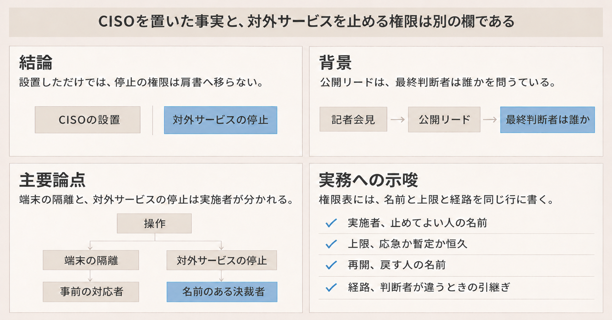
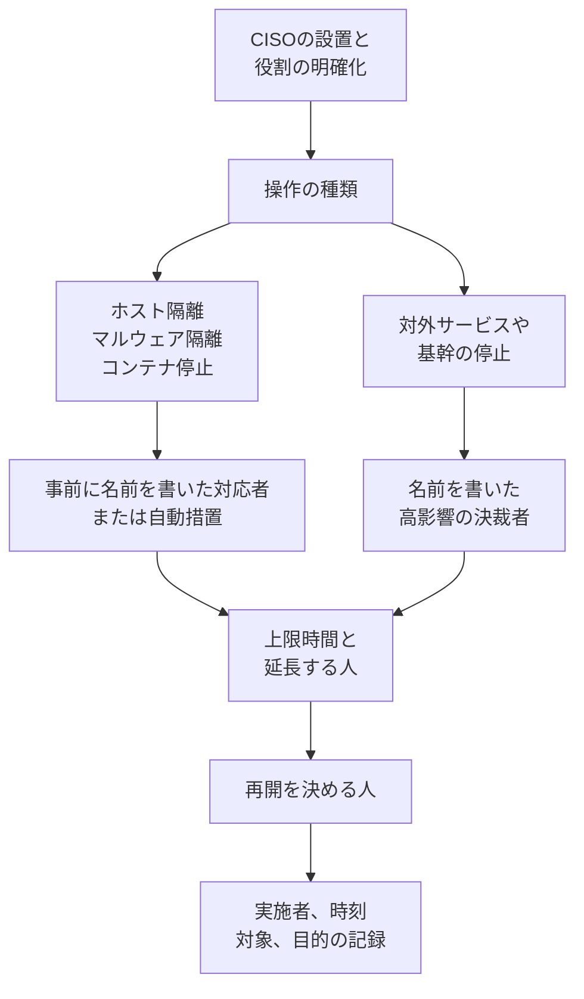

2026年11月17日、日経クロステックの永田雄大記者は、GMOインターネットグループの不正アクセスを巡る記者会見を題材に、日本企業における CISO の位置付けと、有事にサービスを止める最終判断者を扱う記事を書いた。CISO は Chief Information Security Officer の略で、組織の情報セキュリティに責任を持つ役職を指す。

公開リードは、有料の続きの前に無料で読める書き出しを指す。そこには、2026年11月2日の会見で記者が「CISOや専門家の指摘が機能していなかったのではないか」と問うたこと、CISO を置いていても停止の可否と、誰が最終判断を下すのかを考えたいこと、が書かれている。図の説明は、日本企業の CISO 設置率が2026年に57.5%へ伸びたとし、出所を NRI セキュアテクノロジーズとしている。NRI セキュアは、NRI セキュアテクノロジーズを指す。次ページの見出しは「CISOの判断でサービスを停止できるのか」である。

この記事は、その公開部分と、同じ論点を書く公的文書・標準を、権限表に名前を書く作業へ並べる。権限表は、操作ごとに、実施してよい人、上限時間、再開する人を書く表である。手元に残すのは、操作ごとの実施者と、その表の列である。日経本文の2ページ目以降は有料会員限定で、公開リードも、判断者が別にいるという結論までは書いていない。

*この記事の全体像。以下、順に解説します。*

## CISOの設置とサービス停止の権限とは

ここで扱う対象は、CISO という肩書と、有事にシステムやサービスを止める操作を、同じ欄へ書いてよいかという問いである。設置は、役職を置くことである。停止の権限は、どの操作を、誰の名前で、どの上限まで実施してよいかを、別の欄に書くことである。

### 日経クロステックが同じ記事に置いたもの

[日経クロステックの公開部分](https://xtech.nikkei.com/atcl/nxt/column/18/00138/111202148/)は、設置率の図と、停止の最終判断を問う見出しを同じ記事に置いている。題材は、GMOインターネットグループの不正アクセスを巡る2026年11月2日の記者会見である。公開リードが問うのは、CISO や専門家の指摘が機能していたかと、停止の最終判断者は誰か、の二つである。

### 公的文書と標準が書いていること

同じ論点は、次の文書がそれぞれ別の文で書いている。

- 金融庁と日本銀行の2026年5月22日要請（金総政第3245号、金企市第498号、金監督第1384号）は、経営トップが優先サービスや IT システムの能動的な停止をあらかじめ選択肢として検討し、判断基準と手順を組織内で明確にすること、CIO と CISO をはじめとする経営層が対応に直接関与することを書く。CIO は Chief Information Officer の略で、情報システムの責任者を指す。優先サービスは、その要請が IT システムと並べて、停止を検討する対象に挙げるサービスである。能動的な停止とは、止めることを事後の結果ではなく、平時の選択肢として検討しておくことを指す。本文は [金融庁が公開している PDF](https://www.fsa.go.jp/news/r7/sonota/20260522-5/01.pdf) で読める。掲載ページは [金融庁のニュース](https://www.fsa.go.jp/news/r7/sonota/20260522-5/20260522.html) にある。
- [野村総合研究所（NRI）と NRI セキュアの2026年10月22日リリース](https://www.nri.com/jp/news/newsrelease/files/000067194.pdf)は、外部提供サービスと社内システムの停止・再開の判断者と基準を平時に決める支援を説明する。推進委員会は、そのリリースが、停止と再開の判断者と基準を平時に決めるために置く会である。構成には、CEO、CISO、CIO、CFO、IR 担当、法務担当、事業担当役員が並ぶ。CEO は最高経営責任者、CFO は最高財務責任者、IR 担当は投資家向け説明の担当である。社内システムは、そのリリースが外部提供サービスと並べて、停止と再開の判断者を決める対象として書く、組織の内側のシステムである。ニュースの掲載は [NRI セキュアの2026年10月22日](https://www.nri-secure.co.jp/news/2026/1022) にある。
- 経済産業省のサイバーセキュリティ経営ガイドライン Ver 3.0（2023年3月24日公開）は、経営者が CISO 等へ指示すべき事項として、役割と責任の明確化を含む。被害が深刻なときの事業の全部または一部の中断は、検索で確認できた範囲では、経営トップの判断として書かれている。案内ページは [経済産業省](https://www.meti.go.jp/policy/netsecurity/mng_guide.html)、対応する英訳は [ガイドライン Ver 3.0 の英語 PDF](https://www.meti.go.jp/policy/netsecurity/downloadfiles/CSM_Guideline_v3.0_en.pdf) である。
- [NIST SP 800-61r3](https://doi.org/10.6028/NIST.SP.800-61r3)（2025年4月3日公表。本文の版表示は April 2025）は、米国国立標準技術研究所のインシデント対応の指針である。インシデント対応方針には、技術資産を押収・切断・停止できる役割を含める、と書く。リーダーシップは、重要サービスの停止や再構築のような高影響の対応について決定権を持ち得る、と書く。同じ文書は、マルウェアの隔離、侵害された端末の分離、感染したコンテナの停止を、技術が自動で行う設定を検討する、とも書く。PDF は [NIST の公開版](https://nvlpubs.nist.gov/nistpubs/SpecialPublications/NIST.SP.800-61r3.pdf) である。
- テキサス大学リオグランデバレー校（UTRGV）の情報セキュリティ標準 ISO-100-S1（施行2020年2月1日、最終改訂2026年6月5日）は、CISO と、CISO が委任した情報セキュリティ室に、有事のシステム隔離と封じ込めを認める。この ISO は国際規格の番号ではなく、その大学が付ける文書番号である。封じ込めとは、被害をこれ以上広げないために対象を切り離す操作を指す。承認フローによる遅延を禁じる、とも書く。本文は [UTRGV の標準のページ](https://www.utrgv.edu/is/forms-and-policies/policies/ciso-investigative-access-authority-standard/index.htm) にある。

### 文書を読み分けた六つの箱

各文書に出てくる要素は、六つの箱に並べられる。設置、操作の種類、実施者、上限時間、再開する人、記録である。ホスト隔離、マルウェア隔離、コンテナ停止の側と、対外サービスや基幹の側への分岐、および後者の決裁者は、一つの文書が共通図として定めているものではない。ホスト隔離は、端末を切り離す操作を指す。NIST が書く侵害端末の分離は、これと同じ側に置き、別の操作としては扱わない。権限表では、ホスト隔離、マルウェア隔離、コンテナ停止を、対外サービス停止とは別の種類として書く。基幹とは、対外サービスと並べて、名前を書いた決裁者の側に置く IT システムを指す。次の図は、文書の文言を操作の種類で読み分けた配置である。高影響とは、NIST が「重要サービスの停止や再構築」について使う語である。重要サービスは、その文が停止や再構築の対象にしているサービスを指す。

この配置では、設置の箱と、高影響の決裁者の箱を分けている。CISO の名前は、その操作の欄に書いてあるとき、実施者または決裁者の側に入る。金融庁と日本銀行の要請は、CIO と CISO の直接関与を、経営トップによる停止の事前検討と並べて書く。NIST SP 800-61r3 の 2.2 節は、リーダーシップが高影響の決定権を持ち得る、と書く。その文は、決裁者の役職名を CISO とは書いていない。

## 注意点

読者が信じてよい範囲は、見かけの文と、その文が支えている範囲を分けた次の表のとおりである。表の RS.MI-01 や GV.RR-02 は、NIST SP 800-61r3 内の項目名である。C1、C2、R1、R2 は、その項目の中の細目を指す。各行の日本語が、その細目の中身である。低影響とは、対象が端末、マルウェア、コンテナである操作を、この記事が呼ぶ語である。NIST 自身はこの呼び方をしていない。

| 見かけ | 信じてよい範囲 |
|---|---|
| 2026年の CISO 設置率57.5% | 日経クロステック2026年11月17日の図の説明が、出所を NRI セキュアとしてそう書いている、まで。設問の定義は未照合である。NRI セキュアの2026年2月12日ニュース（日本1,263社、米国508社、豪州511社、計2,282社。生成 AI 利用率は日本83.2%、前年度65.3%）にも、NRI の2026年10月22日リリース PDF にも、この百分率は無い。2月12日の社数を57.5%の分母として接続しない |
| 「意思決定の主体は CISO・CIO から CEO と取締役会へ移った」 | NRI と NRI セキュアが2026年10月22日のサービス開始説明に書いた文である。法令の引用ではない。同じ PDF の脚注5が参照する金融庁・日本銀行の要請本文は、主体が CISO から CEO へ移ったとは書いていない |
| 悪用までの期間が2018年の約2.3年から数時間〜1日へ縮んだ | NRI リリース本文が、NRI セキュアの分析として「2018年時点の平均約2.3年」「近年は公開後数時間から1日程度」と書く範囲である。脚注3は、Edgescan「Vulnerability Statistics Report 2026」等に基づく分析であることと、CVE 公開後に実環境で悪用が確認されるまでの期間という定義を示す。CVE は、公開された脆弱性に付く識別子である。数値そのものは脚注には無い。Edgescan の原文は未読である。時間の数値は NRI の記述として扱う |
| 経産省ガイドの「経営トップが中断を判断する」 | 公式 PDF の直ダウンロードは403である。採用したのは、検索インデックスが公式 PDF から抜いた日本語と、英訳 PDF の対応文である。英訳は "Management decisions when the damage is serious" と "it is not permissible to delegate everything to the person in charge" である。段落番号は付けない。付録 F の CISO 権限の細目は未確認である |
| GMO は CISO に停止権限が無かった | 公開の第3報は、停止の実施を書き、決裁者の氏名も CISO の有無も書かない。停止権限の不在を示した文書ではない |
| 通知先が止める権限を持たないと、手順は必ず止まる | 通知先が、実施者でも判断者でもなく、連絡と引継ぎの経路も無いときに限る。経路があれば、通知先と判断者が違っても手順は続く。NIST SP 800-61r3 の項目 RS.MI-01 の C1 は、マルウェア隔離、端末の分離、コンテナ停止を自動で行う設定を検討するよう書く。これらを低影響と呼び、役員決裁が不要だと書くのは、表の直前に書いた読み分けである |
| CISO の肩書には停止系の権限が載らない | 載せる標準は存在する。UTRGV の標準は、隔離と封じ込めを CISO と委任先に書く。対外サービスの停止時間と再開者は書いていない。テキサス州法と、テキサス大学制度の本文は未確認である |

日経本文の2ページ目以降は未確認である。見出し「CISOの判断でサービスを停止できるのか」が、本文でどの結論に着地したかは、この記事の範囲外である。NRI が書く社内システムを、対外サービスや基幹と同じ決裁だと読むのも、この記事の範囲外である。推進委員会の名簿を、権限表の実施者欄へそのまま写すのも、この記事の範囲外である。

権限表の列を書く作業を止めない未確認も残っている。

- 57.5%の設問は、専任か兼務か、取締役か、セキュリティ責任者一般を含むか。有料報告書の本文は未取得である
- 日経本文は、GMO の権限表をどう書いたか
- GMO に CISO という役職があり、その人が10月20日と10月21日の停止を決めたか。公開の第3報はどちらも書かない
- 経営ガイドライン付録 F の細目
- Texas Government Code §2054.136、1 TAC Chapter 202、UT System UTS 165 の本文。UTRGV 標準が根拠に挙げる文書番号だが、公式ビューアの本文は未取得である。番号の正式名称は、本文が無いためここでは展開しない
- 外部の委託先に隔離を許す契約文の実例。NIST SP 800-61r3 の 2.2 節は、第三者との契約に権限と制限を書けと述べる。文例の収集はしていない

権限表に書く実施者の名前と、止める対象は、57.5%の設問定義が公開されるのを待たずに決める。

## 操作の種類で実施者は分かれる

操作の種類で、文書が置いている実施者は分かれる。次の表の「文書が置いている実施者」は、その文書の文言である。低影響という呼び方だけは、前節のとおり、この記事の読み分けである。

| 操作 | 文書が置いている実施者 | 上限の書き方 | 監査 |
|---|---|---|---|
| マルウェア隔離、侵害端末の分離、感染コンテナの停止 | NIST の RS.MI-01 C1 は、技術が自動で行う設定を検討する。R1 は、対応者が手動でも選べるようにする。GV.RR-02 R2 は、責務を果たすのに必要な権限をその人に指定する | RS.MI の注は、数時間で外す応急、2週間以内に外す暫定、恒久、を期間の例にする | 自動でも、誰の設定で動いたかを後から説明できる記録が要る |
| 外部の事業者へ任せる自動の封じ込め（大規模な DDoS などの一部） | NIST の RS.MI-01 C2 は、ISP やクラウド事業者へ自動の封じ込めを授権することを検討する。2.2 節は、契約に「組織に代わって動ける範囲」と「直ちにサービスを止めること」の可否を書け、とする。DDoS は、大量の通信でサービスを使えなくする攻撃である。ISP は、インターネット接続を提供する事業者である | 契約に書く | 契約と連絡経路 |
| 有事の調査アクセス、隔離、封じ込め | UTRGV ISO-100-S1 は CISO と、委任した情報セキュリティ室である。承認フローによる遅延を禁じる | 標準は対外サービスの停止時間を書かない | 実施者、日時、対象、目的。可能な範囲で相互レビューと事後承認 |
| 優先サービスや基幹 IT の能動的な停止 | 金融庁・日本銀行は、経営トップが事前に選択肢として検討し、判断基準と手順を組織内で明確にする。CIO と CISO は直接関与する。NIST の 2.2 節は、リーダーシップが高影響の停止や再構築の決定権を持ち得る（may）と書く | 平時の基準。共同運営とクラウド提供のシステムも同じ | 基準、手順、連絡体制 |
| 被害が深刻なときの事業の全部または一部の中断 | 経営ガイドライン Ver 3.0 の検索で確認できた範囲は、経営トップの判断とする | 状況に応じた判断 | ガイドは、役割と責任の明確化を、経営者から CISO 等への指示に含めている |

### 事前に名前を渡しておく操作

次の三つが揃う操作は、その場の役員決裁へ上げる前に、名前を書いた対応者または自動措置へ渡せる。

- 止める対象が、収益サービス全体ではなく、端末、マルウェア、コンテナである
- 戻す条件と上限時間を、平時に書いてある
- 対応者または自動措置が、その操作の権限を文書で持っている

NIST の RS.MI-01 C1 の自動隔離は "Consider" である。すべての組織が自動隔離を実装済み、という意味には読めない。

### 名前のある経営者の決裁が合うとき

対外サービス、外部提供サービス、対外提供サービスは、顧客へ提供するサービスを指す同じ側の語である。優先業務の IT システムは、金融庁要請の優先サービスと同じく、名前のある決裁者の側に置く。組織の内側のシステム一般は、注意点のとおり、この側とは読んでいない。次の条件では、名前を書いた経営者の決裁が合う。

- 止める対象が、対外提供サービスや優先業務の IT システムである
- 停止が顧客対応、収益、契約、共同運営先へ波及する

NIST の文言が "may" であるように、リーダーシップが常に唯一の経路だとは書かれていない。高影響側を名前で残す読みは、この "may" と、金融庁・日本銀行の要請の⑧から採れる。⑧は、能動的停止の判断基準と手順を自組織で明確にせよ、と書く項目である。この読みは、上の条件そのものではなく、文書が共通して命じる配置ではない。この記事の設計案である。

## 権限表に書く列

最初の知らせを受け取ったあと、誰の名前で何を止め、誰が戻すかを、肩書の種類ではなく操作の欄で書く。最初の知らせとは、インシデントの初期の連絡を指す。

検討した置き方は三つある。

1. 停止はすべて、その場の役員決裁に上げる
2. 端末・マルウェア・コンテナの封じ込めは事前の委譲または自動、対外サービスや基幹の停止は名前のある経営者、と分ける
3. CISO の肩書を、停止の承認者と同一視する

採るのは2である。これは、文書が共通して命じる配置ではない。この記事の設計案である。3は、標準や表がその操作を CISO の名前で書いているときだけ、2の中に入る。1は、NIST が検討を勧める自動の封じ込め（マルウェア隔離、端末の分離、コンテナ停止）とずれる。NIST はその操作を低影響とは呼んでいない。

表の列は次のとおりである。

1. 対象のサービスまたは機能
2. 「止める」の意味。ホスト隔離、マルウェア隔離、コンテナ停止、対外サービス停止、のどれか
3. 実施してよい人の名前と、不在時の名前
4. 上限時間。NIST の例に合わせ、数時間で外す応急、2週間以内の暫定、恒久、のどれか
5. 延長してよい人の名前
6. 戻す判断をする人の名前
7. 記録。実施者、時刻、対象、目的
8. 自動で動く場合の、人が覆す条件
9. 法務へ上げる条件。訴訟、警察、対外開示が近いとき

最初の通知は、最初の知らせと同じ連絡を指す。実施者、判断者、連絡先を分けて書く。実施してよい人は3の名前である。止める判断をする人が実施者と違うときは、列は足さず、同じ行に判断者の名前と引継ぎの経路を書く。列6は、戻す判断をする人である。経路が無いとき、通知だけでは判断に届かない。CISO が3の名前になる条件は、この表か、UTRGV 型の職務標準が、その操作をその人に書いていることである。

この表を肩書だけで書くと、代理と不在のときに止まる。自動隔離に記録が無いと、誰が止めたかを後から説明できない。採る置き方は、対外サービスと基幹の停止を名前のある経営者に残す方である。当番の技術者へ事前に渡すのは、その置き方を採らない場合である。その場合は、影響範囲と承認条件を方針に書く。NIST の 2.2 節は、その委譲を禁じていない。2.2 節はリーダーシップが決定権を持ち得ると書き、2.3 節は停止できる役割を方針に定めよと書く。

金融庁・日本銀行の要請の主題は、金融機関等における、最先端の AI に伴う、公開から悪用までの期間が短い脆弱性への対応である。この記事が使う⑧は、その要請の中で、能動的停止の判断基準と手順を自組織で明確にせよと書く項目である。全産業の法令として読まない。

次の条件が後から揃うと、2の置き方は覆る。

- 自社の職務規程が、対外サービスの停止と再開を CISO の名前で、時間と対象つきで書いている
- 57.5%の設問定義が公開され、その定義が「停止権限を持つ役員」を測っていた。現時点の公開部分はその定義を含まない

次に書くのは、三つである。

1. 止まってよい対象を、対外サービスと、端末・コンテナの隔離に分ける
2. それぞれに、実施者、上限時間、再開者の名前を書く
3. 最初の知らせの宛先に、実施者、判断者、引継ぎの経路を書く

## 設置だけでは対外サービスの停止権限は肩書へ移らない

CISO を設置した事実だけでは、対外サービスを止める権限がその肩書へ移ったとは読めない。前節の設計案では、権限表を操作ごとに分け、封じ込めは事前に名前を書いた対応者または自動措置へ渡し、対外サービスや基幹の停止は名前を書いた経営者に残す。NIST はリーダーシップがその決定権を持ち得ると書き、金融庁・日本銀行は判断基準と手順を組織内で明確にせよと書く。どちらも、決裁者を経営者の肩書に固定してはいない。CISO がその欄の名前になるのは、表または職務標準がその操作を書いているときである。

この読みを支える文書は、次のとおりである。

- 金融庁・日本銀行の⑧は、能動的停止の判断基準と手順を自組織で明確にせよ、と書き、決裁欄を CISO の肩書一言では埋めていない。前文は CIO と CISO の直接関与を求めている
- NRI の2026年10月22日 PDF は、平時に確定する事項として「外部提供サービスや社内システムを停止・再開する判断者と基準」を挙げている。リリースはこれを3点のうちの3点目として書く。1点目と2点目は、この記事の根拠には使わない
- NIST の 2.3 節は、どの役割が押収・切断・停止できるかを方針の要素にする。2.2 節の高影響の決定権は "may" で、CISO とは書いていない
- UTRGV の隔離権限は、CISO の設置そのものではなく、ISO-100-S1 という別紙に書いてある

反対側から見ると、次の限界がある。

- 国内の金融・重要インフラや海外の業法で、対外サービスの停止権限を CISO の職務規程に明示した一次例は、公開検索の範囲では見つかっていない。見つかったのは大学の隔離標準である。一般化は「設置だけでは移ったと読めない」までに留める。「CISO は止められない」には進まない
- 「役員決裁を待ったために被害が拡大した」と因果を特定した一次事例は、今回参照した公開資料の範囲では見つかっていない
- GMO の公開記録は、この因果の実例にならない。[第3報](https://group.gmo/info/alert/20261023/)（2026年10月23日16:10時点）は、10月19日に顧客問い合わせで調査を始め、10月20日に不正プログラムを確認して新規申し込みとコントロールパネルを止め、10月21日4:00に全プランのサーバーを順次止めた、と書く。影響の可能性があるサーバーは26,739件で、確認済みの侵害件数ではない。再開時期は未定である
- 会見の二次報道は、別の失敗を伝える。[＠IT の2026年11月3日の記事](https://atmarkit.itmedia.co.jp/ait/articles/2611/03/news014.html)は、2024年4月24日の指摘が事業側には届きグループ代表には届いていなかったこと、代表がエスカレーションの不備を自らの責任と述べたこと、2026年8月5日の侵入から10月20日の検知までの経過、を会見の説明として書く。議事録そのものではない。金額や補償額は、第3報で再確認していないため、ここでは使わない

57.5%と、NRI の「主体が CEO と取締役会へ移った」という文を、設置すれば停止権限も移る、または移らない、という一般命題の根拠にはしない。両方とも、前の注意点の範囲を超えない。

## まとめ

CISO を置いた事実と、対外サービスを止める権限は、別の欄である。端末、マルウェア、コンテナの封じ込めは、戻す条件と上限時間を書いたうえで、名前のある対応者か自動措置へ渡す。対外サービスと基幹の停止は、名前のある決裁者、上限、再開する人、記録を平時に書く。最初の通知では、実施者、判断者、引継ぎの経路を同じ行に残す。設置率57.5%と、主体が CEO へ移ったという説明文は、その欄を埋める根拠にはしない。

この記事が少しでも参考になった、あるいは改善点などがあれば、ぜひリアクションやコメント、SNSでのシェアをいただけると励みになります！

## 参考リンク

- 日経クロステック（公開部分）: https://xtech.nikkei.com/atcl/nxt/column/18/00138/111202148/
- GMOインターネットグループ 第3報: https://group.gmo/info/alert/20261023/
- 金融庁・日本銀行 要請 PDF: https://www.fsa.go.jp/news/r7/sonota/20260522-5/01.pdf
- 金融庁 掲載ページ: https://www.fsa.go.jp/news/r7/sonota/20260522-5/20260522.html
- NRI・NRIセキュア 2026年10月22日 PDF: https://www.nri.com/jp/news/newsrelease/files/000067194.pdf
- NRIセキュア 掲載: https://www.nri-secure.co.jp/news/2026/1022
- NRIセキュア 実態調査2025ニュース（2026年2月12日）: https://www.nri-secure.co.jp/news/2026/0212
- 経済産業省 ガイドライン案内: https://www.meti.go.jp/policy/netsecurity/mng_guide.html
- ガイドライン英訳 PDF: https://www.meti.go.jp/policy/netsecurity/downloadfiles/CSM_Guideline_v3.0_en.pdf
- NIST SP 800-61r3: https://doi.org/10.6028/NIST.SP.800-61r3
- NIST PDF: https://nvlpubs.nist.gov/nistpubs/SpecialPublications/NIST.SP.800-61r3.pdf
- UTRGV ISO-100-S1: https://www.utrgv.edu/is/forms-and-policies/policies/ciso-investigative-access-authority-standard/index.htm
- ＠IT（会見の二次報道）: https://atmarkit.itmedia.co.jp/ait/articles/2611/03/news014.html
