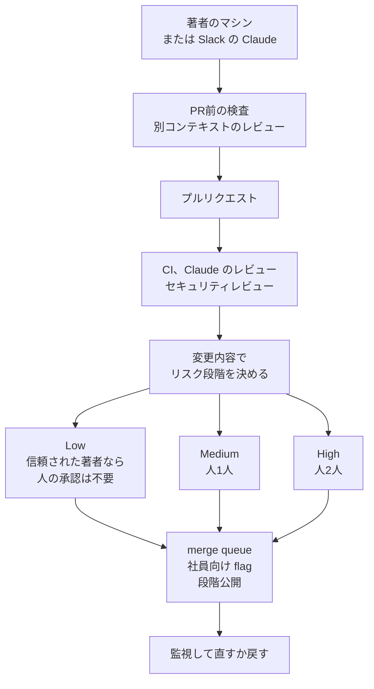

2026年10月15日、Addy Osmani、Morgan Westlee Lunt、Qing Wang が [How the Claude Code team does code review](https://claude.dev/blog/solving-code-review-at-anthropic/) を公開しました。
対象は Claude Code の CLI、デスクトップ、Web、モバイルのリポジトリです。

この記事では、変更が通る検査の層、人の承認が残る条件、公開の Code Review で同じ問いに沿って組める範囲を整理します。
掲載された倍率と割合は同社の自己申告で、件数の台帳は記事に付いていません。

*この記事の全体像。以下、順に解説します。*

## Claude Codeチームのコードレビューとは

Claude Code チームのコードレビューは、エージェントが書く量の変更を、自動の層とリスクに応じた人の承認で検査する流れです。
完了の問いは、人がそのコードを読んだか、から、その変更で何が壊れ、自動と人のどちらが捕まえるべきか、へ移したと本文が書いています。

本文の文は次のとおりです。

> We think "did a human read the code?" is an imprecise proxy for "what could go wrong with this change, and which check—automated or human—is the right one to catch it?"

読む作業の多くは機械に移し、人の時間は人にしかできない判断へ残し、誤りは速く戻せるようにした、という構成です。
レビューの仕事は二つで、出荷前に問題を見つけて直すことと、コードベースの理解をチームに広げることです。
記事の主眼は前者です。

### PR の前に動く検査

レビューは、pull request を開く前の検査も含みます。
多くの変更は、人が見る前に Claude が少なくとも一度は見て直している、と本文が書いています。

PR 前の層では、テスト、ビルド、デザインとのスクリーンショットなど、Claude が実行して出力を見せられる検査を渡します。
別コンテキストの subagent が diff を見ます。
UI の変更は、デザインの指針とも照合します。

### すべての PR に付く自動レビュー

すべての PR に Claude のレビューが付きます。
diff をリポジトリ全体と、PR が述べた意図に照らして読みます。
複数のエージェントがバグを探し、別グループが投票し、同意が揃った指摘だけが投稿されます。
スタイル、診断、cleanup だけの指摘は落とします。
残った指摘はインラインコメントになり、重大度は Important、Nit、Pre-existing です。
Pre-existing は、その PR より前からコードベースにあったバグです。

セキュリティは別の自動レビューです。
バグレビューかセキュリティレビューの指摘が開いたままだと、マージできません。
直すか、短い理由でスレッドを閉じます。
偽陽性を消す手順は、理由を書いてスレッドを閉じることです。
後のコミットが問題を直すと、指摘は自ら消えます。

必須の CI は、lint、型、各プラットフォームのテスト、ビルドです。
PR テンプレートは、どうテストしたかと、どう戻すかを問います。
Claude がその欄を埋められます。
変更を頼んだ人が、その内容にサインします。

### 変更の内容で決まる人の承認

リスク段階は、変更の内容が決めます。
著者の職位は、段階の入力にしません。
docs の修正と auto-updater の変更は、別のレビューになります。

| 段階 | 例 | 人の承認 |
| --- | --- | --- |
| Low | docs、copy、社内限定、flag の背後の追加変更 | 自動レビューとセキュリティが緑なら不要 |
| Medium | 通常の製品変更。caching、auto-updater、system prompts などの敏感な領域 | 1人 |
| High | 最高リスクのコード。常に2人が要る少数のパス | 2人 |

分類器が段階を選びます。
別の分類器が、段階上は不要でもこの変更には人が要るかを問います。
所有者が敏感だと列挙したパスと、CI の workflow ファイルは、常に人が要ります。

軽い経路は、そのリポジトリの信頼リストに入った著者だけが使います。
リストの中心は、そのリポジトリを持つチームです。
リスト外は、二人目の人が要ります。
エージェントの承認は、人の枠に入りません。
自動レビューは低リスクの変更を通せます。
人を求める枠は、自動レビューでは埋まりません。

エージェントに書かせた PR では、指示した人が、必要なレビュアーの一人に数えます。
自分で打鍵した場合と同じ数え方です。
承認は、特定のコミットに結びます。
システムが保証できない新しいコミットが乗ると、承認はやり直しになります。
例は、エージェントの push と、人が手で解消した merge です。
ボットの承認で、必要な人の承認を置き換えません。

### merge queue、flag、戻し

merge queue は、main にその変更を当てた状態で検査をやり直します。
別々に通った二つの PR が、重なったときに壊れた main を作るのを防ぎます。
新しい挙動は、まず社員向けの flag に出します。
社内の利用が、利用者の前に回帰を出すことが多い、と本文が書いています。
公開は `latest` が先で、`stable` は遅れます。

図が積む6層は、検証、必須 CI、AI レビュー、セキュリティレビュー、人の承認、merge queue と flag です。
各層は別の穴を持ち、すり抜けたものは次の層が受けます。
本文の節は、監視して直すか戻す段を7番目に数えます。
flag はデプロイなしで切れます。
週次のオンコールがあり、インシデントの振り返りは、どの層が捕まえるべきだったかを問います。

### 繰り返しの指摘と、再レビューの上限

同じ指摘が続くときは、スキル、lint、`CLAUDE.md`、所有者が書く `REVIEW.md` へ戻します。
`CLAUDE.md` は、スタック、規約、目標、対象外を短く持ち、すべてのレビューが読みます。
`REVIEW.md` は、その領域で失敗がどう見えるかを書きます。
良いものは短く、nit の上限、スキップするパス、ファイルと行の証拠を求めます。
レビュアーがそれに従っているかは、別に確認します。

インシデントを起こした過去の PR と、その fix-forward と revert は、そのコードを知るエンジニアがバグと場所を確認したうえで、レビュアーの日次評価セットに入ります。
レビュアーのプロンプト、ツール、モデルを変えたときは、そのセットで採点し直します。

再レビューは収束させます。
エージェントの著者とエージェントのレビュアーは、止めなければ往復を続けます。
一晩で50ラウンドを超えた CLI の PR があり、人が止めました。
繰り返し指したコードの約59%は、レビュアーの最初のパスの時点で既にありました。
本文は、後のラウンドの中心を、その時点から残っていたコードへの追加の指摘だ、と書いています。
チームは、危険な変更では複数ラウンドに意味があるとし、すべての PR の既定からは外した、と書いています。

変えた規則は四つです。

- 3ラウンドのあと、レビュアーは著者に方針の見直しを求めます。
- 最初の数回のあとは、新しい diff だけを見ます。
- 指摘は種類で出し、同じ種類をまとめて直させます。
- 既出の指摘は繰り返しません。

指摘のノイズは、著者がエージェントだと高くなります。
人は数秒で流せる指摘を、エージェントは直してしまい、別のコミットと別のレビューになります。
コメントは、直した、誤りだと答えた、意図した挙動だと答えた、重要ではないとした、の四つで見ます。
優先順位は、本物のバグを先に捕まえ、レビューのラウンドを次に減らす、と書いてあります。

### 人が残す五つの判断

本文が挙げる判断は五つです。

| 判断 | 本文が置く中身 |
| --- | --- |
| 作るべきか | 方向、好み、範囲。チーム外からの変更には、やるべきかを人が問う例がある |
| 危険なコードか | 課金、自動更新、CI の workflow |
| 他が真似る設計か | ほかがコピーするパターンになる構造 |
| 検査の証拠を読めるか | テスト出力、実行したコマンドと結果、スクリーンショット、レビュアーの指摘 |
| 結果を引き受けるか | 誰が打鍵しても、出荷した変更の責任は人にある |

検査が何を見逃すか言えないときは、本レビューを求める、と本文があります。

理解を広げる第二の仕事では、必要な切片を、今のコードのまま Claude に説明させます。
説明は数分で、その日のコードを反映します。
1行の copy 修正を行単位で読むことと、これから変えるモジュールの説明を読むことを、本文は比べています。
開いた Slack チャネルで作業する文化も、ほかが作っているものを見る経路だと書いています。

### 着陸した人が直す

小さいか中くらいの変更を着陸させた人が、壊れたら直す、というのがチームの規範です。
前提は五つです。

- 変更が小さく、レビューとデバッグと revert がしやすい。
- flag、revert、段階公開で、多くの誤りを数分で戻せる。
- 被害半径が大きいコードには、人と検査を足す。
- 社内利用と計測で、回帰が早く出る。
- 責任は、文脈を持っている人が直す、という意味です。インシデントの振り返りは仕組みを見ます。

コードを書くのが速いので、PR を閉じることを損失と感じにくい、と本文が書いています。
別の方向は、スレッドの早い時点で出します。

## 人の時間をどう数えるか

人の時間には、レビューに使う時間と、壊れたコードを直す時間が入ります。
前者を削って後者に現れた分は、節約の外に置きます。

目標は、ほとんどの PR がループ内の人を最大1人にしてマージされ、その1人は著者でもよく、revert とインシデントは増えない、です。
対象リポジトリは、CLI、デスクトップ、Web、モバイルです。
測るものは、PR あたりの人の承認回数の中央値と95パーセンタイル、人のコメント、人が待つ時間です。
revert 率とインシデント率はガードレールです。
上がったなら、人の時間は後ろへ移動しただけだ、と本文が書いています。
この中央値、95パーセンタイル、インシデント率の実数は、記事にありません。

## 公開の Code Review で組める範囲

2026年10月15日、Code Review は研究プレビューを出て、Team と Enterprise で一般提供になりました。
一般提供の記事は、プレビュー中の約20分が 6–10 分になり、おおよそ3倍速くなった、と書いています。
Quick、Standard、Deep はリポジトリごとに選びます。
Standard が既定です。
組織の Owner が組織のレベルを選び、リポジトリごとに上書きできます。

2026年10月18日に取得したドキュメントでは、ホスト型レビューは Anthropic の基盤で4段です。
並行して探し、候補をコードと照合して偽陽性を落とし、重複を除いて重大度で並べ、PR に投稿します。
投稿されるのは、行へのコメント、レビュー本文の要約、`Claude Code Review` という名前のチェックです。
チェックは失敗で終わりません。
何も見つからなかったとき、チェックの題は `Code review found no issues` です。
レビューは diff と周囲のコードを読み、ビルドも実行もしません。
リポジトリへの書き込みは読取専用で、レビューがコミットを push することはありません。

`REVIEW.md` は、base か default ブランチから読みます。
PR 自身の変更からは読みません。
ローカルの `/code-review` は別物で、どのプランでも、自分のセッションの中で動きます。

使える条件は、Team または Enterprise、GitHub 上のリポジトリ、組織の Owner による有効化です。
GitHub Enterprise Server と、データ居住の GitHub Enterprise Cloud も、コードのホストとしては手順があります。
レビューの処理は Anthropic の管理環境で動き、セルフホスト環境では動きません。
Zero Data Retention、HIPAA 構成、顧客管理の暗号鍵（CMEK）では使えません。
BAA の対象でもありません。
開発者が Bedrock、Google Cloud、Microsoft Foundry 経由で Claude Code を使っていても、Code Review には Claude の組織プランが要ります。

管理画面から足したリポジトリの初期は、push のたびにレビューが走る設定です。
ほかに、PR を開いたとき一度だけ、と、`@claude review` の要求時だけ、があります。
下書きと fork からの PR は、自動レビューをスキップします。
書き込み権限のある人が `@claude review` とコメントすると、1回のレビューが始まります。

課金は、プランの込み枠とは別の usage credits です。
定額の1回単価は、2026年10月18日に取得した料金文書にはありません。
費用は、レビューの深さ、変更の大きさ、周囲のコード、検証する候補の数、レビューが走る回数で動きます。
支出上限、組織の支出上限、クレジット残高のどれかが尽きると、レビューはスキップされます。
1回分の見込み費用を下回った残りでも、スキップされます。
スキップ時は、原因と設定へのリンクが PR に付きます。

マージを止めるゲートは、製品のチェック自身にはありません。
ドキュメントは、自前の CI がチェック出力の `bughunter-severity` 行を読み、JSON の `normal` が1以上ならジョブを失敗させてよい、と書いています。
`normal` は Important の件数で、まだ開いている過去のレビューの指摘も含みます。
その行が無い完了は、指摘ゼロと扱わず、判定無しと扱います。
失敗、時間切れ、取消、新しいレビューに置き換わったチェックには行が無く、完了したレビューの一部にも行が無い、とドキュメントが書いています。
これは利用側が組む検査です。

2026年3月9日の研究プレビューの発表は、次の数字を当時の社内運用として書いています。
変更1,000行超の PR は84%に指摘があり、平均7.5件でした。
50行未満は31%で、平均0.5件でした。
incorrect とマークされた指摘は1%未満でした。
同じ発表は、実質的なレビューコメントが付く PR が16%から54%になった、と書き、承認は人の仕事のままだと書いています。
当時の平均費用は、おおよそ15から25ドルでした。
2026年10月15日の一般提供記事と、2026年10月18日の料金文書は、この平均を再掲していません。
一般提供の「少なくとも1万ドル」のクレジットは、対象の Enterprise が 2027年1月15日までに請求し、請求から30日で消えます。

## 注意点

信じてよい範囲は、Claude Code チームが自リポジトリについてそう書いた、までです。
レビュー方式を変えたことが原因で revert が減った、という証明には、記事の数字はなっていません。

同じ週に並ぶ公式の数字は、母集団が三つあります。

| 文 | どこに書いてあるか | 母集団と時点 | 置いていないもの |
| --- | --- | --- | --- |
| マージされた pull request が2倍超。revert された割合が40%超減 | 2026年10月15日の Claude Code 記事の冒頭 | Claude Code のコードベース。2026年6月から9月 | 開始と終了の件数。revert の操作定義。インシデント率。fix-forward との内訳 |
| 1日にマージする変更が約2,500から3万超 | 2026年10月13日のソースコントロール記事。Claude Code 記事はそこへリンクして要約する | Anthropic の monorepo。2026年5月の平均と、9月時点 | Claude Code リポジトリの件数ではない |
| 実質的なレビューコメントが付く PR が16%から54% | 2026年3月9日の Code Review 研究プレビュー。10月の記事は開始時の数字として参照する | Anthropic が Code Review を乗せた PR。研究プレビュー開始時 | バグ捕捉率でも、revert 割合でもない |

図の説明文には、収束の変更の前後で、1ラウンドで通る内部 PR が65%から78%、5ラウンド以上が8.9%から1.5%、通るまでの平均レビューが2.08から1.32、とあります。
この三つの数は本文の段落には無く、計測期間もキャプションにありません。
品質が上がった証拠として、本文の revert 割合と足し合わせません。
84%、7.5件、31%、0.5件、incorrect 1%未満は、2026年3月9日時点の数字で、6月から9月の revert 割合とは時期も指標も違います。

「コードの約90%を Claude が書く」は、この記事では以前にも言った、とあり、測り方が定義されていません。
作成者の Boris Cherny は 2026年10月16日、残りを誰が書いているかへの返信で、残りも Claude だが、帰属を自信を持って言う前に直している、と書いています。
[When AI builds itself](https://www.anthropic.com/institute/recursive-self-improvement) は、2026年5月時点で、本番へマージした行のうち Claude に帰属できたものが80%超だとし、行数は量であって質ではないと書いています。
同じページの脚注は、経営陣がスクリプトと実験コードを含めて90%以上と公に見積もった、と書いています。
80%超は会社のコードベースへマージした行の帰属で、Claude Code リポジトリの「約90%」とは別の測り方です。
2026年1月2日、Cherny は検証のループがあれば最終結果の質が2倍から3倍になる、と見積もっています。
10月の記事はその投稿を引いています。
実験表はありません。

公開の Code Review を有効にすることは、社内の Low 行を輸入することにはなりません。
製品は指摘を投稿し、承認は出しません。
2026年10月15日の記事は、自リポジトリが低リスクを自動検査だけでマージさせるところまで進んでいる、とその差を分けています。
指摘へ答えなくても、リポジトリ独自の規則が無ければマージできます。

revert 割合を下げうる別の動きも、同じ記事のなかにあります。
変更を小さく割ること、低リスクの docs や copy が増えること、欠陥の始末が revert から fix-forward へ寄ること、取り消しを速くしたことです。
記事は、これらの寄与をレビューゲートの変更と分離していません。

悪いマージに気づくのは、著者とオンコールと、revert およびインシデントのダッシュボードです。
revert やインシデントが動いたときに承認を厳しくするサーキットブレーカーは、2026年10月15日の時点ではまだありません。
本文は、ゼロ人マージをこれ以上広げる前に、その仕組みが欲しい、と書いています。
理解を広げる第二の仕事に、正式なプロセスは無い、と本文が書いています。

ソースコントロール記事は、monorepo では業界標準のグローバルロック付き merge queue を再現できず、マージ後とデプロイ前の自動テストへ寄せた、と書いています。
同じ記事は、そのシステムの変更要求をチームの人がまだ全件見ており、見る対象は全行から意図へ移った、と書いています。
1日3万件超は、Claude Code のレビュー記事の稼働点ではありません。
同じ記事は、他の事業が同じだけトークンを使いたくはない、とも書いています。
主題は Scion で、Claude Code のレビュー手順そのものではありません。
多層の自動レビューを同じ密度でコピーする前提にはなりません。

2026年10月18日時点で、人の承認を減らした前後の同じ倍率と revert 割合を、他社が自社の一次データとして出した報告は、参照した範囲では確認できません。
確認できないことは、存在しない証明にはなりません。

Simon Willison は 2026年10月16日、代理指標の段落を引用しています。
同じ人は 2026年3月4日から、自分でレビューしていないコードの PR を協力者に出すことをアンチパターンとして書いており、10月16日の引用ページはその章を撤回していません。
公式が粗いと言ったのは、チームの完了条件としての閲読です。
提出者が動作を確かめることまで不要だ、とは10月の記事は書いていません。
二つの文の対象は違います。

2026年10月15日の記事が埋めていない問いは、次のとおりです。

- revert された割合の分子、分母、対象リポジトリの内訳。
- 2026年6月から9月のインシデント率と、fix-forward の件数。
- 人の承認がゼロだった PR の割合と、リスク分類器の誤分類。
- 図の収束率の計測窓。
- 一般提供後の、レビュー1回あたりの現行の費用。
- Claude Code リポジトリの「約90%」を、行の帰属で数え直したときの値。

これらが埋まらなくても、完了条件の文とリスクの表は引用できます。
埋まったあとも、倍率は変化の規模であり、レビュー方式だけの成果ではありません。
他の運用変更と分けた比較が無い限り、成果の証明にはしません。

## 自チームに持ち帰る単位

持ち帰る単位は、変更で壊れうること、それを捕まえる自動検査、人の枠、戻し方、の4列です。
人のレビューは、全件の既定から、自動検査が捕まえない種類へ移す、という公式の問いに沿います。
全件を無承認にする処方には沿いません。

次の表は、公式の3段階をその4列に落とした例です。

| 壊れうること | 自動検査 | 人の枠 | 戻し方 |
| --- | --- | --- | --- |
| docs、copy、社内限定、flag の背後の追加 | 自動レビューとセキュリティが緑 | Low かつ信頼リスト内なら不要。リスト外は人2人目 | 再マージ。flag が無い変更は戻し方を PR に書く |
| 通常の製品変更。caching、auto-updater、system prompts | テスト、ビルド、自動レビュー | 人1人。指示した人がその一人に数える | flag、revert、段階公開。数分で戻せる前提 |
| 課金、CI の workflow、所有者が敏感と列挙したパス | セキュリティレビューを含む自動検査 | 常に人。High のパスは人2人 | 承認は新しいコミットで破棄する |

引用してよい核は、代理指標の1文と、リスク3段階の表と、エージェントの承認は人の枠に入らない、という文です。
出典は、2026年10月15日の記事、著者3名、URL まで書きます。

6月から9月の「2倍超」と「revert 割合が40%超減」は、公式の冒頭にある自己申告として書けます。
絶対数が無く、revert の定義が無く、インシデント率は非公開で、因果は分離されていない、と同じ段落に置きます。
monorepo の1日約2,500から3万超、コメント率16%から54%、本番行の80%超は、別の行に分けます。

公開の Code Review は、指摘を PR に付ける層として書けます。
マージを止める層としては書きません。
止めるなら、ドキュメントのとおり自前の CI で Important 件数を見て失敗させ、行が無い完了は指摘ゼロと扱いません。
実行で確かめる層は、製品の外に、テストかビルドかスクリーンショットとして別に置きます。
段階は厳しく始め、revert とインシデントを見ながら緩めます。
その数値が動いたときに承認を戻す仕組みが無い間は、無承認の範囲を広げる根拠にしません。

同じ一次記事が、判断材料として同時に置いているものは四つです。

- 代理指標の文、リスクの表、エージェントの承認は人に数えない、という規則。
- 人の時間が減ったかの判定に、レビュー時間だけでなく、壊れたものを直す時間を入れていること。ガードレールが上がったら節約ではない、という書き方。
- 公開製品が承認を出さないこと。10月の記事がその差を隠していないこと。
- ラウンド上限、差分だけの再レビュー、既出指摘の禁止、日次の評価セットが、冒頭の数字と同じ記事にあること。

公式が revert の定義と絶対数とインシデント率を同じ期間で出しても、見えるのは変化の規模です。
レビュー方式への帰属には、変更を小さくしたこと、fix-forward、戻しの速さといった他の運用と分けた比較が別に要ります。
公開製品が未解決の Important を既定でマージ不能にした場合は、自前 CI の段を書き換えます。

## まとめ

Claude Code チームは、レビュー完了の基準を、人がコードを読んだか、から、その変更で何が壊れ、どの検査が捕まえるか、へ移したと書いています。
人の承認は、変更のリスクと信頼リストで残り、エージェントの承認は人の枠に入りません。
6月から9月の倍率と revert 割合は、定義と絶対数の無い自己申告として読み、レビュー方式だけの成果としては扱いません。
公開の Code Review は指摘を PR に付け、マージを止めるのは自前の CI かリポジトリの規則です。
無承認の範囲は、revert とインシデントが動いたときに承認を戻す仕組みが記事の時点で無いので、広げません。

この記事が少しでも参考になった、あるいは改善点などがあれば、ぜひリアクションやコメント、SNSでのシェアをいただけると励みになります！

## 参考リンク

- Addy Osmani, Morgan Westlee Lunt, Qing Wang. [How the Claude Code team does code review](https://claude.dev/blog/solving-code-review-at-anthropic/). 2026-10-15.
- Anthropic. [Redesigning source control at Anthropic](https://www.anthropic.com/engineering/redesigning-source-control). 2026-10-13.
- Anthropic. [Bringing Code Review to Claude Code](https://claude.com/resources/articles/code-review). 2026-03-09.
- Anthropic. [Code Review is now generally available](https://claude.com/resources/articles/code-review-is-now-generally-available). 2026-10-15.
- Anthropic. [Code Review](https://code.claude.com/docs/en/code-review). Claude Code Docs. 2026-10-18 取得.
- Anthropic. [Read and request reviews on a pull request](https://code.claude.com/docs/en/code-review-pull-requests). Claude Code Docs. 2026-10-18 取得.
- Anthropic. [Code Review costs and usage](https://code.claude.com/docs/en/code-review-costs). Claude Code Docs. 2026-10-18 取得.
- Anthropic Institute. [When AI builds itself](https://www.anthropic.com/institute/recursive-self-improvement).
- Boris Cherny. [検証ループの見積もり](https://x.com/bcherny/status/2007179861115511237). 2026-01-02.
- Boris Cherny. [残り10%の帰属についての返信](https://x.com/bcherny/status/2111207278653399460). 2026-10-16.
- Simon Willison. [代理指標の引用](https://simonwillison.net/2026/Oct/16/code-review/). 2026-10-16.
- Simon Willison. [Anti-patterns: things to avoid](https://simonwillison.net/guides/agentic-engineering-patterns/anti-patterns/).
- Simon Willison. [アンチパターン章の告知](https://x.com/simonw/status/2029260505324412954). 2026-03-04.
- Simon Willison. [Your job is to deliver code you have proven to work](https://simonwillison.net/2025/Dec/18/code-proven-to-work/). 2025-12-18.
