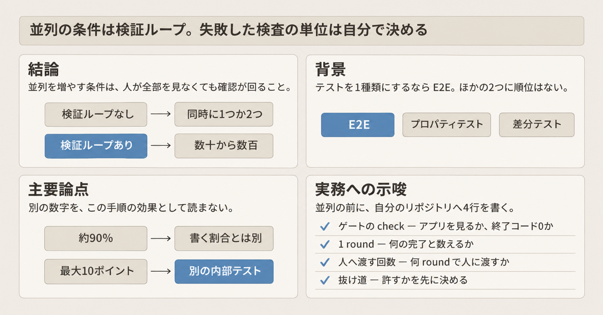
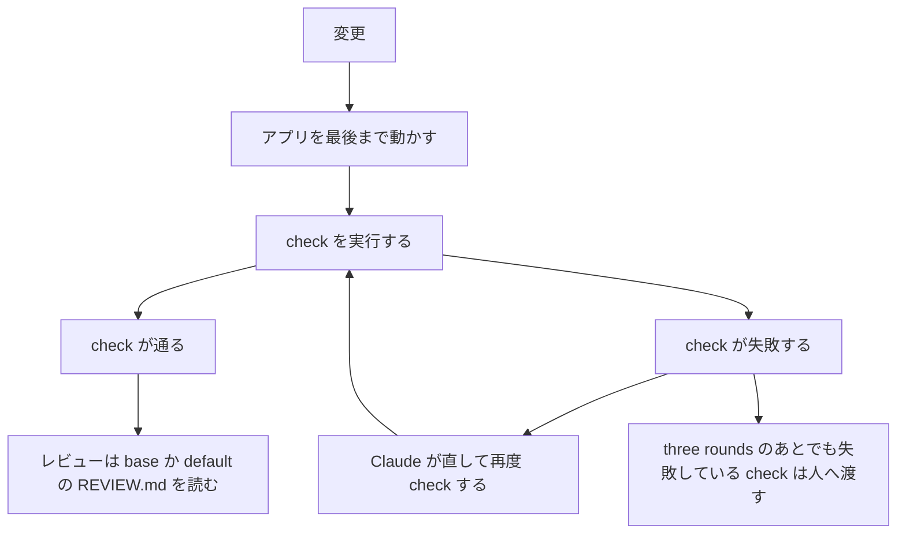

Addy Osmani が 2026-11-16 に claude.dev で公開した [How the Claude Code team thinks about verification](https://claude.dev/blog/how-the-claude-code-team-thinks-about-verification/) は、Claude Code チームが変更を証拠で確認するときのテストの選び方と、確認が失敗したときの人への渡し方を書いています。肩書は Member of Technical Staff です。出典は、チームの運用を著者本人が書いた文章です。

この文章では、チームが書いている検証の手順を整理します。そのあと、エージェントへ任せる作業を増やす前に、自分のリポジトリへ書く項目を置きます。ここでの Claude は、Claude Code 上で変更を書くエージェントを指します。

*この記事の全体像。以下、順に解説します。*

## Claude Codeチームの検証とは

Claude Code チームの検証とは、変更を証拠で確認するときのテストの選び方と、確認が失敗したときの人への渡し方です。エージェントに検証の手段を持たせます。テストを1種類だけ選ぶなら E2E を選びます。プロパティテストと差分テストにも投資します。まだ失敗している check が three rounds 続いたら、Claude が止めて人を呼びます。

check とは、変更に対して実行し、失敗したら Claude が直す検査です。three rounds とは、その失敗が続いたときに人へ渡す、と検証の記事が書いている回数です。1 round が、修正1回か、check の実行1回か、レビューの往復1回かは、検証の記事は定義していません。この候補は、検証の記事が round の単位として書いていないものです。

### 検証ループと同時に走らせる数

検証ループとは、人が変更の全部を見なくても確認を回せる仕組みを、検証の記事が並列の条件として呼んでいるものです。検証ループが無いときは、人が全部を見るので、同時に走らせられる Claude は1つか2つに限られる、と検証の記事は書きます。検証ループがあると、数十から数百を並列にできる、と書きます。

### 投資するテストは3種

投資する価値があるテストとして、検証の記事は E2E、プロパティテスト、差分テストの3種を挙げます。1種類に絞るなら E2E を選べ、と書きます。3種はいずれも投資に値する、とも書きます。

E2E は、ユーザーの一連の操作を表します。機能全体が動くか動かないかが、終わる条件になります。実行中のアプリを skill で起動し、CDP、シミュレータ、API ハーネスで見ます。CDP、シミュレータ、API ハーネスは、検証の記事が手段の名前として挙げるだけで、中身は定義していません。skill とは、Claude Code に渡す手順書です。検証の記事は、起動手順を関係するコードの近くの `.claude/skills/` に、verify という skill として置く、と書きます。

プロパティテストは、壊れてはいけない文を書き、fast-check、Hypothesis、proptest などで多数の入力を生成します。例は、往復変換、不変条件、冪等、最適化前後の一致です。これらの例の意味は、検証の記事は展開していません。

差分テストは、同じ入力を旧系統と新系統に渡し、結果の差を見ます。大規模な移行で、機能が同じままであるべきときに向く、と書きます。入力は乱数か、本番トラフィックの標本です。空白などの無関係な差は正規化します。意図した差は承認リストに残します。

### 検証はアプリを最後まで動かすこと

検証とは変更を動かすことであり、テストよりアプリを最後まで動かすことが大事だ、と検証の記事は書きます。これは、テストの種類を選ぶ文とは別に、同じ記事にある文です。

失敗した check は Claude が直します。three rounds のあとでも同じ check が失敗しているなら、Claude は止めて人を呼びます。

### 止める点、チェックリスト、レビューの読み方

コードの持ち主が、自分なら止める点を check に書きます。レビューアを呼ぶ check は、理由を添えます。

信頼性のチェックリストは39項目です。各項目に、diff から読める trigger、check、背景のインシデントか PR があります。Claude は、trigger が一致した項目だけを見ます。ふつうは3から10項目です。例は「`--resume` が古い transcript を読む」です。この例の `--resume` と transcript の意味は、検証の記事は展開していません。

レビューアを重ねるより、主レビューア向けの `REVIEW.md` を書きます。各ラウンドは、前のラウンドと過去の失敗を文脈にします。この各ラウンドは、`REVIEW.md` のレビューの回として検証の記事が書いている語です。失敗した check の 1 round がこれと同じかは、検証の記事は決めていません。

変更が、自分を判定する check を書き換えられるなら、その check は壊れている、と書きます。Code Review は、PR 上で diff を読むレビューサービスです。手元のセッションで打つ `/code-review` とは別です。Code Review は `REVIEW.md` を、PR の変更からではなく、base か default から読みます。公式ドキュメントも同じ文を持ちます。base は比較の基点になる側、default はリポジトリの既定ブランチです。

レビューは commit に対して行います。レビュー中に push されると、結果は無効です。テスト、ビルド、linter は、PR を開く前に回します。

### commit に付ける検証の印

自分たちのリポジトリでは、commit に検証方法の stamp を付けます。stamp とは、その commit をどう検証したかを示す印です。検証していないものは `none` で検索できます。

commit gate は off、observe、enforce の3モードです。セッションに `/code-review` か `/verify` が無い commit を止められます。enforce では止めます。off と observe の動作は、検証の記事は書いていません。セッション内で2回止めた次の commit は、Claude が詰まらないように通します。

### 見逃しをルールにする方法と、揺れるテスト

見逃しをルールにする方法は2つある、と検証の記事は書きます。

1つ目は、人のレビューコメントと revert からです。2つ以上の PR に現れ、diff から識別できるパターンを候補にします。3体のエージェントが反証を試み、人が PR で承認します。

2つ目は、既知のインシデントに結びつく PR へ bug finder を3つ再生します。2つ以上が見つければ、検出可能な bug とみなします。bug finder の実体と、再生がどの操作かは、検証の記事は定義していません。

flaky なテストは、skip、sleep の追加、通るまでの retry を Claude にさせません。flaky とは、結果が安定せず、エージェントが修正ではなく再実行を覚える、と記事が書くテストです。原因が分からなければテストを消し、理由を残します。遅いテストなら、バッチあたりの本数が減る、とも書きます。バッチの単位は、検証の記事は定義していません。

### レビューア自体を見るとき

マージ後の revert、マージ前にメンテナが拒んだ変更、同程度の大きさで安定したままの変更を見て、レビューア自体を見直します。重要度は Important、Nit、Pre-existing です。公式ドキュメントの定義と対応します。

Important は、マージ前に直すべき bug です。Nit は、直す価値はあるが必須ではない指摘です。Pre-existing は、その PR が入れたのではない既存の bug です。

### 確認の流れ

検証の記事が述べる確認の流れは、変更を動かし、check の結果で次を決める、という形です。

この図は、検証の記事にある「動かす」「失敗した check を直す」「three rounds のあとでも失敗なら人」「`REVIEW.md` は base か default」を1枚に置いたものです。失敗するたびに人へ渡す、という意味の矢印ではありません。人へ渡すのは、three rounds のあとでも失敗している check です。

## 注意点

検証の記事の数値と手順には、測定の公開範囲と、別の文章が足したつながりがあります。ここから先は、どこまで文のまま使ってよいかの仕分けです。

### 要約が一本につないだもの

[@kara_mage の投稿](https://x.com/kara_mage/status/2122589491223523542)（2026-11-17 07:15:45 GMT）は、E2E を最優先、その次にプロパティテストと差分テスト、失敗は最大3回自動修正、それでもダメなら人間、これで品質を保ったまま大量並列が可能、と要約しています。検証の記事の URL は付いています。

検証の記事側の対応する文は、分かれています。

| 投稿の要約 | 検証の記事にある文 | 検証の記事に無い接続 |
|---|---|---|
| E2E が最優先で、次がプロパティ、その次が差分 | 1種類だけ選ぶなら E2E。3種はいずれも投資に値する | プロパティと差分の順位 |
| 失敗は最大3回の自動修正 | 失敗したものを直し、check が three rounds のあとでも失敗なら人へ渡す | round がテスト1件か、タスク1件か、修正1回か、という接続。前段の「修正1回か、check の実行1回か、レビューの往復1回か」とは、投稿側に無い接続を指す別の列です |
| この3回で大量並列が可能 | 検証ループが無ければ同時に走らせられる Claude は1つか2つ。あれば数十から数百 | 数えているのは Claude の本数。three rounds の文ではない |

後段では、アプリを最後まで動かすことはテストより大事だ、とも書きます。E2E をテスト種別の頂点に置く読みと、実行そのものをテストより上に置く文が、同じ記事にあります。

round が、上の図のどの矢印1本に当たるかも、検証の記事は定義していません。

### 約90%は2つの文章で指す範囲が違う

検証の記事は、コードの大半（約90%）が Claude によって書かれ、レビューされている、と書きます。リンク先の [How the Claude Code team does code review](https://claude.dev/blog/solving-code-review-at-anthropic.md)（Published 2026-10-15、著者は Addy Osmani、Morgan Westlee Lunt、Qing Wang）は、"Claude writes about 90 percent of Claude Code's own code." と書きます。こちらは書く割合です。レビューまで含めた90%とは書いていません。

人に見せる前に、ほとんどの変更が少なくとも1回は Claude にレビューされ修正されている、という別の文には、割合がありません。検証の記事の「書かれ、レビューされた」約90%を、リンク先の執筆割合が測定したものとして読むことはできません。独立したレビュー割合の集計は、どちらの文章にもありません。

約90%は、どちらの文章も自己申告です。分母の定義と集計期間は、文章内にありません。

### 最大10ポイントは別の内部テスト

最大10ポイントは、Claude Code の E2E の数字ではありません。Managed Agents という別の対象の内部テストです。検証の記事は、構造化ファイル生成の内部テストで、別の grader がルーブリックに照らすと、通常のプロンプトの往復よりタスク成功が最大10ポイント上がった、と書きます。grader とルーブリックの中身は、検証の記事は定義していません。リンク先の [Claude Managed Agents](https://claude.com/blog/claude-managed-agents) にも、同じ範囲の文があります。

対象は Managed Agents の structured file generation です。Claude Code リポジトリの E2E とは書いていません。標本数、タスク数、10ポイントの分母は、どちらのページにもありません。自己申告の上限です。

### 同じ「3」が指すものが複数ある

| 出所 | 数 | 対象 | そのあと |
|---|---|---|---|
| 検証の記事（2026-11-16） | three rounds | まだ失敗している check | Claude が止め、人を呼ぶ |
| レビューの記事（2026-10-15） | three rounds | レビューと修正の往復 | レビューアが著者に、アプローチの再考を求める |
| 検証の記事 | 3 agents / 3 bug finders | ルール候補の反証、インシデント PR の再生 | 人が承認する、または2つ以上の一致で検出可能とみなす |
| 検証の記事 | twice | `/code-review` も `/verify` も無い commit のブロック | セッション内で2回止めた次の commit は通す |
| 公式の `/goal` | three automatic retries | サーバー過負荷や接続断のように、ひとりでに戻りやすい失敗。Claude Code v2.1.269 以降の対話セッション | pause する。失敗テストの修正回数ではない |
| 公式の auto mode | 3 times in a row、またはセッション合計20 | 分類器が action をブロック。合計はセッションで累積し、その上限で fallback したときだけリセット | 対話では auto mode が一時停止し、確認に戻る。その承認で auto mode に戻る。承認手段の無い非対話 `-p` では、その行動は実行されず、Claude は作業を続ける。セッションの作業は止まらない |
| 公式の Stop hook | 8 continuous | hook が停止を拒み続ける | 次の拒否を上書きして turn を終える。ツール呼び出しで数え直す。上限は環境変数で上げられる |

表の three rounds 以外の回数は、失敗した check を人へ渡す回数ではありません。auto mode の3回は、分類器が行動を止めた回数です。Stop hook の8回は、停止を拒み続けた回数です。

レビューの記事は、レビューと修正が一晩で50回を超えた CLI の PR を、著者が止めるまで続いた例として書きます。git blame では、レビューアが指摘し続けたものの約59%が、最初のパスの時点で既にあったコードだった、と書きます。

収束の前後として、1回のレビューと修正で通る PR が65%から78%、5回以上かかる PR が8.9%から1.5%、pass までの平均レビュー回数が2.08から1.32、と図の説明に書きます。これらはレビュー往復の自己申告です。検証の記事の「失敗 check を three rounds で人へ渡す」の効果測定ではありません。

monorepo の1日の変更は、今年の5月の約2,500から9月の3万超へ増えた、とレビューの記事は書きます。公開日が 2026-10-15 なので、"this year" は2026年を指します。Claude Code リポジトリでは6月から9月にマージ PR が倍以上になり、revert が必要だった割合は40%超下がった、と書きます。この文自体は年を繰り返しません。検証の three rounds を入れた前後、とは書いていません。

研究プレビュー開始時、中身のあるレビューコメントが付く社内 PR の割合は16%から54%になった、とレビューの記事は書きます。どの機能のプレビューかは、レビューの記事は書いていません。こちらもレビューのカバレッジです。E2E の成功率ではありません。

### 39項目と commit gate は自己申告

39項目あること、該当はふつう3から10項目であること、例が1つあること、commit への stamp、off / observe / enforce は、検証の記事に書いてあります。39項目の一覧そのものは、記事にありません。

2026-11-18 に開いた skills、goal、hooks、code-review、code-review-customize、code-review-pull-requests、permission-modes には、この commit gate の節はありませんでした。公開ドキュメントに無いことは、社内の hook が無いことの証明ではありません。記事の外では確認できていません。

検証の記事とレビューの記事の本文を検索し、mutation という語は見つかりませんでした。この検証の話は、変異の件数でテストの穴を測る話ではありません。

### 公開ドキュメントで操作が定義されているもの

検証の記事が勧める手段のうち、公開ドキュメントで操作が定義されているものと、チーム運用の文だけのものがあります。確認日は 2026-11-18 です。

| 検証の記事の文 | 公開ドキュメントで確認できたこと |
|---|---|
| verify skill を `.claude/skills/` に置くと、Claude は commit 前に使う | セッション開始時に、enterprise、personal、project、additional-directory、または同名の `.claude/commands/` にある `verify` か `simplify` があると、commit 指示がコミット直前の実行を伝える。Claude Code v2.1.286 以降。docs と tests だけの変更は除外。bundled の `/verify`、plugin、claude.ai アカウントの skill は、この指示の対象外。`disable-model-invocation: true` や `includeGitInstructions` の無効化でも指示は付かない |
| hook でテストを終了時に回す、または `/goal` でテストスイートが通ることを条件にする | Stop hook は応答が終わったときに走る。継続の既定上限は8連続。`/goal` は毎 turn のあと、別の small fast model が条件を判定する。止まるのは、条件を満たしたとき、不可能と判断したとき、人が直す必要のあるエラーのとき、解除したとき。ターン数の既定上限は無く、条件文に自分で書く。例は "or stop after 20 turns"。条件は4,000文字まで |
| `REVIEW.md` は PR の変更から読まない | Code Review は base か default から読む。severity を下げる、path を除外する、nit の上限を守る、は保護された既定のコピーを読んでいるとき。どの状態がそのコピーかは、ここに挙げた範囲では展開していません。保護を確認できないときは `REVIEW.md` を読まない、という行が表にある。ローカルの `/code-review` は `CLAUDE.md` を読み、`REVIEW.md` は読まない。`CLAUDE.md` は、そのローカルのコマンドが読む側のファイルとして公式ドキュメントが名指しするもので、`REVIEW.md` とは別です |
| Important / Nit / Pre-existing | Important はマージ前に直すべき bug。Nit は直す価値はあるが必須ではない。Pre-existing は PR が入れたのではない既存の bug |
| Code Review がコードを実行して確かめる | サービスのレビューは diff と周囲のコードを読む。ビルドも実行もしない、と code-review のページは書く。プランは Team と Enterprise。ローカルの `/code-review` は any plan |

失敗したテストを3回直して人に渡す、という文は、上に挙げた公開ページの既定にはありませんでした。検証の記事の three rounds は、そのページ群とは別の、チームがそうしている、という記述です。

`/verify` のコミット前指示は、v2.1.286 以降の条件付きです。検証の記事はバージョンを書いていません。読者の Claude Code がそれより前なら、記事の「commit 前に使う」はその指示では起きません。v2.1.286 以降でも、上の表で対象外や無効化と書いた条件に当たれば、同じです。表が対象にしているのは、enterprise、personal、project、additional-directory、または同名の `.claude/commands/` に置いた `verify` か `simplify` です。bundled の `/verify` は対象外です。`.claude/skills/` の verify という skill と、commit gate がセッションに探す `/verify` と、この bundled の `/verify` が同じものかは、検証の記事は書いていません。

### 文章からまだ決まらないこと

次は、検証の記事と、上に挙げた公開ページからは決まりません。

- round は、修正の試行1回か、check の実行1回か、レビューの往復1回か
- 39項目の中身と、commit gate の実装は公開されていない
- 検証の記事の three rounds を入れたあと、revert やインシデントがどう変わったかの数字は、検証の記事に無い
- 約90%と最大10ポイントの分母、期間、標本数は、どちらも文章に無い

決める場所は、記事の外の講演や PR より、自分のゲートに使う check の名前と、1 round を何の完了と数えるかです。

## 並列を増やす前に自分で書くこと

並列を増やす前に、検証の記事が置いている条件は、検証ループがあることです。失敗の打ち切りは、まだ失敗している check を three rounds で人に渡す、というチーム内の手順です。タスク単位ともテスト単位とも、記事は書いていません。投稿の「3回上限が並列の品質の受け皿」は、この2つを1本につないだ読みです。

並列の文は、three rounds の文より前にあります。数えているのは Claude の本数です。検証ループは、このあとの4行そのものではありません。4行は、そのループを自分のリポジトリで、何をゲートと呼び、1 round を何と数えるかを決める項目です。

上限が無いと列が埋まる、という懸念に対して、レビューの記事は50回超のレビュー往復を実例として書きます。ただしそれはレビュー往復の例です。失敗した check を three rounds で人へ渡した効果の測定ではありません。

同じ検証の記事には、人に渡す前にゲートを空ける経路もあります。検証の無い commit をセッション内で2回止めたら、次の commit は通します。flaky の原因が分からなければ、テストを消して理由を残します。受け皿が人ではなく、check の削除になる経路です。

厚いテストをゲートにするなら、速さと安定が先、という条件は記事内にあります。厚いテストとは、ここでは遅いテストや flaky なテストをゲートに置くことを指します。flaky なら再実行を覚え、遅いテストならバッチあたりの本数が減る、と書くためです。

変更が自分の判定基準を書き換えられないよう、`REVIEW.md` を base か default から読む、は検証の記事と公式ドキュメントの両方にあります。E2E を選んでも、Code Review サービスはコードを実行しません。実行による確認は `/verify` や自分の hook 側の話です。PR 上の Code Review がそれを代替する、とは公式ページは書いていません。

自分のリポジトリで並列を増やす前に書くものは、次の4行で足ります。

- ゲートにする check の名前。動くアプリを見るのか、テストスイートが exit 0 なのか
- 1 round を何の完了と数えるか
- 何 round で人に渡すか
- 抜け道を許すか。検証の記事にあるのは、検証の無い commit を2回止めたら次は通す、原因不明の flaky はテストを消す、の2つ

検証の記事が足しているのは、「どの検査をゲートにするか」と「失敗の自動修正をどこで止めるか」です。変異の件数で穴を測る話は、検証の記事にはありません。変異とは、この文では、テストの穴を件数で測る見方を指します。検証の記事の本文には mutation という語はありません。

製品の既定回数として three rounds を転記すると、別の3や8と混ざります。2026-10-15 の three rounds は、レビューアが著者に再考を求める回数です。公式の `/goal` の3回は、一時的な失敗の再試行です。auto mode の3回は、分類器のブロックです。Stop hook の打ち切りは、8連続です。

採用しない方がよい書き方は、次の3つです。

- 検証の記事の約90%を、リンク先の執筆統計で裏づいたレビュー割合として書くこと
- 最大10ポイントを、Claude Code の E2E 改善として書くこと
- 3回を、製品の既定ゲートとして書くこと

検証の記事自身は「書かれ、レビューされた」約90%と書いています。それは自己申告のまとめです。レビューの記事の "writes about 90 percent" とは別の文です。

## まとめ

2026-11-16 の検証の記事が、並列の条件にしているのは検証ループです。数十から数百は、測定された同時実行数ではなく、記事の言い方です。

テストは、1種類なら E2E です。プロパティテストと差分テストに順位はありません。後段は、アプリを動かすことがテストより大事だ、と書きます。

人に渡す条件は、まだ失敗している check が three rounds 続いたときです。タスク単位ともテスト単位とも書いていません。自分のリポジトリでは、ゲートにする check の名前、1 round の完了、人に渡す round 数、抜け道を許すかを先に書きます。

2026-10-15 の three rounds は、レビューアが著者に再考を求める回数です。公式の `/goal` の3回は一時的な失敗の再試行、auto mode の3回は分類器のブロック、Stop hook の打ち切りは8連続です。

この記事が少しでも参考になった、あるいは改善点などがあれば、ぜひリアクションやコメント、SNSでのシェアをいただけると励みになります！

## 参考リンク

- Addy Osmani. [How the Claude Code team thinks about verification](https://claude.dev/blog/how-the-claude-code-team-thinks-about-verification/). claude.dev. Published 2026-11-16. [markdown 版](https://claude.dev/blog/how-the-claude-code-team-thinks-about-verification.md)
- Addy Osmani, Morgan Westlee Lunt, Qing Wang. [How the Claude Code team does code review](https://claude.dev/blog/solving-code-review-at-anthropic.md). claude.dev. Published 2026-10-15
- [Claude Managed Agents](https://claude.com/blog/claude-managed-agents)
- [@kara_mage](https://x.com/kara_mage/status/2122589491223523542). 2026-11-17 07:15:45 GMT
- Claude Code Docs. [Extend Claude with skills](https://code.claude.com/docs/en/skills)
- Claude Code Docs. [Keep Claude working toward a goal](https://code.claude.com/docs/en/goal)
- Claude Code Docs. [Hooks reference](https://code.claude.com/docs/en/hooks)
- Claude Code Docs. [Code Review](https://code.claude.com/docs/en/code-review)
- Claude Code Docs. [Customize Code Review](https://code.claude.com/docs/en/code-review-customize)
- Claude Code Docs. [Read and request reviews on a pull request](https://code.claude.com/docs/en/code-review-pull-requests)
- Claude Code Docs. [Choose a permission mode](https://code.claude.com/docs/en/permission-modes)
