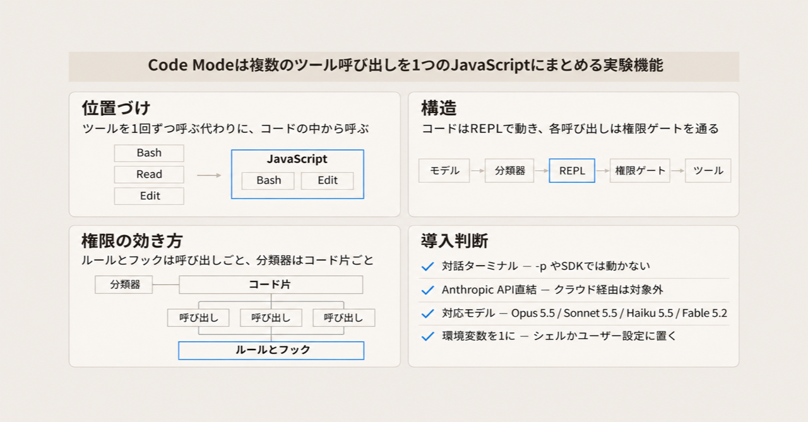
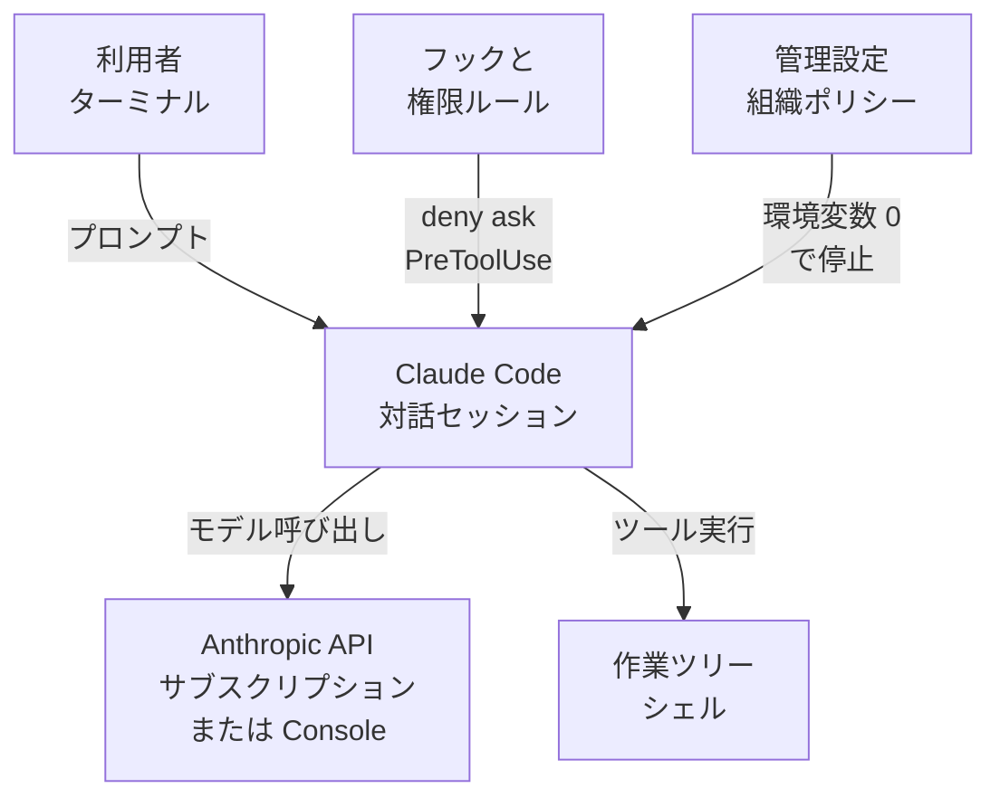
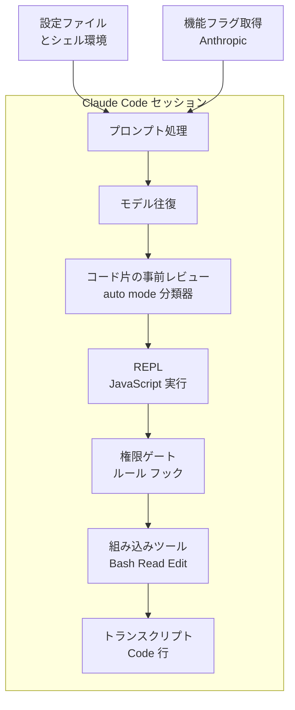
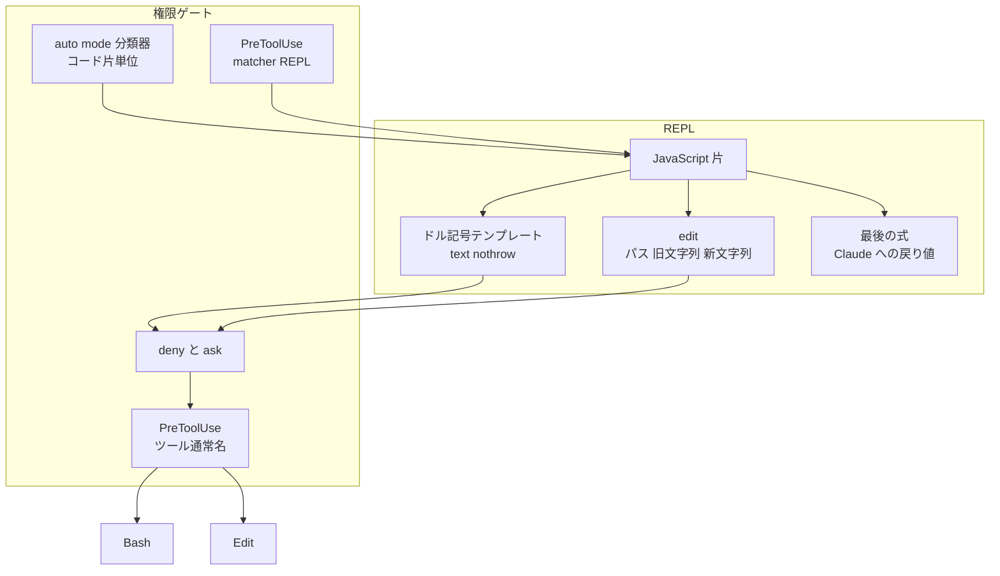
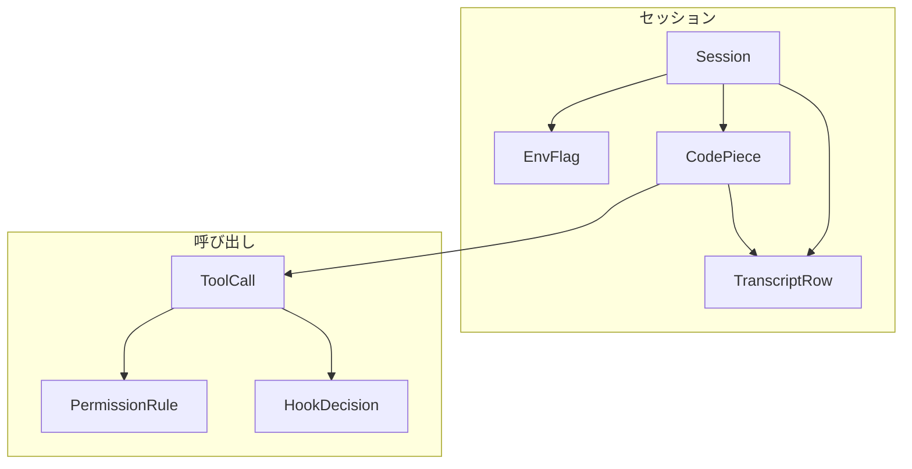
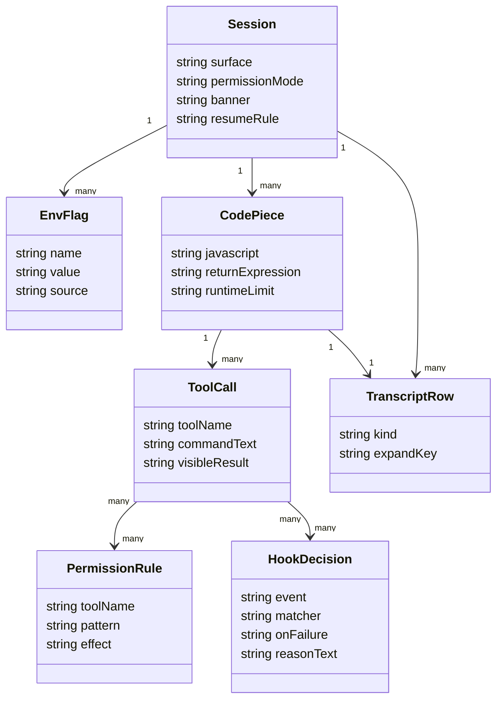

Claude Code v2.1.323 で、実験的な実行モード「Code Mode」が入りました。Claude がツールを 1 回ずつ呼ぶ代わりに、JavaScript を書いてその中から Bash や Edit を呼びます。この記事では、Code Mode の仕組み、オンにする手順、権限とフックの効き方、起動しないときの直し方を、公式ドキュメント（2026-11-19 時点）に沿って整理します。

公式ページは、この機能を「既定はオフで、どのリリースでも変更または削除され得る」実験的機能として案内しています。


*この記事の全体像。以下、順に解説します。*

## Code Modeとは

Code Mode は、Claude Code がツールを 1 回ずつ会話へ出す代わりに、JavaScript を書いてその中からツールを呼ぶ実行モードです。Claude Code はその JavaScript をセッション内で実行します。既定はオフで、フィードバックはセッション内の `/feedback` から送ります。

通常のセッションでは、Claude が Bash、Read、Edit などのツール呼び出しを直接要求し、各結果を読んでから次を決めます。Code Mode でも、利用者がプロンプトで作業を伝える点は同じです。違うのは、Claude が書いた 1 つのコード片が次の 3 つをまとめて行える点です。

- コマンドを並列に走らせる
- 前の結果を次の呼び出しに使う
- Claude が読む必要がある部分だけを返す

公式ページが示す利点はこの 3 点です。待ち時間やトークンがどれだけ減るかは、数値で示されていません。

会話の画面には、編集の差分のようなツール呼び出しが見えます。コードそのものは、`Ctrl+O` で開くトランスクリプトビューア（会話の全記録を表示する画面）で、折りたたまれた **Code** 行を開いて読みます。

初出は Claude Code v2.1.323 です。GitHub のリリースページの本文は `12 Nov 22:12` で、リリースノートの先頭項目は「Claude がツールを呼ぶ JavaScript を書く実験的なオプトイン」という 1 文です。有効化と組織での停止の手順は、公式の Code Mode ページにあります。

この機能は Claude Code の対話ターミナル専用です。「コードでツールを呼ぶ」という同じ発想は、Cloudflare の Code Mode や Anthropic API の programmatic tool calling でも使われていますが、別の製品です。この記事の識別子、制限、権限は、Claude Code の公式ページに基づきます。

## 特徴

- 実験的機能で、既定はオフです。有効化には環境変数 `CLAUDE_CODE_EXPERIMENTAL_CODE_MODE` を使います。
- 1 つの JavaScript が複数のツール呼び出しをまとめます。会話にはツール呼び出しが見え、コードは `Ctrl+O` の **Code** 行にあります。
- 公式例が示す呼び出し方は、タグ付きテンプレート `$` と関数 `edit` です。最後の式が Claude に戻る値になります。
- コード内の各ツール呼び出しは、そのツールの通常名（例: `Bash`）で `deny` / `ask` ルール（拒否する・確認を出す権限ルール）と `PreToolUse` フック（ツール実行前に動く、利用者が設定したコマンド）を通ります。
- auto mode（分類器が操作の安全性を判定し、確認を減らす権限モード）では、分類器が各ツール呼び出しではなく、コード片を実行前にレビューします。実行時に計算された値は分類器に見えません。ルールとフックは auto mode でも呼び出しごとに効き、コード片単位になるのは分類器だけです。
- 完了を待つコードは 10 分で止まります。背景実行（Claude がコードの完了を待たずに会話を続ける実行方式）は、開始時の権限モードが auto または `bypassPermissions`（確認を出さずにツールを実行する権限モード）のとき最長 2 時間です。
- 対応モデルは Claude Opus 5.5、Sonnet 5.5、Haiku 5.5、Fable 5.2 です。最低バージョンは v2.1.323、エージェントチームとの併用は v2.1.326 です。
- プロジェクトの設定ファイルからはオンにできません。管理設定の `0` は組織全体でオフに固定します。
- Code Mode セッションを再開できるのは、Code Mode をオンにしたターミナルだけです。

通常のツール呼び出しとの違いは次のとおりです。

| 比較項目 | 通常のツール呼び出し | Code Mode |
|---|---|---|
| 状態 | 既定 | 実験的、オプトイン |
| モデルの出し方 | Bash / Read / Edit などを 1 回ずつ要求する | JavaScript を書き、その中からツールを呼ぶ |
| 実行場所 | Claude Code の各ツール | セッション内の REPL（ツール名 `REPL`） |
| 利用者が最初に見るもの | 各ツール呼び出し | 各ツール呼び出し。コードは `Ctrl+O` の **Code** 行 |
| Claude が読む結果 | 各ツール結果 | コードが返す部分 |
| 権限 | 呼び出しごと | 呼び出しごとに通常名で評価。auto mode の分類器はコード片単位 |
| サーフェス | 対話、`-p`、SDK、Desktop など製品ごとの対応 | 対話ターミナルのネイティブビルドに限る |

Code Mode で使えないものは次のとおりです。

| 使えないもの | 公式の制限 |
|---|---|
| Remote Control | Code Mode では使えない |
| Claude in Chrome | Code Mode では使えない |
| computer use | Code Mode では使えない |
| Desktop アプリへの移動 | セッションを移せない |
| background session | セッションを背景セッションにできない |
| `/fork` の背景コピー | `/fork` は背景コピーを始められない |
| `-p`、Agent SDK、VS Code パネル、Desktop、クラウドセッション | 対話ターミナルの `claude` 以外では動かない |
| エージェントチームの split panes | 既定の in-process 表示は Code Mode。split panes は Code Mode なしで始まる |

この表の background session（agent view でセッション全体を背景へ回す機能）と、後述の起動理由に出る背景ジョブは、セッションそのものを背景で動かす形態です。コード片だけを背景で動かす「背景実行」とは別のもので、背景実行は Code Mode の中で使えます。

公式ページが向く作業として挙げるのは、関連するツール呼び出しが多い作業です。

| 向く作業 | 公式が挙げる条件 |
|---|---|
| 多数のファイルに同じ変更を繰り返す | 関連するツール呼び出しが多い |
| 検索結果を絞ってから Claude に読ませる | 結果のフィルタが作業の本体になる |
| 独立したコマンドを同時に進める | 1 つのコードが並列実行できる、と本文が述べる |

## 構造

### システムコンテキスト図

Code Mode は、利用者のターミナルで動く Claude Code の対話セッションの中にあります。外側から効くのは、モデル呼び出し先の Anthropic API、作業ツリー、フックと権限ルール、組織の管理設定です。



| 要素名 | 説明 |
|---|---|
| 利用者 | 対話ターミナルでプロンプトを送り、`Ctrl+O` でコードを読む |
| Claude Code | Code Mode のオンオフ、REPL、権限、トランスクリプトを持つ対話セッション |
| Anthropic API | サブスクリプションまたは Console アカウントの直接経路。ゲートウェイと各クラウドプロバイダ経由は対象外 |
| 作業ツリー | `$` が動かすシェルと、`edit` が変えるファイル |
| フックと権限ルール | `deny` / `ask` と `PreToolUse`。コード内の呼び出しはツールの通常名で通る |
| 管理設定 | `CLAUDE_CODE_EXPERIMENTAL_CODE_MODE=0` で組織の利用を止める |

### コンテナ図

セッションの内側では、モデルが書いた JavaScript を（auto mode なら分類器のレビューを経て）REPL（コード片を実行するツール）が実行し、その中の各呼び出しが権限ゲートを通って組み込みツールへ届きます。



| 要素名 | 説明 |
|---|---|
| プロンプト処理 | 利用者の作業指示を受け、Code Mode セッションとしてモデルへ渡す |
| モデル往復 | Opus 5.5、Sonnet 5.5、Haiku 5.5、Fable 5.2 のいずれかが JavaScript を書く |
| コード片の事前レビュー | auto mode のときだけ、分類器がコード片を実行前に見る。それ以外のモードではレビューなしで実行が始まる |
| REPL | コード片を実行するツール。フックから見る名前は `REPL` |
| 権限ゲート | 実行中のコード内の各呼び出しを、通常名でルールとフックに照らす |
| 組み込みツール | 公式の説明が名指しする Bash、Read、Edit。画面にはこれらの呼び出しが出る |
| トランスクリプト | `Ctrl+O` で開く。各コード片は折りたたまれた **Code** 行 |
| 機能フラグ取得 | Anthropic から取得する設定。取得を止める変数やサードパーティ経路では Code Mode をオンにできない |
| 設定ファイルとシェル環境 | 変数の置き場所でオンオフが決まる。プロジェクト設定の `1` は無視される |

### コンポーネント図

REPL の中の JavaScript は、`$` と `edit` でツールを呼び、最後の式で Claude へ値を返します。権限ゲートの側には、ツール単位のルールとフック、コード片単位の分類器とフックが並びます。



| 要素名 | 説明 |
|---|---|
| JavaScript 片 | Claude が 1 ステップで書くコード。会話の既定表示では隠れ、**Code** 行に残る |
| ドル記号テンプレート | 公式例の `` $`command` ``。`.text()` で文字列を取り、`.nothrow()` を戻り値に置ける |
| edit | 公式例の `edit(パス, 旧文字列, 新文字列)`。画面には編集の差分が出る |
| 最後の式 | Claude が次の判断に使う部分。公式例はオブジェクトを返す |
| deny と ask | 権限ルール。コード内でもツールの通常名で評価される |
| PreToolUse | ツール実行前に動くフック。コード経由の Bash は `cd 'app' && git push` のように届くことがある |
| auto mode 分類器 | コード片の実行前にレビューする。実行時に計算したパスは見ない |
| matcher REPL | コードそのものを検査するフック。JavaScript は `tool_input.code` に入る |

## データ

### 概念モデル

Code Mode に関わる概念は、セッション側（オンオフのフラグ、コード片、トランスクリプトの行）と、呼び出し側（ツール呼び出し、権限ルール、フックの判定）に分かれます。



| 要素名 | 説明 |
|---|---|
| Session | 対話ターミナルの 1 セッション。Code Mode のオンオフと権限モードを持つ |
| EnvFlag | `CLAUDE_CODE_EXPERIMENTAL_CODE_MODE` と、起動を止める関連変数 |
| CodePiece | 1 回分の JavaScript。戻り値と、背景実行か完了待ちかが付く |
| TranscriptRow | トランスクリプトの **Code** 行。展開すると JavaScript が見える |
| ToolCall | コードの内側の Bash や Edit。画面に出る単位 |
| PermissionRule | `deny` / `ask` と、auto mode の分類結果 |
| HookDecision | `PreToolUse` または背景実行時の `UserPromptSubmit` の判定 |

### 情報モデル

図の属性名は説明のための概念上の名前で、設定キーでも REPL の入力スキーマでもありません。公開されている識別子は、下の表で名指しする環境変数、`REPL`、`tool_input.code`、設定ファイル、セッション表示文に限られます。`expandKey` も保存キーではなく、`Ctrl+O` でトランスクリプトを開いて行を展開する操作を表します。



| 要素名 | 説明 |
|---|---|
| Session.surface | 公式が対象とするのは対話 `claude`。`-p`、Agent SDK、VS Code パネル、Desktop、クラウドセッションは対象外 |
| Session.permissionMode | 背景実行の条件は、開始時の auto または `bypassPermissions` |
| Session.banner | 成功時の表示は `Code Mode (experimental) is on · this session can be resumed only with Code Mode on` |
| Session.resumeRule | Code Mode セッションは、変数が `1` のターミナルだけが `--continue` / `--resume` できる |
| EnvFlag.name | 主キーは `CLAUDE_CODE_EXPERIMENTAL_CODE_MODE`。値 `1` がオン、`0` がオフ |
| EnvFlag.source | シェル、ユーザー設定、`--settings` はオンに使える。プロジェクト、ローカル、管理設定の `1` ではオンにならない |
| CodePiece.javascript | `REPL` の `tool_input.code` に入る本文 |
| CodePiece.returnExpression | 公式例ではオブジェクトリテラル。Claude が読む部分 |
| CodePiece.runtimeLimit | 完了待ちは 10 分。背景は 2 時間。10 分には許可プロンプトの時間を含む |
| ToolCall.toolName | 権限とフックに渡る通常名。例は `Bash` |
| ToolCall.commandText | Bash ルールとフックが照合する文字列。フォルダ移動付きで届くことがある |
| PermissionRule.effect | `deny` は分類器より前に止まる。`ask` も分類器より前に評価され、auto mode でも一致するとプロンプトになる |
| HookDecision.event | コード検査は `PreToolUse`。背景実行中の出力差し止めは `UserPromptSubmit` |
| HookDecision.matcher | コード片そのものは `REPL`。内側のシェルは `Bash` |
| TranscriptRow.kind | 折りたたまれた **Code** 行 |
| TranscriptRow.expandKey | `Ctrl+O` でトランスクリプトを開き、行を展開する。もう一度 `Ctrl+O` で会話へ戻る |

公式ページは、上記以外の永続ファイル名や REPL 入力スキーマの全フィールドを載せていません。ファイル名が出てくるのは、初回確認の回答を保存できないときの `~/.claude.json` だけで、保存されるキー名は書かれていません。

## 導入

### バージョンとチャネル

- 最低バージョンは Claude Code v2.1.323 です。リリースチャネルは stable と latest のどちらでも構いません。
- それより古い版は Code Mode なしで起動します。理由として `it isn't open to your account yet` が付く場合と付かない場合があります。
- stable の更新が v2.1.323 に届かないときは、stable が追いつくのを待つか、latest へ切り替えます。
- インストールはネイティブビルドです。Windows では Git for Windows が必要です。
- エージェントチームをオンにしたまま使うには v2.1.326 以降が必要です。

```bash
claude --version
```

```bash
claude update
```

### 要件

- アカウントは Claude のサブスクリプションまたは Console です。
- ゲートウェイ、Amazon Bedrock、Claude Platform on AWS、Google Cloud の Agent Platform、Microsoft Foundry、Google Cloud 上の Claude Models（Anthropic 管理）は対象外です。
- 組織が HIPAA 構成または zero data retention を使う場合も対象外です。
- モデルは Opus 5.5、Sonnet 5.5、Haiku 5.5、Fable 5.2 です。サーフェスは対話ターミナルの `claude` です。
- `CLAUDE_CODE_PROVIDER_MANAGED_BY_HOST` は機能フラグ取得の例外を定める変数で、Code Mode をオンにする手段ではありません。

### シェルから起動する

試すだけなら、そのシェルで変数を `1` にして `claude` を起動します。macOS、Linux、WSL と、Windows PowerShell では代入の書き方が違います。

```bash
CLAUDE_CODE_EXPERIMENTAL_CODE_MODE=1 claude
```

```powershell
$env:CLAUDE_CODE_EXPERIMENTAL_CODE_MODE = "1"
claude
```

### ユーザー設定に固定する

以後のセッションでもオンにするには、`~/.claude/settings.json` の `env` に同じ変数を書きます。

```json
{
  "env": {
    "CLAUDE_CODE_EXPERIMENTAL_CODE_MODE": "1"
  }
}
```

- プロジェクトの `.claude/settings.json` と `.claude/settings.local.json` に書いてもオンになりません。クローンしたリポジトリが、利用者の Code Mode を勝手にオンにすることはできません。
- シェルとユーザー設定のどちらかに `0` があると、もう片方の `1` よりオフが優先します。

置き場所ごとの効き方は、Code Mode ページと settings reference で次のとおりです。

| 置き場所 | `1` | `0` |
|---|---|---|
| シェル | オンに使える | 他の `1` があってもオフ |
| ユーザー設定 `~/.claude/settings.json` | オンに使える | 他の `1` があってもオフ |
| `--settings` で渡すファイル | オンに使える | 他の `1` があってもオフ |
| 管理設定 | オンにならない。さらに管理設定が `1` のときはシェルの `1` も無視されるため、オンにするにはユーザー設定に自分の `1` を置く | 他の `1` があってもオフ |
| プロジェクト `.claude/settings.json` | 無視される | この変数のオフとしては使わない |
| ローカル `.claude/settings.local.json` | 無視される | この変数のオフとしては使わない |

### 初回の確認

最初の Code Mode セッションの前に確認が出ます。**Yes, turn on Code Mode** を選ぶと Claude Code が再起動し、セッション上部に次の行が出ます。

```text
Code Mode (experimental) is on · this session can be resumed only with Code Mode on
```

- 別の行が出る、または行が無いときは、後述のトラブルシューティングの理由表へ進みます。
- 回答を保存できないときは、理由が `couldn't save your answer` になります。`~/.claude.json` を書き込み可能にしてください。

### 組織で止める

管理設定の `env` に値 `0` を置くと、組織の誰も Code Mode を使えなくなります。

```json
{
  "env": {
    "CLAUDE_CODE_EXPERIMENTAL_CODE_MODE": "0"
  }
}
```

- すでに Code Mode のセッションにいる人は、終了または再起動までそのセッションに残ります。その後は Code Mode なしで起動し、`0` がある間は Code Mode セッションを再開できません。
- 逆に、管理設定から利用者の Code Mode をオンにすることはできません。

## 利用方法

公式ページが公開している JavaScript の形は、1 つの例だけです。関数の一覧を載せた別ページは、Code Mode ページからリンクされていません（2026-11-19 時点）。例に出てくる要素は次のとおりです。

| 名前 | 公式例での形 | 役割 |
|---|---|---|
| `$` | `` await $`rg -l "function retryPolicy" src`.text() `` | シェルを実行し、`.text()` で標準出力の文字列を取る |
| `$` の `.nothrow()` | `` $`npm test -- retryPolicy`.nothrow() `` | 公式例では戻り値オブジェクトの中に置く。働きは公式ページに説明が無い |
| `edit` | `await edit(target, "maxAttempts: 3", "maxAttempts: 5")` | ファイル内の旧文字列を新文字列へ置き換える |
| 最後の式 | `({ edited: target, tests: ... })` | Claude に返す値 |
| `REPL` | フックの matcher | コード片そのものを実行するツール名 |
| `tool_input.code` | `PreToolUse` の入力 | 実行される JavaScript |

### 公式例の呼び出し

例の作業は、`retryPolicy` を含むファイルを探し、先頭のファイルを編集し、テスト結果を返す、という流れです。

```javascript
const files = await $`rg -l "function retryPolicy" src`.text();
const target = files.trim().split("\n")[0];
await edit(target, "maxAttempts: 3", "maxAttempts: 5");
({ edited: target, tests: $`npm test -- retryPolicy`.nothrow() });
```

1. `$` の `.text()` が、`retryPolicy` を含むファイル一覧を `files` に入れます。
2. 先頭行を `target` にします。
3. `edit` が、そのファイルの `maxAttempts: 3` を `maxAttempts: 5` に置き換えます。
4. 最後のオブジェクトの `edited` と `tests` だけが Claude に戻ります。`tests` は `.nothrow()` 付きです。

画面には編集の差分などのツール呼び出しが出ます。JavaScript は **Code** 行に入ります。

### シェルのタグ付きテンプレート

- バッククォートの中がシェルのコマンド文字列です。公式例は `rg` と `npm test` を使います。
- `.text()` は完了を待って文字列にします。公式例は、その文字列を改行で分割して先頭のパスを選びます。
- 公式本文は「1 つのコードがコマンドを並列に走らせられる」と書いていますが、並列の構文例は同じページにありません。掲載例は `await` による逐次実行です。

```javascript
const files = await $`rg -l "function retryPolicy" src`.text();
const target = files.trim().split("\n")[0];
```

### ファイル編集

- `edit` の第 1 引数はパス、第 2 引数は旧文字列、第 3 引数は新文字列です。
- 会話には編集の差分が出ます。

```javascript
await edit(target, "maxAttempts: 3", "maxAttempts: 5");
```

### 戻り値

- 公式例の最後の式はオブジェクトです。`edited` にパス、`tests` に `.nothrow()` 付きのテスト実行を置きます。
- このオブジェクトが、Claude が次に読む部分です。ページは「Claude が読む必要がある部分を返す」と説明しています。

```javascript
({ edited: target, tests: $`npm test -- retryPolicy`.nothrow() });
```

### トランスクリプトでコードを見る

- `Ctrl+O` でトランスクリプトビューアを開きます。
- **Code** 行を展開すると、ツール呼び出しの背後の JavaScript が見えます。
- もう一度 `Ctrl+O` を押すと会話へ戻ります。

公式ページが試しに使うよう勧めるプロンプトは次の文です。プロジェクト内の Markdown を読み、存在しないローカルファイルへのリンクを列挙させます。

```text
Read every Markdown file in this project and list the links that point to local files that don't exist.
```

### ツールごとの権限

- コード内の各ツール呼び出しは、`deny` と `ask` の権限ルールと `PreToolUse` フックを、ツールの通常名で通ります。Bash なら matcher は `Bash` です。
- auto mode では、分類器が各ツール呼び出しではなくコード片を実行前に見ます。検索結果から取ったパスのような実行時の値は見えません。止める必要がある呼び出しには、ルールかフックを残します。
- auto mode 以外の権限モードでは、コードはレビューなしで始まり、そのモードで本来プロンプトになるツール呼び出しごとに確認が出ます。
- Bash の許可・拒否ルールはコマンド文字列に一致します。`app` というフォルダでの `git push` は、フックへ `cd 'app' && git push` として届くことがあります。公式は、複合コマンドでは各部分を見るよう案内しています。
- ルールが一致しない形のコマンドは、Code Mode の有無にかかわらず通り得ます。コマンド文字列に依存しない境界はサンドボックスです。

次の `ask` は auto mode 設定ページの例、`deny` は権限設定ページの例です。Code Mode でコード内の特定の呼び出しを止めるときは `permissions.deny` を使います。

```json
{
  "permissions": {
    "ask": [
      "Bash(git push *)",
      "Bash(gh pr create *)"
    ]
  }
}
```

```json
{
  "permissions": {
    "deny": [
      "Read(./.env)",
      "Read(./.env.*)"
    ]
  }
}
```

### REPL フック

- コードそのものを検査するときは、`PreToolUse` の matcher を `REPL` にします。
- JavaScript は入力 JSON の `tool_input.code` に入ります。Bash のフックが読む `tool_input.command` とはフィールド名が違います。

次の設定は、公式スニペットではなく筆者が作った例です。`matcher`、`type`、`command` の形はフック参照と同じで、`jq` で `tool_input.code` を読み、実行されるコードをログへ追記します。

```json
{
  "hooks": {
    "PreToolUse": [
      {
        "matcher": "REPL",
        "hooks": [
          {
            "type": "command",
            "command": "jq -r '.tool_input.code' >> \"$HOME/code-mode-repl.log\""
          }
        ]
      }
    ]
  }
}
```

### セッションの再開と停止

- Code Mode で始めたセッションを `claude --continue` または `claude --resume` で再開するときも、変数を `1` のままにします。
- 変数がオフのとき、Claude Code はそのセッションの再開を拒否します。
- Code Mode なしで始めたセッションは、変数が `1` でも Code Mode なしで再開します。
- オフにするには、シェルと `~/.claude/settings.json` から変数を消して新しいセッションを始めるか、どちらかの値を `0` にします。

```bash
CLAUDE_CODE_EXPERIMENTAL_CODE_MODE=1 claude --continue
```

```bash
CLAUDE_CODE_EXPERIMENTAL_CODE_MODE=1 claude --resume
```

## 運用

### 起動理由を読む

- セッション上部の `Code Mode (experimental) isn't available` は、Code Mode なしで起動したことを示します。理由は同じ行に続き、`/status` にも出ます。
- 行が全く無いときは、`claude --version` が v2.1.323 未満でないかを見ます。古ければ更新します。そのうえで、シェルまたはユーザー設定の値が `1` であることを確認し、そこにある `0` と、`--settings` で渡したファイルの `0` を外します。
- 理由ごとの対処は、後述のトラブルシューティングの表にまとめます。

```bash
claude --version
```

### 待ち時間の上限

- コードが長いビルドやテストを待ちながら実行するとき、Claude はコードが終わってから答えます。
- この待ちは 10 分で止まります。10 分には、許可プロンプトに使った時間も含みます。公式本文は「the code stops after ten minutes, including time you spend at permission prompts」と書いています。
- 背景実行の 2 時間とは別の上限です。

### 背景実行

- 長いビルドやテストを走らせるコードを、Claude は完了まで待つか、背景で続けさせます。背景のときは、その間も利用者は Claude と話し続けられ、コードは最長 2 時間動けます。
- 背景にするには、セッションを auto または `bypassPermissions` で始めます。
- 途中で別のモードへ移っていたら、`Shift+Tab` で開始時のモードへ戻します。
- 別モードで始めた、または `claude --resume` の一覧から選んだ場合は、auto mode が使えるなら一度終了し、Code Mode をオンにしたまま次のコマンドで再開します。
- `--tools` にツール名を渡して始めたセッションは、そのフラグなしの auto mode でやり直します。

```bash
CLAUDE_CODE_EXPERIMENTAL_CODE_MODE=1 claude --continue --permission-mode auto
```

### 自動モードの分類器

- auto mode の分類器は、Code Mode では各コード片を実行前にレビューします。auto mode 設定で分類器に渡す拒否の条件 `hard_deny` と `soft_deny` も、コード全体に実行前に適用されます。個別のツール呼び出しを止めるには `permissions.deny` を使います。
- `autoMode.classifyAllShell` を `true` にしても、Code Mode セッションで分類器が見るのはコマンドを走らせるコードです。このキーは Claude Code v2.1.193 以降で使えます。
- 前のコードがまだ動いているときに次のコードが auto mode で始まると、前のコードは分類器のレビューを失います。つまり、前のコードの残りの呼び出しのうち、レビューが必要だったものは自動では通らず、利用者への確認に変わります。
- IDE が接続されていないとき、その確認にはカウントダウンが付きます（公式ページは条件だけを示し、理由は書いていません）。公式が示す文には `1:59` とありますが、開始値が常に 1 分 59 秒だとはページに書かれていません。

```json
{
  "autoMode": {
    "classifyAllShell": true
  }
}
```

```text
Claude Code will automatically block this request in 1:59, to avoid holding up an unattended session
```

### エージェントチーム

- エージェントチームと併用できるのは v2.1.326 以降です。
- チームメイトは、既定の in-process 表示モードでは Code Mode で動きます。split panes では Code Mode なしで始まります。
- v2.1.326 未満で Code Mode を使うときは、`CLAUDE_CODE_EXPERIMENTAL_AGENT_TEAMS` を外します。
- 理由が `it doesn't work in background jobs` のときは、前景で起動し、`--remote-control` を付けません。チームメイトの split pane に同じ理由が出たら、in-process 表示へ切り替えます。

```bash
unset CLAUDE_CODE_EXPERIMENTAL_AGENT_TEAMS
```

### 機能フラグ取得

- Code Mode は、Anthropic から取得する機能フラグを必要とする機能の一覧に入っています。
- `DISABLE_TELEMETRY`、`DO_NOT_TRACK`、`CLAUDE_CODE_DISABLE_FEATURE_FLAGS`、`CLAUDE_CODE_DISABLE_NONESSENTIAL_TRAFFIC` は、それぞれが定める値で取得を止めます。取得が止まると Code Mode をオンにできません。
- サードパーティプロバイダのセッションと Claude apps gateway のセッションも取得をスキップします。これとは別に、Code Mode のアカウント要件もゲートウェイと各クラウド経由を対象外としています。
- インストールまたはアップグレード直後の最初のセッションでは、フラグ取得が終わるまで機能が出ないことがあります。取得結果はそのマシンに保存され、次のセッションから使えます。毎回まっさらな CI コンテナでは、毎回が最初のセッションになります。
- OpenTelemetry を出しているときは、`CLAUDE_CODE_ENABLE_TELEMETRY` と `ENABLE_BETA_TRACING_DETAILED` を外します。このときの理由文は `OpenTelemetry is on` です。

```bash
unset DISABLE_TELEMETRY
unset CLAUDE_CODE_ENABLE_TELEMETRY
unset ENABLE_BETA_TRACING_DETAILED
```

## ベストプラクティス

### 向く作業

- 関連するツール呼び出しが多い作業で試します。公式が挙げるのは、多数ファイルへの繰り返し変更、検索結果のフィルタ、同時に走らせられる独立コマンドです。
- 最初に試すなら、勝手を知っているプロジェクトで、公式の「Markdown のローカルリンク切れを列挙する」プロンプトを使うのが手軽です。
- トークン削減率は、Code Mode の公式ページにも v2.1.323 のリリースノートにも書かれていません。削減率を前提に導入を判断しないでください。
- 戻り値は必要なフィールドだけにします。公開例の `$` と `edit` の範囲で書かれたコードが、レビューしやすい形です。
- コードは会話の既定画面に出ません。レビューする人には、`Ctrl+O` の **Code** 行を開く手順を共有します。

### 権限を二重にする

- 実行時に決まるパスは、auto mode の分類器に見えません。止めるべき呼び出しは `deny` / `ask` か `PreToolUse` に残します。
- コード片そのものを記録・拒否するフックは、matcher `REPL` と `tool_input.code` で書きます。内側のシェルは matcher `Bash` のままです。
- Bash ルールはコマンド文字列の一致です。複合コマンドは各部分を見ます。文字列に依存しない境界はサンドボックス側に置きます。
- Code Mode では、分類器が `hard_deny` と `soft_deny` を各コード片全体へ実行前に適用します。`hard_deny` は利用者の意図や `allow` では外れません。`soft_deny` は利用者の意図と `autoMode.allow` で外れ得ます。コード内の特定の呼び出しを止めるのは `permissions.deny` です。
- フックの結果は 2 種類に分かれます。終了コード 1 のような通常の終了は、`"onFailure": "block"` を付けない限り呼び出しを進めます。一方、起動できない・タイムアウトなどで判定を返さなかったときは、`onFailure` 未設定でもコードからの呼び出しは拒否されます。
- 判定を返さなかったときも呼び出しを進めたいなら、`command` または `http` のフックに `"onFailure": "continue"` を付けます。

### 組織導入

- 組織で止められるのは管理設定の `0` だけです。管理設定の `1` は利用者をオンにしません。
- プロジェクト設定へ `1` を置いてもオンになりません。オンにするのは利用者のシェル、ユーザー設定、または `--settings` です。
- 有効なセッションは、変数を `1` にしたターミナルでだけ再開できます。ランブックには再開コマンドと変数をセットで書きます。
- HIPAA 構成または zero data retention の組織は、要件の時点で対象外です。
- ゲートウェイ、Amazon Bedrock、Claude Platform on AWS、Google Cloud の Agent Platform、Microsoft Foundry、Google Cloud 上の Claude Models（Anthropic 管理）経由では使えません。
- 理由が `it doesn't yet work with the plugin` のときは、名指しされたプラグインをセッションの `/plugin` で無効にします。組織がそのプラグインをオンにしているときは管理者に依頼します。
- 理由が `it doesn't yet work with an installed mod` のときは、ツール呼び出しを検査する mod をオフにします。公式ページは、この対処を `/plugin` とは別に書いています。
- `--restricted`、`--disallowedTools` の `REPL`、`deny` ルールの `REPL` は、起動理由 `this launch's tool options` につながります。Code Mode を使うときは `--tools` に `REPL` を含め、拒否側から外します。

## 注意点

公式ページの記述どうしや、公開直後の二次情報との間に、読み違えやすい差があります。

| 対象 | 資料の記載 | 実態 | 読者への影響 |
|---|---|---|---|
| ドキュメントの公開時期 | v2.1.323 のリリースノートが Code Mode ページへのリンクを載せる | DevelopersIO（2026-11-13）は、その URL が当時 404 だったと書く。Claude Hub（2026-11-13）も、専用ページが執筆時点で到達不能だったと書く。2026-11-19 時点では英語ページを取得できる。ページ本文に公開日は無い | 11-13 ごろの二次記事が「手順不明」とするのは当時の状況。現行の手順は公式ページを正とする |
| モデルの理由文 | 起動失敗の理由に `it only works with Opus 5.5, Sonnet 5.5 and later models` とある | 同じページの要件は Opus 5.5、Sonnet 5.5、Haiku 5.5、Fable 5.2。理由の説明文も Haiku 5.5 と Fable 5.2 が動くと続ける | 理由文だけを見て Haiku 5.5 と Fable 5.2 を対象外と読まない |
| 管理設定の `1` | Code Mode ページは、管理設定から利用者の Code Mode をオンにはできない、と書く | settings reference は、管理設定に `1` があるときシェルの `1` は無視されるので、ユーザー設定にも自分の `1` を置く、と書く | 管理設定の `1` は組織の強制オンではない。シェルだけが `1` だとオフのままになり得る |
| オンにできる設定の範囲 | Code Mode ページは、プロジェクトの設定ファイルではこの変数を無視する、と書く | settings reference は、オンに使えるのはシェル、ユーザー設定、`--settings` ファイルで、管理設定・プロジェクト・ローカルからはオンにできない、と書く | ローカル設定や `--settings` の扱いまで確かめるときは settings reference も見る |
| JavaScript API | 本文は並列実行、前の結果の利用、必要な部分の返却を述べる | 掲載コードは逐次の `$`、`.text()`、`.nothrow()`、`edit`、最後のオブジェクトだけ | 未掲載の関数名や `Promise.all` による並列化を、公式 API として前提にしない |
| `classifyAllShell` | 設定リファレンスは、auto mode 中の Bash と PowerShell をすべて分類器へ送る、と書く | 同じキーの注記と auto mode 設定ページは、Code Mode では分類器がコマンドを走らせるコードをレビューする、と書く | Code Mode セッションでは、このキーの効き方が通常セッションと違う |
| トークン削減 | 同種の「コードでツールを呼ぶ」製品には削減率を示す記事がある | Code Mode の公式ページと v2.1.323 のノートに削減率は無い | Cloudflare Code Mode や programmatic tool calling の数字を、この機能の効果として読み替えない |
| リリース時刻 | 二次記事は 2026-11-12 22:12 UTC と書くことがある | GitHub リリースページの本文は `12 Nov 22:12` で、タイムゾーン表記が無い | 日付は 2026-11-12。時刻のタイムゾーンは確定しない |
| 10 分と 2 時間 | どちらも長いコードの説明に並ぶ | 完了待ちは 10 分（許可プロンプトの時間を含む）。背景は開始モードが auto または `bypassPermissions` のとき 2 時間 | 1 つのタイムアウトとして扱わない |
| 分類器と実行時の値 | auto mode はプロンプトを減らす | Code Mode の分類器はコード片を見る。検索結果から計算したパスは見ない | 実行時の値に依存する禁止は、ルールかフックで残す |
| 初回回答の保存先 | `couldn't save your answer` の対処は `~/.claude.json` を書き込み可能にすること | 保存されるキー名はページに無い | キー名を推測して設定に書き足さない |
| フックのタイムアウトの扱い | 通常の `PreToolUse` には失敗時の方針（`onFailure`）がある | Code Mode ページは、コードからの呼び出しでフックが完了しないと、`onFailure` 未設定でもその呼び出しを拒否する、と書く。セッションで一度コードを実行したあとは、他のツール呼び出しのタイムアウトも拒否になる | `onFailure` の既定の挙動を、通常セッションと同じと考えない |

## トラブルシューティング

### 起動しない

- セッション上部の `Code Mode (experimental) isn't available` に続く理由、または `/status` の理由を、下の表の左列と照らし合わせます。
- 表の対処をしたあとは、新しいセッションを始めます。
- 表に無い理由のときは、導入の「要件」を見直します。
- 行が無い場合は、バージョンが v2.1.323 以降か、シェルまたはユーザー設定が `1` か、それらと `--settings` の `0` を外したかを確認します。

| 症状（理由に含まれる文） | 原因 | 対処 |
|---|---|---|
| `it isn't open to your account in this version` または `it isn't open to your account yet` | v2.1.323 未満、またはアカウントへの開放状況とネットワーク | v2.1.323 未満なら更新する。そうでなければネットワークを確認して再起動する。理由が残るときは別の日に再試行する |
| `it only works directly with the Anthropic API` または `it only works with the Anthropic API` | クラウドプロバイダ、ゲートウェイ、独自の `ANTHROPIC_BASE_URL` | それらの設定を外す |
| `it doesn't work with an API key helper` | `apiKeyHelper`、`ANTHROPIC_AUTH_TOKEN`、`ANTHROPIC_CUSTOM_HEADERS` 内の `Authorization` または `X-Api-Key` | それらを外し、サインインするか `ANTHROPIC_API_KEY` を置く |
| `it only works with Opus 5.5, Sonnet 5.5 and later models` | 非対応モデル | 対応モデルで始める（例: `--model opus`）。Haiku 5.5 と Fable 5.2 も要件に含まれる |
| `it doesn't work in background jobs` | 背景ジョブ、`--remote-control`、または split pane のチームメイト | 前景で起動し `--remote-control` を付けない。split pane なら in-process 表示にする |
| `it needs settings that Claude Code downloads from Anthropic` | 機能フラグ取得が止まっている | `DISABLE_TELEMETRY` など、取得を止める変数を外す |
| `OpenTelemetry is on` | テレメトリ出力 | `CLAUDE_CODE_ENABLE_TELEMETRY` と `ENABLE_BETA_TRACING_DETAILED` を外す |
| `it doesn't yet work with the plugin` | 理由が名指しするプラグイン | セッションで `/plugin` を実行し、そのプラグインを無効にする。組織がオンにしているときは管理者に依頼する |
| `it doesn't yet work with an installed mod` | ツール呼び出しを検査する mod | その mod をオフにする |
| `it can't be used together with agent teams yet` | v2.1.326 未満でのエージェントチーム | v2.1.326 以降へ更新するか、`CLAUDE_CODE_EXPERIMENTAL_AGENT_TEAMS` を外す |
| `this launch's tool options` | `--restricted`、ツール一覧の指定、`REPL` の拒否 | `--restricted` なしで起動し、`--tools` に `REPL` を加え、`--disallowedTools` と `deny` から `REPL` を外す |
| `couldn't save your answer` | 初回の回答を保存できない | `~/.claude.json` を書き込み可能にする |
| `your organization's settings don't allow it` | 管理設定の `0` | 管理者に管理設定を確認してもらう |

### カウントダウンが出る

- auto mode で、前のコードが実行中に新しいコードが始まると、前のコードは分類器のレビューを失います。
- IDE が無いとき、その確認は次の文でカウントダウンします。
- カウントダウンが終わる前に答えます。過ぎるとその呼び出しは拒否され、以後カウントダウンになる呼び出しはプロンプトなしで拒否されます。
- プロンプトを再び出すには、Claude にメッセージを送ります。

```text
Claude Code will automatically block this request in 1:59, to avoid holding up an unattended session
```

### フックによる拒否

Claude がツール呼び出しの拒否を報告したら、エラー文を尋ねます。次の 2 つは、`PreToolUse` が判定を返さなかったことを意味します。`onFailure` が未設定でも、コードからの呼び出しは拒否されます。

| 症状 | 原因 | 対処 |
|---|---|---|
| `the hook failed` | フックが起動できない、強制終了された、終了コード 126、127、または 128 超、HTTP エラー、不正な出力 | フックを直す |
| `the hook did not finish` | コードからの呼び出しでのタイムアウト。セッションで一度コードを実行したあとは、他のツール呼び出しのタイムアウトも同じ拒否になる | フックの `timeout` を上げる |

- `command` または `http` フックを、失敗やタイムアウトでも進めたいときは `"onFailure": "continue"` を付けます。
- `command` フックの通常の終了コード（例: 1）は、`"onFailure": "block"` を付けない限り呼び出しを進めます。

次の JSON は筆者が作った設定例です。`check.sh` は製品に同梱されていません。`timeout` と `"onFailure": "continue"` は、フック参照に載っている共通フィールドです。

```json
{
  "hooks": {
    "PreToolUse": [
      {
        "matcher": "Bash",
        "hooks": [
          {
            "type": "command",
            "command": "\"$CLAUDE_PROJECT_DIR\"/.claude/hooks/check.sh",
            "timeout": 30,
            "onFailure": "continue"
          }
        ]
      }
    ]
  }
}
```

### コードの出力が差し止められる

- コードの出力が出るはずの場所に、フックのブロック理由が出るときは、`UserPromptSubmit` フックを確認します。
- `UserPromptSubmit` は本来、利用者がプロンプトを送ったときに動くフックです。コードが背景で動けるときは、そのイベントの `command`、`http`、`mcp_tool` フックがコードの出力に対しても動きます。
- 公式ページは、フックの入力の `source` が `poll_event` かどうかで、この場合を見分けるよう案内しています。出力を通すには、入力の `source` が `poll_event` のときはブロックしないよう、既存のブロック処理の先頭で分岐させます。`poll_event` 以外の入力は、元のフックの判定に任せます。公式ページはこのフィールド名だけを示しており、完成したスニペットは載せていません。

```text
source が poll_event のときはブロックしない
```

## まとめ

- Code Mode は、Claude がツールを 1 回ずつ呼ぶ代わりに JavaScript を書き、その中で Bash や Edit を呼ぶ実験的な実行モードです。会話にはツール呼び出しが、`Ctrl+O` の **Code** 行にはコードが残ります。
- オンにするのは `CLAUDE_CODE_EXPERIMENTAL_CODE_MODE=1` で、置き場所はシェル、ユーザー設定、`--settings` に限られます。プロジェクト設定と管理設定の `1` ではオンになりません。どこかに `0` があればオフが優先します。
- 対象は対話ターミナルの `claude`、Anthropic API への直接接続、Opus 5.5 / Sonnet 5.5 / Haiku 5.5 / Fable 5.2 です。`-p`、SDK、Desktop、クラウドプロバイダ経由では使えません。
- 権限はツールの通常名で 1 回ずつ効きますが、auto mode の分類器はコード片単位で、実行時に計算された値を見ません。止めたい呼び出しは `deny` / `ask` やフックで残し、コード自体は matcher `REPL` で検査できます。
- 公開されている JavaScript の書き方は 1 例だけで、トークン削減率も公表されていません。まずは関連するツール呼び出しが多い作業で試し、`/feedback` で感想を送るのがよい使い方です。

この記事が少しでも参考になった、あるいは改善点などがあれば、ぜひリアクションやコメント、SNSでのシェアをいただけると励みになります！

## 参考リンク

### 公式

- [Run tool calls from code with Code Mode](https://code.claude.com/docs/en/code-mode)
- [Code Mode 日本語](https://code.claude.com/docs/ja/code-mode)
- [Environment variables](https://code.claude.com/docs/en/env-vars)
- [Features that need feature-flag fetching](https://code.claude.com/docs/en/env-vars#features-that-need-feature-flag-fetching)
- [Advanced setup（ネイティブビルドとリリースチャネル）](https://code.claude.com/docs/en/setup)
- [Interactive mode（トランスクリプト）](https://code.claude.com/docs/en/interactive-mode)
- [Tools reference](https://code.claude.com/docs/en/tools-reference)
- [Git for Windows](https://git-scm.com/downloads/win)

### リリースノート

- [Claude Code v2.1.323](https://github.com/anthropics/claude-code/releases/tag/v2.1.323)
- [タグツリー v2.1.323](https://github.com/anthropics/claude-code/tree/v2.1.323)

### 設定と権限

- [Settings reference](https://code.claude.com/docs/en/settings-reference)
- [Configure auto mode](https://code.claude.com/docs/en/auto-mode-config)
- [Permission modes](https://code.claude.com/docs/en/permission-modes)
- [Configure permissions](https://code.claude.com/docs/en/permissions)
- [Hooks reference](https://code.claude.com/docs/en/hooks)
- [Sandboxing](https://code.claude.com/docs/en/sandboxing)
- [Managed settings](https://code.claude.com/docs/en/managed-settings)
- [Agent teams](https://code.claude.com/docs/en/agent-teams)
- [Agent view](https://code.claude.com/docs/en/agent-view)
- [Remote Control](https://code.claude.com/docs/en/remote-control)
- [Claude in Chrome](https://code.claude.com/docs/en/chrome)
- [Computer use](https://code.claude.com/docs/en/computer-use)
- [HIPAA setup](https://code.claude.com/docs/en/hipaa-setup)
- [Zero data retention](https://code.claude.com/docs/en/zero-data-retention)
- [Monitoring usage（OpenTelemetry）](https://code.claude.com/docs/en/monitoring-usage)

### 公開直後の二次情報

- [DevelopersIO: v2.1.322〜v2.1.323（2026-11-13 時点でドキュメント 404）](https://dev.classmethod.jp/articles/20261113-cc-updates-v2-1-323/)
- [Claude Hub: v2.1.323（執筆時点で専用ページは到達不能）](https://www.claudehub.fr/en/blog/claude-code-2-1-323-code-mode-sandbox-tightens)
- [MarkTechPost: Code Mode の要件要約（2026-11-17）](https://www.marktechpost.com/2026/11/17/anthropic-claude-code-code-mode-javascript-tool-calls/)
