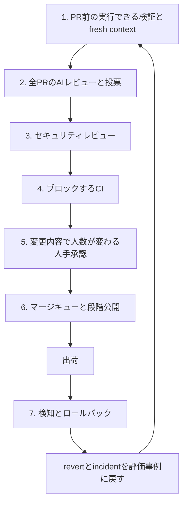
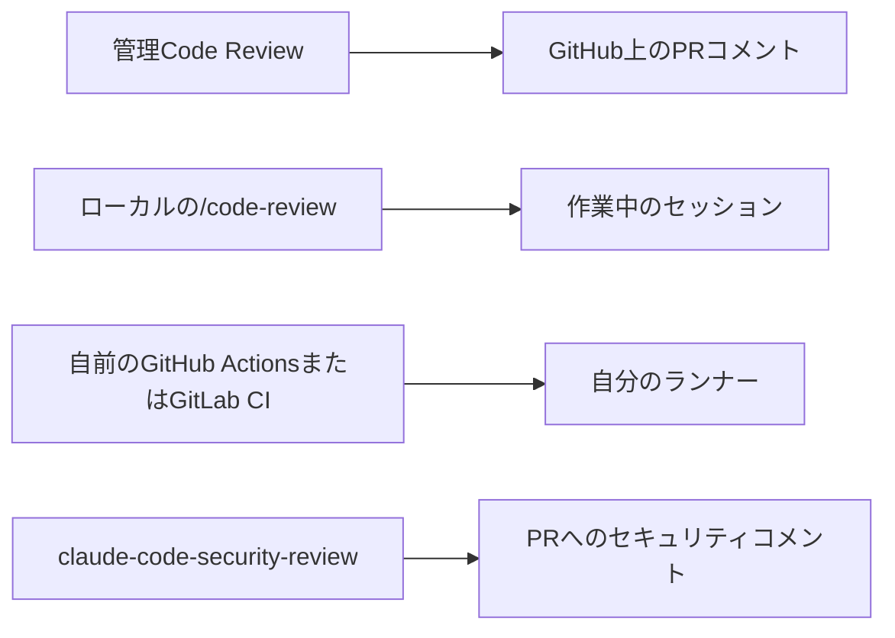

AIエージェントが書いた変更を、どうやって安全に本番へ通すか。Anthropic の Claude Code チームは、CLI・desktop・web・mobile のリポジトリで使っている社内のコードレビュー運用を 2026-10-15 に公開しました。同じ日に、GitHub 上で動く管理サービス Code Review も Team と Enterprise で一般提供（GA）になっています。

この記事では、社内運用の層の作り、公開サービスとの境界、公開されている数値の読み方、そして個人や小規模なリポジトリで採れる範囲を順に整理します。前提として、記事に出てくる割合や倍率は同社の自己申告で、工程が原因だと切り分けた独立の実験表は公開されていません。この点は後半の注意点でまとめて扱います。

*この記事の全体像。以下、順に解説します。*

## Claude Codeチームのコードレビューとは

Claude Code チームが公開したのは、エージェントが書いた変更を本番へ通すまでの一連の工程です。関わる人が多くても、1 人（変更を書いた本人でもよい）で大半の PR をマージでき、しかも revert（取り消し）やインシデントを増やさないことを目標にしています。

工程は、PR を出す前から出荷の後まで、次の層でつながっています。

ここで fresh context とは、作業中のセッションとは別に起動した Claude（サブエージェント）に、まっさらな状態で diff を読ませることを指します。各層の中身は次のとおりです。

### PR前の検証とAIレビュー

- PR を出す前に、テスト・ビルド・スクリーンショット比較など、その場で結果が出るチェックを Claude に渡します。別コンテキストのサブエージェントが diff を見ます。繰り返し出る指摘は、skill（作業手順をまとめた再利用部品）や lint、`CLAUDE.md`、`REVIEW.md` に戻して次から自動で効かせます（`CLAUDE.md` と `REVIEW.md` は、Claude にレビュー時の方針を伝えるためのリポジトリ内のファイルです）。
- すべての PR で、並列のエージェントがバグを探し、別のグループが投票して合意した所見だけを投稿します。スタイルや静的診断の指摘は社内の A/B テストで落としました。所見には Important・Nit・Pre-existing のタグが付き、どの所見にも修正か、理由を添えた解決が要ります。

### セキュリティとCI

- バグ所見かセキュリティ所見が開いているあいだは、社内ルールではマージできません。後続のコミットで直れば、所見は自動で閉じます。
- lint、型、各プラットフォームのテスト、ビルドがマージをブロックします。典型的な CLI の PR は、人が見る前に数十のチェックを通ります。PR テンプレートには Testing（検証）・Risk（危険度）・How to revert（戻し方）の欄があり、Claude が埋めても、依頼した人が確認します。

### 変更内容で変わる人手承認

承認に必要な人数は、変更を書いた人ではなく、変更の内容で決まります。

| 危険度 | 対象の例 | 人手承認 |
|---|---|---|
| Low | docs、文言、社内限定、機能フラグの後ろの追加 | 自動レビューとセキュリティが緑なら不要 |
| Medium | 通常の製品変更、キャッシュ、auto-updater、system prompt（AI への指示文） | 人 1 人 |
| High / 常時2人のパス | 危険度の高い変更、オーナーが指定したパス | 人 2 人 |

オーナーが sensitive（要注意）と指定したパスと CI の workflow は、常に人が見ます。この基準を緩められるのは、おおむねそのリポジトリのチームに属する trusted author（信頼された書き手）に限られます。エージェントの承認は人の承認には数えません。エージェントが書いた PR では、そのエージェントを動かした人が必須レビュアーの 1 人になります。承認はコミット単位で、保証できない新しいコミットが載るとやり直しです。

### マージキューと段階公開、検知

- マージキューとは、変更を main に当てた状態でチェックを再実行してから順に取り込む仕組みです。
- 公開は段階的で、新機能は社員に先に出し、配布チャネルの `latest`（先行版）が先、`stable`（安定版）が後になります。機能フラグ（機能を出すか隠すかを切り替えるスイッチ）はデプロイなしで切れます。
- 週次のオンコール（当番）がインシデントをレビューし、「どの層で拾うべきだったか」を問います。revert やインシデントの率に応じて自動承認を自動的に締める仕組み（記事ではサーキットブレーカーと呼んでいます）は、公開時点では未実装で、人手ゼロのマージを広げる前に欲しい、と書かれています。

人が最後まで残す仕事は、そもそも作るかどうかの判断、billing・auto-updater・CI workflow、後続が真似するアーキテクチャ、テスト出力やスクリーンショット・レビュアー所見の確認、そして出荷の責任です。規範は "you land it, you own it"（通したなら、あなたが持ち主）です。

### 公開版Code Reviewとローカルの位置づけ

同じ「所見を書く」仕事でも、動く場所によって別のものになります。

GA になった管理 Code Review は、Team と Enterprise 向けで、GitHub（GitHub Enterprise Server と、データレジデンシー付きの GitHub Enterprise Cloud を含む）で動きます。自己ホスト環境では走りません。一部のコンプライアンス構成（データを保持しない Zero Data Retention、米国の医療情報保護規制 HIPAA 向けの設定、顧客管理の暗号鍵 CMEK など）を使う組織では利用できず、BAA（HIPAA に関わる受託者契約）の対象外です。レビューは Anthropic の基盤上で読み取り専用に走り、コミットを push せず、コードのビルドも実行もしません。

- チェック名は **Claude Code Review** で、失敗では終わりません。モデルは製品側が選び、管理者は Quick / Standard（既定）/ Deep を選べます。
- `REVIEW.md` は base または default ブランチから読み、PR 自身の変更に含まれる `REVIEW.md` は読みません。ローカルの `/code-review` は `CLAUDE.md` を読み、`REVIEW.md` は読みません。両方に効かせたい指示は `CLAUDE.md` に置きます。
- 既定の焦点は正しさのバグで、整形やテスト不足は既定では見ません。レビューは Find・Verify・Rank・Post の段で進みます。所見ゼロは「バグがない」「安全」を意味しない、とドキュメントが注意しています。draft と fork からの PR は自動レビューをスキップします。

## 注意点

記事とその周辺資料には、印象に残る割合や倍率がいくつも出てきます。ただし分母（何に対する割合か）がそれぞれ違い、工程が原因だと切り分けた実験表は付いていません。代表的なものを対象と留保で並べると、次のようになります。

| よく言われること | 一次資料での対象 | 示されていないこと |
|---|---|---|
| Claude が約 90% を書く | Claude Code 自身のコード | 計測方法・時点、マージ済み PR に占める割合 |
| 2026-06〜09 でマージ PR が 2 倍超、revert が必要だった割合が 40% 超低下 | Claude Code のコードベースの前後比較 | レビュー工程がその原因だという切り分け |
| 1 日 約 2,500 から 30,000 超 | monorepo に入る changes（2026-05〜09） | これは Claude Code とは別リポジトリの monorepo の数 |
| 実質的なレビューコメントが 16% から 54% | 社内 PR のうち実質コメントが付いた割合 | バグの検出率・精度・再現率 |
| 1 往復で通る PR が 65% から 78%、平均レビュー回数 2.08 から 1.32 | 図のキャプションの数値 | 本文に分母・期間・対象 PR 数の記載なし |
| 検証ループで成果が 2〜3 倍 | 個人の見積もり（2026-01-02 の投稿） | 実験表。公式ベストプラクティスにこの倍率はない |

特に、日本語の再掲記事では分母が動いてしまう例が見られます。たとえば「約 90%」を「マージされる PR の 9 割」と読み替える、割合の前後比較を「差し戻しが 4 割以上減った」と因果でつなぐ、観測事実を「夜間レビューが既存コードの約 59% をレビューから切り離した」と結果まで踏み込む、といったものです。元の数値は、あくまで Claude Code 自身のコードの割合であったり、前後比較であったり、観測の並記であったりします。

数値を使うときは、割合なら分母を、倍率なら見積もりか実測かを、前後比較なら原因の切り分けの有無を、それぞれ確かめるのが安全です。

## 社内の測り方と、公開製品との境界

社内で追っている目標は、PR あたりの人手承認の中央値と 95 パーセンタイル、人のコメント数、人が見るまでの待ち時間です。ガードレールは revert 率とインシデント率です。

評価は、インシデントや revert を起こした PR を専門家が確認して事例にし、レビュアーを毎日採点して、点数を上げた変更を残す、という回し方です。レビューの往復が 3 ラウンドを超えたら、著者に方針の再考を求め、その後のパスは差分だけを見ます。指摘は 1 行ではなくバグの種類に対して行い、同じ指摘を繰り返しません。既存コードは夜間にまとめて見ます。CLI の 1 PR が一晩で 50 ラウンドを超えた、という事例も挙げられています。

社内運用と公開ドキュメントの記述は、言葉づかいも含めて食い違う部分があります。公開サービスを導入しただけでは、社内と同じ強制力は得られません。なお次の表に出てくる CODEOWNERS は、パスごとにレビュー必須者を決める GitHub の仕組み、branch protection は、マージの条件（チェック通過やスレッド解決など）を決める GitHub の仕組みです。

| 社内運用が書くこと | 公開ドキュメントが書くこと |
|---|---|
| 所見が開いているあいだはマージできない。タグは Important / Nit / Pre-existing | 「レビューは PR を承認もブロックもしない」。チェック **Claude Code Review** は失敗で終わらない。止めたいなら、スレッド解決を branch protection で必須にするか、チェックが返す JSON を自前の CI で解析し、所見があれば CI を失敗させる。ヘルプ記事はマーカー名を Normal / Nit / Pre-existing と書く |
| 低リスクは自動が緑なら人手ゼロ | 分類器の中身は非公開。利用者は危険度を自分で定義し、auth・billing・CI・リリース・インストーラは CODEOWNERS と branch protection で人を必須にする |
| `REVIEW.md` に繰り返す指摘を戻す | 管理 Code Review は base / default の `REVIEW.md` を読む。ローカル `/code-review` は読まない。両方に効かせるなら `CLAUDE.md` |

費用は usage credits（従量課金の利用枠）で組織に請求され、プランの利用枠とは別です。費用のドキュメントは、組織上限・残高を設けていて、残高が 1 回分の見込みコストを下回るとレビューをスキップすると書いています。コマンドの購読範囲も資料で分かれていて、製品マニュアル（code.claude.com）は `@claude review` を 1 回、`@claude review always` を以後の push の購読としますが、セットアップのヘルプ記事は `@claude review` が以後の push でもレビューする、と書きます。所要時間や単価の平均も、GA 発表は多くのレビューが 6〜10 分になったと書いて平均額を置かない一方、ヘルプ記事には平均 20 分・平均 $15〜25 が残っています。どちらが現在の正かは、公開資料だけでは一つに決められません。

セキュリティ用途の OSS である [claude-code-security-review](https://github.com/anthropics/claude-code-security-review) は、GitHub Action として PR にセキュリティコメントを付けます。ただし所見があってもジョブを失敗させず（API キー欠如などの実行エラーは別）、README も prompt injection（悪意ある指示を入力に紛れ込ませて誤動作させる攻撃）に硬化していないので信頼できる PR に限るよう書いています。2026-10-27 時点で default ブランチ `main` の最新コミットは 2026-02-11 で、README は `claude-model` の既定を `claude-opus-4-1-20250805` と記載しています。

## 小規模リポジトリで採れる範囲

ここでは「エージェントが PR を書き、人は自分のリポジトリのオーナーである」という前提で、社内運用のうち規模に依存せず採れるものを整理します。

採れるもの:

1. PR を出す前に、テスト・ビルド・スクリーンショットのいずれか、その場で結果が分かるチェックを渡す。別コンテキストで diff を読ませる。「2〜3 倍」は見積もりとして扱い、自分の revert の増減で確かめる。
2. ローカルなら `/code-review`。管理 Code Review を使うときだけ、短い `REVIEW.md` を default ブランチに置く。ローカルコマンドに効かせたい指示は `CLAUDE.md` に書く。
3. 未解決のレビューをマージ条件にしたいなら、branch protection でスレッド解決を必須にする。公開サービスのチェック単体は失敗で終わらないため、これだけではマージは止まらない。
4. auth・billing・CI・リリース・インストーラは、分類器がなくても人を必須にする。エージェントの承認は必須承認の数に入れず、新しいコミットが載ったら承認を外す。
5. レビューの往復に上限を置き、その後は新しい diff だけを見る。エージェント同士の長い往復を品質の代理指標にしない。
6. ガードレールは自分の revert とインシデントにする。公開されている「2 倍」「40% 超」は、同社の前後比較として読む。

採らないもの:

- 1 日に数万件の変更を前提にした独自インフラ（自社 VCS など）。対象のコードベースの規模が違う。
- 公開製品を導入しただけで、社内と同じ「所見が開いているあいだはマージできない」が得られたとみなす運用。
- 支出上限に達したあとも毎 PR レビューが走る、という前提。
- セキュリティ用 Action を置いただけでマージを止められる、という前提。止めるなら findings を見て失敗させる後段を足すか、スレッド解決を自分で必須にする。

危険パスの人手を緩めるのは、自分のリポジトリで、人なしで通した期間の revert・インシデントが、人を残した期間と同等以下だと自分で測れたときだけにするのが安全です。記事自身も「最初は厳しく、証拠が出てから緩める」と書いており、自動承認を締めるサーキットブレーカーは同社でも未実装です。

## 支持と反証

公開資料のあいだで整合する部分は、次のとおりです。

- 公開の Code Review は所見を投稿し、承認は人の判断のまま、という立場が発表時から一貫しています。
- 現行ドキュメントは、レビューは承認もブロックもせず、ビルドも実行もせず、所見ゼロを安全の証明にしない、と明記しています。
- 実行できるチェックを Claude に渡す、という部分はプランや環境をまたいで採れます。

一方で、限界や反例もあります。

- 2026-04-23 の[事後報告](https://www.anthropic.com/research/april-23-postmortem)では、あるバグが複数の人手レビューと自動レビュー、ユニットテスト、E2E、自動検証、社内利用をすべて通過し、発見まで 1 週間超かかったと書かれています。レビューの層は万能ではありません。
- GitHub の Issue [anthropics/claude-code#100401](https://github.com/anthropics/claude-code/issues/100401) は 2026-10-27 時点で OPEN で、GitHub Action 経由の code-review プラグインがレビュー担当を起動しないまま「No issues found.」を投稿した、という利用者報告です。原因は CLI と既定モデルの同時変更で切り分けられておらず、管理 Code Review の障害として書かれたものではありません。GA サービスで再現するかは未確認です。
- 本件に直接結び付く CVE は、NVD・MITRE・ベンダー advisory では確認できていません。見つかっていないことは、脆弱性がないことの証明ではありません。

全体として、「所見ゼロは安全ではない」「自動レビューは人手の補完」という公開資料の留保どおりに扱い、強制力は branch protection や CODEOWNERS など自分の設定で足す、という読み方が無理のない結論です。

## まとめ

- Claude Code チームの社内運用は、PR 前の検証・全 PR の AI レビュー・セキュリティ・ブロックする CI・危険度で変わる人手承認・マージキューと段階公開・検知とロールバックの層でできています。
- 公開版の管理 Code Review は所見を投稿するだけで、承認もブロックもしません。強制力は branch protection や CODEOWNERS で自分で足す必要があります。
- 公開されている割合や倍率は、分母・時点・原因の切り分けを確かめてから使うのが安全です。
- 小規模なリポジトリでも、PR 前の検証・危険パスの人手必須・往復の上限・revert による自己計測は、規模に依存せず採れます。

この記事が少しでも参考になった、あるいは改善点などがあれば、ぜひリアクションやコメント、SNSでのシェアをいただけると励みになります！

## 参考リンク

- Claude Code チームの記事（2026-10-15）: https://claude.dev/blog/solving-code-review-at-anthropic.md
- Code Review 一般提供の発表（2026-10-15）: https://claude.com/resources/articles/code-review-is-now-generally-available
- Code Review プレビュー（2026-03-09）: https://claude.com/resources/articles/code-review
- 現行ドキュメント: https://code.claude.com/docs/en/code-review
- ローカルのコードレビュー: https://code.claude.com/docs/en/code-review-local
- カスタマイズ: https://code.claude.com/docs/en/code-review-customize
- 費用: https://code.claude.com/docs/en/code-review-costs
- セットアップのヘルプ: https://support.claude.com/en/articles/14233555-set-up-code-review-for-claude-code
- 自動セキュリティレビューのヘルプ: https://support.claude.com/en/articles/11932705-automated-security-reviews-in-claude-code
- OSS の GitHub Action: https://github.com/anthropics/claude-code-security-review
- ベストプラクティス: https://code.claude.com/docs/en/best-practices
- ソース管理の再設計（2026-10-15）: https://www.anthropic.com/engineering/redesigning-source-control
- 事後報告（2026-04-23）: https://www.anthropic.com/research/april-23-postmortem
- GitHub Issue #100401: https://github.com/anthropics/claude-code/issues/100401
