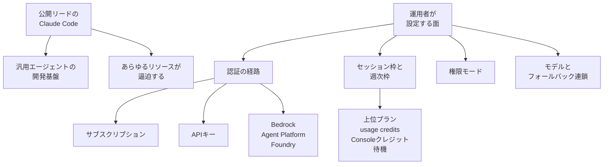
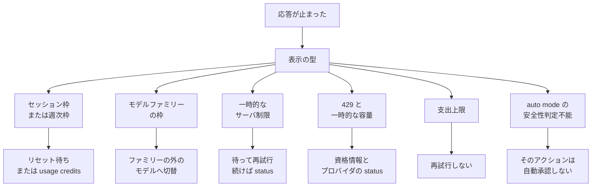

2026年10月13日、日経クロステックは Claude Code 責任者ボリス・チェルニー氏へのインタビューを公開しました。
確認できた本文は、有料壁の手前の公開リードまでです。
この記事では、その公開リードが紹介する製品と、公式ドキュメントが分ける利用枠、認証経路、権限モード、モデルの切り替えを整理します。
応答が止まったときに、どの表示がどの続き方へ進むかも扱います。

*この記事の全体像。以下、順に解説します。*

## Claude Codeとは

公開リードは、Claude Code をコーディング特化の道具から、汎用エージェントの開発基盤へ発展した製品として紹介しています。
記事の表示日は 2026.10.13 です。
読了目安は 9 分です。
連載名は「Anthropic膨張」です。
URL の `100600002` は記事 ID です。
聞き手は、日経クロステック／日経コンピュータ記者の太田萌枝氏と、日経クロステック IT 編集長の島津翔氏です。
写真クレジットは的野弘路氏です。
取材日は、公開リードには書かれていません。

公開リードの 3 ポイントは、次のとおりです。

- 独自取材であること
- 知能向上の始まりに過ぎないと語ること
- 安全性と信頼性の担保を利用拡大の理由と見ること

次ページの見出しは「安全性の追求はカルチャーとして根付く」です。

チェルニー氏の公開引用は、次の 2 文です。

> 私たちが経験しているのは『ハイパー・ハイパーグロース（超超急成長）』。あらゆるリソースが逼迫する

> 私たちは制約を乗り越えられる

公開リードが語る製品と、運用者が設定する面は分かれます。
認証の経路は、計算の置き場を分けます。
権限モードは、その経路の上で承認と実行を分けます。
フォールバック連鎖は、過負荷、利用不能、再試行しないサーバエラーのとき、次のモデルを試します。

### 利用枠と、枠に達したあとの公式の続き

Pro と Max は、5 時間のセッション枠と週次枠を、Claude と Claude Code で共有します。
Max には、Fable 向けの別の週次枠があります。
IDE 拡張の利用も、同じ枠に数えます。
枠の説明は [Use Claude Code with your Pro or Max plan](https://support.claude.com/en/articles/11145838-use-claude-code-with-your-pro-or-max-plan) にあります。
本文の取得日は 2026-10-13 です。

枠に達したあとの公式の継続手段は、4 つです。

- 上位プラン
- usage credits
- Claude Console の API クレジット
- リセット待ち

### 認証の経路

認証経路として公式手順があるのは、次です。

- サブスクリプション
- 環境変数 `ANTHROPIC_API_KEY`
- Amazon Bedrock
- Google Cloud の Agent Platform
- Microsoft Foundry

### 権限モード

権限モードの名前は、[Choose a permission mode](https://code.claude.com/docs/en/permission-modes) が分けています。

| モード | 設定値 |
|---|---|
| Manual | `default` |
| acceptEdits | `acceptEdits` |
| plan | `plan` |
| auto | `auto` |
| dontAsk | `dontAsk` |
| bypassPermissions | `bypassPermissions` |

権限モードの説明は、利用枠のページとは別のドキュメントです。

### フォールバック連鎖

主モデルが過負荷、利用不能、または再試行しないサーバエラーを返したとき、設定した `fallbackModel` が連鎖の次のモデルへ切り替わります。
連鎖は、重複を除いたあと 3 モデルまでです。
効くのは、そのターンのあいだだけです。
設定の説明は [Model configuration](https://code.claude.com/docs/en/model-config) にあります。
本文の取得日は 2026-10-13 です。

## 注意点

公開引用の範囲、日付の取り違え、制限の向き、体感と供給の切り分けを、ここでまとめます。

### 公開引用は資源の内訳を分けていない

確認できた引用は、総称のままです。
公開リードも、公開範囲で読めた転載も、計算、人員、サポート、安全性レビューのどれが逼迫しているかは分けていません。
公開範囲では、内訳は分解できないものとして扱います。

次の 3 文は、公開リードの引用にはありません。

- 承認、実行、停止を単一のコーディング基盤に寄せる
- 供給停止と枠不足をフェイルオーバーの入力にする
- 汎用化で増える権限を、容量計画と別に棚卸しする

この 3 文を、チェルニー氏の発言としては書きません。

安全性についての公開ポイントは、「安全性と信頼性の担保が Claude Code 利用拡大の理由」という見出し側の整理です。
これは、安全性レビューの人手が足りる、または足りない、という資源の話へは進みません。
次ページ見出し「安全性の追求はカルチャーとして根付く」も、審査件数のデータを含みません。

有料本文が、逼迫を計算か人員かに本人の言葉で分けている可能性はあります。
公開範囲だけでは、その読みを支持も棄却もできません。
取材日、有料本文、安全性レビューの人員、サポートの待ち行列は、ここまででは取れていません。

### 別の日付と混ぜない

10 月 13 日のインタビューと、前後の別発表は日付が違います。

| 日付 | 何の話か | 10月13日インタビューとの関係 |
|---|---|---|
| 2026-04-26 | Sonnet 5 発表の脚注。Sonnet と Haiku のレート制限を上げ、ネイティブ Claude Platform を Start、Build、Scale の 3 ティアにした | 別発表。10 月の発言ではない |
| 2026-05-06 | SpaceX の Colossus 1 を使い、Claude Code の 5 時間枠を倍にし、Pro と Max のピーク時縮小を外した | 別発表。逼迫への増強の記録ではある |
| 2026-06-09 から 3 日後 | 日経 2026-06-19 の公開リードが、Fable 5 と Mythos 5 の全面提供停止を米政府の指令として書く | 二次情報。停止の一次文書は未読。10 月の引用ではない |
| 2026-06-11 | 東京「Code with Claude: Extended」の基調講演 | 6 月の別取材の公開リードが参照する |
| 2026-06-19 | デザイア・パスと意図的な汎用性の別インタビュー | 10 月記事とは URL が違う |
| 2026-06-30 | Sonnet 5 発表。Chat、Cowork、Claude Code、Claude Platform のレート制限を上げた | 別発表 |
| 2026-09-17 | Projects の再設計。各 thread が 1 つの Claude Code セッションになる | 機能追加が枠の減りを速くしうる、という公式の説明 |
| 2026-10-07 21:23 UTC | 支出上限到達の誤判定で、Claude Code を含むリクエストが拒否された。解消済み。発生区間の開始時刻は、この掲載だけでは確認できない | 容量不足とは別の停止 |
| 2026-10-13 | 本インタビューの表示日 | 取材日は公開リードに無い |

2026 年 5 月にダリオ・アモデイ氏が、年間の売上高と利用者数の前年比約 80 倍の見通しに触れた、という記述は、2026-06-19 の日経公開リードが別稿へつなぐ伝聞です。
講演原文は未読です。
10 月 13 日のチェルニー氏の発言でもありません。
同日の別カバー「4700兆円の Claude 経済圏」は、このインタビューの引用元にしません。

### 制限が厳しくなる一方、とは書かない

公式が「枠を広げた」と書いた日が、少なくとも 2026-04-26、2026-05-06、2026-06-30 にあります。
供給制約を、一度締めたままの天井として書くと、これらの一次発表とずれます。

[2026-05-06 の発表](https://www.anthropic.com/news/higher-limits-spacex)は、Colossus 1 の容量をすべて使う契約だと書きます。
1 か月以内に 300 メガワット超、NVIDIA GPU 22 万基超の新しい容量が、Claude Pro と Claude Max の容量を直接改善する、とも書きます。
併記の Amazon 最大 5 ギガワット、Google と Broadcom の 5 ギガワット（2027 年から）、Azure 容量 300 億ドルは、発表時点の調達計画です。
2026-10-13 にその全量が稼働している、という意味ではありません。
Fluidstack の項目は、公式投稿が米国の AI インフラへの 500 億ドルの投資と書くものです。
容量の購入量とは分けて読みます。
SpaceX との契約金額は、この公式投稿にはありません。

同日のチェルニー氏の投稿は、原文が次のとおりです。

> 5-hour rate limits doubled on Pro, Max, Team, and seat-based Enterprise

> we've removed the peak-hours limits for Pro and Max

[2026-06-30 の Sonnet 5 発表](https://www.anthropic.com/news/claude-sonnet-5)は、トークナイザの変更で、同じ入力がおおよそ 1.0 倍から 1.35 倍のトークンになりうると書きます。
需要側の消費も、公式に動きます。

### 体感の不足を、供給量の削減と同一視しない

材料は、もう 2 つあります。

[Hacker News の item 47740541](https://news.ycombinator.com/item?id=47740541) では、表示名 `bcherny` の投稿が “Boris from the Claude Code team” と名乗っています。
その投稿は、1M コンテキストの prompt cache miss と、多数の skills、agents、background automations を、枠が早く尽きる要因として挙げています。
2026-10-13 に取得した画面は “6 months ago” としか示さず、暦日は確認できませんでした。
確認できたのは、ユーザー名の一致までです。
同じ投稿は “continuing to investigate” と書いています。
利用者の体感不足の一部は、2026 年後半の Projects や、1M コンテキストの cache miss で説明できる余地があります。
すべての報告がそれで説明できる、とまでは言えません。

「制限は変わっていない」という趣旨の投稿は、原文を確認できませんでした。
二次記事が伝える文言は、本文の根拠にしません。

[Lenny’s Newsletter の番組ページ](https://www.lennysnewsletter.com/p/head-of-claude-code-what-happens)には、次の見出しがあります。

> How underfunding teams and giving them unlimited tokens leads to better AI products

これは目次です。
チェルニー氏の逐語ではありません。
人員の逼迫を、Anthropic の欠員と読む根拠にはしません。

## 止まったあとの続き方

同じ「止まった」でも、公式が書く続きは分かれます。
補足は、[Errors](https://code.claude.com/docs/en/errors) を 2026-10-13 に取得した範囲に限ります。
2026-10-13 時点の公式ドキュメントは、枠、課金上限、モデル過負荷、安全性判定を、別の停止として説明します。

表示ごとの続きは、次のとおりです。

- セッション枠と週次枠は、モデルを替えても戻りません。続きはリセット待ちか、usage credits です。
- Opus 枠や Sonnet 枠は、そのファミリーの外へ替えると続きうることがあります。切替のあと、プロンプトキャッシュは別になります。
- “Server is temporarily limiting requests (not your usage limit)” は、プラン枠ではありません。待って再試行し、続くなら status を見ます。
- 429 の文面が一時的な容量に触れるとき、Anthropic 以外では案内先がそのプロバイダの status になります。資格情報も確認します。
- プランや組織の spend limit は、上限を上げるか、リセット時刻があれば待ちます。ゲートウェイ運用者の spend limit は文言が違い、再試行しません。ゲートウェイ側は `x-should-retry: false` です。容量由来の 429 とは続き方が違います。
- auto mode の分類器が、レート制限、過負荷、サーバエラー、タイムアウト、接続失敗で判定を返せないとき、そのアクションは自動承認しません。作業ディレクトリ内の読み取り、検索、編集は、分類器を通さず続きうると、エラー解説が書きます。
- “Usage credits required for 1M context” は、資格の確認です。セッション枠が残っていても出ます。

[2026-10-07 の status](https://status.claude.com/incidents/vmys9qn874h4) は、支出上限の誤判定で Claude Code のリクエストが拒否されたと書きます。
掲載時刻は 2026-10-07 21:23 UTC です。
見かけの停止を、容量不足の一件に数えると、課金判定の障害が混ざります。

## 枠切れを fallbackModel の入力にしない

`fallbackModel` が切り替わるのは、過負荷、利用不能、再試行しないサーバエラーです。
公式が切替条件から外しているのは、認証、課金、rate-limit、リクエストサイズ、トランスポートです。
枠が尽きたら別モデルへ進む仕組み、としては書きません。
過負荷、利用不能、再試行しないサーバエラーでは、切り替わります。

Bedrock、Agent Platform、Foundry は、環境変数で使う公式手順があります。
手順ページは、既存セッションが障害時に自動で別クラウドへ移るとは書いていません。
別クラウドは、計算の置き場を選ぶ設定です。
障害時の自動移設ではありません。

Max に含まれる月次 API クレジットは、Claude Code と Claude アプリでは使えません。
extra usage にも使えません。
別枠のクレジットが手元にあるように見えても、Claude Code の継続手段にはなりません。
継続手段として公式が書くのは、上位プラン、usage credits、Claude Console の API クレジット、リセット待ちです。

標準の `fallbackModel` が rate-limit でも切り替わるようドキュメントが変わったら、この節の切替条件を差し替えます。

## 権限は容量計画と別に棚卸しする

汎用化で増える権限は、容量のページを読んでも棚卸しが終わりません。
権限モードのドキュメントが、別にあるためです。
この切り分けは、10 月 13 日の公開引用そのものではありません。
ドキュメントがページを分けていることから取る運用です。

auto mode は、公式が次のように書きます。

> reduces permission prompts but does not guarantee safety

確認は減ります。
安全性の保証とは、公式は書いていません。

`bypassPermissions` の用途欄は、隔離したコンテナと VM だけです。
Deny ルールは、全モードで残ります。

分類器が判定を返せないときの扱いは、前節の停止の型に含めます。
権限の棚卸しは、その停止を容量不足へ畳む作業ではありません。

## 同じ枠を速く使う需要側

供給の総称のあとで見るのは、画面のメッセージだけではありません。
同じ枠を、需要側が速く使う変化もあります。

[2026-09-17 の Projects](https://claude.com/resources/articles/projects-redesigned) は、各 thread がフルの Claude Code セッションであると公式が書きます。
そのため、枠に速く達しうると公式が書きます。
機能追加が、需要側の消費を変えます。

1M コンテキストの prompt cache miss も、枠を早く使い切りうる要因として、前掲の Hacker News 投稿が挙げています。
多数の skills、agents、background automations も、同じ投稿が挙げています。
暦日と本人確認は、注意点に書いた限度のままです。

Sonnet 5 のトークナイザ変更は、同じ入力のトークン数がおおよそ 1.0 倍から 1.35 倍になりうると公式が書きます。
枠の数値が変わらなくても、1 回の入力が消費する量は変わりえます。

## 供給制約を運用前提に置く

依存先の供給が常に足りる前提は、公開リードとも、2026-05-06 の増強発表とも合いません。
ハーネスの違いを比べる前に、供給制約を運用前提として 1 節置きます。
その節の中身は、次の順です。

1. 2026-10-13 の公開リードが言っているのは、超超急成長と、あらゆるリソースの逼迫と、制約は乗り越えられる、という総称です。内訳は、公開本文では確認できませんでした。
2. 画面の停止を、1 つのフェイルオーバーにまとめません。プラン枠は待ちか usage credits です。モデルファミリー枠は、ファミリー外への切替です。一時スロットルは再試行です。プロバイダの 429 は、その status です。支出上限は再試行しません。auto mode の判定不能は、自動承認しません。
3. `fallbackModel` を、枠が尽きたら別モデル、の仕組みとして書きません。
4. 権限は、容量計画と別の表にします。
5. 需要側も書きます。Projects の並列 thread、1M コンテキストの cache miss、多数の skills とバックグラウンド処理は、同じ枠を速く使います。Max 付属の月次 API クレジットは、Claude Code に使えません。
6. 公開引用に無かった運用文を、チェルニー氏の発言として書きません。

公開引用は、そのまま運用手順には採用しません。
残るのは、総称としての逼迫と、停止の型を混ぜないことと、権限は別棚卸しであることです。
単一のフェイルオーバーへ寄せる読みは、公式の切替条件が反対を示すので採用しません。

有料本文が「逼迫は計算だけである」、または「人員と安全性レビューだけである」と本人の言葉で分けていたら、1 の総称をその内訳へ差し替えます。

## まとめ

2026-10-13 の公開リードは、Claude Code を汎用エージェントの開発基盤として紹介し、超超急成長のもとであらゆるリソースが逼迫すると語っています。
内訳は、公開範囲では分解できません。
公式ドキュメントは、セッション枠、週次枠、モデルファミリー枠、一時的なサーバ制限、429、支出上限、auto mode の判定不能を、別の続き方として分けています。
`fallbackModel` が受けるのは、過負荷、利用不能、再試行しないサーバエラーです。
認証、課金、rate-limit、リクエストサイズ、トランスポートでは切り替わりません。
権限モードは容量のページとは別です。
Projects、1M コンテキストの cache miss、トークナイザの変化は、同じ枠を需要側から速く使います。
ハーネスを比べる前に、この供給制約を運用前提として置きます。

この記事が少しでも参考になった、あるいは改善点などがあれば、ぜひリアクションやコメント、SNSでのシェアをいただけると励みになります！

## 参考リンク

- 日経クロステック、2026.10.13 表示、「Claude Code責任者が語る「超超急成長」の理由、リソース逼迫を乗り越えろ」。[記事](https://xtech.nikkei.com/atcl/nxt/column/18/03757/100600002/)
- 日経クロステック、2026-06-19 表示、「Claude Code責任者を独占取材　理念は「デザイア・パス」、汎用性に価値」。[記事](https://xtech.nikkei.com/atcl/nxt/column/18/00001/11833/)
- Anthropic、2026-05-06、“Higher usage limits for Claude and a compute deal with SpaceX”。[発表](https://www.anthropic.com/news/higher-limits-spacex)
- Boris Cherny、2026-05-06、X。[投稿](https://x.com/bcherny/status/2052070550982611109)
- Anthropic、2026-06-30、“Introducing Claude Sonnet 5”。[発表](https://www.anthropic.com/news/claude-sonnet-5)
- Anthropic、2026-09-17、“Projects redesigned: from folder to conversation”。[記事](https://claude.com/resources/articles/projects-redesigned)
- Claude Help Center、“Use Claude Code with your Pro or Max plan”（本文取得 2026-10-13）。[ヘルプ](https://support.claude.com/en/articles/11145838-use-claude-code-with-your-pro-or-max-plan)
- Claude Code Docs、“Errors”（本文取得 2026-10-13）。[ドキュメント](https://code.claude.com/docs/en/errors)
- Claude Code Docs、“Model configuration”（本文取得 2026-10-13）。[ドキュメント](https://code.claude.com/docs/en/model-config)
- Claude Code Docs、“Choose a permission mode”（本文取得 2026-10-13）。[ドキュメント](https://code.claude.com/docs/en/permission-modes)
- Claude Status、Incident `vmys9qn874h4`、掲載 2026-10-07 21:23 UTC。[インシデント](https://status.claude.com/incidents/vmys9qn874h4)
- Hacker News、item 47740541（本文取得 2026-10-13。暦日は相対表示のみ）。[スレッド](https://news.ycombinator.com/item?id=47740541)
- Lenny’s Newsletter、番組ページ。[ページ](https://www.lennysnewsletter.com/p/head-of-claude-code-what-happens)
