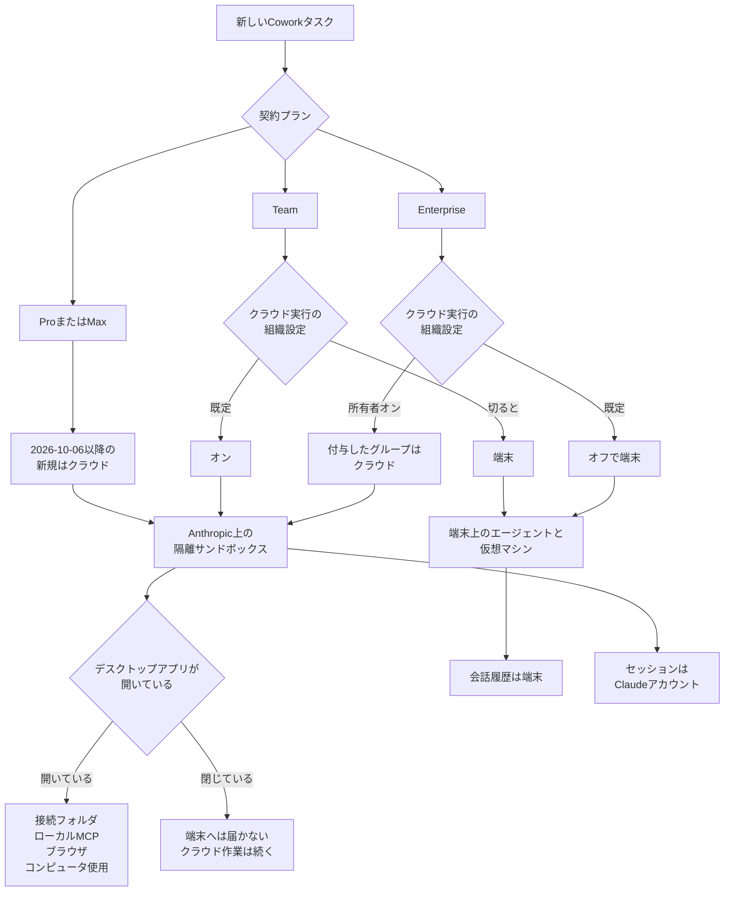

Claude Cowork は、調査、ファイル整理、資料作成のような複数ステップの作業を Claude に任せる機能です。
この記事は、新しいタスクがどこで計算されるかと、会話やファイルがどこに残るかを、契約ごとに整理します。
読み終えると、対象アカウントの計算場所と残るデータを、別々の確認項目として書けます。

日経コンピュータ 2026年10月29日号 p.89 は、動作方式がクラウド型だけになると報じています。
本文は 2026年10月25日時点で有料のため未読で、以下の動作は公式ヘルプとプライバシーセンターに基づきます。

*この記事の全体像。以下、順に解説します。*

## Claude Coworkとは

**Claude Cowork**（以下 Cowork）は、調査、ファイル整理、資料作成のような複数ステップのオフィス作業を、Claude に任せる機能です。
有料プランの Pro、Max、Team、Enterprise で使えます。
画面はデスクトップ、Web、モバイルにあります。

### セッションと定期タスク

**セッション**は、Cowork の一つの実行です。
**タスク**は、その実行に任せる作業です。
**会話**は、チャットに残るやり取りです。
タスクを消すこと、会話を消すこと、メンバーがセッションを消すことは、後の表では別の行です。
クラウドのセッションは、ラップトップを閉じても続きます。
同じ Claude アカウントなら、デスクトップ、Web、モバイルのどれからでも開けます。

**定期タスク**は、公式が Scheduled tasks と呼ぶ、Cowork を繰り返し実行する設定です。
Pro と Max では、2026年10月6日以降に新しく作る定期タスクはクラウドで実行され、端末が起動していなくても動きます。
それより前からコンピュータで動いている定期タスクは、端末に残ります。

Team と Enterprise では、クラウド実行と定期タスクの組織設定がオンのとき、新しい定期タスクはクラウドで動きます。
Enterprise のクラウド実行は、既定ではオフです。
**統合体験**は、チャットと Cowork を一つの会話にする設定です。
統合体験の管理設定で Scheduled tasks をオフにすると、利用者はクラウドに新しい定期タスクを作れません。

Team と Enterprise では、Cowork 全体のオンオフと、クラウド実行のオンオフが、別の設定です。

### 端末のファイル、メモリ、許可

端末上のフォルダの読み書きは、デスクトップで始めたセッションか定期タスクが、開いているデスクトップアプリ経由でコピーを取りに行くときに限る、と機能表の注記が書いています。
クラウドのセッションが端末のファイルを必要とするとき、Claude はそのファイルのコピーを取ります。
フォルダの原本は、端末に残ります。
接続フォルダへの変更が、その原本へ戻るかは、ヘルプのこの説明には書かれていません。

**接続フォルダ**は、デスクトップアプリから Cowork に結んだ端末上のフォルダです。
その読み書きは、デスクトップアプリが開いていることに加え、そのセッションがデスクトップで始まったか、定期タスクであるときに限られます。
**ローカル MCP** は、端末側につなぐツール接続です。
**組み込みブラウザ**は、デスクトップアプリが開いているときに使うブラウザです。
**Claude in Chrome** は、ブラウザ側の接続で、後の節では MCP に含む接続としても出てきます。
この二つは、Chrome のサイドパネルとは別です。
サイドパネルは、開いているタブの読み取りにデスクトップアプリを必要としません。
**コンピュータ使用**は、Pro と Max ではベータの機能です。
何を操作するかは、ヘルプのこの記述にはありません。
ローカル MCP、組み込みブラウザまたは Claude in Chrome、コンピュータ使用は、デスクトップアプリが開いて接続されているときに使えます。

利用者へ渡したファイルは保存されます。
渡されなかった作業ファイルは、クラウドセッションの終了後は保持されず、参照もされません。

クラウドセッションは、チャットのメモリを使います。
**チャットのメモリ**は、クラウドセッションが参照するチャット側の記憶です。
タスク開始前にメモリを切れます。
開始後は変えられません。
端末上で実行するセッションは、メモリを使いません。

従来の Cowork の許可モードは、Manual、Auto、Skip の三つです。
**新しい Claude 体験**は、公式ヘルプがその名前で呼ぶ新しい画面です。
先の統合体験とは別です。
そのメッセージボックスが提示するのは Auto と Manual で、Auto が Pro、Max、Team の既定、Manual が Enterprise の既定です。
Skip は、組織設定の Allow "Skip all approvals" mode として残ります。
Manual と Auto が、何を人が承認し何が自動で通るかは、ヘルプのこの記述にはありません。

### 計算場所

新しいタスクの計算場所は、プランで分かれます。
クラウドで計算する場合でも、端末への道は残ります。
Pro と Max の 2026年10月6日以降の新規タスクは、公式の一方の説明ではクラウドです。
**サンドボックス**は、クラウド側でセッションごとに作る隔離された実行環境です。
**仮想マシン**は、端末側でシェルと生成コードが動く Linux 環境です。
macOS は Apple Virtualization.framework、Windows は Hyper-V を使います。

図の「開いている」から接続フォルダへ進む枝は、機能表の注記では、そのセッションがデスクトップで始まったか、定期タスクであるときに限られます。
図のブラウザは、組み込みブラウザや、タスクの中のブラウザ操作です。
サイドパネルのタブ読み取りは、この枝に含みません。
アーキテクチャの説明では、サンドボックスを終了時に破棄し、組織をまたいで状態を共有しません。

Enterprise の統合体験では、アイドルが数分続くと、端末側とは別のクラウドのサンドボックスを止め、ディスクを暗号化スナップショットとして保存します。
その環境は、作成から 30 日で期限切れになります。
この 30 日は、会話の保持期間や、利用者が削除したあとのバックエンド削除とは別です。
アイドル後に止めるまでの時間は「数分」とだけ書かれ、分数の指定はありません。

## 注意点

日経クロステックの公開リードは、有料本文の手前に出ている導入です。
そこには、動作方式がクラウド型だけになり、セキュリティ上の懸念は減ると考えられる一方、別の懸念が増える恐れがある、とあります。
見出しは「Claude Coworkが仕様変更　企業の懸念は減るか増えるか？」です。
このウェブ記事の出典表記は、日経コンピュータ 2026年10月29日号 p.89 です。
タグに EDR があります。
**EDR** は、エンドポイント製品で実行の中身を見ようとする監視です。
本文は 2026年10月25日時点で有料会員限定であり、リード以外は読んでいません。

### クラウド型だけ、が指す範囲

「クラウド型だけ」は、Pro と Max の新しいタスクについて、[Use Claude Cowork on web, desktop, and mobile](https://support.claude.com/en/articles/15520349-use-claude-cowork-on-web-desktop-and-mobile) と合います。
同記事は、2026年10月6日に Settings の「Only on your computer」を削除し、実行場所を選ぶ設定は無く、戻せない、と書いています。
[What to expect with Claude Cowork in the cloud](https://support.claude.com/en/articles/15811196-what-to-expect-with-claude-cowork-in-the-cloud) は、新しい Claude 体験が無い場合、新規セッションの開始時に Settings、Cowork の「Run new tasks in the cloud」で切り替えられる、とまだ書いています。
段階展開の途中では、画面が分かれることがあります。
すべてのプランの、すべてのタスクには当てはまりません。

次の場合は、クラウドだけにはなりません。

- Team の「Run Cowork in the cloud」は既定オンで、所有者が切れます
- Enterprise の同じ設定は既定オフです。所有者がオンにし、カスタムロールでグループへ付与します
- **HIPAA 設定**は、公式が HIPAA-ready と呼ぶ組織向け設定です。**Claude Code** は、コンピュータ上で動かす公式のツールです。**local mode** は、HIPAA 向けのヘルプが、クラウドではない実行に付ける名前です。Claude Code の local mode と Cowork の local mode にこれを適用した組織では、クラウドの Cowork は使えず、オンにする設定もありません
- 2026年10月6日より前にコンピュータで始めたタスクは、完了までそのコンピュータに残ります。すでにコンピュータで動いている定期タスクも残ります
- **Dispatch** は、どこからでもタスクを割り当てる限定ベータです。すでに使っている一部の Pro と Max は、デスクトップ上でタスクを実行し続けられます。新規利用者は使えません
- 新しい Claude 体験ではローカル実行の選択肢が無い、と What to expect with Claude Cowork in the cloud が書いています。Pro と Max への展開は段階的で、全員が同じ日に入る日付は消費者向けの記事にはありません

[Get started with Claude Cowork](https://support.claude.com/en/articles/13345190-get-started-with-claude-cowork) は「Cowork はタスクをクラウドで実行する」と総称します。
同じヘルプ群がプラン別の例外を書いているので、総称を全契約の仕様として使いません。

### 懸念が減る、という見通し

「セキュリティ上の懸念が減る」は、このリードの見通しです。
公式のアーキテクチャ FAQ は、別のことを書いています。
EDR は、ローカル実行の仮想マシンの中を検査できません。
クラウドセッションはエンドポイントの外で動くため、EDR はそちらも観察できません。
端末から離れるのは、エージェントループとコード実行の場所です。
**エージェントループ**は、公式 FAQ が、端末から離れる対象としてコード実行と並べて呼ぶ処理です。
エンドポイント製品で中身を見る、という監視は、ローカルの仮想マシンの時点で届いておらず、クラウドセッションでも届きません。

### ヘルプから決まらないこと

次の点は、アーキテクチャ、安全、Team、統合体験の各ヘルプからは決まりません。

- Cowork のクラウドセッションが、どの国、どのリージョンで処理されるかは、それらの記事にありません。SLA の数値もありません
- 消費者向けの「Help improve our AI models」の既定がオンかオフかは、プライバシーセンターの説明には書かれていません。未確認です
- 日経コンピュータ当該記事の有料本文は未読です。リードの「減る懸念」と「増える懸念」が、公式のどの制御を指すかは断定できません
- Amazon Bedrock、Google Cloud、Microsoft Foundry 経由のデスクトップで、2026年10月6日以降の Cowork が端末実行のままかは未確認です。この記事の「Anthropic のサーバ」は、claude.ai のアカウントで動く Cowork の説明です
- クラウド実行を組織設定で切ったとき、進行中のセッションが止まるかは、公式ヘルプには書かれていません
- Trust Center の PDF は、この記事の根拠にしていません
- 接続フォルダへの変更が、端末に残る原本へ戻るかは、読み書きはコピーを取りに行くときに限る、という注記と、原本は端末に残る、という説明からは決まりません

## 契約ごとの実行場所

発注側の確認は、新規タスクの計算場所と、アカウントおよびコネクタに残るデータを、別々に書きます。
**コネクタ**は、Google Drive や MCP のように、Cowork が外部サービスを呼ぶ接続です。
**ゼロデータ保持**は、公式が zero data retention と呼ぶ合意です。
対象になる製品は、アカウントに残るデータの節で、公式ページの一覧に限って書きます。
**CMEK** は、統合体験が未提供になる組織条件の一つとしてヘルプが挙げる名前です。
ヘルプには、その略の展開はありません。
**BAA** は、Team と Enterprise 向けの記事が Cowork の対象範囲を整理する契約の名前です。
誰と誰の契約かは、ヘルプのこの記述にはありません。
覆う範囲は、表の HIPAA の行です。
表の Chat は、組織設定で「Cloud code execution and file creation」と並べてオンオフする項目の名前です。
クラウド実行の既定と、統合体験で会話がクラウドのサンドボックスへ進むことは、別の設定です。
計算場所は、次の表で契約ごとに見ます。

| 契約 | 新しいタスクの計算場所 | 公式の切替 |
|---|---|---|
| Pro / Max | 2026年10月6日以降、Use Claude Cowork on web, desktop, and mobile はクラウドで、実行場所を選ぶ設定は無い、と書きます。What to expect with Claude Cowork in the cloud は、新しい体験の外では「Run new tasks in the cloud」が残る、と書きます | 同日より前に始めたタスクと、端末上の既存の定期タスクは端末のままです。段階展開の途中では画面が分かれることがあります。新しい体験ではローカルの選択肢がありません |
| Team | クラウドが既定 | 所有者が「Run Cowork in the cloud」を切れます。Cowork 全体のオンオフとは別です |
| Enterprise | 端末が既定 | 所有者がクラウドをオンにし、グループへ付与します |
| Enterprise で HIPAA 設定を適用した後 | 適用と同時に Cowork はオフになります。所有者が Organization settings、Cowork の「Enable for your organization」を再度オンにした後の実行場所は、デスクトップ上のローカル Cowork です | クラウドの Cowork をオンにする設定はありません。BAA がデスクトップ上の Cowork を覆うのは、そのトグルをオンにした後です。設定前の Cowork と、クラウドの Cowork は BAA の対象外、と Use Claude Cowork on Team and Enterprise plans が整理します |
| Enterprise の統合体験 | コードやファイル作業が必要になると、同じ会話が Anthropic 管理のクラウドサンドボックスへ進みます | 既存組織では既定オフです。Chat and Cowork unified を未変更で、かつ Chat と「Cloud code execution and file creation」が両方オンなら、2026年11月16日に自動でオンになります。どちらかがオフならその日はオンにならず、通知も出ません。両方オンになった時点でオンになります。前提が満たされるときは Keep disabled を選べます。ゼロデータ保持、HIPAA-ready、CMEK の組織では未提供です |

統合体験をオンにしても、デスクトップアプリでコンピュータを結べば、ローカルフォルダ、ローカル MCP、アプリケーションへの到達は残ります。
**アプリケーション**は、ヘルプがローカルフォルダおよびローカル MCP と並べる到達先の名前です。
到達先の製品一覧は、ヘルプにはありません。
**Remote control** は、結んだコンピュータを Web、モバイル、定期タスクから使う設定です。
これをオフにすると、Web、モバイル、定期タスクは結んだコンピュータを使えません。

Pro と Max で、新しいタスクをコンピュータだけで動かしたい場合、公式が案内するのはデスクトップの **Claude Code** です。
Claude Code は、その案内先としてヘルプが挙げる、コンピュータ上のツールです。
Cowork のタスクは「Download task data」のあと、Claude Code で `/port-task-data` を実行して引き継ぎます。

セッションを始めたあと、クラウドとローカルを途中で切り替えることはできません。

## 端末へ届く範囲

この節は、計算が端末にあるか、端末へ届くか、だけを見ます。

新規タスクのエージェントループとコード実行は、前の表のクラウド行では Anthropic のサーバにあります。
ローカル行では、会話とファイルの読み書きとローカル MCP は端末上にあります。
シェルと生成コードは、前節の仮想マシンにあります。

接続フォルダの読み書きは、デスクトップアプリが開いて接続されていることに加え、そのセッションがデスクトップで始まったか、定期タスクであるときに限る、と機能表の注記が書いています。
Web やモバイルで始めたセッションは、アプリが開いているだけでは同じではありません。
各ローカルツール呼び出しは、メンバーの許可を通ります。
ローカル MCP、ブラウザ操作、コンピュータ使用は、デスクトップアプリが開いて接続されているときに届きます。

アプリを閉じると、クラウドの作業は続き、端末のファイル、ローカル MCP、ブラウザ操作、コンピュータ使用には届きません。

組み込みブラウザの通信は、デスクトップアプリが動く利用者のマシンから出ます。
Web やモバイルから操作していても、相手サイトからはその端末の通信に見えます。

Chrome のサイドパネルは、開いているタブの読み取りにデスクトップアプリを必要としません。
タスクの中でブラウザを操作する場合は、デスクトップアプリが開いている必要があります。

ローカルセッションの会話履歴は、利用者のコンピュータに保存されます。
組織向けの標準データ保持の対象外で、管理者は集中して削除できません。
ローカルセッションの削除エンドポイントは、まだありません。

管理端末では、MDM キー `isLocalDevMcpEnabled` と `isDesktopExtensionEnabled` が、ローカル MCP とデスクトップ拡張を止められます。
**デスクトップ拡張**は、ヘルプがローカル MCP と一緒に、これらのキーで止められる対象として挙げる名前です。
二つのキーのどちらがどちらかは、この記述では分かれていません。
**MDM キー**は、管理端末へ配るこの二つの設定項目です。
この二つのキーはデスクトップアプリに効くので、ローカルセッションと、クラウドセッションがデスクトップ経由で届く範囲の両方に効きます。
ローカル MCP は、クラウドセッションの中では動きません。
届くときは、開いているデスクトップアプリ側で動きます。

EDR で仮想マシンの内部とクラウドセッションを見る、という確認は、公式 FAQ の記述と合いません。

## アカウントとコネクタに残るもの

この節は、Anthropic のアカウントと、そこから呼び出すコネクタを見ます。
前節の「端末に原本がある」は、この節の「コピーや会話がアカウントに残る」を消しません。

### 処理の境界

クラウドセッションがデスクトップ経由で開いたローカルファイルを含む作業は、Anthropic のサーバで処理されます。

サンドボックスが持つ資格情報は、数時間で失効するセッション範囲のトークンだけです。
コネクタの認可トークンは、サンドボックスに入りません。
コネクタ呼び出しは、サーバ側で行われます。

組織のネットワーク外向き許可は、クラウドセッションのコード実行には効きます。
Web fetch、Web search、MCP（Claude in Chrome を含む）には効きません。
Web fetch の取得先は、検索結果と、利用者が共有した URL に限られます。
実行場所は記事で分かれます。
Get started with Claude Cowork と Use Claude Cowork on Team and Enterprise plans はサーバ側、Claude Cowork architecture overview はローカルセッションの web fetch を端末側と書いています。

Enterprise の統合体験では、コネクタ方針はサンドボックスの外で、すべてのコネクタ呼び出しに適用されます。

### 何が残るか

**Compliance API** は、Enterprise がコンピュータ上のローカルセッションを取得する公式の API です。
**直接始めた**クラウドセッションは、ヘルプが、会話を消してもメンバーが削除するまで残る、利用者開始のクラウドセッションに付ける言い方です。
**プロジェクト**は、チャットを含むまとまりです。
中のチャットは、チャット側の保持期間では消えません。

| データの種類 | どこに残るか | いつ消えるか |
|---|---|---|
| クラウドセッションの会話と、利用者へ渡したファイル | Claude アカウント | 利用者がタスクを削除すると履歴から直ちに消え、Get started with Claude Cowork はバックエンドから 30 日以内に削除する、と書きます。リンク先は How long do you store my data? です |
| 渡されなかった作業ファイル | クラウドセッションの作業領域 | その説明では、セッション終了後は保持されず参照されません |
| クラウドが取りに行ったファイルのコピー | セッション側 | Pro と Max の変更説明では、セッション削除時にコピーも削除され、消費者向けの保持の説明に従います |
| 利用者が直接始めた Cowork のクラウドセッション | Claude アカウント | Enterprise の統合体験では、会話を消しても一緒に消えません。メンバーが削除するまで保持されます |
| 定期タスクとその実行 | クラウドの定期実行 | 会話を消しても止まりません。止めるには定期タスクの設定を切ります |
| 統合体験のサンドボックスディスク | 暗号化スナップショット | 環境は作成から 30 日で期限切れです。アイドル後の停止は「数分」とだけ書かれ、分数の指定はありません |
| 2026年10月8日以降に統合体験の会話で渡したファイル | その会話に紐づく | ほぼすべてがその会話と一緒に削除されます。組織内の別の会話やプロジェクトが使っている場合を除きます。それより古いファイルは、会話削除後も残ることがあります |
| ローカルセッションの履歴 | 利用者のコンピュータ | 標準の組織向け保持の対象外です。Enterprise は Compliance API で取得できます。HIPAA を有効にし Compliance API をオンにした組織では、Anthropic がコンピュータ上のセッションを取得し、API は直近 30 日を返します。組織の保持期間がそれより短いときは、その期間です |
| プロジェクト | ローカルセッションは端末。クラウドセッションは Claude アカウント | Enterprise のカスタム保持を設定しない限り、プロジェクトは既定で無期限です。プロジェクト内のチャットは、チャット側の期間では消えません |

保持の期間は、契約の種類で分かれます。

消費者プランは、Free、Pro、Max です。
**Claude for Work** は、消費者プランと別に、ヘルプが商用製品として挙げる名前です。
ヘルプは、これが Team または Enterprise の別名だとは書いていません。
Team と Enterprise のクラウドセッションを学習に使わない、という文は、Claude Cowork architecture overview が別に書いています。

消費者プラン（Free、Pro、Max）では、削除した会話は履歴から直ちに消え、バックエンドからは 30 日以内です。
モデル改善を許可している場合、許可後に新しく始めた、または再開したチャットについて、非識別化したデータを学習パイプラインに最大 5 年保持しえます。
設定を切ったあとも、進行中の学習実行と、既に学習済みのモデルからは除かれません。
**Incognito** は、モデル改善がオンでも学習に使わないチャットのモードです。
「Help improve our AI models」の既定がオンかオフかは、未確認です。

Usage Policy 違反としてフラグされた入力と出力は、消費者も組織も最大 2 年です。
信頼と安全の分類スコアは、最大 7 年です。
フィードバックに紐づくデータは、5 年です。

商用製品（Claude for Work、API など）の入出力は、既定ではモデル学習に使いません。
サムズアップやサムズダウンのフィードバックは、関連する会話全体を最大 5 年保存しえます。
コネクタの生データ（Google Drive、リモートおよびローカル MCP）は、そのフィードバックに含まれません。
会話へ直接コピーした内容は、含まれえます。

API の入出力は、例外を除き 30 日以内にバックエンドから削除します。
例外には、Files API のように利用者の管理で長く保持するサービス、ゼロデータ保持などの別合意、Usage Policy の執行、法令があります。
ゼロデータ保持の説明ページが対象とするのは、次の三つだけです。
対象となる Anthropic API、商用組織の API キーを使う製品（API 経由の Claude Code を含む）、Enterprise プランの Claude Code です。
Claude for Work のチャットや Cowork、Claude Max は、このページの対象一覧にありません。

Enterprise のカスタム保持は、最短 30 日です。
設定しなければ無期限です。
チャットの期間は、会話の最新の活動、またはその会話から始めたクラウドセッションの活動から数えます。
プロジェクトからクラウドの Cowork セッションを始めると、プロジェクトの期間はそこで一度リセットされます。
ローカルの Cowork セッションを始めることは、リセットしません。
ローカルフォルダの接続と切断、Cowork セッションからの知識ファイルの編集、クラウドセッションをプロジェクトへ移すことも、リセットします。
**知識ファイル**は、そのリセット条件に挙がる名前です。
どのファイルかは、ヘルプのこの記述にはありません。
**other work** は、公式がそう呼ぶ、それ以外のセッション中の作業です。
other work はリセットしません。

Team と Enterprise のクラウドセッションの会話は、他の Team と Enterprise のデータと同じ商業上の約束で扱われ、Claude の学習には使われない、と Claude Cowork architecture overview が書いています。
この文は、クラウドセッションの節にあります。

### 利用枠

Pro、Max、Team、およびシート課金の Enterprise の利用枠は、5 時間でリセットされるセッション上限と、週に一度リセットされる週次上限です。
**シート課金**は、席数で払う契約です。
**usage-based** の Enterprise は消費量課金で、この 5 時間リセットとは別です。
メッセージ数の固定値はありません。
claude.ai、Claude Code、Claude Desktop の利用は、同じ枠に入ります。
Cowork 固有の RPM や同時セッション数は、公式の利用枠の説明にはありません。
ファイルサイズの数値上限もありません。
非常に大きいファイルや、ファイル数が多い場合は遅くなる、とだけ書かれています。

## 確認票を計算場所と残るデータに分ける

導入の可否は、一つの「クラウド型に変わったか」で書きません。
調達の確認票を、次の三つに分けます。

1. 計算場所です。対象の契約は Pro か Max か、Team か、Enterprise か。新規タスクはクラウドか端末か。Pro と Max は段階展開の途中で、設定が無い画面と、「Run new tasks in the cloud」が残る画面が分かれることがあります。2026年10月6日より前のタスクと、既存のローカル定期タスクが残っているか。HIPAA 設定の適用直後は Cowork が一度オフになり、所有者が再度オンにした後の実行はデスクトップ上のローカル Cowork で、クラウドはオンにできません。ゼロデータ保持、HIPAA-ready、CMEK により統合体験が対象外か。CMEK は、画面か契約にその名前があるかを見る項目です。略の意味はヘルプに無く、その名前が無い組織を対象外とは数えません。Enterprise の統合体験は、未変更かつ Chat と「Cloud code execution and file creation」が両方オンのときだけ、2026年11月16日に自動でオンになります。どちらかがオフならその日はオンにならず、通知も出ません。前提が満たされるときは Keep disabled のままにするか
2. 残るデータと委託です。会話、渡したファイル、渡さない作業ファイル、取りに行ったコピー、直接開始したクラウドセッション、定期タスク、統合体験のスナップショットを、別の行にします。消費者なら削除後 30 日、モデル改善を許可した場合の非識別化最大 5 年、違反フラグの 2 年とスコア 7 年です。Enterprise なら既定無期限か、最短 30 日のカスタム期間か。コネクタはサーバ側から呼ばれ、ローカル MCP は端末で動く、と経路を分けます
3. 監視の期待です。EDR でエージェントの内部を見る、という要件は、ローカルの仮想マシンでもクラウドセッションでも公式の記述と合いません。代わりに、Compliance API、OpenTelemetry、監査ログ、コネクタの都度承認で見る範囲を書きます。OpenTelemetry と監査ログは、その代わりの確認項目として挙がる名前です。ヘルプには、OpenTelemetry の取得項目の一覧はありません。コネクタの都度承認は、ローカルツールがメンバーの許可を通る、という記述とは別に挙がっています。同じ操作かは、ヘルプのこの範囲では結ばれていません

次に人がやることは、対象アカウントのプランと、Organization settings の Cowork、クラウド実行、Chat and Cowork unified、データ保持の四つを画面で見ることです。
ヘルプの既定と、その組織がすでに変えた値が違っていれば、画面の値を優先します。

## まとめ

Cowork の新しいタスクがクラウドで計算されるかは、契約と画面の段階で分かれます。
Pro と Max の新規は、公式の一方の説明では 2026年10月6日以降クラウドで、実行場所の選択は戻りません。
もう一方の説明では、新しい体験の外に切替が残ります。
Team はクラウドが既定で、所有者が切れます。
Enterprise のクラウド実行は、端末が既定です。
統合体験がオンで、コードやファイルの作業が必要になると、その会話はクラウドのサンドボックスへ進みます。
HIPAA 設定を適用したあとに所有者が Cowork を再度オンにしても、実行はデスクトップ上のローカル Cowork で、クラウドをオンにする設定はありません。

端末に原本が残ることと、コピーや会話が Claude アカウントに残ることは、別の行です。
会話を消しても、統合体験で直接始めたクラウドセッションと、定期タスクは、それだけでは止まりません。
EDR でエージェントの中身を見る要件は、実行がクラウドへ移る前から、公式の記述と合いません。

確認は、プランと、Cowork、クラウド実行、Chat and Cowork unified、データ保持の四つを画面で見ることから始めます。
画面の値がヘルプの既定と違えば、画面を優先します。

この記事が少しでも参考になった、あるいは改善点などがあれば、ぜひリアクションやコメント、SNSでのシェアをいただけると励みになります！

## 参考リンク

- [Claude Coworkが仕様変更　企業の懸念は減るか増えるか？（日経クロステック）](https://xtech.nikkei.com/atcl/nxt/mag/nc/18/052100111/102100189/)
  公開リードと書誌のみです。本文は未読です。出典表記は日経コンピュータ 2026年10月29日号 p.89 です
- [Use Claude Cowork on web, desktop, and mobile](https://support.claude.com/en/articles/15520349-use-claude-cowork-on-web-desktop-and-mobile)
- [What to expect with Claude Cowork in the cloud](https://support.claude.com/en/articles/15811196-what-to-expect-with-claude-cowork-in-the-cloud)
- [Claude Cowork architecture overview](https://support.claude.com/en/articles/14479288-claude-cowork-architecture-overview)
- [Use Claude Cowork on Team and Enterprise plans](https://support.claude.com/en/articles/13455879-use-claude-cowork-on-team-and-enterprise-plans)
- [Get started with Claude Cowork](https://support.claude.com/en/articles/13345190-get-started-with-claude-cowork)
- [Set up and manage the new unified Claude experience](https://support.claude.com/en/articles/17444462-set-up-and-manage-the-new-unified-claude-experience-for-your-enterprise-organization)
- [Use Claude Code (local mode) and Claude Cowork (local mode) on a HIPAA-ready Enterprise plan](https://support.claude.com/en/articles/17318731-use-claude-code-local-mode-and-claude-cowork-local-mode-on-a-hipaa-ready-enterprise-plan)
- [Assign tasks from anywhere in Claude Cowork](https://support.claude.com/en/articles/13947068-assign-tasks-from-anywhere-in-claude-cowork)
- [How long do you store my data?](https://privacy.claude.com/en/articles/10023548-how-long-do-you-store-my-data)
- [How long do you store my organization’s data?](https://privacy.claude.com/en/articles/7996866-how-long-do-you-store-my-organization-s-data)
- [Configure custom data retention controls for Enterprise plans](https://support.claude.com/en/articles/10440198-configure-custom-data-retention-controls-for-enterprise-plans)
- [Is my data used for model training?](https://privacy.claude.com/en/articles/7996868-is-my-data-used-for-model-training)
- [I have a zero data retention agreement with Anthropic. What products does it apply to?](https://privacy.claude.com/en/articles/8956058-i-have-a-zero-data-retention-agreement-with-anthropic-what-products-does-it-apply-to)
- [How do usage and length limits work?](https://support.claude.com/en/articles/11647753-how-do-usage-and-length-limits-work)
