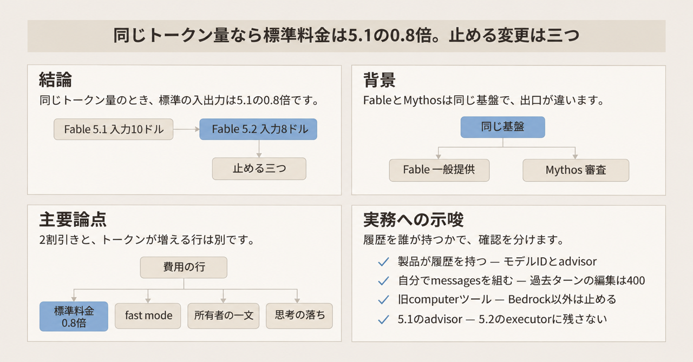
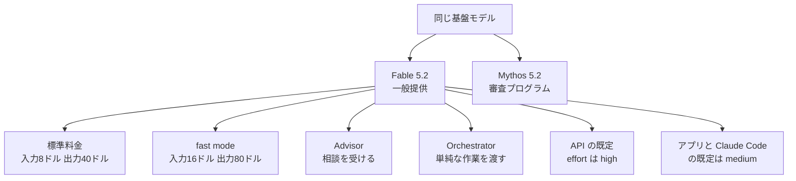
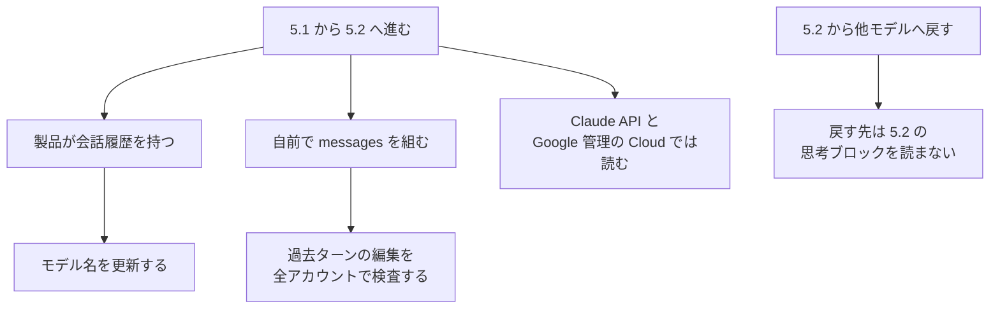

2026年11月9日、Anthropic は Claude Fable 5.2 と Claude Mythos 5.2 を公開しました。この記事は、公式の料金、呼び出しの制約、5.1 から 5.2 へ進むときに固定する確認を、予算とテストへ落とすための整理です。料金は 2026年11月11日の公式料金表に合わせています。料金、速度、ベンチマークの数値は、Anthropic の発表、料金表、システムカードの記載です。システムカードは、評価と安全策をまとめた公式文書です。


*この記事の全体像。以下、順に解説します。*

## Claude Fable 5.2とは

Claude Fable 5.2 と Claude Mythos 5.2 は、同じ基盤モデルです。Fable はサイバーと生物の安全策を付けて一般に出します。Mythos は、ライフサイエンスとサイバーの審査プログラム経由で出します。

発表は、多くのコーディングと知識作業は Claude Opus 5.5 から始め、範囲が広ければ Fable や Mythos へ上げ、単純なら Claude Sonnet 5.5 や Claude Haiku 5.5 へ下げると書きます。Opus、Sonnet、Haiku は、Fable とは別の Claude のモデルです。Fable 5.2 は、小さいモデルが相談する Advisor にも、単純な作業を小さいモデルへ渡す Orchestrator にもなれます。Advisor は、Haiku、Sonnet、Opus が難しい問題を相談する役割です。Orchestrator は、単純な作業の実行を小さいモデルへ渡す役割です。

### モデル ID と窓口

API のモデル ID は `claude-fable-5-2` です。Amazon Bedrock では `anthropic.claude-fable-5-2` です。Mythos は `claude-mythos-5-2` です。

Vercel AI Gateway は、Vercel がモデルを載せる呼び出し窓口です。そこのモデル名は `anthropic/claude-fable-5.2` です。changelog は、長い曖昧な作業を進め、単純な作業を小さいモデルへ渡すオーケストレータ、または他の Claude が相談するアドバイザ、と説明します。

### コンテキスト、出力、廃止の下限

コンテキストは 100 万トークンです。1 リクエストの出力上限は 12.8 万トークンです。

ここでの面は、モデルを呼び出す提供元です。Anthropic が運営する面では、廃止は 2027年11月9日より早くはありません。対象は、Anthropic 自身の Claude API、AWS 上で Anthropic が運営する Claude Platform on AWS、Claude Models on Google Cloud（Anthropic が管理）、Microsoft 側の窓口である Microsoft Foundry です。英語版の廃止表で、状態は Active です。Fable 5.1 の廃止は、同じ適用範囲で 2027年9月1日より早くはありません。Amazon Bedrock は AWS の別提供元、Claude Models on Google Cloud（Google が管理）は Google が運営する別窓口で、どちらも提供元が別の日程を置きます。廃止日が付くのは Anthropic が管理する側です。

### 標準料金と、足される単価

API の標準料金は、Fable 5.2 も Mythos 5.2 も、100万トークンあたり入力 8 ドル、出力 40 ドルです。Fable 5.1 は入力 10 ドル、出力 50 ドルでした。

任意の fast mode は、トークン生成を最大 2.5 倍にします。単価は入力 16 ドル、出力 80 ドルです。fast mode は、生成を速くする代わりに単価が上がる任意のモードです。

キャッシュは、同じプロンプトの先頭を再利用する仕組みです。読みは再利用したときの単価で、基準入力の 2.5%、100万トークンあたり 0.20 ドルです。Fable 5.1 のキャッシュ読みは 0.25 ドルでした。書きは、その先頭を保存するときの単価です。5 分の保持は基準入力の 1.25 倍で 10 ドル、1 時間の保持は 2 倍で 16 ドルです。

Batch API は入出力とも 50% 引きです。Fable 5.2 は入力 4 ドル、出力 20 ドルです。Batch API は、非同期でまとめて処理する API です。

米国へ推論を限る `inference_geo` は、Claude 4.6 以降のトークン料金に 1.1 倍が乗ります。Fable 5.2 はこの範囲に入り、指定すると 1.1 倍です。

### 呼び出しの既定

API の effort の既定は `high` で、Fable 5.1 から変わりません。effort は、思考の深さの段階です。五段階は `low`、`medium`、`high`、`xhigh`、`max` で、そのまま送れます。Claude アプリは claude.ai、Claude Code は会話履歴を製品が持つコーディング用の製品で、どちらも API とは別です。この二つの既定は、発表では Medium です。

安全監視のため、30 日の保持が要ります。明示の許可があるゼロデータ保持は使え、許可が無いゼロデータ保持では使えません。保持の無い組織の Claude API リクエストは 400 になります。Priority Tier は容量の契約枠で、Fable 5.2 と Mythos 5.2 は非対応です。契約がある組織は、容量を別に見ます。

適応的思考は常時オンです。いつどれだけ考えるかはモデルが決め、呼び出し側は止められません。思考ブロックは、その思考が応答に残す推論の記録です。思考の無効化、アシスタント応答の先埋め、`temperature` などのサンプリング、ツールの強制選択は 400 になります。先埋めは、アシスタントの返答の先頭を呼び出し側が書いて送ることです。これは Fable 5.1 と同じです。

移行ガイドは、Fable 5.2 に、Fable 5.1 と、その前の世代である Fable 5 が共有する枠とは別のレート制限があると書きます。

### コードの所有者を名乗る一文

プロンプトガイドの節 `say-who-owns-the-code` は、システムプロンプトに次の一文を置くと、小さいコーディング課題で繰り返しコードの統合が増えた、と書きます。統合は、すでにあるコードと同じ働きを、もう一度書かずに既存へまとめることです。

```text
This codebase is yours: what it's for and how it's built are your call, and you'll keep building on it.
```

同じガイドは、利用者がコードの所有者で、変更を小さくしたいときは、この文を入れない、と書きます。

### 出口と、履歴の持ち方

Fable と Mythos は出口が違います。標準料金と fast mode の単価はどちらも同じです。Advisor と Orchestrator は、発表が Fable 5.2 の役割として書くものです。



5.1 から 5.2 へ進むとき、履歴を誰が持つかで公式の手順が分かれます。prefix check は、システム、ツール、過去のメッセージをターンのあいだで変えたかを検査する仕組みです。製品が履歴を持つ、は Claude Code、claude.ai、Claude Managed Agents、Claude Agent SDK を指します。Claude Managed Agents はエージェントを製品が動かす経路、Claude Agent SDK はそれを組み込む SDK です。



戻す経路は、前進とは別の枝です。思考ブロックを読めるのは、Claude API と、Claude Models on Google Cloud（Google が管理）です。廃止日が付く Anthropic が管理する側とは、別の窓口です。この二つの面では、Fable 5.2 は Fable 5.1 の思考ブロックを読み、Opus 5.5、Sonnet 5.5、Haiku 5.5 の思考ブロックも読みます。他のモデルは、Fable 5.2 の思考ブロックを読みません。

## 注意点

発表とガイドの数値は、条件を落とすと別の意味になります。

出力が最大 30% 速い、は発表のテスター所見です。発表本文は outputs と書きます。どの面か、effort か、初回トークンまでか、標本かは書いてありません。システムカードのテキストにも、この 30% の条件は見当たりません。図の中だけに条件がある可能性は残ります。

料金表の別の約 30% は、トークナイザの話です。Mythos Preview は、料金表がトークナイザの対象に挙げる、Mythos 5.2 とは別のモデルです。Claude 4.7 以降と Mythos Preview は、同じテキストが Claude Sonnet 4.6 以前よりおよそ 30% 多くなります。増え方は、内容とワークロードで変わります。Fable 5.1 と 5.2 はどちらもこの新しい側なので、5.1 から 5.2 へ移すときの増分ではありません。速度の 30% と足しません。

ITmedia（2026年11月10日 7:03）の見出しは、API 料金の 2 割下げと、出力の最大 30% 高速化です。単価は発表と同じ 8 ドルと 40 ドルで、fast mode は 16 ドルと 80 ドルです。一次は発表ページで、ITmedia は転載です。

FrontierCode 2.0 は、コードの変更が取り込まれるかの点数です。High effort の点数は Fable 5.2 が 45.3%、Opus 5.5 の最高が 45.5% です。発表が「タスクあたりおよそ半分の費用」と書くのは、この High effort の Fable 5.2 と Opus 5.5 の最高点を比べた初期テストです。標準単価は Opus 5.5 の 2 倍なので、この半分は単価の話ではなく、そのテストでのタスク費用です。自分の予算の半額には使いません。表の 49.1% は、Fable 5.2 の Xhigh の点数です。手法の詳細はシステムカードにあり、第三者の再測定ではありません。

同じ発表の表には、Fable 5.2 が Opus 5.5 を下回る行があります。AA-Briefcase は知識作業の評価で、Elo はその行の強さの点数です。Fable 5.2 は 1785、Opus 5.5 は 1800 です。別の行では、業務手順の AutomationBench が、Fable 5.2 の 51.4% に対して Gemini 4 Carbon の 53.9% です。Gemini 4 Carbon は、表に並ぶ別のモデルです。発表の「ほぼ全項目で上」は、この表の全行ではありません。

システムカード 8.10.1 の ProgramBench は、残りコンテキストを見せないとき、Fable 5.2 が 85.6%、Fable 5.1 が 87.6%、Opus 5.5 が 91.2% です。コンテキストを使い切った割合は 68%、28%、39% です。残りトークンを見せると、Fable 5.2 は 91.6% になります。対象は、不安定な 34 課題を除いた 166 課題です。長い文脈のコーディングが常に 5.1 を上回る、という読みには、見せない条件の点数が反例になります。

ブロックは、安全策が危険な依頼を止めることです。約 55% 減った、という数字は、claude.ai、Claude Code、Cowork という三つの製品の初期テストで、API 全体の測定ではありません。Cowork は、そのテスト対象に挙がる製品です。サイバーのブロックは約 60% 減り、生物のブロックは約 40% 減りました。この二つの百分率は、減った量の構成比ではありません。ブロック時の応答は、サイバーが Opus 4.8、生物が Opus 5 に落ちます。蒸留は、より強いモデルの出力を学習に使って能力を写すことです。蒸留対策で、攻撃側が集めるデータが 90% から 99% 減った、も同社の報告です。

コアコードベースのマージの 90% 超が Claude の執筆であること、8 日間で 1,000 超のサブエージェントが OS を試作したことは、発表の自己申告です。再現条件は発表にありません。

所有者の一文の率は、Anthropic の小さいコーディング課題です。公開データセットでも、本番リポジトリの保証でもありません。頼んだ機能は、文の有無にかかわらずほぼ毎回動いた、とも同じテストは書きます。率は次のとおりです。

- 繰り返しコードの統合は、文があるとおよそ半分、無いと 10 回に 1 回未満です。課題で率は変わります。
- 出力トークンは約 1.5 倍です。頼んでいない変更が出ます。多くはテストと文書です。
- バグ修正を除き、既存機能の振る舞いは 6 回から 10 回に 1 回変わります。effort が高いほど多いです。
- 締めの要約は大きい変更を書き、小さい変更を落とします。
- 「No drive-by refactors, renames or cleanups」を前に置いても、統合はおよそ 3 分の 1 で残りました。範囲を限る別の一文は、この文を打ち消しません。

フェルマーの最終定理の形式化は、証明をコンピュータが検査できる形にすることです。発表の 11 日は、未公開の研究版による最初の形式化で、専用ハーネスと研究者の案内がありました。ハーネスは、モデルの外側で手順やツールの説明を組む仕組みです。発表は、1,000 体の Fable 5.2 が 30 時間で形式化し、その 11 日よりアクション トークンが 3 分の 1、証明が 7 分の 1 の長さだった、と書きます。アクション トークンは発表の比較単位で、何を 1 と数えるかは発表にありません。複数エージェントの記事が書く 9 月の 11 日は、Fable 5.1 にほぼ相当するモデル、Prove2Me、研究者、出力およそ 60 億トークン、Lean 1,300 万行の形式化です。Prove2Me はそのときの手順、Lean はその記述の言語です。発表がこの 9 月と同一だとまでは書いていません。その記事は、初期の Fable 5.2 による toy experiment で、既に証明された補題 47 個と 60 の文を Fable 5.2 の実行へ渡した、と書きます。28.7 時間、出力トークン 3 分の 1、証明の長さ 7 分の 1 は、この 9 月との比較です。30 時間やアクション トークンとは、数も単位も別です。ネット無し、安全策の分類器、共有データベースが条件で、本番の手順ではありません。

FIXIT の記事は、Fable 5.2 の既定 effort は medium で、設定しなければ medium で始まると書きます。公式は面を分けます。発表は、アプリと Claude Code の既定を Medium と書きます。移行ガイドは、API の既定 `high` が 5.1 から不変と書きます。

まだ数値が無い項目は、次のとおりです。

- 最大 30% 高速の、面と effort と標本。
- Fable 5.2 専用レート制限の数値。移行ガイドは、Fable 5.1 と Fable 5 の共有枠とは別だと書き、RPM、ITPM、OTPM の件数は書きません。RPM は分あたりのリクエスト数、ITPM は分あたりの入力トークン、OTPM は分あたりの出力トークンです。
- SLA と、データの所在リージョンの契約文。
- 自社の本番で、所有者の一文が出力を約 1.5 倍にするか。公式の小さい課題の外では、第三者の測定は見当たりませんでした。

## 世代更新で固定する確認

移行ガイドは、5.1 から 5.2 を mostly drop-in と書きます。mostly drop-in は、呼び出しの大半をそのまま差し替えられる、という意味です。壊れる変更は四点です。自前の messages で過去ターンを変えること、Bedrock 以外の `computer_20251124`、5.2 の executor に 5.1 の advisor を残すこと、他のモデルが 5.2 の思考ブロックを読めないことです。四つ目はリクエストが成功します。止めるのは、失敗する最初の三つです。表の残りの行は、モデル名の確認と、測り直しです。

`computer_20251124` は、以前のコンピュータ操作ツールの型名です。advisor ツールは、executor が相談するモデルを指定する仕組みです。MCP コネクタは、外部ツールの一覧をモデルへ渡す接続です。executor は、作業を進める側のモデルです。Messages API は、`messages` を自分で送る Claude API で、製品が履歴を持つ経路とは別です。

| 経路 | 公式が書くこと | 固定する確認 |
|---|---|---|
| Claude Code、claude.ai、Managed Agents、Agent SDK が履歴を持つ | prefix check の影響は無い。モデル名の更新が中心 | モデル ID。advisor があるなら、advisor も `claude-fable-5-2` か `claude-mythos-5-2`。Managed Agents の model に付いた `speed: "fast"` は、5.2 では外す |
| 自前で `messages` を組む | prefix check はアカウントの年齢を問わない。5.1 は 2026年8月31日以降に作られたアカウントだけ、既定で強制する | システム、ツール、過去メッセージをターン間で変えたリクエストが 400 になること。応急の `drop_block` は、出力トークンを増やし得る。Messages API で明示した fast mode は、速さの選択として残せる |
| ツール一覧を固定しない MCP コネクタ | 一覧の変化は、5.2 の思考ブロックにとって編集である。5.1 と Opus 5.5 にとっては編集ではない | 同じ変化を `claude-fable-5-2` で再実行する |
| 5.1 から 5.2 へ進む会話 | Claude API と、Claude Models on Google Cloud（Google が管理）では、5.2 が 5.1 の思考ブロックを読む。Anthropic が管理する側ではない | 前進では、それまでの推論が残ること |
| 5.2 から他モデルへ戻す | 他のモデルは 5.2 のブロックを読まない。リクエストは成功し、落とした入力は課金されない。次のターンは、費用と待ち時間が増え得る | 利用者が戻す先（Fable 5.1 や Opus 5.5）で思考が落ちること。安全策が止めたときの応答先（サイバーは Opus 4.8、生物は Opus 5）も、5.2 の思考は読まない。この二つは別の経路 |
| `computer_20251124` | Bedrock 以外は 400。代替は `computer_toolset_20260801`。Bedrock では旧ツールが残る | 使っている面だけ |
| advisor ツール | 5.2 の executor が受け付ける advisor は、Fable 5.2 か Mythos 5.2 だけ。モデル変更はツールの編集なので、新しい会話で行う | 5.1 の advisor を付けたリクエストが 400 になること |

自前の `messages` で過去ターンを変えると、移行ガイドは次の 400 を返します。

```text
messages.5.content.0: Invalid `signature` in `thinking` block. The block is bound to a different conversation.
```

同じ応答は、ブロックを外すか、`thinking.block_binding.prefix_mismatch_behavior` を `drop_block` にする、と案内します。`drop_block` は応急で、落とした推論のぶん、出力トークンが増え得ます。本番では、不一致がコードの欠陥だけを意味するなら、既定の `error` のままにします。

別アカウントが Fable 5.2 の思考ブロックを送ると、API はそれを落とし、リクエストは成功します。落ちないのは、ブロックを作ったアカウントと、移行ガイドが linked と呼ぶアカウントです。何をもって linked とするかの一覧は、ガイドにありません。

所有者の一文は、全移行の合格条件にはしません。構造を任せるプロンプトに入れたときだけ、注意点の率を差分レビューの観点にします。見るのは差分です。要約だけは見ません。

effort の旧値を送ると拒否される、という項目ではありません。API で effort を省略した 5.1 の呼び出しは、省略のまま、既定 `high` のままです。段階の順序はモデル間で同じです。各段階の思考量は違い得ます。5.1 や Opus 5.5 で合わせた段は持ち込まず、自社の評価で測り直します。これは不合格条件ではなく、費用と品質の基準を取り直す項目です。

アプリと Claude Code は既定が Medium です。effort を明示しないテストは、API の契約と同じではありません。`medium` 以上では、「熟考するな」という指示が思考を止めなかった、とガイドは書きます。その指示に依存するプロンプトは、別の確認にします。

小さいモデルへ渡す境界は、委任を誘うプロンプトやハーネスがあるときだけです。短い課題で、費用を先に書いたツール説明は、委任する理由を並べた説明より、委任がおよそ 3 分の 1 少なかったです。課題の成功は同じでした。`xhigh` と `max` では、自分の作業をレビューするサブエージェントを使った、とガイドは書きます。同じ課題で 5.1 は使いませんでした。確認するのは、ハーネスがサブエージェントに既定で載せるモデルです。素のツール説明で、他に委任の指示が無ければ、新しい説明はおそらく要りません。

Vercel のオーケストレータの文には、トークン数のしきい値はありません。掲載のフォールバック例は、サイバー分類器が断ったときに Opus 5.5、その次に Sonnet 5.5 を試す配列です。サイバー分類器は、危険なサイバー作業を止める安全策です。

## 費用は同じトークン量と、増える行に分ける

トークン量が同じとき、標準料金は入力も出力も Fable 5.1 の 0.8 倍です。これは料金表からの算出です。定価の 2 割引きは、この条件の予算に入れます。

発表は、アプリと Claude Code の既定である Medium effort では、難しい作業を 5.1 より少ないトークンで済ませ得る、とも書きます。減る割合は書いてありません。実費が必ず 2 割より下がる、とまでは読めません。必ず増える、という逆の断定も、この一文が弱めます。

所有者の一文を入れた小さい課題では、出力トークンが約 1.5 倍でした。出力単価 0.8 倍に 1.5 を掛けると、出力費は 1.2 倍になります。この算出は、そのテストの出力増が本番に出る場合の話です。入力が増えるとは書かれていません。

fast mode を付けると、単価は 5.2 の標準の 2 倍、5.1 の標準の 1.6 倍です。標準料金のままの呼び出しでは、この上乗せは起きません。Batch API と Priority Tier では、fast mode は使えません。

「タスクを最後まで」の種の文を、`medium` の記録済みセッションに足すと、出力トークンが約 30% 増えた、とガイドは書きます。やり残しで終わったセッションは、およそ半分になりました。

Fable 5.2 の標準単価は、Opus 5.5 のちょうど 2 倍です。Opus 5.5 は入力 4 ドル、出力 20 ドルです。これは 5.1 との比較とは別です。

日本トレカセンター Tech Blog（2026年11月10日）は、同じ CSV パーサの依頼で、定価計算の 1 回あたりが次だったと書きます。5.2 の標準は 0.0761 ドル（4 試行、出力 1,890、うち thinking 813）です。5.1 の標準は 0.0428 ドル（2 試行、出力 843、thinking 0）です。比は約 1.8 倍です。計測は 2026年11月10日 12:18〜12:30（JST）、effort は medium、`max_tokens` は 3000 です。請求書との照合は無く、thinking の有無が差の中心です。この 1 本の計算値を、全ワークロードの実費とは読みません。同じ型の課題では、thinking トークンを費用の行に分けて再計測します。

fast mode、所有者の一文、タスク完遂の文、戻すときの思考の落ちは、2 割引きとは別の行で見ます。

## 止める条件と測り直す条件

モデル名の更新だけで済む経路と、契約テストを足す経路は分けます。

止める条件は三つです。

1. 自前で過去ターンを編集する履歴。
2. Bedrock 以外の `computer_20251124`。
3. 5.2 の executor に、5.1 の advisor を残すこと。

製品が履歴を持つ経路まで「差し替えは危険」に含めると、ガイドの範囲を超えます。その経路は、モデル ID と advisor の組を見ます。前進の会話は、5.2 が 5.1 の思考を読みます。Managed Agents の model に付いた `speed: "fast"` は外します。Messages API で明示した fast mode は、速さと単価の選択として残せます。

5.2 の思考ブロックを読めないモデルへ戻す経路は、リクエスト自体は成功します。止める前に、思考が落ちたあとの品質、費用、待ち時間が、その用途で許容できるかを見ます。

測り直す条件は三つです。

1. effort は API では持ち越せます。自社評価の点数とトークンは取り直します。既定 `high` は 5.1 と同じなので、旧値そのものを不合格にはしません。
2. 所有者の一文は、任せるプロンプトに入っているときだけ、差分と出力トークンを見ます。最小変更のために外せ、というガイドと、全件必須は衝突します。機能の成否は、同じ小さい課題では文に依存していません。
3. 委任を誘うハーネスでは、サブエージェントの既定モデルと、費用を先に書いたときの委任の減り方を見ます。委任を誘っていないハーネスまで、境界の対象にはしません。

## まとめ

Claude Fable 5.2 と Claude Mythos 5.2 は同じ基盤で、出口が違います。API の標準料金は 100万トークンあたり入力 8 ドル、出力 40 ドルで、トークン量が同じなら Fable 5.1 の 0.8 倍です。fast mode、所有者の一文、タスク完遂の文、思考ブロックが落ちる戻りは、この 2 割引きとは別の行です。

世代更新で止めるのは、自前の過去ターン編集、Bedrock 以外の `computer_20251124`、5.2 の executor に残した 5.1 の advisor です。製品が履歴を持つ経路は、モデル ID と advisor の組を見ます。effort の段と、任せるプロンプトの所有者の一文と、委任を誘うハーネスは、不合格ではなく測り直しです。

この記事が少しでも参考になった、あるいは改善点などがあれば、ぜひリアクションやコメント、SNSでのシェアをいただけると励みになります！

## 参考リンク

- [Claude Fable 5.2 と Mythos 5.2 の発表](https://www.anthropic.com/claude-fable-and-mythos-5-2)
- [システムカード](https://www.anthropic.com/document/claude-fable-5-2-mythos-5-2-system-card)
- [プロンプトガイド](https://platform.claude.com/docs/en/build-with-claude/prompt-engineering/prompting-claude-fable-5-2)
- [移行ガイド](https://platform.claude.com/docs/en/models/fable-5-2/migration-guide)
- [料金](https://platform.claude.com/docs/en/about-claude/pricing)
- [廃止表](https://platform.claude.com/docs/en/about-claude/model-deprecations.md)
- [複数エージェントの記事](https://claude.dev/blog/safely-scaling-multi-agent-teams-with-fable-5-2/)
- [9月の形式化](https://www.anthropic.com/research/formalizing-fermats-last-theorem)
- [Vercel changelog](https://vercel.com/changelog/claude-fable-5-2-now-available-on-ai-gateway)
- [ITmedia（二次）](https://www.itmedia.co.jp/news/article/2611/10/2000003042/)
- [FIXIT（二次）](https://fixit.co.jp/insights/claude-fable-5-2-whats-new/)
- [日本トレカセンター Tech Blog](https://zenn.dev/jtcc/articles/claude-fable-5-2-migration)
