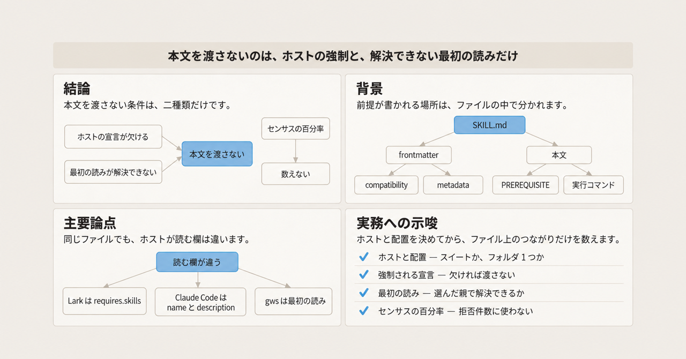
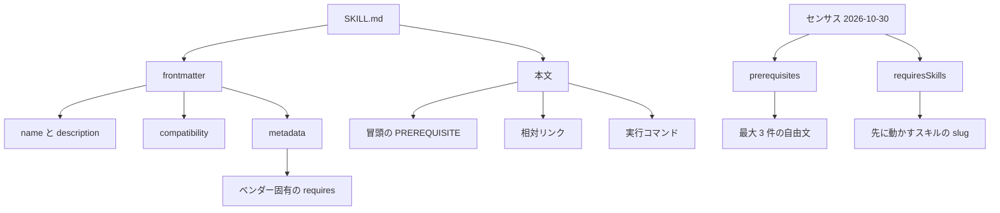
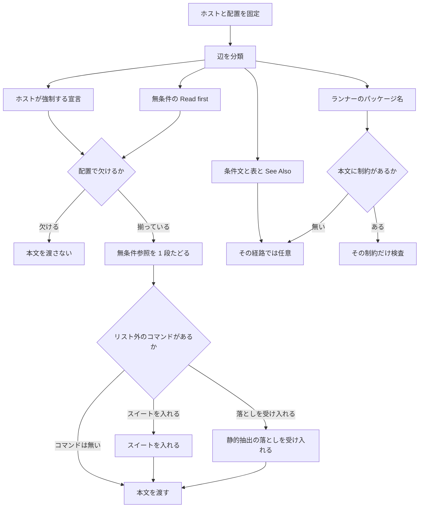

Agent Skills は、ディレクトリ 1 つと `SKILL.md` を単位にする、エージェント向けの手順書の形式です。配布物の中には、別のスキルや特定の CLI を前提に書かれたものがあります。この記事は、スキル本文を製品として版管理する人に向けて、公式仕様と三つの公開 CLI の実ファイルが前提をどこに書くか、そして本文を渡す前に何を数えるかを整理します。

Skillselion は、センサスのページを公開しているサイトの名前です。そのセンサスは、2026-10-30 に固定したカタログダンプを言語モデルが読んで別フィールドへ保存したものであり、パッケージマニフェストのパース結果ではありません。カタログダンプは、そのページが固定したスキル一覧です。

数値は、そのセンサスページに書かれた分子と分母に合わせます。仕様と実ファイルは、2026-11-01 までに開いた範囲です。

*この記事の全体像。以下、順に解説します。*

## Agent Skills とは

Agent Skills の公式仕様は、起動時の発見に `name` と `description` を使います。本文と付属ファイルは、そのスキルが選ばれたあと、必要なときに読みます。`scripts/`、`references/`、`assets/` は任意です。

仕様の frontmatter に置ける欄は、`name`、`description`、`license`、`compatibility`、`metadata`、`allowed-tools` です。`allowed-tools` は、その欄名の一つです。中身の意味は、ここでは書きません。frontmatter は、Markdown 先頭の `---` で囲んだ属性です。`compatibility` は 1〜500 文字の自由文です。仕様の例は「Requires git, docker, jq, and access to the internet」と「Requires Python 3.14+ and uv」です。`metadata` は、仕様が定義しない追加属性を置く場所です。キーも値も文字列、と仕様は書きます。

ファイル参照は、スキルのルートからの相対パスです。深くネストした参照の連鎖は避ける、と仕様は書きます。

ワンショットの実行例について、仕様の作成ガイドは版のピンを勧めます。`npx`、`uvx`、`pipx`、`bunx` は、そのコマンドの実行時にパッケージを取ります。この記事では、これらをランナーと呼びます。ランナーが出すパッケージ名は、PATH 上に常駐する実行ファイルの名前とは別です。

前提が書かれる場所は、次の 5 つに分かれます。

1. 仕様の欄（`compatibility` など）
2. ベンダーが `metadata` に足した欄
3. 本文の文
4. 相対リンク
5. 実行コマンド

センサスは、そのうち自由文とスキル名を、言語モデルが読んで別フィールドに保存します。`prerequisites` は最大 3 件の短い自由文です。`requiresSkills` は、先に動かすスキルの slug です。slug は、そのスキルを指す識別子です。`requiresSkills` はセンサスの欄です。ファイルに書く `metadata.requires.skills` とは、名前が似ていても別です。

本文の先頭で、条件を付けずに別ファイルを読めと求める参照を、この記事では PREREQUISITE と呼び、無条件の Read first とも呼びます。二つは同じものです。See Also は、関連ファイルを列挙する節です。ヘルパー表は、用途ごとの参照を並べた表です。この二つは、条件の無い PREREQUISITE とは別の置き場です。

図の上限 3 件は、自由文の `prerequisites` にだけ付いています。`requiresSkills` の箱は、先に動かすスキルの slug です。

発見時にホストへ渡るのは `name` と `description` です。ホストは、スキルを読み込んでエージェントへ渡す側です。`compatibility` と `metadata` と本文は、そのあと、ホストが読むと決めたときに読まれます。

三つの公開リポジトリは、この 5 つの置き場の使い方が違います。`requires.bins` は、必要とする実行ファイルの名前を並べた配列です。

gws は Google Workspace の CLI で、リポジトリ名は `googleworkspace/cli` です。スキル `gws-gmail-send` は、`metadata.openclaw.requires.bins` に `gws` を書きます。フィールド名の `openclaw` は、OpenClaw というホストの名前です。そのホストが導入前に何を見るかは、次の節で分けます。本文の先頭では `../gws-shared/SKILL.md` を読むよう求めます。

HyperFrames は、リポジトリ名 `heygen-com/hyperframes` の動画向け CLI です。スキル `hyperframes-cli` は、frontmatter に requires も compatibility も置かず、本文で `npx hyperframes` と Node.js 22+ と FFmpeg を書きます。

Lark は、リポジトリ名 `larksuite/cli` の CLI です。スキル `lark-base` は、`metadata.requires.bins` に `lark-cli` を書きます。認証の手順は本文で `lark-shared` に回します。コンポーザは、依存の名前を読んでスキルの構成を組み立てる処理です。Lark の公式コンポーザが依存として読むフィールドは、ファイル上の `metadata.requires.skills` です。センサスの `requiresSkills` とは別の欄です。

## ホストが導入前に見る範囲

仕様と、2026-11-01 に本文を開いたホストでは、強制の範囲が違います。Claude Code は、skills 文書が code.claude.com にあるホストです。兄弟は、同じ親ディレクトリにある別のスキルです。

| 読み手 | 導入前に機械的に見るもの | 本文の相対リンク | CLI 名 |
|---|---|---|---|
| Agent Skills 仕様 | `name` と `description` を発見に使う。依存解決の段は手順に無い | スキルルートからの相対パス。`../別スキル/` は仕様の参照例に無い | `compatibility` の自由文。未充足で起動を拒否する、とは書かない |
| Claude Code の skills 文書 | `metadata` の中身には作用しない。`compatibility` は受け取るが作用しない | 相対リンクの解決は、このセルの文には無い。文書が許可するプロパティは name、description、license、compatibility、metadata、allowed-tools | 欠落した実行ファイルで一覧から隠す、とはこの文書に無い。この一覧は Claude Code 側のもので、センサスのダンプとは別 |
| Lark CLI のコンポーザ（commit `c910e89`） | ファイル上の `metadata.requires.skills` の名前。同じ親にその名前のスキルが無いと構成を失敗させる | コメントが、Markdown リンクと散文は意図的に無関係、と書く | 依存を読む構造に `requires.bins` は含まれない。検査名 `ReadSkill` の対象でもない。この名前が何を読むかは、ここでは書いていない |
| gws の生成器（commit `cd3697e`） | スキル導入器ではない。`gws generate-skills` はスキルファイルを書く | 生成する本文に `../gws-shared` を埋め込む | CLI 名の検査はしない。既定の出力先は、カレントの `skills` |

OpenClaw の準備検査を、この記事では readiness と呼びます。2026-11-01 に commit `a5e0bec` の文書と実装を根拠にした記録があります。消費者は、スキルをホストへ渡す側です。消費者が OpenClaw へスキルを渡すときは、その readiness の結果を使います。参照パーサ `skills-ref` の出力は、その結果に重ねません。検査の組み合わせの中身は、注意点で未確認として分けます。

`skills-ref` は、Agent Skills の参照実装にあるパーサです。`metadata` の値が辞書なら、値を文字列へ変換します。参照実装では Python の `str()` です。該当は `parser.py` の 61–62 行で、2026-11-01 に取得したものです。ネストした `requires.bins` は、この参照実装では構造のまま残りません。Lark の `lark-base` がトップレベルに置く `version` は、参照実装の許可フィールドの外です。許可フィールドは name、description、license、allowed-tools、metadata、compatibility です。

`npx skills add` のコマンド文書を 2026-11-01 に検索した範囲では、名前を指定したスキルのコピーまたはシンボリックリンクはあります。SKILL.md に書かれた CLI 名を辿って追加する記述は、その範囲にはありませんでした。

## ファイル上の必須と任意

分類は、2026-11-01 に保存したファイルと、同じ日に開いた実装に限ります。開いた commit は、gws が `cd3697e`（main、2026-10-30T15:47:59Z）、Lark が `c910e89`（2026-10-29T12:42:34Z）です。HyperFrames の commit は、この節の `hyperframes-cli` に書きます。

2026-11-01 の `gh repo view` では、googleworkspace/cli が約 3.2 万 star、heygen-com/hyperframes が約 7.7 万 star、larksuite/cli が約 1.8 万 star です。いずれも archived ではありません。`pushedAt` は任意ブランチへの push なので、main のコミット時刻とは別に扱います。

無条件の Read first は、さきに定義した PREREQUISITE と同じです。

### gws-gmail-send

frontmatter は `metadata.version: 0.22.5` と `metadata.openclaw.requires.bins: [gws]` です。本文の先頭は、`../gws-shared/SKILL.md` を読めと書きます。この読む指示に条件はありません。`gws generate-skills` は、そのファイルが無いときの修復コマンドです。See Also は `../gws-shared/SKILL.md` と `../gws-gmail/SKILL.md` です。

`gws-shared` も `requires.bins: [gws]` を持ち、バイナリは `$PATH` 上にある、と書きます。追加の別スキル参照は、保存した本文にはありません。`@googleworkspace/cli` の package.json の version も 0.22.5 です（2026-11-01）。`bins` の要素は名前 `gws` だけで、版の制約はファイルにありません。

修復に見える `gws generate-skills` は、`cd3697e` の `parse_output_dir` が既定で `"skills"` を返します。`generate_shared_skill` は既存の共有スキルを読まず、ソースに埋め込んだテンプレートを、実行時の作業ディレクトリ直下の `skills/gws-shared` に書きます。`../gws-shared` と一致するのは、その作業ディレクトリが導入先の親であるときだけです。別のディレクトリで実行しても、導入済みスキルの隣は埋まりません。

同じ親に `gws-*` を並べる配置では、`../gws-shared` は解決します。フォルダ 1 つだけをコピーする配置では解決しません。gws の README は、両方の導入を書きます。根拠は `cd3697e` の README です。ヘルパー表の `../` は、See Also という見出しが無くても、無条件の PREREQUISITE とは別です。`gws-gmail` の表には、PREREQUISITE 以外の `../` が複数あります。該当は 16 行目と 22–32 行目です。

### hyperframes-cli

frontmatter に requires も compatibility もありません。10 行目は `npx hyperframes` と、Node.js 22+ と FFmpeg を要する、と書きます。63 行目の表は、ローカルの Chrome も FFmpeg も要らない経路として `cloud render` を書きます。ここでの実行経路は、スキルをエージェントへ渡す側の「ホスト」とは別です。`cloud render` は、HyperFrames の実行経路の一つです。FFmpeg を全コマンドの必須バイナリとして数えると、この行と衝突します。`npx` のパッケージ名は、PATH 上の欠落コマンドとは別です。

兄弟参照は 3 件です。6 行目、33 行目、97 行目は、2026-11-01 に保存した本文の行番号です。6 行目の `../hyperframes/references/plugin-installation.md` は「このスキルが HyperFrames のプラグインの中にあるとき」です。33 行目は、本文が `snapshot` と呼ぶ対象の説明の中の `format.md` です。この `snapshot` は、あとに書く「保存したスナップショット」（ファイルの写し）とは別です。97 行目の表は `motion.md` です。同じディレクトリの `references/` には別のファイルがあり、この 3 つは 2026-11-01 の `gh api` では `skills/hyperframes/references/` 側にあります。プラグイン条件のリンクを、常時の欠落ファイルとしては数えません。

2026-11-01 に GitHub API で取り直した main は `8a0b8a9`（2026-10-31T22:26:35Z）です。その親は `bb3c3b2`（同日 21:42:26Z）です。この 2 つの差分に `hyperframes-cli` の SKILL.md はありません。`cloud render` の文は、2026-11-01 に保存したスナップショットの 63 行で確認しています。

### lark-base

トップレベルは `version: 1.2.23` です。`metadata.requires.bins` は `["lark-cli"]` です。保存した先頭の範囲に `../` はありません。description と本文は、認証とスコープを `lark-shared` に、docx の本文を `lark-doc` に、import と export を `lark-drive` に回す、と書きます。これは無条件の「最初に読め」ではありません。

コンポーザは、その散文を依存にしません。`parseRequiredSkills` がデコードするのは `metadata.requires.skills` だけです。`lark-base` にこの配列が無いなら、Lark CLI は `lark-shared` が無くても構成します。発行者は、スキル本文を書く側です。発行者が Lark に欠落で止めさせたいときは、散文や `../` ではなく `metadata.requires.skills` に名前を書きます。`requires.bins: ["lark-cli"]` を PATH 検査と読むのは、このバイナリがやっていない検査を足すことになります。

開いた `lark-calendar`、`lark-shared`、`lark-workflow-standup-report` にも `requires.skills` は無く、`requires.bins: ["lark-cli"]` がありました。GitHub code search で SKILL.md の `skills:` は 0 件でした。インデックスの取りこぼしは残ります。

### 名指しが次のスキルへ続くとき

`cd3697e` で開いた `persona-team-lead` は、`requires.bins: [gws]` と、`requires.skills` の 5 スキルを持ちます。PREREQUISITE も、その 5 つを名指しします。本文は毎日 `gws workflow +standup-report` を実行するよう書きます。そのコマンドの実体は、リストに無い `gws-workflow` 側にあります。そこからヘルパー表が `../gws-workflow-standup-report` を指し、そちらが再び `../gws-shared` を PREREQUISITE にします。

CLI 名 `gws` は、persona 自身の frontmatter に既にあります。参照を 2 段で止めても、この CLI 名は隠れません。隠れるのは、名前を配列で書いた欄と、無条件の PREREQUISITE の外にある次のスキルです。この記事では、その配列を構造化リストと呼びます。`metadata.requires.skills` が、その例です。

開いた gws、Lark、HyperFrames のスキルで、CLI 名が孫スキルで初めて出る例はありませんでした。孫スキルは、参照先のさらに先にあるスキルです。

## 注意点

センサスの比率は、ゲートが止めるスキルの割合ではありません。ゲートは、導入前に本文を渡すかどうかを決める検査です。ページが書いた分母のまま読みます。

| ページ上の比率 | 分子 | 分母 | 読み方 |
|---|---|---|---|
| 25.9% | 16,798 | スキル 64,756 | 前提の自由文一覧を持つ |
| 12.8% | 2,142 | 16,798 | その一覧が CLI 系キーワードに合う。全スキルに対する割合ではない |
| 1.6% | 1,034 | 64,756 | 先に動かすスキルを名指しした件数 |
| 15.0% | その 1,034 のインストール | 全スキルインストール | 件数の 1.6% とは別の分母 |
| 65.7% | 155,552,276 | 全スキルインストール | 一覧を持つスキル側のインストール占有 |

一覧の長さは、1 件が 8,250、2 件が 6,333、3 件が 2,215 です。この内訳は、自由文の `prerequisites` です。上限は 3 件なので、4 件目以降は欄に残りません。一覧が無い 47,958 は、自由文の一覧が無い件数です。そのうちタグ付け済みで空なのは 13,694 です。タグ付け済みで空とは、印は付いているが一覧の中身が空、ということです。ページは、空を「依存が無い」証拠とは書きません。一部のタグ付けは、抜粋だけを読みます。

インストールは、公開レジストリ skills.sh を主とする install event です。このレジストリは、センサスのカタログダンプと同じものとは書いていません。稼働中の利用者数でもありません。累計は 236,629,160 です。スイート導入は、スキルごとに 1 回ずつ数えます。スイートは、同じ親ディレクトリに複数のスキルを並べる配布です。カタログがコピーと印した listing は 4,136（6.4%）で、分母 64,756 に含まれます。listing は、その分母に含まれる掲載 1 件です。コピーは、カタログがその掲載にコピーと印したものです。

Lark CLI は 46 一覧で 23,659,918 インストールです。ページは、その 46 件のうちコピーと印した 16 件を外すと 17,083,071 になり、コピーを外したあとの「前提一覧を持つスキル」のインストールに対して 11.6% だと書きます。gws CLI は 107 一覧、3,189,373 インストールで、公開元はすべて googleworkspace です。キーワード分類には偽陽性があります。ページは、「Account size and sizing constraints」が account に入る例と、「gh-pages-deploy skill」が GitHub CLI に入りうる例を書きます。

index と detail は、センサスが同じスキルについて持つ二つのインストール数です。その二つがずれたスキルは 2,039 です。中央値の差は 4、最大は 3,597、純差は 64,301 で全体の 0.03% です。データセットは detail 側を採用します。生データは「次のサイトリリースで配布」とあり、2026-11-01 時点ではダウンロードできません。この記事の比率は、再計算していません。

[Zenn の二次整理](https://zenn.dev/skillselion/articles/455321970cdcaf)（更新 2026-10-31）の 1.6%、15.0%、12.8%、16,798、64,756 は、上記ページが掲げた数値（ページ上の Finding）と一致します。数値の引用先は、センサスページにします。その記事が「2026-08-20 に hyperframes-cli を単体で入れると 4 ファイルが欠ける」と書いた件は、2026-11-01 時点で 2026-08 のツリーを再確認していません。2026-11-01 に保存した `hyperframes-cli` の本文にある兄弟参照は 3 件です。

12.8% を「スキルの 12.8% が CLI に依存する」と読むのは、分母の取り違えです。15.0% を「スキルの 15% が他スキルを必須にする」と読むのも、同じ取り違えです。1,034 件が 16,798 件の部分集合だとも、ページは書いていません。

次の点は、2026-11-01 時点で一次資料を開き直していません。OpenClaw へ渡す検査手順は、この記事の要約から実装しないでください。

- 記録では、`metadata.openclaw.requires.bins` は列挙した名前をすべて要求する AND です。`anyBins` は、いずれか一つの名前で足りる OR です。`always: true` は、bins の検査を飛ばす印です。この演算は、commit `a5e0bec` の文書と実装を開き直していないため、未確認です。OpenClaw へ渡すときは、導入する commit の `docs/tools/skills.md` と readiness の実装を、その都度開きます。
- Codex は OpenAI のコーディングエージェントです。Cursor は、エディタ上のコーディングエージェントです。Codex の `agents/openai.yaml` にある `dependencies.tools` が PATH を止めないこと、Cursor のスキル文書に依存解決が無いことは、文書を開き直していません。対象ホストに含めるなら、その文書を開きます。
- vercel-labs/skills の `experimental_install` が npm パッケージを入れないと書く、という記録も開き直していません。`experimental_install` は、そのリポジトリの実験フラグです。`npx skills add` のコマンド文書と、この `experimental_install` は、同じ配布物だとは結び付けていません。`npx skills` の実験フラグが、SKILL.md の外にある npm 依存をどこまで同期するかは、コマンド文書の検索だけでは閉じていません。
- センサスの生データが公開されたあと、1,034 と 16,798 の関係と、言語モデルの一覧とファイル上の前提の一致率は、再計算できます。2026-11-01 時点ではできません。

`npx skills add` の検索で見つからなかったことを、将来のフラグが無いことの証明にはしません。GitHub code search の 0 件にも、インデックスの取りこぼしが残ります。

発行者が単体導入を README で許すとき、無条件の PREREQUISITE の対象を同梱するか、PREREQUISITE を条件文に変えるかは、リポジトリごとの方針が残ります。本文が構造化リストに無いワークフローコマンドを名指しする型を、静的抽出だけで必須にする規則は、まだありません。persona から `gws-workflow` を名指しする例が、その型です。

これらは、次の節の手順を止める未知ではありません。ホストを OpenClaw、Codex、Cursor に広げるときと、センサスの比率を拒否件数の割合として使うときに、確信度を下げます。

## 導入前に何を数えて本文を渡さないか

導入前に数える単位は、深さ一律のリンクではなく、ファイル上の辺です。辺は、ファイルに書かれた前提のつながりです。失敗で閉じるとは、条件を満たさないときに本文を渡さず止めることです。止める対象は、渡すホストが実際に強制する辺と、選んだ配置で解決できない無条件の Read first だけにします。

これは Agent Skills 仕様の規則ではなく、2026-11-01 時点の解釈です。有効範囲は、ホストと配置を固定したうえで、強制される辺と無条件の読みだけを失敗で閉じるところまでです。全ホストに共通の固定手順にはしません。確信度は中程度です。ホスト実装の改訂と、README と SKILL.md の不一致で、同じファイルでも判定が変わります。

この解釈は、次の事実に支えられます。

- 仕様に依存解決のフィールドと手順が無く、作成ガイドは前提を本文と `compatibility` に書けと述べます。ピンしたワンショットコマンドの例があります。
- Claude Code の文書は、`metadata` と `compatibility` に作用しないと書きます。消費者側が本文を拒むなら、このホストより厳しい検査になります。
- Lark は、`metadata.requires.skills` の欠落で構成を失敗させます。散文は見ません。ホストが強制する形は、ここに書くと機械可読になります。
- gws の無条件 PREREQUISITE は `../gws-shared` です。生成器の既定出力は作業ディレクトリ直下の `skills/` であり、導入先の親で実行したときだけ、そのパスと一致します。配置と作業ディレクトリを決めずに、修復コマンドの有無だけで通すと、読みに失敗します。
- HyperFrames は、ランナーのコマンドと、コマンド経路ごとの前提を本文に分けて書きます。ローカルの FFmpeg と `cloud render` が、その分かれ方です。
- センサスは、空の一覧と、上限 3 件と、言語モデルによる読みを、方法として限定しています。抽出結果をゲートの入力にすると、その限定を無視することになります。

次の暫定案は、このまま採用しません。「`requires.bins` と修復不能な `../` を全部必須にし、修復コマンドがあれば共有スキルの欠落を許し、2 段で打ち切る」です。

- OpenClaw 以外のホストには、bins を PATH 検査にしていないものがあります。
- `../` のすべてが無条件ではありません。
- `gws generate-skills` は、作業ディレクトリが導入先の親でない限り、導入済みスキルの隣を埋めません。
- 2 段で止めると、本文が名指しする未記載のスキルを拾いません。完全に解決した証明にはなりません。
- 同じ親にスイートを置く導入では、単体ファイルだけを見て `../` を欠落と数えると、偽の拒否になります。
- ランナー経由のパッケージ名を PATH の欠落として数えると、`npx hyperframes` のような正規の書き方を拒否します。
- 「実行時にコマンドが見つからない方が、導入前のゲートより安全」という一般則は、agentskills、anthropics/skills、openclaw、larksuite/cli という名前の検索では見つかりませんでした。これらの名前の中身は、この文では開いていません。OpenClaw は、未準備のスキルをモデルへ渡さない側です。どちらが常に安全かは言えません。

スキル本文を渡す前に、次の順で辺を数えます。解釈であり、Agent Skills 仕様の適合条件ではありません。

1. 渡すホストと、配置を先に固定します。配置は「同じ親にスイートを置く」か「フォルダを 1 つだけ置く」かです。
2. 辺の種類を分けます。ホストが機械的に読む宣言。無条件の Read first。条件付きの文、ヘルパー表、See Also。ランナーのパッケージ名。
3. ホストが強制する辺が、その配置で欠けていれば渡しません。Lark なら、`metadata.requires.skills` の兄弟ディレクトリです。OpenClaw なら、渡す commit の readiness が未準備のとき本文を渡しません。Claude Code と、仕様だけの読込は、`compatibility` と `metadata` を起動拒否に使いません。消費者がここで本文を拒むなら、Claude Code より厳しい検査だと明示します。
4. 無条件の Read first は、選んだ親でパスを解決し、ファイルが無ければ渡しません。条件付きの文、ヘルパー表、See Also は、そのコマンド経路では任意とします。`gws generate-skills` は、作業ディレクトリ直下の `skills/` に書きます。導入先の親で実行したときだけ、`../gws-shared` と一致します。別の場所で実行した結果では、欠けた参照を埋めたことにしません。
5. 推移は、無条件の PREREQUISITE と、ファイル上の `metadata.requires.skills` だけを 1 段たどります。センサスの `requiresSkills` は、ここではたどりません。その先に書かれた実行ファイル名と、次の無条件参照を見ます。1 段先の無条件の Read first が、選んだ配置で解決できなければ渡しません。それより先は、完全だとは言いません。ヘルパー表はたどりません。構造化リストに無いワークフローを本文が名指しするときは、スイートを入れるか、静的抽出が落とすことを受け入れます。たどった段数で「CLI 名は尽きた」とは言いません。
6. ランナーは、PATH の欠落バイナリに数えません。版やランタイムを検査するのは、ファイルに制約があるときだけです。この検査は、失敗で閉じる二種類（ホストが強制する宣言と、解決できない Read first）に、版やランタイムを足すものではありません。満たさないときに本文を渡すか渡さないかは、この解釈では決めていません。HyperFrames の Node.js 22+ は本文にあります。FFmpeg は `cloud render` の行があるため、全コマンドの必須にはしません。
7. 版の制約は、スキル本文と同じ成果物に書きます。置き場は `compatibility` と、ピンしたワンショットコマンドです。作成ガイドの例は `npx eslint@9.0.0` です。仕様は `metadata.version` を CLI の版へ束ねません。gws は 2026-11-01 に、スキルの `metadata.version` と npm パッケージの version が、どちらも 0.22.5 でした。`requires.bins` は名前だけです。一致は同じリポジトリの慣行であり、インストーラが読む制約ではありません。参照パーサが `metadata` の値を文字列化するため、構造化した requires だけを唯一の版制約にすると、仕様の検証経路では構造が残りません。人間が読む制約の置き場は、500 字以内の `compatibility` と、本文にピンしたコマンドです。ゲートが検査できるのは、ファイルに書かれた制約だけです。
8. センサスの一覧、空の一覧、センサスの欄 `requiresSkills` の slug は、このゲートの入力にしません。ファイル上の `metadata.requires.skills` とは別です。ファイルを開いた結果だけを数えます。

リスト外のコマンドは、失敗で閉じる理由にしません。スイートを入れるか、静的抽出が落とすことを受け入れ、ホストの宣言と無条件の Read first が揃っていれば本文を渡します。版やランタイムの箱は、その制約を見るところまでです。満たさないときに渡すか渡さないかは、この解釈では決めていません。

三つの実ファイルへ当てはめると、次のようになります。OpenClaw へ `hyperframes-cli` を渡す判定は、渡す commit の readiness を開いた結果です。この表には書いていません。

| 対象 | 固定するホストと配置 | 本文を渡さない条件 | 欠落に数えないもの |
|---|---|---|---|
| `gws-gmail-send` | フォルダ 1 つ。OpenClaw | 渡す commit の readiness が未準備である。または `../gws-shared` が選んだ親に無い | ヘルパー表と See Also の `../` |
| `gws-gmail-send` | 同じ親にスイート。Claude Code | 無条件の `../gws-shared` が選んだ親に無い。Claude Code 自身は拒まない。この解釈で拒むなら、ホストより厳しいと明示する | `metadata` と `compatibility`。`bins` を PATH 検査として足すこと |
| `hyperframes-cli` | Claude Code、または仕様だけの読込。配置はどちらでもよい | 無し。frontmatter にホストの強制宣言が無く、常時の Read first も無い | `npx hyperframes`。全コマンド必須としての FFmpeg。プラグイン条件のリンク。Node.js 22+ は欠落に数えず、本文の制約として検査する。満たさないときの渡し止めは決めていない |
| `lark-base` | Lark CLI | 無し。`requires.skills` が無いので、兄弟が無くてもこのホストは構成する | 散文の `lark-shared`、`lark-doc`、`lark-drive`。`requires.bins` を PATH 検査として足すこと |

棄却した手順は、四つです。修復コマンドがあれば共有スキルの欠落を許すこと。すべての `../` を必須にすること。2 段の参照を完全性の証明にすること。センサスの百分率を拒否件数に使うこと。

直近のアクションは 3 つです。ひとつ目は、OpenClaw へ渡すなら渡す commit の `docs/tools/skills.md` と readiness の実装を開き、Codex と Cursor を含めるならそれぞれの文書を開くことです。readiness は OpenClaw の準備検査の名なので、Claude Code と Lark には割り当てていません。ふたつ目は、無条件の PREREQUISITE の解決先が、選んだ配置に含まれるかを、1 スキルずつ見ることです。みっつ目は、版の制約を `compatibility` かピンしたコマンドとして、スキルと同じ成果物に書くことです。

逆転条件は、仕様が機械可読の依存フィールドを定義し、クライアントがそれを実装したときです。ここでのクライアントは、スキルを読み込むホストの実装です。対象ホストが、本文の相対リンクを導入時に解決すると文書化したときも、同じです。そのときは、失敗で閉じる辺を、そのフィールドへ移します。

## まとめ

Agent Skills の本文を渡す前に数えるのは、カタログの百分率ではなく、選んだホストと配置のうえでファイルに残る辺です。失敗で閉じるのは、そのホストが強制する宣言と、解決できない無条件の Read first だけです。ファイルに書かれた版やランタイムは、この二種類に足さず、書いてあるときだけその文を検査します。満たさないときに渡すか渡さないかは、決めていません。ランナーのパッケージ名、条件付きのリンク、ヘルパー表、センサスの自由文は、その検査の入力にしません。版の制約を書く場所は、`compatibility` かピンしたコマンドで、スキルと同じ成果物です。

この記事が少しでも参考になった、あるいは改善点などがあれば、ぜひリアクションやコメント、SNSでのシェアをいただけると励みになります！

## 参考リンク

- [Agent Skills 仕様](https://agentskills.io/specification)（2026-11-01 取得）
- [スクリプトの書き方](https://agentskills.io/skill-creation/using-scripts.md)（2026-11-01 取得）
- [skills-ref のパーサ](https://github.com/agentskills/agentskills/blob/main/skills-ref/src/skills_ref/parser.py)（61–62 行、2026-11-01）
- [センサス](https://skillselion.com/research/agent-skill-dependency-census-2026-10)（データ固定 2026-10-30、HTML 取得 2026-11-01、CC BY 4.0）
- [Zenn の二次整理](https://zenn.dev/skillselion/articles/455321970cdcaf)（更新 2026-10-31）
- [Claude Code の skills 文書](https://code.claude.com/docs/en/skills.md)（2026-11-01 取得）
- googleworkspace/cli の commit `cd3697e`（main、2026-10-30T15:47:59Z）。パスは `skills/gws-gmail-send/SKILL.md` と `crates/google-workspace-cli/src/generate_skills.rs`
- heygen-com/hyperframes。2026-11-01 に取り直した main は `8a0b8a9`（2026-10-31T22:26:35Z）。親は `bb3c3b2`（同日 21:42:26Z）。本文の引用は 2026-11-01 のスナップショットで、この 2 commit の差分にその SKILL.md は無い
- larksuite/cli の commit `c910e89`（2026-10-29T12:42:34Z）。パスは `internal/skillpolicy/dependencies.go` と `skills/lark-base/SKILL.md`
