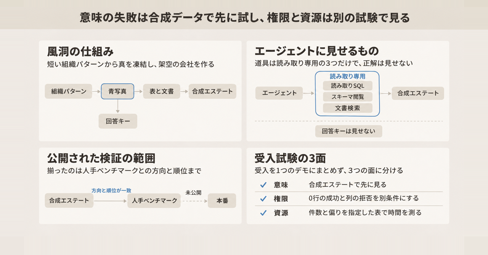
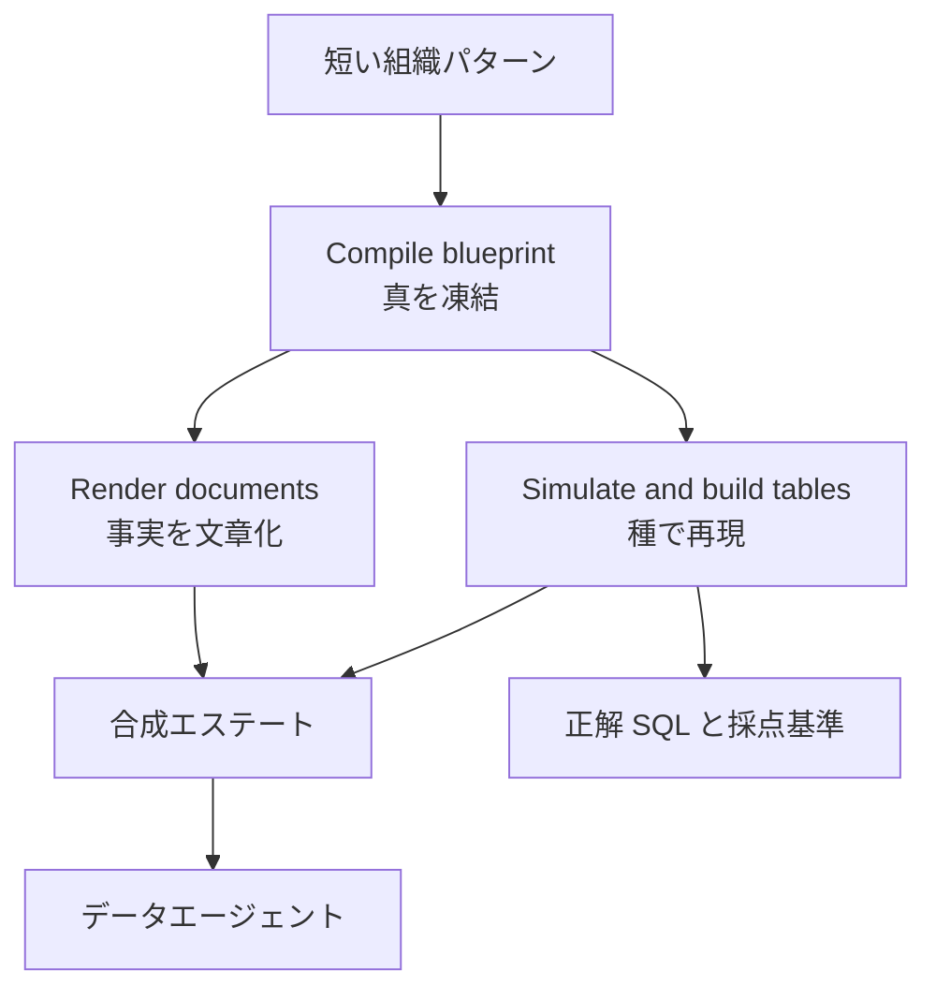

Google Cloud の Data Cloud Frontier AI チームが、2026年11月21日の公式ブログ「[Frontier and Center: Why your data agents need a “wind tunnel”](https://cloud.google.com/blog/products/data-analytics/a-data-simulator-to-test-agents/)」で、社内のデータシミュレータを説明しました。データエージェントは、企業のデータウェアハウスに対して自然言語の問いを受け、SQL や文書検索で答えを返すエージェントです。このシミュレータは、本番のデータに繋がずにデータエージェントを試すための「風洞」として作られました。

この記事では、風洞が何を生成し、エージェントに何を見せ、何を隠すのかを整理します。そのうえで、ブログが範囲外にしている行フィルタ、列マスク、遅いクエリを、受入試験のどこで見るべきかを BigQuery の公式ドキュメントに沿って考えます。なお、出典は公開 API の仕様書ではなく、社内の仕組みを説明するブログです。

*この記事の全体像。以下、順に解説します。*

## データシミュレータ「風洞」とは

風洞は、短い英語の組織パターンから、構造の似た架空の会社を丸ごと作るシミュレータです。作るものは、スキーマ、行、出来事の履歴、文書、チャット、難しい問い、検証済みの回答キーです。回答キーは、各問いの正解（定量の問いなら正解 SQL、定性の問いなら採点基準）です。以下、この一式を合成エステートと呼びます。エステートは、ある組織が持つデータ資産の全体を指す言葉です。

エージェントが使える道具は、読み取り専用の SQL、スキーマ閲覧、文書検索の 3 つだけです。真の事実を決めた設計書（ブログの用語で blueprint、以下「青写真」）と回答キーは、エージェントからは見えません。

図の下段で、エージェントが触れるのは合成エステートだけです。正解 SQL と採点基準は評価の側に置かれます。

### 入力は短い組織パターン

入力は数文の組織パターンです。ブログの例は次の内容です。ブレーキを作る 2 工場の会社で、ERP と製造現場の実行系システムを使い、3 交代で動いています。第 2 シフトの監督は、停止時間をオペレーション部門や財務部門とは異なるやり方で記録しています。この文から、Calder Brakes という合成会社ができます。

最後の一文が、試験の罠になります。ブログの例では、監督の定義は段取り替え（製品を切り替えるための準備作業）を除いて数える、という食い違いとして現れます。監督の定義、公式の指標の定義、後から入る訂正が、同じ青写真に植えられます。きれいなテスト用データベースでは起きない「定義の食い違い」を、エージェントが見抜けるかを試せます。

### 生成の 4 段階

生成は次の 4 段階です。

| 段階 | 何をするか | 言語モデルを使うか |
| --- | --- | --- |
| Compile blueprint | 何が真かを決め、青写真として凍結する | 使う |
| Simulate and build tables | 凍結した青写真と乱数の種から、表と正解 SQL を決める | 使わない |
| Render documents | 凍結した事実を、人ごとの文体のメモやチャットにする | 使う |
| Evaluate agent | 読み取り専用の道具だけでエージェントを試す | 試される側のエージェントが使う |

言語モデルで真を決めるのは最初の段階だけです。2 段目はモデルを使わないので、同じ青写真と同じ種からは、毎回同じ表と同じ正解 SQL ができます。描画した文書は、青写真に無い数、日付、名前を足していないかを検査されます。

### 乱れの植え方

本物の倉庫は汚れています。風洞は、乱れを 2 系統で植えます。

1 つ目は、スケジュールに沿った出来事です。手順の改訂や定義の変更が起きるので、古い手順書や、矛盾した定義が文書に残ります。

2 つ目は、行への注入です。再試行で生まれた重複行、マージされていないキー、期の途中での単位変更を行に入れ、その内容を messiness log に記録します。messiness log は、どの行にどんな乱れを入れたかの記録です。正解 SQL は、この記録に合わせて作られます。

### 問いと正解

問いは 3 種類あります。

- 定量の問い: 乱れた表に対する正解 SQL が付きます。ブログの例では、欠陥行の再試行重複を `COUNT(DISTINCT)` で数えた期待値が 240 です。同じ問いで、重複を除かない `COUNT(*)` や、監督の定義に従って段取り替えを除いた SQL といった誤った数え方が、240 とは別の数になることも確認します。
- 定性の問い: 指標の所有者、公式定義、後からの訂正に基づく採点基準が付きます。検証できない問いは捨てます。
- 存在しない指標の問い: エステートのどこにも無い指標（ブログの例は Basalt Velocity Ratio）を問います。信頼できるエージェントは棄権し、「その指標は無い」と返します。棄権は、答えられないと判断して回答を差し控えることです。

最後の問いは、もっともらしい文書を要約して、無い指標に数を作ってしまう失敗を検出します。

### 現実性の検査

合成データが本物らしいかは、現実性の報告で測ります。測るのは、結合による行の増幅、キーの偏り、null と重複の率、出来事の長さ、曜日ごとの活動の曲線、先頭桁の分布です。先頭桁の分布は、ベンフォードの法則と比べます。ベンフォードの法則は、自然に生じた数値では先頭の桁に小さい数字が多く現れる、という経験則です。

ブログは、生成とは別に行う校正として、統計的な現実性と正解 SQL の検証を合わせて百を超える検査があると書いています。初期の顧客案件では、相手の分析者に合成データへ問いを投げてもらい、自分たちの系のように振る舞うかを見ています。

### 保つ性質と、合成する表面

ブログが保つと書いた性質は、表どうしの関係、出来事とレコードの対応、組織の知識がどの文書や人の手元にあるかという所在、定義の乱れです。一方で、表や列の名前、数値、文書の文言は合成します。専有のスキーマを写すのではなく、構造の似た会社を発明する、という作り方です。

ブログによると、Google はこの風洞を社内で使い、顧客データに触れずに Google Cloud のデータエージェントを鍛えています。社内評価では、推論を深くする、文脈の扱いを変える、といった変更が、合成エステートと人手のベンチマーク（中身は公開されていません）の両方で精度の方向と順位を揃えた、とも書いています。方向は変更によって精度が上がるか下がるか、順位は変更どうしを精度で並べた順です。同じ「青写真を先に決める」作り方は、自前の評価を作るチームにも使える、というのがブログの主張です。

## 注意点

### 公開されている検証は「方向と順位が揃った」まで

ブログ自身が、風洞の点数が本番の点数と一致する必要は無い、と範囲を狭めています。必要なのは、変更による精度の方向と、劣化のペースだという立場です。

公開されているのは、社内で人手のベンチマークと方向と順位が揃った、という記述までです。劣化のペースの測り方や、それが揃ったかは書かれておらず、比較相手も本番ではなく人手のベンチマークです。本番ウェアハウスとの精度差、試行数、順位表は出ていません。実顧客のエステートと対にした、より広い研究は進行中だとブログが書いています。初期の分析者レビューに一致率は無く、百を超える検査に合格率もありません。

数字の読み違いにも注意が要ります。`240` は、ある欠陥件数の正解例です。モデルの精度でも、入力の上限でもありません。百を超える検査は社内の校正スイートの規模で、公開 API の制約ではありません。

### 転移の喩えと先行ベンチマークは別の課題

ブログは、転移の直感として domain randomization（[arXiv:1703.06907](https://arxiv.org/abs/1703.06907)）を引いています。domain randomization は、シミュレータ側の見た目を大きくばらつかせて学習し、実世界へ転移させる手法です。引用先は、シミュレータの画像だけで実世界の物体位置を 1.5 cm の精度で推定した、ロボット視覚の実験です。ブログも "adapt an intuition" と書いており、SQL について成り立つ定理として使ってはいません。

ブログが先行例に挙げるベンチマークも、風洞とは課題が違います。

| 出典 | 課題 | 出典が書く規模 |
| --- | --- | --- |
| [BIRD](https://bird-bench.github.io/) | 大規模データベース上の質問と SQL | 12,751 超の組、95 データベース、合計 33.4 GB、37 超の分野 |
| [Spider 2.0 論文要約](https://arxiv.org/abs/2411.07763) | 企業由来のワークフロー | 632 問。しばしば 1,000 列超。o1-preview のコードエージェントは 21.3%。同じ要約は Spider 1.0 で 91.2%、BIRD で 73.0% と書く |
| [Spider 2.0 サイト](https://spider2-sql.github.io/) | 同じ系列の自己申告 | o1-preview は 17.1%、GPT-4o は 10.1%。Spider 1.0 では 86.6% |
| [τ-bench 要約](https://arxiv.org/abs/2406.12045) | 言語モデルが利用者を演じる対話と、終了時のデータベース状態 | gpt-4o の成功は課題の 50% 未満。retail の pass^8 は 25% 未満 |
| [Generative Agents 要約](https://arxiv.org/abs/2304.03442) | 小さな町の 25 体のエージェントのもっともらしさ | SQL の正誤でも権限でもない |

pass^8 は、同じ課題を 8 回試して 8 回とも成功する割合です。Spider 2.0 の 21.3% と 17.1% は、どちらも一次の自己申告ですが、同じ条件の一つの値ではありません。いずれも、風洞が本番に近いことの測定値としては使えません。

### 過学習とドリフトの手当ては一文だけ

ブログ自身が、シミュレータの乱れ方への過学習と、実際の事業が青写真から離れていくドリフトをリスクに挙げています。手当ては「定期的に実地の走行と合わせる」という一文で、頻度も、不一致のときに受入を止める条件も書かれていません。

### 製品、API、料金は公開されていない

2026年11月21日時点で、公式ドキュメント、製品カタログ、GitHub の `GoogleCloudPlatform` 組織を検索しても、この風洞の製品ページ、API、同名のリポジトリは見つかりませんでした。非公開の実装や別名までは否定できません。名前や用途の近い Google Cloud の別の製品やサンプル（Data Agent Kit、Conversational Analytics、マラソン模擬の `race-condition`、GDC Sandbox）は、この風洞の料金や SLA を示すものではありません。レート制限、SDK、エラーコード、IAM、リージョン、課金、入力上限も公開仕様がありません。無料である、制限が無い、とは確認できていません。

## 行フィルタと列マスクは風洞で試せるか

受入の現場で出る問いは 2 つです。シミュレータは行フィルタと列マスクを再現するか。エージェントが本番に無い結合を作ったとき、失敗として返すか。

### ブログの “row-level flaws” は行アクセス制御ではない

ブログの “row-level flaws” は、行単位のアクセス制御の話ではありません。原文の意味は取り込み時の不具合で、例は再試行の重複行、未マージのキー、期中の単位変更です。2026年11月21日に取得したブログ全文には、row-level security、row access policy、column-level、data masking、policy tag、IAM の語がありません。評価の面として書かれているのは、合成エステートに対する読み取り SQL、スキーマ閲覧、文書検索です。

### 本番の BigQuery は別の面で権限を適用する

本番の BigQuery 上のデータエージェントは、風洞とは別の面で権限を適用します。Conversational Analytics API は、BigQuery などのデータに自然言語で問い合わせるエージェントを作るための Google Cloud の API です。その[接続手順](https://docs.cloud.google.com/gemini/data-agents/conversational-analytics-api/connect-bigquery)は、API が利用者の資格情報で検索とクエリを行い、IAM、行レベルと列レベルの制御、VPC Service Controls（Google Cloud の API へのアクセスを境界の内側に閉じる仕組み）の境界がなお適用される、と書いています。BigQuery の[会話の手順](https://docs.cloud.google.com/bigquery/docs/create-conversations)は、元テーブルに必要なロールが無いと `Schema_Resolution: Access Denied` を返す、と書いています。

### 権限の失敗はエラー一つにまとまらない

BigQuery の行アクセスポリシーは、条件に合う行だけを特定の利用者に見せる仕組みです。ポリシータグは、列ごとにアクセスを制御するためのタグです。[行レベルセキュリティと他機能の組み合わせの公式例](https://docs.cloud.google.com/bigquery/docs/using-row-level-security-with-features)では、権限の失敗が次のように別々の形で現れます。

| 状況 | 結果 |
| --- | --- |
| 行アクセスポリシーの対象外の利用者 Bob が `SELECT rank` を実行 | 成功し、0 行が返る。結果がポリシーでフィルタされた可能性があるという通知が出る |
| ポリシータグで禁じた列 `fruit` を名指し | access denied |
| 制限列を含むテーブルへの `SELECT *` | ページ前段は名指しと同じくエラーと書く。後段の例の表には、別の利用者 Alice の `SELECT *` が 1 行で成功した例があり、前段の説明と食い違って読める |

`SELECT *` の成否は、このページだけでは一意に決まりません。確かなのは、名指しは拒否され、行フィルタはエラーにならずに 0 行で成功する、という点です。

つまり、越権を「例外が返ったか」だけで判定すると、見えてはいけない行を黙って落とした成功を見逃します。ブログの風洞は、この静かな失敗を再現するとは書いていません。

### 無い結合と遅いクエリも範囲外

本番カタログに無い結合の検出も、ブログには書かれていません。風洞は専有スキーマを写さず、構造の似た会社を発明します。合成スキーマにその結合があれば、読み取り SQL は成功し得ます。合成スキーマに名前が無ければ、SQL エンジンは未知の名前として拒否し得ます。どちらも、本番にその結合が無いことの検査にはなりません。本番側で資源が無い場合は、[BigQuery のエラー](https://docs.cloud.google.com/bigquery/docs/errors)が `notFound`（例: `Not Found: Dataset myproject:foo`）として別に定義しています。

遅いクエリも、風洞の現実性指標には入っていません。測ると書かれているのは結合の行増幅や曜日の曲線で、スロット（BigQuery がクエリ実行に割り当てる計算資源の単位）、課金対象として走査したバイト数、実行時間ではありません。

## 受入試験を三つの面に分ける

以上から、データエージェントの受入を一つのデモにまとめず、次の 3 面に分けることを勧めます。面ごとに決めるのは、試験用データの置き場と、見る失敗の種類です。

| 面 | 見ること | データの置き場 | 失敗の形 |
| --- | --- | --- | --- |
| 意味 | 公式定義と現場の定義の食い違い、後からの訂正、重複行、存在しない指標への棄権 | 本番と行を共有しない合成エステート。使い捨てにできる置き場で足りる | 間違った数、もっともらしい誤った説明、棄権しないこと |
| 権限 | 見えてはいけない行、禁じられた列、マスク | 本番のポリシーを写したフィクスチャ。中身の行は合成でよい | 0 行の成功、名指し列の access denied、平文が返ること |
| 資源 | 件数、結合の増幅、遅いクエリ | 件数と偏りを指定して作った表 | 時間、走査量、増幅した行数 |

フィクスチャは、試験のために用意する固定のデータと設定です。ブログの風洞が担当すると書いた範囲は、意味の面です。権限と資源の面は、同じ合成会社の副産物としてはブログに出てきません。

### 意味の面は合成エステートで先に見る

意味の受入を、本番に繋いだデモに置かないようにします。風洞そのものは公開されていないので、ブログが自前の評価を作るチーム向けに勧める作り方、つまり青写真を先に固定し、種から表と正解 SQL を決定的に生成する仕組みを自チームで用意する前提です。どこまで作れば足りるかという最小構成は、ブログには書かれていません。短い業務パターンから合成エステートを作り、公式定義、現場の誤った定義、後からの訂正、重複、存在しない指標をそこで見ます。回答キーはエージェントに見せません。

この方針の根拠は、ブログが風洞を作った理由にあります。本番へのアクセスが難しい、カタログが不完全、正解のキーが無い、複雑さを系統的に変えられない、という 4 つです。開発者がデータを持つチームの外にいる、という状況も含まれます。青写真に正解を固定し、表の生成を決定的にすれば、同じ種から同じ表と同じ正解 SQL を何度でも再生できます。

### 権限の面と資源の面は別のフィクスチャで見る

権限の受入は、行ポリシーとポリシータグを付けたフィクスチャで見ます。行ポリシーの外の利用者が 0 行で成功すること、禁じられた列の名指しが拒否されること、マスクが平文にならないことを、別々の合格条件として書きます。例外の有無だけでは越権を検出できません。

資源の受入は、件数、キーの偏り、結合の増幅を指定した表で、実行時間と走査量を見ます。風洞のベンフォードの法則や曜日の曲線は、その代わりにはなりません。

## 誰が青写真に責任を持つか

風洞の正解は、青写真の公式定義が本番と一致して初めて意味を持ちます。パターン文を書く人と指標の所有者が違うと、植えた罠は本番の失敗モードではなく、作文の失敗モードになります。ブログには初期の専門家レビューが出てきますが、変更のたびに続ける義務とは書かれていません。そこで、役割を次のように分けます。

1. 本番の指標所有者が、パターン文の公式定義、所有者、訂正の有無を承認します。ここが空だと、風洞の正解は作文になります。
2. エージェントを作る側が、エステートの生成、罠、正解 SQL、種を持ちます。回答キーはプロンプトにも学習データにも混ぜません。
3. 指標の定義、所有者、表と列の意味が変わったら、指標所有者がパターン文を更新し、開発側が種を回して回答キーを作り直します。表名と列名の差分だけを追う役では、第 2 シフトの監督のような定義の罠は更新されません。

### 風洞を受入の代理にしない条件

次のどれかに当てはまるなら、判断を切り替えます。

- Google の風洞について公開された比較で、風洞と本番の精度の方向が逆だと分かったら、意味の面でも風洞を受入の代理にしません。
- 権限か遅延が受入の主条件なら、風洞だけでは受入を閉じません。
- 指標所有者がパターン文を承認しないなら、そのエステートでの不正解を本番の不正解として数えません。

### 公開情報で分からないこと

次の点は、2026年11月21日時点で公開情報からは判断できません。

- 社内評価の精度差、試行数、比較した人手ベンチマークの中身
- 非公開の実装が、ブログに無い行ポリシーや実行時間を返しているか
- 評価ハーネスが、SQL エンジンのエラーを不正解として数えるか
- マスクされた値が平文で返る経路を、合成エステートのどの検査が見るか

ブログに無いものは、受入条件に入れないのが安全です。

## まとめ

Google Cloud の風洞は、短い組織パターンから青写真を凍結し、乱れた表、文書、難しい問い、回答キーを持つ合成エステートを作るデータシミュレータです。エージェントには読み取り SQL、スキーマ閲覧、文書検索だけを開き、正解は評価の側に置きます。定義の食い違い、後からの訂正、重複行、存在しない指標への棄権といった「意味」の失敗を、本番の行に触れずに見るのに向いています。

一方で、公開されている検証は人手ベンチマークと方向と順位が揃った、という記述までです。行フィルタ、列マスク、無い結合、遅いクエリはブログの範囲外です。BigQuery では行フィルタが 0 行の成功として現れるため、権限と資源は別のフィクスチャで、別の合格条件として見る必要があります。手始めに、いま受入に使っている問いを意味、権限、資源の 3 面に仕分け、意味の面の公式定義と既知の誤定義を指標所有者に 1 枚で承認してもらうところから始めるとよいでしょう。

この記事が少しでも参考になった、あるいは改善点などがあれば、ぜひリアクションやコメント、SNSでのシェアをいただけると励みになります！

## 参考リンク

- [Frontier and Center: Why your data agents need a “wind tunnel”（Google Cloud Blog、2026-11-21、Eva Sharma、Sunil Pedapudi）](https://cloud.google.com/blog/products/data-analytics/a-data-simulator-to-test-agents/)
- [BigQuery: Use row-level security with other BigQuery features](https://docs.cloud.google.com/bigquery/docs/using-row-level-security-with-features)
- [BigQuery: Analyze data with conversations](https://docs.cloud.google.com/bigquery/docs/create-conversations)
- [Conversational Analytics API: Connect to BigQuery](https://docs.cloud.google.com/gemini/data-agents/conversational-analytics-api/connect-bigquery)
- [BigQuery: Error messages](https://docs.cloud.google.com/bigquery/docs/errors)
- [BIRD](https://bird-bench.github.io/)
- [Spider 2.0（arXiv:2411.07763）](https://arxiv.org/abs/2411.07763)
- [Spider 2.0 サイト](https://spider2-sql.github.io/)
- [τ-bench（arXiv:2406.12045）](https://arxiv.org/abs/2406.12045)
- [Generative Agents（arXiv:2304.03442）](https://arxiv.org/abs/2304.03442)
- [Domain Randomization（arXiv:1703.06907）](https://arxiv.org/abs/1703.06907)
