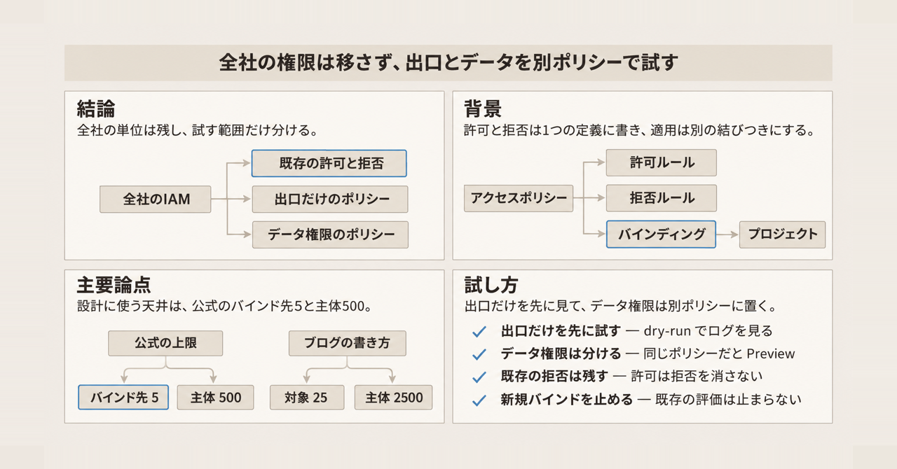
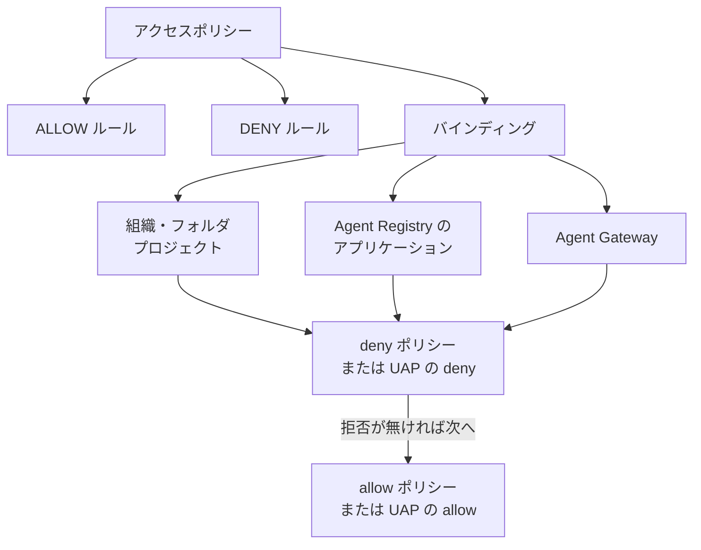

Google Cloud の Identity and Access Management（IAM）に、Unified Access Policies（統一アクセスポリシー、以下 UAP）があります。IAM は、誰がどの資源に対して何をしてよいかを決めるアクセス制御です。UAP は、許可のルールと拒否のルールを 1 つのポリシーに書き、そのポリシーを別のバインディングで対象へ適用します。バインディングは、定義済みのポリシーを 1 つの対象資源へ接続する結びつきです。

公式ブログのページに出ている日付は 2026年11月20日で、案内はプレビューです。データアクセスは、プロジェクトやフォルダや組織と、その子孫の IAM 権限を許すか拒むルールです。ツール出口は、エージェントが外のツールへ出る通信を許すか拒むルールです。この記事では、ポリシーとバインディングの分かれ方、評価の段、公式の上限、この 2 種類の条件、監査に残るメソッド名を、そのブログと公式ドキュメントに沿って整理します。

*この記事の全体像。以下、順に解説します。*

## Unified Access Policiesとは

UAP は、許可と拒否を同じポリシーに置ける IAM の仕組みです。allow ポリシーは許可だけ、deny ポリシーは拒否だけを書きます。UAP はその両方のルールを 1 つの定義にまとめ、同じ定義を複数の対象から参照できます。定義を作っただけでは効果は出ません。バインディングが対象を指したときから、その対象と子孫に効きます。

ポリシーの親は、プロジェクト、フォルダ、組織のいずれかです。資源名の location は `global` です。名前は `RESOURCE_TYPE/RESOURCE_ID/locations/global/accessPolicies/POLICY_ID` の形です。`RESOURCE_TYPE` は `projects`、`folders`、`organizations` のいずれかです。親は、誰がそのポリシーを閲覧・編集できるかに効きます。どの資源へバインドできるかには効きません。公式は、適用したい範囲に近い親を選ぶよう書いています。近い親を選ぶのは、その範囲の管理者だけが閲覧と編集できるようにするためです。

2026年11月21日時点の公式説明では、機能全体は Preview です。Preview は一般提供の前の段階です。例外は、権限が `iap.googleapis.com/resources.egressViaIAP` だけのポリシーで、こちらは General Availability（GA、一般提供）と案内されています。この権限は、Identity-Aware Proxy（IAP）が出口の通信を評価するときに使います。IAP は、通信の出口で認証と認可を行うプロキシです。他の権限が 1 つでも入ると、そのポリシーは Preview の案内側に残ります。

### ルールに書けること

ルールの effect は 1 つです。REST の列挙は `ALLOW`、`DENY`、未指定の `EFFECT_UNSPECIFIED` です。ALLOW は列挙した権限の使用を許し、DENY は拒みます。プリンシパルは、ユーザー、グループ、サービスアカウント、エージェント ID など、アクセスの主体です。エージェント ID は、エージェントに付く主体の識別子です。ルールには含めるプリンシパルと、グループに入っていても除外するプリンシパルを書けます。

ロール名を書けるのは ALLOW ルールだけです。ロールは権限の束です。カスタムロールは、組織が権限の組み合わせを自分で定義したロールで、どのルールからも指定できません。権限は個別名でも、権限グループでも指定できます。権限グループはロール名ではなく、権限名のパターンです。ALLOW の権限グループは、そのパターンのうち、カスタムロールに入れてよい権限だけを含みます。DENY のワイルドカードは、deny ポリシーがサポートする権限グループに限られます。

公式の上限は次のとおりです。1 つの UAP のルールは 100 です。ユニークプリンシパルは 500 で、ドメインと Google グループを含みます。ドメインは、プリンシパルとして書くドメイン名です。ユニークなグループとドメインは 100 です。1 つの UAP をバインドできる対象は 5 です。1 つの資源にバインドできる UAP は 5 です。この 5 と 100 ルールは、制限表だけでなく、UAP の説明とポリシー種別の説明にも同じ数字で出ています。グループやドメインが 1 件としてだけ数えられ、所属メンバーは別途数えない、とまでは UAP の行に書かれていません。メンバー数では、500 に収まるかを判断できません。

### 条件はサービスごとに分かれる

条件はルールに付けます。バインディングには付けられません。条件は、タイトル、説明、真偽の式です。式が真のリクエストにだけ、そのルールが効きます。1 つの条件は、異なるサービスの属性を混ぜられません。1 つのルールには複数の条件を追加できます。

2026年11月21日時点で UAP の表にある属性は次の 3 つです。

| サービス | 属性 | 適用される権限 | 段階 |
|---|---|---|---|
| `iam.googleapis.com` | リソースタグ | 任意 | Preview |
| `eventarc.googleapis.com` | メッセージ | `eventarc.googleapis.com/messageBuses.publish` | Preview |
| `iap.googleapis.com` | 宛先 | `iap.googleapis.com/resources.egressViaIAP` | GA |

リソースタグは、資源に付ける目印です。Eventarc は、イベントを運ぶ Google Cloud のサービスです。表のメッセージは、`eventarc.googleapis.com/messageBuses.publish` のリクエストで使う `message.id` などの属性です。この記事の試行では使いません。属性は、その属性の適用権限がルールに含まれていないと、ポリシー作成が失敗します。コンソールで付けられる条件は、IAM が提供する属性だけです。Eventarc や IAP の宛先のように他サービスの属性は、REST API か gcloud CLI で書きます。

### 直接バインドできる対象

Resource Manager は、組織、フォルダ、プロジェクトを束ねる資源階層です。直接バインドできるのは次の資源です。

| 対象 | リソース ID の形 |
|---|---|
| Resource Manager のプロジェクト | `//cloudresourcemanager.googleapis.com/projects/PROJECT_ID` |
| Resource Manager のフォルダ | `//cloudresourcemanager.googleapis.com/folders/FOLDER_ID` |
| Resource Manager の組織 | `//cloudresourcemanager.googleapis.com/organizations/ORG_ID` |
| Agent Registry の AI アプリケーション | `//agentregistry.googleapis.com/projects/PROJECT_ID/locations/LOCATION/aiApplications/APPLICATION_ID` |
| Network Services の agent gateway | `//networkservices.googleapis.com/projects/PROJECT_ID/locations/LOCATION/agentGateways/GATEWAY_ID` |

Agent Registry は、エージェントや MCP サーバーなどを登録する台帳です。MCP（Model Context Protocol）は、エージェントが外部のツールを決まった名前で呼ぶためのプロトコルです。表の AI アプリケーションは、Agent Registry で直接バインドできる資源種別の名前です。登録されるエージェントや MCP サーバーと同一かは、この表には書かれていません。Agent Gateway は、エージェントの通信を仲介し、IAP で UAP を評価するゲートウェイです。Network Services は、その gateway を持つサービス名です。バケットやデータセットそのものへの直接バインドは、この表にありません。プロジェクト、フォルダ、組織へバインドしたポリシーは、その子孫の IAM 権限に効きます。子孫には、プロジェクトの中のバケットやデータセットも含まれます。

### 管理に使う権限と操作面

管理ロールは Access Policy Admin（`roles/iam.accessPolicyAdmin`）です。作成に必要な権限は `iam.accesspolicies.create` です。コンソールでの作成には `iam.accesspolicies.list` も要ります。適用には、ポリシーの親に対する `iam.accesspolicies.bind` と、バインド先の `SERVICE.RESOURCE.createPolicyBinding` が要ります。後者は、対象のサービスと資源種別ごとの権限です。

ブログは、コンソール、gcloud CLI、Terraform、IAM v3 の REST を操作面として挙げています。作成と適用の手順ページが手順として書くのは、コンソール、gcloud、REST です。

### 階層での継承と組織の境界

Cloud Resource Manager の階層では、組織の下にフォルダがあり、その下にプロジェクトがあります。祖先にバインドした UAP は子孫へ継承されます。gateway や AI アプリケーションそのものへのバインドは、その資源に限られます。プロジェクトへのバインドは、そのプロジェクト内の gateway と、資源名がそのプロジェクトの下にある Agent Registry の AI アプリケーションに及びます。

組織をまたぐバインドは作れません。プロジェクトを別組織へ移すと、移動前の組織のポリシーへのバインドは、後から IAM が削除します。公式の例では、`example.com` のプロジェクトにバインドした UAP が、プロジェクトを `cymbalgroup.com` へ移したあとに組織をまたぐ状態になり、手で消さなければ IAM が消します。

ポリシーを消す前に、通常はバインディングを消します。バインディングが残っている削除はエラーになります。強制削除すると、ポリシーは外れた扱いになり、残ったバインドは消えるまで資源あたりのバインド枠を使い続けます。

### 評価の段

接続された対象について、IAM は既存の allow、deny、Principal Access Boundary（PAB）、UAP をまとめて見ます。allow ポリシーは、資源に 1 つだけ付く許可です。deny ポリシーは、特定の権限の使用を拒むポリシーです。PAB は、プリンシパルがアクセスしてよい資源の範囲を制限するポリシーです。PAB があり、そのプリンシパルが範囲に入っていないときは、その後の許可は効きません。PAB が無ければ、次の段へ進みます。

公式は、実装上は各ポリシーを同時に見て結果をまとめるとしつつ、理解のためには次の段で考えると書いています。

1. PAB で、そのプリンシパルが資源に到達してよいかを見ます。到達できなければ拒否です。PAB が無ければ次へ進みます。
2. deny ポリシー、または UAP の deny ルールが、必要な権限を拒むなら拒否です。祖先の UAP deny は、子孫の UAP allow があっても残ります。
3. allow ポリシー、または UAP の allow ルールが、必要な権限を与える必要があります。与えられなければ拒否です。

公式の例では、組織の deny があるプリンシパルは、子孫が `compute.googleapis.com/instances.delete` を許可しても、その組織内ではインスタンスを削除できません。

次の図は、ポリシーがルールの入れ物であり、バインディングが対象へ接続し、接続先の拒否が先、許可が後、という関係です。PAB の段は図の前にあります。

## 注意点

### ブログの規模と公式の上限は別の数字です

告知ブログは、プレビュー中に 1 つの UAP を最大 25 の Cloud Resource Manager 対象へバインドできると書きます。同じ文脈で、1 つの資源へ最大 5 つの UAP を付け、各 UAP は 64 KB とルール 100、資源あたり 2,500 のユニークプリンシパルと 500 グループまで広がる、とも書きます。ブログは、数千の自律エージェントとマイクロサービスを、この規模の話の前提に置いています。

公式の制限表で増やせない上限の UAP 行は、別の数字です。

| 項目 | 公式の上限 | ブログの書き方 |
|---|---|---|
| 1 UAP のルール | 100 | 100。ここは一致する |
| 1 UAP のユニークプリンシパル | 500（ドメインとグループを含む） | 資源あたり 2,500 |
| 1 UAP のグループとドメイン | 100 | 資源あたり 500 グループ |
| 1 UAP のバインド先 | 5 | 25 の CRM 対象 |
| 1 資源に付く UAP | 5 | 5。ここは一致する |
| ポリシーのサイズ | UAP の行には無い | 各 UAP が 64 KB |

64 KB は、同じ制限表ではカスタムロールのタイトル、説明、権限名の合計サイズです。UAP のサイズ上限としての 64 KB は、この表にありません。allow ポリシーの行にある主体の上限は 1,500 で、64 KB とは別の項目です。資源あたり 2,500 プリンシパルと 500 グループを、UAP の公式上限の行として読むこともできません。検算すると 5×500=2,500、5×100=500 になります。同じ 2,500 と 500 は、deny ポリシーを資源単位で合計した行にもあります。プリンシパルはポリシー間で重なり得るので、5 枚を足した数がユニーク人数の保証にはなりません。25 の CRM 対象を公式上限として読むこともできません。公式のバインド先は 5 です。設計の天井は、公式の 100、500、100、5、5 に置きます。

### 料金と SLA とプレビューの契約

ブログは、プレビューを追加費用なしと書きます。IAM の料金ページは、Identity and Access Management API の利用はすべて無料だと案内しています。UAP 専用の料金項目は、料金ページからは特定できていません。

IAM の SLA ページは、IAM サービスに SLA は適用されないと書きます。SLA は、可用性などのサービス水準の合意です。UAP 専用の SLA 数値は、そこにはありません。データアクセスを含む UAP は、Pre-GA Offerings Terms の対象です。Pre-GA は一般提供前の提供条件で、as-is、予告なく変更・停止・終了され得て、SLA と補償の対象外、とサービス別条項にあります。出口専用で GA と案内されているポリシーと、データアクセスを含む Preview のポリシーは、契約の置き方が違います。

### 承認待ちの effect は現行のルールにありません

datePublished が 2026-05-06 の IAM ブログ（ページ表示は 2026-05-07）は、Agent Identity 向け UAP を coming soon とし、human-in-the-loop の承認に触れています。2026-11-20 のブログは、UAP をその承認や委任の土台と書きます。現行のルール表現に、承認待ちの effect はありません。effect は許可か拒否か未指定です。

Agent Platform の概要には、1 つのルールが allow と deny の両方の effect を持てると読める文があります。同じページの後段は、allow のルールと deny のルールを別々に書く例です。IAM の説明は、effect をルールごとに 1 つとしています。ルールを書くときは、1 ルール 1 effect に合わせます。

### 同じ名前が過去の拒否ポリシーを指すことがあります

2025-05-07 の Zenn 記事は、Next '25 の拒否ポリシーを Unified Access Policies と呼んでいます。これは今回のプレビューの失敗事例ではありません。2026-11-21 時点の公開情報では、このプレビューの採用失敗を示す一次報告と、確認できる CVE は見つけていません。CVE は、公開された脆弱性の識別子です。

## 条件付きのロールバインディングとどこが違うか

条件付きのロールバインディングと UAP の間に、どちらが先という優先度の番号は置かれていません。条件付きのロールバインディングは、ロールを誰に付けるかの結びつきへ、リクエストの属性が真のときだけ許可する書き方です。両方とも、上の deny の段と allow の段に入ります。条件付き allow は、無条件の allow を無効にしません。UAP の allow も、既存の allow を消しません。

UAP の条件は、従来の IAM Conditions の属性一覧そのものではありません。IAM Conditions は、時刻や資源名などで許可に条件を付ける仕組みです。条件の概要は、allow と deny では IAM がサポートする属性を使える一方、UAP では各サービスが自分の属性を出す、と書いています。UAP の表に `request.time` や `resource.name` はありません。リソースタグは `iam.googleapis.com` の属性として Preview です。

同じルールに複数の条件を置けます。サービスをまたいだとき、式の関係が AND か OR かは、参照した文書には書かれていません。試すときは、データ用とツール用を別のルールにします。1 ルールにつき条件を 1 つに限る、とは書かれていません。データアクセス用の属性とツール用の属性はサービスが違うので、1 つの条件には混ぜられません。

Policy Troubleshooter は、allow、deny、PAB を説明し、UAP は対象外です。この文は IAM のトラブルシュートページにあります。Policy Troubleshooter は、なぜ許可や拒否になったかを説明する診断です。Policy Intelligence のトラブルシュートページの注記は、Cloud Storage の ACL と VPC Service Controls を勘定しない、と書きます。ACL はバケット側のアクセス制御リスト、VPC Service Controls はデータが通れる境界です。2026-11-21 に取得したその本文に UAP はありません。公式の手動手順は、対象と祖先のバインディングを列挙し、参照先の UAP を開くことです。

公式のユースケースは、すでに allow または deny を使っているなら、それらを使い続けることを勧めています。理由は、Troubleshooter がそれらを扱えるからです。UAP を挙げる場面は、新しい組織が最初から UAP に揃える場合と、UAP の条件で細かく分ける場合です。

組織制約は、組織ポリシーで資源の操作を制限する設定です。UAP の `iam.managed.disableAccessPolicyBinding` は、新しいバインドの作成を止めます。既存バインドの評価は止めません。

| 基準 | 条件付き allow と deny | UAP |
|---|---|---|
| 権限の単位 | ロールバインディング、または deny ポリシー | ポリシー定義と、最大 5 対象へのバインディング |
| 条件の置き場所 | allow 側はバインディングに条件を付けられる | ルールにだけ付ける。バインディングには付けられない |
| 条件の属性 | IAM Conditions の属性 | サービスが出す属性。表にあるのはタグ、Eventarc、IAP の宛先 |
| 拒否の勝ち | deny が allow より先 | 同じ deny の段に UAP の deny も入る |
| 切り分け | Policy Troubleshooter が説明できる | Troubleshooter の対象外。祖先のバインディングを見る |
| カスタムロール | allow のロールバインディングで使える | ルールからの参照はできない |
| 全社の停止 | 既存の deny を外す、またはバインドを外す | 組織制約は新規バインドの作成を止めるだけ |
| 契約 | GA の IAM として運用されている範囲 | データアクセスを含む場合は Pre-GA。出口専用は GA |

## 監査ログに残る名前

変更の監査は、ポリシー本文とバインディングでメソッドが分かれます。Cloud Audit Logs の管理アクティビティは設定変更のログです。データアクセス監査ログは、取得や一覧のログです。ここでのデータアクセスは、上のデータの権限ルールとは別の、監査ログの種別です。作成・更新・削除は管理アクティビティ（`ADMIN_WRITE`）です。取得・一覧・検索はデータアクセス監査ログ（`ADMIN_READ`）です。

ポリシー本文の例は、`google.iam.v3beta.AccessPolicies.CreateAccessPolicy`、`UpdateAccessPolicy`、`DeleteAccessPolicy` です。対応する権限の例は `iam.accesspolicies.create` のように、UAP の権限名です。バインディングの例は、`google.iam.v3beta.PolicyBindings.CreatePolicyBinding`、`UpdatePolicyBinding`、`DeletePolicyBinding` です。同じ短いメソッド名は `google.iam.v3.PolicyBindings` にもあります。Logs Explorer のフィルタは、`protoPayload.methodName` にこれらの文字列を置く形で公式に載っています。誰がポリシー定義を変えたかと、誰がバインドを変えたかは、このメソッド名で分かれます。

CreatePolicyBinding の監査は、PAB のバインドとメソッドを共有します。監査エントリに出る権限の例は、`iam.googleapis.com/principalaccessboundarypolicies.bind` や、対象側の `createPolicyBinding` です。これを UAP 専用の `iam.accesspolicies.bind` と同一視しません。適用に必要な権限は、作成手順のページでは UAP 側の `iam.accesspolicies.bind` と、対象側の `createPolicyBinding` です。

ランタイムの許可・拒否について、Agent Gateway の dry-run 案内が見るフィールドは、`protoPayload.authenticationInfo.principalEmail`、`protoPayload.resourceName`、`protoPayload.authorizationInfo` です。`protoPayload` は、監査ログの中のリクエスト情報です。権限の例 `iap.resources.egressViaIAP` は、ルールに書く `iap.googleapis.com/resources.egressViaIAP` と同じ権限の短い表記です。通常の Google API の認可判定ログに、ポリシー名（`accessPolicies/...`）とバインディング名（`policyBindings/...`）のどちらが残るかは、参照した文書には書かれていません。トラブルシュート文書の policy ID は、更新 API に渡す ID が無いときの `POLICY_NOT_FOUND` の話で、判定ログのフィールドとしては書かれていません。

## データアクセスとツール出口を同じポリシーに置ける範囲

同じポリシー資源に、データアクセスのルールとツール出口のルールを並べることはできます。同じ条件に、両方の属性を書くことはできません。試す単位はルールです。

データアクセス側は、プロジェクト、フォルダ、組織と、その子孫の IAM 権限を ALLOW または DENY します。条件として書けるのは、主にリソースタグと、Eventarc の公開などサービスが定義した属性です。この種の権限を含むポリシーは Preview です。

ツール出口側は、Agent Gateway と IAP が `iap.googleapis.com/resources.egressViaIAP` で UAP を評価します。宛先の属性には、登録済みの MCP ツール名や、未登録のホスト、パス、HTTP メソッドがあります。`startsWith`、`endsWith`、`contains` は、未登録のホストとパスに限られます。この権限だけの UAP は GA です。

Agent Registry はリージョンを持ちます。登録済み資源向けのルールは、そのレジストリのリージョンで適用されます。ポリシー資源の location が `global` であることとは別です。バインディングに書く主体は `principal://` 形式です。`urn:agent:` は在庫とカタログを引く識別子で、IAM のプリンシパルには使えません。

gateway には dry-run があります。強制の前に、出口の判定をログへ残し、通信は止めないモードです。設定名は `iamEnforcementMode: "DRY_RUN"` です。このキーは、Agent Gateway の認可拡張の `metadata` にあります。認可拡張は、出口の判定を gateway に足す設定です。コンソールの表示は Audit-only です。これはツール出口の確認用で、データの権限を含むポリシーの Preview を GA に変えるものではありません。

実行時に強制になるのは、`iamEnforcementMode` が無いときと、値が `DRY_RUN` でないときです。コンソールの Enforce policies は、gateway の作成時には `ENFORCED` を書き、既存 gateway の更新時にはそのキーを消します。コンソールが作成時に残す `ENFORCED` は、IAP の API が拒否する明示値です。API は `DRY_RUN` 以外を受け付けません。そのため gcloud、Terraform、REST で強制にするときは、`ENFORCED` を書かず、`metadata` から `iamEnforcementMode` を消します。

## プレビュー期間にどこまで試すか

いまの判断は、全社の権限単位をプレビュー中の UAP へ置き換えない、です。テスト用プロジェクトで、データアクセスのルールとツール出口のルールを分けて試します。既存の deny は残します。

置き換え以外の単位として使える事実は、次のとおりです。

- 定義と適用が分かれ、1 つのポリシーを複数対象で参照できます。エージェントごとのロールを増やしていく単位とは別です。
- 公式上限の 5 対象と、1 対象あたり 5 ポリシーは、少数の共有ルールを試す規模には合います。
- 出口専用ポリシーは GA で、dry-run のログ項目が案内されています。ツール実行だけを先に見る道があります。
- 管理変更の監査は、ポリシー API とバインディング API でメソッドが分かれます。

全社の単位にする前に残る事実は、次のとおりです。

- 公式は、既存の allow または deny を使い続けるよう書いています。
- データアクセスを含むポリシーは Pre-GA で、全社の停止手段をここに一本化する契約条件と合いません。
- 1 ポリシー 500 プリンシパル、バインド先 5 は、数千の主体を 1 枚で受ける上限ではありません。
- カスタムロールは参照できません。バケットやデータセットそのものへの直接バインドは、対応資源の表にありません。
- 組織制約 `iam.managed.disableAccessPolicyBinding` は、新しいバインドの作成を止めます。既存バインドの評価停止とは書かれていません。組織制約は、組織ポリシーで資源の操作を制限する設定です。
- ポリシーを削除しても、残ったバインドは消えるまで、資源あたりのバインド枠を使い続けます。

試す手順は、次の順です。

1. 既存の allow、deny、条件付きロールバインディングは残します。全社の拒否は deny に置きます。UAP の allow は、その deny を上書きしません。
2. テスト用プロジェクトに、ポリシーを 2 つ置きます。1 つはリソースタグを条件にしたデータ権限のルールだけです。もう 1 つは `egressViaIAP` だけを含む出口ルールで、まず dry-run にします。1 つのポリシーに両方の権限を入れると、そのポリシー全体が Preview の案内に戻ります。1 つの条件に両方の属性は書きません。タグは IAM の属性なのでコンソールでも書けます。出口の宛先は IAP の属性なので、gcloud か REST で書きます。
3. 出口の権限だけを含むポリシーを、GA の範囲として記録します。データ権限のポリシーは Preview として、本番の停止手順に入れません。
4. 停止の手順を先に書きます。出口は dry-run に戻すか、そのバインディングを外します。新規の UAP バインドを組織で止めるなら `iam.managed.disableAccessPolicyBinding` を使います。これは既存の適用を外しません。共有ポリシーの実体を消す前に、他のバインディングが残っていないかを見ます。
5. 棚卸しの名前は、ポリシー ID とバインディング ID を別行にします。変更監査は `AccessPolicies` と `PolicyBindings` の両方を残します。バインディングは v3 と v3beta の両方のメソッド名を見ます。ランタイムの原因名は、IAP の dry-run ログに出る主体、資源、権限までを一次とし、ポリシー名が残る前提でアラートを作りません。
6. 申請の単位を「エージェント 1 体につきロール 1 つ」から「共有ポリシー 1 枚につきバインド先 5 まで」へ変えるのは、タグ条件と出口条件が別々に説明できてからです。数千の主体は、1 ポリシーあたり 500 プリンシパルに収めるか、ポリシーを分けます。500 にはドメインと Google グループが含まれ、そのうちグループとドメインは 100 までです。1 枚へ集約しません。

判断を見直す条件は、データアクセスを含む UAP が GA になり、Troubleshooter が UAP を説明し、判定ログにポリシー名かバインディング名が公式に残り、公式上限が数千主体を 1 枚で受ける行になることです。その前に、全社の権限単位は移しません。

## まとめ

UAP は、許可と拒否のルールを 1 つのポリシーに書き、バインディングでプロジェクト、フォルダ、組織、Agent Registry のアプリケーション、Agent Gateway へ適用する IAM の仕組みです。評価は、PAB の適格、deny、allow の順で考えると公式の説明に沿います。祖先の deny は、子孫の allow があっても残ります。

公式の天井は、ルール 100、ユニークプリンシパル 500、グループとドメイン 100、バインド先 5、資源あたり 5 です。ブログの 25 対象、64 KB、資源あたり 2,500 と 500 は、この上限の行ではありません。出口専用の `egressViaIAP` だけを含むポリシーは GA で、dry-run から始められます。データアクセスを含むポリシーは Preview で、Pre-GA の契約です。

プレビューのあいだは、既存の allow と deny を残し、テスト用プロジェクトでデータ用ルールと出口用ルールを分けて試します。全社の権限単位を 1 枚の UAP へ移すのは、上の見直し条件が揃ってからです。

この記事が少しでも参考になった、あるいは改善点などがあれば、ぜひリアクションやコメント、SNSでのシェアをいただけると励みになります！

## 参考リンク

- [How to simplify cloud access with Unified Access Policies, now in preview](https://cloud.google.com/blog/products/identity-security/how-to-simplify-cloud-access-with-unified-access-policies/)（ページの日付は 2026-11-20）
- [What's new in IAM](https://cloud.google.com/blog/products/identity-security/whats-new-in-iam-security-governance-and-runtime-defense)（datePublished 2026-05-06、ページ表示は 2026-05-07）
- [Unified Access Policies](https://docs.cloud.google.com/iam/docs/unified-access-policies)
- [Create and apply Unified Access Policies](https://docs.cloud.google.com/iam/docs/unified-access-policies-create-apply)
- [IAM policy types](https://docs.cloud.google.com/iam/docs/policy-types)
- [IAM Conditions の概要](https://docs.cloud.google.com/iam/docs/conditions-overview)
- [Quotas and limits](https://docs.cloud.google.com/iam/quotas)
- [IAM audit logging](https://docs.cloud.google.com/iam/docs/audit-logging)
- [Troubleshoot IAM-related policies](https://docs.cloud.google.com/iam/docs/troubleshoot-policies)
- [Troubleshoot IAM permissions](https://docs.cloud.google.com/policy-intelligence/docs/troubleshoot-access)
- [Agent Platform の UAP 概要](https://docs.cloud.google.com/gemini-enterprise-agent-platform/govern/policies/iam-overview-uap)
- [dry-run の報告](https://docs.cloud.google.com/gemini-enterprise-agent-platform/govern/policies/dry-run-report)
- [UAP のトラブルシュート](https://docs.cloud.google.com/gemini-enterprise-agent-platform/troubleshooting/troubleshoot-iam-policies-uap)
- [REST の Effect](https://docs.cloud.google.com/iam/docs/reference/rest/v3/folders.locations.accessPolicies)
- [IAM SLA](https://cloud.google.com/iam/sla)
- [IAM pricing](https://cloud.google.com/iam/pricing)
- [Service Specific Terms](https://cloud.google.com/terms/service-terms)
