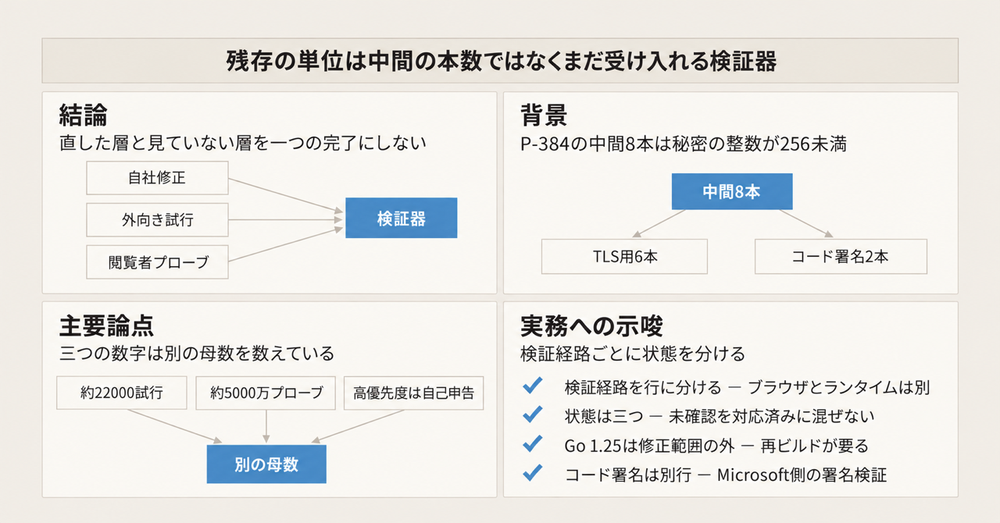
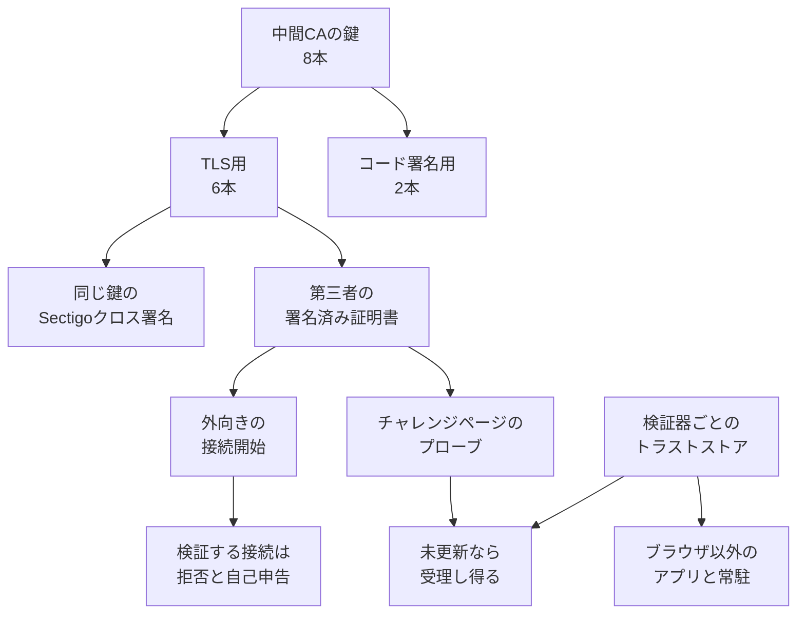

2026年10月30日、Cloudflare は eMudhra の弱い中間 CA 鍵について、自社の修正、外向き TLS で見えた試行、インターネット側のクライアントがまだその鎖を受け入れる割合を、別々の計測として公開しました。eMudhra は、この中間 CA を発行した認証局です。中間 CA は、終端の証明書に署名する認証局の証明書です。対象は 2025年4月30日の鍵生成で作られた P-384 の中間 8 本です。P-384 は楕円曲線の種類で、秘密の整数はその曲線の秘密鍵にあたる値です。8 本とも、その整数は 256 未満でした。

公開鍵の証明書から秘密鍵を復元できるため、ソフトウェアが未更新で、かつ Certificate Transparency（CT）を強制しないクライアントは、その中間で署名された証明書を正規のものとして検証し得ます。CT は、証明書を公開のログに載せる仕組みです。ここでの強制は、ログに無い証明書をブラウザが受け取らない条件を指します。自社システムの高優先度が修正済み、という記述は Cloudflare の自己申告です。

この記事では、8 本の鍵、三つの計測が数えている単位、検証器ごとの更新先を順に説明します。

*この記事の全体像。以下、順に解説します。*

## eMudhraの弱い中間CAとは

弱い単位は、中間 CA の鍵 8 本です。TLS 用が 6 本、コード署名用が 2 本です。TLS 用は EM DV、OV、EV の各 TLS CA の G3B と G3C です。DV、OV、EV と G3B、G3C は、中間証明書の名前の区別です。コード署名用は EM OV CS CA の G3B と G3C です。TLS 用 6 本の鍵に対する Sectigo のクロス署名は、別の証明書です。Sectigo は、そのクロス署名を出した側です。クロス署名は、同じ公開鍵の証明書に別のルートが署名したものを指します。秘密鍵は、その TLS 用の鍵と同じです。コード署名用の 2 本の下には、クロス署名を置いていません。

Cloudflare は、秘密の整数を 4、56、66、115、155、156、230、237 と書いています。

### 三つの計測

Cloudflare が 2026年10月30日に分けた観測は、次の三つです。

外向きの観測は、Pingora の接続開始の試行です。Pingora は、Cloudflare がこの外向き観測に使った発信経路です。ログの展開は 2026年10月21日に終わり、約 1 週間で約 22,000 件でした。この件数は、ログに残った試行です。証明書を検証する設定にした接続は拒否された、と Cloudflare は書いています。

閲覧者側の観測は、チャレンジページからのプローブです。チャレンジページは、Cloudflare が閲覧者へ出した確認用のページです。直近 1 週間で約 5,000 万プローブです。1 件は、プローブ 1 回です。対象は、JavaScript を実行するクライアントです。ホストの台数でも、中間 CA の残本数でもありません。

自社システムでは、2026年10月30日時点で高優先度は修正済み、という自己申告です。確認済みの低影響チケットは残ります。顧客の WARP、cloudflared、独自のトラストストアは、自社システムのチケットとは別の行で数えます。WARP と cloudflared は、顧客が自分で入れる Cloudflare のソフトウェアです。トラストストアは、検証器が信頼の起点として持つ証明書の束です。

### ブラウザと、ブラウザ以外

ブラウザは、OneCRL や CRLSet のような迅速失効で先に塞がれました。OneCRL は Firefox、CRLSet は Chrome が配る、失効を急いで届ける一覧です。失効情報を見ない言語ランタイムや、アプリに同梱された CA の束は、ソフトウェアの更新と再起動、イメージの再デプロイが別に要ります。

Go は、`crypto/x509` の `Certificate.Verify` に denylist を入れました。`crypto/x509` は、Go が証明書を検証する標準ライブラリです。`Certificate.Verify` は、そのライブラリが証明書の鎖を検証する関数です。denylist は、検証時に対象の中間を拒否する一覧です。修正が入った版は Go 1.26.10 と Go 1.27.3 です。影響範囲は、Go 1.26.10 未満と、Go 1.27.0-0 から Go 1.27.3 未満です。識別子は GO-2026-6809 で、別名は CVE-2026-111943 です。GO-2026-6809 は、Go の脆弱性データベースの識別子です。

### 残存は層で分かれる

残存を 1 つの数にすると、直した層と見ていない層が同じ対応済みになります。公式が分けている単位は、次のとおりです。

上から順に、鍵そのもの、その鍵で署名された証明書、その証明書を提示された接続、接続を検証するソフトウェア、です。失効は、鍵の列を消しません。検証器が失効か denylist を見るまで、下の列は残ります。

## 注意点

### 見出しの「4」

2026年10月30日の記事の見出しは “4 real?” です。説明文の “Four, just four” は、破るための材料が 4 つ、という意味ではありません。115 桁であるべき P-384 の秘密の整数が、整数 4 だった、という Cloudflare の説明です。どの中間が 4 に対応するかは、2026年10月30日の記事にも、Mozilla Bug 2083449 の comment 5 にも、対応表がありません。Mozilla Bug 2083449 は、この中間 CA の件を扱う Mozilla の公開バグです。comment は、Bugzilla の公開コメントの番号です。対応関係は未確認です。

### 外向きの約22,000件

約 22,000 は、傍受が成功した件数ではありません。傍受は、経路上で通信の中身を読むことです。内訳は Cloudflare の観測です。約 3 分の 2 は、`emudhra.we-have-a-problem.com` などの試験サイトです。残りのほぼ全部は、弱い中間で自分用の証明書を置いたように見える origin です。origin は、接続の相手となるサーバーです。

約 160 件は、SAN が SNI と無関係です。SAN は証明書が名乗る名前、SNI は接続時にクライアントが示すホスト名です。複数の拠点へ同じ証明書が出たため、経路上の差し替えより、サーバー自身の既定証明書に見える、と Cloudflare は書いています。ホスト名の検証でも落ちます。この記述は、SAN と SNI が一致する偽造が無かった証明にはなりません。

ログは、2026年10月21日以降の Pingora 発信に限られます。Cloudflare 自身が、このログから、特定の相手だけを狙った接続を除外できない、と書いています。Cloudflare の外でそれが起きたかは、このログの制限とは別の未確認です。

### 閲覧者プローブの母数

約 5,000 万は、そのチャレンジ流量の中のプローブ回数です。大規模 ASN で過半数がまだ受理する、は、その流量の中の割合です。ASN は、プローブ結果をまとめたネットワークの単位です。未確認の bot が多く、JavaScript を実行しないクライアントは母数に入りません。

2026年10月23日 16:30 UTC から 2026年10月27日 10:00 UTC は、ロールバックで欠測があります。ロールバックは、計測の設定を戻した期間です。同じ週に、制御端点の証明書、SCT の有無、G3 のクロス署名の追加、端点 ca2 を AAA Certificate Services へ切り替えたこと、無課金ゾーンの抽出率を 1% から 10% にしたこと（2026年10月27日 18:18 UTC）が重なります。G3 は、G3B と G3C の名前に共通する区分です。制御端点は、比較用に置いた端点です。AAA Certificate Services は、プローブの端点 ca2 の切替先として名指しされた証明機関です。ca2 は、プローブの端点の名前です。SCT は、CT ログへ載ったことの証跡です。抽出率は、無課金ゾーンでプローブを何割取るかです。無課金ゾーンは、その変更の対象になった、料金の無い区分です。約 5,000 万全体の何割を増やしたかは、この記述だけでは分かりません。

2026年10月29日 約 18:00 UTC に、macOS 上の Chrome 150–154 を名乗る bot が流入しました。Cloudflare の 2026年10月30日の記事のグラフでは、修正が進んだように見えます。分類の変化だと、Cloudflare は断じています。Android WebView の 30–40% は、プローブに載ったその組み込みブラウザ群の受理です。WebView は、アプリに組み込まれたブラウザ部品です。Android 端末全体の割合ではありません。Linux の Chrome 150–154 の低下は、同記事が「示唆であり断定ではない」と書いています。

### 自社修正の自己申告

高優先度は修正済み、は Cloudflare の自己申告です。低影響のチケットは残ります。顧客が入れる版は別にあります。2026年10月20日の記事の表では、Cloudflare One Client が Android v2.5.7、iOS v1.12.7、デスクトップ 2026.8.2115.0 です。1.1.1.1 app は Android v6.38.11、iOS v6.31.8 です。cloudflared は 2026.10.2 です。Cloudflare One Client と 1.1.1.1 app は、その表が顧客向けの版として挙げるソフトウェアです。先の WARP と同一かは、表の名前だけでは断定しません。cloudflared は、先に別行で数えるソフトウェアと名前が同じです。Gateway と最新クライアントの Zero Trust は自動で守られる、と同記事は書いています。Gateway は、その文で自動保護の対象に挙がる Cloudflare の製品です。最新クライアントは、その文が Gateway と並べるクライアントです。どの製品の名前かは、その文は書いていません。Zero Trust は、同記事が Gateway と最新クライアントに付けている呼び方です。

顧客側の点検が残るのは、mTLS のアップロード CA、Full (strict)、Authenticated Origin Pulls の Strict、Containers のイメージ内ストアです。mTLS は、クライアント側の証明書も検証する TLS です。アップロード CA は、顧客が Cloudflare へ登録した検証用の CA です。Full (strict) と Authenticated Origin Pulls の Strict は、オリジン証明書の検証を顧客側で点検する設定名です。Containers のイメージ内ストアは、コンテナイメージの中に入った証明書の束です。

### CTと失効

CT を強制するブラウザが、2025年4月の証明書作成から公表前まで攻撃され得なかった、というのは Dennis Jackson の台帳の主張です。この台帳は、この件の対応状況を並べた公開の一覧です。根拠は、その期間に当該中間の CT ログが無かったことと、Firefox、Chrome、Edge、Safari が CT を強制することです。公表後は別です。

Mozilla Bug 2083449 の comment 44 は、Jacob Durham の計測です。CT ログからの独立した再集計ではありません。2026年10月20日 09:40 UTC から 2026年10月21日 22:02 UTC に、8 本中 6 本の鍵で署名された証明書 107,107 枚が、e-Szignó のログに載りました。e-Szignó は、その計測が名指しした CT ログです。利用可能な SCT を含む例があります。CT の強制は、未ログの証明書を止める条件です。ログ済みの証明書を、それだけで拒否する保証にはなりません。企業プロキシが TLS を中継している場合、ブラウザ試験の結果はプロキシのストアを見ています。

失効も一枚岩ではありません。eMudhra は、2026年10月18日 09:24:32 UTC から 09:38:46 UTC のあいだに、8 枚を reason `cACompromise` で失効した、と comment 10 の表に書いています。`cACompromise` は、認証局の鍵が危殆化した、という失効理由です。Sectigo は comment 13 で、クロス署名の失効完了と、CRL および OCSP の公開を報告しています。CRL は失効の一覧、OCSP は失効の問い合わせです。Bugzilla API 上のそのコメント時刻は 2026年10月19日 14:55 UTC です。これは投稿時刻であり、各クロス署名の CRL 上の失効時刻を、ここで再取得してはいません。その時刻は未確認です。

eMudhra は comment 43 で、エンドエンティティ証明書は出しておらず、失効を確認する依拠当事者は露出していない、と主張しています。エンドエンティティ証明書は、中間ではなく、サイトや署名対象そのものの証明書です。依拠当事者は、検証結果を信じて処理を進める側です。comment 44 は、第三者の証明書の多くが失効ポインタを持たず、エンドエンティティだけを見るクライアントは中間の失効に届かない、と反論しています。Go は、Linux に一様な失効機構が無いため、ランタイム側の denylist を急いだ、と書いています。コード署名の 2 本は、TLS の傍受として数える 6 本の本数に加えません。署名検証の行は、後の棚卸しで分けます。

eMudhra は comment 11 で、鍵生成スクリプトの欠陥と、弱い第二の鍵をラベルの取り違えで CSR に使ったこと、その CSR を Sectigo にも送ったことを説明しています。CSR は、証明書の署名を依頼する文書です。第二の鍵は、8 本の外に足す追加の本数ではありません。comment 11 は、意図した鍵とは別に、より弱い鍵が似たラベルで作られ、CSR にはその弱い鍵が使われた、と説明しています。公開された 8 本は、その弱い鍵の側です。スクリプト本文は、2026年11月1日時点の公開コメントの範囲では、添付を確認できませんでした。comment 66 は、スクリプト、セレモニー記録、独立レビューの公開を、なお問うています。セレモニー記録は、鍵を作ったときの手順の記録です。

A 系列と A-1 は、影響を受けた 8 本とは別の中間です。Bug 2083449 の comment 5 は preliminary（暫定）と記し、2025年4月30日の中間 24 本が系列 A、B、C と、RSA 4096 と P-384 と、用途 DV、OV、EV、CS に分かれ、影響を受けたのは B と C の P-384 だと書いています。A 系列は 2025年5月に失効し、A-1 に置き換わりました。未回復は、そのコメントの時点で、A と A-1 の P-384 の秘密鍵を復元できていない、という意味です。RSA は、同じコメントの時点では、まだ見始めていません。後続の公開コメントに、これを覆す検証は見当たりませんでした。eMudhra の「RSA は別経路なので安全」は、同社の評価です。別経路が、鍵の作り方のどの違いを指すかは、この説明では分かりません。Mozilla がまだ見ていないことと、混ぜません。

CVE-2026-111943 は、Go 公式データベース GO-2026-6809 の別名として、2026年10月21日に掲載されています。NVD は、脆弱性情報の公開データベースです。NVD の HTML は、2026年11月1日の取得でレコード本文を返しませんでした。NVD 上の CVSS や影響文は未確認です。CVSS は、脆弱性の点数の付け方です。

## 三つの計測を一つの完了にしない

層ごとに、公式が言っていることと、同じ対応済みへ入れないものを分けます。時点は 2026年10月30日前後です。

| 層 | 単位 | 公式が言っていること | 同じ対応済みに入れないもの |
| --- | --- | --- | --- |
| Cloudflare のシステム | 優先度付きチケット | 高優先度は修正済み。低影響は作業中 | 顧客の WARP、cloudflared、独自ストア |
| 外向き TLS | 接続開始の試行 | 約 22,000。検証する接続は拒否。傍受成功の証拠は自社経路では見ていない | 展開前、Pingora 外、特定相手への接続、SAN が一致する偽造 |
| 閲覧者 | JavaScript のプローブ | 約 5,000 万。大規模 ASN で過半数が受理。WebView は 30–40% | ホスト台数、中間 CA の残本数、bot を除いた全利用者 |
| 開発者とランタイム | 検証経路 | ブラウザの迅速失効とは別に、束の更新と再起動が要る | ブラウザ試験や curl の 1 本の成功 |

顧客と開発者が足す更新先のうち、ベンダー一次で版を確認できたものは、次のとおりです。

- Go 1.27.3 と Go 1.26.10 です。Go 1.25 は影響を受けます。修正が入る版は 1.26.10 で、1.25 系の修正リリースは GO-2026-6809 にありません。1.25 のまま残すと、修正範囲の外です。ビルド済みバイナリは、再ビルドが要ります。
- Python は 3.15.2、3.14.10、3.13.18、3.12.16、3.11.18 です。Python 公式の 2026年10月のリリース記事が、`ssl` での遮断を書いています。`ssl` は、Python の TLS 実装です。
- Node.js は 26.12.1、24.22.1、22.23.4 です。Node.js の 2026年10月のセキュリティリリースが、CA 証明書の更新として eMudhra の中間 CA を挙げています。
- Oracle JDK は 27.0.1.0.3、25.0.5.0.3、21.0.13.0.3、17.0.21.0.3、11.0.33.0.3、8u511 b33 です。版番号は、2026年11月1日時点の Oracle Java ダウンロードページの配布見出しです。[ops.java の告知](https://ops.java/emudhra/)は、同日の外部照合では関連ルートの削除を述べ、この版番号は載せていませんでした。その告知ページは、その後の再取得では技術障害で本文を返しませんでした。台帳上の OpenJDK は Pending（未了）です。Oracle JDK の版と混ぜません。
- Electron 44.9.1、43.8.1、42.11.16 は、Jackson の台帳の行です。Electron は、デスクトップアプリにブラウザ部品を同梱する枠組みです。この版は、ベンダー一次の再取得をしていません。台帳の行として扱います。

Jackson の台帳は、ブラウザが塞がっても、Electron 製アプリや独自の束はアプリの更新まで残る、と説明しています。Cloudflare も、ブラウザ試験の成功は常駐サービスを守らず、curl の結果は別の検証器を使うアプリに効かない、と書いています。証明書エラーを、検証の無効化で消すことは、この更新が戻そうとした認証を外します。

## いま置ける結論

いま置ける結論は、次のとおりです。未パッチの検証経路は残っています。Cloudflare は、自社の修正速度、外向きの試行、閲覧者プローブを混ぜずに公開しました。試行の大半は試験と自己設置に見え、自社接続の傍受成功は確認していません。残存の単位は、中間 CA の本数ではありません。その鍵をまだ受け入れる検証器です。

支持側は、次の四点です。Mozilla が公開鍵から独立に鍵を復元できたこと（comment 0 と comment 5）。Pingora が、検証する接続開始を拒否した、という自己申告。プローブが、最新ブラウザと WebView や bot で受理率を分けて見せていること。Go が、システム失効に頼れない経路のために denylist を入れたこと。

反証側は、次の五点です。計測の母数が、チャレンジページと bot に偏ること。欠測と端点の変更が、パッチの進度に見えること。ログが、展開後の自社発信だけであること。CT 済みの証明書は、「未ログだからブラウザは安全」の外にあること。失効ポインタの無い偽造の終端証明書は、中間の CRL に届かないこと。

Firefox Android では、版 158.0.1 でも試験先を受け入れた、という利用者報告が Bug 2084517 にあります。試験先のホスト名は、ここに書いてありません。重複先は非公開で、どの報告の重複かは分かりません。原因は未確認です。ここでいう配布済みは、その遮断が配られたことです。それは、全端末のブロック完了ではありません。

## まだ閉じていない問い

次は、2026年11月1日時点で閉じていません。

- Mozilla のバグが一般公開された正確な時刻。Cloudflare は、notBefore が 2026年10月20日 18:19 UTC の偽造証明書を、「バグ公開から 1 時間未満」と書いています。notBefore は、証明書に書かれた有効開始の日時です。Bugzilla の derestrict（公開制限の解除）の時刻は、固定できていません。未確認です。
- 整数 4 が、8 本のどれか。
- comment 44 の 107,107 枚を、CT ログから独立に再集計すること。
- Sectigo のクロス署名それぞれの、CRL 上の失効時刻。
- 鍵生成スクリプトの実体と、A 系列、A-1、RSA 系列を、第三者が同じ基準で見た結果。
- NVD 画面上の、CVE-2026-111943 の記述。
- 特定の相手だけを狙った傍受が、Cloudflare の外で起きたか。公式は見ていない、と書いています。起きなかった、とは書いていません。

## 検証経路を棚卸しする

外向き TLS の棚卸しは、プロセスの一覧ではなく、検証経路の一覧にします。行を分ける先は、ブラウザ、OS のストア、言語ランタイム、コンテナのベースイメージ、アプリに同梱された CA の束、プロキシ、WARP、cloudflared、mTLS と origin の独自 CA です。

行の状態は、三つに分けます。修正版を入れて再起動または再デプロイした。試験はしたが、別経路は未確認。未着手。未確認を、対応済みに混ぜません。

試験は、そのアプリが実際に使う検証器で行います。Jackson の台帳には、CT 無しの試験ホストがあります。そこへ繋がるクライアントは、中間を信頼し、かつ CT を強制していません。プロキシ配下のブラウザ試験は、プロキシのストアを見ています。失敗が証明書拒否なのか欠測なのかは、ブラウザの成功表示だけでは分からない、と台帳は注意しています。

更新の順番は、インターネットに出る常駐とバッチを先にします。対話のブラウザは、迅速失効が入っている前提で、後段の確認にします。Go のバイナリは、`go version -m` で、ビルド時のツールチェーンを見ます。Go 1.25 のまま残すことは、GO-2026-6809 の修正範囲の外に置いたままにすることです。

コード署名用の 2 本は、TLS の棚卸し表に本数だけ足しません。Bug 2083449 の説明は、この 2 本をコード署名用で、Microsoft が信頼する証明書だと書いています。別行に入れるのは、その署名検証が Microsoft 側に残る経路です。どの製品のストア名までは、その説明は書いていません。Microsoft 以外の署名検証は、この行には入れません。

逆転条件は、二つです。A 系列、A-1、または RSA に、同じ種類の弱い鍵が見つかること。または、Cloudflare の「傍受の証拠はない」を覆す一次記録が出ること。その記録は、SAN と SNI が一致し、検証を通過した経路です。その場合は、TLS の 6 本だけの棚卸しを閉じません。

## まとめ

eMudhra の弱い中間は、P-384 の鍵 8 本です。TLS 用 6 本とコード署名用 2 本で、秘密の整数は 256 未満でした。同じ鍵の Sectigo クロス署名は、別証明書であって、別の秘密鍵ではありません。

Cloudflare は 2026年10月30日に、自社修正、外向きの約 22,000 件、閲覧者プローブ約 5,000 万を、別の計測として公開しました。約 22,000 は傍受の成功件数ではなく、約 5,000 万は JavaScript を実行するクライアントを対象にしたプローブの回数です。高優先度の修正済みは、自己申告です。

残存の単位は、中間の本数ではなく、その鍵をまだ受け入れる検証器です。ブラウザの迅速失効、言語ランタイムの denylist、顧客の WARP や cloudflared、独自ストアは、別の行で数えます。未確認を、対応済みに混ぜません。

この記事が少しでも参考になった、あるいは改善点などがあれば、ぜひリアクションやコメント、SNSでのシェアをいただけると励みになります！

## 参考リンク

- [Cloudflare “4 real? Tracking exploitation and patching of eMudhra’s weak keys”（2026-10-30）](https://blog.cloudflare.com/emudhra-patching/)
- [Cloudflare “8 eMudhra certificates are compromised. Here's what you need to know”（2026-10-20）](https://blog.cloudflare.com/emudhra-certificate-compromise/)
- [Mozilla Bug 2083449 “eMudhra: Private key compromise of Intermediate Certificates”](https://bugzilla.mozilla.org/show_bug.cgi?id=2083449)
- [Dennis Jackson “eMudhra Intermediate CA Compromise”](https://emudhra.we-have-a-problem.com/)
- [Go “Our Response To The eMudhra Key Disclosure Incident”（2026-10-26）](https://go.dev/blog/emudhra-incident)
- [Go vulnerability database GO-2026-6809](https://pkg.go.dev/vuln/GO-2026-6809)
- [GO-2026-6809 の JSON](https://vuln.go.dev/ID/GO-2026-6809.json)
- [Go announce: Go 1.27.3 and Go 1.26.10](https://groups.google.com/g/golang-announce/c/66pojueaQek)
- [Python Insider: Python 3.15.2 / 3.14.10 / 3.13.18 / 3.12.16 / 3.11.18](https://blog.python.org/2026/10/python-3152-31410-31318-31216-31118/)
- [Node.js October 2026 security releases](https://nodejs.org/en/blog/vulnerability/october-2026-security-releases)
- [Oracle の eMudhra に関する JDK 告知](https://ops.java/emudhra/)
- [Oracle Java downloads](https://www.oracle.com/java/technologies/downloads/)
- [Mozilla Bug 2084517](https://bugzilla.mozilla.org/show_bug.cgi?id=2084517)
