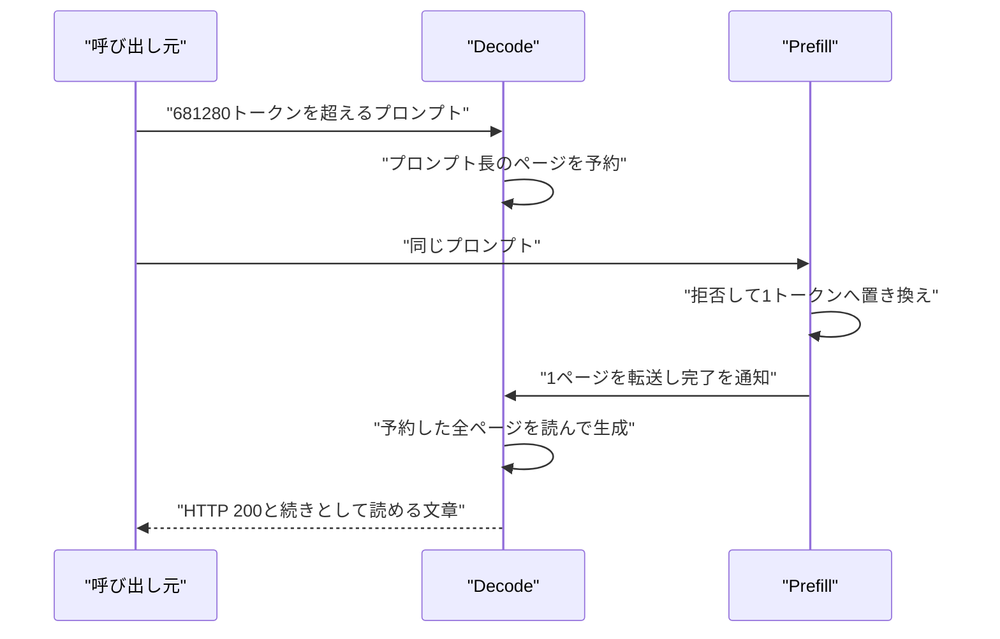

2026年8月27日から9月9日まで、Cloudflare の Workers AI に公開されていた `@cf/zai-org/glm-5.3` で、別セッションの計算途中のデータが応答に混ざりました。Workers AI は、Cloudflare がホストするモデル推論です。Cloudflare と推論エンジン SGLang の保守側は 2026年10月26日に、発見者は 10月27日に、それぞれの報告を公開しています。この文章では、混入の経路、呼び出し側に見えた形、その後の是正を、それらの公開資料に沿って整理します。影響件数、対象モデル、意図的な悪用の有無は Cloudflare の調査結果であり、発見者が自分のアカウントで測った境界は別の観測です。

*この記事の全体像。以下、順に解説します。*

## Workers AI の KV キャッシュ混入とは

KV キャッシュは、次のトークンを計算するために推論エンジンが保持する key と value のページです。名前が近い Workers KV とは別の層です。今回、混入の経路に入った公開モデルは `@cf/zai-org/glm-5.3` だけです。

### 公開コンテキストと prefill のプール

公開コンテキストは 1,048,576 トークンです。prefill 側のプールは 681,280 トークンでした。prefill は、プロンプトを読んで KV を作る段です。decode は、その KV を読んで続きのトークンを出す段です。プールは、その段が一度に保持できる KV の容量です。公開コンテキストと prefill プールの差は、公開前から分かっていました。長い入力の試験は HTTP の成功で返り、上限を超えた分は穏やかに処理されるものとして、モデルは公開されました。Cloudflare は、他の分離デプロイでは prefill と decode の両方でプールが公開コンテキスト以上だった、と調査結果に書いています。分離デプロイは、prefill と decode を別ノードに置いた配備です。

推論は SGLang の prefill と decode を分けた構成でした。SGLang は、リクエストを受けてトークンを生成する推論エンジンです。二つの段のあいだは、Mooncake の RDMA で KV を渡します。Mooncake は、離れたノードのメモリページを直接コピーする転送です。RDMA は、CPU を介さずメモリ同士でデータを移す方式です。

### 拒否のあと、予約したページを読む

プールを超えるプロンプトは拒否扱いになります。プロンプトの中身は、1 トークンに差し替わります。差し替え後も、その要求は prefill の列に残ります。prefill は 1 ページだけを decode へ転送し、完了を通知します。decode は、元のプロンプト長ぶんのページを確保したままです。書き換わっていない残りのページを読んで、生成します。ページは、要求のあいだでゼロクリアされません。

混入は、decode が二つのものを区別しないことで起きます。一つは、この要求が書いたページです。もう一つは、この要求のために予約したページです。予約の幅は、送った長文の長さです。転送されるのは 1 ページです。残りのページには、前の要求の KV が残ります。

次の図は、一回の要求が decode と prefill の両方へ届く内部の流れです。利用者の操作は、入口への一回の呼び出しです。

単一ノードでは、同じ置き換えのあと、クライアントはエラーを受け取ります。分離構成だけが、完了通知のあとで予約ページ全体を生成に使います。分離構成は、上で書いた分離デプロイと同じ置き方です。

エンジン内部では、拒否は `Req.set_finish_with_abort` で付きます。拒否は完了理由の欄 `to_finish` に残り、完了したかを返す `finished()` は偽のままです。分離の入場は、`finished()` が偽である要求を通すので、拒否を見ずに KV の受け渡しへ進みます。入場の準備を bootstrap と呼びます。是正のエンジン側は、bootstrap、メモリの確保、KV 転送より前に、拒否が付いた要求をこの入場から外します。

上流の Issue [sgl-project/sglang#30233](https://github.com/sgl-project/sglang/issues/30233) は、同じ置き換えを SGLang 0.5.11 と GLM-5.2-FP8 で報告しています。GLM-5.2-FP8 は、その Issue に書かれた別モデルの識別子です。そちらで観測されたクライアント症状は、prefill の `prompt_tokens` が 1 になり、decode が入力と無関係な文字列を出す、というものでした。`prompt_tokens` は、API が入力として数えたトークン数です。

### 呼び出し側に見えた形

この経路の応答は、次の形で返りました。

- ステータスは HTTP 200 です。API 上は成功に見えます。
- `prompt_tokens` は、送った長文の長さと一致します。単一ノードの同じ拒否は、クライアントへエラーを返します。
- 返信は、送ったプロンプトの続きとして読める文章になります。発見者は、プロンプトに入れた固有の文字列（マーカー）が、本文にも reasoning にも残らなかった、と記録しています。マーカーは、入力が応答に残っているかを見るための印です。reasoning は、応答本文とは別に返る思考過程の欄です。
- 発見者が測った外側では、662,162 トークンまでは通常の遅延で返りました。700,166 トークン以降の試行で、短時間の無関係な応答が始まりました。812,377 トークンの一例は、長文入力として Neurons が計上されました。Neurons は、Workers AI が推論の利用量を数える単位です。

Cloudflare は、155 件の応答に、同じモデルの別セッションのデータが混ざったと数えています。混入があったプロンプトは、いずれも 681,280 トークンを超えていました。

中断時には、別の経路もあります。転送の途中で要求が中断します。decode がページを先に解放します。遅れて届いた RDMA の書き込みが、次の要求のページへ着地します。条件は四つです。分離していること、転送バックエンドがあること、転送中に中断すること、着地前に枠が再利用されることです。転送バックエンドは、KV のページを隣のノードへ渡す実装です。今回の公表経路は、拒否された要求が毎回ハンドオフへ進み、受信側が前のページを読む、というものです。中断経路は確率的で、書き込みの向きが逆です。

ページの寿命を見る検査は、2026年夏のプロトタイプとして一度作られました。再割当でタグが変わり、decode は読む前に期待するタグと照合します。試した相手は GLM 5.2 です。公開資料は、上流 Issue の GLM-5.2-FP8 と同じモデルだとは結びつけていません。名前は、事故の `@cf/zai-org/glm-5.3` とも違います。8月中旬に試し、信頼性の問題で無効化されました。

### 是正と、いまの呼び出し口

2026年9月9日 14:00 UTC に、モデルは非公開になりました。呼び出しは HTTP 400 になりました。プールを約 204 万トークンへ広げた canary は、14:35 UTC にこの経路の影響を受けないと確認されました。約 204 万は、公開コンテキスト 1,048,576 の約 2 倍です。canary は、全体へ戻す前の限定した確認配備です。19:40 UTC に、公開へ戻りました。

是正は二つに分かれます。

1. 設定です。prefill のプールを約 204 万トークンにし、妥当な要求がこの拒否に入らないようにしました。Cloudflare は、これだけでこのバグは踏まれなくなる、と書いています。
2. エンジンです。拒否が付いた要求を、bootstrap と確保と KV 転送の前に、分離の入場から外します。[sgl-project/sglang#36988](https://github.com/sgl-project/sglang/pull/36988) は 2026年9月6日に merge され、v0.5.20 に含まれます。[sgl-project/sglang#38935](https://github.com/sgl-project/sglang/pull/38935) は 2026年9月16日に merge され、v0.5.21 に含まれます。v0.5.20 には含まれません。Cloudflare が下書きした [sgl-project/sglang#38704](https://github.com/sgl-project/sglang/pull/38704) は、2026年10月10日に draft のまま閉じ、merge されていません。

保守側が運用者へ勧める版は、v0.5.22 以降です。この版は、上記二つの merge に加え、その後の転送完了通知の修正を含む、という位置づけです。チェックサムは `--disaggregation-enable-kv-checksum` で有効にします。既定ではオフです。任意のチェックサムを足す [sgl-project/sglang#39500](https://github.com/sgl-project/sglang/pull/39500) は merge されています。Cloudflare の表では、この変更は v0.5.21 です。解放時のゼロ化は、draft の [sgl-project/sglang#46435](https://github.com/sgl-project/sglang/pull/46435) として開いています。

現行の呼び出しは、Workers 上のプログラムに渡る binding `env.AI.run`、アカウントの REST、OpenAI 互換エンドポイント、AI Gateway のいずれかです。binding は、そのプログラムからモデルを呼ぶ接続です。OpenAI 互換エンドポイントは、OpenAI のチャット API と同じリクエスト形で、このモデルを呼ぶ入口です。AI Gateway は、同じモデルへのもう一つの呼び出し口です。モデルページは、2026年10月28日時点で掲載が続いています。

## 注意点

ここからは、件数・文書・版をどこまで信じてよいかです。前の節の経路そのものは、当事者が同じ機序を書いています。

### 155 件が数えているもの

155 は応答の件数です。顧客数でも、漏れたトークン量でも、しきい値を超えた試行の全数でもありません。Cloudflare は、影響を受けた応答は 155 件だと書いています。続く文では、自社試験と報告者を除いたあとに識別した要求は、通常の長文利用に見える、と書いています。155 がその除外のあとなのか前なのかは、原文の接続だけでは確定できません。しきい値を超える要求はこの経路になる、とも書いています。1 件の応答が、複数の前の要求のページを読み得ます。

「他のモデルは影響を受けていない」「意図的な悪用の証拠はない」は、事業者の調査結果です。他モデルについては、プールがコンテキスト以上で、この拒否に届かない、という説明です。全モデルの過去出力を第三者が監査した記録は、三つの当事者記事にはありません。発見者は glm-5.3-flash、glm-5.2、glm-4.7-flash を同じやり方で試し、成功か拒否だったと書いています。これは三つの対照であり、フリート全体の監査ではありません。悪用が無い、という判断は、自社試験と報告者を除いたあとに識別した要求の時刻と量が、通常の長文利用に見える、という読みです。

### ステータスページが覆う期間

ステータスページのインシデント [jsvvrtk5hvym](https://www.cloudflarestatus.com/incidents/jsvvrtk5hvym) の題は “Cloudflare Workers AI increased errors” です。impact は minor です。本文は、GLM 5.3 利用時のエラー増加と、修正の実装、解消だけを書きます。期間は 2026-09-09T14:25:16Z から 2026-09-09T20:09:37Z です。8月27日から9月8日の露出は載りません。

### コンテキスト長の文書が一致しない

モデルページは 1,048,576 です。別ページの [AI Search 対応モデル表](https://developers.cloudflare.com/ai-search/configuration/models/supported-models/)（2026年10月1日更新）は、`@cf/zai-org/glm-5.3` を 1,310,720、`@cf/zai-org/glm-5.3-flash` を 1,048,576 と書きます。AI Search は、Workers AI のモデルを検索機能から使うときの一覧がある別機能です。発見者は、調査時点の文書が 1,310,720 だったことと、Cloudflare から「表示はバグで、強制される窓は 1,048,576」と訂正を受けたことを記しています。この訂正文の出典は、発見者記事のなかの引用です。1,048,576 を超える要求は HTTP 400 で、セキュリティ上の影響は無かった、と発見者は書いています。681,280 ちょうどを外部から切った計測は、公開資料には見当たりません。

### 版を一つにまとめない

Cloudflare の本文は、このバグは v0.5.21 で扱われた、と書きます。Cloudflare の記事の表は、`#36988` が v0.5.20 でこの事故の露出を止め、`#38935` が v0.5.21 で bootstrap 前に拒否する、と分けます。`#36988` は、1 トークンへ差し替えたあとの結果が decode へ届く前に、その要求を列から外します。`#38935` は、それより前、bootstrap の前に拒否します。推奨は、両方を含む v0.5.22 以降です。リリースの包含関係では、`#36988` の merge commit は v0.5.20 に含まれます。`#38935` の merge commit は v0.5.21 に含まれ、v0.5.20 の祖先ではありません。

保守側は、遅延解放を既定で有効にする版を、転送バックエンドごとに分けています。遅延解放は、転送の途中で要求が中断したとき、decode がページをすぐ次の要求へ渡さないよう、解放を遅らせる修正です。失敗した送信完了通知の修正は、失敗した転送を完了として通知しないようにするものです。どちらも、拒否された要求が予約ページを読む経路とは別で、中断時に遅い書き込みが次のページへ着地する経路の側です。Mooncake と NIXL の遅延解放は v0.5.21、MORI は v0.5.22 です。NIXL と MORI は、Mooncake とは別の転送バックエンドとして、保守側の記事に並びます。失敗した Mooncake の送信完了通知は v0.5.22 です。失敗した NIXL と MORI の同種経路は v0.5.23 です。後者二つの PR 状態は、保守側（LMSYS）の記述として扱います。

チェックサムは既定オフです。Cloudflare は、GLM 5.3、GLM 5.3 Flash、DeepSeek V4 のチェックサム対応が進行中だと書いています。DeepSeek V4 は、混入が起きたモデルとしては書かれていません。転送後のすべての decode 読みまでは、拡張されていません。ゼロ化は draft のままです。ページ所有タグは、無効化されたプロトタイプです。v0.5.22 へ上げることは、これらの検査が本番の GLM-5.3 で、すでにすべての読みを拒んでいる、という意味ではありません。10月26日の記事は、事故期間の GLM-5.3 でページ所有の照合が有効だった、とは書いていません。

### 通知、データ利用、発見の経路

顧客への個別通知、通知日時、規制当局への届出は、Cloudflare の記事に書かれていません。無かったとも、あったとも、公開された一次資料からは言えません。数値の SLA も、同じ記事群には見当たりません。

[データ利用のページ](https://developers.cloudflare.com/workers-ai/platform/data-usage/)（2026年10月16日更新）は、標準の非ステートフル推論について、応答を返したあとのゼロ保持、学習に使わないこと、他の顧客へ提供しないことを書きます。事故期間中に起きたのは、保持期間のあとではありません。生成の途中で、別セッションの KV が読まれたことです。このページは、インシデントに言及していません。

発見の最初の異常は、中継サービス OpenRouter を通した通常の作業でした（2026年9月7日、発見者の記録）。その後の切り分けは、発見者自身の Workers AI アカウントで行われました。155 件の算定から報告者を除いたかは、原文だけでは確定できません。発見時の応答が 155 に含まれるかは、どちらの記事にもありません。OpenRouter が本文を保存した、という記載は見当たりません。

この公表に、Cloudflare、SGLang、発見者側の Knostic が振った CVE 番号はありません。確認した一次の脆弱性レコードでも、この拒否経路への番号は見当たりません。別のキャッシュ不具合に振られた番号と、この事故を同じものとして扱わないでください。

上流 Issue は 2026年9月5日に bot が閉じました。`#36988` の merge は 2026年9月6日です。closed は、事故経路が本番の前に直っていたことを意味しません。Issue の `prompt_tokens=1` と、Workers AI の長い `prompt_tokens` は、同じ層の観測ではありません。

## どこまでを判断に使うか

当事者の記述と揃うのは、次の点です。超過プロンプトが 1 トークンへ置き換わり、分離の decode が予約ページの残りを読みます。単一ノードのこの拒否は、エラーになります。プールを約 204 万トークンにした canary は、この経路では影響を受けないと Cloudflare が書いています。エンジンの入場拒否は、そのあとでプールが再びずれたときや、別の理由で拒否された要求が同じハンドオフへ入るときの、後段の止めです。

次の読みは、結論を弱くします。

- 155 を顧客数や全量と読むこと。
- 9月9日のステータスページが、データの露出を告知したと読むこと。
- プール拡大とエンジン修正の両方が無いと、観測された 155 件の経路が止まらなかったと読むこと。設定変更の時点で、この経路の canary は影響を受けなくなっています。
- プールがコンテキスト以上なら、KV の所有の問題が終わると読むこと。中断時の着地は、別条件で残ります。
- v0.5.20、v0.5.21、v0.5.22 のどれか一つで、関連するクラスが閉じたと読むこと。
- `#30233` の無関係な文字列と `prompt_tokens=1` を、本番の HTTP 200 と同じクライアント症状として読むこと。
- ページ所有タグやチェックサムが、事故当時および 2026年10月26日時点の GLM-5.3 で、読み取りを防いでいたと読むこと。

## 出力の本文で見る四つの確認

共有推論を呼ぶ側の検証に、正常な短いプロンプトの成否だけでは足りません。次の四つを、出力の本文で見ます。料金と速度は、この判断の主材料ではありません。

1. 公開コンテキストの直前と、文書に書かれた窓を超えた入力です。期待は、窓の内側は自分の入力に沿った応答、窓の外側はエラーであり、別件の文章ではないことです。
2. エンジンが拒否する長さです。プール容量や `max_req_input_len` が公開窓より小さい構成では、HTTP 200 と、入力長と一致する `prompt_tokens` と、入力と無関係な本文が、同時に出ていないかを見ます。`max_req_input_len` は、エンジンが入力として受け付ける長さの設定名です。
3. 転送中の中断のあと、同じ枠を次の要求が再利用したときです。前の要求の断片が、次の本文に出ていないかを見ます。中断した側へ戻ることだけを見ても、着地の向きは逆なので取りこぼします。
4. ステータスコードだけで成功にしないことです。200 でも、プロンプトに入れたマーカーが本文と reasoning の両方に無ければ失敗とします。発見者は、マーカーを応答へそのまま書くようプロンプトで頼み、境界より短い入力ではその文字列が返り、超えると本文と reasoning の両方から消えた、と書いています。遅延が急に短くなることも、拒否経路の観測でした。

参考として、2026年10月28日時点のモデルページでは、入力が 100 万トークンあたり約 1.4 ドル、出力が約 4.4 ドル、キャッシュ入力が約 0.26 ドルです。キャッシュ入力は、そのページの課金区分です。応答に混ざった KV キャッシュの単価ではありません。Neurons は、入力 100 万トークンあたり約 12.7 万です。[limits のページ](https://developers.cloudflare.com/workers-ai/platform/limits/)（2026年9月17日更新）では、有料必須モデルの標準がアカウントとモデルの組で 20 リクエスト/分です。前払いの AI Gateway クレジットと Unified billing では 50 リクエスト/分です。Unified billing は、同じページが 50 リクエスト/分の側に置く請求の区分で、標準の 20 リクエスト/分とは別枠です。一般的な無料枠の 300 リクエスト/分を、このモデルの上限として使わないでください。

## 分離構成を自分で持つとき

運用者が自分で SGLang の分離構成を持つ場合、Cloudflare が勧める起点は v0.5.22 以降です。そのうえで、プール容量は起動中のエンジンから、prefill と decode の両方を測ります。公開するコンテキスト以上であることを、設定の検査に入れます。量子化、並列度、CUDA graph の変更は、プールを動かします。これらは実行時の形を変える設定であり、起動前に書いた容量が、起動後のプールと一致するとは限りません。チェックサムは明示的に有効化します。未対応のモデルでは、有効にしただけで読み取りが守られるとは扱いません。ゼロ化とページタグは、2026年10月26日時点では本番の防護になっていません。

## プロセスの隔離では閉じない境界

エージェントの実行場所を隔離しても、この経路は閉じません。呼び出し元のプロセスがどのマシンにあるかと、共有デコーダがどのページを読むかは、別の境界です。プロンプトに他テナントのデータを置かない、という対策も、受信側が前のページを読む事故には届きません。

[Data Localization Suite の互換表](https://developers.cloudflare.com/data-localization/compatibility/)（2026年10月25日更新）では、Regional Services は Workers AI に対応していません。Data Localization Suite は、機能ごとにデータの地域制約へ対応するかを示す Cloudflare の一覧です。Regional Services は、その一覧に載る地域向けの機能です。公開資料が書くメタデータ境界の確認も、推論 GPU の設置場所を固定しません。その確認がどの項目を見るかは、同じ文章には書かれていません。共有される状態は、アカウントの外にある KV ページの中身です。

## まとめ

`@cf/zai-org/glm-5.3` の混入は、公開窓より小さい prefill プールで拒否された要求が、分離の decode に予約ページの残りを読ませた経路です。呼び出し側には HTTP 200 と、入力長どおりの `prompt_tokens` と、続きとして読める文章が返りました。Cloudflare が数えた混入応答は 155 件で、該当プロンプトはいずれも 681,280 トークンを超えていました。設定でプールを約 204 万トークンへ広げた時点で、この経路の canary は影響を受けなくなっています。エンジンの入場拒否は、プールが再びずれたときの後段です。

判断に使うときは、155 を顧客数や全量にせず、9月9日のステータスページを露出期間の告知とせず、v0.5.20 から v0.5.22 のどれか一つで関連クラスが閉じたともしません。共有推論の確認は、短いプロンプトの成功ではなく、窓の内外、拒否長、転送中断の次の要求、200 でもマーカーが残るか、を本文で見ます。

この記事が少しでも参考になった、あるいは改善点などがあれば、ぜひリアクションやコメント、SNSでのシェアをいただけると励みになります！

## 参考リンク

- [Cloudflare, Cross-request KV cache exposure in the GLM-5.3 Workers AI model, and our remediation with SGLang（2026-10-26）](https://blog.cloudflare.com/kv-cache-exposure-remediation/)
- [SGLang Team / LMSYS, SGLang security update: improving request isolation（2026-10-26）](https://www.lmsys.org/blog/2026-10-26-cf-security)
- [Gadi Evron / Knostic, Hallucination or Cross-Tenant: When an LLM Answers With Another User’s Context（2026-10-27）](https://www.knostic.ai/blog/hallucination-or-cross-tenant-when-an-llm-answers-with-another-users-context)
- [Cloudflare Status, incident jsvvrtk5hvym](https://www.cloudflarestatus.com/incidents/jsvvrtk5hvym)
- [Workers AI モデルページ `@cf/zai-org/glm-5.3`](https://developers.cloudflare.com/workers-ai/models/glm-5.3/)
- [AI Search supported models](https://developers.cloudflare.com/ai-search/configuration/models/supported-models/)
- [Workers AI limits](https://developers.cloudflare.com/workers-ai/platform/limits/)
- [Workers AI pricing](https://developers.cloudflare.com/workers-ai/platform/pricing/)
- [Workers AI data usage](https://developers.cloudflare.com/workers-ai/platform/data-usage/)
- [Data Localization Suite compatibility](https://developers.cloudflare.com/data-localization/compatibility/)
- [sgl-project/sglang#30233](https://github.com/sgl-project/sglang/issues/30233)
- [sgl-project/sglang#36988](https://github.com/sgl-project/sglang/pull/36988)
- [sgl-project/sglang#38935](https://github.com/sgl-project/sglang/pull/38935)
- [sgl-project/sglang#38704](https://github.com/sgl-project/sglang/pull/38704)
- [sgl-project/sglang#39500](https://github.com/sgl-project/sglang/pull/39500)
- [sgl-project/sglang#46435](https://github.com/sgl-project/sglang/pull/46435)
