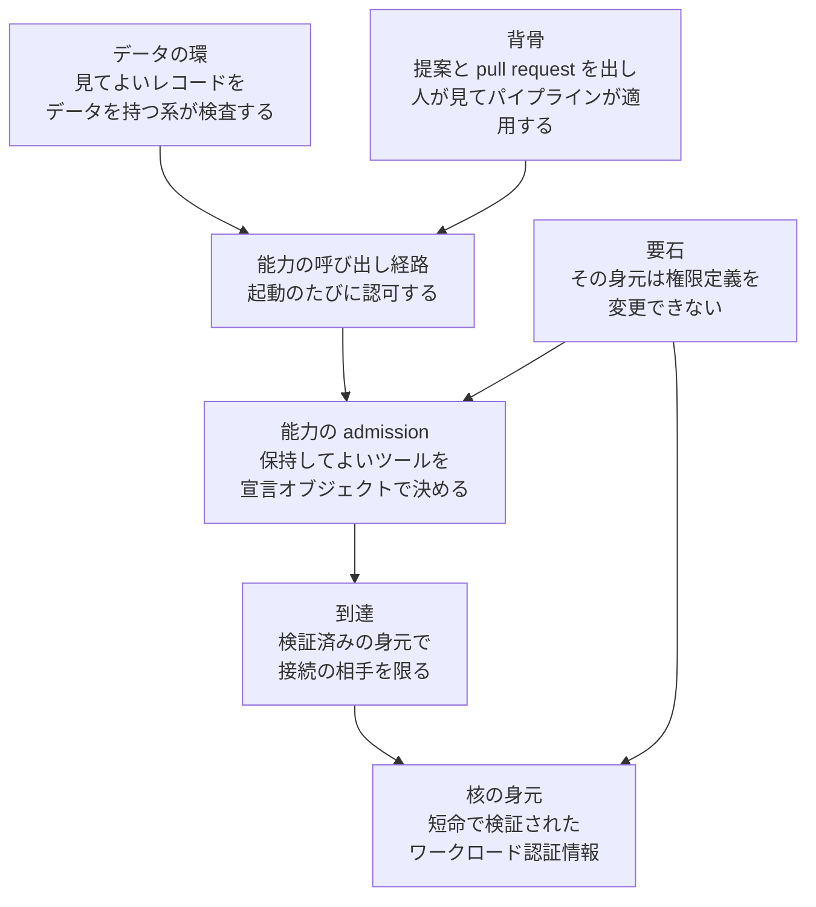

2026年10月29日、CNCF Blog は Ambassador Post として "The boundary problem in agentic AI is a platform problem" を掲載しました。著者は William Rizzo（Field CTO、Kairos Maintainer、CNCF Ambassador）と Francesco Beltramini（Field CTO）です。掲載区分は Blog の Ambassador Post であり、Announcements ではありません。

記事は、自律エージェントが何に届くかを、推論の外側にある基盤が決める、と書いています。その整理に Safe Operating Model という名前を付け、身元、到達、能力、データの同心円として示しています。読み手は、エージェントへ渡す道具と、その道具の追加や削除の経路を決めるプラットフォーム側です。

この記事では、四つの環が何を限るかを先に整理します。次に、記事の言い切りを出荷時の既定や仕様の義務としてどこまで読めるかを分けます。最後に、エージェントへ渡すツールの一覧を、どの層の正本として扱うかを書きます。

*この記事の全体像。以下、順に解説します。*

## Safe Operating Model とは

Safe Operating Model は、CNCF ブログが導入する名前です。有界な自律を、エージェントが走るプラットフォームの性質として置きます。境界の置き場は、推論が到達できる範囲を決める基盤です。

### 四つの環

同心円は、内側から身元、到達、能力、データです。能力は admission と呼び出し経路の二つに分かれます。admission は、エージェントが保持してよい能力を宣言オブジェクトで決める関門です。呼び出し経路は、保持した能力で、その起動のときにしてよいことを決める関門です。

身元は核です。他の制御は、何が動いているかを知ることに依存します。記事が書くワークロード身元の標準は、エージェントとツールサーバのそれぞれへ、短命で検証された認証情報を発行します。ワークロード身元とは、動いている処理そのものに対して発行する身元です。

到達は、身元の次に限る層です。限る対象は、接続してよい相手です。検証済みの身元に対して、サービスメッシュが接続ごとに相手を限る、と記事は書いています。サービスメッシュは、サービス間の通信を仲介し、接続の相手をポリシーで絞る基盤です。

能力は、到達が決めた会話相手に対して、実際にできることを決めます。起動してよいツールと、システムに対してしてよいことです。記事は、許可されていないツールを求めると拒否が返り、そのツールはエージェントから見えるものにも出ない、と書いています。

外側の環はデータです。エージェントが見てよいレコードを限る層です。強制は、データを持つシステムがデータプレーンで行います。データプレーンは、データを持つ系が照会と更新のときに行う検査の場所です。記事は、この環の強制をメッシュや admission コントローラには置いていません。

要石は、権限を定義するオブジェクトを当の身元が書き換えない、という規則です。環の名前とは別に置かれます。境界の内側では動け、境界自体は書き換えられない、と記事は書いています。権限の変更は、人が行うかパイプラインが行う、版管理された設定のレビュー済み差分に限る、と書いています。

決定論的な背骨は、能力の使い方を提案の出力へ寄せる経路です。エージェントは、変更案、下書き、推奨、望む状態に対する pull request を出します。人がレビューし、パイプラインが適用します。

記事が新しく小さい部分として書くのは、エージェントの身元と許可された能力を一級の宣言オブジェクトにすることです。一級の宣言オブジェクトとは、ほかの設定と同じく、宣言して管理する対象です。あわせて、agent-to-tool protocols が導入したツールごとの認可を強制する、と書いています。agent-to-tool protocols は、記事が使う一般名で、エージェントがツールを起動するときの取り決めを指します。

記事は、成熟したクラウドネイティブの積み上げに、このモデルが要るものは既にある、と書いています。これからの仕事は、既存の部品の統合と厳密さに置く、と続けています。

### 同心円の関係

図の矢印は、外側の環が内側の検証済み身元を鍵にすることを示します。要石は、その身元と、admission のオブジェクトに掛かります。背骨は、呼び出しの出どころに掛かります。

記事が各層へ置いている文は、次のとおりです。

| 層 | 記事が置いていること |
| --- | --- |
| 身元 | 他の制御は、何が動いているかを知ることに依存する。ワークロード身元の標準が、短命で検証された認証情報を発行する |
| 到達 | 身元の次に限るのは、接続してよい相手である |
| 能力 | 到達が会話相手を決め、能力が実際にできることを決める。起動してよいツールと、システムに対してしてよいことである |
| admission | エージェントが保持してよい能力を決める |
| 呼び出し経路 | 保持した能力でしてよいことを決める |
| 要石 | 自分の権限を定義するオブジェクトを、自分の身元は変更できない。境界の内側では動け、境界自体は書き換えられない |
| データ | 見てよいレコードを、データを持つ系がデータプレーンで強制する |

### ツールは能力の二段と要石にある

身元は、誰が動いているかの鍵です。到達は、どの相手へ接続できるかです。ツールの一覧と、その一覧に対する起動の可否は、能力の層にあります。ポリシーは admission の宣言オブジェクトにあり、実行時の判定は呼び出し経路にあります。

要石は、その宣言を、実行中のエージェントが書き換えない、という分離です。変えてよいのは、レビュー済みの設定差分だけです。記事の文は、ツール境界を一つの層の名前にまとめず、能力の二段と要石の組み合わせとして置いています。

## 注意点

この節は、記事の言い切りを、どこまで測定や仕様として読めるかを分けます。確認日は 2026年10月30日です。

### この名前は筆者の整理である

本文は Safe Operating Model を、筆者の整理として導入しています。2026年10月30日の確認では、CNCF のプロジェクト一覧、glossary のトップ、landscape.yml の文字列、`org:cncf Safe Operating Model` のリポジトリ検索、Issue 検索の total_count 0 の範囲に、この名前の仕様もプロジェクトもありませんでした。

GitHub の code search API は 401 を返したため、リポジトリ内の全ファイルまでは見ていません。したがって、CNCF のどのファイルにもこの文字列が無い、とまでは言えません。記事が本番級だとする部品を、この名前の一つの標準がすでに結合している、という証拠も、確認した範囲にはありませんでした。

### 本文は製品名を出していない

記事本文の HTML と、本文として抽出したテキストの双方で、SPIFFE、Istio、MCP、OPA、Kyverno の出現は 0 件でした。SPIFFE は、ワークロードに検証可能な識別子を発行する仕様です。Istio と、後で触れる Linkerd は、サービスメッシュの実装です。MCP（Model Context Protocol）は、エージェントが外部のツールを一覧し、呼び出すためのプロトコルです。OPA と Kyverno は、ポリシーをコードとして書く実装の例です。

記事が使うのは、workload identity standard、service mesh、admission、agent-to-tool protocols、policy-as-code のような一般名です。policy-as-code は、許可の規則を版管理できるコードとして書くやり方を指す一般名です。

"every one of them has a production-grade project behind it today" は、部品の背後に本番級のプロジェクトがある、という文です。プロジェクト名は本文にありません。KubeCon のセッションページに MCP、A2A、OpenTelemetry が出るのは、セッションページの文です。A2A はエージェント同士が対話するための別プロトコルの名です。OpenTelemetry は、トレースなどの遠隔計測の仕様と実装の名です。ブログ本文の語ではありません。

### 回数と年数には分母がない

記事は "A boundary that holds ninety-nine times and yields on the hundredth is not a boundary" と書いています。99回保つ境界が100回目に崩れるなら、それは境界ではない、という文です。あわせて "The industry has spent fifteen years learning to bound what a workload can do." と書いています。ワークロードの到達を限ることを、業界が15年かけて学んできた、という文です。どちらの文にも、記事中に標本、分母、期間の起算、出典がありません。この二つの数は、観察結果としては記載されていません。

署名の Field CTO に、雇用主の社名はありません。Kairos Maintainer はプロジェクト上の役割であり、Field CTO の雇用主ではありません。

### 到達の出荷時既定は拒否ではない

記事は、許可されていない相手への接続を、開く前に拒否する、と書いています。あわせて、その拒否以外の動作は既定ではない、と環の動作として書いています。確認したメッシュ文書の出荷時の既定は、この二文と並びません。

Istio のセキュリティ概念は、認可ポリシーが適用されていないワークロードでは全リクエストを許可する、と書いています。deny-by-default（何も許可しなければ拒否する、という既定）は、そのワークロードに ALLOW の認可ポリシーが少なくとも一つあるときに限る、とも書いています。

PeerAuthentication は、Istio が相互 TLS のモードを書くオブジェクトです。相互 TLS は、通信の両端が証明書で相手を確認する方式です。mode が未設定なら、より広い範囲である親の mode を継承します。メッシュ全体ポリシーの mode が未設定なら PERMISSIVE です。PERMISSIVE は、相互 TLS と平文の両方を受け付けます。この PERMISSIVE の文は、メッシュ全体ポリシーの mode が未設定である場合の文であり、PeerAuthentication オブジェクトが一つも無い場合の文ではありません。

リクエストの認証を書く Request authentication は、トークンの無いリクエストを既定では受け付ける、と書いています。引用したページは `latest` であり、リリース番号はピン留めされていません。対応する原稿ファイルの最終コミットは 2025年10月17日の `57c0b885c7bce73f1f0ac10277d8be8b18267815` です。

Linkerd の現行の server policy は、既定ではメッシュを通過するトラフィックをすべて許可する、と書いています。既定ポリシー `all-unauthenticated` は、すべてのリクエストを許可する、と書き、これが既定だと明記しています。

Kubernetes の NetworkPolicy は、既定では Pod の入出力が非隔離で、接続を許可する、と書いています。記事の到達はメッシュの話なので、この文がメッシュの文を直接置き換えるわけではありません。プラットフォーム一般について、何もしなければ拒否が既定だ、という読みはここでも成り立ちません。

### データの環は、何もしなければ全行が見える

PostgreSQL の行セキュリティは、行ごとに見える範囲を限る機能です。既定ではテーブルにポリシーが無く、SQL 権限があれば全行が照会と更新の対象になります。行セキュリティは `ENABLE ROW LEVEL SECURITY` まで無効です。スーパーユーザ、行セキュリティを迂回する属性である `BYPASSRLS`、通常はテーブル所有者も行セキュリティをバイパスします。検査されるのは SQL のロールです。SPIFFE ID がそのまま行の鍵になる、とは書かれていません。SPIFFE ID は、SPIFFE がワークロードへ付ける識別子で、仕様は識別子の path（パス部分）がワークロードを識別する、と書いています。

### 権限の書き換え防止はロールとバインドに書かれている

Kubernetes RBAC は、ロールに権限を足していくアクセス制御です。権限は加算のみで、deny 規則はありません。特権昇格の防止は API レベルにあり、RBAC authorizer を使っていないときも適用される、と書いています。

Role と ClusterRole は権限の中身、RoleBinding と ClusterRoleBinding はその権限を誰に付けるかです。昇格防止の対象として書かれているのは、この四つの作成と更新です。ロールの作成と更新は、そのロールに含まれる権限を同じ範囲で既に持つか、`escalate` がある場合にできます。バインドの作成と更新は、参照ロールの権限を既に持つか、`bind` がある場合にできます。Istio の AuthorizationPolicy（リクエストの許可と拒否を書くオブジェクト）、ツール許可を書く設定である ConfigMap、自分のワークロード定義である Deployment は、この節の `escalate` と `bind` の対象としては書かれていません。

### 許可外ツールを隠すことは MCP の MUST ではない

MCP の認可は、2025年11月25日と、仕様インデックスが latest と表示する 2026年7月28日の双方で OPTIONAL です。OPTIONAL は、実装が従わなくても仕様違反にならない、という強さです。MUST は、従わないと仕様違反になる強さです。SHOULD NOT は、しないよう推奨する強さであり、MUST の禁止ではありません。MAY は、してもよいという強さで、義務ではありません。

STDIO は、クライアントが MCP サーバを子プロセスとして起動し、標準入出力で通信する方式です。STDIO を使う実装について、同じ認可仕様は、この認可仕様に従わないことを推奨し、代わりに資格情報は環境変数から取る、と SHOULD NOT で書いています。環境変数の資格情報は、記事が核に置く短命で検証されたワークロード認証情報であることを、この文は要求していません。

2026年7月28日の tools 仕様は、ツールをモデルが制御する設計だと書いています。プロトコル自体は、特定の利用者対話モデルを義務づけない、と続けています。人が呼び出しを拒否できることは SHOULD であり、MUST ではありません。ツール一覧は空でもよく、時間とともに変わってもよい、と MAY で書いています。

`tools/list` の集合は、提示された認可によって変えてよい、と MAY で書いています。例として、付与された scope が許すツールだけを返す、とあります。これは、許可外のツールを一覧から外す MUST ではありません。scope は、トークンに載る許可の範囲を表す主張です。

未マージの [modelcontextprotocol/modelcontextprotocol#2385](https://github.com/modelcontextprotocol/modelcontextprotocol/pull/2385) は closed で、merged は false です。2026年3月12日のコメントは、ツールを隠すこと自体を、既に可能なサーバ判断として扱っています。サーバが隠せる、という留保のあとも、プロトコルがクライアント側へその強制を MUST として課している、という記録にはなっていません。

関連する提案も、ツール単位の allow-list を MUST にはしていません。[#1881](https://github.com/modelcontextprotocol/modelcontextprotocol/issues/1881) は closed で、GitHub 上の状態理由は completed ですが、仕様へ採用された記録ではありません。[#1880](https://github.com/modelcontextprotocol/modelcontextprotocol/issues/1880) は closed で、not_planned です。[#1488](https://github.com/modelcontextprotocol/modelcontextprotocol/issues/1488) は 2026年10月30日時点で open、Draft です。追加するのは optional な `securitySchemes` であり、ツール単位 allow-list の MUST ではありません。

状態を持つツールの節は、非規範の案内です。非規範とは、仕様の義務ではなく案内だ、ということです。プロトコルに状態ハンドルという型は無く、ハンドルはツール結果の中の普通の文字列です。認証済みサーバでは、そのハンドルは名前であり能力ではありません。サーバは呼び出しのたびに、呼び出し元の認可をそのハンドルに対して検査するべきだ、と should で続けています。例は、買い物かご ID のように、呼び出しのあいだで引き回す値です。

セキュリティ上の注意は、サーバが対応する scope の一覧である `scopes_supported` の全部を渡したトークンで、追加の昇格無しに高リスクのツールをすぐ呼べる、と書いています。サーバがトークン内の scope 主張だけで足りるものとして扱うことを、よくある誤りとして挙げています。認可の応答に scope が無いとき、クライアントは `scopes_supported` の全部を使う、という SHOULD のフォールバックも残っています。MCP サーバは、クライアントから受け取ったトークンを透過してはならない、と MUST で書いています。透過とは、そのトークンをそのまま別の呼び出しへ渡すことです。

### 許可集合の内側に非決定が残る

許可集合の内側では、説明文、注釈、ツール出力がモデルの文脈に入ります。注釈は、信頼できるサーバ由来でなければ信頼しない、とクライアントは MUST で扱います。集合を狭めても、集合の中のどのツールを選ぶか、どの引数で呼ぶかは、モデルの選択のままです。すでに admission を通過したサーバが、実行中に一覧と説明を変える余地も、ツール一覧が時間とともに変わってよい、という MAY の側に残ります。

OWASP の LLM01:2025 は、間接プロンプト注入の影響に、LLM から使える関数への認可されていないアクセスを含めています。間接プロンプト注入は、モデルが読む外部の内容に指示を混ぜ、モデルの振る舞いを変える攻撃です。同じページは、防止に確実な方法があるかは不明だ、と書いています。

MCPTox（arXiv 2508.14925）は、関連 DOI [10.1609/aaai.v40i42.40895](https://doi.org/10.1609/aaai.v40i42.40895) を持ち、頁題は Proceedings of the AAAI Conference on Artificial Intelligence です。要旨は、ツールを実行せずメタデータへ指示を埋める攻撃で、o1-mini の攻撃成功率 72.8%、拒否が最も高い Claude-3.7-Sonnet でも 3% 未満、と報告しています。この数値は著者らの報告であり、この記事で再実験した値ではありません。

査読前の MCP-ITP（arXiv 2601.07395）は、毒入りツールを呼ばせず、メタデータで正当な高権限ツールを呼ばせる攻撃で、攻撃成功率が最大 84.2%、悪意ツール検出率が 0.3% まで下がった、と要旨で報告しています。この数値も著者らの報告であり、この記事で再実験した値ではありません。

Greshake らの論文は、Proceedings of the 16th ACM Workshop on Artificial Intelligence and Security の掲載論文です。オンライン公開日は 2023年11月26日、DOI は [10.1145/3605764.3623985](https://doi.org/10.1145/3605764.3623985) です。arXiv 2302.12173 の要旨は、取得データに指示を混ぜて LLM 連携アプリを操る、と述べています。到達先を絞っても、その到達先の応答はデータであり、指示にもなります。

### stdio はメッシュの到達を通らない

stdio では、クライアントが MCP サーバを子プロセスとして起動し、stdin と stdout で通信します。Istio がサイドカーで扱う相互 TLS は、そのパイプではありません。サイドカーは、Pod の通信を隣のプロキシへ寄せる付加コンテナです。

ローカルサーバは、利用者のマシン上でクライアントと同じ権限を持ち得る実行ファイルとして、セキュリティ解説が扱っています。緩和として書かれているのは、ワンクリック設定の同意を MUST とすることと、サンドボックスを SHOULD とすることです。同じ解説は、stdio を選ぶ理由として、アクセスを MCP クライアントだけに限る、と書き、ネットワークの到達制御の外に置いています。

プロキシが子プロセスを stdio で起動する構成では、クライアント側の欠陥から任意コマンドの起動へ進み得る、とも書いています。前提はプロキシ構成であり、すべての stdio がその攻撃だ、とは書かれていません。

### 提案の pull request が境界の書き換えになる条件

提案である pull request が、境界の書き換えになる条件は限定できます。

Argo CD は、Git 上の望むマニフェストをクラスタの状態へ合わせる継続的デリバリの仕組みです。自動同期は、有効にしているとき、Git 上の望むマニフェストが変わると、追加の適用承認無しでクラスタへ反映できます。既定では削除を自動同期しない、という安全策はあります。追加と変更を、適用前に人が止める機構ではありません。

GitHub の保護ブランチは、必須レビューを有効にした場合の規則です。既定では、リポジトリの admin と、branch protection をバイパスするカスタムロールに、その制限は適用されない、と書いています。自動マージは、必須レビューとステータスチェックを通過したあとにマージする、と書いています。必須レビューを有効にしていなければ、待つレビューは残りません。

エージェントが望む状態の差分に、自分の AuthorizationPolicy や Role の緩和を含め、その差分がレビュー無しでマージされ、自動同期されるとき、提案経路は要石の書き換え経路になります。すべての pull request がそうだ、という主張ではありません。

### ワークロード身元は利用者の委任ではない

MCP の認可では、クライアントが資源所有者（保護された資源の利用を許可する人）の代わりに保護資源へアクセスする OAuth 2.1 クライアントとして動きます。OAuth 2.1 は、利用者の許可を受けたクライアントが、保護された資源へアクセスするための認可の枠組みです。

SPIFFE の標準 4.1.1 は、SVID の有効期間中に変わり得る主張の例に、ロール、グループ、アクセスポリシーを挙げています。SVID は、SPIFFE が発行する検証可能な身元文書です。4.1.4 は、別のトラストドメインが顧客の認証済みを主張しても、その主張を盲目的に信じてはいけない、という例を書いています。トラストドメインは、身元を発行する信頼の範囲です。

利用者とワークロードと認可文脈を一つのトランザクショントークンで運ぶプロファイルは、2026年10月30日時点で [spiffe/spiffe#420](https://github.com/spiffe/spiffe/issues/420) が open の提案です。作成は 2026年8月21日、最終コメントは 2026年10月22日で、本文は upcoming と proposed と書いています。見た範囲の Issue と標準本文に、experimental という語はありませんでした。

対応する IETF 文書 draft-ietf-oauth-transaction-tokens-11 は Internet-Draft であり、Expires は 2027年1月31日、RFC ではありません。13.12 は、ワークロードがトランザクショントークンで自分を認証してはならない、ワークロード身元の資格情報ではない、と書いています。WIT-SVID は安定度 Incubating の別サブプロファイルであり、#420 のトランザクショントークンではありません。

Confused deputy は、権限を持つ主体が、別の主体の依頼を自分の権限のまま実行してしまう問題です。ここでの話は、ワークロード身元が利用者委任を運ぶかどうかとは別で、MCP のプロキシが下流へ同意を取り違える条件です。静的クライアント ID とは、どの MCP クライアントから来たかにかかわらず、プロキシが第三者の認可サーバへ出すクライアント ID が同じ値である、ということです。2026年7月28日のセキュリティ考慮は、そのプロキシが、動的登録クライアントごとに同意を取ることを MUST としています。脆弱になる条件は、静的クライアント ID、動的クライアント登録、同意クッキー、転送前のクライアントごとの同意が無いこと、が揃うときとして書かれています。同意が無いプロキシでは、下流から見えるのは開始したエージェントではなくプロキシです。ワークロード身元は、下流の認可主体にはなりません。

### まだ閉じていない問い

次の点は、2026年10月30日時点で閉じていません。

- Safe Operating Model という文字列が、401 で見えなかった CNCF リポジトリのファイル内容に含まれるか。
- どの製品で、エージェントが実行主体のまま、自分の MCP クライアント設定を書き換えられるか。製品マニュアルまでは確認していません。
- トランザクショントークンの提案が、ワークロード身元と利用者委任の穴を埋める仕様になるか。現時点では open の提案と Internet-Draft です。
- 記事の Figure 1 が、本文の環と異なる要素を描いているか。画像は本文と突き合わせていません。
- "fifteen years" の起算を、別の一次資料が否定するか。否定する調査はしていません。

これらは、ツール境界を能力の層に読む判断を止めません。確信度を、仕様の採用や製品の購入へ上げることは止めます。

## 正本は宣言した能力の集合に置く

この節でいう正本は、エージェントが何をできるかという境界全体です。接続相手を限る到達の環の話ではありません。

結論の骨は、記事が層を分けて書いている範囲では維持できます。確信度は限定です。環の動作を、名指しされていない製品の出荷時既定や、MCP の MUST として読むと、前節の反証が当たります。採用するのは意見記事の決定枠であり、その名前の標準ではありません。

### 層を分けた範囲で残る結論

エージェントが何をできるかの正本は、プラットフォームが宣言した能力の集合です。その集合は、検証済みのワークロード身元に結び、当の身元からは変更できません。プロンプトの注意書きは意図であり、何ができるかの正本ではありません。

ツールの追加と削除は、エージェントが自分で適用できない、レビュー済みの設定差分で通します。操作を次状態の提案に限る実装は、提案、下書き、推奨、pull request を出すツールだけを見える集合に残し、マージ、適用、承認、資金移動のようなツールをその集合から外すことです。

### 記事の層分けが支える点

- 記事は、境界を推論ではなく、何に届き何ができるかを決める基盤に置く、と書いています。
- 能力の定義が、起動してよいツールと、システムに対してしてよいことである、と書いています。
- 要石が、権限定義オブジェクトの実行時変更を当の身元から外す、と書いています。
- 背骨が、出すものを提案と pull request に限る、と書いています。
- 2026年7月28日の MCP は、認可に応じてツール一覧を変えてよい、と MAY で書いています。サーバが隠すこと自体は、未マージの #2385 への 2026年3月12日のコメントでも、既に可能なサーバ判断として扱われています。

### 仕様の既定として読むと外れる点

前節の確認を、判断に使う形へ畳むと次のとおりです。

- 確認した Istio と Linkerd の出荷時の既定は、宣言の無い相手を拒否することではありません。
- MCP の認可は OPTIONAL のままです。stdio は認可仕様の外に置かれ、メッシュの接続拒否を通りません。
- 許可集合の内側の選択、引数、説明文、実行中の一覧変更は、環の文が閉じている範囲の外に残ります。
- Kubernetes RBAC に deny は無く、昇格防止はロールとバインドの系に書かれています。AuthorizationPolicy や ConfigMap の更新は、その検査の対象としては書かれていません。
- 自動同期と、レビュー無しまたは admin バイパスが重なると、提案の pull request が境界の書き換えになります。
- ワークロードの SVID は、利用者委任とトランザクション文脈を運ぶ資格情報としては書かれていません。
- Safe Operating Model は、確認した範囲では CNCF の仕様名でもプロジェクト名でもありません。

## 見えるツール集合をどう決めるか

何ができるかの正本は、エージェントに渡しているツールの一覧と、その一覧に対する呼び出しごとの認可です。一覧の追加と削除は、コード変更として版管理し、エージェントが適用できないレビューを通します。セッション中の権限申請で、同じエージェントが申請し適用できる経路は採りません。

### 比べた選択肢

比べたのは、次の四つです。

- プロンプトへ禁止を書く。
- 身元を発行し、メッシュの相手だけを限る。
- 見えるツール集合を、提案を出すものに限る。
- セッション内の権限ダイアログで、エージェントの申請を通す。

見る基準は四つです。記事がどの層にツールを置いたか。エージェント自身がその定義を書き換えられるか。出荷時の既定と、設定したあとの動作を混同していないか。許可集合の内側に残る非決定を、境界が閉じたことに数えていないか。

### 採る配置

プロンプトの禁止は、意図の記録として残します。何ができるかの正本にはしません。

身元とメッシュは、接続相手を限る層として残します。どのツールが見えるかの正本にはしません。stdio やプロセス内のツールは、この層を通りません。

見える集合に残すツールは、変更案、下書き、推奨、望む状態への pull request を出すものに限る、とします。マージ、適用、承認、価格決定、資金移動は、禁止文ではなく、見える集合から外します。

境界を変える差分は、レビューを通った版管理された設定変更とします。その変更を行うのは、人か、エージェントの身元とは別のパイプラインです。自動マージと自動同期を、権限を広げるパスに対して有効にしたままにすると、提案経路が要石を通り抜けます。保護ブランチの admin バイパスを、エージェントの資格情報に持たせると、同じことが起きます。

たとえば、エージェントの ServiceAccount が自分の Role を更新でき、その緩和を含む pull request がレビュー無しでマージされ、Argo CD の自動同期がクラスタへ反映すると、提案は要石の書き換えになります。ServiceAccount は、Pod が Kubernetes API を呼ぶときに使う身元です。見える集合からマージと適用を外し、権限を広げる差分だけ適用前の人の承認を残す、という組でこの経路を断ちます。

データ範囲は、データを持つ系の権限として別に置きます。メッシュに入れたことの帰結としては扱いません。

Safe Operating Model という名前は、この記事の決定枠として参照します。CNCF の仕様や、導入すべき製品名としては扱いません。記事が名指ししていない SPIFFE、Istio、OPA、Kyverno を、この記事の推奨製品として買いません。

### 配置を変える条件

次の条件が揃ったときだけ、層の比重を変えます。見える集合を正本にする判断自体は残します。

- 運用のツールがすべてネットワーク上のサーバであり、stdio とローカルプロセスが無い。かつ、メッシュと認可ポリシーを、出荷時既定のままではなく拒否を既定にして入れている。このとき、到達の層の比重は上がります。ツール一覧の正本は残ります。
- プロトコルの将来版が、ツール単位の allow-list と、一覧からの除外を MUST にした。このとき、サーバ実装の任意判断という留保は弱まります。見える集合を正本にする判断は残ります。
- 権限を広げる Git パスに、必須レビューと admin バイパスの禁止が揃い、レビュー前の差分を自動同期が適用しない。このとき、提案の pull request を境界変更の経路として使えます。レビューを通過したあとの反映をパイプラインが行うことは、記事の背骨に含まれます。

### 直近で見ること

1. エージェントに渡しているツール定義を一覧し、マージ、適用、承認、設定ファイルの書き込み、認可オブジェクトの更新が含まれるかを見ます。運用中のクラスタなら、エージェントの ServiceAccount が更新できるオブジェクト種別を一覧し、その中に認可ポリシー、ツール許可、自分の Deployment、Git への書き込みが含まれるかを見ます。
2. 含まれていれば、そのツールを見える集合から外し、残す出力を提案と pull request に限ります。
3. 境界を変えるリポジトリで、必須レビュー、バイパス権限、自動マージ、自動同期の組み合わせを確認します。権限を広げるパスだけ、適用前に人の承認が残るかを見ます。

## まとめ

CNCF Blog の Ambassador Post は、エージェントの境界を推論の外側に置き、Safe Operating Model という同心円で示しています。内側から身元、到達、能力、データです。ツールの一覧と起動の可否は能力の二段にあり、その定義を当の身元が書き換えないことが要石です。出すものは提案と pull request に寄せ、人が見てパイプラインが適用します。

この名前は、確認した範囲では CNCF の仕様でもプロジェクトでもありません。本文は SPIFFE や Istio や MCP を名指ししていません。メッシュの出荷時既定は、宣言の無い相手を拒否することではありません。MCP のツール隠しは MAY であり、stdio はメッシュを通りません。許可集合の内側の選択と説明文は残ります。レビュー無しのマージと自動同期が重なると、提案が境界の書き換えになります。

採用するのは、見えるツール集合と呼び出しごとの認可を正本にし、その変更をエージェントが適用できないレビューへ通す、という決定枠です。プロンプトの禁止は意図の記録に残し、何ができるかの正本にはしません。

この記事が少しでも参考になった、あるいは改善点などがあれば、ぜひリアクションやコメント、SNSでのシェアをいただけると励みになります！

## 参考リンク

- [CNCF Blog "The boundary problem in agentic AI is a platform problem"（2026年10月29日）](https://www.cncf.io/blog/2026/10/29/the-boundary-problem-in-agentic-ai-is-a-platform-problem/)
- [KubeCon + CloudNativeCon North America セッション "Verticalizing Platform Intelligence for Regulated Domains"（id 1238630）](https://events.linuxfoundation.org/kubecon-cloudnativecon-north-america/program/schedule/?id=1238630)
- [Istio security concepts（latest）](https://istio.io/latest/docs/concepts/security/)
- [Istio security concepts の原稿](https://github.com/istio/istio.io/blob/master/content/en/docs/concepts/security/index.md)
- [Linkerd server policy](https://linkerd.io/docs/features/server-policy/)
- [Kubernetes NetworkPolicy](https://kubernetes.io/docs/concepts/services-networking/network-policies/)
- [Kubernetes RBAC](https://kubernetes.io/docs/reference/access-authn-authz/rbac/)
- [PostgreSQL row security](https://www.postgresql.org/docs/current/ddl-rowsecurity.html)
- [MCP authorization（2025-11-25）](https://modelcontextprotocol.io/specification/2025-11-25/basic/authorization)
- [MCP authorization（2026-07-28）](https://modelcontextprotocol.io/specification/2026-07-28/basic/authorization)
- [MCP tools（2026-07-28）](https://modelcontextprotocol.io/specification/2026-07-28/server/tools)
- [MCP transports stdio（2026-07-28）](https://modelcontextprotocol.io/specification/2026-07-28/basic/transports/stdio)
- [MCP security best practices（2026-07-28）](https://modelcontextprotocol.io/docs/2026-07-28/tutorials/security/security_best_practices)
- [SPIFFE concepts](https://spiffe.io/docs/latest/spiffe-about/spiffe-concepts/)
- [SPIFFE Identity 仕様](https://github.com/spiffe/spiffe/blob/main/standards/SPIFFE-ID.md)
- [spiffe/spiffe#420](https://github.com/spiffe/spiffe/issues/420)
- [draft-ietf-oauth-transaction-tokens](https://datatracker.ietf.org/doc/draft-ietf-oauth-transaction-tokens/)
- [WIT-SVID](https://github.com/spiffe/spiffe/blob/main/standards/WIT-SVID.md)
- [modelcontextprotocol/modelcontextprotocol#1881](https://github.com/modelcontextprotocol/modelcontextprotocol/issues/1881)
- [modelcontextprotocol/modelcontextprotocol#1880](https://github.com/modelcontextprotocol/modelcontextprotocol/issues/1880)
- [modelcontextprotocol/modelcontextprotocol#1488](https://github.com/modelcontextprotocol/modelcontextprotocol/issues/1488)
- [modelcontextprotocol/modelcontextprotocol#2385](https://github.com/modelcontextprotocol/modelcontextprotocol/pull/2385)
- [Argo CD automated sync](https://argo-cd.readthedocs.io/en/stable/user-guide/auto_sync/)
- [GitHub protected branches](https://docs.github.com/en/repositories/configuring-branches-and-merges-in-your-repository/managing-protected-branches/about-protected-branches)
- [GitHub auto-merge](https://docs.github.com/en/pull-requests/collaborating-with-pull-requests/incorporating-changes-from-a-pull-request/automatically-merging-a-pull-request)
- [OWASP LLM01:2025](https://genai.owasp.org/llmrisk/llm01-prompt-injection/)
- [MCPTox（arXiv 2508.14925）](https://arxiv.org/abs/2508.14925)
- [MCP-ITP（arXiv 2601.07395）](https://arxiv.org/abs/2601.07395)
- [Greshake ら（arXiv 2302.12173）](https://arxiv.org/abs/2302.12173)
