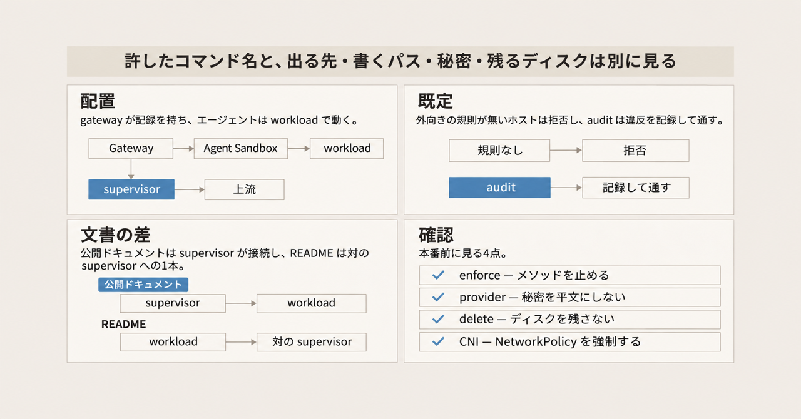
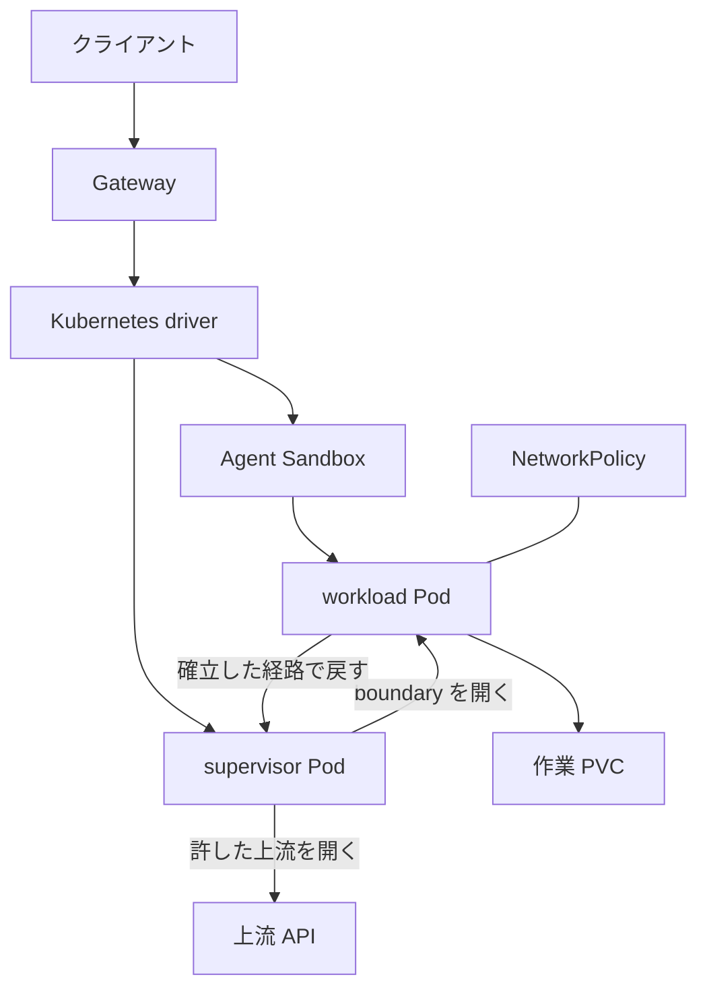

OpenShell は、シェルやツールを呼び出すプログラム（エージェント）のコードを sandbox の中で動かし、外向きの通信とファイルとプロセスをポリシーで縛る実行環境です。NVIDIA が Apache-2.0 で公開し、CNCF Sandbox に入っています。CNCF Sandbox はプロジェクト段階の名前で、このあとに書く実行単位の sandbox とは別です。Kubernetes では自前のスケジューラを持ちません。Pod を作るのは、Kubernetes の分科会である SIG Apps が提供する Agent Sandbox です。これは実行単位の sandbox とは別の Kubernetes 資源で、API グループは `agents.x-k8s.io`、リソース名は Sandbox です。

公開ドキュメントの構成説明は v0.1.7（2026-11-03 公開）に沿い、CNCF Blog のデモは OpenShell 0.1.3 をピンしています。

この記事では、Kubernetes 上の部品と 4 つの境界を先に置きます。そのあとで、既定値とドキュメント間の差、Pod Security Standards との違い、本番前の確認項目を示します。

*この記事の全体像。以下、順に解説します。*

## OpenShellとは

### 何を閉じる実行環境か

sandbox は、エージェントのプロセスを閉じ込める実行単位です。エージェントのコードはその中で動きます。sandbox の外にいる supervisor は、起動前と通信時に境界を確認するプロセスです。制御の入口は gateway です。gateway は sandbox レコードを正本にします。sandbox レコードは gateway が持つ sandbox の記録で、Pod を作る Agent Sandbox 資源とは別です。

ポリシーは YAML です。版は 1、上限は 4 MiB です。ファイルシステム（Landlock によるパスの制限）とプロセスは起動時に固定されます。Landlock は、プロセスが触れるパスを読む側と書く側に分ける Linux カーネルの仕組みです。ネットワーク規則は、実行中の `policy update` で変えられます。`policy update` は、そのネットワーク規則を差し替える操作です。

資格情報を provider に載せた場合、エージェントが見る値は `openshell:resolve:env:KEY` というプレースホルダです。provider は、サービスと保管した秘密を対応させる部品です。supervisor が、ポリシーで許した endpoint にだけ実値を差し込みます。endpoint は、ポリシーが名指しする接続先です。

Kubernetes 上の作業ディレクトリは、PVC 上の `/sandbox` です。PVC は、Pod が消えても残せるディスクの要求です。2026-11-05 時点の GitHub `NVIDIA/OpenShell` は約 2.1 万 star で、アーカイブされていません。

### 境界は4層ある

境界はファイル、プロセス、ネットワーク、資格情報の 4 層です。

ファイル層では、載っていないパスには届きません。`read_write` は読み書きを許すパスの指定で、ここに `/` は置けません。必須の baseline は `/.openshell` を隠します。この baseline は、あとで出る Pod のプロファイル名 Baseline とは別です。`/.openshell` は OpenShell の内部ディレクトリで、ポリシーから見せることはできません。Landlock ABI はカーネル側インタフェースの版で、v3 が要ります。それより古いカーネルでは起動しません。

プロセスは非 root です。Linux capability（プロセスに足す権限）は持たせず、seccomp で危険なシステムコールを落とします。seccomp は、プロセスが呼べるシステムコールを絞る仕組みです。Kubernetes driver は、クラスタへ資源を作る部品です。数値の UID と GID、`allowPrivilegeEscalation: false`、capability の drop ALL、RuntimeDefault（ランタイム既定）の seccomp、host の network / PID / IPC なし、を Pod に置きます。

ネットワークは、規則が無いときの外向きを拒否します。規則は、接続する実行ファイル、ホスト、ポートを名指しします。`protocol` は規則に付ける項目で、付けたときだけ HTTP メソッドやパスを見ます。`pip` のようなスクリプトでは、接続する Python インタプリタの実パスが binaries に入る必要があります。binaries は、接続を許す実行ファイルの一覧です。

資格情報は、許した endpoint だけで置換します。Kubernetes Secrets credential driver は、provider の秘密を Kubernetes の Secret に置く部品です。有効にし、専用 namespace を指定したとき、資格情報はその namespace の Secret に入ります。gateway はその namespace の Role だけで API から読みます。Role は、その namespace に限った権限です。namespace を指定しないとき、置き場は、この driver がクラスタ内で動くときに付く ServiceAccount の namespace です。その namespace が取れなければ `default` です。

corporate proxy の Basic 認証 Secret は、別にスケジュールされた supervisor Pod にだけマウントされます。workload は、環境変数からも volume からも読めません。workload は、エージェントのコードが動く Pod です。driver README では、workload と supervisor の両方で `automountServiceAccountToken: false` です。supervisor だけが、一度きりのトークン交換用に、audience 付きの projected token を受け取ります。projected token は、audience で受け取り先を限定した ServiceAccount トークンです。

既定ポリシーは、有効な global も、その sandbox に保存されたポリシーも、イメージに含まれるポリシーも無いときにだけ使われます。global は、有効なあいだその sandbox のポリシーとして使われる全体向けのポリシーです。保存ポリシーは、その sandbox に保存したものです。イメージ内ポリシーは、コンテナイメージに入っているものです。`--policy` を付けないだけでは既定になるとは限りません。イメージか環境変数 `OPENSHELL_SANDBOX_POLICY` がポリシーを渡すことがあります。壊れたイメージ内ポリシーは既定には落ちず、直すまで起動しません。この条件のときの中身は次です。`/bin`、`/usr`、`/lib`、`/proc`、`/dev/urandom`、`/etc`、`/var/log` は読み取り専用です。`/tmp`、`/dev/null`、作業ディレクトリは読み書きです。ネットワーク規則はありません。`compatibility` は、追加のファイル規則を適用できないときの扱いです。既定は `best_effort` です。`enforcement` は、許した接続先の中で規則に合わないリクエストの扱いです。既定は `audit` です。

`best_effort` は、追加の filesystem policy を適用できないとき、その追加規則なしで起動し、高深刻度の指摘をログに残すモードです。filesystem policy は、パスの読み書きを書く部分です。適用できないのは、パスが無い、開けない、または Landlock がその規則を強制できないときです。`hard_requirement` は、その追加規則を適用できないとき起動を拒むモードです。`audit` は、その endpoint の allow / deny に合わないリクエストを記録して通すモードです。`enforce` は、その違反を拒否するモードです。private-file は、`/.openshell` を隠す必須規則の名前です。Security Best Practices は、`best_effort` も `hard_requirement` も、この必須 baseline は緩めない、と書きます。ABI v3 未満では起動しません。

ユーザー名前空間は、コンテナ内の UID をホスト上の別の UID 範囲へ対応させる仕組みです。Kubernetes では `hostUsers: false` がそれにあたります。OpenShell では既定で無効です。Helm の `enable_user_namespaces` で、クラスタ全体に有効にします。Helm は、Kubernetes へまとめて入れるツールです。前提は Kubernetes 1.33 以降と、対応するコンテナランタイムです。別カーネルに載せるときは、`pod.runtime_class_name` を Pod の RuntimeClass に写します。RuntimeClass は、Pod をどのランタイムで動かすかを名指しする資源です。例の `kata-containers` は、Kata という別ランタイムの名前です。

配置の前提は次のとおりです。

- Kubernetes 1.29 以降
- Helm 3。chart は、Helm に渡す配布単位です
- Agent Sandbox の CRD と controller。CRD はその資源の定義、controller はその資源から Pod を動かすプログラムです。OpenShell の chart はそれらを同梱しません
- ingress と egress の両方で NetworkPolicy を強制する CNI。CNI は、NetworkPolicy を実際に適用するネットワーク実装です
- OpenShift（Red Hat の Kubernetes 配布）なら 4.19 以降。4.16 から 4.18 の RHCOS（OpenShift のノード OS、Red Hat Enterprise Linux CoreOS）のカーネルは Landlock が無効で、OpenShift 手順は sandbox の起動に失敗する、と書きます

ユーザー名前空間の 1.33 と、配置そのものの 1.29 は別の下限です。

### クラスタ上の部品

gateway が sandbox レコードを正本にします。driver は Agent Sandbox 資源、supervisor Pod、NetworkPolicy、作業用 PVC を作ります。workload Pod は、Agent Sandbox の controller がその資源から作ります。

公開ドキュメントの Kubernetes では、supervisor が workload の boundary へ接続し、gateway への外向きセッションを維持します。boundary は、workload 側の制御用の口です。NetworkPolicy は、supervisor から workload の boundary ポートへの ingress を許します。workload が新たに開く接続は拒否します。workload が、その確立した経路の上で要求を戻します。supervisor がポリシーを見て、許した上流を開きます。Architecture は、supervisor への仲介経路が workload に許された唯一の egress で、それ以外は外側の柵が拒否する、と書きます。

`supervisor_topology` は、supervisor を sandbox ごとの Pod で持つか、gateway 側で共有するかを選ぶ設定です。値を `gateway` にすると、新しい実行系は sandbox ごとの supervisor Pod ではなく、gateway namespace に Helm が置く共有プロセス上のインスタンスになります。

図は、sandbox ごとに supervisor Pod を置く構成です。`supervisor_topology` を `gateway` にすると、この Pod の代わりに共有プロセス上のインスタンスを使います。図の向きは、公開ドキュメント v0.1.7 が書く「supervisor が workload へ接続する」構成です。

### 作業ディレクトリの寿命

`/sandbox` は PVC です。初回だけ、初期化処理がイメージの `/sandbox` を PVC へ写します。以降の start は、同じ PVC を付け直します。start、stop、delete、`--no-keep` は、OpenShell への操作の名前です。stop は Agent Sandbox を止めます。止め方は API の版で分かれます。`v1beta1` は `spec.operatingMode: Suspended`、`v1alpha1` は `spec.replicas: 0` です。PVC は残します。delete は、その Sandbox と driver が所有するストレージを消します。`--no-keep` は、操作の終了後に delete を走らせます。

## 注意点

ここからは、ブログ、公開ドキュメント、driver README のあいだで読みが分かれる点です。前の節の部品名を、そのまま信じすぎないための条件です。

### デモと公開ドキュメントは世代が違う

デモの版ピンは、ブログ本文の言葉です。OpenShell 0.1.3、Agent Sandbox v1.0.5、Kubernetes 1.35、Cilium 1.20、Kyverno 1.18.2、kind の 2 node です。Cilium は CNI、Kyverno は別のポリシーエンジン、kind はローカルに組む Kubernetes です。現行ドキュメントの既定表示は v0.1.7 です。GitHub release の `v0.1.7` は 2026-11-03 公開です。

LFX は、CNCF のプロジェクトページが載せる集計です。そこに出る star 数 2 は、同じ日の GitHub の約 2.1 万と桁が違います。活発さは GitHub の概数で見ます。`pushedAt` の 2026-11-05 は、任意ブランチへの push です。default branch のコミット時刻は 2026-11-04 です。

### ディスクは stop では消えない

stop は `/sandbox` の PVC を残します。README はこの残し方を stopgap（暫定の扱い）と呼び、再スケジュールをまたいで利用者ファイルを残し、イメージ更新を既存 PVC へ自動適用しない、と書きます。消す操作は delete と `--no-keep` です。delete の API 応答が PVC の消失完了を待つかは、README の本文では未確認です。`/tmp` が Pod の終了や stop で空になるかも未確認です。

### メソッド制限のデモは既定ではない

メソッド制限のデモは、endpoint に `enforcement: enforce` を書いたときの動作です。schema の既定は `audit` です。`audit` は、ルールに合わないリクエストを記録して通します。Network Rules は、audit が効くのはその endpoint の allow / deny 規則であり、壊れたリクエストや別ホスト宛ては別途拒否する、と書きます。接続を許す規則が無いホストは、audit であっても通りません。

ファイル側も同じ読み方が要ります。`best_effort` は追加規則を外して起動し得ます。必須 baseline と ABI v3 は残ります。schema の「filesystem rules なしで起動」は、この追加規則の話として読みます。private-file の必須 baseline が外れる、という意味ではありません。

### NetworkPolicy のオブジェクトと強制は別である

Kubernetes setup は、API が NetworkPolicy オブジェクトを受け付けることと、CNI が ingress と egress を強制することを分けています。強制が無いと、workload が supervisor の方針を迂回して、直接ネットワークへ出えます。

### 制御接続の向きは文書で分かれる

v0.1.7 の Architecture は、"Supervisor to sandbox: The supervisor dials into the workload" と書きます。同じタグの説明と、`main` の `d7da0c7` にある `docs/kubernetes/setup.mdx` も、supervisor が boundary を開き、NetworkPolicy は workload が新たに開く接続を拒否する、と書きます。ブログの 0.1.3 デモもこの向きです。

一方、同じ `main` の Kubernetes driver README は、新しい runtime generation を `runtime-initiated` と呼びます。generation は、sandbox の実行系を差し替える単位です。`runtime-initiated` では、名前が `os-control-<id>` の NetworkPolicy が、その sandbox の workload から対の supervisor への TCP を 1 本だけ通します。同じ箇条書きに "The workload still cannot reach the control port." もあります。control port がその 1 本と同じ口かは、この文だけでは確定しません。README が開くのは任意の外部ホストではなく、対になった supervisor への 1 本です。古い `supervisor-initiated` は、supervisor が workload へ接続する世代です。README では stop / start で置き換わるまで残ります。

前の節の図は、公開ドキュメントの向きに合わせています。README の新しい generation は、ドキュメントが追随するまでの差として読みます。v0.1.7 のリリースノートが、この切り替えを明記しているかは未確認です。README の該当文は `main` にあります。

### 秘密の平文経路は provider と別である

provider 経由のプレースホルダと、`--env` / `--env-from` は別経路です。`--env` と `--env-from` は、作成時に環境変数を渡す指定です。どちらも、sandbox 内の全プロセスから平文の環境変数として読めます。OpenShell の警告は、名前（TOKEN、SECRET、PASSWORD、API_KEY など）を見て、値は見ません。ブログが Kyverno で Secret の注入を拒む、と書く部分はデモの追加策です。OpenShell 本体の既定ではありません。デモリポジトリ上のポリシー本文がブログと一致するかは未確認です。

### supervisor の数と、出荷済みと言い切れないもの

ブログは、supervisor Pod がエージェントごとに 1 つ、と書きます。README の `supervisor_topology = "gateway"` は、その Pod を使わない選択肢です。既定値が gateway かどうかは、この README の条件文だけでは確定しません。

RFC 0018 を書いた PR #4377 は、2026-10-26 にマージされた設計文書です。マルチ sandbox や高可用（HA、複数台で動き続けること）が出荷済みであることの証明にはしません。Agent Substrate は OpenShell とは別のプロジェクトです。それを backend にする提案が NVIDIA/OpenShell#3362 で、2026-11-05 時点では OPEN です。

ブログの比較表にある遅延、密度、アイドル時のスケールは、Substrate の一次資料では照合していません。量の定義も数値も、この記事では置きません。投票日だけは git-vote（CNCF の投票記録）と一致します。binding は、そのうち拘束力のある票です。OpenShell は 2026-09-26 に vote closed で、binding の 72.73% が賛成です。Substrate は 2026-09-28、72.73% です。

OpenShell 固有の CVE は、2026-11-05 時点で NVD（CVE の公開データベース）の一次記録を確認できていません。番号は置きません。gateway API のレート制限も未確認です。

## Restrictedでは表現できない境界

Pod Security Standards は、Pod のマニフェストに課す Kubernetes の標準プロファイルです。Restricted は、その最も厳しい段です。Baseline は、その一段手前のプロファイルです。OpenShell が `/.openshell` を隠す必須 baseline とは別です。Restricted は Baseline に加えて、volume 種別、`allowPrivilegeEscalation: false`、`runAsNonRoot`、0 以外の `runAsUser`、RuntimeDefault または Localhost の seccomp を求めます。Localhost は、ノード上のファイルで指定する seccomp です。capability は drop ALL で、追加は `NET_BIND_SERVICE`（特権ポートをバインドする権限）だけです。

呼び出しバイナリ、HTTP メソッド、パス、資格情報の差し替えは、この標準の制御一覧にありません。

| 見ているもの | Restricted と NetworkPolicy | OpenShell on Kubernetes |
|---|---|---|
| 誰が root か、capability、seccomp | Restricted が Pod に課す | driver が非 root、drop ALL、RuntimeDefault を置く |
| どのホストへ出られるか | NetworkPolicy の L3/L4。CNI が強制するときだけ効く | 外側に同じ NetworkPolicy。内側はバイナリとホストとポート |
| どのメソッドか | 表現しない | `protocol` と `enforcement: enforce` のとき |
| どのパスを書けるか | 表現しない | Landlock。追加規則は `best_effort` で欠けることがある |
| 秘密が Pod に載るか | マニフェスト次第 | provider は supervisor 側。`--env` は workload に載る |
| 作業ディスク | volume の種類と reclaim（削除後の回収方針）次第 | `/sandbox` の PVC は stop で残る |
| カーネル | 共有カーネル。RuntimeClass は別設定 | 同じ。RuntimeClass は任意 |

L3/L4 は、送信先のホストとポートまでです。HTTP メソッドは含みません。

ツール名の許可一覧は、上の表のどの行でもありません。`curl` という名前を許すこと、その `curl` が `api.github.com` へ GET だけを出せること、秘密が環境変数に入っていること、`/sandbox` が次の start に残ることは、別のレビューです。

## 実行場所をレビューする

ネットから取得した文は、次のシェル実行の入力になり得ます。この境界は、許可したツール名の集合より、実行場所の方に近いです。OpenShell のポリシーは、実行ファイル、パス、ホスト、ポート、検査した HTTP、資格情報の置換先を分けて書きます。

Kubernetes の Restricted と NetworkPolicy は、その HTTP の中身と資格情報の置換を表現しません。CNCF の投稿が「NetworkPolicy はホストとポートまで」と書く部分は、Kubernetes の NetworkPolicy の役割と一致します。

driver README は、sandbox Pod が ServiceAccount token を automount しない、と書きます。Architecture は、エージェントが gateway の署名鍵、gateway JWT、provider の実値を持たない、と書きます。automount のフィールド名は、Architecture の本文にはありません。

次は、ドキュメントから読めないことです。

- ファイル規則が常に全部効く、とは読めません。追加ポリシーは `best_effort` で欠けます。必須 baseline と ABI v3 は残ります。
- POST を既定で止める、とは読めません。既定の `audit` は、許した endpoint の中の違反を通します。デモが `policy_denied` と記録するのは、`enforce` で拒否した例です。
- パッケージ導入の専用スイッチは、確認したドキュメントにはありません。書き込み可能なパス（既定では `/tmp` と作業ディレクトリ。`/usr` は既定で読み取り専用）と、実バイナリを名指ししたネットワーク規則の両方が要ります。同じインタプリタを使う別の Python プログラムにも、そのネットワーク許可は及びます。
- 作業のたびにディスクが消える、とは読めません。stop は PVC を残します。
- 公開ドキュメントの「workload が新たに開く接続は拒否」と、driver README の runtime-initiated の 1 本は、同じ `d7da0c7` のツリーの中で文章が分かれます。README の 1 本は対の supervisor 宛てであり、任意ホストへの許可ではありません。
- gateway の API を通すことだけでは、namespace 内で Pod や緩い NetworkPolicy を直接作る権限までは縛れません。README がそう書きます。ブログも、gateway の ServiceAccount が Pod と NetworkPolicy を作れる、と留保します。
- 共有カーネルのままです。gVisor や Kata は、RuntimeClass で付ける別ランタイムの例です。ユーザー名前空間は既定オフです。
- NVIDIA/OpenShell#1719 は OPEN の、Kubernetes Operator（資源の運用をコントローラに任せる形）の議論です。OpenShell 自身の宣言的な Sandbox CRD がもうある、という意味ではありません。Pod を作る宣言資源は、SIG Apps の Agent Sandbox です。

CNI が NetworkPolicy を強制しないクラスタでは、外側の柵を前提にできません。setup と README が警告しています。

## 本番前に確認する項目

許可したツール名と、そのツールが動く場所は、別々にレビューします。場所とは、出られるホスト、書けるパス、秘密が載るマウントと環境変数、`/sandbox` が stop のあとも残るか、です。取得した文を、次の実行の入力にしない、という分け方も同じレビューに入ります。

本番の資格情報をエージェントが扱うなら、Restricted Pod だけではメソッドと資格情報の境界になりません。OpenShell を使う場合の確認項目は次です。

- endpoint の `enforcement` を `enforce` にする。既定の `audit` のまま、メソッド制限を期待しない。
- ファイル規則を欠かしたくない環境では `hard_requirement` を検討する。追加規則を適用できないときは起動を拒みます。`best_effort` は追加規則を外して起動し得ます。ABI v3（OpenShift なら 4.19 以降）と、NetworkPolicy を強制する CNI を前提にする。
- 秘密は provider に載せる。`--env` や workload への Secret 注入で平文を渡さない。
- 作業ファイルを次の実行に残したくないときは、stop ではなく delete か `--no-keep` を選ぶ。
- カーネルを分けたいときは RuntimeClass を明示する。ユーザー名前空間は既定では無効である。
- gateway の ServiceAccount と、sandbox namespace で Pod や NetworkPolicy を作れる権限は、OpenShell のポリシーとは別に絞る。
- ブログの比較表にある遅延、密度、アイドル時のスケールを理由に Agent Substrate を混ぜない。定義も数値も、この記事では採用しません。#3362 は提案のままです。

## まとめ

OpenShell on Kubernetes は、gateway と driver が Agent Sandbox に workload を作らせ、supervisor がポリシーを見て上流を開く実行環境です。ファイル、プロセス、ネットワーク、資格情報は別の層です。既定では、外向きのネットワーク規則は無く、endpoint の `enforcement` は `audit`、追加のファイル規則は `best_effort` です。`/sandbox` の PVC は stop で残ります。

Restricted と NetworkPolicy は、誰が root か、どのホストとポートへ出られるか、を課せます。バイナリ、HTTP メソッド、書けるパス、秘密の差し替えは、OpenShell のポリシー側のレビューです。デモの 0.1.3 と公開ドキュメントの v0.1.7、そして `main` の driver README では、制御接続の文章が分かれます。図と確認項目は、公開ドキュメントの向きと、既定が `audit` であることに合わせています。

この記事が少しでも参考になった、あるいは改善点などがあれば、ぜひリアクションやコメント、SNSでのシェアをいただけると励みになります！

## 参考リンク

- [CNCF Blog: OpenShell on Kubernetes: A Guide for Platform Engineers](https://www.cncf.io/blog/2026/11/04/openshell-on-kubernetes-a-guide-for-platform-engineers/)
- [OpenShell Architecture（Latest v0.1.7）](https://docs.nvidia.com/openshell/about/architecture)
- [Kubernetes setup](https://docs.nvidia.com/openshell/kubernetes/setup)
- [OpenShift](https://docs.nvidia.com/openshell/kubernetes/openshift)
- [Policy schema](https://docs.nvidia.com/openshell/how-it-works/policies/schema)
- [Default policy](https://docs.nvidia.com/openshell/how-it-works/policies/default-policy)
- [Gateway configuration](https://docs.nvidia.com/openshell/how-it-works/gateways/configuration)
- [Manage policies](https://docs.nvidia.com/openshell/how-it-works/policies/manage-policies)
- [Network rules](https://docs.nvidia.com/openshell/how-it-works/policies/network-rules)
- [Sandboxes](https://docs.nvidia.com/openshell/how-it-works/sandboxes/overview)
- [Security best practices](https://docs.nvidia.com/openshell/security/best-practices)
- [Kubernetes driver README（main）](https://github.com/NVIDIA/OpenShell/blob/main/crates/openshell-driver-kubernetes/README.md)
- [Pod Security Standards](https://kubernetes.io/docs/concepts/security/pod-security-standards/)
- [NVIDIA/OpenShell#1719](https://github.com/NVIDIA/OpenShell/issues/1719)
- [NVIDIA/OpenShell#3362](https://github.com/NVIDIA/OpenShell/issues/3362)
- [NVIDIA/OpenShell#4377](https://github.com/NVIDIA/OpenShell/pull/4377)
