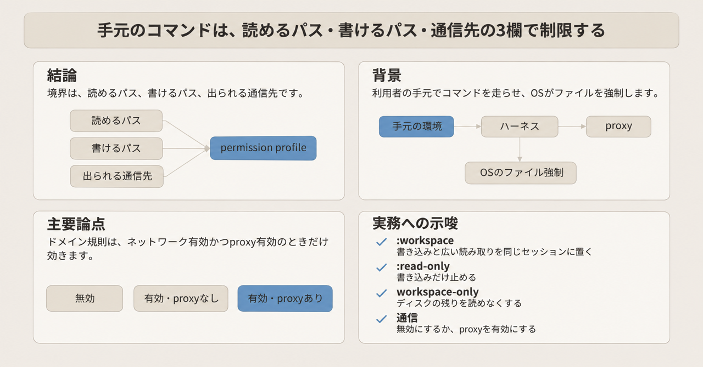
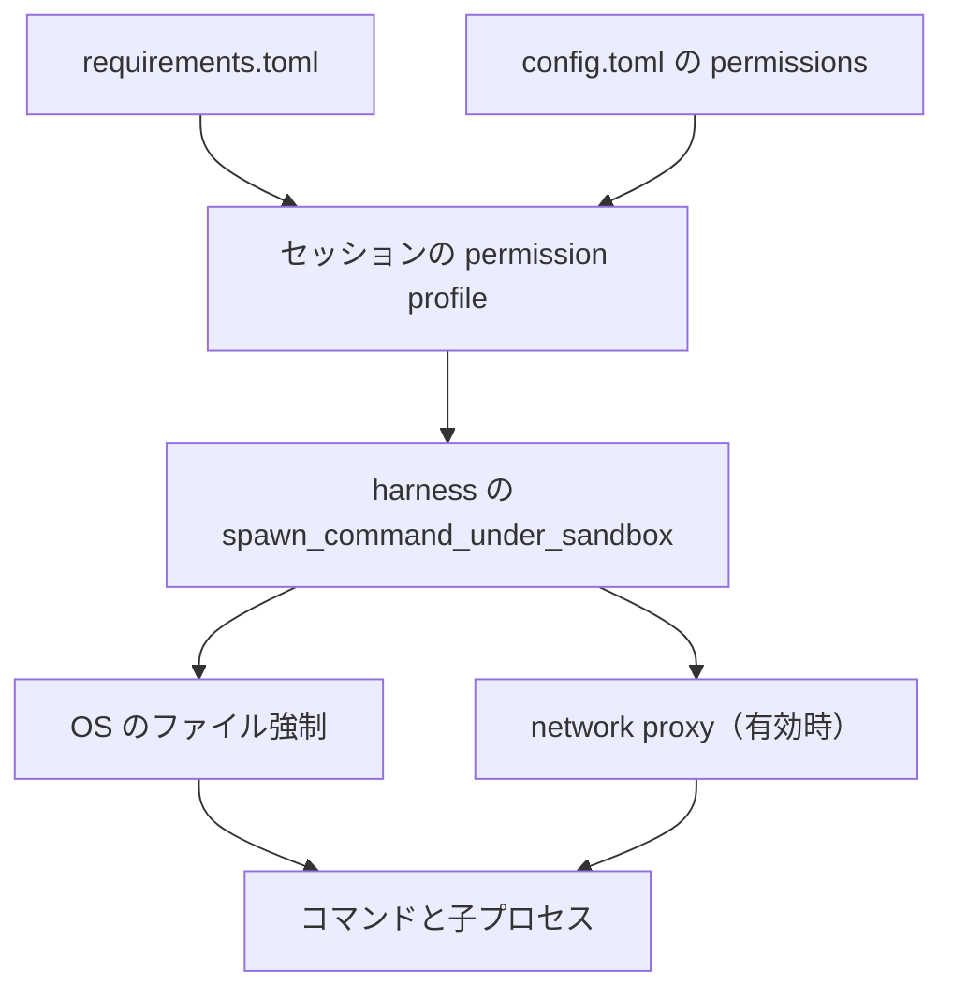

2026年11月18日、OpenAI は Codex のローカル実行に、ファイルとネットワークの制限をどうかけるかを公開しました。対象の OS は macOS、Linux、Windows です。記入の単位は permission profile です。permission profile は、ローカルコマンドが読めるパス、書けるパス、出られる通信先を1つにまとめた名前付きの方針です。この記事は、その3欄で境界を読み、コーディングエージェントの権限設計と比べるところまでを扱います。Permissions 文書は permission profile を Beta としています。文書の確認日は 2026年11月19日です。


*この記事の全体像。以下、順に解説します。*

## Codexのローカルサンドボックスとは

Codex のローカル実行は、利用者の既存環境でコマンドを走らせ、そのコマンドにファイルとネットワークの制限をかける仕組みです。コマンドの入口は `spawn_command_under_sandbox` です。これは、permission profile を渡してコマンドを起動する関数です。子プロセスは同じ制約を引き継ぎます。2026年11月18日の記事は、示した Python 例を簡略化した説明だと明記しています。

ハーネスは、この入口でプロセスを起動する側です。モデルはコマンドごとに、次の3つを要求できます。

- `use_default` は、そのターンの既定のサンドボックス設定を使います。
- `with_additional_permissions` は、サンドボックスの内側で権限を広げる要求です。
- `require_escalated` は、サンドボックスの外での実行を求める要求です。

許可するかはハーネスが判断します。判断先は、利用者への確認か auto-review です。auto-review は、境界を越えてよいかを見る審査です。サンドボックス境界そのものは変えません。境界の内側で既に許されている操作は、追加の審査なしで進みます。

### ファイル権限

ファイル権限の値は `read`、`write`、`deny` の3つです。`read` は、ファイルの読み取りとディレクトリの一覧です。`write` は、読み取りに加えて作成、変更、改名、削除です。`deny` は、そのパスの読み取りと書き込みの両方を拒みます。同じパスでは `deny` が `write` より優先し、`write` が `read` より優先します。より具体的なパスが、より広いパスに勝ちます。広い `deny` の内側を、より具体的な `write` で開き直すこともできます。

### 組み込みプロファイル

組み込みプロファイルは3つです。

`:read-only` は、ローカルコマンドの書き込みを止めます。ディスク上の読み取りは、利用者の OS 権限の範囲で残ります。

`:workspace` は、ワークスペースへの書き込み、ワークスペース外を含む広い読み取り、ネットワーク無効を組み合わせます。`:root = deny` は含みません。`:root` は、ファイルシステム全体を指す記号です。2026年11月18日の記事は、Git リポジトリをワークスペース根にしたとき、`.git` や `.codex` を読み取り専用に保ちつつソースは書き換える、と書いています。`.codex` は、Codex の `config.toml` を置くディレクトリです。コンパイラと SDK はリポジトリの外を読むため、読み取りをワークスペース内だけにすると通常のビルドが壊れる、とも書いています。その引き換えに、API キーを含む設定ファイルのように、マシン上の別のファイルも読める余地が残ります。

`:danger-full-access` は、ローカルのサンドボックス制限を外します。ファイルとネットワークの境界を意図して外すときだけ使います。

permission profile と、古い `sandbox_mode` および `sandbox_workspace_write` は、同時には合成されません。`sandbox_mode` は、古い書き方でのサンドボックスの強さです。`sandbox_workspace_write` は、その書き方での書き込み先です。`--sandbox` は、その強さを起動時に指定する引数です。設定プロファイルは、permission profile とは別の、名前付きの設定の組です。`sandbox_mode` が読み込まれた設定、`--sandbox`、選択中の設定プロファイルのいずれかに出ると、Codex は古いサンドボックス設定を使います。`default_permissions` は、毎回使う permission profile の名前です。この条件のときは、その名前を使いません。例外は、管理者が配る `allowed_permission_profiles` です。この allowlist があると、Codex は permission profile を使います。混在期間の互換として、全クライアントが Codex 0.138.0 以降になるまで `allowed_sandbox_modes` を残す、と Permissions 文書は書いています。`0.138.0` は、その文書が書く Codex の版です。IDE 拡張の 0.4 系とは別の番号です。`allowed_sandbox_modes` は、古い `sandbox_mode` のうち許可するものの一覧です。Permissions 文書は、permission profile の公式仕様です。

`extends` は、既存プロファイルを土台にして差分だけ足す指定です。`:workspace` を extend すると、明示して上書きしない限り、ワークスペース根の `.git`、`.agents`、`.codex`、`.aws` は読み取り専用のままです。`.agents` と `.aws` は、その継承が読み取り専用に残すパスです。中身は、参照した記述にはありません。同じ extend では `:tmpdir` と `:slash_tmp` が既定で `write` になります。`:tmpdir` は `$TMPDIR` があるときの場所です。`:slash_tmp` は、存在するときの `/tmp` です。`:danger-full-access` は extend の親にできません。未知の親と、継承の循環も拒否されます。

`:workspace_roots` は、セッションのワークスペース根と、プロファイルが追加した根に、同じファイル規則を当てる記号です。CLI の既定の根は作業ディレクトリです。ChatGPT デスクトップアプリは、CLI とは別のクライアントです。その根は、プロジェクトのソースフォルダです。

### ネットワークの3態

ネットワークは3態です。無効。有効かつ proxy なし。有効かつ proxy あり。proxy は、ドメイン規則を見て転送する中継です。`:workspace` の既定は無効です。`:danger-full-access` の既定は、proxy なしの直接通信です。

次の値は、`:workspace` や `:danger-full-access` の振る舞いとは別です。項目を書かなかったときのフィールド初期値です。`network.enabled` の初期値は `false`、`proxy_url` は `http://127.0.0.1:3128`、`socks_url` は `http://127.0.0.1:8081`、`enable_socks5` は `true`、`allow_local_binding` は `false` です。`proxy_url` は HTTP proxy の待ち受けです。`socks_url` は SOCKS5 の待ち受けです。`enable_socks5` は、その SOCKS5 の待ち受けを有効にするかです。`allow_local_binding` は、名前がローカルアドレスやプライベートアドレスへ解決する先を許すかの設定です。初期値の `false` では、`localhost` や `127.0.0.1` のようなリテラルを明示的に許可しない限り、ローカルやプライベートへの到達を止めます。

ドメイン規則が効くのは、ネットワークが有効で、proxy も有効なときです。proxy を有効にする設定は、`config.toml` の `features.network_proxy = true`、または管理者が有効にした `[experimental_network]` です。`network.enabled = true` だけでは proxy は始まりません。proxy が無い有効化では、コマンドは直接ネットワークへ出ます。ドメイン規則は、その直接通信を制限しません。

deny は allow より優先します。有効な proxy に allow が1件も無いときは、外部宛先を止めます。DNS は、許可または承認のあとで解決されます。許可は、ドメイン規則の allow です。承認は、規則に一致しない宛先を、利用者か auto-review が通した決定です。広いワイルドカードを許可した範囲と、DNS が届く範囲では、その範囲で外へ出せます。

### 設定が1つのプロファイルに集まる

ローカルでサンドボックスされるコマンドは、設定と要件が1つの permission profile に集まり、ハーネスがそのプロファイルでプロセスを起動します。ファイルは OS のサンドボックスが強制します。通信先は、proxy を有効にしたときだけ proxy が見ます。



`config.toml` は、利用者と組織の設定ファイルです。2026年11月18日の記事は、複数の `config.toml` について、テーブルを再帰マージし、配列は全体を置き換える、と書いています。`requirements.toml` は、管理者が配る要件ファイルで、層の合成は別です。macOS と Linux では `/etc/codex/requirements.toml`、Windows では `%ProgramData%\OpenAI\Codex\requirements.toml`、macOS の MDM では `com.openai.codex:requirements_toml_base64` です。MDM は、端末へ設定を配る管理機構です。managed configuration は、高い層が通常のスカラーとリストを上書きし、テーブルはキーでマージする、と書いています。2026年11月18日の記事の例では、クラウドの requirements が `/etc/codex/requirements.toml` より優先します。ここでのクラウドの requirements は、管理者がクラウドからローカルの Codex へ配る要件です。Codex Cloud の実行環境ではありません。rules、hooks、filesystem restrictions は、要件の項目の種類で、項目ごとの合成規則を持ちます。rules は、あとのコマンドルールと同じです。この hooks は、あとで書くパッケージマネージャの hook ファイルとは別です。認証の要件はローカルと MDM だけで、クラウド管理の requirements には載りません。

管理者は `allowed_permission_profiles` で、使えるプロファイルを列挙できます。省略されたプロファイルは拒否になります。将来の版で増える組み込みも、列挙が無ければ拒否です。この allowlist と、managed の `default_permissions` を Codex が読むのは 0.138.0 以降です。0.137.0 以前は両方を無視します。

permission profile が決めるのは、手元でサンドボックスされたコマンドのファイルと通信です。Web 検索、アプリとコネクタ、ブラウザと Computer Use、Codex 自身の通信、Codex Cloud は、別の制御です。Codex Cloud は、クラウド側の実行環境の設定です。stdio MCP の起動は、ハーネスが既定ではサンドボックスしません。stdio MCP は、標準入出力で起動する MCP サーバです。利用者は `codex sandbox --permission-profile` で、後からその起動を包めます。

OS のファイル強制は、実装が分かれます。macOS は Seatbelt です。Seatbelt は、Apple のカーネルが強制するサンドボックスです。Linux と WSL は bubblewrap です。bubblewrap は、マウント名前空間でファイルの見え方を作る仕組みです。Windows の文書は、`mxc`、`elevated`、`unelevated` の3実装を併記しています。`mxc` は Microsoft eXecution Container で、Windows のプロセス分離を使います。互換のある端末での推奨で、管理者のセットアップ、追加の Windows アカウント、ローカルのファイアウォール規則を使いません。`elevated` は、MXC が使えないときの従来の優先フォールバックです。管理者によるセットアップが要り、サンドボックス内のコマンドは管理者権限では動きません。`unelevated` は、そのセットアップが無いときの従来のフォールバックです。読み取り拒否のパスを扱えず、ネットワークの分離は `elevated` より弱いです。

## 注意点

2026年11月18日の記事は、サンドボックスが悪い振る舞いの大きな類型を止める、と書いています。同じ記事が残る害として挙げるのは、Git が無視しがちな `node_modules/prettier` への書き込みです。エディタがその Prettier をサンドボックスの外で実行すると、ファイルの保存が、サンドボックスの外のコード実行になります。記事は、防御をサンドボックス単体に置いていません。学習とアライメントとの多層だと、記事自身が限定しています。書き込みが残るスクリプト、ビルド手順、パッケージマネージャの hook、シェルの起動ファイル、共有ディレクトリは、あとから別の道具がサンドボックスの外で実行できます。

同じ TOML が、OS ごとに同じ到達結果になる保証は、文書にありません。届く欄は、読めるパス、書けるパス、出られる通信先の3つです。実装差は、あとの確認表にまとめます。

記事は、以前の Windows サンドボックスを MXC を使う実装へ置き換えている最中だ、と書いています。2026年11月19日に取得した Windows sandbox 文書は、`mxc`、`elevated`、`unelevated` の3実装を併記しています。置き換えは、完了した単一実装の宣言としては読めません。現行クライアントのうち、どれが既定になる割合は、公開文書にありません。

`sandbox-exec` は、macOS で Seatbelt を起動するコマンドです。記事と、2026年11月19日時点の `man sandbox-exec` は、このコマンドを DEPRECATED と書いています。man のフッタは March 9, 2017 です。現行の Codex の sandbox 文書は、macOS では Seatbelt が最初から使える、と書き、廃止期日は書いていません。記事は、当面 Seatbelt を使い続ける、と書いています。記事の語句は "foreseeable future" です。置き換える期日は、この語句以上にはありません。

ドメイン規則を通信先の制限として読めるのは、ネットワークが有効で proxy も有効なときだけです。`network.enabled = true` だけで proxy が無い構成は、宛先を制限しません。許可したワイルドカードが広いとき、その範囲は外へ出ます。

読み取り拒否の glob は、Linux、WSL、Windows の MXC と elevated で、サンドボックス化されたプロセスの起動時に具体パスへ展開されます。glob は、パスのパターンです。スナップショットの寿命はそのプロセスであり、Codex セッション全体ではありません。起動後に増えた一致は、そのプロセスの拒否一覧へは足されません。

資格情報の境界は、このプロファイルとは別です。security cookbook は、必要なら独立した broker で短命の資格情報を渡す、と別手順で書いています。broker は、コマンドへ渡す資格情報をプロファイルの外で仲介する仕組みです。同じ cookbook の `shell_environment_policy` は、秘密ファイルのレシピでは "user-configurable default, not an enforced requirement"、公開リスクのレシピでは "configurable default, not an enforced credential boundary" です。どちらも、利用者が変えられる既定であり、強制された資格情報境界ではありません。

`require_escalated` を許可したコマンドは、サンドボックスの外で動きます。その実行は、ローカルコマンドの proxy を迂回できます。読み取り専用のセッションで昇格を許可しても、そのコマンドは読み取り専用の継続にはなりません。stdio MCP は、既定ではこのプロファイルの外で起動します。

auto-review の回数は、利用枠ではありません。利用枠は、使える回数の上限です。多くのモデルは、連続3回、または直近50レビュー中10回の拒否でターンを中断します。サイバーセキュリティ指定モデルは、最初の拒否で中断します。どのモデルが指定モデルかは、この記述には列挙されていません。文書が指すポリシーテンプレートの名前は `rust-v0.167.0` です。あとの issue の `rust-v0.117.0` は、投稿者環境の表記で、このテンプレートとは別です。決定的な保証とは書いていません。

CVE-2025-59532（GHSA-w5fx-fh39-j5rw）は、2025年9月19日公開、severity high、state published の過去の不具合です。GHSA は、GitHub Security Advisory の識別子です。ベンダーアドバイザリの本文は、モデルが生成した `cwd` が、利用者が開始したフォルダの外を含む書き込み根になり得た、と書いています。影響範囲は、任意のファイル書き込みと、Codex プロセスの権限内でのコマンド実行です。ネットワークを無効にした制限には影響しなかった、とも書いています。本文が示す修正は Codex CLI 0.39.0、IDE 拡張 0.4.12 で、CLI は 0.38.0 以前を更新するよう書いています。2026年11月19日に `gh api` で取得した影響版は、npm パッケージ `@openai/codex` が `0.2.0 <= 0.38.0`（修正 0.39.0）、Codex IDE Extension が `<= 0.4.11`（修正 0.4.12）です。本文の散文には開始版の文が無く、範囲はこのフィールドによります。これは、現在の版が同じ穴を持つ証拠ではありません。

次の3件は、2026年11月19日時点で open の、投稿者環境での再現です。全利用者の不具合率ではありません。修正の有無は、その時点の本文からは確定できません。

- [openai/codex#18711](https://github.com/openai/codex/issues/18711)。成功した `find` の出力を、パスに `sandbox` が含まれるため SandboxDenied として捨てた、という macOS の報告です。SandboxDenied は、サンドボックス拒否として扱われた印です。投稿者の環境は rust-v0.117.0（codex-acp v0.11.1）、Darwin 25.3.0 arm64 です。
- [openai/codex#29908](https://github.com/openai/codex/issues/29908)。`apply_patch` と管理サンドボックスが、コマンドの前に bubblewrap の loopback と user namespace で失敗する、という Ubuntu 24.04 の報告です。`apply_patch` は、差分をファイルへ当てる操作です。管理サンドボックスは、その報告が失敗地点として書いた語です。permission profile そのものとは書いていません。`bwrap` は、bubblewrap の実行ファイルです。投稿者の環境は kernel 6.17.0-35-generic、bubblewrap 0.9.0、`apparmor_restrict_unprivileged_userns=1`、bwrap は setuid ではありません。
- [openai/codex#55950](https://github.com/openai/codex/issues/55950)。Codex Desktop の MXC 初期化が `CreateProcessSecurityEnvironment failed (HRESULT = 0x80070003)` で失敗し、同じ PC の CLI は許可ファイルの読み取りと拒否ファイルの拒否を分けられた、という報告です。投稿者の環境は Desktop 26.1016.51333、Windows 11 25H2 build 26200.9711、CLI 0.163.0-alpha.10.2 です。

2026年11月18日の記事は、一部の Linux ディストリビューションが user namespace へのアクセスを既定で止め、システム `bwrap` には例外を与える、と書いています。すべての Linux が既定で止める、という文ではありません。リンク先の [openai/codex#14963](https://github.com/openai/codex/pull/14963) は 2026年3月17日に merged で、タイトルは "fix(linux-sandbox): prefer system /usr/bin/bwrap when available" です。[openai/codex#15791](https://github.com/openai/codex/pull/15791) は 2026年3月26日に merged で、タイトルは "fix: resolve bwrap from trusted PATH entry" です。確認したのは、タイトルと merged の状態です。

`[experimental_network]` の Windows での結果は、cookbook がテスト前の適用を避けるよう書いています。Windows 向けの適用範囲は限定的、とも書いています。結果の実測は、参照した文書にはありません。

2026年11月19日に参照した公式ページには、ローカルサンドボックスの契約 SLA、追加料金、公式 Colab の記載はありませんでした。公式 Colab は、ブラウザで開く実行ノートの有無を見た項目です。この3つは、3欄の採否には使いません。記載が無いことから、存在しないとは書きません。

## 権限は3欄で書く

ローカルでサンドボックスされたコマンドの権限は、次の3欄で書きます。

1. 読めるパス
2. 書けるパス
3. 出られる通信先

この3欄は、手元のサンドボックスされたコマンドの境界です。承認、コマンドルール、フック、資格情報、MCP、昇格、ブラウザ、Web 検索、Codex Cloud は、欄の外に残します。コマンドルールは、サンドボックスの外でコマンドの接頭辞を許可、確認、禁止する規則です。ここでのフックは、要件の hooks と同じ種類の制御で、パッケージマネージャの hook ファイルとは別です。

通常の実装は `:workspace` を使います。読み取りと書き込みは、同じセッションに置けます。2026年11月18日の記事が、ワークスペース外の SDK をビルドが読む、と書いているためです。公式は、調査用セッションと編集用セッションの分離を、常に必須とは書いていません。CLI では `/permissions` で、そのセッションのプロファイルを選べます。毎回同じにするには、`default_permissions` にプロファイル名を書きます。

編集させない閲覧は `:read-only` を使います。これは書き込みを止めるプロファイルです。ワークスペース外の秘密を読めなくする用途には、公式が別に置く `workspace-only` を使います。

ワークスペース外の読み取りを狭めるときは、Permissions 文書の "File access limited to workspace" に合わせます。`:workspace` を extend し、`:root = deny` と `:minimal = read` を置きます。`:minimal` は、一般的なツールが必要とする実行環境のパスです。公開例は `:tmpdir` と `:slash_tmp` も `deny` にします。extend しただけではこの2つは `write` のままなので、一時ディレクトリも閉じるなら、その2行を残します。2026年11月19日に取得した例は、次のとおりです。

```toml
default_permissions = "workspace-only"

[permissions.workspace-only]
# By extending the :workspace profile, you get Codex's safeguards to ensure
# paths such as .git/, .agents/, .codex/, and .aws/ within a workspace root
# are read-only while the rest of the folder is writable.
extends = ":workspace"

[permissions.workspace-only.filesystem]
# By default, deny read access to all files on disk.
":root" = "deny"

# Though in practice, a software agent needs to be able to read folders that
# contain common tools, such as `/usr/bin`, to get work done, so grant access
# to a "minimal" set of files and folders, as determined by Codex.
":minimal" = "read"

# By extending the :workspace profile, :tmpdir and :slash_tmp are "write" by
# default, though you can deny access to them altogether, if desired.
":tmpdir" = "deny"
":slash_tmp" = "deny"
```

秘密のパスは、同じプロファイルで明示的に `deny` します。Permissions 文書は、広い書き込み領域から `.env` のような部分パスを `deny` にする例も置いています。ワークスペース根を書き込み可能にしたまま、一致する環境ファイルだけを拒む形です。

```toml
[permissions.project-edit.filesystem.":workspace_roots"]
"." = "write"
"**/*.env" = "deny"
```

セッションを分けても、`require_escalated` を許可した時点で、そのコマンドはサンドボックスの外に出ます。

通信先を制限するなら、ネットワークを無効にするか、proxy を有効にします。`network.enabled = true` だけで proxy を付けない構成は、ドメイン規則が空き、直接通信になります。proxy を有効にして宛先を書く例は、次です。deny は allow より優先します。

```toml
[features]
network_proxy = true

[permissions.project-edit.network]
enabled = true

[permissions.project-edit.network.domains]
"api.openai.com" = "allow"
"tracking.example.com" = "deny"
```

### OSで3欄の届き方を確かめる

確認する欄は、読めるパス、書けるパス、出られる通信先の3つです。macOS は、強制できないポリシーを拒否し、サンドボックスなしでは動かしません。Linux の `no_new_privs` は、子プロセスが新しい権限を取らない指定です。seccomp-bpf は、システムコールをフィルタする仕組みです。`--unshare-net` は、コマンドを別のネットワーク名前空間へ入れる指定です。netns は、その名前空間です。ACL は、Windows のアクセス制御リストです。denied read paths は、読み取りを拒否するパスの一覧です。ジャンクションは、Windows でフォルダを別のパスへつなぐ別名です。同じ実体を指す別名があるとき、MXC は deny、読み取り専用、読み書きの順で厳しい権限を採ります。読めるパスのセルにある「ドライブ直下の write は再帰しない」は、書き込み許可がドライブ直下から子へ自動では降りない、という制限です。managed networking は、Windows 文書が MXC のネットワーク要件に付ける名前です。private-network 追加チェックは、proxy がプライベート網の宛先へ追加でかける検査です。error 1385 は、サンドボックス用ユーザーに必要なログオン種別を Windows が拒否した番号です。issue の Codex Desktop は、報告が使うクライアント名です。前に書いた ChatGPT デスクトップアプリと同一とは、文書は書いていません。

| 欄 | macOS | Linux / WSL | Windows MXC | Windows elevated | Windows unelevated |
|---|---|---|---|---|---|
| 読めるパス | Seatbelt。ポリシーを強制できなければコマンドを拒否する | bubblewrap。deny glob はプロセス起動時の展開 | deny glob はプロセス起動時。ドライブ直下の write は再帰しない。シンボリックリンクとジャンクションは厳しい側を採る | deny glob はプロセス起動時。管理者セットアップと ACL | denied read paths に非対応。非対応ポリシーは拒否される |
| 書けるパス | プロファイルの write を Seatbelt が強制する | 同じプロファイルを bubblewrap が強制する。`no_new_privs` と seccomp-bpf を使う | より具体的なパスが勝つ。フォアグラウンド終了で残った子プロセスも止まる | サンドボックス用ユーザーの権限。ログオン種別が無いと error 1385 | 読み取り拒否を除く範囲で、文書が弱い実装と書く |
| 出られる通信先 | proxy 有効時はホストの loopback ポートへ出す | ネットワーク無効または proxy ありのとき `--unshare-net`。proxy は netns の loopback をホスト側プロセスが中継する | ホストの loopback へは届く。managed networking を効かせるには実効 `allow_local_binding = true` が要る。中継される通信のドメイン規則は残る。private-network 追加チェックは外れる | ファイアウォール規則で分ける。2026年5月13日の記事は、オンラインのユーザーとオフラインのユーザーの分離として書いた | 専用のオフラインユーザーのファイアウォールではなく、環境変数レベルのオフライン制御。分離は elevated より弱い |

native Windows の managed `deny_read` は、直接のファイルツールには届きます。これは、管理者が配る読み取り拒否です。プロファイルに書いた filesystem の `deny` 全部がシェルに届かない、という意味ではありません。シェルの子プロセスの読み取りには、この `deny_read` だけでは及びません。cookbook は、OS の識別子と ACL を併用する、と書いています。どの種類の識別子かは、その文には列挙されていません。

MXC の互換として文書が書くのは、Windows 11 24H2 build 26100.9278 と 25H2 build 26200.9278 です。設定を変えずに1コマンドで試す例は、CLI 0.162.0 以降です。`prefer_mxc = true` が推奨側の切替で、`windows.allow_mxc = false` は MXC を止めます。

資格情報、承認、フック、MCP、ブラウザ、Web 検索、Codex Cloud、書き込んだファイルを後からエディタが実行する経路は、この3欄の外に残します。managed のカスタムプロファイルを配る対象は、Codex 0.138.0 以降に限ります。

次のどれかが公式文書で起きたら、`:workspace` に読み取りと書き込みを同居させる推奨と、OS 差の表を見直します。`:workspace` の広い読み取りが廃止される。MXC 以外の Windows 実装が文書から消える。`deny_read` がシェルの読み取りまで単独で止める、と cookbook が書き換わる。

## まとめ

Codex のローカル実行は、利用者の手元でコマンドを走らせ、permission profile の3欄でファイルと通信を制限します。通常の実装は `:workspace` で、ワークスペース内の書き込みと、ワークスペース外を含む読み取りを同じセッションに置けます。編集だけを止めるなら `:read-only`、ディスクの残りを読めなくするなら公式の `workspace-only` です。通信先を制限するなら、ネットワークを無効にするか、proxy を有効にします。同じ TOML の届き方は OS の実装ごとに確かめ、資格情報と昇格と MCP は3欄の外に残します。

この記事が少しでも参考になった、あるいは改善点などがあれば、ぜひリアクションやコメント、SNSでのシェアをいただけると励みになります！

## 参考リンク

- [Inside the Codex sandbox](https://openai.com/index/inside-the-codex-sandbox)（OpenAI、2026年11月18日）
- [Building a safe, effective sandbox to enable Codex on Windows](https://openai.com/index/building-codex-windows-sandbox/)（OpenAI、David Wiesen、2026年5月13日）
- [Permissions](https://learn.chatgpt.com/codex/permissions.md)（2026年11月19日取得）
- [Sandboxing](https://learn.chatgpt.com/codex/sandboxing.md)（2026年11月19日取得）
- [Windows sandbox](https://learn.chatgpt.com/codex/windows/windows-sandbox.md)（2026年11月19日取得）
- [Auto-review](https://learn.chatgpt.com/codex/sandboxing/auto-review.md)（2026年11月19日取得）
- [Managed configuration](https://learn.chatgpt.com/codex/enterprise/managed-configuration.md)（2026年11月19日取得）
- [Security cookbook](https://learn.chatgpt.com/codex/enterprise/security-cookbook.md)（2026年11月19日取得）
- [GHSA-w5fx-fh39-j5rw（CVE-2025-59532）](https://github.com/openai/codex/security/advisories/GHSA-w5fx-fh39-j5rw)（published 2025年9月19日）
- [openai/codex#18711](https://github.com/openai/codex/issues/18711)
- [openai/codex#29908](https://github.com/openai/codex/issues/29908)
- [openai/codex#55950](https://github.com/openai/codex/issues/55950)
- [openai/codex#14963](https://github.com/openai/codex/pull/14963)
- [openai/codex#15791](https://github.com/openai/codex/pull/15791)
