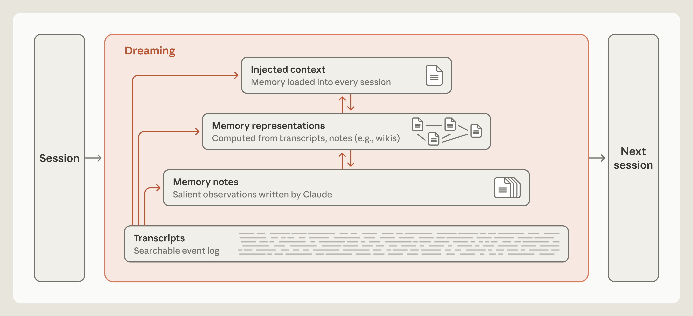
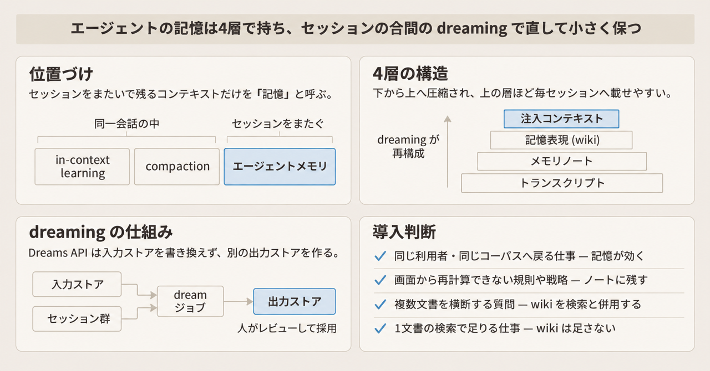
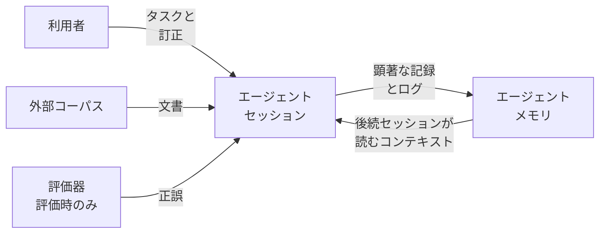
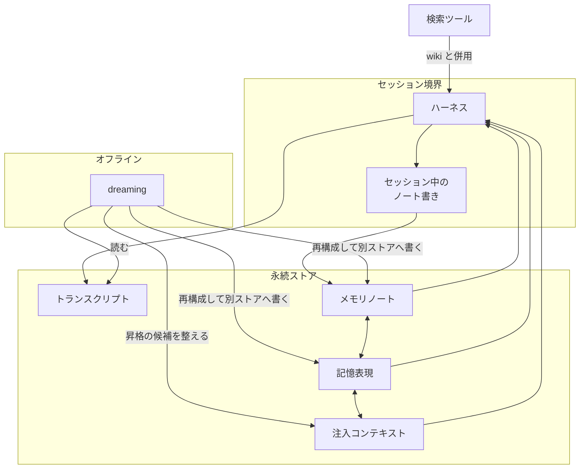
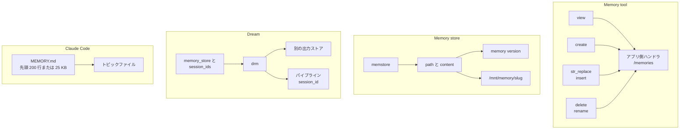
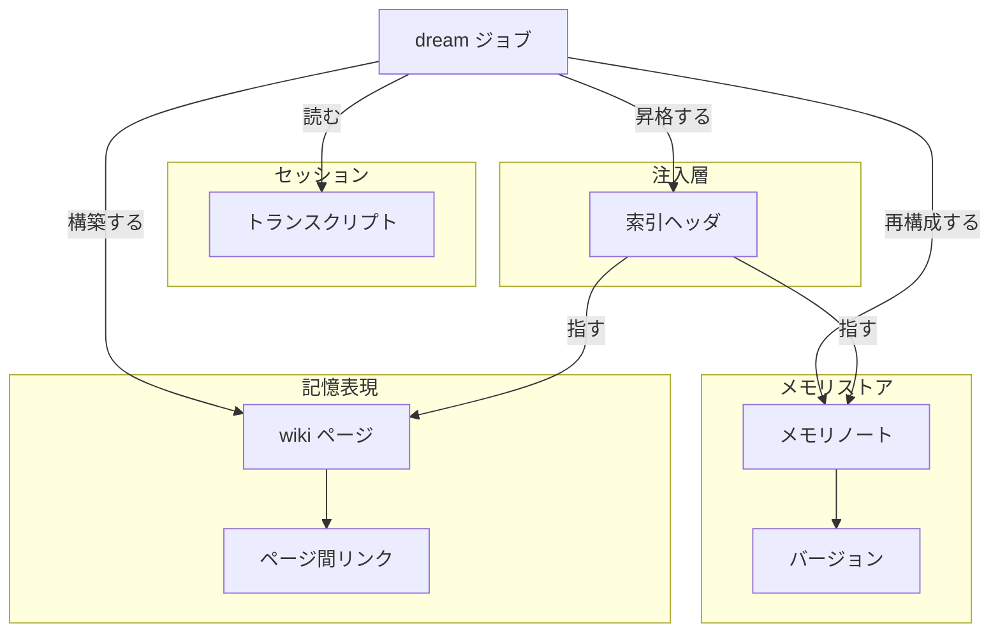
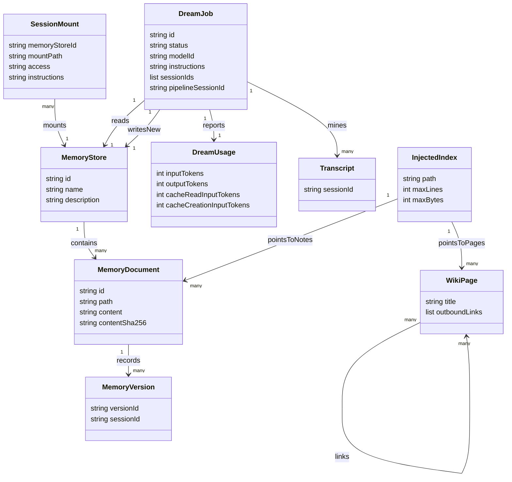
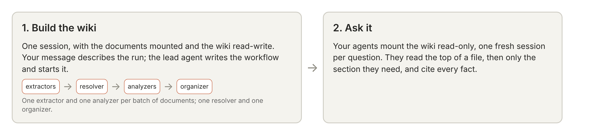

Anthropic Research は 2026 年 11 月 6 日に、投稿「The components of agent memory」(執筆: Lance Martin) を公開しました。エージェントメモリは、エージェントが利用者とのやり取りやタスクから得た知識のうち、セッションをまたいで残り、あとから読めるコンテキストです。投稿はこれを、トランスクリプト、メモリノート、記憶表現、注入コンテキストの 4 層で整理し、セッションのあいだに記憶を再構成する「dreaming」を提案しています。投稿が示す実験値は Anthropic の社内実験であり、公開リーダーボードの単一スコアではありません。

この記事では、4 層の役割、人間の記憶との対応、製品上の実装面 (Memory tool、Managed Agents の Memory Stores、Dreams API、Claude Code の auto memory)、API の使い方、運用上の上限、設計の指針を整理します。Managed Agents は、Anthropic がセッションと環境を提供するエージェント実行基盤です。読み終えると、どの層をどの製品で持たせるか、dreaming を何に使い何に使えないかを判断できます。


*投稿が示す記憶階層。下から上へ圧縮され、上の層ほど毎セッションへ載せやすくなります。*


*この記事の全体像。以下、順に解説します。*

## エージェントメモリとは

エージェントメモリは、セッションのあいだに残り、あとから読めるコンテキストです。投稿はこれを次の 4 層で捉えます。

| 層 | 何が入るか |
|---|---|
| トランスクリプト | セッションの検索できるイベントログ。ノートの真偽を確かめる根拠 |
| メモリノート | セッション中に書いた観察と規則 |
| 記憶表現 | 主題ごとにまとまり、相互リンクを持つページ群。投稿の例は wiki |
| 注入コンテキスト | 毎セッションの先頭に自動で載る小さい層。索引の役割 |

投稿はエージェントメモリを、モデルの重みの更新、1 会話の中の in-context learning、古いターンを要約で置き換える compaction とは別物として置いています。in-context learning は、同じ会話の中で与えた例から振る舞いが変わる現象です。compaction は、長い会話の古い部分を要約に置き換えてコンテキストを空ける処理です。どちらもセッションを越えて残りません。

### 人間の記憶との対応

投稿は、人間の記憶における海馬と新皮質の分業、およびオフラインの再生をモデルにしています。海馬は経験をその場で捉え、新皮質はそのうち一部を長期の知識として統合します。投稿が貼っている一次文献は次の 5 本です。

| 対応する仕組み | 文献 |
|---|---|
| 海馬が経験をその場で捉える役割 | [McClelland, McNaughton, O'Reilly 1995 の相補学習システム](https://stanford.edu/~jlmcc/papers/McCMcNaughtonOReilly95.pdf) |
| 経験の一部だけが長期の知識になる選別 | [Yang ほか 2024](https://www.science.org/doi/10.1126/science.adk8261) |
| 安静時の再生 | [Nature Communications 2018](https://www.nature.com/articles/s41467-018-06213-1) |
| 経験を新皮質の知識へ統合する見立て | [Nature Neuroscience 2019](https://www.nature.com/articles/s41593-019-0467-3) |
| 経験を重要な記憶として印づける仕組み | [Frey と Morris 1997 の synaptic tagging](https://www.nature.com/articles/385533a0) |

エージェント側では、セッション中のログと顕著なメモが「その場の記録」、アイドル時間の dreaming が「再生と統合」に対応します。顕著なメモとは、将来のセッションが再び必要とする、とモデルがその場で判断した事柄のメモです。dreaming は、ログを読み返し、誤りの修正、新しいノートの作成、wiki のような表現の構築、次セッションへ先に載せる層の整理を行う処理です。

投稿が挙げる系譜は、Letta と UC Berkeley の sleep-time compute (arXiv:2504.13171)、Andrej Karpathy の wiki メモ、Google Research の Sleep Framework です。sleep-time compute は、クエリが来る前に既存の文脈をオフラインで考えておく手法で、Anthropic の Dreams API そのものではありません。Karpathy の gist は、1 主題 1 ページを相互リンクで結ぶ表現の参照先です。

### 製品上の 4 つの実装面

投稿の考え方は、2026 年 11 月 7 日時点で次の 4 つの製品面に対応します。1 つの製品が 4 層をすべて持つわけではありません。注入コンテキストの層を製品機能として持つのは Claude Code の auto memory だけで、Managed Agents ではストアの説明と案内がシステムプロンプトへ入るにとどまります。

| 面 | 公開状態 | 記憶の置き場 | 誰が実行するか |
|---|---|---|---|
| Memory tool `memory_20250818` | Claude API で stable | アプリが実装する `/memories` | モデルがコマンドを依頼し、アプリが実行する |
| Memory store | beta。ベータ機能を有効にする HTTP ヘッダ `anthropic-beta` に `agent-memory-2026-07-22` を指定する | ワークスペース (組織の API 利用単位) の文書集合。セッションでは `/mnt/memory/` 配下 | エージェントのファイルツール。API からも編集できる |
| Dream | research preview。同ヘッダに `managed-agents-2026-04-01` と `dreaming-2026-04-21` の両方を指定する | 入力ストアを複製した別の出力ストア | 非同期ジョブ。1 から 100 セッションのトランスクリプトを読む |
| Claude Code auto memory | ローカルセッションでは既定で有効 | `~/.claude/projects/<project>/memory/` | Claude がセッション中に読み書きする |

Memory tool は、Messages API のツールとして渡し、ファイル操作をアプリ側で実行するクライアント側の仕組みです。Memory store は、Managed Agents のワークスペースに置く文書集合です。Dream は、メモリストアとセッション群を入力にとり、再構成した別のストアを出す非同期ジョブです。auto memory は、Claude Code がプロジェクトごとにローカルへ書く記憶です。

### 評価に使われた課題

投稿の評価は 4 系統です。CL-Bench 1.0 のデータベース課題、Pokémon Red、投稿が「5 月に買収した」と書く Stainless 社の社内文書コーパス上の 25 問、Harvey LAB と合併文書です。評価に登場する Opus、Sonnet、Fable などはいずれも Claude のモデル名で、番号が大きいほど新しい世代です。CL-Bench は、継続学習を測るベンチマークです。Pokémon Red は、エージェントがゲームを操作し、記憶フォルダだけを持ち越しながら進める課題です。Harvey LAB は、法務タスクの評価セットです。いずれも「記憶の部品が成績にどう効くか」を見る実験です。

## 特徴

### 記憶は将来の予測である

投稿は、記憶を「将来のセッションが再び必要とするものの予測」と位置づけます。検証済みの事実を書くことは、次のセッションがその事実を再確認せずに使う、という予測を含みます。

何を顕著とみなすかはモデル世代で変わります。Pokémon の 1 ランずつ、約 10,000 ステップ時点の比較では、Sonnet 3.7 は遭遇を広く残し、Fable 5 は画面から再読できない戦略と計画に絞りました。

### 強いモデルには目的だけを伝える

投稿は、強いモデルには記憶の目的だけを伝え、書く中身の固定規則は置かない方が成績が伸びた、と報告しています。CL-Bench のデータベース課題で「失敗だけを記録せよ」と指定すると、記憶による利得が減りました。

CL-Bench のデータベース課題は、質問のたびに新しいセッションを始め、セッションをまたぐのはメモリディレクトリだけ、という条件で Managed Agents 上で走らせています。次の平均報酬は、投稿の Figure 3 と Figure 5 の代替テキストに書かれた値です。

| モデル | 状態を持たない基線 (図 3) | メモリあり (図 3) | メモリを読み推測を検証するよう明示した指示を足したとき (図 5 左) | 失敗だけ記録へ変えたときの利得の変化 (図 5 右) |
|---|---|---|---|---|
| Opus 5.5 | 0.655 | 0.838 | 図に系列なし | 図に系列なし |
| Sonnet 5.5 | 0.644 | 0.833 | 図に系列なし | 図に系列なし |
| Opus 5 | 0.564 | 0.828 | 図に系列なし | −0.234 |
| Opus 4.7 | 0.383 | 0.700 | 図に系列なし | −0.150 |
| Sonnet 5 | 0.306 | 0.610 | 図に系列なし | 図に系列なし |
| Sonnet 4.6 | 0.330 | 0.364 | 0.641 | −0.020 |

「図に系列なし」は、その図にそのモデルの線が描かれていないことを指します。投稿本文は、Opus 5 がこの系列で最初に、検証済みの規則を書いて次のセッションで使う循環 (学習ループ) を閉じ、Opus 5.5 と Sonnet 5.5 も検証済みの規則を残した、と書いています。Sonnet 4.6 は未検証の推測が散らばり、メモリを読む割合は半分未満でした。Sonnet 5 は促しなしで 10 回中 9 回、回答前にメモリを読みました。

### 画面から再読できる値を残さない

Pokémon の記憶フォルダは、同じ縮尺のツリーマップ (Figure 4) で次のとおりです。

| モデル | ファイル数 | 文字数 | 本文が述べる進行 |
|---|---|---|---|
| Sonnet 3.7 | 413 (フォルダは本文で 225) | 977,930 | バッジ 1 個。ステップ 10,000 付近で 17 ステップのあいだゲーム操作をせず、記憶ファイルの作成と削除に使った |
| Fable 5 | 図は 10。本文は 2 フォルダに 9 ファイルと最上位の `global.md` | 43,406 | バッジ 4 個 |
| Opus 5.5 | 小さいフォルダ。件数は本文に無い | 本文に無い | 現在目標と次の手順を書き換えながらゲームをクリアした |

### dreaming がノートを直すと進行が変わる

dreaming がノートを直して進行が変わった例が、投稿の図 7 と図 8 の Mt. Moon です。Mt. Moon はゲーム内の洞窟で、以下の地名はいずれもゲーム内の場所です。入口近くの一方通行の崖は、PokéCenter を山のどちら側にあると思うかで落ちるかどうかが分かれます。誤ったノートは PokéCenter を東側と書き、「Mt Moon DONE」と更新していました。未訂正のランは崖を 3 回落ち、3 回目のあと「回り続けるより止める」と書きましたが、実験のセットアップが自動で続行を返したため進み続け、山の手前の Pewter City まで戻って終わりました。記憶なしのランも Cerulean City には届いていません。

誤ったノートを含むフォルダに dreaming を掛けると、Claude はノートをセッションのトランスクリプトと照合して書き換えました。訂正後のランは洞窟へ戻り、累積行動 1,935 で Cerulean に到達しました。

投稿は、利用者個人を目標として記憶を育てる dreaming の例に、[Claude Duet](https://support.claude.com/en/articles/17631495-get-started-with-claude-duet) という製品を挙げています。利用手順はサポート記事にあり、投稿の評価数値には含まれません。

### wiki は検索の代替ではなく併用相手である

Stainless の社内文書は約 350,000 ファイル、約 420M トークンです。25 問に対し、128 セッションの Opus 5 が共有ログで前セッションの作業を引き継ぎながら wiki を書きました。この wiki を書くセッションが dreaming です。dreaming のセッション数を 2 から 128 へ増やすと、wiki 単独の採点基準達成率は 13% から 48% へ上がりました (図 10)。投稿本文はこの変化をセッション数で書きますが、図 10 の成績グラフの横軸は dreaming トークン数 (2M から 128M) で、両者の換算関係は投稿に示されていません。検索ツールだけのときは 53% で横ばい、wiki と検索の併用は 54% から 61% へ上がり、1 問あたり約 20,000 トークンを節減しました。図のネットワークは、2 セッション後が 103 ページと 766 リンク、128 セッション後が 222 ページと 12,893 リンクです。

合併に関する 24 問では、複数文書の結合や判断、計算を要する項目について、wiki 参照が 87%、検索のみが 73% でした。LAB の別課題では、採点事実 57 件のうち、複数エージェントが 1 つの共有ページへ書く方式で残ったのは 41 件 (72%) で、契約ごとに 1 ページへ逐語で写す方式では 57 件 (100%) でした。別の LAB 課題では、コーパス 10 文書 115 KB に対し wiki が 68 ページ、255 リンク、203 KB (コーパスの 1.77 倍) まで膨らみ、抽象化が起きませんでした。

### 注入層は小さく保つ

注入層は、毎セッションの先頭へ自動で載る小さい層です。Claude Code は `MEMORY.md` の先頭 200 行または 25 KB の早い方だけを毎セッションへ載せます。長い指示ファイルは遵守を下げる、と Claude Code の文書が警告しています。

### 製品の dream は入力ストアを書き換えない

Dreams API の出力は別ストアです。採用前に人がレビューできます。メモリストアの各文書は 100 kB、ストアあたり最大 10,000 件です。セッションへ付けられるストアは最大 8 個で、作成時にだけ付けられます。

### 似た仕組みとの位置づけ

| 方式 | いつ書くか | セッションをまたぐ単位 | 投稿との関係 |
|---|---|---|---|
| in-context learning | 同一会話の中 | そのコンテキストウィンドウ | 投稿の定義から外れる |
| compaction | 同一会話が長くなるとき | 古いターンを置き換える要約 | 投稿の定義から外れる |
| memory tool / memory store | セッション中の顕著な出来事 | ファイルまたはストア文書 | 投稿の「メモリノート」に対応する実装 |
| dreaming / Dreams API | セッションのあいだ | 再構成されたストア、wiki、注入層 | 投稿のオフライン統合に対応する |
| sleep-time compute | クエリが来る前 | 既存コンテキストに対する事前計算 | 系譜。数値は別論文のもの |
| MemGPT に代表される記憶のページング | コンテキストに載せる範囲を入れ替えるとき | コア記憶と外部記憶 | 投稿本文は論じていない。境界として置くだけ |

向く場面は、セッションを分けても同じ利用者や同じコーパスへ戻る仕事、画面やツール結果から再計算できない規則、複数文書を横断する質問です。1 文書の文字列検索で採点基準を満たせる仕事では、wiki の維持コストが先に立ちます。

## 構造

論理構造は投稿の記憶階層に沿います。システムコンテキストとコンテナは役割名で描き、コンポーネントで公開 API の名前を使います。

### システムコンテキスト図



| 要素名 | 説明 |
|---|---|
| 利用者 | タスクを与え、記憶の目的を伝える。書く手続きの固定は成績を下げることがある |
| エージェントセッション | その回の作業主体。終了するとコンテキストは消える |
| エージェントメモリ | セッションをまたいで残すログ、ノート、表現、注入層の総体 |
| 外部コーパス | 社内文書、契約、ゲーム画面のように、記憶とは別に存在する情報源 |
| 評価器 | 評価時だけ正解や採点基準を返す。本番の毎セッションの部品ではない |

### コンテナ図



| 要素名 | 説明 |
|---|---|
| ハーネス | モデル呼び出しとツール振り分けを行うプログラム。次セッションの先頭で注入層を載せる |
| セッション中のノート書き | その場の顕著性判断でノートを書く。本作業から注意をそらす |
| トランスクリプト | 検索できるイベントログ。dreaming がノートを確かめるときの根拠 |
| メモリノート | セッション中に書いた観察と規則 |
| 記憶表現 | 主題ごとにまとまり、相互リンクを持つページ群。投稿の例は wiki |
| dreaming | トランスクリプトを読み、ノートと表現の再構成は別ストアへ書く。注入層への矢印は昇格の候補を整えることで、ストアの付け替えそのものではない |
| 注入コンテキスト | 毎セッションの先頭に載る小さい層。隣接する記憶表現とのあいだは双方向 |
| 検索ツール | wiki の代替ではない。Stainless の評価では wiki と併用した |

### コンポーネント図

4 つの囲みは代替の実装面であり、1 つのプロセスの中身ではありません。memory tool、memory store、Dream、Claude Code はパスもヘッダも別です。



| 要素名 | 説明 |
|---|---|
| view / create / str_replace / insert / delete / rename | memory tool が依頼する 6 コマンド。実行はアプリ |
| アプリ側ハンドラ | `/memories` より外のパスを拒否する。ツール型は `memory_20250818`、名前は `memory` |
| memstore | Memory Stores API のストア。ID は `memstore_` で始まる |
| path と content | ストア内の 1 文書。1 件 100 kB まで。作成は上書きしない |
| memory version | 変更のたびに残る不変版。`content_sha256` で楽観ロックできる |
| `/mnt/memory/slug` | セッション作成時にマウントされるディレクトリ。表示名をスラグ化した名前。正は応答の `mount_path` |
| drm | Dream リソース。ID は `drm_` で始まる。状態は pending、running、completed、failed、canceled |
| memory_store と session_ids | dream の入力。セッションは 1 個以上 100 個以下 |
| 別の出力ストア | 入力を変更せずに作る再構成結果。`running` の直後は `outputs` が空のことがある |
| パイプライン session_id | dream が running になると埋まる。イベントを流して観察できる |
| MEMORY.md | auto memory の索引。先頭 200 行または 25 KB の早い方が毎セッションに載る |
| トピックファイル | 索引からリンクされる詳細。索引の上限を超えた本文は次のロードで落ちる |

## データ

### 概念モデル

所有は入れ子、参照は矢印で示します。



| 要素名 | 説明 |
|---|---|
| メモリストア | ノートの所有者。セッションへは作成時に最大 8 個まで付ける |
| メモリノート | 作成時のキーは path。更新の宛先は `mem_` 形の ID で、path はあとから変えられる。中身は顕著な観察、規則、未確認の推測 |
| バージョン | ノートの各変更に対応する不変記録 |
| 記憶表現 | ノートとトランスクリプトから dreaming がまとめるナビ用の構造 |
| wiki ページ | 1 主題のページ。他ページとソースへのリンクを持つ |
| ページ間リンク | 未作成ページを指すことがあり、次の dreaming が張り替える |
| トランスクリプト | セッションのイベント列。ノートの真偽を確かめる根拠 |
| dream ジョブ | 入力ストアとセッション群を取り、別ストアを出す |
| 索引ヘッダ | 毎セッションへ載る小さい目次。詳細は下位層に残す |

### 情報モデル

属性は 2 種類あります。MemoryStore から DreamUsage までは公開 API の資源を指しますが、クラス図の属性名は camelCase のラベルであり、ワイヤ上のフィールド名ではありません。実装するときはコード例の snake_case を使います。例は `content_sha256`、`mount_path`、入力の `session_ids`、`model` の ID、バージョン ID の接頭辞 `memver_`、バージョンを作ったセッションはトップレベルではなく `created_by.session_id` です。Transcript、WikiPage、InjectedIndex は投稿の階層と Claude Code の注入から採った概念型で、API のフィールド名ではありません。



| 要素名 | 説明 |
|---|---|
| MemoryStore | `id` は `memstore_` 形。`description` はエージェントへ渡る |
| MemoryDocument | `path` は作成時に指定する。更新は ID 指定で `content` と `path` の一方または両方を変える |
| MemoryVersion | 変更の監査と時点復旧の単位。公式のコード例では `content_sha256` を前提条件に使う |
| SessionMount | `access` は `read_write` または `read_only`。`instructions` は 4,096 文字まで。`mount_path` は応答を正とする |
| DreamJob | `status` は pending、running、completed、failed、canceled。`instructions` は合成の方針であり、特定行の編集命令には向かない |
| DreamUsage | リソース上のトークン集計。キャンセル後もしばらく更新が続くことがある |
| Transcript | 概念型。API に渡すのはセッション ID である。イベント列そのもののフィールド名は公開スキーマに無い |
| WikiPage | 概念型。投稿のグラフが数えるのはページとリンクである |
| InjectedIndex | 概念型。投稿の図ではページとノートの両方を指す。Claude Code の実ファイルは `MEMORY.md` とトピックファイルで、`maxLines` は 200、`maxBytes` は 25 KB。早い方で切る |

## 構築方法

ここからのコマンドは、2026 年 11 月 7 日に取得した公式ドキュメントの例です。モデル ID は文書の例に合わせ、Dreams 対応モデル一覧にも含まれる `claude-opus-5-5` を使います。

### 前提と 3 つの実装面

- memory tool は Messages API のツールとして渡します。ベータヘッダは要りません。データは呼び出し側のストレージに残ります。
- memory store の作成と文書 API は `anthropic-version: 2026-10-21` と `anthropic-beta: agent-memory-2026-07-22` を使います。同じリクエストに `managed-agents-2026-04-01` を足すと 400 になります。
- セッションへストアを付けるリクエストは `managed-agents-2026-04-01` を使います。Dream の作成は `managed-agents-2026-04-01` と `dreaming-2026-04-21` の両方が要ります。
- Dreams は research preview で、利用申請が別にあります。Zero Data Retention (API の入出力を Anthropic 側に保持しない契約オプション) と HIPAA の対象外です。
- knowledge-wiki クイックスタートは Python 3.11 以降と `anthropic` SDK 2.0 以降を要件にしています。knowledge-wiki は、コーパスを一度 wiki にして質問に答える、Anthropic 公式のサンプル実装です。

投稿の 4 層と、製品の対応は次のとおりです。

| 投稿の層 | 製品上の置き場 | 持たないもの |
|---|---|---|
| トランスクリプト | Managed Agents のセッション | memory tool 単体にはセッションログの資源が無い |
| メモリノート | memory store の文書、または memory tool の `/memories` | 両者のパスは互換ではない |
| 記憶表現 | dream が書く別の出力ストア。中身の形は指示次第で、wiki 専用の資源型は無い | 入力ストアのその場書き換え |
| 注入コンテキスト | Claude Code の `MEMORY.md` だけが、先頭 200 行または 25 KB という製品上の上限を文書に持つ。Managed Agents では、各マウントの短い説明 (表示名、マウントパス、access、ストアの `description`、`instructions`) がシステムプロンプトへ自動で入るにとどまる | Dreams API の出力を自動で毎セッションへ載せる操作。Managed Agents で記憶の中身を先頭へ載せる仕組み |

### メモリツールを Messages API に載せる

- `tools` に型と名前だけを置きます。入力スキーマはアプリが定義しません。
- ハンドラは `/memories` 配下だけを許可します。`/memories/../../secrets.env` のような横断を拒否します。
- Python のローカル実装は `BetaLocalFilesystemMemoryTool` で、基底パスをアプリが決めます。

次の JSON はツール設定を示す抜粋です。実際のリクエストには必須の `messages` も含めます。

```json
{
  "model": "claude-opus-5-5",
  "max_tokens": 2048,
  "tools": [
    {
      "type": "memory_20250818",
      "name": "memory"
    }
  ]
}
```

```python
import anthropic
from anthropic.tools import BetaLocalFilesystemMemoryTool

client = anthropic.Anthropic()
memory = BetaLocalFilesystemMemoryTool(base_path="./memory")
runner = client.beta.messages.tool_runner(
    model="claude-opus-5-5",
    max_tokens=1024,
    messages=[
        {
            "role": "user",
            "content": "Remember that customer Acme Corp prefers email follow-ups.",
        }
    ],
    tools=[memory],
)
final_message = runner.until_done()
```

### Managed Agents のメモリストアを作る

- `name` と `description` を付けます。`description` はマウント説明とともにシステムプロンプトへ入ります。
- 初期文書は `POST /v1/memory_stores/{id}/memories` で種まきできます。同じパスへの create は上書きしません。
- エージェントがファイルを読み書きする標準ツール群 (エージェントツールセット) を、エージェント作成時に有効にします。ストアを付けてもツールが無いと読み書きできません。

```bash
curl -s https://api.anthropic.com/v1/memory_stores \
  -H "x-api-key: $ANTHROPIC_API_KEY" \
  -H "anthropic-version: 2026-10-21" \
  -H "anthropic-beta: agent-memory-2026-07-22" \
  -H "content-type: application/json" \
  -d '{"name":"User Preferences","description":"Per-user preferences and project context."}'
```

```python
store = client.beta.memory_stores.create(
    name="User Preferences",
    description="Per-user preferences and project context.",
)
client.beta.memory_stores.memories.create(
    store.id,
    path="/formatting_standards.md",
    content="All reports use GAAP formatting. Dates are ISO-8601.",
)
```

### Dreams ジョブを作る

- 入力は既存の memory store を 1 つと、セッション ID の配列です。ストアが無いときは空ストアを先に作ります。
- `model` は Dreams の対応表に含まれるものだけを渡します。2026 年 11 月 7 日の文書では Fable 5.1、Fable 5、Opus 5.5、Opus 5、Sonnet 5.5、Sonnet 5、Opus 4.8、Opus 4.7、Sonnet 4.6 が列挙されています。
- `instructions` は任意で、焦点、残す内容、出力の慣例を書きます。特定の文を書き換えよ、という命令はパイプラインの対象外です。

```python
dream = client.beta.dreams.create(
    inputs=[
        {"type": "memory_store", "memory_store_id": store_id},
        {"type": "sessions", "session_ids": [session_a, session_b]},
    ],
    model="claude-opus-5-5",
    instructions="Focus on coding-style preferences; ignore one-off debugging notes.",
)
```

作成直後の応答は次の形です。主要フィールドのみの抜粋で、実際の応答には `model` (オブジェクト)、`instructions`、`session_id`、各時刻、`error` も含まれます。

```json
{
  "type": "dream",
  "id": "drm_01AbCDefGhIjKlMnOpQrStUv",
  "status": "pending",
  "inputs": [
    {"type": "memory_store", "memory_store_id": "memstore_01Hx"},
    {"type": "sessions", "session_ids": ["sesn_01", "sesn_02"]}
  ],
  "outputs": [],
  "usage": {
    "input_tokens": 0,
    "output_tokens": 0,
    "cache_read_input_tokens": 0,
    "cache_creation_input_tokens": 0
  }
}
```

### Claude Code の自動メモリを有効にする

- ローカルセッションでは auto memory は既定でオンです。切るにはユーザ設定の `autoMemoryEnabled` か、環境変数 `CLAUDE_CODE_DISABLE_AUTO_MEMORY=1` を使います。
- プロジェクト単位で止めるときは、そのプロジェクトの設定に `autoMemoryEnabled: false` を書きます。
- 保存先を変えるときは `autoMemoryDirectory` を設定します。既定のディレクトリは git リポジトリ単位で、worktree とサブディレクトリは同じディレクトリを共有します。
- Claude Code の自己ホスト環境 (Claude Code のクラウドセッションを、自分で配備したランナープロセスで自分のインフラ上で動かす形態) のセッションは、Claude Tag (Slack 上で Claude を呼び出す製品) の外では auto memory が既定でオフです。この自己ホスト環境は、後述する Managed Agents の自己ホストサンドボックスとは別の仕組みです。

```json
{
  "autoMemoryEnabled": false,
  "autoMemoryDirectory": "~/my-custom-memory-dir"
}
```

```bash
CLAUDE_CODE_DISABLE_AUTO_MEMORY=1 claude
```

```text
~/.claude/projects/<project>/memory/MEMORY.md
~/.claude/projects/<project>/memory/<topic>.md
```

## 利用方法

必須パラメータを先にまとめます。

| 操作 | 必須 | ヘッダまたは設定 |
|---|---|---|
| Messages API に memory tool を付ける | `type` が `memory_20250818`、`name` が `memory` | `anthropic-version` と API キー。memory tool 自体にベータヘッダは不要 |
| ストア作成 | `name`。`description` は文書の例では一緒に送る | `agent-memory-2026-07-22` のみ |
| 文書作成 | `path` と `content` | 同上。create は既存パスを上書きしない |
| セッションへ装着 | `agent`、`environment_id`、`resources[].memory_store_id` | `managed-agents-2026-04-01`。装着はセッション作成時のみ |
| dream 作成 | `inputs` に memory store と 1 から 100 の `session_ids`、`model` | `managed-agents-2026-04-01` と `dreaming-2026-04-21` |
| 文書の安全な更新 | 読んだ時点の `content_sha256` | 不一致なら読み直して再試行する |

### メモリツールの 6 コマンド

- `view` はディレクトリ一覧か、行番号付きのファイル本文を返します。`view_range` は `[start_line, end_line]` で、終端 `-1` は末尾までを意味します。
- ディレクトリ一覧は 2 階層まで、隠しファイルと `node_modules` を除き、サイズとパスをタブ区切りで返します。
- ファイルが 999,999 行を超えるときは、その旨のエラー文字列を返します。ツール説明は 16,000 文字を超える本文の切り詰めと、画像拡張子の表示にも触れています。
- `create` は `path` と `file_text` で新規ファイルを作ります。
- `str_replace` は `old_str` が一意なときだけ `new_str` で置き換えます。一致が無いとき、および複数回出現するときは置換せず、エラー文字列を返します。`new_str` を省略すると、その `old_str` を削除します。Go、PHP、Ruby のデモが先頭の 1 件だけを置換するのは、公式が推奨する仕様ではなく、パス検証を省いたデモです。
- `insert` は `insert_line` と `insert_text` を取ります。`delete` は `path`、`rename` は `old_path` と `new_path` を取ります。

```json
{
  "command": "view",
  "path": "/memories/notes.txt",
  "view_range": [1, 10]
}
```

```text
Here's the content of /memories/notes.txt with line numbers:
     1	Hello World
     2	This is line two
```

### メモリストアをセッションに付ける

- `access` の既定は `read_write` です。参照専用の共有文書は `read_only` にします。
- `instructions` はストアの名前と説明に加えて、そのセッション向けの案内になります。上限は 4,096 文字です。
- マウント先は `/mnt/memory/` の下で、表示名を小文字化し、英数字以外の連続をハイフン 1 つに潰したスラグです。実際のパスは `mount_path` を読みます。
- `/mnt/memory/` のストア外への書き込みは失敗します。親ディレクトリは読み取り専用でマウントされます。
- Managed Agents の自己ホストサンドボックス (セッションのサンドボックスを自分の環境で動かす形態で、環境ワーカーと呼ぶプロセスがストアを管理する) ではライブマウントではなく、ワーカーがローカルコピーを同期します。既定の同期間隔は 15 秒に 1 回までで、セッション終了時にもう一度同期します。

```yaml
agent: agent_id
environment_id: environment_id
resources:
  - type: memory_store
    memory_store_id: memstore_id
    access: read_write
    instructions: User preferences and project context. Check before starting any task.
```

### メモリ文書の読み書きと楽観ロック

楽観ロックは、読んだ時点の内容ハッシュを更新の前提条件として送り、他者の更新と衝突したら失敗させる方式です。

- 一覧の `path_prefix` は末尾が `/` で、パスセグメント単位に一致します。`depth` を省略するか `0` にすると部分木全体、`1` は直下のみです。それ以外の `depth` は 400 になります。
- 更新は `POST /v1/memory_stores/{store_id}/memories/{memory_id}` で、`content` と `path` の片方でも両方でも送れます。
- 同時更新を避けるときは `precondition.type` に `content_sha256` を置きます。

```python
client.beta.memory_stores.memories.update(
    memory_id=mem.id,
    memory_store_id=store.id,
    content="CORRECTED: Always use 2-space indentation.",
    precondition={"type": "content_sha256", "content_sha256": mem.content_sha256},
)
```

公式文書の例にある `ant` は Anthropic の CLI です。

```bash
ant beta:memory-stores:memories list \
  --memory-store-id "$store_id" \
  --path-prefix "/"
```

### Dream の進捗確認と出力ストアの採用

- 作成直後の `status` は `pending` です。処理中は `running` で、`usage` が途中経過として増えます。
- `completed` の `outputs` にある `memory_store` が新しいストア ID です。以後のセッションの `resources` に、入力の代わりか入力と並べて付けます。この付け替えは、投稿がいう注入層への昇格そのものではありません。昇格は毎セッションの先頭に載せる小さい索引の話で、ストアの付け替えは記憶表現を次のセッションから読めるようにする操作です。
- 採用しない出力は Memory Stores API で削除またはアーカイブします。dream 自体のアーカイブは終端状態のあとで、出力ストアは別管理です。
- `failed` と `canceled` の出力ストアは、止まった時点までの中身を残します。入力ストアのアーカイブや削除、入力セッションの削除は、実行中の dream を `input_memory_store_unavailable` または `input_session_unavailable` で失敗させます。

```python
import time

while dream.status in ("pending", "running"):
    time.sleep(10)
    dream = client.beta.dreams.retrieve(dream.id)
if dream.status != "completed":
    raise RuntimeError(f"dream {dream.id} ended with {dream.status}: {dream.error}")
output_store_id = next(
    output.memory_store_id
    for output in dream.outputs
    if output.type == "memory_store"
)
```

```bash
curl -s -X POST "https://api.anthropic.com/v1/dreams/$dream_id/cancel" \
  -H "x-api-key: $ANTHROPIC_API_KEY" \
  -H "anthropic-version: 2026-10-21" \
  -H "anthropic-beta: managed-agents-2026-04-01,dreaming-2026-04-21"
```

### セッション中の顕著性メモと注入層

- 投稿の運用指針は、利用者に頼まれたときと、明らかに残す価値があるときにノートを書く、という短い案内です。書く項目のチェックリストは強いモデルの利得を削ることがあります。
- Claude Code では、利用者が「覚えて」と頼むと auto memory に入り、「CLAUDE.md に追加して」と頼むと指示ファイル側に入ります。CLAUDE.md は、プロジェクトに置き、Claude Code が起動時に読み込む利用者が書く指示ファイルです。両者は別物です。
- `MEMORY.md` は 1 行 1 件の索引にし、詳細はトピックファイルへ移します。上限を超えた書き込みは成功しても、次のロードでは上限の向こうが落ちます。超えたときは Claude Code が書き直しを求めるエラーを返します。
- メイン会話の auto memory は、fork を除きサブエージェント (Claude Code が別のコンテキストで起動する補助エージェント) へは載りません。fork は、親の会話とシステムプロンプトを引き継ぐ起動方式です。サブエージェント専用の記憶は、サブエージェント定義の `memory` フィールドで別ディレクトリになります。

```text
# index loaded every session
- preference: pnpm, not npm
- api-tests: local Redis is required
```

## 運用

### Dream のライフサイクルと課金

- 状態の意味は、pending がキュー投入、running が処理中、completed が出力ストア完成、failed がエラー終了、canceled が中断です。
- 所要時間は入力トランスクリプトの数に依存し、数分から数時間です。課金は選択モデルの通常トークン単価で、コストは入力セッションの数と長さにおおよそ比例します。`usage` が実数を持ちます。
- 一覧は非アーカイブが新しい順で、`limit` の既定は 20、最大は 100 です。アーカイブ済みを含めるときは `include_archived=true` を付けます。
- 終端前の dream をアーカイブすると 400 になります。先にキャンセルします。キャンセル済みへの再キャンセルは no-op で、completed と failed へのキャンセルは 400 です。
- 文書が挙げるエラー型は `timeout`、`internal_error`、`memory_store_org_limit_exceeded`、`input_memory_store_too_large`、`input_memory_store_unavailable`、`input_session_unavailable` です。

```bash
ant beta:dreams retrieve --dream-id "$dream_id"
```

```bash
ant beta:dreams list --limit 20
```

### ストア上限とマウント競合

- 1 文書 100 kB、1 ストア 10,000 文書が Memory Stores の上限です。大きいコーパスではエンティティページを分割してリンクする、と knowledge-wiki の README が書いています。
- セッションあたりのストアは 8 個までです。共有の参照は read_only、利用者やプロジェクト固有の学習は read_write、という分け方が文書の例です。
- Managed Agents を AWS 上の Claude Platform や Google Cloud の Anthropic 管理モデル経由で使う場合、自己ホストサンドボックスのセッションには memory store を付けられません。この注記はメモリ文書の冒頭にあります。
- Managed Agents の自己ホストサンドボックスでの read_only は、ワーカーの write と edit が拒否します。bash がローカルコピーを変えられるケースは、公式文書の自己ホストサンドボックス向けメモリのページに分離されています。
- knowledge-wiki の README は、共有ページへの同時書き込みで、最も忙しいエンティティページの約 5% の行が内容を失う、と記録しています。投稿の LAB 実験でも、1 つの `provisions.md` へ複数エージェントが書くと 57 件中 41 件しか残りませんでした。

```text
access: read_only
path: /mnt/memory/<slug>/
limit_per_memory: 100 kB
limit_per_store: 10000 memories
limit_per_session: 8 stores
```

### 注入層のサイズを保つ

- 注入はトークンを消費し、誤ったノートを全セッションへ運びます。載せることは遵守を保証しません。
- Claude Code は書き込み後に 200 行と 25 KB を測り、近いときは索引を短くするよう促します。超えても書き込みは成功し、次回復元時に超過分が落ちます。
- CLAUDE.md の推奨サイズも 1 ファイル 200 行未満です。CLAUDE.md から別ファイルを取り込む `@path` 形式の import は整理にはなりますが、一緒にロードされるためコンテキスト費用は減りません。
- 投稿は、dreaming の仕事の一部を「詳細を下の層へ移し、リンクだけを上に残すこと」と説明しています。

```text
# MEMORY.md stays an index
- goal: current gym plan -> gameplay/gyms.md
- route: Mt. Moon -> locations/mt-moon.md
```

### 権限とプロンプトインジェクション

- read_write のストアは、信頼できない入力が記憶へ書き込むと、次セッションがそれを信頼して読みます。参照資料は read_only にします。
- memory tool はクライアント側なので、パス検証はアプリの責任です。SDK の Go、PHP、Ruby のデモ用インメモリストアは、この検証を省略している、と文書が明記しています。
- CLAUDE.md と auto memory は強制設定ではありません。ツール実行を必ず止める層は PreToolUse フックです。PreToolUse フックは、Claude Code がツールを実行する直前に走るユーザ定義のスクリプトです。
- Dreams と Managed Agents のセッションは、削除するまでトランスクリプトが残ります。Zero Data Retention の対象外です。memory tool は、保持をアプリが決めるため Zero Data Retention の対象になり得ます。モデルによる例外は公式文書の対応表を参照してください。

```json
{
  "resources": [
    {
      "type": "memory_store",
      "memory_store_id": "memstore_reference",
      "access": "read_only"
    }
  ]
}
```

### Managed Agents の自己ホストサンドボックスの同期

- Managed Agents の自己ホストサンドボックスでは、エージェントの write と edit はローカルコピーだけを変えます。他セッションから見えるのは、双方のワーカーが同期したあとです。
- `/mnt/memory/` のストアディレクトリ外へシェルが書いたファイルはストアへ同期されません。
- dream の `session_id` はパイプラインのセッションを指します。終端後もアーカイブされ、トランスクリプトは残ります。削除とは別です。
- コストはセッション数と長さにおおよそ比例します。文書は、少数セッションで品質を見てから増やす手順を勧めています。

```python
session = client.beta.sessions.create(
    agent=agent_id,
    environment_id=environment_id,
    resources=[
        {"type": "memory_store", "memory_store_id": output_store_id},
    ],
)
```

## ベストプラクティス

投稿の実験結果を、実装時の判断に翻訳します。

### 何を覚えるかを指示し、書き方はモデルに任せる

- ストアやフォルダが使えることと、その記憶が何のためかだけを伝えます。
- 強いモデルでは、この案内だけで CL-Bench のデータベース課題の利得が出ました。
- 古いモデルがメモリを読まないときは、読むことと、推測を検証することを明示します。Sonnet 4.6 ではこの指示で平均報酬が 0.364 から 0.641 へ動きました。
- フロンティアモデルへの投稿時点の案内は、頼まれたときと、明らかに残す価値があるときにノートを書く、という短い文です。

### 失敗だけを記録する規則を置かない

- 「失敗だけを記録せよ」は Opus 5 の記憶利得を 0.234、Opus 4.7 を 0.150 減らしました。
- 残す価値があるのは、検証済みの規則、その規則をどう確かめたか、過去問の答え、発見した罠です。Opus 5 のノートはこれらを含んでいました。
- 未検証の推測をファイルに散らす段階で止まったモデルは、学習ループを閉じていません。

### 画面から再読できる状態はメモに残さない

- 所持金や現在地のように、毎ターン画面から読める値は記憶にすると陳腐化します。
- 残す対象は、ゲームや環境が明示しない戦略、計画、試して確かめた規則です。
- Fable 5 は `global.md` を現在目標、ジム計画、記憶の使い方のダッシュボードにし、`locations` と `gameplay` に分けました。
- フォルダが巨大化したら、本作業より記憶の探索に時間を使っていないかを見ます。Sonnet 3.7 はステップ 10,000 付近でその状態になりました。

### 共有ページへの同時書き込みを避ける

- 契約条件のように欠落が採点に直結する項目は、1 文書につき 1 エージェント、1 ページとし、要約ではなく逐語で残します。
- 投稿の改善ループは、失敗を振り返り、wiki 生成の指示を書き換え、wiki を作り直す、という順でした。
- 共有テーブルが必要なときも、knowledge-wiki が記録した上書きを前提に、あとから差分を監査します。
- dream の `instructions` には「何を残すか」を書き、行の修正は出力ストアの Memory API で行います。

### 表現と検索を併用する

- 合併の 24 問のうち、複数文書の結合や判断、計算を要する項目では、wiki を参照したときが 87%、検索のみが 73% でした。これは併用の得点ではありません。
- wiki と検索の併用が検索単独を上回ったのは Stainless の 25 問です。併用は 54% から 61% へ上がり、検索のみは 53% でした。61% は到達点です。wiki 単独の最高は 48% で、検索単独を下回ります。
- 1 文書のテキスト検索で足りる採点基準には、wiki を足しません。
- 表現がコーパスより大きくなったら、抽象化が起きていない兆候として扱い、枝を刈る dreaming を回します。

### 夢の指示は方針に留め、行単位の修正は API で行う

- `instructions` は焦点、保存する内容、ストア全体の慣例に使います。
- 特定文の置換や、節の中の件数修正は、出力ストアの update と `content_sha256` で行います。
- 2 回目の dreaming は、未作成ページへのリンクの張り替えと索引の追加に使えます。投稿の図 15 の例では、存在しない “escrow-agreement” へ向いていた 9 本のリンクを “buyer-form-escrow-agreement” へ向け直し、索引、指示メール、エスカレーションの 3 ページを足して、38 エントリ 225 リンクから 41 エントリ 278 リンクになりました。
- 入力ストアは dream が触りません。採用するまで本番セッションのマウントを変えません。

## 注意点

### ドキュメントと実装の乖離

| 対象 | 資料の記載 | 実態 | 読者への影響 |
|---|---|---|---|
| 記憶ディレクトリのパス | 投稿は Managed Agents の「メモリディレクトリ」と Claude Code の `MEMORY.md` を同じ階層図で説明する | memory tool の接頭辞は `/memories`。Memory store のマウントは `/mnt/memory/<slug>` で、正は `mount_path`。auto memory は `~/.claude/projects/<project>/memory/` | 投稿のフォルダ名を API パスとして実装すると読み書きが空振りする |
| dreaming の更新単位 | 投稿は既存ノートをトランスクリプトと照合して書き換える、と説明する | Dreams API は入力ストアを変更しない。別の出力ストアを作る。行単位の命令はパイプラインが無視し得る | 本番ストアが dream 中に直接治る前提で監視すると、治ったことを検知できない |
| ベータヘッダ | セッションもストアも Managed Agents 配下に見える | ストア API に `managed-agents-2026-04-01` と `agent-memory-2026-07-22` を同時に付けると 400。セッション装着は前者、ストア CRUD は後者、dream は前者に `dreaming-2026-04-21` を足す | 1 つのヘッダ定数を全呼び出しに使うとストア作成か dream 作成のどちらかが失敗する |
| 注入の上限 | 投稿は「先頭 200 行または 25 KB」と要約する | Claude Code 文書は同じ数値に加え、超えた書き込みは成功し次のロードで落ちること、起動時に読む CLAUDE.md は 4 MiB 以下なら全文で、それを超えるファイルは読み込まないと書く | `MEMORY.md` の制限を CLAUDE.md に適用すると、指示ファイルの設計を誤る |
| wiki のサイズ感 | 投稿の Stainless 実験は約 350,000 ファイル、約 420M トークン、128 セッション | knowledge-wiki README の記録済み実行は SEC 提出書類 8 件、テキスト 2.8 MB、約 16 ドル、23 分。ストア 1 ファイル 100 KB | 投稿のトークン数をクイックスタートの請求額やファイル数として見積もると桁が合わない |

### 資料間の食い違い

| 対象 | 資料の記載 | 実態 | 読者への影響 |
|---|---|---|---|
| wiki 成長の横軸 | 本文は dreaming を 2 セッションから 128 セッションへ増やしたと書く | Figure 10 の代替テキストは、採点基準の達成率が dreaming トークン 2M から 128M への成長として描かれる、と書く。ページ数は 103 から 222、リンクは 766 から 12,893 | 2 と 128 をトークン数の単位と取り違えない。セッション数とトークン数の換算表は投稿に無い |
| Pokémon のファイル数 | 本文は Fable 5 が 2 フォルダに 9 ファイルと `global.md` を書いたと書く | 同じ図の代替テキストは 10 ファイル、43,406 文字と書く | 9 に最上位ファイルを足すと 10 になり、矛盾ではない。件数だけを引用するときはどちらを数えたかを添える |
| sleep-time compute の倍率 | 系譜として dreaming の前段に引用される | arXiv:2504.13171 では、同じ精度に必要なテスト時計算が Stateful GSM-Symbolic と Stateful AIME で約 5 倍減る。精度の上昇は Stateful GSM-Symbolic で最大 13%、Stateful AIME で最大 18%。Multi-Query はクエリあたり 2.5 倍のコスト減。いずれもその論文のタスクの数値である | Anthropic の CL-Bench や Pokémon の報酬と足し合わせない |
| 製品発表の完了率 | 2026 年 5 月 19 日の Managed Agents 記事は、Harvey のテストで完了率が約 6 倍になったと書く | 2026 年 11 月 6 日の投稿が示す LAB の数は 57 件中 41 件から 57 件であり、6 倍とは別の測定である | どちらか一方を、もう一方の実験の結果として引用しない |
| Dreams のモデル一覧と Memory のモデル一覧 | memory tool と memory store の対応表には Mythos や Haiku が含まれる | Dreams の対応表は Fable、Opus、Sonnet の列挙で、Mythos と Haiku を含まない | 記憶ストアに使えるモデル ID を、そのまま dream の `model` に流用しない |

投稿の中では、dreaming が行う仕事の分類が図と本文で揃っていないため、分類の件数は引用しないでください。図 1 の説明文は、訂正、ノートの作成、表現の構築、次セッションへ先に載せる層の整形、の 4 つです。本文の節は、訂正、表現の構築、注入への昇格、目標に合わせた整形、穴埋め、の 5 つです。目標への整形は図 1 の説明文に無く、ノート作成は後の節見出しに無いため、4 つに 1 つ足した関係ではありません。

### 執筆時点の未確認事項

| 対象 | 資料の記載 | 実態 | 読者への影響 |
|---|---|---|---|
| CL-Bench の母数 | 図 3 右の代替テキストは、running-mean reward over 30 questions と書く | 30 問が窓幅なのか、系列の長さなのかは書いていない。反復回数、信頼区間、データベース課題以外の成績も確定できない | 30 問を移動平均の窓幅とも独立試行の回数とも読まない。表の小数をベンチ全体の代表値として扱わない |
| Pokémon のラン数 | 比較は各モデル 1 ラン、約 10,000 ステップ時点である | シードを変えた反復の分布は投稿に無い。Opus 5.5 のファイル数と文字数も本文に無い | 413 対 10 を、全モデル世代の平均的な圧縮率として一般化しない |
| Stainless の取得時期 | 「May に買収した」とだけ書く | 年は投稿本文に無い。25 問の採点ルーブリック原文も公開されていない | コーパスを再取得して 13% や 61% を再現する手順は、投稿だけでは閉じない |
| 図の平均線 | 複数の図が平均報酬と累積行動を示す | 代替テキストに無い補助線の値は、画像の目盛りから読んでいない | この記事の数値は本文と代替テキストに現れたものに限る |
| dream のサイズ上限の具体バイト数 | `input_memory_store_too_large` が定義されている | バイト数やトークン数の閾値は、Dreams 文書の Limits 節に無い | 上限に当たる前の目安は、文書が勧める「少数セッションから始める」に従う |

### 投稿が残した未解決点

投稿末尾 “Thinking backward, looking forward” が明示している限界は次の 4 点です。

- その場で書くと本作業から注意がそれます。dream に遅らせると、出力はすぐには使えません。
- 記憶を最新に保つ問いです。予測は最初から誤り得ます。環境が変わると記憶は陳腐化します。dreaming は直し方の 1 つですが計算を使います。全記憶を常時照合するのは非現実的で、変わりやすい情報に絞るか、参照頻度で間隔を決める、という方向だけが示されています。
- 表現は維持に計算が要り、誤りや幻覚が積もります。トランスクリプト検索を土台とみなす余地がある、と投稿は書いています。
- どのモデルも、将来のターンを本当には知りません。顕著性の判断が改善しても、この限界は残ります。

## トラブルシューティング

| 症状 | 原因 | 対処 |
|---|---|---|
| メモリストアの作成や一覧が 400 になる | ストア API に `managed-agents-2026-04-01` と `agent-memory-2026-07-22` を同時に付けている | ストア呼び出しは `agent-memory-2026-07-22` だけにする。セッション装着は `managed-agents-2026-04-01` に戻す |
| dream 作成が権限エラーになる | research preview の申請前、または `dreaming-2026-04-21` が無い。`managed-agents-2026-04-01` だけでは dream は開かない | 両方のヘッダを付け、対応モデルだけを `model` に渡す |
| dream が `input_memory_store_unavailable` または `input_session_unavailable` で失敗する | 実行中に入力ストアをアーカイブまたは削除した、あるいは入力セッションを削除した | 終端まで入力を残す。不要な出力だけをあとから削除する |
| dream が `input_memory_store_too_large` で失敗する | 入力メモリストアがパイプラインのサイズ上限を超えた | 入力ストアを小さく分割してから再実行する。セッション数を減らしてもストアのサイズは下がらない |
| dream が `memory_store_org_limit_exceeded` で失敗する | 組織のメモリストア数の上限に達した | 不要なストアと、失敗時に残った部分的な出力ストアを削除して枠を戻す |
| `instructions` で指定した文が出力に反映されない | dream はストア全文の編集器ではなく、入力に対する合成である | 方針だけを `instructions` に書き、文の修正は出力ストアの update に `content_sha256` を付けて送る |
| エージェントが記憶パスに書けない | 組み立てたパスが `mount_path` と違う。または `read_only` である。Managed Agents の自己ホストサンドボックスでは同期前の他セッションから見えない | セッション資源の `mount_path` を使い、`access` を確認する。自己ホストサンドボックスは同期間隔のあとにもう一度読む |
| memory tool が `/memories` の外を読もうとする | ハンドラがパス検証を省略している | すべてのコマンドで正規化後のパスが `/memories` 配下であることを確認し、外はエラー文字列を返す |
| 毎セッションの指示が守られない | `MEMORY.md` か CLAUDE.md が長く、注入されても遵守が落ちている。または索引の 200 行 / 25 KB の向こうに詳細がある | 索引を 1 行 1 件にし、詳細はトピックファイルへ移す。強制が必要なら PreToolUse フックを使う |
| 次のセッションで auto memory が空に見える | Claude Code の自己ホスト環境では既定オフ、`autoMemoryEnabled` が false、または `CLAUDE_CODE_DISABLE_AUTO_MEMORY=1` である。プロジェクトのパス導出が別リポジトリになっている | `/memory` でディレクトリを開き、設定と環境変数を確認する。worktree は同じ git リポジトリの記憶を共有する |
| wiki に採点事実が欠け、エージェント同士の記述が消える | 複数エージェントが同一ページへ同時に書いた | 1 ソースにつき 1 ページへ分け、逐語で残す。2 回目の dreaming で未解決リンクを実在ページへ張り替える |
| キャンセルした dream の `usage` がまだ増える | 飛行中の処理が数秒残る | `usage` が安定するまで取得を繰り返す。中間の値を最終請求とみなさない |
| 終端前の dream をアーカイブして 400 になる | pending と running はアーカイブできない | 先に cancel し、completed、failed、canceled のいずれかになってから archive する |

### メモリストア作成が 400 になる

- 応答のエラーがベータヘッダ不一致なら、ストア用とセッション用でヘッダを分けます。
- `depth` に 0 と 1 以外を渡した一覧も 400 になります。部分木全体は `depth` を省略します。
- 作成は上書きしません。同じパスが既にあるときは update を使います。

### Dream が入力消失で失敗する

- 入力ストアと入力セッションは、dream が終端するまで削除しません。
- 失敗後の出力ストアは中身が部分的です。採用せず、Memory Stores API で削除します。
- `timeout` のときはセッション数を減らして同じ入力の部分集合で再実行します。

### 注入した指示が守られない

- 先頭 200 行と 25 KB のどちらに当たったかをファイルサイズで見ます。
- 索引に手順全文を置かず、トピックファイル名だけを残します。
- 矛盾する CLAUDE.md が祖先ディレクトリにもあるときは、近い方だけが勝つのではなく両方が連結されます。矛盾を消します。

### メモリパスがストアの外を指す

- `mount_path` をログに出し、プロンプトに書いた固定パスと差分を取ります。
- read_only のストアへ write した場合は、別の read_write ストアをセッション作成時に追加します。実行中の付け外しはできません。
- memory tool では、公式が例示するエラー文字列を tool result の本文で返します。`is_error` は memory tool の必須仕様としては書かれていません。

### 自動メモリが空に見える

- `/memory` で auto memory フォルダを開きます。プレーンな Markdown を直接読めます。
- 環境変数と `autoMemoryEnabled` をユーザ設定、プロジェクト設定の順に確認します。
- クラウドの別マシンとは共有されません。ローカルにしかファイルが無いためです。

### 共有ページの上書きで事実が消える

- 生成指示を「契約ごとに 1 ページ、条項は逐語」へ変えて wiki を作り直します。
- 監査は、採点基準の件数と wiki に残った件数を比較します。投稿の例では 41/57 から 57/57 へ動きました。
- クイックスタートが記録した約 5% の行欠落は、共有ページを選んだときの残差として見ます。


*knowledge-wiki クイックスタートの構成。コーパスを一度 wiki にし、質問は読み取り専用で答えます。*

## まとめ

- エージェントメモリは、セッションをまたいで残るコンテキストです。トランスクリプト、メモリノート、記憶表現、注入コンテキストの 4 層で捉えます。
- dreaming は、アイドル時間にトランスクリプトを読み返して記憶を直し、まとめ、昇格候補を整える処理です。製品の Dreams API は入力ストアを書き換えず、別の出力ストアを作ります。
- 製品面は memory tool、memory store、Dream、Claude Code auto memory の 4 つで、パスもベータヘッダも別です。ヘッダの混在は 400 の主因になります。
- 強いモデルには記憶の目的だけを伝えます。「失敗だけを記録せよ」のような固定規則は利得を削ります。
- wiki は検索の代替ではなく併用相手です。1 文書の検索で足りる仕事には足しません。共有ページへの同時書き込みは事実を失わせます。
- 注入層は小さく保ちます。Claude Code の `MEMORY.md` は先頭 200 行または 25 KB だけが毎セッションへ載ります。

この記事が少しでも参考になった、あるいは改善点などがあれば、ぜひリアクションやコメント、SNSでのシェアをいただけると励みになります！

## 参考リンク

### 一次論文と投稿

- [The components of agent memory](https://www.anthropic.com/research/components-of-agent-memory)
- [Harness design for long-running application development](https://www.anthropic.com/research/harness-design-long-running-apps)
- [相補学習システム (McClelland, McNaughton, O'Reilly 1995)](https://stanford.edu/~jlmcc/papers/McCMcNaughtonOReilly95.pdf)
- [Selection of experience for memory by hippocampal sharp wave ripples](https://www.science.org/doi/10.1126/science.adk8261)
- [安静時の再生として投稿が引用する Nature Communications 2018](https://www.nature.com/articles/s41467-018-06213-1)
- [新皮質への統合として投稿が引用する Nature Neuroscience 2019](https://www.nature.com/articles/s41593-019-0467-3)
- [Synaptic tagging and long-term potentiation (Frey and Morris 1997)](https://www.nature.com/articles/385533a0)
- [Sleep-time Compute: Beyond Inference Scaling at Test-time](https://arxiv.org/abs/2504.13171)
- [sleep-time compute のコードとデータ](https://github.com/letta-ai/sleep-time-compute)
- [Karpathy の LLM wiki gist](https://gist.github.com/karpathy/442a6bf555914893e9891c11519de94f)
- [The Sleep Framework](https://research.google/blog/the-sleep-framework-a-new-way-for-llms-to-retain-knowledge-in-continual-learning/)
- [In-context learning and induction heads](https://www.anthropic.com/research/in-context-learning-and-induction-heads)

### プロダクト公式

- [Dreams](https://platform.claude.com/docs/en/managed-agents/dreams)
- [Using agent memory](https://platform.claude.com/docs/en/managed-agents/memory)
- [Memory tool](https://platform.claude.com/docs/en/agents-and-tools/tool-use/memory-tool)
- [How Claude remembers your project](https://code.claude.com/docs/en/memory)
- [Compaction](https://platform.claude.com/docs/en/build-with-claude/compaction)
- [Effective context engineering for AI agents](https://www.anthropic.com/engineering/effective-context-engineering-for-ai-agents)
- [Managed Agents overview](https://platform.claude.com/docs/en/managed-agents/overview)
- [Dreaming with a dynamic workflow](https://platform.claude.com/cookbook/managed-agents-cma-dreaming-with-a-dynamic-workflow)
- [knowledge-wiki クイックスタート](https://github.com/anthropics/claude-quickstarts/tree/main/managed-agents/knowledge-wiki)
- [New in Claude Managed Agents: dreaming, outcomes, and multiagent orchestration](https://claude.com/resources/articles/new-in-claude-managed-agents)

### 評価と関連ベンチ

- [CL-Bench 1.0](https://continual-learning-bench.com/news/cl-bench-1-0/)
- [Harvey LAB](https://github.com/harveyai/harvey-labs)
- [Claude Duet の開始手順](https://support.claude.com/en/articles/17631495-get-started-with-claude-duet)

### 実装例

- [Python memory tool の例](https://github.com/anthropics/anthropic-sdk-python/blob/main/examples/memory/basic.py)
- [TypeScript memory helper の例](https://github.com/anthropics/anthropic-sdk-typescript/blob/main/examples/tools-helpers-memory.ts)
