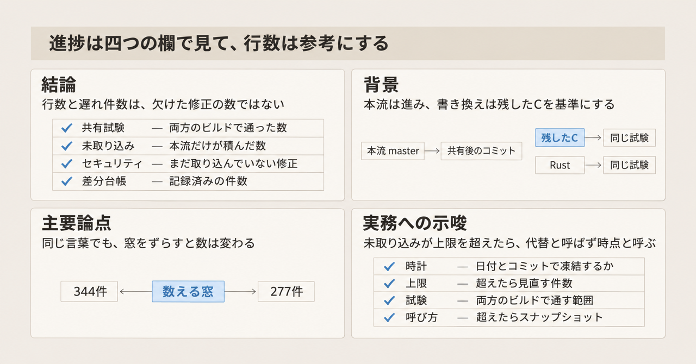
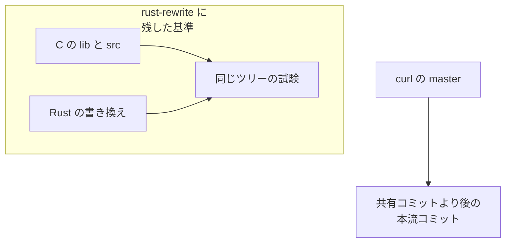

Daniel Stenberg は 2026年11月17日の記事で、エージェントが curl の C を Rust へ書き換える作業と、同じ期間に本流の curl がコミットとバグ修正を取り込み続けたことを並べています。Simon Willison は 2026年11月18日に、その記述を引用しました。Willison のページは Stenberg の文章の引用で、コミット数や行数や脆弱性件数の測定本文は Stenberg の記事にあります。記事が名指しする実装は二つです。数か月前にゼロから書かれた urlx と、2026年11月の fork `kov/curl`（既定ブランチは `rust-rewrite`）です。この文章は、生きた本流を持つ基幹を全面的に移す計画を書く人に、並走期間をどの時点の基準で生きるかと、進捗を何で数えるかの材料を渡します。数値の取得日は 2026年11月19日です。

*この記事の全体像。以下、順に解説します。*

## curlのRust書き換えと本流の並走とは

本流は `curl/curl` です。既定ブランチは `master` です。2026年11月19日時点でアーカイブされておらず、star は約 43,600 です。任意のブランチへの最終 push は 2026-11-18T14:57:26Z です。直前リリースの curl 8.23.0（2026年10月14日）のリリース記事は、公式 Numbers という集計で、42 日間の 476 コミット、281 件のバグ修正、24 件のセキュリティ修正を数えています。

名指しされた実装の一つは [`kov/curl`](https://github.com/kov/curl) です。`curl/curl` を複製した fork で、作成は 2026-10-20T20:25:07Z、既定ブランチは `rust-rewrite`、最終 push は 2026-11-16T14:02:24Z です。2026年11月19日時点の star は 5 で、アーカイブされていません。README は、開発ツール Claude Code 上の Claude が、メンテナの指示とレビューのもとで書いた、と自己申告しています。開始は 2026年10月20日です。README が置く規模は、約 2,300 コミット、試験込みで約 430,000 行の Rust、比較対象として `lib/` と `src/` の約 200,000 行の C です。

出すものは三つです。

- 既存プログラムを再ビルドせず使える共有ライブラリ `libcurl.so.4`
- 同じオプションと終了コードの `curl`
- 製品として出す Rust の API `curl-core`

基準の置き方は、リポジトリの方針文にあります。`SCOPE.md` は「C ツリーはその場所に残り、基準であり upstream ではない」と書きます。`CLAUDE.md` は「ここの C ツリーが書かれている相手の基準実装であり、C は我々にとって upstream ではない」と書きます。引用の「書かれている相手」は、残した C です。その C を試験の採点基準にし、取り込み続ける本流には置かない、という宣言です。

完了の判定は、同じツリーに残した C のビルドと Rust のビルドの両方で、curl 自身の試験が通ることです。README は、どこでも外れる例外は試験 96 と 558 だと書いています。この二つは試験の番号で、デバッグ用のメモリログに C のソースファイル名が出ることを理由に外れます。`SCOPE.md` は、同じ性質の Rust の試験に置き換える、と書いています。意図した差分は `DIVERGENCE.md` に、その差分を固定する試験とともに記録します。この文書が、以降でいう差分台帳です。

ビルドしないものは、README が三つ挙げています。一つは NTLM で、C 側では利用者が明示したときだけ入り、削除予定です。ほかの二つは quictls と、Apple の実験的な fast UDP です。

もう一つの実装は [`jonwiggins/urlx`](https://github.com/jonwiggins/urlx) です。`curl/curl` の fork とは別のリポジトリで、作成は 2026年3月8日、最終 push は 2026-10-06T19:38:22Z、2026年11月19日時点の star は 25 です。Stenberg は、メモリ安全な、ゼロからの再実装、という自己説明として紹介しています。

書き換え側のうち、`kov/curl` が置いている構造は、ある時点で残した C のツリーと、その試験と、その試験で採点される Rust のツリーです。本流の `master` は、その時点のあとにもコミットを積みます。二つの履歴が分岐する直前の共有コミットを、merge-base と呼びます。

2026年11月19日の [GitHub compare](https://github.com/curl/curl/compare/master...kov:rust-rewrite)（`curl/curl` の `master` と `kov:rust-rewrite`）では、双方に相手へ入っていないコミットがあります。GitHub はこの状態を diverged と表示します。merge-base は `d1d4b5931af37bd17aae66992107a5e4841577cf`（committer は 2026-10-20T09:22:41Z）です。`rust-rewrite` はこの共有コミットから 2,379 コミット先行しています。先行は、共有コミットより後に書き換え側だけが積んだ数です。`master` からは 366 コミット遅れています。遅れは、共有コミットより後に本流だけが積んだ数です。先行側が、README の「約 2,300 コミット」に対応する帯です。

## 注意点

Stenberg の記事の数値は、公開の git、リリースノート、アドバイザリと突き合わせると、一つの数には着地しません。定義と、数える窓と、いつの記録かを分けます。

| 記事の言い方 | 2026-11-19 に突き合わせたもの | 読み方 |
|---|---|---|
| C 185,000 行を Rust 340,000 行へ（I counted） | 2026-11-16 の push 時点の `rust-rewrite` で物理行を数えると、`lib/` と `src/` の C/H は 473 ファイル 201,400 行。全 `.rs` は 601 ファイル 430,267 行。試験パスを除いた `.rs` は 507 ファイル 368,333 行。`lib/` と `src/` の `.c` のみは 239 ファイル 177,503 行 | 数え方は記事に無い。201,400 は README の「約 200,000」と合う。430,267 は README の「約 430,000、試験込み」と合う。185,000 と 340,000 は、このフィルタでは再現しない |
| 3 週間強で 300 件超のコミット | `master` の history。fork 作成 2026-10-20T20:25:07Z から 2026-11-17T23:59:59Z までは 344 件（28.15 日、1 日約 12.2 件）。始点を 2026-10-23T00:00:00Z、終点を 2026-11-17T00:00:00Z にすると 277 件 | 「3 週間強」と fork 開始日に窓を置くと 300 を超える。窓を約 3 週間ぶん後ろへずらすと 300 を下回る。窓の宣言は記事に無い |
| 200 件超のバグ修正を、Rust 側は持っていない | 未リリース 8.23.1 の `RELEASE-NOTES` を、2026-10-20 の `master` と 2026-11-16 の `master` で行差分する。bugfix として並ぶ行は 30 から 286 へ増え、追加 256、削除 0。接頭辞の粗い分類は docs 18、build 16、tests 30、コードに見える行 192 | 「200 超」は、この RELEASE-NOTES の bugfix 行の増加と同じ桁である。公開された別統計ではない。2026-11-19 の生きた `master` はさらに進み、その時点の bugfix 行は 311 だった。256 と 311 は別時点 |
| 脆弱性もいくつか直した | [`vuln.json`](https://curl.se/docs/vuln.json)（2026-11-19 取得）で `published` が 2026-10-20 から 2026-11-17 のレコードは 0。同じ期間に、vulnerability というラベル付きで閉じた GitHub issue も 0 | 公開アドバイザリの ID はこの窓に無い。「いくつか」は、未公開の確認を含む可能性がある。ID は特定できない |
| 2026 年に確認した 81 件のうち 14 件（17.3%）はメモリ安全な言語なら避けられた可能性が高い。Rust でも 67 件は残る | 14 / 81 = 17.3%、81 − 14 = 67 で算術は一致する。`vuln.json` の 2026 年 published は 69 件（Low 53、Medium 15、High 1）。公式 HTML の “considered a C mistake” は 9 件、“not considered a C mistake” は 41 件、どちらも無いものは 19 件 | 81 は「confirmed」（確認済み）。69 は「published」（公開済み）。“considered a C mistake” は、公式 HTML が C に起因すると書いた句です。Stenberg 自身のコメント（2026-11-18T07:34:54Z）は、公開データで検証できるのは過去の “C mistakes” の数だ、と書いている。公開 HTML の 2026 年分は 9 件で、14 には一致しない |
| 1 日約 11 コミット | 8.23.0 の 476 / 42 = 11.33。書き換えの窓の 344 / 28.15 日 = 12.22 | 「約 11」は直前リリース周期と一致する。書き換え期間の実測はそれより少し多い |
| 8,600 USD を使ったと主張している | 出典は claude.ai 上の資料（artifact）。本文は取得できていない。コメント（Joonas Kuorilehto、2026-11-17T15:32:53Z）は、API 相当額の見積もりであり購読の請求額とは違う、と書き、記事の主張自体は変わらない、とも書く | 請求額としての 8,600 USD は未確認。公開されたコメントが伝える見積もりである |

行数の二つの語り手を、一つの進捗に混ぜません。Stenberg の 185,000 / 340,000 と、README の約 200,000 / 約 430,000 は、別の数え方として並びます。185,000 と 340,000 のフィルタは公開されていません。再現には、数えた本人の手順が要ります。

「Rust 側はその 200 件のバグ修正を持たない」は、git の祖先関係としては、本流コミットが `rust-rewrite` に無い、という意味では 2026年11月19日時点の遅れ 366 と整合します。挙動として欠ける、という意味には届きません。本流が merge-base より後に入れた次の 3 件は、現行の `DIVERGENCE.md` が「C はこうなる。書き換えはこうする」と既に書いています。

- `2ba56e30`「file: report download read errors」。committer は 2026-11-16T14:51:36Z。`file://` の読み失敗を `CURLE_READ_ERROR` にする、と差分台帳が書いています。
- `a40772f2`「hsts: honor the read-only file flag」。committer は 2026-11-13T09:36:14Z。本文は Anthropic OSS Scanner の `ANT-2026-Q74TN5PZ` を出典にします。読み取り専用の HSTS ファイルを書き戻さない、と差分台帳が書いています。
- `73835a3e`「easy: preserve rate limits when duplicating handles」。committer は 2026-11-17T22:32:55Z。複製したハンドルが速度制限を保つ、と差分台帳が書いています。

この 3 件は、遅れ件数から「修正が無い」を機械的に引くと、数え過ぎます。三つの段落を、対応する本流コミットより前に書いたかは、公開の記録からは特定できません。

2026 年の公開 High で、公式 HTML が C に起因すると書くもの（“considered a C mistake”）は [CVE-2026-92392](https://curl.se/docs/CVE-2026-92392.html) です。HTTP/2 のアップロードで、解放済みのメモリを再び使う不具合（CWE-416）です。影響は curl 8.12.0 から 8.22.0 までで、8.23.0（2026年10月14日）で修正されています。fork の作成より前のリリースです。書き換えの窓に「公開済みの High を取り込まなかった」という事実は、この公開の脆弱性一覧にはありません。

第三者の脆弱性一覧 NVD が [CVE-2026-8924](https://curl.se/docs/CVE-2026-8924.html) に付ける点数 9.1（CISA-ADP）は、curl 公式の Low とは別のスコアです。公式アドバイザリは Low で、修正は 8.21.0（2026年6月24日）です。第三者の点数を、curl の深刻度として読みません。

「確認した 81」と「C mistake の 14」の内訳リストは、公開の `vuln.json` と HTML の定型句からは再現しません。81 が未公開の確認を含む、という読みは、公開データだけでは確定しません。確認日と公開日を分ける Stenberg の 2026年11月3日の記事はあります。書き換えの窓の「いくつかの脆弱性」の ID は、公開アドバイザリにも、vulnerability ラベル付きで閉じた issue にもありませんでした。HackerOne 上の未公開報告までは見ていません。

試験が全部通る、という README の到達宣言は、試験を再実行した結果ではありません。性能の自己申告は README の表にあり、C 比で Linux x86_64 が 0.86 から 1.11、Linux aarch64 が 0.81 から 1.11、macOS が 0.84 から 1.08 です。1 を超えるとどちらが速いかは、この C 比という書き方だけでは確定しません。公開されているのはこの自己申告であり、この表を測定し直した数値ではありません。

urlx がこの窓のバグ修正を挙動として持つかは、試験の実行結果がありません。最終 push は 2026年10月6日なので、この窓の git コミット自体は入っていません。共有試験で採点した記録もありません。並走の進捗を数える材料は、`kov/curl` 側の記述にあります。

`kov/curl` の `DESIGN.md`、`MILESTONES.md`、`SCOPE.md`、`DIVERGENCE.md` には、本流コミットを取り込む手順の記述はありません。185,000、340,000、300、200、81、14 を Stenberg が訂正した公開の記録もありません。8,600 USD の artifact 本文も取得できていません。凍結した試験を採点基準にした遅れが、セキュリティ上は無害だ、という一次資料もありません。2026年11月18日の OSS Scanner の記事は、45 件の報告のうち確認が 5 件、と書いています。これは書き換え記事の翌日の話であり、書き換えの窓の「いくつかの脆弱性」の ID 一覧ではありません。

## 並走中の進捗を四つの欄で見る

進捗を見る欄は四つです。両方のビルドで通った共有試験。未取り込みの本流コミット。未取り込みのセキュリティ修正。記録済みの差分。変換した行数は、この四つの参考値にとどめます。方針へ書く三項目は、次の節で手順にします。ここでは、その欄を支える観察と、支えすぎない観察を分けます。

記事の中心文は、一次の git と合います。fork の開始から記事の日までの `master` は 344 コミットです。compare の遅れ 366 は、2026年11月19日時点の数で、記事のあと約 2 日を含みます。先行 2,379 は、書き換え側のコミット帯です。

プロジェクト自身が、C を、追い続ける義務のある upstream としては置いていません。2026年11月19日時点で、`lib/http.c` に 2026-10-21 以降のコミットは無く、メッセージに `upstream` を含むコミットの検索は 0 件でした。この観察は、上の方針文と矛盾しません。

1 日 11 から 12 コミットの本流では、取り込まない月が、そのまま数百件の差になります。8.23.0 の周期の 1 日 11.33 件を 30 日続けると、約 340 件です。

`CLAUDE.md` は、文書化された C の制限をそのまま移植すると、他所で直った不具合を隠す、と注意しています。凍結した C を試験の採点基準にすることと、本流のその後の修正を自動で持つことは、別の文です。

Stenberg は、言語を替えても 2026 年の確認済み脆弱性の多くは残る、と自分で書いています。本人の数では 81 のうち 67 です。全面書き換えの動機を「メモリ安全にすれば、確認済みの脆弱性はすべて消える」に置く材料には、本人の文章がすでになりません。ただし 81 と 14 は、公開の `vuln.json` と HTML の 9 件からは再現しません。公開データで検証できる、と本人が書いた範囲は、過去の “C mistakes” の数です。

未取り込み件数は、その修正の中身が無いことまでは意味しません。前節の 3 コミットが該当します。件数の上限は「見直しの引き金」であり、「欠けている修正の件数」そのものではありません。

この 3 週間強に、公開済みの脆弱性を取り込まなかったことは、不安全の根拠にはなりません。公開の脆弱性一覧の published（公開日）は、その窓で 0 件です。

件数の上限を超えたら代替実装と呼んではならない、は強すぎます。反例が uutils/coreutils です。GNU のコミットを移植するのではなく、GNU の試験で追う実装です。[0.12.0](https://github.com/uutils/coreutils/releases/tag/0.12.0)（公開 2026-09-17T06:31:42Z）のリリースノートは、Ubuntu が既定の coreutils として出荷している、と書いています。同じノートの GNU 試験比較は coreutils 9.11 に対するもので、pass の割合は 95.33%（0.11.0、653/685）から 94.36%（0.12.0、653/692）へ下がっています。素の pass 件数は 653 のままです。追跡 issue [uutils/coreutils#14705](https://github.com/uutils/coreutils/issues/14705)（open、2026年11月17日更新）は、GNU 9.12 に対し 718 試験、681 PASS、25 FAIL、1 ERROR、11 SKIP と書いています。試験で追うプロダクトが、差分コミットの上限なしに「代替」と呼ばれる実例はあります。追従コストが低い、という実測は、この例にはありません。

## 全面書き換えの方針に書くこと

全面書き換えの方針には、次の三つを必須で書きます。

1. ブランチの時計と寿命。凍結した基準（日付とコミット）で生きるのか、動く本流で生きるのか。いつまでその呼び方を続けるか。
2. 未取り込みの本流コミットの上限。超えたら見直しに入る数であり、欠けた修正の件数ではありません。見直しでは、差分台帳が既に同じ結果を試験で固定しているコミットと、セキュリティを変えるコミットと、互換の表面を変えるコミットを分けます。互換の表面とは、書き換え側が本流と同じだと主張する入出力の境界です。この事例で README が同じだと置いているのは、再ビルドせず使える `libcurl.so.4` と、同じオプションと終了コードの `curl` です。`curl-core` は製品として出す Rust の API で、C の curl と同じ入出力だとは README は書いていません。
3. 動作一致と呼ぶ試験の範囲。どのスイートを、どの基準ビルドに対して、両方で通すか。名前付きの例外と、意図した差分の台帳を含みます。

curl の事例では、時計の候補は merge-base `d1d4b5931af37bd17aae66992107a5e4841577cf`（2026-10-20T09:22:41Z）に残した C です。動作一致の候補は、同じツリーの curl 自身の試験で、試験 96 と 558（メモリログに C のファイル名が出るため外れる二件）を名前付きの例外にすることです。上限の件数そのものは、この事例から一意には決まりません。決めるのは、出荷したい製品が「その時点の curl」のままかです。

基準 X は、その計画が採点の基準にすると宣言した、日付とコミットで特定できる本流の時点です。

取り込む本流コミットは、次の三つを同時に満たすものです。書き換え側が本流と同じだと主張する入出力を変えるか、セキュリティを変えること。差分台帳が、書き換えを本流と別の結果にすると試験で固定していないこと。そのコミットを入れたあとの観測結果が、差分台帳の試験でまだ固定されていないこと。

残す本流コミットは、次のどちらかです。そのコミットを入れたあとの観測結果が、差分台帳の試験で既に固定されているもの。または、その本流コミットの主張が基準 X の挙動で、変更が文書とビルドだけに閉じるもの。前節の 3 件は、観測結果が差分台帳に既に書いてある例です。遅れ 366 の残りが同じ形かは、一件ずつの見直しで決まります。

呼び方は、主張に合わせます。

- 主張が「今日の本流の代替」であるのに、取り込んでいない本流コミットが上限を超えたら、呼び方を「基準 X のスナップショット」へ変えます。
- 主張が最初から「基準 X を、X の試験で採点したもの」であるとき、上限は「その X が、出荷したい製品のままか」を決める引き金です。`kov/curl` の README と `SCOPE.md` は、こちらの主張に近いです。今日の `master` の代替、とは書いていません。

進捗の欄は四つ置きます。両方のビルドで通った共有試験。未取り込みの本流コミット。未取り込みのセキュリティ修正。記録済み差分の件数。変換した行数は、この四つの隣に参考として置きます。

curl の速度は、直前周期で 1 日 11.33 コミット、書き換えの窓で 1 日 12.22 コミットです。取り込み能力がその速度に届かない書き換えは、月に数百件の差を抱えます。差の意味は、上記の見直しで一件ずつ付けます。

## まとめ

curl の Rust 書き換えは、凍結した C とその試験を採点基準にし、そのあいだも本流の `master` はコミットを積み続けています。2026年11月19日の compare では、書き換え側が共有コミットから 2,379 先行し、本流から 366 遅れていました。300 件超や 200 件超や行数は、窓と数え方を宣言しないと一つの数になりません。遅れ件数は、欠けた修正の件数そのものではありません。

全面的に移す計画には、時計と寿命、未取り込みの上限、動作一致と呼ぶ試験、の三つを書きます。進捗は、共有試験、未取り込みコミット、未取り込みのセキュリティ修正、記録済み差分の四つで見ます。変換した行数は参考です。

この記事が少しでも参考になった、あるいは改善点などがあれば、ぜひリアクションやコメント、SNSでのシェアをいただけると励みになります！

## 参考リンク

- Simon Willison, 引用ページ, 2026-11-18. <https://simonwillison.net/2026/Nov/18/daniel-stenberg/>
- Daniel Stenberg, “Actual curl rewrites in rust”, 2026-11-17. <https://daniel.haxx.se/blog/2026/11/17/actual-curl-rewrites-in-rust/>
- 同記事のコメント。Joonas Kuorilehto 2026-11-17T15:32:53Z（<https://daniel.haxx.se/blog/2026/11/17/actual-curl-rewrites-in-rust/comment-page-1/#comment-27585>）。Daniel Stenberg 2026-11-18T07:34:54Z（<https://daniel.haxx.se/blog/2026/11/17/actual-curl-rewrites-in-rust/comment-page-1/#comment-27595>）
- Daniel Stenberg, curl 8.23.0, 2026-10-14. <https://daniel.haxx.se/blog/2026/10/14/curl-8-23-0/>
- curl vulnerability database. <https://curl.se/docs/vuln.json>
- CVE-2026-92392. <https://curl.se/docs/CVE-2026-92392.html>
- CVE-2026-8924. <https://curl.se/docs/CVE-2026-8924.html>
- `kov/curl` `rust-rewrite`. <https://github.com/kov/curl>
- compare（2026-11-19、ahead 2379 / behind 366）. <https://github.com/curl/curl/compare/master...kov:rust-rewrite>
- `jonwiggins/urlx`. <https://github.com/jonwiggins/urlx>
- uutils/coreutils 0.12.0. <https://github.com/uutils/coreutils/releases/tag/0.12.0>
- uutils/coreutils#14705. <https://github.com/uutils/coreutils/issues/14705>
