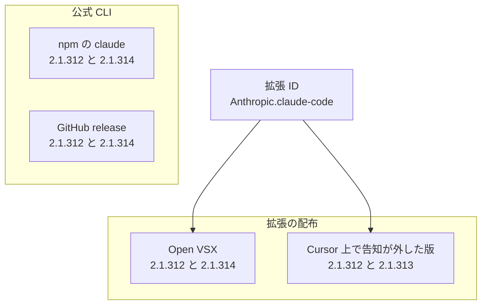

影響人数の上限と、Claude Code for VS Code の 2.1.314 への更新指示は、Cursor 公式の X 投稿にあり、2026年10月31日に取得した Cursor のセキュリティ告知の本文にはありません。

2026年10月29日、Cursor の VS Code 拡張マーケットに、拡張 ID `Anthropic.claude-code` の 2.1.312 と 2.1.313 が置かれました。Cursor は、このマーケットを運営するエディタです。Claude Code for VS Code は、IDE の中で使う Anthropic の Claude Code の拡張です。拡張 ID は、VS Code 互換の拡張を区別する識別子です。Anthropic は、告知がこの拡張の開発元として書く組織です。対象として告知が見出しに挙げる OS は Windows と macOS です。Cursor の告知は、これらの版を Anthropic が開発していない改変版だと書いています。

この記事では、同じ版の文字列が公式の CLI と IDE 拡張のどちらに出るかを分けます。導入を許可するときに、配布元、拡張 ID、バージョン、パッケージの SHA-256 をどの列で持つかを整理します。

*この記事の全体像。以下、順に解説します。*

## Cursor 拡張マーケットの Claude Code 2.1.312 と 2.1.313 とは

Cursor の告知が名指すのは、Cursor VS Code Extension Marketplace に置かれた拡張パッケージです。告知は、`cursor.com/marketplace` から入れた他の拡張、Grok Bot、Grok、その他の SpaceXSI 製品を、この件の外に置きます。SpaceXSI 製品は、告知が対象外として名指す自社製品の呼び方です。告知は、アクセスを監査し、他の拡張は改ざんされていないと確認した、とも書きます。

### 置かれていた時間と、告知が書く対応

置かれていた時間は、2026年10月29日の午前2時27分ごろから午後1時35分までです。時刻は太平洋時間です。10月の太平洋時間は UTC から7時間遅れるので、日本時間では10月29日18時27分ごろから10月30日5時35分ごろにあたります。

告知が書く対応は、検知後にその版を外し、マーケットを止めて運営側の鍵を回し、オンラインへ戻した、というものです。回した鍵の種類は告知が書かず、後述の攻撃者の SSH 鍵とは別です。攻撃者のサーバーは、すでに機能していない、とも書きます。クラウドの事業者と協力して停止したため、リバースシェルと、ホスト情報の POST は動かない、と告知は続けます。リバースシェルは、侵害された端末から攻撃者側へ接続を張り、そこから操作を受ける仕組みです。告知末尾の更新は、2026年10月30日午前11時30分（太平洋時間）です。同じ換算では、日本時間の10月31日3時30分ごろです。更新文は「IOC を更新し、対象バージョンを明確化した」です。IOC は、侵害の有無を照合する目印のことで、告知の見出しは Indicators of compromise です。

### 告知が書く動作

告知が書く動作は、次のとおりです。

- ホストと利用者の情報を送ります。中身は、hostname、username、OS、architecture、home のパス、環境変数の名前、作業ディレクトリ、設定済みの Git email、公開 IP です。
- `authorized_keys` へ SSH の公開鍵を追加し、ローカルの SSH を有効にし、逆向きのトンネルを試みます。`authorized_keys` は、その端末への SSH ログインを許す公開鍵の一覧です。逆向きのトンネルは、端末の SSH を攻撃者側から届く形で待ち受ける接続です。
- macOS では LaunchAgent、Windows ではスケジュールタスクで永続化を試みます。LaunchAgent は、macOS でユーザーのログイン後に動く自動起動の設定です。Windows のタスクは SYSTEM（Windows の高い権限）としての実行を試み、スタートアップスクリプトへのフォールバックがあります。バックグラウンドの再試行は約60秒ごとです。

確認の目印は、鍵コメント `svc-telemetry` です。修復スクリプトは、macOS 用の [remediate-macos.sh](https://cursor.com/static/security/claude-code-extension/remediate-macos.sh) と、Windows 用の [remediate-windows.ps1](https://cursor.com/static/security/claude-code-extension/remediate-windows.ps1) です。問い合わせ先は security@cursor.com です。永続化のファイルパスと、プロセスのコマンドラインは、告知の Indicators of compromise に列挙されています。

### 版の文字列が並ぶ棚

同じ版の文字列は、公式 CLI のレジストリと、拡張 ID の配布先の両方に出ます。拡張 ID から線が伸びるのは、Open VSX と、Cursor のマーケットだけです。Open VSX は、拡張 ID `Anthropic.claude-code` の公開記録を API で見るレジストリです。npm の `claude` と GitHub の release は、公式 CLI の行に置きます。npm のパッケージ名は `@anthropic-ai/claude-code` です。版の文字列が同じでも、告知はハッシュを分けています。図の「Cursor 上で告知が外した版」は、Cursor のマーケットに置かれていた 2.1.312 と 2.1.313 です。図は、直後の表にある全版の列挙ではありません。

公式 CLI の棚は、同じ図に置きます。拡張 ID からは線を引きません。並んでいるのは版の文字列で、配布物そのものではありません。

GitHub、npm、Open VSX の公開記録は、2026年10月31日時点で次のとおりです。time は、npm が各版の公開時刻を置く欄です。表の「キーは無い」は、その版の項目が time に無いことです。作者ログインは、GitHub がその release に返す作者のユーザー名です。公開者のログインは、Open VSX の API が返す公開者のユーザー名です。この二つのユーザー名の違いは、改ざんの根拠には使いません。dist-tag の latest は、npm がその時点で最新として指す版です。verified は、Open VSX の API が返す確認済みの印で、この印があることをもって改ざん版ではないとは扱いません。signature は署名ファイル、publicKey はその署名を確かめる公開鍵のファイルです。2.1.315 は、更新先として挙がる 2.1.314 より後に、npm の time にだけ見える版です。

| 棚 | 2.1.312 | 2.1.313 | 2.1.314 | 2.1.315 |
|---|---|---|---|---|
| GitHub `anthropics/claude-code` | 2026-10-27T20:24:20Z。作者ログインは `ashwin-ant` | release は 404 | 2026-10-30T01:06:26Z。作者ログインは `ashwin-ant` | API は 404 |
| npm `@anthropic-ai/claude-code` の time | 2026-10-27T18:36:10Z | キーは無い | 2026-10-30T00:12:56Z。dist-tag の latest はこの版 | 2026-10-30T21:05:24Z。latest ではない |
| Open VSX | 2026-10-27T20:26:56Z。verified。公開者のログインは `igorkofman`。files に signature と publicKey がある | API は 404 | 2026-10-30T01:07:38Z。verified。公開者のログインは `igorkofman`。files に signature と publicKey がある | API は 404 |

### パッケージハッシュの分かれ方

告知が「外した」側の SHA-256 と、Open VSX が 2.1.312 に添える SHA-256 は、一致しません。darwin-arm64 は Apple Silicon の macOS、win32-x64 は 64bit の Windows です。Open VSX 側はサイドカーです。サイドカーは、レジストリが VSIX に添える付帯ファイルです。VSIX は、VS Code 互換拡張の配布ファイルです。表の Open VSX の値は、VSIX 本体を取り直して計算したハッシュではありません。2026年10月31日に取得したサイドカーの値です。

| 版とプラットフォーム | Open VSX の SHA-256 サイドカー（2026-10-31） | Cursor 告知の改ざん版 SHA-256 |
|---|---|---|
| 2.1.312 darwin-arm64 | `b851e43b35b634987ef794fbddc759a7eeabd662088511a276f6063a598373d2` | `fcbb327e38e61c4fec795e0d0591f52cd1014b813d20a5912104953c3a17c364` |
| 2.1.312 win32-x64 | `4393b5a468057ec65061083604f2db1f03bdd2725f2a72c485eaae6cffe75ddd` | `3de1722901165769893bef57c72594e9a54459faa23f3091b136b79966edd081` |
| 2.1.313 darwin-arm64 | API が 404 でサイドカー無し | `80402fdcad8799285fd93044976973ca000da7995fb93363f819bb8e4f84ee6c` |
| 2.1.313 win32-x64 | API が 404 でサイドカー無し | `6786ec90cbd45949695bd7805c9fbb26cfc91bc5fc897de0183d9bcb9cb21731` |

告知は、このパッケージ以外の版と、公式の配布に影響した証拠は無い、と書きます。

## 注意点

ここからは、人数、ログインの成否、更新先の版、公式チャネルの範囲について、公開資料がどこまで言っているかを分けます。

### 人数は上限の自己申告である

Cursor の公式投稿は、影響を “at most 5,000 users” と書きます（[@cursor_ai](https://x.com/cursor_ai/status/2116074289053175808)、2026年10月30日 07:46 UTC）。これは上限の自己申告です。実数でも下限でもありません。数え方は投稿にありません。2026年10月31日の告知 HTML に、この数字はありません。報道の「最大 5,000 人」は、この投稿の言い換えです。直接連絡の対象が、インストール済みの利用者に限るかも、投稿にはありません。

### トンネルのログインと、起きた処理は別である

告知は、Cursor を管理者として起動したような例外を除き、悪意のあるコードの誤りで SSH サービス起動の段が失敗した、と書きます。多くの macOS と Windows では、トンネル経由のログインはできなかった、と続きます。同じ文は、鍵の追加、永続化の設置、ホスト情報の送信は起きたので、確認はそれでも行え、と書きます。ログインできなかったことは、確認を省く理由にはなりません。

環境変数については、「名前」を収集したと書きます。値の一覧とは書いていません。限定的な収集であることは、バックドア経由の後日の資格情報アクセスを否定しない、とも書きます。バックドアは、正規の入口を避けて後から入る経路で、この件では告知が書く SSH のトンネルを指します。OAuth トークンや API キーの値が初期送信に含まれた、という文は告知にありません。

### 拡張を消しても、永続化は残ることがある

拡張を消すだけでは足りないことがある、と告知は書きます。ペイロード（拡張とは別に残る悪意のある処理）は、単体で動き続ける永続化を設置します。資格情報とセッションは、影響を受けたホストから到達できるものを、信頼できる別の系統からローテーションする、と書きます。回す資格情報の種別は、告知が列挙しません。

告知が置く確認は、`authorized_keys` を鍵コメント `svc-telemetry` で検索するものです。macOS の確認コマンドは、コメントが無いとき “machine not impacted” と表示します。Windows は、ユーザーの `authorized_keys` と、`C:\ProgramData\ssh\administrators_authorized_keys` を見ます。修復スクリプトは、悪意のある拡張、永続化、動いているトンネルのプロセス、攻撃者の SSH 鍵を外し、何か残っていればゼロ以外で終了する、と告知は書きます。macOS では、影響を受けたユーザーとして実行し、root では実行しない、と書きます。Windows では、管理者として開いた PowerShell で実行する、と書きます。

### 2.1.314 は更新指示であり、ノートが結んだ修正版ではない

@cursor_ai は、全顧客に Claude Code for VS Code の 2.1.314 への更新を求めます。`v2.1.314` の GitHub リリースノートは、2026年10月30日 01:06:26 UTC に公開されています。この投稿より前です。2026年10月31日に取得したノートには、このマーケットの改ざんも、Cursor の拡張マーケットも書かれていません。ノート内の “cursor” は文字カーソルの意味で、“security” はスラッシュコマンド（`/` から始める操作の名前）です。いずれもこの件ではありません。

2.1.314 は、顧客向けの更新先としては公式 X にあります。リリースノートが、この改ざんの修正だと定義した版としては結べません。更新は、拡張ファイルの差し替えです。残る鍵と、永続化の確認を置き換えません。npm の latest は 2.1.314 です。同じ日の npm には 2.1.315 もあり、latest ではありません。GitHub の `v2.1.315` と Open VSX の 2.1.315 は、2026年10月31日の API で 404 です。2.1.315 が、なぜ GitHub と Open VSX に無く、latest でもないかは、これらの応答だけでは分かりません。

### 公式チャネルと署名について、一次が書いていないこと

ここで公式チャネルと言うのは、npm、GitHub の release、Open VSX、そして後の許可表にある VS Marketplace です。図の公式 CLI は、このうち npm と GitHub の release だけを指します。

Anthropic 社員 Felix Rieseberg の投稿（[@felixrieseberg](https://x.com/felixrieseberg/status/2116170451466543578)、2026年10月30日 14:08 UTC）は、次のように書きます。Anthropic のシステムや社員ラップトップの侵害ではない。攻撃者が Cursor のマーケットへのアクセスで、改ざんコピーを公開した。公式チャネルの版は影響を受けず、影響は Cursor の利用者だけである。この投稿は、会社ドメインのアドバイザリページではありません。

署名検証が改ざん版を受け入れたか、パブリッシャーの認証情報（拡張をそのマーケットへ出す権限）が盗まれたかは、この投稿も告知も書いていません。マーケットへ出すアクセスが、どの認証情報だったかも書いていません。Open VSX の正規版に signature ファイルがあることと、Cursor のマーケット上の改ざん版を署名が止めたことは、別の文です。

IOC のファイル節には、Linux のパスがあります。見出しと「何をすべきか」の対象は Windows と macOS です。Linux 向けビルドが Cursor のマーケットに出た、とは書いていません。パスが、未配布のコード上の分岐なのか、告知が対象から外した実配布なのかは、告知だけでは決まりません。

この件に対応する CVE 番号は、告知にも `v2.1.314` のノートにもありません。CVE 番号は、公知の脆弱性に付く識別番号です。2026年10月28日から31日の NVD 検索では、このマーケット改ざんを指す番号を採用できませんでした。NVD は、米国 NIST の脆弱性データベースです。無い、とは断定しません。

### 解説記事の食い違い

当初、Open VSX や npm も 2.1.313 を配ったとする解説があります。現行の [OpenSourceMalware](https://opensourcemalware.com/blog/trojanized-claude-code-extension-plants-persistent-ssh-backdoor) は、出所を Cursor のマーケットへ訂正しています。[Socket](https://socket.dev/blog/claude-code-extension-compromise) は、Open VSX の変更フィード（公開内容の変更記録）と npm の time に 2.1.313 が無い、と書きます。成果物は入手していない、とも書きます。2026年10月31日のレジストリ応答は、npm の time に 2.1.313 が無く、Open VSX は 404 です。この訂正の側と揃います。

[Phorion](https://phorion.io/blog/offical-claude-code-vsx-compromise/) の「npm と VS Code の 2.1.313 も取り下げた」は、公開してから消した版でも time に時刻が残る、という Socket の説明と衝突します。引用の VS Code が、Cursor のマーケット、Open VSX、VS Marketplace のどれを指すかは、この文だけでは決まりません。衝突として使うのは、npm の time に 2.1.313 が無い、という側です。同じバイトが公式に出た根拠にはしません。

Open VSX のサイドカーと、VSIX 実体のハッシュが一致するかは、サイドカーの掲載値だけでは分かりません。

## 許可台帳で分ける列

拡張の許可は、製品名の一括でも、版番号の一括でも切りません。配布元、拡張 ID、バージョン、パッケージハッシュの組で切ります。公式 CLI（npm の `claude`）と、IDE 拡張は、別の行にします。

公開資料が揃えている事実は、次のとおりです。

- 告知が、改ざん版の SHA-256 を、版とプラットフォームごとに分けて載せています。
- Open VSX の 2.1.312 サイドカーが、その改ざん版の値と一致しません。
- 公式の GitHub と npm と Open VSX に、2.1.313 の公開記録がありません。
- 告知が、公式配布と他バージョンに影響した証拠は無い、と書きます。Felix Rieseberg の投稿も、影響は Cursor の利用者に限る、と書きます。会社ドメインのアドバイザリではない、という限界は前節のとおりです。

この件で、許可欄をどう分けるかは次の表です。表の VS Marketplace は、Cursor の拡張マーケットでも Open VSX でもない、別の配布元の名前です。許可点は、その版を固定して許す点です。

| 見るもの | この件で分かること | 許可欄での扱い |
|---|---|---|
| 製品名 Claude Code | 公式 CLI と IDE 拡張と、Cursor 上の同じ拡張 ID が並ぶ | 製品名だけで 1 行にしない |
| 拡張 ID `Anthropic.claude-code` | 告知の改変版もこの ID だった | ID は必要で、ID だけでは足りない |
| バージョン 2.1.312 | 公式のサイドカーと、告知の改ざん版でハッシュが割れる | 版番号だけで許可しない |
| バージョン 2.1.313 | 公式 release、npm の time、Open VSX に無い。告知だけが改ざん版として載せる | この版の公式ハッシュは照合先が無い |
| バージョン 2.1.314 | X が更新先に挙げる。ノートはこの件を書かない。npm の latest はこの版。同日 npm に 2.1.315 もあるが latest ではない | 更新指示として扱い、固定の許可点にはしない |
| 配布元 | 告知が名指すのは Cursor の VS Code 拡張マーケット | 公式 CLI、Open VSX、VS Marketplace（Visual Studio Marketplace）、Cursor の拡張マーケットを別行にする |
| ハッシュ | 告知が 4 つの改ざん版 SHA-256 を出す | 入れるファイルのハッシュを、告知の値と公式サイドカーの両方と照合できる欄を残す |
| 署名 | Open VSX の正規版には signature ファイルがある。告知は改ざん版の署名成否を書かない | 署名の有無を欄に置く。この件で「署名があれば止まった」とは書かない |

製品名で Claude Code 全体の利用を止める判断は、Cursor の告知、公式 X、Felix Rieseberg の投稿、GitHub、npm、Open VSX の範囲では出ません。公式チャネルを巻き込む証拠は、これらの資料にはありません。「署名が破られた」とも、一次は書いていません。「5,000 人が侵入された」は、上限の自己申告より強い読みです。トンネルのログインは、告知自身が、多くのホストでは失敗したと書いています。

公式チャネルの 2.1.312 を、サイドカーが改ざん版と違うことだけを理由に、一括で安全だと扱うのも、同じ列の切り方には合いません。照合は、棚ごと、ハッシュごとに行います。

## 該当期間に入れた端末で行う確認

次の窓に当てはまる端末が対象です。2026年10月29日午前2時27分ごろから午後1時35分（太平洋時間）の間に、Cursor の VS Code 拡張マーケットから、`Anthropic.claude-code` の 2.1.312 または 2.1.313 を、macOS か Windows へ入れたか、更新した端末です。

確認と修復は、告知の手順に進みます。拡張を消しただけでは終わらせません。

1. 鍵コメント `svc-telemetry` を、告知の確認手順で検索します。見つかった端末は、影響を受けたものとして扱います。告知の macOS 向け表示は、コメントが無いとき “machine not impacted” です。トンネルのログイン失敗を、検索を省く理由にはしません。
2. 修復は、告知が置くスクリプトに進みます。[macOS](https://cursor.com/static/security/claude-code-extension/remediate-macos.sh) は影響を受けたユーザーとして実行し、root では実行しません。[Windows](https://cursor.com/static/security/claude-code-extension/remediate-windows.ps1) は、管理者として開いた PowerShell で実行します。残りがあれば、スクリプトはゼロ以外で終了する、と告知は書きます。
3. 資格情報のローテーションは、信頼できる別の系統から行います。影響を受けたホストの上で、同じ資格情報を握ったまま回す、とは告知は書いていません。
4. 2.1.314 への更新は、Cursor 公式 X の顧客向け指示として扱います。残る鍵と永続化の確認の代わりにはしません。リリースノート上の修正版とは呼びません。

## 公式チャネルを同じ対象に上げる条件

いまの資料では、公式 CLI、Open VSX、GitHub release の行は、この改ざん版の配布先に上げません。上げる条件は、次のどちらかが一次で示されたときです。

- 公式の npm、Open VSX、VS Marketplace、GitHub のいずれかが、告知の改ざん版 SHA-256 と同じバイトを配ったと示されたとき。
- Anthropic のアドバイザリが、公式チャネルの特定の版を対象に加えたとき。

そのときは、公式側の行も、同じインシデントの対象に上げます。サイドカーと VSIX 実体の不一致が後から出た場合は、その棚のハッシュ欄を、実体の計算値へ置き換えます。その不一致だけを理由に、製品名の 1 行を安全とも対象外とも決めません。

## まとめ

Cursor の VS Code 拡張マーケットに、2026年10月29日の約11時間、拡張 ID `Anthropic.claude-code` の 2.1.312 と 2.1.313 が置かれました。告知は、これらを Anthropic が開発していない改変版だと書いています。公式の GitHub、npm、Open VSX には 2.1.313 の公開記録が無く、Open VSX の 2.1.312 サイドカーは、告知の改ざん版 SHA-256 と一致しません。

許可は、製品名でも版番号でも一括にしません。配布元、拡張 ID、バージョン、SHA-256 の組で切り、公式 CLI と IDE 拡張は行を分けます。該当する窓で Cursor のマーケットから入れた macOS と Windows の端末は、鍵コメント `svc-telemetry` と、告知の修復スクリプトに進みます。拡張の削除は、永続化の確認を置き換えません。2.1.314 への更新は公式 X の指示であり、リリースノートが結んだ修正版ではありません。人数の “at most 5,000 users” は上限の自己申告です。

公式の npm、Open VSX、VS Marketplace、GitHub が告知と同じ SHA-256 を配ったと一次で示されたとき、または Anthropic のアドバイザリが公式チャネルの版を対象に加えたときだけ、公式側の行も同じ対象に上げます。

この記事が少しでも参考になった、あるいは改善点などがあれば、ぜひリアクションやコメント、SNSでのシェアをいただけると励みになります！

## 参考リンク

- [Cursor, “Security notice — malicious version of Anthropic.claude-code (2.1.312 and 2.1.313) identified in the Cursor VS Code Extension Marketplace”](https://cursor.com/blog/claude-code-extension-security-notice)（2026年10月29日。末尾更新は 2026年10月30日 11:30am PT）
- [Cursor (@cursor_ai) の投稿](https://x.com/cursor_ai/status/2116074289053175808)（2026年10月30日 07:46 UTC）
- [Felix Rieseberg (@felixrieseberg) の投稿](https://x.com/felixrieseberg/status/2116170451466543578)（2026年10月30日 14:08 UTC）
- [GitHub release v2.1.312](https://github.com/anthropics/claude-code/releases/tag/v2.1.312)
- [GitHub release v2.1.314](https://github.com/anthropics/claude-code/releases/tag/v2.1.314)
- [GitHub release v2.1.313](https://github.com/anthropics/claude-code/releases/tag/v2.1.313)（2026年10月31日の API は 404）
- [npm registry `@anthropic-ai/claude-code`](https://registry.npmjs.org/@anthropic-ai/claude-code)（2026年10月31日取得）
- [Open VSX API 2.1.312](https://open-vsx.org/api/Anthropic/claude-code/2.1.312)
- [Open VSX API 2.1.314](https://open-vsx.org/api/Anthropic/claude-code/2.1.314)
- [Open VSX API 2.1.313](https://open-vsx.org/api/Anthropic/claude-code/2.1.313)（2026年10月31日の API は 404）
- [修復スクリプト remediate-macos.sh](https://cursor.com/static/security/claude-code-extension/remediate-macos.sh)
- [修復スクリプト remediate-windows.ps1](https://cursor.com/static/security/claude-code-extension/remediate-windows.ps1)
- [OpenSourceMalware の解説](https://opensourcemalware.com/blog/trojanized-claude-code-extension-plants-persistent-ssh-backdoor)（現行ページは出所を Cursor のマーケットへ訂正）
- [Socket の解説](https://socket.dev/blog/claude-code-extension-compromise)
- [Phorion の解説](https://phorion.io/blog/offical-claude-code-vsx-compromise/)（npm と VS Code の 2.1.313 取り下げは、2026年10月31日のレジストリ応答と衝突するため、同じバイトが公式に出た根拠にはしない）
