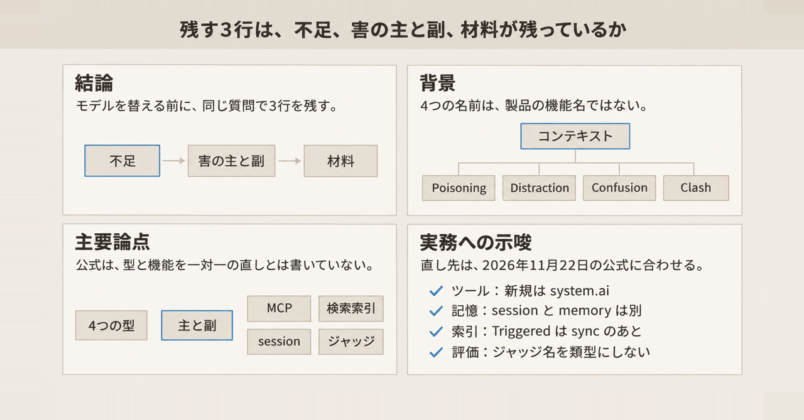
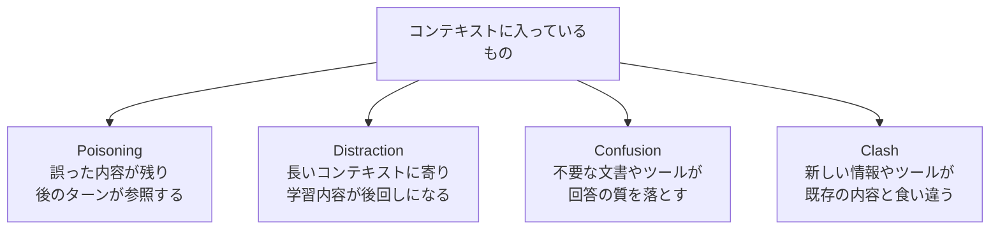

Databricks 上のエージェントが依頼と違う答えを返したとき、長いコンテキストの失敗を4つの名前で見る見方を説明します。読み終えると、同じ質問について「必要な事実が無かったのか」「入っている情報が害をしていたのか」「要約で材料が消えたのか」を、トレースを開いたあとに3行で残せるようになります。

4つの名前は Databricks の製品機能名ではなく、Drew Breunig が 2025-06-22 に置いた定義で、Databricks の試験ガイド（公開日 July 29, 2026）がトレース診断の出題範囲にしています。

*この記事の全体像。以下、順に解説します。*

## Databricks上のコンテキスト失敗の4類型とは

ここでのエージェントは、ツールを呼びながら複数ターンで応答するプログラムです。コンテキストは、その応答を作るときにモデルへ渡している文章のまとまりです。会話の履歴、検索で取った文書、ツールの説明、モデル自身の以前の出力が入ります。トレースは、その呼び出しと入出力の記録です。

### 4つの短い定義

Drew Breunig は 2025-06-22 の [How Long Contexts Fail](https://www.dbreunig.com/2025/06/22/how-contexts-fail-and-how-to-fix-them.html) で、長いコンテキストが失敗する仕方を4つに分けました。2025-06-26 の [How to Fix Your Context](https://www.dbreunig.com/2025/06/26/how-to-fix-your-context.html) でも同じ定義を再掲し、6つの直し方を並べています。短い定義を日本語にすると次のとおりです。

| 名前 | 短い定義 |
| --- | --- |
| Poisoning | 幻覚や誤った内容がコンテキストに入り、後のターンがそれを繰り返し参照する |
| Distraction | コンテキストが長くなり、モデルが学習内容よりコンテキスト側に寄りすぎる。履歴の反復はその例 |
| Confusion | 質問に不要な内容が混ざり、回答の質が落ちる |
| Clash | 新しい情報やツールが、すでに入っている内容と食い違う |

[y0shidahr の Zenn 記事](https://zenn.dev/y0shidahr/articles/2d1fb00790d0ad) は、この4つを Databricks 上のエージェントの誤答に当て、トレースの中身で見分けてから直す、と書いています。直し先として挙げているのは、ワークスペースの MCP、AI Search（旧 Vector Search）の Delta Sync、agent sessions と agent memory、MLflow 3 の組み込みジャッジです。長いコンテキストの数値の背景には、Databricks の 2024-08 のブログを置いています。

MCP は Model Context Protocol で、エージェントが外部の道具を呼ぶ接続です。AI Search は Databricks の検索インデックスです。Delta Sync は、そのインデックスをソース表から更新する仕組みです。agent session は会話の短期状態、agent memory は会話をまたぐ記憶です。ジャッジは、MLflow のトレースを決められた観点で採点する組み込みの評価です。

### トレース上の出所

y0shidahr の記事は、誤りの出所を次のように見ます。

| トレース上の出所 | ラベル |
| --- | --- |
| モデル自身の以前の出力に含まれる誤り | Poisoning |
| 長い履歴の繰り返し | Distraction |
| 無関係な検索結果、または説明が似たツール | Confusion |
| 食い違う2つの文書、または古い索引 | Clash |

この表は、y0shidahr の記事がトレースの出所に付けるラベルです。Poisoning の行は、モデル自身の以前の出力に含まれる誤りです。短い定義の「誤った内容」全般ではありません。Distraction の行は観測例です。定義そのものは、コンテキストへの過集中です。古い索引の行も、記事が付けるラベルです。必要な事実が無いときは、後の手順で不足が先になります。

### データの置き場所

Databricks 側のデータの置き場所は、上のラベルとは別の軸です。

| 置くもの | 置き場所 |
| --- | --- |
| 会話の短期状態 | session item。opaque な JSON で、サービスは中身を解釈しない |
| 会話をまたぐ事実 | memory entry。一意キーは actor_id、session_id、path。actor_id は記憶の分離キー |
| 検索文書 | Unity Catalog 上のソース表と、AI Search のインデックス |
| ツール | MCP、または Python からの直接呼び出し |
| 評価 | MLflow のトレースに対するジャッジ |

opaque は、サービスが中身を解釈しない、という意味です。path は一意キーの3つ目の名前です。何の文字列か、session_id をこのキーに含める理由は、名前の列挙以上には分かっていません。Unity Catalog は、テーブルや関数を正式に置く場所です。

### 記事が割り当てた部品

2026-11-22 に読んだ公式ページの状態は、次のとおりです。画面と URL はこの日のものです。

| 類型 | 記事が割り当てたもの | 2026-11-22 の公式ページ |
| --- | --- | --- |
| Confusion | 必要な MCP だけをつなぐ。ツール説明を書き分ける。ジャッジは `RetrievalRelevance` と `ToolCallCorrectness` | Genie、AI Search、Unity Catalog 関数の 3 URL は実在し、Public Preview。新規は `system.ai` を推奨。Genie One は GA。Python エージェントには MCP を介さない直接呼び出しを推奨 |
| Poisoning | スレッド（session）を切り、長期記憶には確かめた事実だけを書く | sessions と memory はどちらも Beta。プレビュー名は Agent Memory Sessions。session を消しても memory は残る。memory pipeline は保存済み entry を書き換えうる |
| Distraction | 履歴を要約する。済んだツール結果を消す。サブエージェントは要約だけ返す | 読んだ製品ページに、対応する単一のスイッチは無かった。試験ガイド Section 6 は compaction を出題する |
| Clash | Unity Catalog で正式な情報源に絞る。AI Search の Delta Sync。Triggered は sync を呼んだときだけ更新する | Delta Sync と Triggered / Continuous は作成ページにある。Triggered は `index.sync()` または REST の sync。ソースは Delta 以外も含む |

Public Preview と Beta は、ページが付ける一般提供前のラベルです。どちらが本番に近いかは、読んだページでは比べていません。GA は一般提供です。compaction は、会話を要約して新しい窓で再開する処理です。Triggered は、sync を呼んだときだけインデックスを更新する方式です。Continuous は、ソースの変化へ追随する方式です。

旧来の MCP URL は、ワークスペース管理者が Previews で Managed MCP Servers を有効にすると使えます。2026-11-18 更新の公式ページは、次を Public Preview としてまだ載せています。

| サーバー | URL | OAuth scope |
| --- | --- | --- |
| Genie Agent | `https://<workspace-hostname>/api/2.0/mcp/genie/{genie_space_id}` | `genie` |
| AI Search | `https://<workspace-hostname>/api/2.0/mcp/ai-search/{catalog}/{schema}/{index_name}` | `ai-search` |
| Unity Catalog functions | `https://<workspace-hostname>/api/2.0/mcp/functions/{catalog}/{schema}/{function_name}` | `unity-catalog` |
| SQL | `https://<workspace-hostname>/api/2.0/mcp/sql` | `sql` |

Genie は、自然言語でテーブルを問う Databricks の機能です。URL 表の Genie Agent は、Public Preview の旧経路です。Genie One は `system.ai.genie_one_mcp` で、分析のとき検討する GA の経路です。SQL の URL は、y0shidahr の記事が挙げていない行です。旧 prefix `/api/2.0/mcp/vector-search/` と scope `vector-search` がまだ動く、という文は一覧ページではなく、[AI Search MCP](https://docs.databricks.com/aws/en/agents/mcp-tools/ai-search) のページにあります。

公式は、新規の接続に `system.ai` を勧めています。`system.ai` は Unity Gateway 経由の MCP の置き場です。Unity Gateway は、公式が新規の MCP 呼び出しを通す経路です。クライアント URL は `https://<workspace-hostname>/ai-gateway/mcp-services/<mcp-name>`、scope は `ai-gateway` です。`system.ai.genie_one_mcp`（Genie One）は GA です。`system.ai.dbsql`、`system.ai.web_search`、`system.ai.sandbox` は Beta です。

### 組み込みジャッジ

MLflow 3 のジャッジページ（Last updated Sep 15, 2026）で、記事が挙げる5つの名前は次のとおりです。ground truth は、採点のときにあらかじめ持っている正解です。

| ジャッジ | ground truth | ページが評価すると書いていること |
| --- | --- | --- |
| `RetrievalRelevance` | 不要 | 取得したコンテキストが依頼に直接関係するか |
| `RetrievalGroundedness` | 不要 | 回答がコンテキストに根拠づくか。幻覚か |
| `RetrievalSufficiency` | 必要 | コンテキストが、正解事実を含む回答を生成するのに足りるか |
| `ToolCallEfficiency` | 不要 | ツール呼び出しに冗長が無いか |
| `ToolCallCorrectness` | 必要 | ツールと引数が依頼に対して正しいか |

同じページには、記事が使っていないジャッジもあります。単ターンでは `RelevanceToQuery`、`Safety`、`Correctness`、`Guidelines`、`ExpectationsGuidelines` です。複数ターンでは `ConversationCompleteness`、`UserFrustration`、`KnowledgeRetention`、`ConversationalGuidelines`、`ConversationalRoleAdherence`、`ConversationalSafety`、`ConversationalToolCallEfficiency` です。

### 6つの直し方

Breunig の直しの記事は、失敗1つにつき戦術1つ、という表を出していません。6戦術は次のとおりです。

| 戦術 | 名称の訳 |
| --- | --- |
| RAG | 必要な文書を検索して渡す |
| Tool Loadout | 渡すツールを選ぶ |
| Context Quarantine | 疑わしい内容を隔離する |
| Context Pruning | 不要な内容を削る |
| Context Summarization | 履歴を要約する |
| Context Offloading | コンテキストの外へ退避する |

上の右列は名称の訳です。Breunig の記事が各戦術に書く操作手順を、この表は写していません。y0shidahr の記事は、どの戦術がどの失敗に主に効くかを筆者が対応させたと明記しています。その表では Quarantine が Poisoning と Clash に、Pruning が Confusion と Clash にまたがります。

### 試験ガイドが出題する診断

[認定の案内ページ](https://www.databricks.com/learn/certification/context-engineer-associate) は、採点対象 45 問、90 分、受験料 200 ドル、英語、補助なし、前提資格なし、推奨経験 6 か月以上、有効 2 年、と書いています。2026-11-22 に確認しました。[試験ガイド](https://www.databricks.com/sites/default/files/2026-10/Databricks-Certified-Context-Engineer-Associate-Exam-Guide-August-2026.pdf) はさらに、非採点の問題が最大 10 問あること、複数選択がありうることを書いています。4類型の診断文は案内ページには無く、試験ガイド Section 1（Foundations、16%）にあります。

## 注意点

ここからは、数字と公式の文言を、手順のどこまでに使ってよいかです。

### 定義どうしの重なり

Breunig は Clash を "a more problematic version of Context Confusion" と書いています。シャード化プロンプトの低下を説明した節は "The answer is Context Confusion" で終えています。1つの失敗が、食い違いと、余分な初期回答と、ツール定義の衝突を同時に含みえます。

試験ガイドのサンプル Question 1 は、採点のために Confusion を1つ選ばせます。poisoning、distraction、instruction clash は、その設問の条件では否定されます。本番の1件が1ラベルとは限りません。

必要な情報がコンテキストに無い失敗は、4つの名前の外にあります。`RetrievalSufficiency` が見るのはそこです。試験ガイド Section 7 も、複数エージェントの "insufficient shared context" を別目標にしています。2024 年の Databricks ブログは、検索の再現率を生成性能の上限と書いています。

### 表1の 98.1 と 64.1

y0shidahr の記事と Breunig は、Clash の数値例に arXiv:2505.06120（2025-05-09）の o3 の 98.1 と 64.1 を使っています。HTML 版の表1では、この2つは末尾2列です。キャプションは、Concat と Sharded を Full と比べた百分率を、6タスクで平均した列だと説明しています。

o3 の行は次のとおりです。

| 設定 | Code | Database | Actions | Data-to-text | Math | Summary |
| --- | --- | --- | --- | --- | --- | --- |
| Full | 86.4 | 92.0 | 89.8 | 40.2 | 81.6 | 30.7 |
| Concat | 87.2 | 83.3 | 91.5 | 39.4 | 80.0 | 30.4 |
| Sharded | 53.0 | 35.4 | 60.2 | 21.7 | 63.1 | 26.5 |

タスクごとの Concat÷Full の平均は 98.07% です。Sharded÷Full の平均は 64.08% です。小数1桁で 98.1 と 64.1 になります。98.1 は、Concat が Full の約 98.1% 残った、という意味です。98.1 点から 64.1 点へ落ちた、ではありません。Concat、Sharded、Full が情報をどう渡す設定かは、確認したキャプションには書かれていません。キャプションが説明しているのは、Concat と Sharded を Full で割った百分率を6タスクで平均した列である、ということです。

同じ論文は、低下の大きさを別の数でも書いています。要旨と結果節は平均 -39% です。図1のキャプションは -35% です。導入は、単ターンで約 90%、マルチターンで 65%（25ポイント差）です。-39% は、平均スコアの単純な引き算（90−65）とも、o3 の残存率 64.1 とも別の集計です。式の差は未確認のまま併記します。採録した会議名は、proceedings を確認していないので書きません。

論文の機序は、結果節と付録では次のとおりです。必要情報がまだ無い状態での仮定、早期の誤答への固着、中間ターンの喪失、冗長な回答です。情報をターンに分けるだけで失われ、全部を一度に渡す条件だけが信頼性を戻した、と書いています。ユーザー側で既出のシャードを繰り返す Snowball は、Full から Sharded への低下分の 15〜20% しか埋めません。論文は別に、エージェント風の前処理に頼るのは限界がある、と書いています。この論文が測った失敗を、食い違う2文書を1つにすれば終わる、と読むのは、実験の条件から外れます。

### 44.2% という文

arXiv:2411.15399（2024-11-23）の本文は、Llama3.1-8b について "The success rate increased from the baseline to 44.2%" と書いています。成功率がベースラインから 44.2% になった、です。44ポイント、または 44% の改善とは書いていません。ベースラインの値はこの文にありません。Breunig の "improved by 44%" と、y0shidahr の記事の「44%上がった」は、この文の先の要約です。運用の定量根拠にはしません。

46個のツールで失敗し、19個で成功、は表IIの1クエリです。モデルは Llama3.1-8b-q4_K_M、コンテキストは 16K、46個で 30 秒・失敗、19個で 20 秒・成功です。本文は 16K に収まると書いています。BFCL 全体の集計ではありません。BFCL は、この論文がツール呼び出しの成否を載せる評価の名前です。同じ節の Mistral-8b は、成功率が上がらなくても実行時間が 77% 減り、電力が 18% 減った、と書いています。Breunig の 18% と 77% はこの文と一致します。論文の対象はエッジ上の量子化モデルです。abstract の "Accepted at DATE 2025" は proceedings 未確認のため、採録とは書きません。

### 2024年8月のブログの読み方

Databricks のブログ [Long Context RAG Performance of LLMs](https://www.databricks.com/blog/long-context-rag-performance-llms) の冒頭は、Llama-3.1-405b が 32k トークンの後に下がり、GPT-4-0125-preview が 64k の後に下がる、と書いています。同じ箇条書きで、gpt-4o、claude-3.5-sonnet、gpt-4o-mini は、コンテキストが長くなっても低下がほとんど無い、と書いています。最適長はモデルとタスクによる、とも書いています。y0shidahr の記事の「崩れる位置はモデルによる」は、このブログと一致します。本文先頭の日付は August 12, 2024 です。

実験は 2,000 を超える単純な RAG です。チャンク 512、ストライド 256、text-embedding-3-large、FAISS、temperature 0 です。失敗の分類は、繰り返し、無関係な内容、指示不履行、誤答、その他です。4類型の名前は出てきません。冒頭の「32k の後」「64k の後」は、箇条書きの文言としてそのとおりです。同じページの 4 データセット平均では、山がそれより前にあります。Llama-3.1-405b は 16k が 0.623、32k が 0.594 です。GPT-4-0125-preview は 16k が 0.664、32k が 0.622、64k が 0.585 です。この実験を、2026 年のエージェントの直し手順のしきい値にはしません。

### 10万トークンの記述

Gemini 2.5 技術報告書には、10 万トークンのコンテキストをまたいだ推論が、複雑なツール利用の土台だった、とあります。同じ箇所は、コンテキストが 10 万を大きく超えると、新しい計画より履歴の行動を繰り返す傾向があった、と書いています。その観察は逸話（anecdotal）です。context poisoning の段落は、goals と summary がゲーム状態の誤情報で汚染され、取り消すのに非常に長くかかると書いています。この失敗はループと強く関係する（highly related）と続きます。10 万を超えたら Distraction、と1ラベルに決める読みは、報告書の書き方より強いです。

### 旧MCP URLの位置

公式は、旧3 URL の呼び出しが Unity Gateway を迂回すると書いています。そのトレース表には残らず、MCP レベルの許可（grant）、方針（policy）、ガードレール（guardrail）も無い、と書いています。Python エージェントには、AI Search、Unity Catalog 関数、Genie を MCP なしで呼ぶライブラリを推奨しています。

resource limits ページは、内部サービスからの managed MCP（UC function、Vector Search、Genie）を 50 QPS / workspace、SQL を 10 QPS / workspace と書いています。QPS は、ワークスペースあたり1秒の要求数です。旧3 URL のクライアント呼び出しがこの枠と同じかは未確認です。PAT（個人用アクセストークン）は Unity Gateway 経由では使える、と認証ページにあります。旧 URL での PAT の可否は未確認です。

### sessionを消したあとの記憶

sessions と memory は、どちらも管理者が Previews で Agent Memory Sessions を有効にします。プレビュー中は背後の Lakebase に課金され、sessions 自体と memory 自体の追加料金は無い、と書かれています。Lakebase は、その背後のデータベースです。価格はプレビューの進行で変わりえます。公式ページに「Beta だから本番で使うな」という禁止文は、今回読んだ sessions、memory、pipeline、stateful-agents にはありませんでした。

session または session store を消しても、memory store の記憶は消えません。`actor_id` は記憶の分離キーであり、アクセス制御ではありません。ストアに届く principal は、全 actor の entry を読み書きできます。principal は、権限を付与する主体です。`actor_id` はモデルや利用者の入力で決めず、信頼できるアプリ側で決めます。memory store はワークスペースあたり最大 50 です。store ID は 3〜56 文字です。検索は最大 100 件で、ページングはありません。`put()` は原子的ではなく、同じ path への並行書き込みは上書きしえます。session item の列挙は1ページ最大 100 です。保持日数は未確認です。ストア権限は、作成者またはワークスペース管理者が principal 単位で付与します。グループは使えません。

memory pipeline も Beta です。ページの Last updated は Nov 18, 2026 です。セッションから事実を抽出し、既存の記憶へマージします。パイプラインは、処理する actor_id の entry を rewrite、merge、split、delete しえます。対象には、エージェントが直接書いた entry が含まれます。各 run が読むのは、その actor の前回成功以降の session です。処理済みの古い会話から、削除した entry が戻るとは書かれていません。未処理の会話に誤った事実が残っていれば、次の run で再び抽出されえます。「確かめた事実だけを書く」は、パイプラインが人が書いた entry を書き換えうるなら、書いた側だけでは閉じません。

### 要約のあとで分かること

Anthropic の [Effective context engineering for AI agents](https://www.anthropic.com/research/effective-context-engineering-for-ai-agents)（公開メタ 2025-09-29）は、compaction が会話を要約して新しい窓で再開すると書いています。強すぎる compaction は、微妙だが重要な文脈を失う、と書いています。tool result clearing は "One of the safest lightest touch forms of compaction" と書いています。サブエージェントが親へ返す量は "often 1,000-2,000 tokens" と書いています。y0shidahr の記事のこの2点は、本文と一致します。

試験ガイド Section 6 は、compaction 済みの長時間タスクが整合を失ったとき、どの種類の情報が誤って捨てられたか、を問います。これは4類型のどれか、とは別の問いです。session item は opaque で、Databricks は中身を検査しません。残っているのが要約だけなら、要約に入った誤り、捨てられたツール結果、元の文書どうしの食い違いを、トレース上では分けられません。

### ジャッジが返すもの

`RetrievalGroundedness` の評価文は「回答がコンテキストに根拠づくか、幻覚か」です。y0shidahr の記事が Confusion に割り当てた「関係ない検索」は、公式の文では `RetrievalRelevance` に近いです。`ToolCallEfficiency` は冗長な呼び出しで、記事は Distraction に割り当てています。この割り当ては筆者のものです。ジャッジページは類型名を使いません。`RetrievalSufficiency` と `ToolCallCorrectness` は expectations が無いと動きません。expectations は、期待する事実を評価セットに書いたものです。本番のラベル無し障害では、この2つを第一の計測にできません。ジャッジ用モデルの名前、課金、リージョン、GA か Preview かは、指定ページに無く未確認です。

### 試験ガイドの使い方

ガイドの目的は、試験の範囲と受験準備です。公式ドキュメントを最も新しい正本とし、古い教材を避けるよう書いています。Section 1 には4類型の診断があります。同じガイドは、推論モード（standard / extended thinking / reduced thinking）の選択、compaction で捨てた情報の種類、authoritative sources への検索範囲の制限、MCP の説明の重なり、を別の目標にしています。

サンプル Question 2 の正解は compaction です。より大きいモデルへ替える選択肢は、その設問の制約のもとで捨てられます。制約は、取得済み事実を捨てないことと、検索能力を落とさないことです。Question 4 の正解は、TRIGGERED の Delta Sync は sync を呼んだときだけ更新し、日次ジョブの後に sync する、です。Question 10 の正解は、在庫更新の後に vector index を sync していない、です。

### 機能と類型の公式上の関係

判定は「その Databricks 機能が、その失敗類型の公式な直しとして書かれているか」です。部品が実在することとは分けます。

| 類型 | 公式文書にその名前が出るか | 記事の機能と一対一か |
| --- | --- | --- |
| Poisoning | 製品ページには出ない。試験ガイド Section 1 に出る | いいえ。session と memory の独立は公式と一致する。公式はその独立を Poisoning の直しとは呼ばない |
| Distraction | 製品ページには出ない。試験ガイド Section 1 に出る | いいえ。compaction は試験範囲の技術で、対応する製品スイッチは確認できない |
| Confusion | MCP ページとジャッジページには出ない。試験ガイド Section 1 と、Section 5 の「説明が似た MCP ツール」に出る | いいえ。3 URL と Public Preview、ジャッジ名は一致する。公式は「サーバーを絞る＝Confusion の直し」とは書かない |
| Clash | AI Search の作成ページには出ない。試験ガイド Section 1 に出る | いいえ。Triggered の更新条件は一致する。公式はそれを Clash の直しとは呼ばない。ソース表は Delta 以外も含む |

### まだ確認できないこと

次は、2026-11-22 の時点で未確認のままです。

- 旧 `/api/2.0/mcp` のクライアント呼び出しが、内部向け 50 QPS と同じ枠か
- 旧 URL で PAT が使えるか
- ジャッジ用 LLM のモデル、課金、リージョン、ライフサイクル
- session の保持日数と件数の上限
- Triggered sync が失敗したとき、古いベクトルが検索に残るか
- 論文の -35% と -39% の集計式の差
- arXiv:2411.15399 の DATE 2025 採録
- マネージド MCP のツール説明を利用者が書き換える公式手順。確認した MCP ページには無かった

## 同じ質問で分ける手順

モデルを替える前にコンテキストを見ます。見るときの単位は「4つのどれか1つ」ではありません。「不足か、入っている情報の害か」と「害の主ラベルと副ラベル」です。2024-08 のトークン数は、この手順の分岐に使いません。製品の操作は公開後に動くので、分岐の本体はトレースの中身に置きます。

```mermaid
flowchart TD
  openTrace["誤答のトレースを開く"] --> visible{"誤りを生んだ本文が残っているか"}
  visible -->|"残っていない"| hold["ラベルを確定しない<br/>要約前の結果か索引の版を取り直す"]
  visible -->|"残っている"| enough{"必要事実がコンテキストにあるか"}
  enough -->|"無い"| lack["不足<br/>空、権限、更新漏れを見る"]
  enough -->|"ある"| harm["害を主ラベルと副ラベルで書く"]
  harm --> poison["Poisoning<br/>以前の出力の誤りの再参照"]
  harm --> distract["Distraction<br/>コンテキストへの過集中"]
  harm --> confuse["Confusion<br/>無関係な文書か似たツール"]
  harm --> clash["Clash<br/>新旧の文書かツールの食い違い"]
```

図で事実がある側は、害のラベルです。4つのどれにも当てはまらないときは、ラベルを付けません。モデル差は、残す3行の外で測ります。旧 URL の呼び出しは、要約前の結果を取り直しても、ゲートウェイのトレースには戻りません。

残す3行は、次の型です。

1. 不足。必要事実がコンテキストに無かったか。無かったなら、その理由を書く。見る例は、検索結果の空、権限、索引の更新漏れです。古い索引で必要な事実が無いなら、ここは不足です。古い本文が残って新しい文書と食い違うなら、次の害の Clash です。文書が返っていても、必要な事実がその中に無ければ不足です。空、権限、更新漏れは、そのとき見る例であり、この3つだけの分類ではありません。その誤った内容を、モデル自身の以前の出力が繰り返しているときは、害の Poisoning も残せます。無関係でも食い違いでもない文書は、Confusion にも Clash にも入れません。
2. 害。事実があるうえで害があるとき、主ラベルと副ラベルを書く。主と副に順位はありません。同時に当てはまる出所を2つ残し、1つに決めた記録にはしません。試験の単一選択は採点用であり、本番の記録形式にはしない。
3. 材料。誤りを生んだ本文が残っているか。compaction や tool result clearing のあとで要約しか無いなら、4つのどれかに決めたと記録しない。

`RetrievalSufficiency` は、expectations がある評価セットで使います。本番の単発障害では、検索結果の空、権限、索引の更新漏れを見ます。これは Confusion の「ツールを絞る」でも、Clash の「版を1つにする」でも閉じません。

ツールの Confusion は、新規なら Unity Gateway の `system.ai` を優先します。分析なら Genie One（`system.ai.genie_one_mcp`、GA）から検討します。Python エージェントは、公式が勧める直接呼び出しを優先します。名前は AI Bridge と `UCFunctionToolkit` です。どちらを選ぶ条件は、確認したページにはありません。旧 `/api/2.0/mcp/...` は、クライアントが MCP の URL を要求し、かつその Genie space、インデックス、関数に限定するときに使います。事前に Managed MCP Servers を有効にします。旧 URL はゲートウェイのトレース表に残らないので、診断の唯一の観測点にしません。ツール説明の重なりは、試験ガイドが問う診断です。マネージド MCP の編集 API は確認できていません。

Poisoning の会話のやり直しは、新しい session を作ります。memory は別途消さないと残ります。memory pipeline は、処理する actor の entry を書き換え、結合し、分割し、削除しえます。未処理の会話に誤った事実が残っていれば、次の run で再び抽出されえます。処理済みの会話から、削除した entry が戻るとは書かれていません。`actor_id` はアプリが決めます。どちらも Beta で、Lakebase の課金と、プレビュー中の価格変更を前提にします。

文書の新旧は、正式とみなすテーブルだけを AI Search のソースにし、`columns_to_sync` で列を絞ります。ソースは Delta に加え、streaming table、materialized view、Iceberg v3 以降の managed table がありえます。これらは、ソースが Delta だけではない、という公式の列挙です。種類ごとの別の sync 手順は、確認した範囲では分かれていません。バッチ取り込みの後は Triggered と `index.sync()`、または REST の `POST /api/2.0/vector-search/indexes/{index_name}/sync`、または Catalog Explorer の Sync now です。standard と storage-optimized は、作成ページが分ける方式の名前です。standard で常時追随が必要なら Continuous です。秒オーダーで、クラスタ常駐のため高くなります。storage-optimized は Triggered のみで、sync のたびに索引の一部を作り直します。スキーマ変更はインプレースでは不可で、索引の作り直しが要ります。sync が失敗したときに古いベクトルが残るかは未確認です。

Distraction の履歴短縮は、アプリケーションが session item を要約して書き直すか、`clear_items()` でスレッドを空にします。Databricks が中身を解釈して compaction するスイッチは、読んだ製品ページにはありません。消す前に、次の診断に必要なツール結果を別の観測へ残します。例は MLflow の span です。span は、トレースの中の1区間です。サブエージェントの返しを 1,000〜2,000 トークンに収めるのは Anthropic の観察であり、親のトレースだけで原因が1つに決まる根拠ではありません。

直しの前後は、同じ質問でジャッジを比べます。ground truth が無いなら `RetrievalRelevance`、`RetrievalGroundedness`、`ToolCallEfficiency` です。期待事実がある評価セットなら `RetrievalSufficiency` と `ToolCallCorrectness` を足します。会話全体のツール効率は `ConversationalToolCallEfficiency` です。引数は session です。記憶の保持に近い複数ターンのジャッジとして `KnowledgeRetention` があります。y0shidahr の記事はどちらも使っていません。ジャッジは類型名を返しません。

モデル差は、ラベルの前に測定で残します。2024 年の単純 RAG では、長さでほぼ下がらないモデルがあります。arXiv:2505.06120 は、より強いモデルも複数ターンで同程度に失われ、推論トークンを足しても消えない、と書いています。先にモデルだけ替える手順にも、先に機能を1つ直せば終わる手順にもしません。自分のモデルとタスクで、不足、害、モデル差のどれが大きいかを同じ質問で比べます。

## 手順に入れないもの

ランブックに残すのは、前節の分け方と、2026-11-22 の公式に合わせた直し先です。次は入れません。

- 4類型と、MCP、AI Search、sessions / memory、MLflow の一対一
- 98.1 から 64.1 への得点低下、という説明
- BFCL で 44% 上がった、という説明
- 2024-08 の 32k / 64k を、現行エージェントのしきい値にすること
- 試験の単一選択を、本番の排他診断にすること
- 認定の案内ページだけを、4類型の出典にすること。出典は試験ガイド（July 29, 2026）です

## まとめ

誤答の第一手は、モデルの交換にしないことです。残す3行は、不足、害の主ラベルと副ラベル、材料が残っているか、です。モデル差は、この3行の外で、同じ質問の測定として残します。害は1つに決めた記録にはしません。不足は Poisoning、Distraction、Confusion、Clash の外として先に分けます。要約しか残っていないときは、ラベルを確定しません。

直し先は、2026-11-22 に読んだ公式に合わせます。ツールは `system.ai` と、Python なら MCP を介さない直接呼び出しです。旧 MCP URL は Public Preview の例外です。session と memory は Beta で、消す対象が別で、pipeline が記憶を書き換ええます。索引の更新は、Triggered なら取り込み後の sync です。履歴の短縮はアプリ側で行い、消す前に診断材料を残します。評価は MLflow のジャッジで前後を比べ、ジャッジ名を失敗類型の名前として記録しません。

この記事が少しでも参考になった、あるいは改善点などがあれば、ぜひリアクションやコメント、SNSでのシェアをいただけると励みになります！

## 参考リンク

- Drew Breunig, "How Long Contexts Fail", 2025-06-22. <https://www.dbreunig.com/2025/06/22/how-contexts-fail-and-how-to-fix-them.html>
- Drew Breunig, "How to Fix Your Context", 2025-06-26. <https://www.dbreunig.com/2025/06/26/how-to-fix-your-context.html>
- Philippe Laban, Hiroaki Hayashi, Yingbo Zhou, Jennifer Neville, "LLMs Get Lost In Multi-Turn Conversation", arXiv:2505.06120, 2025-05-09. <https://arxiv.org/html/2505.06120v1>
- "Less is More", arXiv:2411.15399, 2024-11-23. <https://arxiv.org/html/2411.15399v1>
- Databricks, "Long Context RAG Performance of LLMs", 2024-08-12. <https://www.databricks.com/blog/long-context-rag-performance-llms>
- Google DeepMind, Gemini 2.5 technical report. <https://storage.googleapis.com/deepmind-media/gemini/gemini_v2_5_report.pdf>
- Anthropic, "Effective context engineering for AI agents", 2025-09-29. <https://www.anthropic.com/research/effective-context-engineering-for-ai-agents>
- Databricks, Databricks-provided MCPs, Last updated Nov 18, 2026. <https://docs.databricks.com/aws/en/agents/mcp-tools/managed-mcp>
- Databricks, Agent sessions, Last updated Nov 11, 2026. <https://docs.databricks.com/aws/en/agents/agent-memory/managed-sessions>
- Databricks, Agent memory, Last updated Nov 17, 2026. <https://docs.databricks.com/aws/en/agents/agent-memory/managed-memory>
- Databricks, Memory pipelines, Last updated Nov 18, 2026. <https://docs.databricks.com/aws/en/agents/agent-memory/memory-pipelines>
- Databricks, Create AI Search endpoints and indexes, Last updated Nov 6, 2026. <https://docs.databricks.com/aws/en/vector-search/create-vector-search>
- Databricks, Built-in LLM judges, Last updated Sep 15, 2026. <https://docs.databricks.com/aws/en/mlflow3/genai/eval-monitor/concepts/judges/>
- Databricks, Certified Context Engineer Associate. <https://www.databricks.com/learn/certification/context-engineer-associate>
- Databricks, Exam Guide, Exam Published July 29, 2026. <https://www.databricks.com/sites/default/files/2026-10/Databricks-Certified-Context-Engineer-Associate-Exam-Guide-August-2026.pdf>
- y0shidahr, 「Databricksのエージェントがおかしいとき、4つの「コンテキストの失敗」を見分けて直す」. <https://zenn.dev/y0shidahr/articles/2d1fb00790d0ad>
