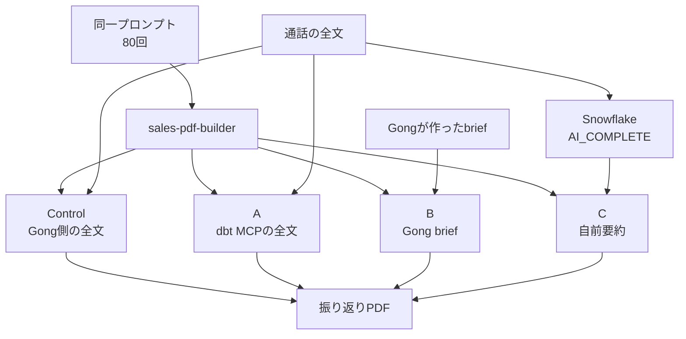

dbt Labs の Christine Berger は、社内のエージェント用手順（スキル）へ渡す顧客通話の文脈だけを 4 通りに変え、同じプロンプトで各 20 回、合計 80 回走らせた実験を公開しています。ページ表示は Last edited on Oct 26, 2026 です。初出日はこのページからは確認できません。この記事では、4 つの渡し方、測定の範囲、公開された平均と 6 分類の回数を、スキルへ転用する前に切り分けられる形でまとめます。数値の正本は実験記事の表と図であり、生ログと採点表は公開されていません。

*この記事の全体像。以下、順に解説します。*

## 文脈実験とは

対象は、通話を読み、ブランド付きの振り返り PDF を作る社内スキル `sales-pdf-builder` です。会社名は dbt Labs です。この実験で倉庫の列を読む側を、まとめて dbt と呼びます。エージェントが呼ぶサーバが dbt MCP で、dbt platform のツールを呼びます。dbt platform は、そのツールを実行する側です。倉庫は Snowflake です。Gong は顧客通話を記録するサービスで、全文と、Gong が作った短い要約（brief）の出所です。

### 固定した条件と変えた条件

実験記事は、隔離した変数は文脈の取り方だけだと書いています。プロンプトは 80 回とも同じです。内容は、2025-12-04 の Jess Williams の pre-service call と、2026-01-08 の Christine Berger の RAA Kickoff の 2 通話を要約する、というものです。pre-service call と RAA Kickoff は、実験記事のプロンプトに書かれた通話の題名です。題名がどの種類の会話を指すかは、実験記事に書いてありません。顧客名は実験記事上で伏せられています。各回をべき等に近づけるため、元のスキルを引き締め、モデルの自由な推論が結果を乱さないようにした、とも書いています。

### 4つの文脈源

1 通話あたりの文字数は、実験記事が次のように示しています。

| 条件 | 文脈の中身 | 読み方 | 1通話あたりの文字数 |
|---|---|---|---|
| Control | 通話の全文 | Gong 側から全文トランスクリプトを読む | 約 3 万から 7.2 万 |
| A | 通話の全文 | dbt MCP の `execute_sql` で倉庫の列を読む | 約 3 万から 7.2 万 |
| B | Gong が作り、倉庫へそのまま入った brief | 同じ `execute_sql` | 約 500 から 600 |
| C | 自前の物語的要約 | 同じ `execute_sql` | 約 1.2 万から 2 万 |

Control と A は全文です。違うのは取得元です。Control が Gong 側のどのツールで全文を読んだかは、実験記事に書いてありません。B は短い brief です。C は全文より短く、brief より長い要約です。

### 自前要約の生成

C の要約は、スキル実行の前に作られ、倉庫の列へ置いてあります。生成は Snowflake の `AI_COMPLETE` だけです。`AI_COMPLETE` は、model と prompt を必須とする Snowflake の関数です。chunking、embedding、classification は入っていません。実験記事の本文は、この要約を「長さ制限のない、事実に基づく物語」と書いています。

実験記事の SQL 図には `model => 'claude-sonnet-4-6'` と `max_tokens: 8192` が写っています。図のプロンプトは、途中をコメントで省略しています。引数の正本は、公式ドキュメントの一般形ではなく、この図です。本文の「長さ制限のない」と、図の `max_tokens: 8192` の関係は、実験記事には書いてありません。

図に写っている抽出規則は次のとおりです。

- 発言に無いことを足さない
- 日付と数値を明示する
- ツール名を明示する
- decision と next step を物語に溶かさず明示する
- 矛盾は両方残す

### 6分類の数え方

品質は 6 行です。各 20 回のうち、その種類の詳細が出力に出た回数を数えます。行は dates、numbers、titles/roles、decisions (new project/repo)、next steps、tooling です。numbers は数値の行です。後の使い分けは、これを範囲と基盤の数値（実験記事の表記は scope と infrastructure）として置きます。表の行がその範囲だけを数えたかは、実験記事に書いてありません。decisions の行は、新しいプロジェクトまたはリポジトリに関する決定です。決定一般の回数ではありません。実験記事は、スキル指示は具体を求めたが、毎回すべての分類を必須にはしていない、と書いています。

### 実験が置いた3つの仮説

仮説は 3 つです。

1. 取得元を Gong MCP から dbt MCP の全文へ替えても、費用、品質、速度はほぼ同じ。実験記事は、この取得元を Gong MCP と呼びます。Control が呼んだツールの名前は、実験記事にありません。Gong MCP は、Gong 側のツールをエージェントが呼ぶサーバです。
2. Gong brief に替えると速く安くなるが、品質は落ちる。
3. 自前要約なら、費用、速度、品質が両立する。

仮説が当たったかどうかは、後の節で表に戻して見ます。

### 読み先が分かれる位置

同じプロンプトが同じスキルに入り、文脈の読み先だけが分かれます。C の要約はスキルの前に倉庫へあり、エージェントは `execute_sql` でその列を読みます。

`execute_sql` は、エージェントが書いた SQL を dbt platform が開発用の倉庫の資格情報で実行し、結果の表を返します。公式 FAQ は、書き込み文をツール側では止めないこと、service token では動かないこと、長いクエリはタイムアウトし大きな結果は上限で切られることを書いています。service token は、確認した FAQ が `execute_sql` では動かないとする dbt のトークンです。この 80 回がどのトークンで接続したかは、実験記事にありません。上限の行数とタイムアウト秒数は、確認した FAQ には数値がありません。dbt Copilot の action 枠は、dbt が一部のツール利用を数える枠です。消費するのは `text_to_sql` であり、`execute_sql` ではありません。`text_to_sql` は、SQL を実行する `execute_sql` とは別の dbt MCP のツールです。remote MCP は、dbt MCP を dbt 側の接続で使うときの呼び方です。その API 全体は、IP あたり毎分 5,000 リクエストです。この 80 回が remote MCP を使ったかは、実験記事にありません。`execute_sql` だけに限った回数の上限は、確認した文書には数値がありません。

### 実験記事が示した平均

百分率は実験記事の表の値です。トークン減の列だけ、表の平均からの再計算です。費用と時間は、Control の平均に対する減りです。

| 条件 | 文脈 | 平均トークン | トークン減 | 平均費用 | 費用の減り | 平均時間 | 時間の減り |
|---|---|---:|---:|---:|---:|---:|---:|
| Control | Gong 側の全文 | 115,565 | 基準 | $0.66 | 基準 | 168.7 秒 | 基準 |
| A | dbt MCP の全文 | 111,838 | 約 3.2% | $0.57 | 13.6% 安 | 144.4 秒 | 14.4% 短 |
| B | Gong brief | 64,855 | 約 43.9% | $0.29 | 56.1% 安 | 76.8 秒 | 54.5% 短 |
| C | 自前要約 | 76,867 | 約 33.5% | $0.34 | 48.5% 安 | 95.8 秒 | 43.2% 短 |

品質は、20 回中その分類が出力に出た回数です。

| 分類 | Control | A | B | C |
|---|---:|---:|---:|---:|
| Dates | 15 | 13 | 0 | 12 |
| Numbers | 14 | 14 | 0 | 13 |
| Titles / roles | 15 | 19 | 0 | 9 |
| Decisions (new project/repo) | 16 | 15 | 0 | 0 |
| Next steps | 11 | 11 | 0 | 16 |
| Tooling | 20 | 15 | 20 | 20 |

B の tooling は、実験記事の注記どおり、通話で出た 5 ツールのうち 1 つの名前です。B の Dates は 0/20 です。実験記事は、出力に日付があっても、それはプロンプトに書いてあった日付であり、brief 由来ではない、と注記しています。

## 注意点

実験記事の見出しは、自前要約を dbt MCP で渡すと費用が 48.5%、実行時間が 43.2% 減り、日付、数値、次のステップの多くは残った、と読めます。同じ記事の表を分母と定義に戻すと、その文は次の範囲でしか読めません。

### 百分率の分母

48.5% と 43.2% は、Control の平均 $0.66、168.7 秒に対する C の平均 $0.34、95.8 秒です。測っているのは、指示、ツール呼び出し、PDF 生成を含むスキル実行全体です。要約を作る `AI_COMPLETE` の課金を、このドルに足したという記述はありません。`execute_sql` が dbt Copilot の action 枠を消費しないことは、倉庫の利用料が無料であることとは別です。倉庫側の金額は、確認した MCP の文書に数値がありません。

要約を通話のたびに作り直し、スキルを 1 回しか走らせないなら、この百分率は正味ではありません。何回再利用すれば元が取れるかは、生成のドルが非公開なので計算できません。

### 費用の減りとトークンの減りは一致しない

平均トークンは Control の 115,565 から C の 76,867 です。減りは約 33.5% で、費用の減り 48.5% より小さいです。表の平均から計算すると、1,000 トークンあたりの見かけの単価も C の方が約 23% 低くなります。実験記事はこの差の理由を書いていません。キャッシュ、入出力単価、出力の長さ、実行モデルの差は、本文からは切り分けられません。

A は費用 13.6% 安、時間 14.4% 短です。実験記事はその理由を、account 列での絞り込みだとします。account 列は、実験記事が絞り込みに使ったとする倉庫の列です。列の中身の定義は、実験記事にありません。平均トークンの減りは約 3.2% です。プロンプトは既に日付と参加者名を含んでいます。account 列だけが 13.6% の原因だと、この表は切り分けていません。

### 残らなかった分類

decisions は C が 0/20 です。Control は 16/20、A は 15/20 です。titles は C が 9/20 で、A の 19/20、Control の 15/20 を下回ります。抽出規則は decision を明示せよと書いています。規則があっても、この採点行は 20 回とも出ていません。

C の安さと速さは、decisions 0/20 と titles 9/20 と同時に起きています。必要な行が残ったまま半額、という読みにはなりません。

### 回数は中身の網羅ではない

採点は網羅率ではありません。実験記事は「その種類の詳細が表面化した回数」と書き、B の tooling 20/20 については 5 ツールのうち 1 つしか名前が無い、と注記します。C の tooling 20/20 に、5 つ全部を指したという注記はありません。decisions の行名は new project/repo です。人数、担当、決定一般は測っていません。分散、信頼区間、採点者、期待文字列は本文にありません。

同じ組織の開発者ブログは、大きいモデルに答えを採点させるのは課金される意見であり、信頼できるテストではない、と書いています。実験記事は採点者を書いていません。人が採点したとしても、一致率と期待文字列は非公開です。各 20 回の平均だけで、数回差（dates の 15 と 12 など）を差とは言い切れません。0/20 と 16/20 の差は、その行の有無としては大きいです。

### 別測定の98%とは足せない

2026-08-06 の Britton Stamper の記事は、別の測定として、データ量 20 倍圧縮、60 分通話を数万トークンから数百トークンへ、トークン費用おおよそ 98% 減、品質は維持または向上、と書いています。今回の実験記事は、98% は文脈そのものの大きさ比較であり、今回はスキル実行全体だと区別しています。C の文字数は約 1.2 万から 2 万であり、数百トークンではありません。数百文字に近いのは B です。B は 5 分類が 0/20 です。

### ベクトル検索の効果ではない

実験記事の末尾が勧める `dbt_context_engineering` は、dbt Labs のパッケージです。その最初の型は、文章を分割し（chunk）、埋め込みにして（embed）、検索する（search）ことです。この 80 回はその型を測っていません。2026-10-27 時点の star は 47 です。実験記事の本文では約 50 とあります。main の最新コミットは 2026-10-06 です。

### 公開ヘルプと対照手順のずれ

公開されている Gong MCP のヘルプは、2026-05-11 公開、2026-10-12 更新です。ツールは `ask_account`、`ask_deal`、`generate_brief` の 3 つで、生のトランスクリプトは返しません。account と deal は名前で探せる、とヘルプは書いています。各ツールの入出力の詳細は、実験記事にはありません。実験記事は、Gong MCP に account name のパラメータが無く、エージェントはその日の通話を読む、と書いています。公開ヘルプと対照手順は一致しません。実験が呼んだコネクタのスキーマは実験記事にありません。

### この80回を第三者が再現できない理由

著者 Christine Berger は、プロンプト内の 2026-01-08 の通話の当事者でもあります。開発スキーマ名も `dbt_cberger` です。顧客データは非公開で、第三者は同じ 80 回を再実行できません。2026-10-27 時点で、GitHub の issue、Qiita、Zenn の範囲では、この 80 回の独立した追試は見つかっていません。フォーラムの反応の有無は、ここでは確認できていません。

80 回を実行したエージェントのモデル名、温度、ツール呼び出し回数の内訳は、実験記事にありません。decisions の 0/20 は、要約に決定が無かったのか、PDF まで届かなかったのか、採点が見る文言が狭かったのかも分かれていません。C の要約生成が実際いくらだったか、増分更新か、テスト用スキーマへの一括生成かも書いてありません。

## 表から読める範囲

このスキル、この 2 通話、引き締めた手順では、自前要約は全文よりスキル実行の平均ドルと平均時間が小さく、日付、数値、次のステップは近い回数で出ました。決定として採点された行は出ず、肩書きは全文より少なかった、が現在の読みです。

支持できる点は 3 つです。

- 4 条件の平均は、文脈の長さとスキル実行の平均ドル、時間が一緒に動いたことを示します。B が最も安く速く、次が C、全文の 2 つが重いです。
- C の next steps 16/20 は 4 条件で最良です。実験記事は、B が「セットアップの深掘りから始める」と書くのに対し、C は BI ディレクターが Salesforce の手順を歩き、BI リードが複数の Redshift クラスタにまたがる利用手順を扱う、と次のセッションを書いた例を置いています。
- 取得元を倉庫に寄せるだけ（A）でも、実験記事の平均では全文の品質帯を大きく崩していません。titles は A が 19/20 で 4 条件の最良です。

仮説の判定は、実験記事に沿うと次のとおりです。仮説 1 はおおむね当たりです。品質は全文同士で近く、A は約 14% 安く速い、と実験記事は書きます。その理由を account 列だけにする読みは、前節のトークン減と揃いません。仮説 2 は当たりです。仮説 3 はおおむね当たりです。C は 3 指標のバランスが取れた唯一の条件で、title と decision は取りこぼしたので、抽出規則はもう一段要ります。

## 渡し方を選ぶときの基準

サブエージェントへ渡す調査文脈（別のエージェントに渡す材料）と、定期実行エージェントの記憶（決まった間隔で動くエージェントが次回も使う記録）を、この実験から「要約にすれば約半分」という規則にはしません。残す事実の種類をスキルごとにリストにし、同じ課題の繰り返しで、全文、ベンダー要約、自前要約を比べます。ベンダー要約は、この実験の B のように、通話サービス側が作った短い要約です。判定はトークンではなく、リストの各項目が毎回出たか、項目の中身が全部出たか、の 2 段にします。

この実験の範囲で言える使い分けは次のとおりです。

1. dates、numbers（範囲と基盤の数値）、titles/roles（顧客チームの誰がどの役割か）、decisions（new project/repo）、next steps が要るなら、Gong brief 型（B）を既定にしません。この実験では、その 5 分類が B で 0/20 でした。人数、担当、決定一般は測っていないので、別途確認します。
2. 自前要約（C）は、次のステップを具体にする目的とは相性がよかった、と言えます。決定と肩書きを必須にするスキルでは、この抽出のまま全文の代わりにしません。プロンプトに「決定を書け」とあることと、20 回とも出ないことは両立します。脱落した種類は、スキルごとの残すリストとして別に持ちます。
3. 費用を比べるときは、生成、取得、スキル本体（指示、ツール、成果物）を分けて記帳します。48.5% は 3 つ目の、Control との平均比較です。2026-08-06 の約 98% とは足しません。
4. 取得を先に揃えるなら、要約の前に、絞り込みに使う列が倉庫側にあるかだけを見ます。これは A に近い確認です。ただしこのデータは、account 列がその 13.6% の原因だと切り分けてはいません。
5. この 80 回の結果を、`dbt_context_engineering` のベクトル検索の効果として読みません。パッケージを使うなら、見積もりトークンは入力文字数の 4 分の 1 だけを見ている、という open の [issue 26](https://github.com/dbt-labs/dbt-context-engineering/issues/26)（2026-10-03）を別問題として知っておきます。issue は、ある Snowflake の抽出で請求が見積もりの約 6.4 倍だった、と書いています。これは今回の $0.34 の修正値ではありません。

逆転する条件は 3 つです。スキルが要旨だけで足りるなら、B がこの 4 つの中で最も安く速いです。決定と肩書きが毎回必須なら、C の再測定が終わるまで全文を残します。要約の利用が 1 回きりなら、上流の生成がスキル実行の節約を消しえます。最後の条件の金額は未測定です。

## まとめ

dbt Labs の 80 回は、`sales-pdf-builder`、2 通話、引き締めた手順のうえで、文脈の渡し方だけを変えた比較です。自前要約（C）は、スキル実行の平均で Control より $0.34 対 $0.66、95.8 秒対 168.7 秒でした。日付、数値、次のステップの回数は全文に近く、新しいプロジェクトまたはリポジトリの決定は 0/20、肩書きは 9/20 でした。48.5% と 43.2% は、要約生成の課金を含まないスキル実行全体の平均比較です。

残す事実をスキルごとにリストにし、全文、ベンダー要約、自前要約を、項目が毎回出たか、中身が全部出たかで比べるのが、この表の使い方です。Gong brief を、日付、数値、肩書き、決定、次のステップが要るスキルの既定にはしません。

この記事が少しでも参考になった、あるいは改善点などがあれば、ぜひリアクションやコメント、SNSでのシェアをいただけると励みになります！

## 参考リンク

- Christine Berger、dbt Labs。[Showing our work: a controlled experiment in context engineering](https://www.getdbt.com/blog/context-engineering-experiment-dbt-mcp)。Last edited on Oct 26, 2026。
- Britton Stamper、dbt Labs。[From analytics engineer to context engineer](https://www.getdbt.com/blog/from-analytics-engineer-to-context-engineer)。2026-08-06。
- dbt Developer Hub。[dbt MCP FAQs and troubleshooting](https://docs.getdbt.com/docs/dbt-ai/mcp-troubleshooting)。
- dbt Developer Hub。[API rate limits](https://docs.getdbt.com/docs/dbt-apis/rate-limits)。
- dbt Developer Hub。[About the dbt MCP server](https://docs.getdbt.com/docs/dbt-ai/about-mcp)。
- Snowflake。[AI_COMPLETE (single string)](https://docs.snowflake.com/en/sql-reference/functions/ai_complete-single-string)。
- Gong。[About Gong MCP server](https://help.gong.io/docs/about-gong-mcp-server)。
- dbt Labs。[dbt_context_engineering](https://github.com/dbt-labs/dbt-context-engineering)。
- dbt-labs/dbt-context-engineering。[issue 26](https://github.com/dbt-labs/dbt-context-engineering/issues/26)。
