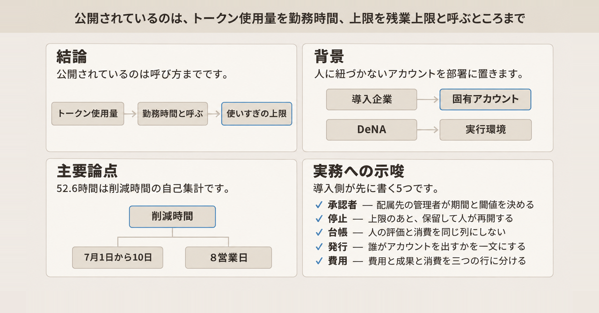
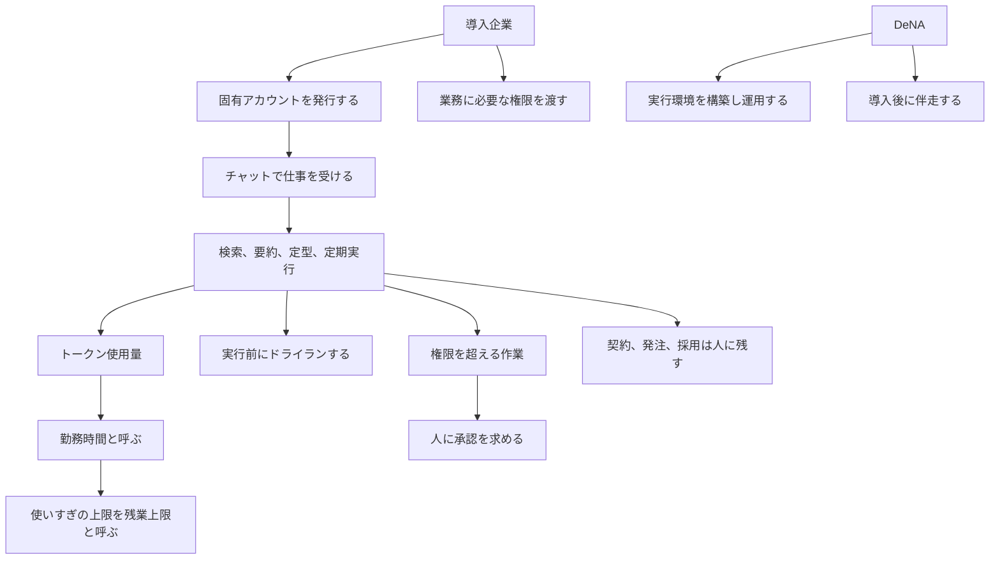

DeNAは2026年11月20日、社内の部署に配属して育ててきたエージェントを「AI社員 by DeNA」として外部企業へ提供すると発表し、2026年11月から事前登録を始めました。ニュースリリースでは、導入企業が人に紐づかない固有アカウントを発行して権限を渡し、チャットと業務ツールの上で検索、要約、定型作業を進めます。同じリリースは、稼働量であるトークン使用量を勤務時間、使いすぎを防ぐ上限を残業の上限として扱う、と書いています。

この記事では、そのサービスの仕組み、公開資料が勤務時間と呼んでいる数字の中身、導入する側が自社の手順に書く項目を順にまとめます。時間と人数の数字は、DeNA自身の申告です。

*この記事の全体像。以下、順に解説します。*

## DeNAのAI社員とは

「AI社員 by DeNA」は、個人のチャット契約とは別に、部署へ配属し、判断基準と手順を組織側のファイルに残すエージェントです。ニュースリリースは、生成AIの利用が社員個人のアカウントに閉じると、覚えた判断基準が担当者の異動で失われ、操作ログもその人の行為として残る、と課題を書いています。

アカウントは、特定の個人に紐づかない固有のものです。名前、アイコン、メール、所属を持ち、部署に配属します。リリースは、アカウントの発行と権限の付与を導入企業の仕事とし、実行環境の構築と運用、初期設定、導入後の伴走をDeNAの仕事としています。サービスサイトは、正式提供に先立つ先行導入の募集であり、登録時点では費用が発生しない、と書いています。

稼働の量は、リリースの中ではトークン使用量と呼ばれます。そのトークン使用量を勤務時間、使いすぎを防ぐ上限を残業の上限として扱います。リリースは、そのため新しい管理の考え方を覚える必要はない、と書いています。

権限は、業務に必要な最小限にします。操作は、そのアカウントの固有IDで各システムのログに残ります。誤操作を防ぐため、実行前の試行であるドライランがあります。権限を超える作業は、人に相談し、承認を求めます。契約や発注の最終承認、採用の合否判定は、人に残します。

預かったデータは、導入企業の同意なくモデルの学習には使いません。契約終了後は、要望に応じて消去します。料金は、初期費用と、従量を含む月額で、個別見積です。

サービスサイトの育成は、3段階です。配属初日から検索と要約を任せます。次に、メンターが繰り返す作業を教えます。手順が固まると、人の確認なしの定期実行で、1人で業務を完結する、とサイトが書いています。

社内の配属例は、購買での申請・見積・資産台帳の突き合わせ、会計システムの開発・保守、インフラの一次切り分け、IT品質管理の品質チェック、営業での見積と契約の下書きです。2026年11月10日の公式noteは、ヘルプデスク、ネットワーク、AI社員と一緒に業務を行うAI社員チームを加えています。リリースは、社内で30人が稼働している、と書いています。

リリースの対応ツール表は、社内実績として Microsoft Teams、Microsoft 365、Slack、Google Workspace、Confluence、Jira、GitHub、kintone、AWS、Google Cloud などを挙げます。注は、どこまで連携できるかは導入の形によって異なる、と書いています。サービスサイトは、仕事を頼む環境の現行を Slack と Google Workspace とし、Teams と Microsoft 365 を近日対応予定とします。Google Workspace と Microsoft 365 は、サイトが環境の名前として並べた製品群です。Confluence、Jira、GitHub、kintone、AWS、Google Cloud、Webブラウザなどは、同じページの対応済みに並びます。リリース本文は、利用者は Teams や Slack で仕事を頼める、と書いています。

次の図は、2026年11月20日のリリースが名前を付けた関係です。

導入企業が出すアカウントと権限の内側で、エージェントはチャットから業務ツールへ手を伸ばします。トークン使用量は、リリースの説明では勤務時間の枠に置かれます。権限を超える操作と、契約・発注・採用の最終判断は、人に戻ります。

## 注意点

### 勤務時間と呼ばれるものが二つある

公開資料には、時間と呼ばれるものが二つあります。混ぜると、トークンの上限と、人が楽になった時間の自己申告が、同じ数字に見えます。

| 呼び方 | 何を数えているか | どこにあるか |
|---|---|---|
| 勤務時間、残業上限 | トークン使用量を、管理者になじみのある枠の名前で呼ぶ | 2026年11月20日のリリース |
| 削減時間 | AI社員自身の日報・週報が、人がやらなくて済んだと見積もった時間 | DeNA Engineeringのブログ、公式note、サイトのFAQ |

換算式は、公開資料にありません。集計が日次か、週次か、月次かも書いてありません。上限を決める人の名前も、上限に達したあとの処理も書いてありません。2026年11月20日のリリース、サービスサイト、2026年8月4日と8月27日のEngineering、2026年11月10日と11月13日の公式note、2026年11月24日のITmediaを読んでも、その4点は出てきません。

### 52.6時間は2026年7月1日から10日の削減時間である

Engineering（小山達也、2026年8月4日）は、会計システムの開発・保守に配属されたAI社員Berryについて、ある週の削減時間を書いています。窓は2026年7月1日〜10日の8営業日です。合計は約52.6時間です。日によるばらつきはあるが、平均すると1日あたり6〜8時間分、と書いています。集計は、AI社員自身の日報・週報です。2026年7月1日は水曜、7月10日は金曜です。間の土日を除くと8営業日です。2026年の海の日は7月20日で、この窓の外です。

52.6を8で割ると、6.575時間です。リリース本文は「8営業日で52.6時間分、1日平均で8時間勤務の約8割」と書いています。日付の窓（7月1日〜10日）は、本文にありません。ブログの「約52.6時間」の「約」も、本文にありません。「約」は52.6時間からは取れ、リリース本文の「約8割」に残ります。注は上記ブログを指し、効果は任せる業務と導入環境で異なる、と書いています。

サービスサイトのFAQは、業務削減、8営業日、1日平均でほぼ1人分（8時間労働の8割相当）と書きます。日付の窓は置きません。ITmedia（2026年11月24日）は「8営業日で52.6時間分に相当する業務を担い」と書いています。残るのは8営業日です。落ちるのは、7月1日〜10日という日付と、削減時間という語です。

産経新聞（2026年11月20日）は「1日平均で6.6時間」「52.6時間の業務を削減」と書いています。6.6は、6.575の丸めです。リリース本文の文言ではありません。

同じBerryの別の窓が、2026年8月27日の記事にあります。問い合わせが多かった5営業日、約30件で、削減時間は約41.9時間です。2026年11月10日の公式noteは、17体の直近1か月の削減時間が1,000時間近く、チームメンバー換算でおよそ6人分、と書いています。ネットワーク管理のLycheeの自己申告は1日100〜180分です。AI社員チームのYuzuは、多い日で約4.5時間です。52.6時間の週は、1体あたりの月次の代表値ではありません。

巡回の回数は、削減時間でも、トークンを勤務時間に読み替えた時間でもありません。同じ公式noteで、購買のMelonは、決済の失敗を知らせるメールを1時間ごとに確認し、それだけで月720回と数えます。営業のLimeは、2,709行のリストを約580回確認します。社内ヘルプデスクのAnzuは、1日約27,000行を突き合わせます。夜中も休日も決まった時間に見回りする、という文は、この3人のあとに続くAI社員全般の記述です。これらは、会社の自己申告です。

### 30人と17体は時点の違う発表である

2026年11月10日の公式noteは、17体と書いています。2026年11月20日のリリースは、社内で30人が稼働している、と書いています。8月4日のEngineeringが名指しするのは、最初の実証機であるLemon、Berry、Melon、Plum、Kiwi、Peach、Oliveです。30とは書きません。その後の公開名であるLime、Anzu、Lychee、Yuzu、ichigo、Ichijikuを足しても、30には届きません。10日間の増加を示す名簿は、公開資料では確認できません。30を誤りとは扱いません。説明のない二つの自己申告が並んでいる、と読みます。

### チャットツールの範囲は資料で揃っていない

三つの書き方が、同時にあります。

- サービスサイトのFAQは、Microsoft Teams と Microsoft 365 を近日対応予定とします。チャット環境の現行は、Slack と Google Workspace です。他のツールは、対応済み一覧にあります。
- リリースのツール表は、Teams と Microsoft 365 を社内実績に入れます。注は、連携範囲は導入形態により異なる、と書いています。
- リリース本文は、利用者は Teams や Slack で仕事を頼める、と書いています。本文には、社内実績の限定が付きません。

ITmediaは、主に Slack と書き、サイトに近い書き方です。Impress Watch（2026年11月20日）は、Slack と Teams を、近日対応の留保なしに並べて書いています。本文は「社員がSlackやMicrosoft Teamsで仕事を依頼すると」です。

### 残業上限は停止の手順としては公開されていない

2026年8月4日のEngineeringは、次の項目を今後の課題に置いています。利用コストの管理です。異常な動作を見つけて止めることです。操作ログと権限の統制です。評価の周期です。何人日分を代替できているか、です。2026年11月20日のリリースは、上限を残業の上限として扱う、と現在の説明に書いています。2026年11月25日に公開されているサービスサイトの本文には、勤務時間、残業上限、トークンの語がありません。

2026年11月10日の公式noteは、次回を「第4回 安全編」としています。予告にあるのは、大事な操作の前の確認、見るのはよいが送るのは不可、本番前の試行、誰がいつ何をしたかの記録です。本番前の試行は、この予告の語です。前に書いたドライランと同じ仕組みかは、予告には書かれていません。2026年11月25日時点で、その回の本文へ辿れる公開URLはありません。予告の範囲に、トークン上限や残業上限は出てきません。

上限に達した作業を破棄するか、保留するか、人が再開するかは、公開資料では確認できません。導入する側が先に決める事項です。DeNAが決めた停止の意味としては書けません。

公開されている、別のきっかけの制御は次のとおりです。

- 実行前のドライランがあります。出典は2026年11月20日のリリースです。
- 権限を超える作業は、人に承認を求めます。きっかけは、トークン上限とは別に書かれています。
- 契約、発注、採用の最終判断は、人に残します。
- 書き込みや設定変更は、開発用の環境で検証し、本番のBerryだけに広げ、一定期間観察してから、他のAI社員全体へ広げます。出典は2026年8月4日のEngineeringです。
- インフラ配属のIchijikuは、個人のPCとスマホ向けの更新だけを案内し、会社システムの項目は人の当番に残します。出典は公式note（2026年11月13日）です。迷ったら、仕事ごとの相談相手に聞きます。決まったルールは、手順に書きます。読んだもの、入れたもの、外したものは、案内が無い日も含めて記録します。元データが無い日は、推測で送りません。

Ichijikuの実例は、2026年11月9日（月曜）です。前営業日を金曜（11月7日）と数えました。11月7日は土曜です。本当の金曜は11月6日でした。土曜の元データが無いため、案内を見送りました。相談相手が、曜日の数え方を直しました。これは、トークン上限の話ではありません。欠損データでの見送りです。導入前の当番は営業日ごとにあり、1回の作業はおよそ10分です。PCとスマホ向けの更新案内が要るのは、およそ2回に1回です。公式noteが、そのように書いています。

サイトの第3段階は、人を介さず1人で業務を完結する、と書いています。2026年8月4日のEngineeringは、経理システムのエラー通知を起票し、対応が完了したものをクローズする、と書いています。2026年8月27日のBerryの記事は、エラーメール監視のチケットについて、クローズは自分ではやらない、と書いています。二つの文章が同じ作業を指すとは、どちらの記事も書いていません。判断の分かれるクローズは人です。動き方は、指示待ち・トリガー待ちです。IT全般統制（ITGC）の記録取りでは、今期の取得作業全体の約30%をBerryが対応し、今年度の依頼行は約50行です。記録は、手順書に沿って各システムから集めます。ブラウザ操作で画面のスクリーンショットも取れる、と書いたうえで、画面キャプチャのうち人の手が要る部分は人に依頼した、と書いています。

料金は、労働時間のたとえに置き換わっていません。リリースは、管理の考え方を新しく覚えなくてよい、と書いています。見積は、初期費用と従量を含む月額のままです。費用の上限をやめた、とは書いていません。

産経新聞（2026年11月20日）は、次の三つの文を書いています。「派遣社員1人雇うのと同水準を想定している」。 「決裁をする機能は備えておらず、一般社員として活動する」。 「外部提供を開始したと発表した」。いずれも、リリース本文にはありません。サイトは先行導入の募集です。一般提供が完了したとは書いていません。「決裁をする機能は備えておらず」は、ドライランと、権限を超えたときに承認を求める、というリリースより強い言い方です。

ITmedia（2026年11月24日）の見出しは「使い過ぎを“残業時間”で管理」です。本文は「残業時間の上限」と書きます。リリースの語は「残業の上限」です。本文の「といった設定も可能」は、リリースの「承認を求めます」を、任意の設定に寄せます。「消去も可能」は、契約終了後に要望に応じて消去する、という条件を落とします。同意なく学習に使わない、はリリースにあります。同意があっても使わない、とは書いていません。

評価期間の稼働に、エージェントの時間を載せる制度は、公開されていません。近い記述は、2026年8月4日が今後の課題に置いた「何人日分の業務を代替できているか」です。

公式noteは、AI社員全般について、夜中も休日も決まった時間に見回りする、と書いています。Melonの数字は、決済失敗の通知を毎時、月720回です。この見回りが残業上限で止まる、とは公開資料が書いていません。

## 導入する側が手順に書くこと

公開資料が書いていないところは、導入する側の手順で埋めます。次の5つは、DeNAの仕様として既にあるものではありません。

### 承認者を配属先の管理者として名指しする

残業上限の期間と閾値を決める人を、配属先の管理者として名指しします。公開資料が名指ししている近い役割は、Ichijikuの「仕事ごとの相談相手」までです。メンター、依頼者、管理者のどれが上限の承認者かは、書いていません。

### 上限に達した作業は保留して人が再開する

上限に達した未完了の作業は、保留して人が再開する、を既定にします。破棄は、決済失敗の通知のような毎時の見回りでは、見落としになります。人による再開は、元データが無い日に案内を見送って相談相手へ戻したIchijikuの型に近いです。きっかけがトークン上限のときは、この型は類推です。公開された停止手順ではありません。

### 人の評価期間に、勤務時間と呼んだ消費を混ぜない

人の評価期間の稼働に、トークン使用量を勤務時間と呼んだ消費を混ぜません。混ぜるなら、人の成果とは別の行だと、評価制度に書きます。削減時間は自己申告です。トークン使用量を時間へ換算する式は、未公開です。この二つを、同じ列にしません。

### アカウントを誰が発行するかを契約で一文にする

リリースとFAQでは、アカウント発行と最小権限の付与は、導入企業の仕事です。サイトの導入手順は、アカウント発行、権限設計、ツール接続を、DeNA側（サイトの文言では基盤側）で用意する、とも書いています。契約で、どちらが発行するかを一文にします。公開の権限一覧はありません。社内例として書けるのは、次までです。Berryの投稿は専用チャンネルに限る。関連チャンネルは参照する。エラー対応で判断の割れるクローズは、自分で閉じない。2026年8月4日の記事は、受け入れ部署が自分のGmailやカレンダーを直接つなげたいと望んだ、と書いています。これは、チャットの入口の話ではありません。専用アカウントは、前に書いた個人に紐づかない固有アカウントです。受け入れ部署が望んだのは、自分のGmailやカレンダーを、そのAI社員へ直接つなぐことです。固有アカウントの設計と、その要望は、一致していませんでした。

### 費用と成果と消費を三つの行に分ける

労働時間のたとえとは別に、従量を含む月額が見積に残る前提で、予算を取ります。費用の行と、成果の行と、労働時間へ写した消費の行は、三つに分けます。

## 公開されたら手順のどこを書き換えるか

換算式、上限の期間、到達時の破棄・保留・再開が、会社の公開資料に出たら、停止条件の書き方が変わります。そのときは、公開された仕様との差分だけを手順に書きます。それまでは、勤務時間と残業上限という呼称を、停止機能の説明としては読みません。

次に見る場所は、三つです。

1. 「第4回 安全編」が公開されたら、トークン上限と承認者の有無だけを見ます。
2. 先行導入の契約、またはFAQに、上限の期間と到達後の動作があるかを見ます。
3. 30人の内訳が会社の文章で出たら、11月10日の17体との差を更新します。

## まとめ

ニュースリリースが同じ文で結んでいるのは、トークン使用量を勤務時間、使いすぎの上限を残業上限と呼ぶ、までです。換算、承認者、上限に達したあとの未完了作業は、公開されていません。52.6時間は、トークン使用量を勤務時間に読み替えた数字ではありません。2026年7月1日から10日の、削減時間の自己集計です。

呼称と、人に紐づかないアカウントの骨格は、リリースの文章で確認できます。停止の意味、30人の内訳、削減時間を常態の成果と読むことは、公開資料の範囲では強められません。導入する側は、承認者、保留して人が再開する停止、人の評価と混ぜない台帳、発行主体の一文、費用と成果と消費の三行を、自社の手順として先に書きます。

この記事が少しでも参考になった、あるいは改善点などがあれば、ぜひリアクションやコメント、SNSでのシェアをいただけると励みになります！

## 参考リンク

- [DeNAニュースリリース「AI社員 by DeNA」（2026-11-20）](https://dena.com/jp/news/5481/)
- [サービスサイト「AI社員 by DeNA」](https://ai-shain.dena.com/)
- [DeNA Engineering「同僚として組織に迎える」（2026-08-04）](https://engineering.dena.com/blog/2026/08/ai-employee-introduction/)
- [DeNA Engineering「Berry」（2026-08-27）](https://engineering.dena.com/blog/2026/08/ai-comate-berry/)
- [公式note「17体の1か月」（2026-11-10）](https://note.com/dena_ai_shain/n/n52664780a88f)
- [公式note「Ichijiku」（2026-11-13）](https://note.com/dena_ai_shain/n/n6951c7a751f8)
- [ITmedia AI+（2026-11-24）](https://www.itmedia.co.jp/aiplus/article/2611/24/2000003406/)
- [産経新聞（2026-11-20）](https://www.sankei.com/article/20261120-X7JMSVVIVJJDDPAUSHUC2QYZUI/)
- [Impress Watch（2026-11-20）](https://ai.watch.impress.co.jp/docs/news/2158218.html)
