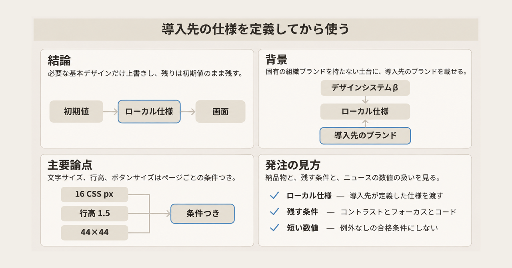
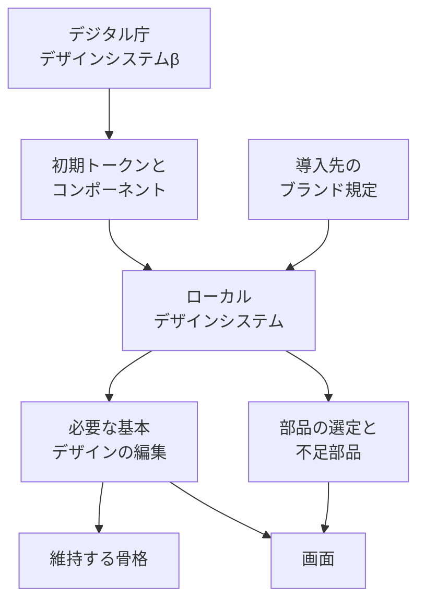

デジタル庁デザインシステム（β）は、ウェブサイト、ウェブアプリケーション、オンラインサービスまたはシステム向けのプラットフォーム型デザインシステムです。固有の組織ブランドを持たないため、公式は、個々のサイトやサービスの要件に合わせたデザイン仕様を定義してから使う前提にしています。この仕様を、ローカルデザインシステム（スタイルガイド）と呼びます。導入先は、このデザインシステムを自分のサイトやサービスへ取り込む組織です。

この記事では、初期値のまま残せるもの、編集後も維持する骨格、発注時に渡す一覧を整理します。規範の文言はデザインシステムβ版のガイダンスを優先し、2026年11月26日のデジタル庁ニュースは2026年8月6日の事業者向け勉強会の再掲として扱います。

*この記事の全体像。以下、順に解説します。*

## デジタル庁デザインシステムとは

公式は、このデザインシステムを β版として公開し、リビングスタンダードと位置づけています。リビングスタンダードは、版を固定せず更新を続ける、という公開の仕方です。2026年11月18日時点のデザインデータの告知は、Figma v2.18.3 です。

定義の本文は、β版のサイトにあります。2026年11月26日の[デジタル庁ニュース](https://digital-agency-news.digital.go.jp/articles/2026-11-26)は、2026年8月6日の事業者向け勉強会の内容を公開した記事です。政策頁は、この勉強会を令和8年8月6日とし、申込事業者数 128、参加者数 366 名と記録しています。アーカイブは [YouTube](https://www.youtube.com/watch?v=-VIfqgd9MGQ) にあります。

### ローカルデザインシステム

ローカルデザインシステムとは、デジタル庁デザインシステムを、個々のサイトやサービスの要件に合わせて定義したデザイン仕様です。使用にあたって、この仕様を作ることが前提になります。

Figma とコードスニペットに入っているトークンは、デジタル庁ウェブサイトを起点にした初期値です。Figma は、コンポーネントとトークンを配布しているデザインデータの置き場です。トークンは、カラーや文字サイズなど、基本デザインの初期値についた名前です。コードスニペットは、部品の実装サンプルです。導入先のブランドに合わせて、基本デザインを編集します。変更が不要な項目は、初期値のまま使えます。

2026年8月6日の使い方の資料は、カスタマイズしてローカルデザインシステムを作ることが必須だと書きます。同じ資料は、変更不要な箇所はデフォルトのままでよいとも書きます。

### 作る順と編集できる基本デザイン

作成順は、ブランドやコミュニケーション方針、スタイル定義、UI コンポーネントです。構成そのものに規定はありません。必要な項目は追加できます。

編集できる基本デザインは、カラー、タイポグラフィ、余白、角の形状、エレベーション、リンクテキスト、レイアウトです。タイポグラフィは、文字の大きさ、書体、行の高さの指定です。余白は、部品と部品の間隔です。エレベーションは、面から浮いて見える高さの段階です。

Figma のコンポーネントは、想定と合わなければ切り離して組み直せます。切り離しは、Figma の detach です。共有部品との紐づけを外し、その画面用の部品として組み直す操作です。コードスニペットは、利用環境に合わせて書き換えられます。書き換えた後も、WAI-ARIA と強制カラーモードへの対応は残します。WAI-ARIA は、読み上げソフトなどに、部品の役割や状態を伝えるための属性です。強制カラーモードは、色が置き換わる表示でも、要素の境界と状態を判別できるようにする実装です。コードスニペットを書き換えるときは、この対応を取り除きません。文書、Figma、コード、フォント、アイコンで、ライセンスは分かれます。利用は、官民を問いません。

### 編集後も維持する数値

編集後も維持する数値と規則は、基本デザインごとに書いてあります。

テキストと背景のコントラストは 4.5:1 以上です。枠線やディバイダーなど、文字以外は 3:1 以上です。ディバイダーは、領域を分ける線です。フォーカスは、キーボード操作で今選ばれている位置の表示です。その印であるフォーカスインジケーターは、Yellow-300 と Black の 2 重構造です。Yellow-300 は、その表示に使う黄色のトークン名です。カラーのページは、視認性を確実にするため、この組を変更しない、と書きます。セマンティックカラーは、意味と結び付いた色です。公式の例では、成功は緑、エラーは赤です。色相と意味の結びつきは変えません。明度と彩度は編集できます。

本文と UI の文字サイズの基準は 16 CSS px です。CSS px は、ブラウザがレイアウトに使う長さの単位です。14 CSS px は、フッターなど、16 CSS px が難しい場合に限ります。14 CSS px 未満は、原則として許容されません。

ボタンのターゲットは、隣の部品と重ならない状態で、少なくとも 44×44 CSS px です。ターゲットは、操作を受け付ける領域です。参照は WCAG 2.2 の達成基準 2.5.5（レベル AAA）です。WCAG は、ウェブコンテンツのアクセシビリティに関する国際的な達成基準の文書です。達成基準は、その中の個別の項目です。レベル AAA は、レベル AA より高い適合レベルです。ボタンの達成基準 2.5.5 は、WCAG が高度とする項目です。ボタン以外のリンクは、少なくとも 24×24 CSS px です。参照は達成基準 2.5.8（レベル AA）です。

### 初期値から画面までの流れ

導入先は、プラットフォームの初期値と、自前のブランド規定から、ローカルデザインシステムを定義します。その仕様で、部品と画面を組みます。図の維持する骨格は、編集したあとも残す条件です。

配る側は、デジタル庁デザインシステムを提供する側です。配る側が持つのは、考え方、初期値、コンポーネント、維持する骨格です。導入先が持つのは、ブランド規定、どのトークンを編集するか、部品の選定と追記、切り離し後の構成、画面の構成です。

次の表で使う色の名前を先に置きます。表の右の列が、編集後も残す条件です。キーカラーは、同じ色相の階調から選ぶ色です。ブランドカラーは、導入先のブランドが定める色で、キーカラーの上書きに使います。共通色は、白から黒のグレーを基調に、ページの共通要素へ使う色です。グレー以外の色味を足して作れます。

| 層 | 導入先が編集できること | 編集後も維持すること |
|---|---|---|
| カラー | キーカラー、ブランドカラー、共通色の追加、セマンティックカラーの明度と彩度 | テキスト 4.5:1、非テキスト 3:1、意味色の色相、フォーカス色 Yellow-300 と Black |
| タイポグラフィ | 用途に応じた大きさ、行ボックスの高さ | 本文と UI の基準は 16 CSS px。読み物本文の行高は、ローカルデザインシステムページでは文字サイズの 1.5 倍以上 |
| 余白 | 基準単位と倍率 | 間隔値に規則性を持たせる。操作要素のターゲットサイズを確保する。基準単位の必須値はなく、例として 8 CSS px |
| 角と高さ | 部品ごとの角丸、高さの段階 | 浮いた要素は面に対して 3:1。影は単色でコントラストを取れないため、ボーダーで取る |
| リンクとレイアウト | リンク色、カラム、ブレークポイントの数 | 色だけに依存しない。リキッドレイアウト。見た目の順と読み上げ順をできるだけ一致させる |
| 部品とコード | 選定、追記、detach、スニペットの書き換え | フォーカスインジケーター、強制カラー、WAI-ARIA |

リキッドレイアウトは、画面幅に合わせて列が伸び縮みする組み方です。ブレークポイントは、画面幅に応じて段組みを切り替える幅です。行ボックスは、1 行が占める高さです。

## 注意点

2026年11月26日のニュースは、勉強会の再掲として、編集後も必須の要件を短くまとめています。β版サイトの部品ページとタイポグラフィページは、同じ数値に条件を付けています。ニュースの一文だけを記事や発注文に使うと、詳細ページにある条件が落ちて、数値の適用が広くなります。

### ローカル仕様の範囲

[ローカルデザインシステム](https://design.digital.go.jp/dads/guidance/local-design-system/)のページは、「デジタル庁デザインシステムを導入先で直接使うのではなく、導入先専用のデザインシステムを定義してから使います」と書きます。同じページは、「変更する必要がない項目については、デジタル庁デザインシステムの初期値をそのまま使用して構いません」とも書きます。

2026年8月6日の使い方 PDF は、「カスタマイズしてローカルデザインシステムを作ることが必須」とします。直後に、「変更不要な箇所はデフォルトのまま使っても OK」と書きます。同じ資料は、「DADSを使うと青くなる」を誤解として説明しています。DADS は、資料中のデジタル庁デザインシステムの略です。リンク色の青は推奨です。コントラスト、色覚、リンクだと分かることへの配慮があれば、他の色相も使えます。

全トークンを差し替える読みは、初期値のまま使ってよいという公式の例外と両立しません。

### 文字サイズと行高

[タイポグラフィ](https://design.digital.go.jp/dads/foundations/typography/)の概要（2026年8月5日更新）は、本文と UI の基準を 16 CSS px 以上とします。16 CSS px が難しい場合に限って、14 CSS px を置きます。行高 1.5 倍以上は、読み物本文について「推奨」と書きます。管理画面のように情報量を優先する場合は、行間を狭めてよいとも書きます。Oneline の行高は 100% です。Display は 140% です。タイポグラフィページにある Dense の一覧では、行高 120% の行と 130% の行があります。Oneline、Display、Dense は、そのページにある文字組みの名前です。どの文字に使う名前かは、ページの数値だけでは分かれません。

[タイポグラフィのアクセシビリティ](https://design.digital.go.jp/dads/foundations/typography/accessibility/)は、行高 1.5 倍以上を、読みやすさへの配慮とします。参照は WCAG 2.2 の達成基準 1.4.8（レベル AAA）です。ローカルデザインシステムページと 2026年11月26日のニュースは、読み物本文の行高 1.5 倍以上を、編集後の要件として書きます。基準、推奨、要件が、ページによって割れています。

「文字はすべて 16 CSS px、行高はすべて 1.5」は、14 CSS px、行高 100%、120% と両立しません。

### ボタンとリンクのターゲット

[ボタンのアクセシビリティ](https://design.digital.go.jp/dads/components/button/accessibility/)（2026年10月21日更新）は、ボタンを少なくとも 44×44 CSS px とし、WCAG 2.2 の 2.5.5（AAA）を参照します。ボタン以外のリンクは、44×44 が確保できない場合でも、少なくとも 24×24 CSS px とします。[リンクテキストのアクセシビリティ](https://design.digital.go.jp/dads/foundations/link-text/accessibility/)は、24×24 を目安とします。高さ 16 CSS px でも、上下に 4 CSS px の余白があれば確保とみなす、と書き、2.5.8（AA）を参照します。

ボタンの 44×44 は、「確保してください」です。「なければなりません」は、同じボタンページが、ボタン以外のリンクに課す 24×24 の側にあります。[ボタンの使い方](https://design.digital.go.jp/dads/components/button/usage/)は、Small と X-Small の見た目が 44 CSS px に満たないときは、上下の余白でターゲット領域を 44 CSS px 以上にする、と書きます。更新履歴は、2026年2月18日の Figma v2.10.3 で、X-Small の高さを 28px に修正したと書きます。ニュースの「ボタンなど操作できる要素」を 44×44 とする一文は、この分岐を含みません。

アイコンも同様です。ニュースは、ラベルとともに構成すると書きます。ボタンのアクセシビリティページは、テキストラベルを原則とします。領域や既存システムの制約で、アイコンだけのボタンを認めます。その場合は、代替テキストを必須とします。

「操作要素はすべて見た目 44×44」は、24×24 と、高さ 28px の X-Small と両立しません。

### 適合の範囲

ローカルデザインシステムページは、骨格を維持できていれば、JIS X 8341-3:2016 と WCAG 2.2 の達成基準を「満たす、または満たすことが容易となる」と書きます。JIS X 8341-3 は、ウェブアクセシビリティの日本産業規格です。アクセシビリティのガイダンスは、デザインシステムで達成できる範囲は、考慮すべきアクセシビリティの一部であり、コンテンツの確保は各サイトの制作者側だと書きます。

[2025年10月14日の公式ニュース](https://digital-agency-news.digital.go.jp/articles/2025-10-14)の本文は、WCAG 2.2 の達成基準 86 のうち 43 について、「適合できる」または「適合が容易になる」と書きます。2026年8月6日の概要 PDF は、同じ 43 について、「達成できる」または「達成が容易になる」と書きます。同ニュースの目次見出しは、「適合」または「適合が容易」です。43 はデジタル庁自身の数えです。この記事は、86 項目を再集計していません。

[試験結果](https://design.digital.go.jp/dads/webaccessibility/result/)のページは、令和7年（2025年）12月10日更新の表明で、JIS X 8341-3:2016 の AA に準拠するとしています。対象は `https://design.digital.go.jp/dads/` 以下です。コードスニペットのサンプル集 `/dads/html/` と `/dads/react/` は除きます。試験は代表 25 ページです。期間は 2025年11月11日から 2025年12月3日です。これは文書サイトの表明であり、導入先プロダクトの適合宣言ではありません。

骨格を守った導入先サイトが、JIS または WCAG に適合した、という証明書にはなりません。

### 調達文書の書き方

2026年8月6日の概要 PDF の話者は、嶌田 喬行です。この資料は、「中央省庁の調達事業では、原則として採用することになっています」と書きます。未改変で納品せよとも、ローカルデザインシステムを作れとも書いていません。

[標準ガイドライン群の索引](https://www.digital.go.jp/resources/standard_guidelines)（最終更新 2026年10月13日）は、デジタル庁デザインシステムを「参考資料」として載せます。DS 番号も、Normative のラベルも付いていません。DS 番号は、デジタル社会推進標準ガイドラインの文書番号です。Normative は、守るべき規範だというラベルです。DS-100 の本文に、原則採用の条文があるかは未確認です。

令和7年12月15日の調達概要書（電子契約システム更改）は、望ましい専門性として「デジタル庁デザインシステムに基づく UI/UX 設計」と書きます。体制欄には「デジタル庁デザインシステム準拠の UI/UX 設計」と書きます。ローカルデザインシステムという言葉はありません。未改変で適用せよとも書いていません。

「調達で未改変採用が義務」は、スライドの「原則として採用」からも、この一件の「準拠」からも出ません。根拠条文は未確認です。

### サイト、Figma、パッケージの版

2026年11月18日の告知は、更新の単位が分かれています。デザインデータは Figma v2.18.3 で、メガメニューの作例追加です。コードスニペットは、一部の部品とマニフェストです。ドキュメントは、利用上の注意事項の改訂であり、Markdown 一式の更新ではありません。更新履歴の配布先ファイル ID は `1377880368787735577` です。

[`digital-go-jp/design-tokens`](https://github.com/digital-go-jp/design-tokens) の README 対応表は、Figma 2.0.4 から 2.18.1 までを、パッケージ 2.1.0 に対応させます。2.18.2 と 2.18.3 の行はありません。npm の `@digital-go-jp/design-tokens` の latest は 2.1.0 です。公開時刻は 2026-10-20 です。README が指す Figma ファイル ID は `1255349027535859598` です。二つのファイルが同じライブラリかは未確認です。2.18.2 以降にトークン値が変わったかも未確認です。スター数は約 80 です（2026-11-27 時点）。手順図のスクリーンショットに写る v2.18.0 や利用者数は、ページ自身が、スクリーンショット当時だと断っています。

「npm 2.1.0 が Figma v2.18.3 と一致する」は、公式の対応表が示していません。

### 編集と出典

[利用上の注意事項](https://design.digital.go.jp/dads/introduction/notices/)（2026年11月18日更新）では、文書とガイドライン（Markdown を含む。Figma とコードスニペットは除く）は、デジタル庁のコピーライトポリシーに従います。編集した場合は、編集したことと、編集主体の記載が要ります。デジタル庁が作ったかのように示してはなりません。[コピーライトポリシー](https://www.digital.go.jp/copyright-policy)（最終更新 2026年5月12日）は、特記がなければ、公共データ利用規約（第1.0版）（PDL1.0）とします。PDL1.0 は、その公共データ利用規約の版の名前です。

Figma Community のデータは CC BY 4.0 です。コードスニペットは MIT です。いずれも、編集して作った画面パーツを自分のサイトで使う場合は、出典は不要です。未編集のまま公開する場合は、出典が要ります。同梱アイコンの一部である Material Symbols は、Apache License 2.0 です。フォントである Noto Sans は、SIL Open Font License 1.1 です。フォントファイルの再配布は OFL のままです。そのフォントで作った文書には及びません。注意事項は、OFL を掲げてそう書きます。Figma 内のイラストとアイコンの条項本文は、注意事項にありません。別規約へ委ねています。条項本文は未確認です。

「編集したので一式出典不要」は、画面パーツを自分のサイトで使う場合に限ります。文書とフォントファイルの再配布には、別の条件が残ります。

### 生成AIと画面生成

2026年11月26日のニュース、ローカルデザインシステムページ、[「デザインシステムとは」](https://design.digital.go.jp/dads/guidance/design-system/)（2026年10月14日更新）には、ローカルデザインシステムを画面生成のプロンプトへ渡せ、という文はありません。渡すな、という文もありません。「デザインシステムとは」が「デザインを機械的に生成するルール」ではないと書くのは、準拠規約や機械生成のルールではない、という説明です。考え方とアクセシビリティを掛け合わせた仕組みだ、と書いています。生成AIで使うな、という禁止ではありません。

標準ガイドライン DS-920 は、生成AIの調達ガイドラインです。デザインシステムの画面生成手順ではありません。DS-680.2 は、ウェブコンテンツガイドラインです。索引要約に「生成AIの適切な利用」とあります。本文は未確認です。

公開の脆弱性情報を、パッケージ名 `@digital-go-jp/design-tokens` と文書サイトのドメインで確認した範囲では、デジタル庁デザインシステム自体の CVE は見つかりませんでした。CVE は、公開された脆弱性の識別番号です。検索結果に混ざる CVE-2024-21765 は、電子納品チェックシステムであり、このデザインシステムとは別です。ネイティブアプリに向かない、ダークテーマに向かない、民間ブランドに向かない、という公式文は、今回開いたページにはありませんでした。民間利用ができることは、[政策頁](https://www.digital.go.jp/policies/servicedesign/designsystem)と 2025年10月14日のニュースに書いてあります。テキストや文字以外の要素は、通常、背景を白または黒と想定してコントラストを置いています。共通カラーには、黒背景向けのグレーの範囲があります。フォーカス色の節は、Yellow-300 と Black を変更しない、と書きます。ダークテーマ専用の手順は、見つかっていません。

## 残る結論と落とす読み

デジタル庁デザインシステムの使用は、導入先のローカルデザインシステムを定義することが、公式の前提です。上書きするのは、導入先のブランドやサービスに必要な基本デザインです。変えない項目は、初期値のまま残せます。維持するのは、コントラスト、意味色の色相、フォーカス色、強制カラー、コードに残す WAI-ARIA です。16 CSS px、行高 1.5、44×44 CSS px は、ページによって、基準、推奨、ボタンとリンクの分岐があります。公式文書は、そのローカル体系を生成AIの入力にせよとも、するなとも書いていません。

この結論を支える公式の書き方は、次のとおりです。

- ローカルデザインシステムページが、プラットフォーム型であり、固有ブランドを備えないため、作成が前提だと定義している。
- 2026年8月6日の使い方 PDF が、ローカルデザインシステム化を必須としている。
- 「デザインシステムとは」が、導入先のブランドとコミュニケーション方針に基づく再定義が必要だと書いている。
- 基本デザインの編集範囲と、コントラスト、フォーカス色、意味色、強制カラー、WAI-ARIA の維持が、同じガイダンスに分かれて書いてある。

次の読みは、公式の文言より強いので、落とします。

- 全トークンを差し替える。
- 操作要素はすべて見た目 44×44、文字はすべて 16 CSS px、行高はすべて 1.5 である。
- 中央省庁の調達は、未改変のデジタル庁デザインシステムを納品物とする。
- 骨格を守れば、JIS と WCAG に適合する。
- 編集したので、文書もフォントも出典不要である。
- npm 2.1.0 が、Figma v2.18.3 と同じトークンである。

未確認の点は、ローカルデザインシステムが使用の前提だという結論を覆しません。調達義務や、版の一致を主軸にすると、確信度は落ちます。

- DS-100 の本文に、中央省庁調達で原則採用とする条文があるか。
- Figma v2.18.2 と v2.18.3 で、トークン値が変わったか。
- 二つの Figma Community ファイル ID が、同一ライブラリか。
- イラストレーションとアイコン素材の利用規約の条項。
- DS-680.2 の生成AIの節が、デザインシステムの使い方に何を書くか。
- フォーカス色 Yellow-300 と Black が、特定のブランド色と衝突した公式事例は、見つかっていません。

## 発注で渡す仕様

発注で渡すのは、デジタル庁サイトの見た目ではありません。導入先が定義したローカルデザインシステムと、維持する骨格の一覧です。電子契約システム更改の調達概要書は、「基づく」「準拠」と書きます。ローカルデザインシステムという言葉は、そこにはありません。発注側が足すなら、見た目の複製ではなく、次の境界です。

配る側に求めるもの:

- プラットフォームとしての仕組みと初期値
- コントラスト、意味色の色相、フォーカス色
- コードスニペットに残す WAI-ARIA と強制カラー

導入先が決めるもの:

- ブランドとコミュニケーション方針
- どの基本デザインを上書きし、どれを初期値のまま残すか
- 部品の選定、不足部品、detach 後の構成
- ローカルファイルの版管理と、画面の構成

画面生成の入力に、そのローカル体系を渡すかどうかは、公式の指示ではありません。導入先が、定義済みの仕様を生成の入力にする、という使い方です。渡すな、とも書かれていません。「デザインを機械的に生成するルール」ではない、という説明を、生成AIの禁止とは読みません。前節で落とした読みは、発注条件にしません。

判断は、3 点で足ります。納品物が、導入先のブランドとサービスに合わせて定義したローカルデザインシステムか。初期値のまま残す項目と、上書きする基本デザインが分かれているか。コントラスト、意味色の色相、フォーカス色が仕様に残り、コードを書き換えても、強制カラーモードで要素の境界と状態が分かることと、WAI-ARIA を残しているか。この 3 点が揃うなら、ニュースの短い数値を、例外なしの合格条件にはしません。

## まとめ

デジタル庁デザインシステムは、導入先のローカルデザインシステムを定義してから使う前提です。変えるのは、ブランドやサービスに必要な基本デザインです。変えない項目は、初期値のまま残せます。編集後も残すのは、コントラスト、意味色の色相、フォーカス色、強制カラー、コードの WAI-ARIA です。

16 CSS px、行高 1.5、44×44 CSS px は、一枚の条件ではありません。ページによって、基準、推奨、ボタンとリンクの分岐があります。骨格を守ることは、導入先サイトの適合証明書にはなりません。中央省庁調達の「原則として採用」は、未改変納品の義務でも、ローカルデザインシステム作成の指示でもありません。根拠条文は未確認です。npm 2.1.0 を、Figma v2.18.3 と同じトークンだとは扱えません。編集した画面パーツを自分のサイトで使う場合の出典不要は、文書とフォントファイルには及びません。

生成AIへの入力は、公式が指示も禁止もしていません。発注で渡すのは、デジタル庁サイトの見た目ではなく、導入先が定義したローカルデザインシステムと、維持する骨格の一覧です。

この記事が少しでも参考になった、あるいは改善点などがあれば、ぜひリアクションやコメント、SNSでのシェアをいただけると励みになります！

## 参考リンク

- [デジタル庁ニュース「デジタル庁デザインシステムをどう使うか」（2026-11-26）](https://digital-agency-news.digital.go.jp/articles/2026-11-26)
- [デジタル庁ニュース（2025-10-14、WCAG 2.2 の 86 のうち 43）](https://digital-agency-news.digital.go.jp/articles/2025-10-14)
- [政府情報システムにおける利用者満足度評価の導入](https://www.digital.go.jp/policies/gov-system-user-satisfaction-evaluation)
- [勉強会アーカイブ](https://www.youtube.com/watch?v=-VIfqgd9MGQ)
- [概要 PDF（2026-08-06）](https://www.digital.go.jp/assets/contents/node/basic_page/field_ref_resources/79b783f4-5265-4044-a374-f8f6ccd6e5da/5b510767/20260806_meeting_Overview-and-Features-of-DADS_outline_03.pdf)
- [使い方 PDF（2026-08-06）](https://www.digital.go.jp/assets/contents/node/basic_page/field_ref_resources/79b783f4-5265-4044-a374-f8f6ccd6e5da/d3abed7f/20260806_meeting_How-to-use-DADS_outline_04.pdf)
- [ローカルデザインシステム](https://design.digital.go.jp/dads/guidance/local-design-system/)
- [デザインシステムとは](https://design.digital.go.jp/dads/guidance/design-system/)
- [カラー](https://design.digital.go.jp/dads/foundations/color/)
- [タイポグラフィ](https://design.digital.go.jp/dads/foundations/typography/)
- [タイポグラフィのアクセシビリティ](https://design.digital.go.jp/dads/foundations/typography/accessibility/)
- [余白](https://design.digital.go.jp/dads/foundations/spacing/)
- [ボタンのアクセシビリティ](https://design.digital.go.jp/dads/components/button/accessibility/)
- [ボタンの使い方](https://design.digital.go.jp/dads/components/button/usage/)
- [リンクテキストのアクセシビリティ](https://design.digital.go.jp/dads/foundations/link-text/accessibility/)
- [利用上の注意事項](https://design.digital.go.jp/dads/introduction/notices/)
- [コピーライトポリシー](https://www.digital.go.jp/copyright-policy)
- [試験結果](https://design.digital.go.jp/dads/webaccessibility/result/)
- [デザインデータ更新履歴](https://design.digital.go.jp/dads/updates-design/)
- [β版トップ](https://design.digital.go.jp/dads/)
- [デザイントークン](https://github.com/digital-go-jp/design-tokens)
- npm `@digital-go-jp/design-tokens` 2.1.0（2026-10-20）。URL は公式 README の対応表に依る
- [デジタル社会推進標準ガイドライン](https://www.digital.go.jp/resources/standard_guidelines)
- [調達概要書（電子契約システム更改、令和7年12月15日）](https://www.digital.go.jp/assets/contents/node/basic_page/field_ref_resources/457aa20a-9eab-4a7a-ad4e-6df78d12278b/ef7aef2d/20251215_procurement_system_agreement_outline_01.pdf)
- [デザインシステムの政策頁](https://www.digital.go.jp/policies/servicedesign/designsystem)
