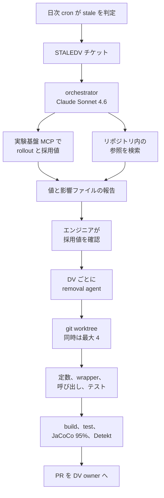

feature flag（機能フラグ）は、コードを書き換えずに実行時の設定で機能の有効・無効を切り替える仕組みです。段階的な公開、A/B テスト、障害時に機能を止める kill switch に使われます。機能を全員に出し終えたあとも、フラグとその分岐はコードに残り続けます。DoorDash の Atharv Chandratre と Jai Datar は、この残ったフラグを Jira のチケットから pull request（PR）まで運ぶ複数エージェントの仕組みを、2026年10月22日に arXiv で産業報告として公開しました（arXiv:2610.31351v1）。

この記事では、その仕組みの構成、評価の数字の読み方、人が判断として持ち続けている部分を整理します。リリース後に残る分岐の撤去を、機能の完了条件に入れるか、エージェントの作業範囲に入れるかを決める立場の人が、どこまで任せてよいかを判断できることを目指します。これは1社の Kotlin リポジトリでの運用報告で、評価した PR の一覧は公開されていません。記述は2026年10月24日時点の論文と公開資料に基づきます。


*この記事の全体像。以下、順に解説します。*

## DoorDash の feature flag 撤去エージェントとは

DoorDash の実験基盤は、feature flag を Dynamic Value（DV）と呼びます。論文の報告は、使い終えた DV を見つけ、採用する値を確定し、コードとテストから分岐を外し、検証を通した PR を DV の owner に渡すまでを、エージェントで自動化したものです。

採用値（target value）は、フラグを消したあとにコードへ固定する値で、本番の実験基盤が今返している値を基準に決めます。コード上の既定値は、フラグを読む呼び出しに書かれた値で、後述の Listing 1 では `getBoolean` に渡している `false` がこれにあたると読めます。論文は、全員に公開済みの DV でもコード上の既定値と本番の値が違うことがあり、ソースだけを見て撤去すると誤った値を固定しかねない、と書いています。

論文の Abstract によれば、DoorDash には 56,000 を超える DV が約 623 のリポジトリにあり、そのうち 1,659 が stale（使い終えたまま残っている状態）です。新しい DV は月に約 2,300 作られ、手作業での撤去は社内の見積もりで1件あたり1〜2時間かかる、と書かれています。

論文は撤去を急ぐ理由として、米国証券取引委員会（SEC）が2013年に公表した Knight Capital の事案を引いています。SEC の発表では、新しいコードが、使われなくなった機能を起動していたフラグを再利用し、2012年8月1日の取引開始から45分で4億6,000万ドルを超える損失が出ました。残ったフラグは、眠っている分岐を誤って起こす経路にもなる、というのが論文の動機です。

### stale と判定される条件

DV の一生は、作成、実験、rollout（段階的な公開）、stale、撤去の順に進みます。DV は次の4条件をすべて満たすと stale と判定されます。

- 90日間変更されていない
- コードからまだ参照されている
- archived や retired といった終了状態になっていない
- exclusion list（撤去しない DV を並べたリスト）に載っていない

日次の cron ジョブがこの条件で stale を拾い、`STALEDV` という Jira チケットを作って DV の作成者に割り当てます。論文は、チケットの割り当て先を DV の作成者（creator）、後で出す PR の割り当て先を DV の owner と書き分けており、両者が同じ人かは書いていません。owner がどの範囲に責任を持つかの定義もありません。

### コード上の参照は3層に分かれる

DoorDash のサービスでは、DV への参照が3つの層に分かれています。論文の Listing 1（簡略版）は次のとおりです。

```kotlin
// Layer 1: RuntimeKeys.kt - string constant
object RuntimeKeys {
  const val ENABLE_X = "enable_feature_x"
}

// Layer 2: FeatureFlags.kt - wrapper function
@Singleton
class FeatureFlags @Inject constructor(
  private val dvClient: DynamicValuesClient
) {
  fun shouldEnableX(userId: String): Boolean =
    dvClient.getBoolean(ENABLE_X,
      withContext("user_id" to userId), false)
}

// Layer 3: Business logic - usage via DI
class MyService @Inject constructor(
  private val featureFlags: FeatureFlags
) {
  fun process(userId: String) {
    if (featureFlags.shouldEnableX(userId)) {
      handleNewPath()
    } else { handleOldPath() }
  }
}
```

1層目は DV の名前を文字列定数として置くファイルです。2層目は、依存性注入（DI。必要な部品を外から渡して組み立てる方式）で配られる wrapper 関数で、`getBoolean` / `getString` / `getObject` といった API にユーザー ID や国コードなどの文脈を渡します。3層目の業務コードは wrapper しか呼びません。

DV の名前、API 呼び出し、条件分岐は別々のファイルにあり、メソッド呼び出しと DI でしかつながっていません。Uber が開発した Piranha は、構文木（AST）のパターン照合で flag の条件式を単純化する既存ツールです。論文は、この3層の構造を AST の照合だけでは追えないことを、Piranha 系のツールが DoorDash では構造的に合わない理由に挙げています。

### 2相の構成と人の確認点

システムは Google の Agent Development Kit（ADK。エージェントを組むためのオープンソースのフレームワーク）の上に、2つの相で作られています。図中の MCP、JaCoCo、Detekt は、この後の手順の中で説明します。



Phase 1 では、全体を取りまとめる orchestrator エージェント（Claude Sonnet 4.6）が、DV ごとに次を行います。

1. CLI で `STALEDV` チケットを取得する
2. 実験基盤を MCP 経由で問い合わせ、DV のメタデータ（UUID、rollout の割合、採用値）を得る。MCP（Model Context Protocol）は、AI が外部のデータやツールにつながるための共通の取り決めです。呼ぶのは `GetDynamicValue` と `GetDynamicValueDetails` です
3. 対象リポジトリを見つけ、コード上の参照をすべて検索する
4. 提案する採用値と影響ファイルを並べた確認用の報告を作る

この報告を見て、エンジニアが DV ごとに提案値を確認します。ここが人の確認点です。論文は、この確認をどの役割のエンジニアが行うかは書いていません。部分的にしか公開していない DV や、放棄されて 0% のままの実験も、ここで正しく扱われると論文は書いています。0% の DV は、公開済みとみなさず、公開前の値（baseline）で外します。

Phase 2 では、確認済みの DV ごとに、orchestrator が removal agent（Claude Opus 4.6）を1つずつ起動します。各 agent は git worktree（1つのリポジトリから作業ディレクトリを複数切り出す git の機能）の中で隔離されて動きます。同時に動くのはリポジトリあたり最大4つで、この数は設定で変えられます。

### removal agent の手順と安全装置

removal agent は次の手順を、検証が通るまで繰り返します。

1. 定数、wrapper 関数、呼び出し箇所を含む DV の参照をすべて探す
2. DV の型（boolean、integer、string）と使われ方から撤去の方針を決める
3. wrapper の呼び出しを採用値に置き換え、条件分岐を畳む
4. wrapper 関数、定義、定数を削除する
5. 影響を受けるテストを更新または削除する。たとえば「DV が無効のとき」のテスト分岐を消し、テストに付いた DV 用のアノテーション（`@DynamicValueOverrides`）を外す
6. ビルドを通す
7. テストを通す
8. 変更した行のテストカバレッジ（patch coverage）が 95% 以上であることを JaCoCo（Java/Kotlin 向けのカバレッジ計測ツール）で確かめる
9. Detekt（Kotlin 向けの静的解析ツール）を実行する
10. 検証が失敗したら原因を調べて直し、再試行する

ローカルでテストと Detekt が通るまで、agent は PR を作りません。論文は安全装置として、worktree による隔離、agent ごとの1時間のハードタイムアウト、JaCoCo による 95% のしきい値、Detekt の4つを挙げています。並行実行で worktree 同士が状態を汚さないよう、ビルドツールの Gradle は、常駐するビルドプロセス（daemon）を使わない設定 `--no-daemon` で動かします。できた PR は DV の owner に割り当てます。

### 評価の結果

評価の対象は、2026年4月14日時点でシステムが処理した直近の stale DV 50件で、すべて Kotlin のリポジトリです。各 PR を、CI が通るか（95% の coverage を含む）、コードが正しいか、開発者のレビューを通るか、の3点で評価し、次の3区分に分けています。

- Accepted：初回でそのまま受け入れられた
- Accepted with revision：軽い修正（多くは agent をもう1回動かすこと）のあと受け入れられた
- Failed：エンジニアが本格的に手を入れた

論文の Table I は次のとおりです。

| 指標 | 値 |
|---|---|
| 初回で Accepted | 31（62%） |
| 軽い修正のあと Accepted | 14（28%） |
| Failed | 5（10%） |
| usable PR（Accepted 2区分の合計） | 45/50（90%） |
| CI の初回通過 | 44/50（88%） |
| 1件あたりの時間 | 平均 13.8 分、中央値 12.3 分 |
| 1件あたりの LLM API 費用 | 平均 $4.79、中央値 $3.49 |

著者は50件を、事後に3段階の複雑度へ分けています。simple は1つの boolean 判定で1〜2ファイル、medium は複数の使用箇所で3〜5ファイル、complex は入れ子の条件、ファイルをまたぐ依存、boolean 以外の型、大きなテスト修正のどれかを含むものです。型の内訳は boolean 41、string 6、integer/long 3 です。

| 複雑度 | 件数 | 初回で Accepted | 修正を含めた Accepted | 平均時間 | 平均費用 |
|---|---|---|---|---|---|
| simple | 6 | 6 | 6（100%） | 7.5 分 | $2.69 |
| medium | 18 | 14 | 17（94%） | 10.4 分 | $3.46 |
| complex | 26 | 11 | 22（85%） | 17.7 分 | $6.20 |

複雑度別の平均時間と平均費用を件数で加重すると 13.848 分と $4.792 になり、Table I の全体平均と整合します。complex には、40分と $19 に達する外れ値があります。

## 注意点

### 90% は初回で通った割合ではない

論文が掲げる到達点は、評価した50件のうち45件で、エンジニアが受け入れられる PR を出した、というものです。この 90% には、軽い修正のあとで受け入れた14件が含まれます。初回でそのまま受け入れられたのは 62% です。

複雑度別の率も同じ区別が要ります。medium の 94% と complex の 85% は修正を含めた通過率で、初回で通ったのは medium 14/18、complex 11/26 です。初回の通過率が 100% と言えるのは simple の6件だけです。技術メディアの InfoQ（2026年9月18日）は、94% と 85% を、simple の 100% と同じく初回で通った率であるかのように並べて書いています。

在庫の 1,659 件を撤去し終えた、とは論文は書いていません。

### 「バグも回帰も無かった」は50本の PR の観察

論文は、生成した50本の PR について、変更したコードに由来するバグや回帰は観測しなかった、と書いています。CI の初回失敗6件はすべて coverage 不足で、誤ったコード変更によるものではない、とも書いています。DoorDash の公式ブログの「no bugs or regressions」も同じ50件の観察を短く書いたものです。

マージ後の観察期間、本番インシデントの件数、事故率は、論文にも公式ブログの結果の節にもありません。開発者からの指摘として、削除は正しいが、flag が消えたあとの変数名が意味とずれている、という声が引用されています。この指摘は「バグは観測しなかった」の範囲には入っていません。

### 修正14件の内訳が、論文の中で2通りある

RQ1（受け入れの結果を問う節）は、14件のうち coverage 不足が6件、残りの8件は深い呼び出しの鎖での使われなくなったコードの消し残しで、再指示で直った、と書きます。RQ2（どの性質が成否を分けるかを問う節）は、coverage 不足を6件と数えたうえで、残りをテスト修正の誤り6件と、残った未使用変数2件に分けています。coverage の6件は両節で揃いますが、残り8件の説明は揃いません。どちらの読みを採るかは、著者の訂正が無いと決まりません。

Failed の5件について、RQ2 は、共通点は flag の型やファイル数ではなく、インターフェースをまたいで引数を通す深い呼び出しの鎖だ、と書いています。agent は使われなくなったコードの大半を消したものの、複数ファイルにまたがる鎖の1〜2か所を残した、という記述です。論文は complex の撤去を、5層以上のメソッドをまたいで引数を外していく作業と説明しています。再指示で直った修正の例について、RQ1 は、深い呼び出しの鎖に使われなくなった変数や参照が1つ残るのが典型だと書いています。

### 在庫の数と時点が資料で揃っていない

| 資料 | 在庫の書き方 |
|---|---|
| arXiv v1 の Abstract | 56,000 超、623 リポジトリ、stale 1,659、時点は May 2026 |
| 論文本文の I 章 | 56,000 超、約 623、stale 1,659。月の記載なし。新規は月に約 2,300 |
| ICSME 2026（ソフトウェア保守の国際会議）のプログラム抄録 | 56,000 超と 1,659。時点は May 2025 |
| DoorDash 公式ブログ（2026年8月24日） | 60,000 超、約 623、stale は 1,000 超 |

1,659 の時点は、arXiv の抄録と学会プログラムの抄録で1年ずれています。どちらが誤記かは公開ページだけでは決まりません。評価集合の日付は2026年4月14日で、どちらの May とも別の日です。フラグ総数の規模は「数万」と読むのが安全です。

### 時間と費用の比較は計測条件が違う

手作業の1〜2時間は、論文の Threats to validity（妥当性への脅威）の節が、社内の経験によるもので実測ではない、と書いています。$4.79 は LLM API の費用の平均で、エンジニアがレビューに使う時間は含みません。時間を何倍短くしたかは、経験則との比較として読む必要があります。

### 評価の範囲と再現性

- 各 DV は1回しか実行していません。LLM の出力は実行ごとに変わり得るため、再実行で結果が変わる可能性を論文自身が書いています
- 複雑度のラベルは著者が事後に付けたものです。simple の 100% は6件の結果です
- 一般化の範囲は、DI の wrapper を使う Kotlin の1社に限られる、と論文は書いています。flag の API を直接呼ぶコードベースでは Piranha 系のツールが合う可能性がある、とも書いています
- 評価集合に object（JSON）型の DV は含まれていません
- arXiv には ICSME 2026 の Industry Track に採択と記載があり、学会プログラムには2026年9月16日の10分の発表が載っています。2026年10月24日時点で、IEEE Xplore にこの題名の文書は見つかっていません

## 人はどこで判断しているのか

論文に操作として書かれている人の判断は、Phase 1 の報告で提案値を確認することです。部分 rollout と放棄された実験は、この確認で扱われます。公式ブログは、60% まで公開して放棄した実験について、公開を完了する、元に戻す、今は撤去を見送る、のどれかを人が選ぶと書いています。見送った件数は、論文にもブログにもありません。

撤去しない DV を決める exclusion list は、stale の4条件の1つです。しかし、何件載っているか、どの基準で載せるか、誰が更新するかは論文のどの節にもありません。kill switch をどう扱うかの記述もありません。90日変更が無く、コードから参照され、リストに載っていなければ、kill switch でも stale の定義は満たします。

評価の50件は「システムが処理した直近の撤去」です。exclusion list で残した DV や、確認の段階で止めた DV は分母に入りません。

PR は DV の owner に割り当てられ、開発者のレビューが評価軸の1つになっています。owner がマージしなかった件数の記録はありません。公式ブログは初回の31件を merged と書いていますが、修正後に受け入れた14件が本番にマージされたかは書いていません。

将来の課題として論文は、Phase 1 に信頼度のスコアを入れ、低リスクな撤去は自動で承認し、人の確認は曖昧なケースだけに残す方向を挙げています。低リスクの例は、rollout が 100% の boolean で、コード上の既定値が本番の値と一致する DV です。今回の報告の範囲では、この自動承認はまだ入っていません。

## エージェントが触る差分と触らない差分

agent の手順に入っているのは、定数、wrapper、呼び出し箇所、条件の畳み込み、テスト、`@DynamicValueOverrides`、coverage、Detekt です。変数名を意味に合わせて直す工程は手順にありません。論文は将来の課題として、撤去後の命名のような意味の問題を見るレビューの段を足すと書いています。

次の項目は、agent の作業範囲の外にあるか、論文の中で閉じていません。

- どの flag を残すかの台帳
- rollout が 100% であることの確認。stale の4条件に「全員に公開済み」は含まれません
- object（JSON）型の DV。論文の Listing の説明には `getObject` が出てきますが、評価した50件の型の内訳に object はありません
- Kotlin 以外の言語

撤去で変わるファイル数も資料で揃っていません。論文の II-B 節は単純な boolean でも3〜20ファイルと書き、同じ論文の simple の定義は1〜2ファイルです。公式ブログは単純な boolean で5〜20ファイルと書いています。

論文の V 章は、設計で効いた点として3つを挙げています。1つ目は、本番の値を実験基盤から読んでから置き換えることです。ソースコードだけを見るツールは、コード上の既定値を誤って固定してしまう恐れがあります。2つ目は、PR を作る前に、モデルの自己申告ではなく JaCoCo、Detekt、ビルドを通すことです。agent が自分で計算した coverage が外れることがあり、95% 未満を CI が落とした、と論文は書いています。3つ目は worktree と `--no-daemon` です。初期の実験では、隔離せずに並行させた agent が同じファイルを書き換え、壊れた差分ができたと報告されています。

## 他社の報告と比べて何が言えるか

論文は、LLM でのフラグ撤去について、成功率・費用・時間・複雑度別の内訳・失敗の分析まで出した業界の報告は他に無い、と主張しています。この主張は、範囲を狭めて読む必要があります。

- Atlassian のブログ（2026年3月9日）は、初期の専用プロンプトで9件中5件、改善後に9件中8件、執筆時点で31件中29件を介入なしで撤去した、と成功率を書いています。1件あたりの費用と時間、複雑度別の内訳はありません
- Duolingo のブログ（2025年12月4日）は、試作に約1日、本番化に約1週かかった、と開発期間を書いています。撤去の成功率はありません
- Uber の Piranha は、ソフトウェア工学の国際会議 ICSE の実務部門（ICSE-SEIP 2020）の抄録で、2017年12月から2019年5月に 1,381 の flag の撤去差分を生成し、それが当時の全 flag の 17% で、65% は修正なしでマージされ、85% 超がコンパイルとテストを通った、と書いています

1件あたりのドルと分、複雑度別の分解まで出している点では、DoorDash の報告は他の公開資料より細かいと言えます。成功率を出した報告が他に無い、とまでは言えません。

## 自分の開発サイクルに取り入れるなら

この報告から、リリース後に残る分岐の撤去をエージェントに渡す手順を組むなら、次の順になります。

1. 機能の完了チケットに専用の欄を設け、撤去の担当、期限、残してよい分岐（kill switch や長期の実験）、採用する値の4項目をまとめて書く。残す分岐の欄が空のまま、90日ルールだけで撤去の対象にしない
2. エージェントに渡すのは、その欄が埋まったあとにする。渡す前に、本番の設定値とコード上の既定値が一致するかを人が見る。部分 rollout と 0% の flag は自動で畳まない
3. 検証には、テストが通ることとは別に、参照の消し残しを見る段を入れる。論文の失敗はここに集中しています。coverage はモデルの自己採点ではなく、計測ツールのしきい値で判定する
4. 名前が flag の存在を前提にしたまま残る差分は、正しさの検証の外にあります。必要なら別のレビューを置く
5. 成功率を言うときは、初回で通った割合、再試行を含めた割合、本番にマージされた割合を分ける。50件の観察を事故率と呼ばない

手順1と2の人の確認を省き、エージェントへ直接渡してよいのは、次の条件がすべてそろうときです。残してよい分岐の基準がすでに機械で読める形になっている。rollout が 100% で、コード上の既定値と本番の値の一致を機械で確かめられる。変更が論文の simple の定義（1つの boolean 判定で、変更は1〜2ファイル）に収まる。マージ後の観察が別に用意されている。DoorDash の論文も、rollout が 100% で既定値が本番の値と一致する boolean の自動承認は将来の課題として挙げるにとどめており、評価集合がこの条件を満たしているとは書いていません。

## まとめ

DoorDash の仕組みは、stale になった DV をチケットから PR まで運び、本番の採用値を実験基盤から読み、ビルド・テスト・coverage・静的解析を通してから PR を出す2相の構成です。人の確認は、Phase 1 の採用値の確認と、owner による PR のレビューに残っています。

評価の 90% は、修正後の受け入れを含む50件の結果で、初回で通ったのは 62% です。「バグも回帰も無かった」は50本の PR の観察で、本番の事故率ではありません。失敗は深い呼び出しの鎖での消し残しに集中し、撤去しない flag を決める exclusion list の中身は公開されていません。

撤去をエージェントに任せるかどうかの判断は、差分を作る能力よりも、残す分岐と採用値を誰がどこに書くかで決まります。その欄を先に埋め、消し残しを検証の段に入れることが、この報告から持ち帰れる設計です。

この記事が少しでも参考になった、あるいは改善点などがあれば、ぜひリアクションやコメント、SNSでのシェアをいただけると励みになります！

## 参考リンク

- Chandratre, A. and Datar, J. "Automating Feature Flag Cleanup at Scale with Multi-Agent LLM Systems: An Industrial Experience at DoorDash". arXiv:2610.31351v1, 2026-10-22. https://arxiv.org/html/2610.31351v1
- arXiv abs ページ: https://arxiv.org/abs/2610.31351
- ICSME 2026 Industry Track プログラム: https://conf.researchr.org/details/icsme-2026/icsme-2026-industry-track/8/Automating-Feature-Flag-Cleanup-at-Scale-with-Multi-Agent-LLM-Systems-An-Industrial-
- DoorDash 公式ブログ（2026-08-24）: https://careersatdoordash.com/blog/automating-feature-flag-cleanup-at-scale-with-a-multi-agent-llm-system/
- U.S. SEC. Press Release 2013-222: https://www.sec.gov/newsroom/press-releases/2013-222
- Ramanathan et al. "Piranha: Reducing Feature Flag Debt at Uber". ICSE-SEIP 2020: https://ieeexplore.ieee.org/document/9276556
- Atlassian（2026-03-09）: https://www.atlassian.com/blog/developer/turning-ff-cleanup-into-handsoff-ai-workflow
- Duolingo（2025-12-04）: https://blog.duolingo.com/buildingaiagents/
- InfoQ（2026-09-18）: https://www.infoq.com/news/2026/09/doordash-feature-flag-cleanup/
