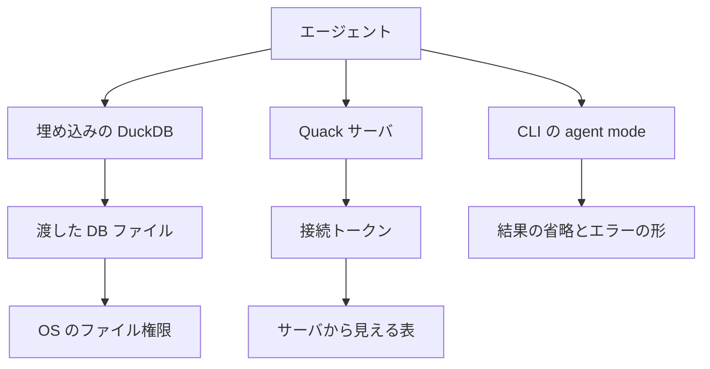

2026年10月21日、DuckDB 2.0.0 が長期サポート版（LTS）として公開されました。コードネームは Cinnamon Teal です。DuckDB チームは、1.5 以降の約 20,000 コミットを含む大きな機能リリースだと説明しています。

Quack は、DuckDB のインスタンスを HTTP のサーバにし、別の DuckDB から接続するプロトコルです。プロセスの中に埋め込んでファイルを開く使い方は、2.0 でも残ります。CLI には、結果の表示とエラーの出し方を変える agent mode もあります。agent mode は、接続先やトークンとは別の層です。

この記事では、ファイルを渡す埋め込み、Quack の接続、CLI の表示の三つが、それぞれ何を変えるかを公式文書に沿って整理します。読み終わると、エージェントに分析用のデータベースを渡すとき、届く範囲をどの層で決めるかを切り分けられます。文中の日付と数値は、2026年10月26日に公式文書と公開の issue を照合したものです。


*この記事の全体像。以下、順に解説します。*

## DuckDB 2.0 と Quack とは

DuckDB 2.0.0 は、ファイルを開くライブラリとしての使い方を残したまま、Quack で別プロセスからの SQL を受け付けます。Quack の公開記事は 2026年5月12日です。本体に同梱されるコア拡張になったのは、2026年5月20日の DuckDB 1.5.3 からです。2.0 の発表は、これを磨いた機能として置いています。

### 接続の形

メッセージはクライアントが送ります。サーバからの push は無く、符号化は DuckDB 内部の直列化です。問い合わせのあと、結果は `FETCH` でチャンクを受け取ります。`FETCH` は、利用者が書く SQL ではなく、結果を分割して受け取るプロトコルの操作です。URI のスキームは `quack:` で、既定ポートは 9494 です。

サーバは既定で、ローカルのホスト名だけを listen します。`CALL quack_serve()` は、listen URI、HTTP URL、そして既定の認証を使うときは `auth_token` を返します。クライアントは、`ATTACH` で `quack:` URI とトークンを接続名に結び、そのあと `CONNECT` でセッション全体をサーバへ向けます。Quack の overview（概要文書）は、attach したあとの `CONNECT` を、リモートで作業するときの案内にしています。トークンは、クライアントが送る文字列とサーバが持つ文字列を比べる認証の鍵です。

ローカルの URI（`localhost`、`127.0.0.1`、`::1`）は平文 HTTP が既定です。それ以外は HTTPS が既定で、証明書を渡さない非ローカルのサーバは自己署名の HTTPS を出します。本番配置の案内は、サーバを localhost に bind し、TLS を終端する reverse proxy を前に置く、です。外部から届くアドレスで listen するときは `allow_other_hostname = true` を渡します。

認証の既定は、クライアントとサーバのトークンを比べる `quack_check_token` です。トークンは起動時に指定するか、サーバが乱数で出します。最短は 4 文字です。認可の既定 `quack_nop_authorization` は、受け取ったクエリを書き換えずに、実行する対象として返します。トークンを通過したクライアントは、そのサーバセッションから見える表やファイルを読み書きできます。Quack の overview（概要文書）がそこに含めるのは、メモリ上の表、サーバが開いているデータベースファイル、スキーマです。

認可コールバックは、別の SQL 文字列を返してそれを実行させることができます。コールバックが false / NULL、またはコールバック自身のクエリが失敗すると、`Authentication failed` または `Authorization failed` になります。コールバックは、サーバ側の新しい一時接続で動きます。SQL マクロは、`CREATE MACRO` で SQL として登録する関数です。データの追加や更新や削除（DML）は実行できません。誰が接続したかをサーバ側に残すには、拡張機能のスカラー関数（scalar UDF。1 行ずつ値を返す関数）が要ります。マクロではその記録を書き込めないためです。Python の UDF は、トークンを比べる認証コールバックには使えません。クエリを通す認可の側の話ではありません。

CLI は `-serve` と `-connect` で、サーバ起動と接続を案内しています。同時接続の上限 `quack_server_max_connections` の既定は 1024 で、超えた新規接続は拒否されます。keep-alive は 300 秒、heartbeat の既定タイムアウトは 60 秒です。

2026年10月21日の発表が示す接続は、次の形です。サーバ側でトークンを指定して待ち、表を作ります。

```sql
CALL quack_serve(
    token = 'my_token'
);

CREATE TABLE events
    (date DATE, name VARCHAR);

INSERT INTO events VALUES
    ('2027-04-07',
     'DuckCon #8');
```

別の DuckDB から、同じトークンで attach してセッションを向けます。

```sql
ATTACH 'quack:localhost'
    AS qk (TOKEN 'my_token');

CONNECT qk;
SELECT * FROM events;
```

CLI から同じ役割を起動する案内は、次です。

```shell
duckdb -serve
duckdb -connect
```

### 同じファイルを複数プロセスで開くとき

公式の concurrency 文書では、読み書きモードで読み書きできるのは 1 プロセスです。同一プロセスの中では、MVCC（多版同時実行制御）と楽観的同時実行があり、追記は衝突しません。同時に同じ行を変更するトランザクションは衝突し、そのエラー文は `Transaction conflict: cannot update a table that has been altered!` です。文言は表が変更された、と読みますが、文書が対応づける条件は同じ行の同時変更です。読み取り専用なら、複数プロセスが読めます。指定は `access_mode = 'READ_ONLY'` です。

ネイティブファイル（DuckDB 自身のデータベースファイル）を複数プロセスで書き込む経路として、同文書は Quack を挙げます。ファイルを直接開くときの同時アクセスはファイルロックで扱われ、共有ディレクトリや NAS では注意が要ります。これは Quack の接続の話ではありません。別経路は DuckLake です。DuckLake は、オブジェクトストレージとカタログ（表の置き場を記録する台帳）で複数書き込みをする形式です。concurrency 文書は、DuckLake 1.1 と、PostgreSQL をそのカタログにする例を挙げ、中央の PostgreSQL カタログを介して複数の DuckDB が同時に読み書きできる、と書きます。

分散クエリは、FAQ が未対応と書きます。MotherDuck は別プロトコルのマネージド製品で、利用者管理やバックアップは Quack の機能一覧に含まれません。プロセス内利用は、FAQ が first-class として残すと書きます。

### ストレージ形式

2.0 が既定で作るファイルは storage version 69 です。storage version は、データベースファイルの形式の版番号です。2.0 未満はこれを読めません。案内されているエラーは、次です。

```text
IO Error: Trying to read a database file with version number 69, but we can only read versions between 64 and 68
```

2.0 は古いファイルを読み書きでき、そのファイルは古い storage version のまま残ります。古い形式で新規作成するときは、`-storage-version`、設定 `storage_compatibility_version`、または ATTACH の `STORAGE_VERSION` を使います。移行文書が示す、2.0 の CLI で v1.5.6 形式の新規ファイルを作り、1.5.6 で開く例は次です。

```shell
~/.duckdb/cli/latest/duckdb my.db -storage-version v1.5.6 -c "CREATE TABLE t (x INT);"
~/.duckdb/cli/1.5.6/duckdb my.db
```

既存ファイルを 2.0 の形式へ移す変換は、`EXPORT DATABASE` / `IMPORT DATABASE` です。文書の例では、older が 2.0 未満、newer が 2.0.0 です。

```shell
/older/duckdb mydata.old.db -c "EXPORT DATABASE 'tmp'"
/newer/duckdb mydata.new.db -c "IMPORT DATABASE 'tmp'"
```

### サポート期間

発表、リリースカレンダー、community support は、2.0 の期間を次のように書いています。

| 根拠 | 日付の書き方 |
| --- | --- |
| 2.0 発表（2026年10月21日） | 少なくとも 2027年10月までサポート |
| リリースカレンダーの 2.0.0 LTS 行 | End of life は 2027年10月22日 |
| community support の v2.0 行 | 2027年10月まで |
| カレンダーの次パッチ | 2.0.1 は 2026年11月18日の予定。カレンダーは予定日を仮（tentative）としている |
| 前の系統 | 1.4.0 の EOL は 2026年11月17日。1.5.0 の EOL は 2027年3月1日。発表は 1.5 のサポートを 2027年3月まで延ばしたと書く |

community support は、問題が一定時間内に解決される保証はできない、と書きます。再現の試行は数営業日、まとめて週次、という運用です。ページヘッダの Last updated は 2026年8月27日で、本文には v2.0 の行があります。期間の正本は、発表とカレンダーに置きます。

サポート対象のクライアント一覧があり、C++ API は安定した利用者向け API ではない、と community support は書きます。32-bit、big-endian、debug build、内部構造は対象外です。商用の応答時間、リージョン、データ所在地、利用料金の単価は、FAQ と community support に数値がありません。DuckDB 自体のライセンスは MIT です。

### CLI の agent mode と safe mode

agent mode は、結果を短い Markdown にし、省略を明示し、エラーを stderr に JSON で出します。発表は、暴走するクエリを早く止める、とも書きます。止める条件の数値は、agent mode のマニュアル本文では確認していません。自動で入る条件は、次の三つがすべて揃ったときです。文書が例に挙げる環境変数（`AI_AGENT`）があること、stdout が TTY ではないこと、出力モードの指定が無いことです。明示するフラグは `-agent` / `-no-agent`、環境変数は `DUCKDB_AGENT_MODE` です。

既定の表示は、全体で最大 1,000 行かつ 10,000 バイト、セルは 500 文字で切ります。それを超える結果は、先頭と末尾と総行数を出します。1,000,000 行を超えて読むクエリは、stderr に見積りと進捗を出します。フッターには行数と、読み切ったときは順序に依らないハッシュがあります。

```shell
duckdb -agent -c "SELECT 42 AS answer;"
duckdb -no-agent -c "SELECT 42 AS answer;"
```

safe mode は、`-safe` または `.safe_mode` で入ります。最初に開いた DB ファイル以外の外部ファイルと、ホストのファイルシステム操作を止めます。`.sh` や `.system` などのドットコマンド、`getenv`、外部ファイルへの到達を許す設定 `enable_external_access` が閉じます。`ATTACH` で別ファイルを開くこと、`COPY` のファイル入出力、`read_csv` / `read_parquet` / `read_json` の外部読みが止まります。同じ CLI セッションでは解除できません。

```shell
duckdb -safe
```

### エージェントから見た三つの経路

エージェントから見た経路は三つあります。埋め込みは、プロセスがファイルを開きます。Quack は、トークンでサーバセッションに入ります。agent mode は、開いたあとの表示だけを変えます。表示の層なので、埋め込みと Quack のどちらとでも併用します。図の三本目は、その表示の層です。



埋め込みでは、渡したファイルに対する OS の読み書き権限が、そのプロセスの届く範囲になります。safe mode は、そのプロセスがホストの別ファイルへ出る操作を、CLI 上で止める追加のスイッチです。

Quack では、サーバプロセスから見える表やファイルが届く範囲になります。既定の認可はクエリをそのまま通すので、トークンはサーバセッション全体への鍵になります。ファイルの OS 権限は、サーバプロセスのユーザに対して効きます。クライアントプロセスの OS ユーザには、ファイルを直接開かせない構成にできます。

agent mode は資格を発行しません。表示の上限とエラーの形を変えます。

## 注意点

公開文と公式 FAQ は、Quack の完成度を違う語で置いています。同じ言葉でも、ページごとに数えているものが違います。2.0.0 のバイナリで、文書の案内と公開 issue の報告が揃わない点もあります。

### 本番という語と、サポート期間

2.0 の発表は、Quack を磨いた、と書きます。2026年10月26日に取得した FAQ の “Is Quack production-ready?” は “Not yet” です。beta であり、プロトコル、関数名、既定値が壊れ得る、と書きます。2026年5月12日の初出記事は、2.0 と一緒に最初の production release を予定する、と書いていました。2026年10月26日の FAQ は、その予定が達成済みだとは書いていません。LTS の期間は、プロトコルが変わらない期間ではありません。

発表は、本番へ切り替える前のシャドー試験を勧めます。シャドー試験は、本番の外で既存の負荷を追いかける試験です。ミッションクリティカルなら、最初のパッチまで待ってよい、と書きます。1.5 のサポートは 2027年3月まで延びているので、待つ選択はカレンダー上は残ります。

「少なくとも 2027年10月」は発表の文です。カレンダーの End of life は 2027年10月22日で、公開日の 1 年と 1 日後です。2.0.1 の 2026年11月18日は予定であり、カレンダーは予定を仮としています。community support は修正期限を保証しません。

[Publickey](https://www.publickey1.jp/blog/26/duckdb_20_ltsquack.html)（2026年10月26日）は、5 日前の発表の要約です。見出しに “QuackDB 2.0” という表記があります。仕様の確認は公式文書で行います。

### 百分率と書き込み速度

「出力が 59% 減った」は、2026年10月21日の発表が TPC-H の自社実験として書いた値です。TPC-H は、意思決定支援の標準ベンチマークです。agent mode のマニュアル本文には、この百分率はありません。第三者の再測定は、この記事では扱っていません。

「毎秒数千の書き込み」は、FAQ が 2026年5月12日の測定へ向けている値です。FAQ の条件は、8 CPU、32 GB のサーバです。測定記事の条件は、AWS m8g.2xlarge、8 vCPU、32 GB、同じアベイラビリティゾーン、1 行ずつの `INSERT` です。同じ記事は、同一テーブルへの INSERT は 8 並行を超えると DuckDB 側が頭打ちになり、その先は PostgreSQL の方が伸びる、と書きます。ピークとして書かれているのは、8 並行で毎秒およそ 5,500 トランザクションです。2.0 発表の本文に、この小書き込みを 2.0 で測り直した表はありません。2.0 の性能保証値としては扱いません。

overview、reference、FAQ には、1 分あたりのリクエスト数の定義はありません。1024 は同時接続数の上限であり、1 分あたりのリクエスト数ではありません。

### 文書と 2.0.0 の報告

公式の security 文書は、SQL の先頭だけを正規表現で見て read-only と判断する例を、堅くないと明記しています。`WITH ... INSERT` で迂回できます。文書の例は、先頭が `SELECT`、`FROM`、`WITH`、`EXPLAIN`、`DESCRIBE`、`SHOW` なら通す、という形です。

```sql
CREATE MACRO read_only(sid, query) AS
    regexp_matches(upper(trim(query)), '^(SELECT|FROM|WITH|EXPLAIN|DESCRIBE|SHOW)\b');

SET GLOBAL quack_authorization_function = 'read_only';
```

案内は、read-only で attach するか、パースした文の種類を見ることです。2026年10月26日時点の GitHub では、その read-only attach が 2.0.0 の境界になっていない、という報告が開いています。状態は `gh` で再取得しました。報告は再現の提示であり、全環境で DuckDB チームが確認したことと同じではありません。

| 記録 | 状態 | 何が起きるか |
| --- | --- | --- |
| [duckdb/duckdb-quack#327](https://github.com/duckdb/duckdb-quack/issues/327) | open | 2.0.0 で `READ_ONLY` の Quack attach から INSERT / UPDATE / DELETE / 表定義の変更（DDL）が通った、という報告 |
| [duckdb/duckdb-quack#329](https://github.com/duckdb/duckdb-quack/pull/329) | merged（2026年10月22日） | タイトルは READ_ONLY attach を拒否する。read-only の実装ではない |
| [duckdb/duckdb-quack#325](https://github.com/duckdb/duckdb-quack/issues/325) | open | SQL で定義した認証・認可を、認証済みクライアントが置換できる、という報告。報告者の再現手順は v2.0.0-alpha48877。2.0.0 の正式公開版での再検証は、この issue には無い |
| [duckdb/duckdb-quack#319](https://github.com/duckdb/duckdb-quack/issues/319) | open | remote pushdown（問い合わせの処理をサーバ側へ寄せる機能）を切った状態で、別の接続からの `DROP COLUMN` のあと、消した列名の照会が別の列の値を返し得る、という報告。この機能の既定がオンかは、報告には書いていない |
| [duckdb/duckdb-quack#332](https://github.com/duckdb/duckdb-quack/issues/332) | open | 1 つの接続の複数 cursor（結果を順に読むハンドル）が、互いのクエリを cancel する |
| [duckdb/duckdb-quack#336](https://github.com/duckdb/duckdb-quack/issues/336) | open | `Invalid connection id` が、セッションが消えたことを説明しない |

#329 が、公開済みの 2.0.0 バイナリに入っているかは未確認です。マージは 2.0.0 公開の翌日です。2.0.0 を使うあいだ、`READ_ONLY` は権限の境界にしません。マージ後の挙動も「拒否」であり、読み取り専用の強制ではありません。security 文書が「本番の read-only には read-only で attach」と書く箇所は、この 2.0.0 の報告および #329 の方針と揃いません。

#325 が open であるあいだ、認証マクロと、トークンと利用者名を並べた表を、クライアントが書けるカタログに置く構成は境界にしません。ここでいうカタログは、そのサーバセッションから見える表の一覧です。

#319 は、エラーではなく別の値を返し得る、という種類の報告です。複数エージェントが表定義を更新する構成では、結果の意味が変わります。ディスク上のファイル破損として、ここで挙げた記録の範囲で一次確認できた報告はありません。

NVD の `keywordSearch=quack` は、2026年10月26日時点で 0 件です。`duckdb/duckdb-quack` の公開 security advisory も空でした。Quack 固有の CVE が無いことの証明ではありません。DuckDB 本体の過去の CVE は、2.0 の Quack の境界とは別件です。例として CVE-2024-41672 は 1.0.0 以前で、外部ファイルへの到達を止める設定 `enable_external_access=false` の下でも、CSV の形を推定して読む `sniff_csv` がファイルを読めました。NVD は修正を 1.1.0 に見込んでいます。

2026年10月26日の公式チェックで、2.0 の Statements Overview を確認しました。`CREATE ROLE` / `GRANT` による組み込みの DB ロールは、その一覧では確認できませんでした。追加のサイト内検索でも、Quack 用のロール文は見つかりませんでした。これは実装全体の監査ではありません。Quack の資格は、ドキュメント上はトークンと、任意の認証・認可コールバックです。

まだ閉じていない問いは、次です。

- #329 がどの公開バージョンに入るか。カレンダー上の次点は 2.0.1（2026年11月18日、tentative）です。
- #325 が 2.0.0 の正式公開版のバイナリで再現するか。
- 拡張機能のスカラー関数で認可を固定する実装例が、公式の本番手順としてどこまで書かれているか。security 文書は必要性までで、配布済みの ACL 拡張の採否は未確認です。ACL は、誰がどの操作をできるかを表にしたものです。
- Quack のプロトコルが、LTS の 1 年のあいだにどこまで互換を保つか。FAQ は破壊的変更があり得る、と書き、正式公開のあとに起きた確定事例はここで確認できていません。
- 2.0 での小書き込みの再計測。2026年5月12日の条件付きの値しか、ここでは見つかっていません。

## 届く範囲はどの層が決めるか

渡し方ごとに、届く範囲の正本が違います。agent mode は、この表のどの行の資格にもなりません。

| 渡し方 | 届く範囲の正本 | 既定で範囲を狭める手段 | 複数プロセスの書き込み |
| --- | --- | --- | --- |
| 埋め込みでファイルを渡す | そのファイルの OS 権限 | CLI なら `-safe`。外部ファイルとホスト操作を止める | ネイティブファイルの読み書きは 1 プロセス |
| Quack のトークンを渡す | サーバセッションから見える表やファイル | 既定は通すだけ。2.0.0 では、Quack の attach に付ける `READ_ONLY` も SQL マクロも、範囲を狭める手段にしない | Quack が公式の経路 |
| DuckLake | カタログとオブジェクトストレージの権限 | カタログ側の権限。ファイルの OS 権限とは別 | 公式が別経路として書く |

判断に使う事実は、次のとおりです。

- サーバセッションが見えるものが、リモートから届きます。overview は、メモリ上の表も attach したファイルも、そのセッションが見ていればプロトコル越しに届く、と書きます。
- 既定認可はクエリを書き換えずに通します。security 文書の `quack_nop_authorization` です。
- ネイティブファイルの複数プロセス書き込みは Quack 経由、と concurrency 文書が書きます。
- agent mode の文書は、表示とエラーと打ち切りです。認証の項目はありません。

2.0.0 で境界に使わないものは、次です。

- 別のトークンや、Quack の attach に付ける `READ_ONLY` で、読み取りだけを分けること。ファイルを開く `access_mode = 'READ_ONLY'` とは別です。#327 が open で、#329 は拒否であって読み取り専用の強制ではありません。
- クライアントが更新できる表の一覧に置いた、SQL マクロとトークン表。#325 が open です。
- 出力の省略や stderr の JSON。それらは agent mode の表示であり、ファイル権限やトークンの代わりになりません。

## 単一の分析ファイルを渡す

単一のエージェントに、単一の分析ファイルを渡します。境界の正本は、そのファイルの OS 権限にします。プロセス内の埋め込みのままにします。CLI で渡すなら、ホストの別ファイルとシェルを止めるために `-safe` を付けます。agent mode は、表示の層として別に効かせてよいです。資格の代わりにはしません。

ネイティブファイルを、複数プロセスが同時に読み書きする要件が先に立ったときだけ、Quack を使います。そのときは次をセットにします。

- トークンを、サーバセッション全体への鍵として配ります。読み取りだけが必要なら、別のトークンや、Quack の attach に付ける `READ_ONLY` では分けません。ファイルを直接開くときの `access_mode = 'READ_ONLY'` とは別です。
- サーバは localhost に bind し、外へ出すなら TLS 終端の reverse proxy を置きます。
- 認可を、SQL マクロと、クライアントが更新できるトークン表に置きません。
- FAQ が beta と書くあいだ、ミッションクリティカルな面はシャドー試験にするか、発表が許している最初のパッチまで待ちます。1.5 は 2027年3月までサポートが残ります。

2.0 が既定で新規作成したファイルは、2.0 未満のワーカーが読めません。混在させるなら、`STORAGE_VERSION` か `EXPORT DATABASE` / `IMPORT DATABASE` を先に決めます。

オブジェクトストレージとカタログで複数書き込みをしたい場合は、DuckLake が公式の別経路です。ネイティブファイルの OS 権限や Quack トークンの話とは、ストレージが違います。

## まとめ

DuckDB 2.0.0 は 2026年10月21日の LTS で、既定の新規ファイルは storage version 69 です。Quack は別プロセスから SQL を届けるプロトコルで、既定のトークンはサーバセッション全体への鍵です。埋め込みと agent mode は、それぞれ OS 権限と表示の層です。

FAQ は Quack をまだ beta と書き、発表の LTS 期間はプロトコルの安定を意味しません。2.0.0 では `READ_ONLY` attach を権限境界にせず、クライアントが書き換えられる SQL 認可も境界にしません。単一の分析ファイルを渡すなら、埋め込みと OS 権限と、CLI なら `-safe` が、今日の境界です。複数プロセスの書き込みが先に立ったときだけ Quack を足し、外へ出すなら localhost と TLS 終端にします。

この記事が少しでも参考になった、あるいは改善点などがあれば、ぜひリアクションやコメント、SNSでのシェアをいただけると励みになります！

## 参考リンク

一次（本文の照合日は 2026年10月26日）:

- [Announcing DuckDB 2.0.0（2026年10月21日）](https://duckdb.org/2026/10/21/announcing-duckdb-200.html)
- [Quack overview](https://duckdb.org/docs/2.0/quack/overview.html)
- [Quack security](https://duckdb.org/docs/2.0/quack/security.html)
- [Quack reference](https://duckdb.org/docs/2.0/quack/reference.html)
- [Quack troubleshooting](https://duckdb.org/docs/2.0/quack/troubleshooting.html)
- [Quack FAQ](https://duckdb.org/quack/faq.html)
- [Quack 初出（2026年5月12日）](https://duckdb.org/2026/05/12/quack-remote-protocol.html)
- [DuckDB 1.5.3（2026年5月20日、Quack をコア拡張として同梱）](https://duckdb.org/2026/05/20/announcing-duckdb-153.html)
- [Concurrency](https://duckdb.org/docs/2.0/connect/concurrency.html)
- [Migration](https://duckdb.org/docs/2.0/operations_manual/migration.html)
- [Release calendar](https://duckdb.org/release_calendar.html)
- [Community support](https://duckdb.org/community_support.html)
- [CLI agent mode](https://duckdb.org/docs/2.0/clients/cli/agent_mode.html)
- [CLI safe mode](https://duckdb.org/docs/2.0/clients/cli/safe_mode.html)
- [Statements overview](https://duckdb.org/docs/2.0/sql/statements/overview.html)
- [NVD keyword quack（2026年10月26日、0 件）](https://services.nvd.nist.gov/rest/json/cves/2.0?keywordSearch=quack)
- [CVE-2024-41672](https://nvd.nist.gov/vuln/detail/CVE-2024-41672)
- [duckdb/duckdb-quack#327](https://github.com/duckdb/duckdb-quack/issues/327)
- [duckdb/duckdb-quack#329](https://github.com/duckdb/duckdb-quack/pull/329)
- [duckdb/duckdb-quack#325](https://github.com/duckdb/duckdb-quack/issues/325)
- [duckdb/duckdb-quack#319](https://github.com/duckdb/duckdb-quack/issues/319)
- [duckdb/duckdb-quack#332](https://github.com/duckdb/duckdb-quack/issues/332)
- [duckdb/duckdb-quack#336](https://github.com/duckdb/duckdb-quack/issues/336)

二次:

- [Publickey「DuckDB 2.0 LTSがQuackでクライアントとサーバを分離」（2026年10月26日）](https://www.publickey1.jp/blog/26/duckdb_20_ltsquack.html)
