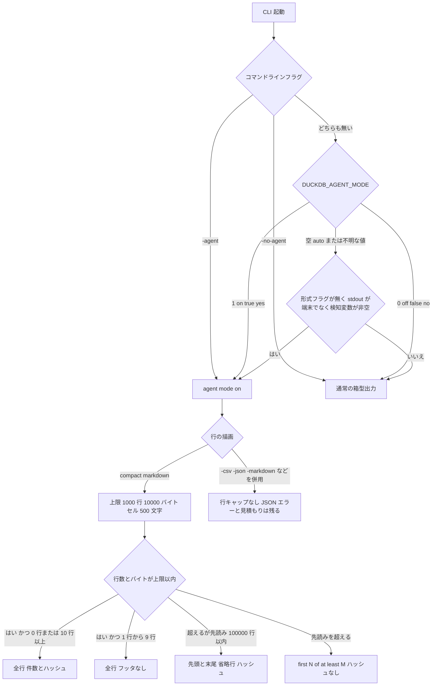

DuckDB の CLI には、コーディングエージェント向けの出力モードがあります。エージェントを検知するか、`-agent` で明示すると、桁を揃えた枠の代わりに短い Markdown 表を出します。上限との関係はフッタと省略行に表れ、エラーは標準エラーの JSON で返します。人が端末で同じ CLI を開いたときの既定は、従来の箱型の表のままです。

2026-10-12 時点で、この実装はブランチ `v2.0-cyanoptera` にあります。安定版の最新リリース v1.5.6（公開 2026-09-28）のシェルソースには入っていません。

この記事では、モードの入り方、コンパクトな Markdown の上限、エラーの返し方、結果を完了とみなす前に見るフッタを説明します。


*この記事の全体像。以下、順に解説します。*

## DuckDB CLIのエージェントモードとは

エージェントモードは、DuckDB CLI の行の描画と、エラーと見積もりの返し方を、エージェントが読みやすい契約に寄せるスイッチです。HTTP のクライアント文字列は見ません。見るのは、コマンドラインフラグ、環境変数、標準出力が端末かどうかです。

有効なときの行描画は、桁を揃えない Markdown 表です。ヘッダには型名が付きます。セル内の `|` はエスケープします。既定の上限は 1000 行、10000 バイト、セル幅 500 文字です。セル幅はバイト数ではありません。

行数とバイトの両方が上限以内なら、全行を出します。上限を超えても結果を読み切ったときは、先頭と末尾、省略を示す行、16 桁のハッシュを出します。片側の表示は最大 20 行です。上限のあと 100000 行を超えて数えると、読み込みを止めます。そのときのフッタは `first N of at least M rows (query stopped early; ...)` で、ハッシュは付きません。

エラーは標準エラー出力の JSON です。計画上の読み取りが 100 万行以上の SELECT、INSERT、UPDATE、DELETE、CREATE、COPY では、実行前に見積もり行を出します。端末の進捗バーの代わりに、5.0 秒間隔のプレーンな進捗行を出せます。最初の印字より前に終わったクエリは、完了行も出しません。

`.tables` はオブジェクトを 1 行で出します。`EXPLAIN` の既定は、演算子 1 行の compact 形式です。`EXPLAIN (FORMAT ...)` を付けると、その形式が勝ります。

人が端末で見る既定は、箱型の duckbox です。中央に 40 行を出し、フッタは `(40 shown)` の形です。

| 項目 | 人が端末で見る既定 | エージェントモードの Markdown |
|---|---|---|
| 描画 | 箱型の duckbox | 桁を揃えない Markdown 表。ヘッダに型名。セル内の縦棒はエスケープ |
| 行の見せ方 | 中央に 40 行。フッタは `(40 shown)` | 上限は 1000 行、10000 バイト、セル幅 500 文字 |

実装の入口は [pull request 26167](https://github.com/duckdb/duckdb/pull/26167) です。作者は h4nsmuller、マージ先は `v2.0-cyanoptera`、マージ日時は 2026-10-01T13:52:02Z、状態は closed です。レビューは carlopi の APPROVED が 1 件で、文面は "I think this is good to go." です。インラインコメントは 0 件です。描画の実装は CLI の `tools/shell` にあります。バイト予算と早期停止の先行として、ブログと PR は carlopi の `.mode llm` 提案（`carlopi/duckdb#117`）を参照しています。

### 起動からフッタまで

検知から、コンパクト Markdown のフッタまでの流れは次のとおりです。形式フラグを `-agent` と重ねたときの行描画は、この Markdown の枝から外れます。そのときもエージェントモード自体はオンのままで、JSON エラーと見積もり行は残ります。



起動時の 1 行は、入った理由を書きます。検知で入ったときは、どの変数が立っていて、標準出力が端末でないかを書きます。`-agent` や `DUCKDB_AGENT_MODE` で入ったときは、その理由と `.help agent` への案内を書きます。`.startup_text none` で、この行は消せます。`.help agent` はモードがオフでも読めます。案内するのは、出力規則、上限、ハッシュ、JSON エラー、見積もりのしきい値、`SET max_execution_time`、`DESCRIBE`、`SUMMARIZE`、`.tables`、`duckdb_functions()`、`DUCKDB_AGENT_MODE` です。

v2.0 系のブランチでモードを明示する起動は、次の形です。安定版 v1.5.6 の引数一覧には、このフラグはありません。

```shell
duckdb -agent
duckdb -no-agent
```

```shell
DUCKDB_AGENT_MODE=1 duckdb
DUCKDB_AGENT_MODE=auto duckdb
```

## モードに入る条件

自動で入る条件は、次の三つが同時に真であることです。

1. `-csv`、`-json`、`-markdown` などの出力形式フラグが無い。
2. 標準出力が端末ではない。
3. 検知対象の 11 変数のいずれかが非空である。

`DUCKDB_AGENT_MODE` が `1`、`on`、`true`、`yes` なら、この自動検知より先にオンになります。`0`、`off`、`false`、`no` ならオフになります。空と `auto` は自動検知に任せます。それ以外の値は `ignoring DUCKDB_AGENT_MODE=...` と警告して、自動検知へ戻ります。`-agent` と `-no-agent` は、この環境変数よりさらに優先します。

検知変数は 11 個です。`AI_AGENT` と `AGENT` は、値がそのまま名前になります。ほかは `CLAUDECODE`、`CODEX_CI`、`CODEX_SANDBOX`、`CODEX_THREAD_ID`、`CURSOR_AGENT`、`GEMINI_CLI`、`COPILOT_AGENT`、`COPILOT_CLI`、`COPILOT_AGENT_SESSION_ID` です。空文字は検知しません。

`GROK_AGENT` はこの 11 個に含まれません。この変数だけが非空で、11 変数と `DUCKDB_AGENT_MODE` が空のプロセスから、標準出力をパイプに繋いで呼ぶと、自動ではエージェントモードに入りません。明示の `-agent` か `DUCKDB_AGENT_MODE` が必要です。

形式フラグだけで起動すると、起動行も JSON エラーも見積もりも出ません。失敗時の hint も出ません。`-agent` と形式フラグを重ねると、エージェントモードはオンのまま、行の描画だけその形式になります。公開テスト `test_agent_flag_with_output_mode` が見ている結果は 1 行です。行数上限、省略行、ハッシュ、早期停止の `break` は `ModeMarkdownRenderer` にしかありません。見積もり行と、文ごとの `fflush` は、`agent_mode_active` のまま `ExecuteSQL` が行います。

未検知のままパイプへ失敗すると、標準エラーに hint が 1 行出ます。成功時、`-no-agent` のとき、すでにエージェントモードのとき、エージェントが自分で形式フラグを付けたときは出ません。

### ドットコマンドが上書きする既定

`.mode`、`.maxrows`、`EXPLAIN (FORMAT ...)`、`~/.duckdbrc` は、エージェントモードが置いた既定より優先します。一度入ったあと `.mode duckbox` に戻しても、行上限の初期値は 1000 のままです。40 行に戻すには `.maxrows` が必要です。`.maxrows` と `.maxbytes` の `-1` または `0` は無制限です。`.maxcellwidth 0` はセルの切断を止めます。予算が 1 行未満でも、先頭の 1 行は出します。

```text
.startup_text none
.maxrows -1
.maxbytes 0
.maxcellwidth 0
.help agent
```

## 省略、打ち切り、エラーの形

コンパクト Markdown は、結果の状態をフッタと表の中の行で分けます。

全件のフッタは、0 行、または 10 行以上のときに `N rows, hash` と出ます。1 行から 9 行で、上限にも当たっていないときは、フッタ自体がありません。

上限を超えて読み切ったときの文言は、テストが固定しています。`range(2500)` は `first 20 and last 20 of 2500 rows (.maxrows -1 for all), hash` と、表の中の行 `| … 2460 rows omitted … |` です。幅が広いとバイト上限が先に効き、`first 12 and last 12 of 2500 rows (.maxbytes 0 for all)` のように 20 行より少なくなります。`.maxrows 5` を 20 行に掛けると `first 3 and last 2 of 20 rows` になります。セル切断は文字数です。`repeat('é|', 300)` は `é\|…(+100 chars)` になります。

### ハッシュ

ハッシュは行ハッシュの和で、16 桁の 16 進（`%016llx`）です。行の順序には依りません。列の位置は混ぜるので、列の入れ替えでは変わります。NULL は定数 `0x9E3779B97F4A7C15` で、文字列 `'NULL'` とは別です。表示上限を超えた行も、結果を読み切っていればハッシュに入ります。早期停止のときはハッシュを出しません。

### 読み込みを止めたとき

早期停止は、表示用の先頭を埋めたあとの添字が、`head_lines` の長さ + 100000 に達したときに起きます。フッタの二つ目の数は、その時点の `loaded_row_count` です。この数は、停止時点まで読み込んだ行数です。計画上の全行数でも、定数 100000 そのものでもありません。

ストリームにエラーが無ければ、この描画は成功を返します。止めた位置より後ろの行は取得しないので、未読行のエラーはこの描画では観測しません。テスト `test_huge_result_stops_early` は終了コードを見ておらず、`102400` という数も含みません。

[公式ブログ](https://duckdb.org/2026/10/09/agent-mode) の例は、`FROM range(1_000_000_000)` が 30 ミリ秒で `first 20 of at least 102400 rows` を返した、という 1 回の記述です。30 ミリ秒はソース定数ではなく、進捗間隔の 5.0 秒とも別です。`102400` もソース定数ではありません。同じクエリの再実行結果は、公開された記述の範囲にはありません。ソース定数との対応は次のとおりです。

ベクトル長の既定は 2048 です。行上限 1000 で先頭が埋まるなら、停止を判定する添字は 101000 です。その添字は、開始位置 `49 * 2048 = 100352` のチャンクに入ります。そのチャンクを取り終えた読み込み済み行数は `50 * 2048 = 102400` になります。表示する先頭は最大 20 行なので、フッタの `first 20` はサンプル側と一致します。`102400` は、読み込み済み行数をベクトル境界まで進めた下限です。

### エラー、見積もり、進捗

エラーは `SET errors_as_json = true` で、標準エラーへ JSON を出します。シェル自身のエラーも同じ形に包みます。候補フィールド `candidates` は落とします。テストが確認した型は次のとおりで、どれも終了コード 1 です。

| 型 | テストが使った入力 |
|---|---|
| Binder | 存在しない列。`LINE 1` とキャレットがあり、`candidates` は無い |
| Parser | `SELEC 1` |
| Invalid Input | `.nonsense` |
| INTERRUPT | `max_execution_time` |
| Conversion | ストリーム中のゼロ除算 |

ストリームの途中で起きたエラーを、csv や json を含むストリーミング出力が終了コード 0 で飲み込んでいた問題は、PR がエージェントモード以外も含めて直したと書いています。例外型の全一覧は、このテストセットにはありません。

見積もり行は `estimate: ~N rows read (...)` の形で、SELECT のときだけ返却行数の句を足します。スキャンは上位 5 件と「N more」です。計画に失敗したときは何も出しません。小さい読み取りでも出しません。見積もりは `agent_mode_active` に結び付くので、`-agent` と形式フラグの組でも残ります。

進捗行は `progress: N% (elapsed ...s, remaining ~...s)` と `progress: done (elapsed ...s)` です。間隔の定数は `PRINT_INTERVAL_SECONDS = 5.0` です。ブログは、通常の `progress_bar_time` の待ちのあと 5 秒ごとに出すと書いています。

## 注意点

公式ブログの TL;DR は、このモードが「正しい結果へ、より速く、より少ないトークンで届く」と書きます。同じ記事がリンクする実験は、その言い切りを支えません。実験は DuckDB チームの Hannes Mühleisen 氏のリポジトリ `hannes/agent-mode-experiment` の [REPORT.md](https://github.com/hannes/agent-mode-experiment/blob/main/REPORT.md)（日付 2026-10-02）です。2026-10-12 時点で、公開された独立の追試は見つかっていません。daily.dev、Vuink、CSDN に出た記事はブログの再掲であり、計測の根拠には使いません。

### 速さと正しさの主張

第 1 実験は、Claude Code 2.1.287（`claude -p`、モデル名はレポートでは `fable`、ブログの引用では Claude Fable 5.1）が、TPC-H SF100 の 22 問を英語で解いたものです。繰り返し 3、エージェントモードの有無 2、合計 132 run で、両腕とも 66/66 が正答でした。DuckDB のコミットは `3b71ca1fc7`（v2.0.0-dev、ブランチ `v2.0-cyanoptera`）です。データはレポートの記述で、lineitem が 600,037,902 行、ファイルが 29 GB、パスは実験者のローカルです。

ツールが読み戻した DuckDB 出力は、312 KB / 123.6k トークンから 162 KB / 50.8k トークンへ減りました。トークンの減りは 59% です。ブログが載せる Claude の引用は「60 percent」と丸めています。ターン合計は 237 対 224、壁時計合計は 1806 秒対 1718 秒、コストは 14.18 ドル対 13.68 ドルで、エージェントモード側が大きいです。キャッシュされた入力トークンは 14.1M 対 13.3M、出力トークンは 60.9k 対 57.6k です。レポートは、節約した約 73k トークンが総入力の 0.5% であり、システムプロンプトが支配的だと書きます。1 run あたり「0.20 ドル」はレポートの丸めです。合計を 66 で割ると約 0.215 ドル対約 0.207 ドルなので、ここでは合計を優先します。

起動行は、エージェント側ツール出力 50.8k トークンのうち 5.3k（10%）を占めます。`.startup_text none` で消せます。

| 指標 | エージェントモード | 通常 |
|---|---|---|
| 正答 | 66/66 | 66/66 |
| ツールが読み戻した出力 | 162 KB / 50.8k トークン | 312 KB / 123.6k トークン |
| ターン合計 | 237 | 224 |
| 壁時計合計 | 1806 秒 | 1718 秒 |
| コスト | 14.18 ドル | 13.68 ドル |
| キャッシュされた入力トークン | 14.1M | 13.3M |
| 出力トークン | 60.9k | 57.6k |

フォローアップは、回答に全結果を書かせる条件です。レポートは条件 A、B、C に分けています。三つの条件の違いそのものは、ブログとレポートのこの要約だけでは特定できません。条件 A の Q9 の 3 回目は API 障害で両腕とも除外し、完了は 118 run、正答は全件です。トークンの減りは条件 A が 19%、B が 27%、C が 31% です。条件 A のターンは 87 対 81、壁時計の中央値は 50 秒対 42 秒で、エージェント側が増えています。原因としてレポートが書くのは、幅の広い 100 行が 10 KB 上限で `first 20 and last 20 of 100 rows` になり、`.maxbytes 0` か形式フラグでやり直したことです。条件 A の通常側 26 run のうち 19 run は、最終クエリが `-csv` か `-markdown` を自分で付けています。そのフラグは自動検知を切ります。コストは条件 A が 9.45 ドル対 9.34 ドル、条件 C が 5.14 ドル対 5.91 ドルで、常にエージェント側が高いわけではありません。

レポートは、モードが防ぎたい失敗（黙って切れた表を全件として扱うこと）は、どちらの腕でも起きなかったと書きます。JSON エラーは、第 1 実験とフォローアップを合わせた約 250 run で使われていません。条件 C では見積もり行 91 と進捗行 93 が出ましたが、アシスタントの発言はそれらを参照していません。レポートの結語は、バイトは減るが、このエージェントとこの課題ではより速くもより正しくもしていない、というものです。

ブログ本文は、総コストと実行時間には節約が出ず、ターンは 237 対 224 だったと書いており、この表に近いです。結論の「正しい結果までの手順が減る」は、同じ表のターン数と衝突します。「典型的な結果は箱より 25% から 65% 小さい」はブログと PR の記述で、測定表は記事にありません。`candidates` フィールドを残すとエラーが 2.7 kB になる、という記述と、初期の起動文が 634 バイトだったという記述も、公開された測定表がなく、再計測値もありません。

主張を、実装と実験のどこまでで読めるかに分けると次のとおりです。

| 読み方 | どこまで言えるか | どこから先は言えないか |
|---|---|---|
| 省略と打ち切りと JSON エラーは、コンパクト Markdown の出力として実装されている | ソース定数と `test_agent_mode.py` | 形式フラグを重ねると行キャップは外れる。公開テストは 1 行 |
| ツール出力のトークンは減る | 123.6k から 50.8k（59%）。フォローアップは 19% から 31% | 総コストと壁時計は第 1 実験で減っていない。起動行が 10% を占める |
| 正しい結果へより速く届く | ブログの TL;DR | 正答は両腕とも全件。ターンは 237 対 224、条件 A は 87 対 81。結語は中立 |
| 切れた結果を全件と誤認する経路を塞いだ実例である | 省略行と早期停止のフッタが文として存在する | その失敗はどちらの腕でも起きていない。JSON エラーも未使用 |
| ハッシュか `at least N` を見れば完全性が分かる | ハッシュは読み切ったときだけ付く。`at least` は下限だとフッタが書く | ハッシュは順序に依らない和。`at least` の数は読み込み済み行数。早期停止は成功を返し得る |
| 検知リストの外のエージェントも自動で守られる | 11 変数と非 TTY で入る | `GROK_AGENT` はリストに無い。描画の実装は `tools/shell` にあり、言語クライアントが同じフッタを出すかは埋め込み文書の範囲では分からない |

GitHub の issue 検索 `repo:duckdb/duckdb is:issue "agent mode"` は、2026-10-12 時点で `total_count: 0`、`incomplete_results: false` でした。同じ語句の Discussion も 0 件でした。ブログは、検出漏れや混乱したトランスクリプトを issue かこの PR へ送ってほしいと書いています。ブログ自体は、混乱した実例を載せていません。

### ドキュメントとリリースの状態

v2.0.0 は 2026-10-12 時点で一般提供ではありません。GitHub の安定版リリースの先頭は v1.5.6（公開 2026-09-28）です。公式カレンダーは v2.0.0 を 2026-10-21、v2.0.1 を 2026-11-18 とし、日付を tentative と書きます。[2026-09-02 の公式記事](https://duckdb.org/2026/09/02/try-duckdb-20-alpha) は、alpha を本番向けではないと書きます。

[preview の引数一覧](https://duckdb.org/docs/preview/clients/cli/arguments.html)（2026-10-12 に取得）は `-csv`、`-json`、`-markdown` を載せ、`-agent` と `-no-agent` を載せていません。[ドットコマンドの preview](https://duckdb.org/docs/preview/clients/cli/dot_commands) は、`.maxrows` を duckbox 専用、既定 40 行と書きます。ブログの検知表は `DUCKDB_AGENT_MODE` を載せていません。ソースとテストと `.help agent` にはあります。

「形式フラグは行の印刷だけを変える」と読むと、実装より広くなります。行キャップと省略行と早期停止はコンパクト Markdown のレンダラに残り、形式フラグを重ねるとその枝から外れます。JSON エラーと見積もりは残ります。

### ハッシュと件数の読み方

ハッシュは、読み切った結果に対する行ハッシュの和です。暗号学的な完全性の証明ではありません。行順の証明でもありません。`at least N` は、その時点の読み込み済み行数です。正確な件数ではありません。ブログ例の 102400 を、先読み定数や真のカーディナリティとして実装に写すと、ソース定数とずれます。

### セーフモードとは別のスイッチ

エージェントモードはセーフモードではありません。[preview のセーフモード](https://duckdb.org/docs/preview/clients/cli/safe_mode.html) は `.sh` や `.system` などを止め、`enable_external_access` を false にし、セッション中に解除できません。エージェントモードの起動が足すのは、進捗表示と `errors_as_json` です。`.sh` は任意のシェルコマンドを実行できるままです。

[埋め込みのドキュメント](https://duckdb.org/docs/current/operations_manual/securing_duckdb/embedding_duckdb.html) は、CLI を埋め込まず、Python、R、Java などのライブラリを使うと書きます。この描画の実装は `tools/shell` にあります。ライブラリのクライアントが同じフッタを出すかは、その文書の範囲では分かりません。

### 検知リストに入らない実行系

2026-10-12 に読んだページから言えることは限られます。次の名前は、DuckDB の 11 変数に入りません。汎用の `AGENT` か `AI_AGENT` が非空なら検知されます。その代入は、下のページでは確認できていません。

- Cline の Discussion #5366 は、著者が端末へ `CLINE_ACTIVE=true` を足し、v3.24.0 で出したと書きます。Issue #7793 のコメントは、その変数がある前提で回避策を書いています。現行の `TerminalRegistry.ts` は、ここで参照したページの範囲には含まれていません。
- Aider の設定文書は `AIDER_*` を Aider 自身のオプションとして書きます。子プロセスへ `AI_AGENT` や `AGENT` を立てる公式記述は見つかっていません。
- Continue の quickstart は `CONTINUE_API_KEY` を書きます。
- OpenCode の PR #9289 は、bash の環境へ `OPENCODE_SESSION_ID` と `OPENCODE_SESSION_TITLE` を足します。Issue #15739（2026-03-02）は、ツールの子プロセスがセッションを知る手段がまだ無いと書いています。それより後の main で変数が増えたかは、参照したページだけでは分かりません。
- Windsurf の端末文書は allow / deny と専用の zsh を書き、検知用の変数名は無かったです。

### まだ確定していないこと

- `progress_bar_time` の既定値。進捗の 5.0 秒間隔とは別の待ちです。
- `range(1_000_000_000)` を現行ブランチで再実行したとき、フッタが 102400 と 30 ミリ秒のままか。
- 形式フラグと `-agent` を重ねた大結果で、行キャップが無いか。ソース上は Markdown レンダラにしか無く、公開テストは 1 行です。
- 1 行から 9 行の全件にフッタが無いことを、完了判定が未完了と読むか。
- リスト外のエージェントが、汎用の `AGENT` を子に立てているか。Cline の現行ソースは未確認です。
- preview の引数一覧が、v2.0.0 の公開時に `-agent` を載せるか。
- 独立したデータと別モデルで、黙って切れた表を全件と扱う失敗が再現するか。

## 結果を完了とみなす前に見ること

コンパクト Markdown の結果を完了とみなす前に、フッタを見ます。

- フッタに `omitted`、`stopped early`、`at least` のいずれかがあれば、結果は全体ではありません。
- ハッシュがあり、その三つが無ければ、コンパクト Markdown は結果を読み切っています。ハッシュは表示行だけの証明ではなく、行順の証明でもありません。
- フッタが無いのは、コンパクト Markdown では 1 行から 9 行の全件です。別の描画や、出力が途中で落ちた場合と、フッタの不在だけでは区別できません。

形式フラグを、この契約の代替にしません。`-csv` や `-json` や `-markdown` は、自動検知を切ります。`-agent` と重ねても、行キャップと省略行と早期停止はコンパクト Markdown に残ったまま外れます。JSON エラーと見積もりは残ります。

ハッシュを完全性の暗号にしません。`at least N` を正確な件数にしません。ブログ例の 102400 を、先読み定数や真のカーディナリティとして実装に写しません。

検知リストに無い実行系は、自動では入らない前提で `-agent` か `DUCKDB_AGENT_MODE` を明示します。このモードをセーフモードや `.sh` の無効化として扱いません。2026-10-12 時点では、安定版 v1.5.6 にこの実装は無く、カレンダーの v2.0.0 は 2026-10-21 予定で tentative です。本番の既定に置く根拠は、ここまでの資料の範囲にはありません。

## 社内CLIに先に書く三つの出力契約

社内の CLI をエージェントに渡すなら、出力の契約として次の三つを先に書きます。新しいサブコマンドを足すことよりこの三つが先である、と DuckDB の実験が証明したわけではありません。実験が観測しなかった事故を、仕様が防いだ実例としては使いません。

1. 省略した行数を、表の中の行として書きます。切れた結果を、フッタの無い全件と同じバイト列にしません。
2. 読み込みを止めたときは、返した件数が下限であることをフッタに書き、ハッシュを付けません。成功終了は、未読行にエラーが無かったことを意味しません。
3. エラーは、種別とメッセージを持つ JSON を標準エラーへ出し、終了コードを 0 にしません。

DuckDB のコンパクト Markdown は、この三つを実装しています。実験が示したのは、このエージェントと TPC-H SF100 ではツール出力のバイトが減ることです。正答率は両腕とも全件で、ターンと壁時計と総コストは第 1 実験では減っていません。順序の根拠にするなら、別のデータと別のモデルで、黙って切れた表を全件と扱う失敗が起きるかを見る必要があります。

## まとめ

DuckDB CLI のエージェントモードは、短い Markdown 表で、省略した行、読み込みを止めたときの下限、エラーの種類を明示します。人が端末で開いたときの既定は箱型の duckbox のままです。自動で入るのは、形式フラグが無く、標準出力が端末でなく、11 個の検知変数のいずれかが非空のときだけです。`-agent` と `DUCKDB_AGENT_MODE` は、その自動検知より優先します。

上限内の 0 行と 10 行以上には件数とハッシュが付き、1 行から 9 行にはフッタがありません。読み切って上限を超えたときは先頭と末尾と省略行とハッシュが出ます。さらに先の読み込みを止めたときは `at least` の下限だけが出て、ハッシュは付きません。エラーは標準エラーの JSON で、テストが確認した型は終了コード 1 です。

公式ブログの「より速く、より正しく」は、同じ記事がリンクする実験が支えていません。トークンは減ります。正答は両腕とも全件で、第 1 実験のターンと壁時計と総コストはエージェントモード側が大きいです。ハッシュは行ハッシュの和であり、`at least N` は読み込み済み行数です。このモードはセーフモードではなく、2026-10-12 時点では安定版 v1.5.6 にありません。

社内の CLI では、省略行、打ち切りが下限であること、エラー JSON と非 0 の終了コード、の三つを先に固定できます。DuckDB の実験は、その順序を証明した事例ではありません。

この記事が少しでも参考になった、あるいは改善点などがあれば、ぜひリアクションやコメント、SNSでのシェアをいただけると励みになります！

## 参考リンク

- DuckDB チーム、Agent Mode in the DuckDB CLI、2026-10-09。[https://duckdb.org/2026/10/09/agent-mode](https://duckdb.org/2026/10/09/agent-mode)
- duckdb/duckdb pull request 26167、merged 2026-10-01、状態 closed。[https://github.com/duckdb/duckdb/pull/26167](https://github.com/duckdb/duckdb/pull/26167)
- Hannes Mühleisen、agent-mode-experiment `REPORT.md`、2026-10-02。[https://github.com/hannes/agent-mode-experiment/blob/main/REPORT.md](https://github.com/hannes/agent-mode-experiment/blob/main/REPORT.md)
- 実装（ブランチ `v2.0-cyanoptera`）。`tools/shell/shell.cpp`、`tools/shell/shell_renderer.cpp`、`tools/shell/include/shell_progress_bar.hpp`、`tools/shell/tests/test_agent_mode.py`、`src/include/duckdb/common/vector_size.hpp`
- 安定版 v1.5.6、公開 2026-09-28。[https://github.com/duckdb/duckdb/releases/tag/v1.5.6](https://github.com/duckdb/duckdb/releases/tag/v1.5.6)
- Release Calendar。[https://duckdb.org/release_calendar.html](https://duckdb.org/release_calendar.html)
- Try the DuckDB v2.0 Alpha、2026-09-02。[https://duckdb.org/2026/09/02/try-duckdb-20-alpha](https://duckdb.org/2026/09/02/try-duckdb-20-alpha)
- CLI arguments（preview）。[https://duckdb.org/docs/preview/clients/cli/arguments.html](https://duckdb.org/docs/preview/clients/cli/arguments.html)
- Dot commands（preview）。[https://duckdb.org/docs/preview/clients/cli/dot_commands](https://duckdb.org/docs/preview/clients/cli/dot_commands)
- Safe mode（preview）。[https://duckdb.org/docs/preview/clients/cli/safe_mode.html](https://duckdb.org/docs/preview/clients/cli/safe_mode.html)
- Embedding DuckDB（current）。[https://duckdb.org/docs/current/operations_manual/securing_duckdb/embedding_duckdb.html](https://duckdb.org/docs/current/operations_manual/securing_duckdb/embedding_duckdb.html)
