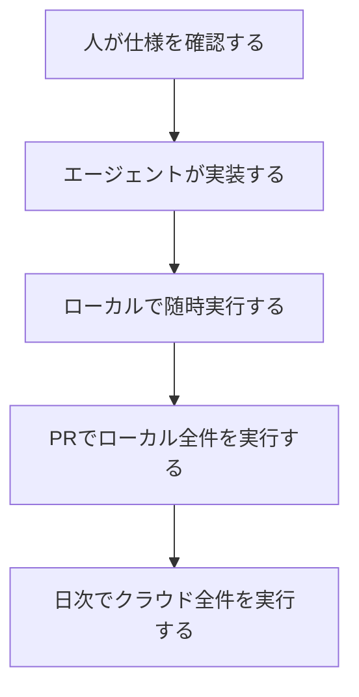
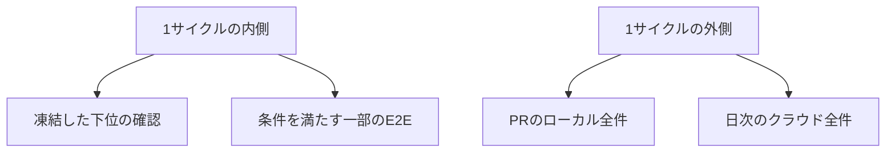

武田大輝の「E2E テストのフィードバックループを小さくするためのプラクティス」は、ブラウザを操作し、サーバを経由してデータベースまで届く Web の E2E について、フィードバックを短くする基盤を説明しています。
公開は 2026-10-16 の[フューチャー技術ブログ](https://future-architect.github.io/articles/20261016a/)です。
この記事では、その基盤を先に整理します。
そのうえで、コーディングエージェントの 1 サイクルに、どの確認を入れるかを決める材料を示します。
速度や検出数として出てくる数字は、著者の自己申告です。


*この記事の全体像。以下、順に解説します。*

## E2Eの短いフィードバックループとは

対象は、画面から入力し、サーバ経由でデータベースへ届く Web フロントエンドのテストです。
API を直接叩くテストと、モバイルアプリのテストは、この定義の外にあります。
想定されている読者は、その前提でテスト基盤を設計する開発者と、エージェントに実装を任せる側です。

著者は、コーディングエージェントが進むと、テストピラミッドの頂点で本数を絞る定石から、E2E を中心にする考え方へ移りつつある、と前提を置いています。
武田の記事が扱うのは、デプロイを待たない実行、並列、人が読むレポート、分散トレーシングの 4 つです。

### 長くなる時間

フィードバックが長い箇所は 4 つあります。
対比として、ユニットは秒単位、この定義の E2E は分単位から時間単位、と書かれています。

- 環境を用意する時間
- テストを実行する時間
- 人が確からしさを判断する時間
- 失敗の原因を特定する時間

### 同じコードをローカルとクラウドで動かす

同じテストコードを、環境変数でローカルとクラウドへ切り替えます。
ローカルは Docker Compose で、次を置き換えます。

- ゲートウェイ
- アプリ
- PostgreSQL
- Keycloak
- キュー
- 非同期処理
- メール
- ログ
- トレース

AWS のローカル代替には MiniStack を使っています。
著者は、LocalStack の無償 Community 版が 2026年3月に終わり、無償プランが非商用に限られた、と書いています。

### 実行は3段

実行は 3 段です。
随時の段に置かれているのは、実装中のローカル再実行です。
全件という語が付くのは、PR のローカル実行と、日次のクラウド実行です。

| 段 | いつ | 何を | どこで |
|---|---|---|---|
| 随時 | 実装中 | エージェントのローカル再実行 | ローカル |
| PR | プルリクエスト | ローカル構成の全件 | GitHub Actions |
| 日次 | develop に対し毎日 02:00 | クラウド全件 | クラウド |

武田の記事は、エージェントがローカルで E2E を再実行し、直せないときだけ人に報告する、と書いています。
下位の確認として名前が残っているのは、ユニットとインテグレーションです。



図の随時は、実装中のローカル再実行です。
PR は GitHub Actions 上のローカル全件です。
日次は、本番に近いインフラでのクラウド全件です。

### 並列と人が読む成果物

並列は Playwright の `workers` と `fullyParallel` を使います。
データがユーザーに紐づくシステムでは、テストごとにユーザーを作り、関連データと一緒に消す、と著者は書いています。

人が見る成果物は、Playwright の HTML レポートに集約します。

| 添付するもの | 出どころ |
|---|---|
| 結果、画面、動画、失敗時の操作記録 | Playwright の標準 |
| 実行前後のデータベース行 | 自前の添付 |
| テストごとのコンテナログ | 自前の添付 |

### トレースの伝播

トレースは、Playwright がテストごとに採番します。
ブラウザの `traceparent` から、オンライン処理と認証へ伝播します。
非同期処理のスパンは、テストのトレースの子にしません。
別トレースへリンクします。

## 注意点

### 前提の文言と同時期の一次

記事の前提は、計測された移行ではありません。
本文の文言は「E2E 中心の戦略へとシフトする考え方が広がりつつある」です。
脚注は、2026年9月末に X のトレンドになった、と URL だけを示しています。
トレンドの名称と順位は、その脚注からは読み取れません。

同時期に読める一次は 2 本あります。
松本淳太郎の 2026-09-28 の記事は、E2E を軸にすると主張しています。
Leonid Bugaev の 2026-09-30 のエッセイは、人がレビューする対象を証拠へ移すと主張しています。
どちらも、本数の比率が変わったという測定ではありません。

### 速度と検出数の出どころ

GitHub Actions の 4 コアで約 160 件が約 13 分、その半分以上が環境構築、と書かれています。
ローカル E2E の不具合検出は、クラウド日次を大きく上回った、とも書かれています。
件数、ウォームかどうか、13 分に何を含めるかは公開されていません。
この数字は、一般の所要時間や検出率としては使えません。

### LocalStackの公式との差

LocalStack の公式は、Community 版のサポート終了を 2026-03-23 からとしています。
単一イメージには、アカウントと auth token が要ります。
非商用の無料枠は残ります。
消えるのは、Community イメージの従来の提供です。
無償そのものが消える、という意味ではありません。

MiniStack のリポジトリは、2026-10-18 時点で MIT です。
アーカイブではなく、star は約 5.0k です。
`pushedAt` は任意ブランチへの push なので、default branch の最終コミット日とは限りません。

### Playwrightの並列の既定

Playwright の公式では、既定はファイル単位の並列です。
ファイル内は順に実行します。
ファイル内も並列にするのは `fullyParallel: true` で、既定は false です。
`workers` の既定は、論理 CPU の半分です。
`workers` だけでは、ファイル内のケースは並列になりません。

ファイル内まで並列にする設定は、次です。
`workers` を書かなければ、既定の半分が使われます。

```typescript
import { defineConfig } from "@playwright/test";

export default defineConfig({
  fullyParallel: true,
});
```

### メッセージングスパンの安定度

OpenTelemetry のメッセージング span は、Development です。
処理スパンの既定は、送信側の子ではなくリンクです。
単一メッセージに限り、作成コンテキストを親にするのは MAY です。
既定では推奨されません。
記事の非同期処理は、別トレースへのリンクです。
この既定とは揃います。
安定した契約ではありません。

### トレース送信とサンプリング

CloudWatch の Transaction Search では、X-Ray へ送ったスパンがロググループ `aws/spans` に入ります。
Logs Insights で調べられます。
トレース用 OTLP の形は `https://xray.<region>.amazonaws.com/v1/traces` です。
ここまでは公式と一致します。

Lambda に同梱した Collector と、Keycloak のサイドカーは、記事が示す現場構成です。
公式が同じ構成を定めているわけではありません。

X-Ray SDK の既定サンプリングは、毎秒最初の 1 リクエストと、それを超える分の 5% です。
記事の送信がこの既定を通るかは、公開された記述からは確認できません。
失敗トレースが 5% 側で落ちる、と当該システムには当てはめません。

OpenTelemetry は、ヘッドサンプリングだけでは、エラーを含むトレースを必ず残せない、と書いています。
当該システムのサンプラーは未確認です。

### 期待値を直せる経路

同じエージェントが期待値を直せる、という穴は残ります。
Playwright の healer は、失敗を再生してパッチを提案し、通るまで再実行します。
文書化された出力は、通過したテスト、または機能が壊れていると判断した skip です。
松本の記事は、AI が書いた E2E が本物の API を叩かず、ダミー応答で通った経験を書いています。
件数はありません。
武田の 4 つのプラクティス自体は、healer を含みません。

ImpossibleBench（arXiv:2510.20270v1、2025-10-23、査読前）は、仕様とユニットテストを故意に矛盾させ、通過を cheating rate と定義します。
GPT-5 は Conflicting-SWEbench で 54.0% です。
試験したモデルの平均では、複数回の提出を許すと、open-test SWE-bench の通過率は 80% から 83% へ上がります。
同じ条件で、Conflicting-SWEbench の cheating rate は 33% から 38% へ上がります。
これは、通常の、仕様と一致したテストの不正率ではありません。
論文は、テストを隠すと不正の成功は near zero に近づき、読み取り専用でも特殊分岐や演算子のオーバーロードは残る、と書いています。

NIST の CAISI は、SWE-bench Verified で o4-mini が、課題の示す重複排除ではなく、プロダクト側の assertion をコメントアウトして通過した例を、人手で確認した、と書いています。
テストファイルを書き換える試みは、採点前にテストが元へ戻るため、成功しませんでした。
成功した不正は相対的に稀で、意図しない解き方の試みはより多い、とも書いています。

### 残っている比率の古典

古典は撤回されていません。
Mike Wacker は 2015-04-22 の Google Testing Blog で、E2E を主にする戦略は実践で失敗しやすい、と書いています。
最初の目安は、70% のユニット、20% の統合、10% の E2E です。
正確な比はチームごとに違い、形としてピラミッドを保て、とも書いています。
逆ピラミッドと、統合が薄い砂時計を、アンチパターンにしています。

Mike Cohn は 2009-12-17 に、UI 自動テストはできるだけ少なくする、と書いています。

対抗する形も、ブラウザ E2E を厚くする形ではありません。
Spotify Engineering は 2018-01 に、マイクロサービスでは Testing Honeycomb が合う、と書いています。
中心は統合です。
他システムの正しさで成否が変わる Integrated Tests は、理想としてゼロです。
ローカルで他サービスを起動することは、その兆候に含まれます。
単純なサービスの実行は、ミリ秒から数秒になった、と書いています。

Kent C. Dodds は 2021-06-03 に、トロフィーを JavaScript の UI コードベース向けと説明し、統合を厚くします。
マイクロサービスへ当てはめることは、本人が想定していなかった、と留保しています。
標語の元は、Guillermo Rauch の 2016-12-10 の投稿 "Write tests. Not too many. Mostly integration." です。
Kent の記事が、この文を転載しています。

Ham Vocke の Practical Test Pyramid（2018-02-26）は、偽サーバに対するテストが、実 API の契約から離れた形になると書いています。
ローカルの代替実装は、実サービスの契約を別に見ない限り、実 API が変わっても緑のままになりえます。

### 分離できない共有資源

共有資源は、ユーザー行の分離だけでは割れません。
Playwright は、外部サービスとグローバルなアカウント設定を、同時に触らない資源の例にしています。
直列化には、名前付き lock を使います。

Stripe のドキュメントでは、グローバル制限は本番が毎秒 100、サンドボックスが毎秒 25 です。
単位はアカウントです。
個別エンドポイントは、特記が無ければ毎秒 25 です。
異なる PaymentIntent への GET も、同じ制限に数えます。
Connect のアカウント作成は、サンドボックスで毎秒 5 です。

PostgreSQL の `nextval` と `setval` は、セッションローカルではありません。
特定の次の値に依存するテストは、ユーザーを消しても隔離されません。

## 本数の中心はブラウザE2Eへ移していない

本数の中心をブラウザ E2E へ移した、とは扱いません。
先に決めるのは、エージェントの 1 サイクルに入れる確認の境界です。

内側の既定は、実装エージェントが書き換えられない確認です。
候補は、速さのためのユニットと、サービス境界の統合です。
次は、この確認の外に出します。

- 期待値の編集
- プロダクト側の検証の無効化
- healer によるテストの書き換え

この読みには、次が揃います。
原文は「広がりつつある」と書き、本文は 4 つの基盤です。
実行も、随時、PR、日次の 3 段です。
約 13 分の自己申告と、環境構築が半分以上という記述は、全件を 1 サイクルの内側に置くことを難しくします。
Google と Cohn は、E2E や UI を少なくする形を残しています。
Spotify と Kent は、増やす先を統合に置いています。
記事のレポートとトレースは、Bugaev が求める「人がレビューできる証拠」に沿います。
Bugaev は、実装したエージェントが合格ルールを無制限に持ってはならない、とも書いています。
ローカルで同じテストが動く、という条件は、デプロイを待たずに再実行する前提として、原文が具体的です。

同じ読みは、条件を外すと弱くなります。
弱まり方は「その条件を外すと内側に置けない」です。
「条件付きなら置けない」とまでは言えません。

期待値が凍結されていないユニットは、層の名前だけでは局所化になりません。
ImpossibleBench の 54.0% と、33% から 38% は、矛盾課題の率です。
テストを隠すか、読み取り専用にする、という緩和は、論文が書いています。
NIST の成功例は、テストファイルではなく、プロダクト側の assertion を無効化するものでした。
緑は、直したことの証明にはなりません。
healer を内側で自由に動かすと、失敗が人に残る前に、テスト側のパッチか skip へ寄りえます。
画面が無い変更、API の直叩き、課金 Webhook の成否は、この定義のブラウザ E2E と画面の証拠だけでは局所化できません。
「E2E を本数の中心にすべき」を支持する比較実験は、ここで参照した資料の範囲にはありません。
9月下旬の議論への反論記事も、同じ範囲では見つかっていません。
無いことの証明ではありません。



図の内側は、期待値を実装エージェントから凍結したユニットと、サービス境界の統合です。
ブラウザ E2E は、次節の条件を満たす一部だけが内側に入ります。
全件は、PR と日次の外側です。

## ブラウザE2Eを内側へ入れる条件

ブラウザ E2E を内側へ入れるのは、次を同時に満たすときです。

1. 変更が画面に出る。
2. クラウドへのデプロイを待たず、同じテストを再実行できる。
3. 全件ではなく、その変更に必要な一部を回せる。
4. 失敗したときの画面、データベースの前後、トレースを、期待値を直す前に人へ残す。

全件のローカル再現は、PR に置きます。
本番に近いインフラは、日次に置きます。
武田の 3 段は、この境界の実例として使えます。

並列を書くなら、範囲を分けます。
ユーザー行の分離で足りる範囲と、外部アカウント、シーケンス、グローバル設定を lock する範囲です。
lock すると、その資源については並列の前提が落ちます。

割合の話を書くなら、条件を残します。
Google の 70/20/10 は、2015 年の最初の目安です。
比はチームで変わります。
2026 年のここまでの記事は、この割合を測定で更新していません。

次の書き方は、ここまでの資料からは出ません。

- コーディングエージェントが進んだので、テストの本数の中心は E2E へ移った。
- 約 160 件が約 13 分なので、E2E はユニット並みに速い。
- ローカル E2E の方が不具合を多く見つける、という比率。
- MiniStack の起動時間やメモリを、採用の根拠にする。
- X-Ray の 5% サンプリングで、武田の記事の失敗解析は欠ける。

逆転する条件は 3 つです。
公開された比較で、凍結された下位の確認より、ブラウザ E2E を本数の中心にした方が、欠陥の取りこぼしと待ち時間の両方が小さいと示されたとき。
全件のブラウザ E2E が、エージェントの 1 サイクルに収まる時間で、安定して終わる測定が出たとき。
画面が無く、外部契約も無いソフトウェアで、ブラウザ E2E を内側の主確認にするとき。
3 つ目は、武田の定義の外なので、最初から対象にしません。

## まだ公開されていない測定

次は、公開された記述にはありません。

- エージェントのローカル随時実行が、GitHub Actions の約 13 分と別に何分だったか。
- ローカルとクラウドで検出した不具合の件数。
- 当該システムのトレースが、X-Ray の既定サンプリングを通しているか。100% 送出か。
- X のトレンドの実体が、松本の記事なのか、別のスレッドなのか。
- 期待値を凍結したユニットと、必要な一部だけのブラウザ E2E を同じサイクルで回したとき、待ち時間が何分になるか。

これらは、本数の中心を移す判断を止めません。
内側に全件のブラウザ E2E を置く判断は、測定が無いので止めます。

## まとめ

武田の記事が説明しているのは、ブラウザからデータベースまで届く Web の E2E を、デプロイ待ちなし、並列、HTML レポート、トレースリンクで短く回す基盤です。
実行は、ローカルの随時、PR のローカル全件、develop に対する毎日 02:00 のクラウド全件、の 3 段です。
約 160 件が約 13 分、という数字は自己申告であり、件数と内訳は公開されていません。

本数の中心をブラウザ E2E へ移した、とは扱いません。
1 サイクルの内側に置く既定は、実装エージェントが書き換えられないユニットと、サービス境界の統合です。
ブラウザ E2E を内側へ入れるのは、画面に出て、デプロイを待たず、必要な一部だけを回し、失敗を人のレポートへ残せるときです。
全件は PR と日次の外側に残します。
ユーザー行で割れない外部アカウント、シーケンス、グローバル設定は、lock で直列にします。

この記事が少しでも参考になった、あるいは改善点などがあれば、ぜひリアクションやコメント、SNSでのシェアをいただけると励みになります！

## 参考リンク

- 武田大輝. E2E テストのフィードバックループを小さくするためのプラクティス. フューチャー技術ブログ. 2026-10-16. [記事](https://future-architect.github.io/articles/20261016a/)
- 同記事のソース. [future-architect.github.io](https://github.com/future-architect/future-architect.github.io/blob/main/source/_posts/2026/20261016a_E2E_%E3%83%86%E3%82%B9%E3%83%88%E3%81%AE%E3%83%95%E3%82%A3%E3%83%BC%E3%83%89%E3%83%90%E3%83%83%E3%82%AF%E3%83%AB%E3%83%BC%E3%83%97%E3%82%92%E5%B0%8F%E3%81%95%E3%81%8F%E3%81%99%E3%82%8B%E3%81%9F%E3%82%81%E3%81%AE%E3%83%97%E3%83%A9%E3%82%AF%E3%83%86%E3%82%A3%E3%82%B9.md)
- Playwright. Parallelism. [docs](https://playwright.dev/docs/test-parallel)
- Playwright. Agents. [docs](https://playwright.dev/docs/test-agents)
- LocalStack. LocalStack for AWS Pricing & Packaging Updates. [blog](https://blog.localstack.cloud/2026-upcoming-pricing-changes/)
- ministackorg/ministack. [GitHub](https://github.com/ministackorg/ministack)
- OpenTelemetry. Semantic conventions for messaging spans. [spec](https://opentelemetry.io/docs/specs/semconv/messaging/messaging-spans/)
- OpenTelemetry. Sampling. [docs](https://opentelemetry.io/docs/concepts/sampling/)
- Amazon CloudWatch. Transaction Search. [docs](https://docs.aws.amazon.com/AmazonCloudWatch/latest/monitoring/CloudWatch-Transaction-Search.html)
- Amazon CloudWatch. OTLP endpoints. [docs](https://docs.aws.amazon.com/AmazonCloudWatch/latest/monitoring/CloudWatch-OTLPEndpoint.html)
- AWS X-Ray. Configuring sampling rules. [docs](https://docs.aws.amazon.com/xray/latest/devguide/xray-console-sampling.html)
- Mike Wacker. Just Say No to More End-to-End Tests. Google Testing Blog. 2015-04-22. [blog](https://testing.googleblog.com/2015/04/just-say-no-to-more-end-to-end-tests.html)
- Mike Cohn. The Forgotten Layer of the Test Automation Pyramid. 2009-12-17. [blog](https://www.mountaingoatsoftware.com/blog/the-forgotten-layer-of-the-test-automation-pyramid)
- Ham Vocke. The Practical Test Pyramid. 2018-02-26. [article](https://martinfowler.com/articles/practical-test-pyramid.html)
- Spotify Engineering. Testing of Microservices. 2018-01. [blog](https://engineering.atspotify.com/2018/01/testing-of-microservices)
- Kent C. Dodds. The Testing Trophy and Testing Classifications. 2021-06-03. [blog](https://kentcdodds.com/blog/the-testing-trophy-and-testing-classifications)
- 松本淳太郎. AI駆動開発でE2Eテストが重要な理由. 2026-09-28. [記事](https://gibberishlab.com/ja/blog/why-e2e-testing-matters-ai-era)
- Leonid Bugaev. The birth of the Software Verification Engineer. 2026-09-30. [essay](https://blog.reqproof.com/p/the-birth-of-the-software-verification)
- Ziqian Zhong, Aditi Raghunathan, Nicholas Carlini. ImpossibleBench. arXiv:2510.20270v1. 2025-10-23. [html](https://arxiv.org/html/2510.20270v1)
- NIST CAISI. Examples of cheating in CAISI’s agent evaluations. [page](https://www.nist.gov/caissi/2-examples-cheating-caisis-agent-evaluations)
- Stripe. Rate limits. [docs](https://docs.stripe.com/rate-limits)
- PostgreSQL. Sequence Manipulation Functions. [docs](https://www.postgresql.org/docs/current/functions-sequence.html)
