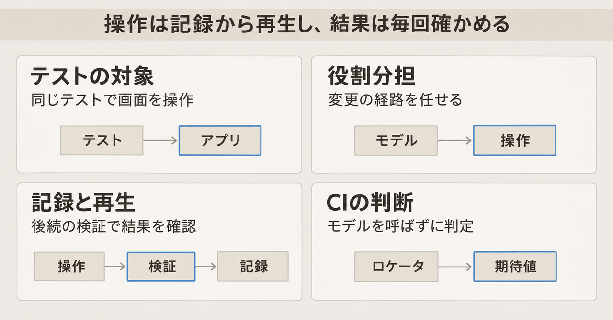
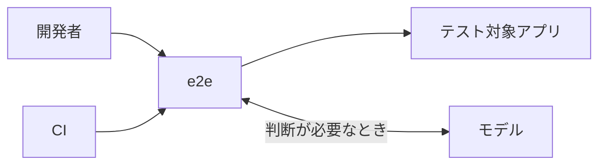
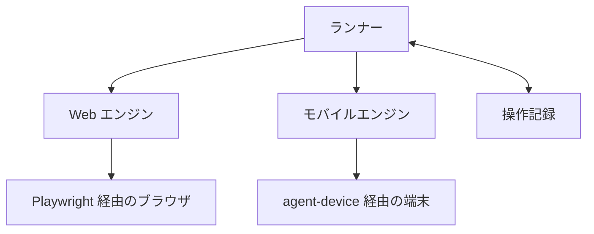
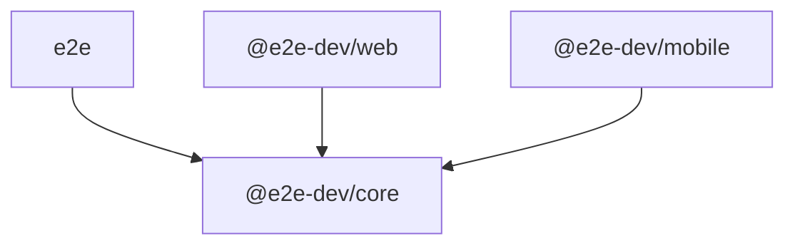
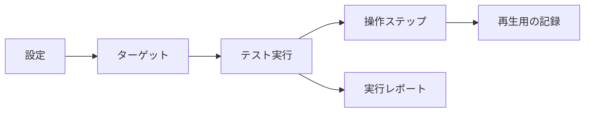
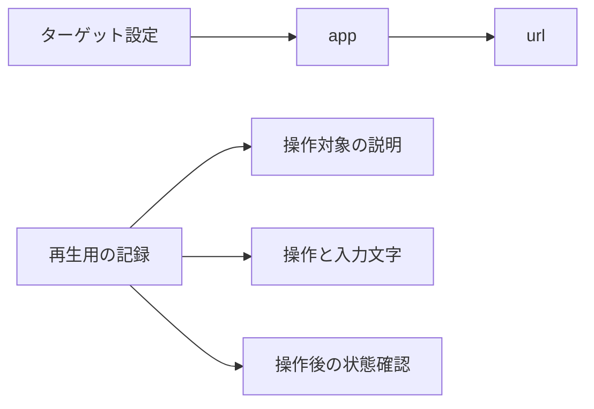

料金プランを変更するテストで、ボタンの配置が変わっても操作を続けたい。一方、変更後のプラン名は厳密に照合したい。この二つの要求を、Web・モバイル向けのテストフレームワーク e2e では一つの TypeScript テストに書けます。操作の記録がいつ再利用できるかを、開発端末での初回実行から CI での再実行まで追います。対象は npm の `e2e@0.25.0` です。



## e2e とは

e2e はブラウザや端末でアプリを操作し、ユーザーが画面上で目的を達成できるかを検証します。テストには、役割や名前から画面要素を特定する**ロケータ**と、自然言語で目標を受け取る**エージェント**を併用できます。たとえば「Pro プランに変更する」までの操作をエージェントに任せ、最後にステータス欄の文字列をロケータで検証できます。

## 特徴：操作と合否判定を別々に選べる

| テストに書くこと | 実行時に起きること |
| --- | --- |
| ロケータによる操作と `expect(locator)` | e2e が指定した要素を操作・検証します。モデルへの問い合わせはありません。 |
| `agent.act` | 初回はモデルが画面を観察して操作を選びます。後続の検証で裏付けられた操作列は次回から再生できます。 |
| `agent.assert` | 「請求の内訳が説明されている」など、意味を読み取る確認を組み込みエージェントが実行ごとにモデルへ依頼します。 |

同じ文言を厳密に確認できる箇所はロケータにすると、その確認にモデルを使う費用も、モデルの回答で合否が揺れる余地もなくなります。

## 構造：テストの指揮と画面の操作

### システムコンテキスト図

開発者と CI は同じテストを実行します。モデルは判断が必要なステップに参加し、アプリへの実際の入力は e2e 側が担当します。



### 構成要素と役割分担

ランナーはテストを順に進め、アサーションの再試行や記録の読み書きを管理します。エンジンは現在の画面から一致する要素を返し、指示された要素を操作します。



### コンポーネント図

npm の `e2e` にテストを書くための API、ランナー、CLI が入っています。画面を駆動する共通機能は `@e2e-dev/core` にあり、Web 用またはモバイル用のパッケージを実行対象に応じて追加します。図の矢印は共通パッケージへの依存を示します。



## データ：何を保存して次回へ渡すか

### 概念モデル

**ターゲット**はテストの実行対象を表す設定です。ここでは Web エンジンとアプリの URL を指定します。キャッシュの読み書きが有効なとき、観測可能な画面変化を起こし、後続の検証で結果を確認できた操作が記録の保存対象になります。合否を伝えるレポートと、次回の操作を再現する記録は用途が違います。



### 情報モデル

Web ターゲットの開始 URL は `app.url` に置きます。一方、記録には操作対象の説明や入力した文字が残ります。図は設定項目と記録内容の対応を抜き出したものです。通常の入力文字列はそのまま保存されるため、記録を Git に追加する前に中身を確認します。



## 導入：Web アプリをテスト対象にする

Node.js 22 系なら 22.22.3 以降、あるいは 24.8.0 以降を使います。対象プロジェクトで次のコマンドを実行し、対話画面で Web エンジンを選ぶと、設定ファイルとテスト例が生成されます。

```bash
npx e2e init
npx e2e doctor
```

`e2e.config.ts` の `targets` にある `app.url` を開発サーバーの URL に合わせ、テスト前に開発サーバーを起動します。CI でランナーに起動を任せる場合は、起動コマンドを表す `app.command` も指定します。ロケータだけで書いたテストは API キーなしで実行できます。次節のように組み込みの `agent.act` を使う場合は、初回実行の前にモデルとその認証を設定します。[公式クイックスタート](https://e2e.com/docs/quickstart.md)

## 利用方法：プラン変更の操作を記録する

以下は、請求設定ページと現在のプラン名だけを表示するステータス欄があるアプリ向けの例です。プラン変更が可能なテストアカウントでサインイン済みとします。

```ts
import { expect, test } from 'e2e';

test('Proプランへの変更が表示に反映される', async ({ app, agent, screen }) => {
  await app.open('/settings/billing');
  await agent.act('ワークスペースの料金プランを Pro に変更する');
  await expect(screen.getByRole('status')).toHaveText('Pro');
});
```

`npx e2e run` で初回はモデルが変更手順を選びます。その後の `expect` が変更結果を確認すると、記録の条件を満たした操作列が `.e2e/cache/` に保存されます。次回は、操作列の記録に欠落がなく、現在の画面と一致すればその操作列で進み、最後の `expect` は現在の画面に対して改めて評価されます。[キャッシュの仕様](https://e2e.com/docs/cache.md)

## 運用：CI に記録を渡す

初期設定では `.e2e/cache/` が Git の管理対象から外れています。共有する場合は記録中の入力を確認し、対応する除外行を外してテストと一緒にコミットします。CI の既定はキャッシュの読み取り専用です。次のコマンドは記録済みの操作が現在の画面に合わないときに失敗します。

```bash
npx e2e run --strict-cache
```

| ステップの状態 | 組み込みエージェントでの動き |
| --- | --- |
| 再生可能な記録が画面と一致 | 記録を再生 |
| 再生対象の記録が画面と不一致 | `REPLAY_STALE` で失敗 |
| 組み込みのファイルストアに同じステップの古い識別キーの記録がある | `REPLAY_STALE` で失敗 |
| 記録の破損・スキーマ不適合 | `REPLAY_STALE` で失敗 |
| 未記録・ストアにアクセスできず記録を取得できない | 最初からモデルが操作を選択 |
| 記録が上限を超えて打ち切られた（`truncated`） | ステップ全体をモデルで実行 |
| 安全に再生できない操作がある（`gap`） | 再生できるところまで進み、その先をモデルに引き継ぐ |
| 意味を判定する `agent.assert` | モデルで判定 |

## ベストプラクティス：CI の判定条件を先に決める

各コミットをモデル呼び出しゼロで判定したい場合は、そのジョブをロケータによる操作と `expect` だけで構成します。途中の UI に複数の正しい経路がある場合は、別のテストで `agent.act` に経路選択を任せ、最後に確認したい値を `expect` で明示できます。料金変更の例なら、毎回同じ初期プランから始めることも再実行の前提です。

## 注意点

`--strict-cache` は再生時の不一致をエラーにします。新規テストを追加すると、その操作の記録が CI にまだ存在せず、モデルが現在の画面を見て操作を選ぶことがあります。また、組み込みの `agent.waitFor`（条件が成立するまで画面を観察）や `agent.extract`（画面から値を抽出）も記録再生の対象外です。モデルへのアクセスを許すかは、ジョブに含めるステップ単位で判断します。[キャッシュの仕様](https://e2e.com/docs/cache.md)

## トラブルシューティング

| 症状 | 最初に確かめること |
| --- | --- |
| 開発端末では再生でき、CI だけがモデルを呼ぶ | 対象の記録が Git に含まれるか、毎回モデルを呼ぶ判定が残っているかを確認します。記録がある場合は、CI の `.e2e/report.json` で対象ステップの `cache.mode` と `cache.reason` を確認します。 |
| `REPLAY_STALE` で失敗する | 理由が `invalid-entry` なら記録ファイルの形式を確認します。それ以外は画面の変更か、アプリの識別値（`app.identity`）などの設定変更かを切り分けます。意図した変更なら開発端末で操作を記録し直し、差分を確認します。 |
| `LOCATOR_AMBIGUOUS` が出る | 単一要素を期待するロケータに複数件が一致しています。ラベルや名前を加え、一つの要素を特定できるロケータにします。 |

## まとめ

料金プラン変更のように「途中の操作には自由度があり、結果は一意」なテストでは、経路選択を `agent.act` に任せ、合否を `expect` で固定できます。CI に移すときは、実際に共有した記録と、毎回モデルが必要なステップを確認すると、実行に必要な認証や費用を見通せます。

この記事が少しでも参考になった、あるいは改善点などがあれば、ぜひリアクションやコメント、SNSでのシェアをいただけると励みになります！

## 参考リンク

- [e2e のリポジトリとテスト例](https://github.com/e2e-inc/e2e)
- [ロケータとエージェントの使い分け](https://e2e.com/docs/agentic-vs-deterministic.md)
- [キャッシュの記録条件と再生](https://e2e.com/docs/cache.md)
- [CI での実行](https://e2e.com/docs/ci.md)
- [エラーコードのリファレンス](https://e2e.com/docs/reference/errors.md)
