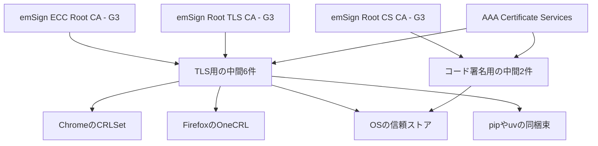

2025年4月30日の鍵生成式典で作られた eMudhra の中間 CA 証明書 8 件は、楕円曲線 P-384（曲線の名前は secp384r1）です。楕円曲線の秘密鍵は、秘密スカラーと呼ばれる整数です。通常の秘密スカラーは、1 から群位数までの乱数になります。群位数は、その曲線で秘密スカラーが取りうる範囲の上限です。8 件は 256 未満なので、候補は最初の 256 個に収まります。Mozilla Bug 2083449 の Dennis Jackson のコメントは、8 件とも 256 未満の整数だった、と書いています。公開されている証明書から秘密鍵を復元できる、と Google のセキュリティブログも書いています。

この記事では、8 件がどの用途の中間か、ブラウザの遮断リストと開発ツールの信頼ストアがなぜ別々か、どの版へ上げるかを整理します。記述は各組織の公開文書と、対象一覧の JSON（2026年10月23日取得）に基づきます。

*この記事の全体像。以下、順に解説します。*

## eMudhraの中間CAとは

中間 CA は、ルート認証局が署名し、サイトやソフトウェアへ載せる終端の証明書に署名する認証局です。利用者のソフトウェアは、自分が信頼するルートからこの中間を経由して終端証明書へたどり着けるかを見ます。信頼の起点になるルート証明書を、トラストアンカーと呼びます。

2025年4月30日の式典で作られた 8 件のうち、6 件は TLS 用です。2 件はコード署名用です。TLS 用は Chrome、Mozilla、Microsoft、Apple のルートプログラムが信頼する鎖につながる、と Bug 2083449 は書いています。コード署名用は Microsoft が信頼する、と同バグは書いています。

2026年10月17日、研究者 Wayne の報告を受け、Chrome は CRLSet、Firefox は OneCRL で対象の公開鍵を遮断しました。CRLSet は Chrome がブラウザへ配る遮断リストです。OneCRL は Firefox が配る遮断リストです。どちらも、証明書のシリアル番号ではなく、公開鍵（SPKI。Subject Public Key Info）を指します。パッケージ取得やビルドが参照する信頼ストアは、この遮断リストとは別のファイルであり、更新の単位も別です。

### 8件の中身

対象一覧の `impacted-intermediates.json`（2026年10月23日取得）は 16 レコードです。中身は 8 個の鍵について、eMudhra 発行の証明書と、Sectigo の AAA Certificate Services によるクロスサインが 1 枚ずつあります。クロスサインは、別のルートが同じ公開鍵の証明書に署名し、別の信頼ストアからも鎖がつながる状態です。DV、OV、EV と G3B、G3C は名前の区別です。遮断の単位は公開鍵で、TLS 用の 6 件は同じ扱いです。

表の CRL は、証明書を発行した認証局が配る失効の一覧です。Chrome の CRLSet とは別のファイルです。ca_compromise は、その一覧の失効理由で、認証局の鍵が危ないことを指します。notBefore は、証明書に書かれた有効開始の日時です。

| 用途 | 名前 | eMudhra 側の発行者 | notBefore | eMudhra CRL |
|---|---|---|---|---|
| TLS | EM DV TLS CA - G3B / G3C | emSign Root TLS CA - G3 | 2025-04-30 | 2026-10-18、reason は ca_compromise |
| TLS | EM OV TLS CA - G3B / G3C | 同上 | 同上 | 同上。時刻は証明書ごとに 09:24:32Z から 09:38:46Z |
| TLS | EM EV TLS CA - G3B / G3C | 同上 | 同上 | 同上 |
| コード署名 | EM OV CS CA - G3B / G3C | emSign Root CS CA - G3 | 2025-04-30 | 2026-10-18、reason は ca_compromise |

クロスサインの notBefore は 2025年5月14日です。Sectigo CRL の失効は 2026-10-19T10:35:36Z で、reason は ca_compromise です。Sectigo は Bugzilla で、AAA Certificate Services は Chrome と Mozilla のルートストアから以前に外れており、Microsoft と Apple のルートプログラムでは信頼が残っている、と書いています。

Google が Chrome Root Store から外すと名指しするのは emSign ECC Root CA - G3 です。Google は、このルートが対象の中間に署名した、と書いています。上表の直接の発行者名は emSign Root TLS CA - G3 です。コード署名用の直接の発行者は emSign Root CS CA - G3 です。この 3 つの名前が同一の証明書かは、公開文書だけでは確定できません。Chrome から外すと Google が書く名前は、emSign ECC Root CA - G3 です。Mozilla のブログは、NSS 3.131.1 が外すルートの名前を本文に書きません。NSS は、Firefox や一部のランタイムが使う証明書ライブラリと、そのルート証明書の束です。

A 系列と、置換後の A-1 系列の P-384 は、表の G3B / G3C とは別の証明書です。それらの秘密鍵は、手間をかけても回復できなかった、と Jackson のコメントは書いています。RSA 鍵は、そのコメントの時点ではまだ見ていない、と同コメントは書いています。

### いつ遮断されたか

時刻は UTC です。出典が UTC と書いていないものは、その文書の表示のままにします。

| 時刻 | 出来事 | 出典 |
|---|---|---|
| 2025-04-30 | 対象 8 件の notBefore | 対象 JSON |
| 2026-10-17 18:05 | Chrome Root Program が報告を受領 | Google ブログ |
| 2026-10-17 19:45 | Chrome が SPKI ハッシュを CRLSet で遮断。ブラウザの更新も再起動も不要 | Google ブログ |
| 2026-10-17 20:06 / 20:08 | Mozilla が転送報告を受領し、受領を確認 | Bug 2083449、Mozilla ブログ |
| 2026-10-17 21:48 | Mozilla が独自に鍵を復元 | Bug 2083449 |
| 2026-10-17 22:59 | 標準設定の Firefox 向け OneCRL が完了 | Mozilla ブログ |
| 2026-10-19 22:00 頃 | Android と Googlebooks が Play 開発者サービス経由で同等の更新を受けた。Android 端末は多数が受け取った、と Google は書く | Google ブログ。同日は報告の次の月曜 |
| 2026-10-20 | Firefox 158.0.1、ESR 115.43.1、ESR 153.5.1。ESR は Firefox の別系統の版番号です。Remote Settings を受け取れない利用者向け | Mozilla ブログ |
| 2026-10-21 08:29 | Firefox for Android 158.0.2。同梱 OneCRL が起動直後に効かない問題 | Mozilla ブログ |
| 2026-10-27 朝 PDT 予定 | Chrome Root Store から emSign ECC Root CA - G3 を全デバイスへ。Canary と Beta はそれより早い | Google ブログ |

Remote Settings は、Firefox が OneCRL などを後から配る仕組みです。標準設定の OneCRL 完了は、その時刻にすべての端末へ届いた、という意味ではありません。

Dennis Jackson の対象一覧（2026年10月23日取得）は、Firefox と Chrome は 10月17日から、Microsoft プラットフォームは 10月20日から、Apple 製品は 10月22日から、と書いています。

### 開発ツールが見ている場所

ブラウザは CRLSet または OneCRL を更新します。次のツールは、それとは別の証明書束か、別の検証コードを持ちます。

- pip 26.2.2 未満は、システムの信頼ストアに加えて、同梱の certifi を読みます。certifi は、pip が同梱している CA 証明書の束です。26.2.2 以上でも同梱の束は残ります。危険なルートを外すには、pip を 26.2.2 以上へ上げ、certifi パッケージは 2026.10.19 にします。`REQUESTS_CA_BUNDLE` と `--cert` は CA を足すだけで、同梱の certifi を外す手段は案内に無い、と Python の議論（Christian Heimes の投稿、案内本体は Seth Larson、2026年10月20日）は書いています。既存の仮想環境は、Python 本体を上げても pip が置き換わらない、と同案内は書いています。
- uv は、既定で同梱の証明書束を使う取得ツールです。uv 0.13.4 は、その束から emSign ECC Root CA - G3 を外します。`--system-certs` や `SSL_CERT_FILE` の利用者は、そのストアを自分で見る、と GHSA-hq85-5cpj-mr62 は書いています。`UV_SYSTEM_CERTS=true` は uv の案内に出ます。
- Go 1.27.3 と 1.26.10 は、`crypto/x509` の Verify が対象中間を含むチェーンを返しません。golang-announce はこの取得時のビューで Oct 19, 2026, 9:13:25 PM と表示し、UTC とは書きません。告知本文は CA 名を書きません。紐づく CVE は CVE-2026-111943 です。公開 issue golang/go#82345 は 2026年10月19日に開かれ、2026年10月20日に completed で閉じました。本文は CA 名を書きません。
- Node.js 22.23.4、24.22.1、26.12.1（GitHub のリリースノート日付は 2026年10月21日。表示時刻 10:38 のタイムゾーンは、ページ上で UTC と書かれません）は、ルート証明書を NSS 3.131.1 に更新し、遮断対象の公開鍵を含むチェーンを拒否する、と各リリースノートは書いています。
- rustls-webpki は、Rust で証明書のパスを検証する部品です。設定したトラストアンカーがそのパスを許すとき、対象の emSign 中間の公開鍵を含むパスを受け入れる、と RUSTSEC-2026-0382（2026年10月20日）は書いています。RUSTSEC は、Rust のセキュリティ勧告の識別子です。修正範囲は 0.103.16 以上かつ 0.104.0-alpha.1 未満、または 0.104.0-alpha.8 以上です。エイリアスに CVE-2026-111943 があり、Go の告知と同じ番号です。
- OpenJDK の 2026年10月21日アドバイザリ（最終更新 20:26 UTC）は CVE-2026-91403 として 8 件の中間を案内します。影響バージョンは 27.0.1、25.0.5、21.0.13、17.0.21、11.0.32.1、8u504、およびそれ以前です。Arch、Debian、Devuan、Fedora、Gentoo、Oracle Linux、RHEL、Ubuntu のパッケージは OS の証明書を使うので、OS の ca-certificates 更新で足りる、と OpenJDK は書いています。FreeBSD と Homebrew の OpenJDK はランタイム自体の更新が必要、と書いています。

### 信頼ストアは経路ごとに分かれる

信頼は一本のリストではありません。同じ中間鍵が、ブラウザの遮断リスト、OS のストア、言語の同梱束、クロスサインの別ルートに、別々に載ります。

図の上段は、文書ごとの名前を並べたものです。Google は、ECC ルートが対象中間に署名した、と書いています。対象 JSON は、TLS 中間の直接の発行者を emSign Root TLS CA - G3 と書いています。上段の矢印は、文書が結ぶ発行者名の対応です。中間から CRLSet、OneCRL、OS、同梱束への矢印は、同じ中間鍵が別々の信頼の置き場に載る、という対応です。

## 注意点

次の限定を外すと、公開文書より広い結論になります。

- これは TLS の暗号方式そのものが壊れた、という話ではありません。Cloudflare は、証明書の認証の問題だ、と書いています。P-384 という曲線の名前は、鍵の弱さの原因ではありません。弱さは、秘密スカラーが 256 未満の整数だった、という公開の事実にあります。
- 「悪用は確認されていない」は、言った主体の範囲に限ります。Cloudflare は自社サービスのレビューに限る、と書いています。Google は、遮断前に 6 件の TLS 中間へつながる TLS 証明書が Certificate Transparency に無かったので、CT を強制するクライアントでは偽造証明書は使えなかった、と書いています。Certificate Transparency は、公開ログへ証明書を載せる仕組みです。CT を強制しないクライアントには、この文は及びません。2025年4月30日から遮断までの間に何が起きたかは、公開文書の範囲では未確定です。
- eMudhra は、8 件の中間からエンドエンティティ証明書は出ていない、と書いています。エンドエンティティ証明書は、この記事の前半で書いた終端の証明書のことです。インフラ侵害もデータ漏えいも無い、電子署名・eSign・emSigner・CertiNext・emCA・Privatrust・SecurePass は別インフラで影響が無い、とも書いています（声明の最終更新 2026年10月22日）。これは CA の自己申告です。crt.sh は公開の証明書検索サイトで、ここでは再検索していません。
- 同じ声明は、ECC ルートの信頼除去の影響は米国の 1 顧客エコシステムに限る、と書いています。Google は、このルート配下の正規証明書は Chrome で動かなくなる、と書き、別の PKI 階層の証明書へ移すよう求めています。8 中間からの発行実績と、ルート除去で切れる正規証明書は、同じ集合ではありません。
- eMudhra は、弱い鍵は FIPS 140-2 Level 3 の HSM 上の式典で、wrap/unwrap の手順の欠陥から生まれ、約 18 か月と監査 2 回のあいだ見落とされた、と書いています。HSM は、鍵を外へ出さずに署名するハードウェアです。根本原因は未確定で、調査後に公開する、とも書いています。HSM を使っていなかった、という読みにはしません。
- Mozilla からの emSign Root CA - C1 と emSign ECC Root CA - C3 の除去は、eMudhra がこのインシデントと無関係な計画的退役だと書いています。Bug 2083709 はその 2 枚の除去で、今回外れる emSign ECC Root CA - G3 とは別件です。
- Node.js の 3 本のリリースには、この件と別の CVE が並びます。それらを eMudhra の件と束ねません。
- CVE-2026-111943 は Go の告知と、rustls-webpki の RUSTSEC のエイリアスの両方に出ます。番号が同じでも製品は同じではありません。CVE-2026-111943 の NVD 詳細は、取得時に本文が取れずホームへ落ちました。実在の一次は Go の告知に置きます。
- メディアの「数ミリ秒」は、Bugzilla の「near instantly」や「最初の 256 個」の言い換えです。ここで測った時間ではありません。約 3 万枚、97%、InCommon、という件数は、Google ブログ本文にはありません。本文の根拠には使いません。
- コード署名の 2 件は、Chrome の CRLSet が守るブラウザの HTTPS とは別の用途です。Microsoft が信頼する、という記述は Bug 2083449 にあります。Microsoft の告知本文では確認していません。
- Java では、OpenJDK が名指ししたディストリビューションは OS の証明書を使います。OS 更新が足りる経路と、pip のように足りない経路が同居します。
- コミュニティ一覧（2026年10月23日）は、Bottlerocket、Composer の ca-bundle、Erlang の certifi、Godot を pending と表示していました。修正版の表に、未出荷のものを完了として混ぜません。
- webpki-roots / webpki-root-certs 1.0.10 と rustup 1.29.2 は、対象一覧と二次記事が挙げます。crates のリリースノートと rustup の公式ブログでは確認していません。修正版の表には入れません。
- pip 26.2.2 の GitHub タグは 2026年10月20日の表示で、署名者は notatallshaw です。NEWS 本文は取れていません。修正版の根拠は Python の案内に置きます。タグ表示時刻のタイムゾーンは、ページ上で UTC と書かれません。
- Apple と Microsoft の遮断日は、両社の告知本文では確認していません。10月21日前後の二次記事には、Apple を 10月19日とするものがあります。Jackson の対象一覧は Apple を 10月22日、Microsoft を 10月20日と書いています。
- 8 中間からエンドエンティティ証明書が出ていないかは、eMudhra が社内分析と crt.sh で確認した、と書く範囲です。
- Chrome 安定版への emSign ECC Root CA - G3 の除去は、2026年10月27日朝 PDT の予定です。2026年10月23日の時点では、その安定版リリースは確認していません。
- 移行先の書きぶりは分かれます。Google は Chrome Root Store に含まれる別の階層を求めます。eMudhra は G1 ルートが有効だと書き、Sectigo 発行の証明書も案内します（声明の Update 4、2026年10月22日）。G1 は、その声明が有効だと書く別のルートの名前です。G3 と同一だとは書いていません。
- nodejs/node#66871 の PR 状態は、ここでは確認していません。
- 対象一覧に並ぶ OS の ca-certificates（Alpine、Arch、Debian、Ubuntu、Fedora、Homebrew、FreeBSD など）は、2026年10月23日時点のコミュニティ表です。各ディストリのアドバイザリ本文は読んでいません。OpenJDK が「OS の証明書を使う」と名指ししたディストリは、Java の行に従います。

## 自分の環境では何を見ればよいか

判断の基準は、その処理がどのファイルで信頼を決めているかです。ブラウザの遮断リストを更新しても、他の経路のファイルは置き換わりません。ブラウザや curl の成功は、別の検証経路を使うアプリの安全を示しません。curl は CT を強制しない、と対象一覧は書いています。

### 経路を分けて確認する

次の順で、自分のビルドと実行環境を見ます。

1. 経路を分けます。ブラウザ、OS の ca-certificates、pip、uv、Go、Node.js、Rust（rustls-webpki）、Java、コンテナイメージのベース、cloudflared、Cloudflare One Client、1.1.1.1 アプリです。あとの 3 つは Cloudflare の顧客向けクライアントです。使っていなければ、その行は見なくてよいです。
2. 下表の修正版へ上げます。表に無い Go や Node.js の系統は、ここでは上げる先を書けません。Python の案内は、コンテナイメージをレイヤーキャッシュ無しで作り直す、と書いています。上げたあとのバイナリを再ビルドしていない実行ファイルには、Go の Verify フィルタも Node.js の拒否も入りません。
3. pip は、OS を更新しただけでは 26.2.2 未満が残ります。venv ごとに上げます。uv でシステム証明書を使う設定なら、そのストアも見ます。
4. Java は、OpenJDK が名指しした OS パッケージなら OS の証明書更新を見ます。単体導入、FreeBSD、Homebrew はランタイム側を見ます。対象一覧のビルド番号（末尾に `.0.2` が付くものなど）と、OpenJDK の影響バージョン表は、同じ文字列として扱いません。
5. emSign ECC Root CA - G3 につながる正規の TLS 証明書を、2026年10月27日の Chrome Root Store 更新の前に別階層へ移します。見るのは発行者の表示名だけではありません。表示が emSign Root TLS CA - G3 でも、それだけで emSign ECC Root CA - G3 と同一とは決められません。移すかは、鎖の先に emSign ECC Root CA - G3 があるかで見ます。この記事では、その鎖を組み直していません。8 件の中間から証明書を出していない、という自己申告があっても、同じルートの他の中間は切断の対象になりえます。
6. 証明書エラーが出ても、検証を無効にして通しません。テスト用ホストへの接続成功を、別アプリの安全とみなしません。
7. コード署名の 2 件は、ブラウザの HTTPS 遮断とは別に、Microsoft の信頼と署名検証の経路を見ます。Microsoft の告知本文は未読です。

たとえば、OS の ca-certificates を更新したコンテナでも、イメージ内の pip が 26.2.2 未満なら、同梱 certifi の経路は残ります。同じコンテナの OpenJDK が Debian や Ubuntu のパッケージなら、OpenJDK の案内どおり OS の証明書更新を見ます。

### 修正版の一覧

版の数字は、右列の文書から取っています。gihyo.jp（2026年10月22日）は pip、uv、Go、Node.js、Rust を日本語で整理しています。表の版の根拠には使いません。

| 対象 | 上げる先 | 条件 | 出典 |
|---|---|---|---|
| Firefox（Remote Settings を受け取れない場合） | 158.0.1、ESR 115.43.1、ESR 153.5.1、Android 158.0.2 | 標準設定は 2026年10月17日の OneCRL | Mozilla セキュリティブログ |
| NSS | 3.131.1 | 対象中間に署名したルートを外す。ブログはルート名を書かない | Mozilla セキュリティブログ |
| Go | 1.27.3、1.26.10 | CVE-2026-111943。告知は CA 名を書かない。1.25 以前の修正版はこの告知に無い | golang-announce。表示は Oct 19, 2026, 9:13:25 PM（UTC とは書かない） |
| Node.js | 22.23.4、24.22.1、26.12.1 | ルート束を NSS 3.131.1 にし、遮断対象の公開鍵を拒否する | 各 GitHub リリースノート、2026年10月21日 |
| pip | 26.2.2 以上 | 同梱の certifi を読む作りは残る。危険なルートを外すにはこの版へ上げ、certifi パッケージは 2026.10.19 にする。venv とコンテナイメージは作り直す | Python の案内、2026年10月20日 |
| certifi | 2026.10.19 | 2026.10.18 は emSign ルートをすべて外す。2026.10.19 は影響の無い emSign ルートを戻す、と案内の注と GitHub Advisory が書く。戻るルートの個別名は、その書き方以上には無い | GHSA-6q48-6c7w-9gw2、Python の案内 |
| uv | 0.13.4 以上 | 既定の同梱束が対象。システム証明書を使う設定は別 | GHSA-hq85-5cpj-mr62、2026年10月20日 |
| rustls-webpki | 0.103.16 以上かつ 0.104.0-alpha.1 未満、または 0.104.0-alpha.8 以上 | トラストアンカーがそのパスを許す場合。CVE 番号は Go と共有 | RUSTSEC-2026-0382 |
| OpenJDK（単体導入） | アドバイザリの影響バージョンより新しいビルド、または `blocked.certs` の置換 | CVE-2026-91403。直す側の個別ビルド番号は、影響バージョンより新しい、という書き方だけで、番号の一覧は無い。行列スコア 9.1、ベクトル NLNNUHHN はアドバイザリの深刻度の表記。JDK 8 のファイル名は `blacklisted.certs` | OpenJDK、2026年10月21日 |
| cloudflared | 2026.10.2 | Cloudflare の顧客向け | Cloudflare ブログ |
| Cloudflare One Client | Android v2.5.7、iOS v1.12.7、デスクトップ 2026.8.2115.0 | 同上 | Cloudflare ブログ |
| 1.1.1.1 アプリ | Android v6.38.11、iOS v6.31.8、デスクトップ 2026.8.2115.0 | 同上 | Cloudflare ブログ |

CVE-2026-113470 は NVD にあり、CNA は security@mozilla.org です。NVD は脆弱性の公開データベースで、CNA はその採番元です。修正版の番号は上表の Firefox の行と重なります。NVD の英文は、Security Block-lists という部品の暗号の問題だとして、修正版を Firefox 158.0.1、Firefox ESR 153.5.1、Firefox ESR 115.43.1、Thunderbird 158.0.1、Thunderbird 153.5.1、Firefox 158.0.2、と書いています。Security Block-lists は、遮断リストの部品を指す NVD の呼び方です。Thunderbird は NVD が同じ修正版に挙げる別製品で、上表の Mozilla ブログの行にはありません。掲載は 2026-10-20T13:16:41.273 です。NVD 自身の CVSS ベーススコアはありません。二次の CISA Coordinator は、NVD とは別の採点主体です。CVSS 3.1 で 5.4 MEDIUM（CVSS:3.1/AV:N/AC:L/PR:N/UI:R/S:U/C:L/I:L/A:N）と書いています。Remote Settings を受け取れない利用者へ OneCRL を同梱する、という説明は Mozilla のセキュリティブログ側にあります。この英文だけで、NVD の記述とブログの説明を同じ対処だと決めません。

### 正規の証明書を移すとき

移す対象は、弱い 8 中間から出た終端証明書だけではありません。Google が切るのは emSign ECC Root CA - G3 です。このルート配下の正規証明書は、Chrome Root Store の更新後に Chrome で動かなくなります。eMudhra が影響を 1 顧客に限る、と書く範囲と、Google が切る範囲は一致しません。移す先は、Google の求めに従うなら Chrome Root Store に含まれる別の階層です。eMudhra の声明は G1 ルートと Sectigo 発行の証明書も案内しています。どちらを採るかは、その証明書を受け取るクライアントがどのストアを信頼しているかで決めます。

## まとめ

eMudhra の中間 CA 8 件は、P-384 の秘密スカラーが 256 未満だった、と Bug 2083449 が書いています。公開の証明書から秘密鍵を復元できる、と Google は書いています。Chrome の CRLSet と Firefox の OneCRL は 2026年10月17日に対象の公開鍵を遮断しました。pip、uv、Go、Node.js、rustls-webpki、OpenJDK、Cloudflare のクライアントは、別のファイルか別の検証コードを持つので、ブラウザの更新だけでは置き換わりません。

OS の ca-certificates で足りるのは、OpenJDK がそう書いたディストリのパッケージです。pip 26.2.2 未満の同梱 certifi は、OS を更新しても残ります。emSign ECC Root CA - G3 につながる正規証明書は、2026年10月27日朝 PDT に予定された Chrome Root Store の更新の前に、別の階層へ移します。証明書エラーを、検証の無効化で消しません。

この記事が少しでも参考になった、あるいは改善点などがあれば、ぜひリアクションやコメント、SNSでのシェアをいただけると励みになります！

## 参考リンク

- Cloudflare Blog, Bas Westerbaan. datePublished 2026-10-20T22:20:16.524Z、dateModified 2026-10-21T15:12:43.511Z. [emudhra certificate compromise](https://blog.cloudflare.com/emudhra-certificate-compromise/)
- Google. Protecting Chrome and Android Users from Compromised eMudhra Intermediate CA Certificates. 2026-10-20. [Google Security Blog](https://blog.google/security/protecting-chrome-and-android-users-from-compromised-emudhra-intermediate-ca-certificates/)
- Mozilla Security Blog. 2026-10-20、更新 2026-10-21. [Protecting Firefox users](https://blog.mozilla.org/security/2026/10/20/protecting-firefox-users-following-the-compromise-of-emudhra-intermediate-certificates/)
- Mozilla Bugzilla Bug 2083449. [show_bug.cgi?id=2083449](https://bugzilla.mozilla.org/show_bug.cgi?id=2083449)
- Dennis Jackson. [emudhra.we-have-a-problem.com](https://emudhra.we-have-a-problem.com/) と [impacted-intermediates.json](https://emudhra.we-have-a-problem.com/impacted-intermediates.json)（2026年10月23日取得）
- eMudhra. Certificate security incident. 初出 2026-10-20、最終更新 2026-10-22. [emudhra.com の声明](https://emudhra.com/en/post/certificate-security-incident)
- Python discuss. Seth Larson、2026-10-20. [Information for Python users](https://discuss.python.org/t/information-for-python-users-regarding-emudhra-emsign-ca-certificate-security-incident/109576)
- Go announce. Go 1.27.3 and Go 1.26.10. この取得時の表示は Oct 19, 2026, 9:13:25 PM（UTC とは書かない）. [golang-announce](https://groups.google.com/g/golang-announce/c/66pojueaQek)
- golang/go#82345. closed、completed、2026-10-20. [issue 82345](https://github.com/golang/go/issues/82345)
- Node.js v22.23.4、v24.22.1、v26.12.1 の GitHub リリースノート. 2026-10-21. [nodejs/node releases](https://github.com/nodejs/node/releases)
- GHSA-hq85-5cpj-mr62（uv）、GHSA-6q48-6c7w-9gw2（certifi）
- [RUSTSEC-2026-0382](https://rustsec.org/advisories/RUSTSEC-2026-0382.html)
- [OpenJDK vulnerability advisory 2026-10-21](https://openjdk.org/groups/vulnerability/advisories/2026-10-21)
- [NVD CVE-2026-113470](https://nvd.nist.gov/vuln/detail/CVE-2026-113470)
- gihyo.jp. 2026-10-22. 二次記事. [開発ツール側の修正の整理](https://gihyo.jp/article/2026/10/emudhra-ca-key-compromise-dev-tools-fixes)
