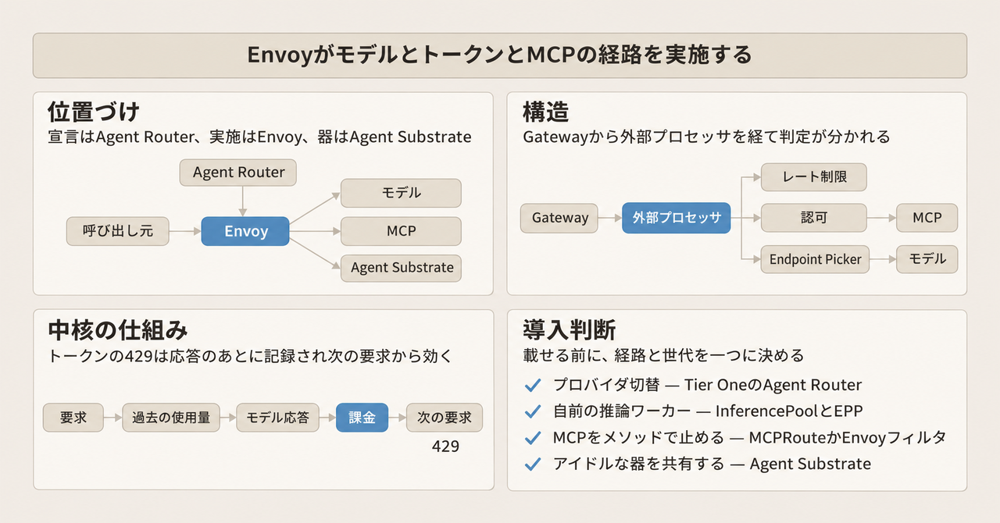
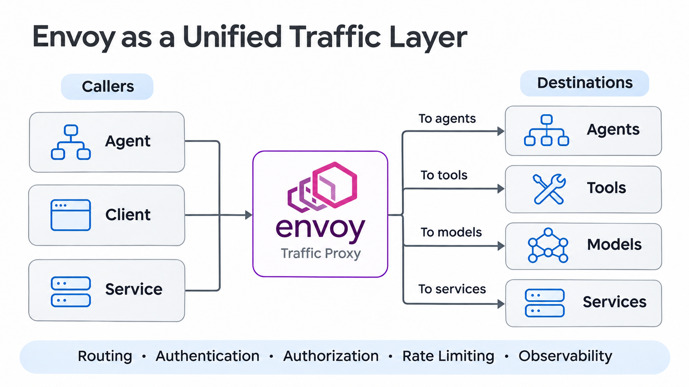
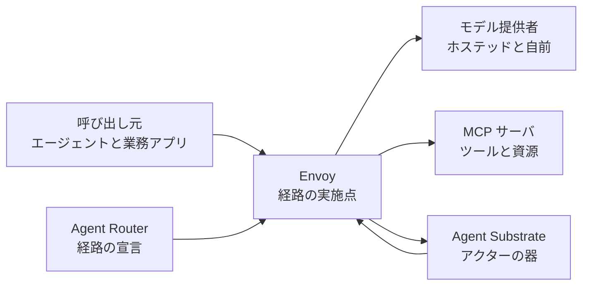
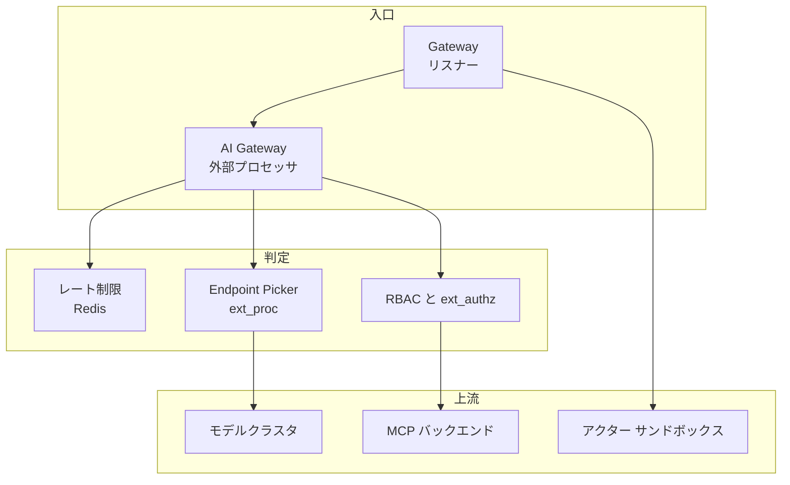
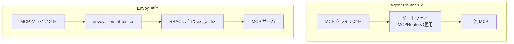
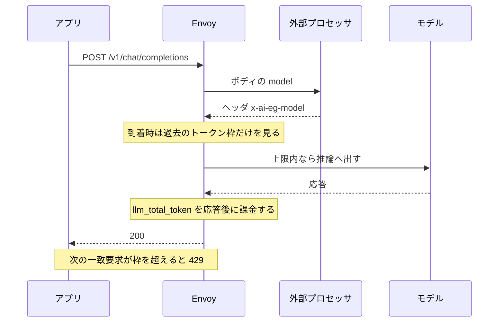
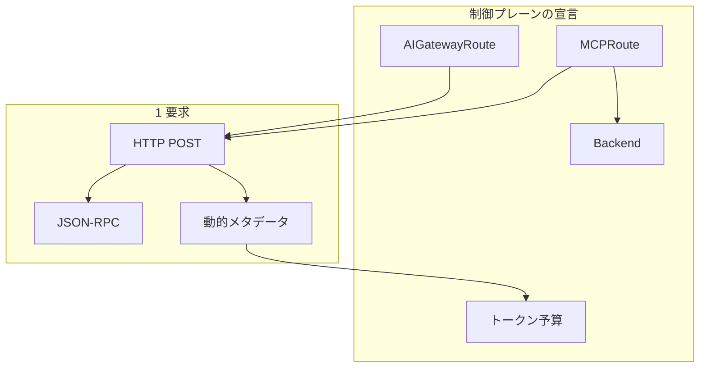
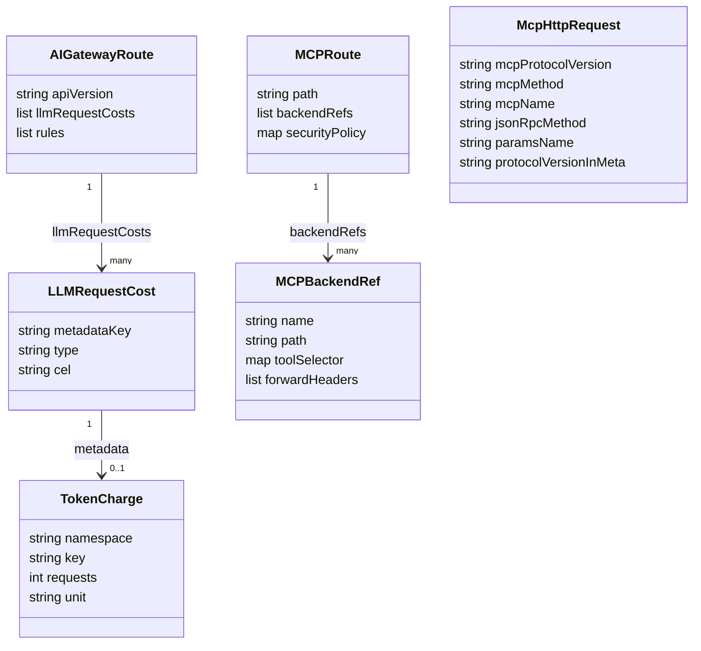

2026年11月19日、Google Cloud Blog は「[Building an agentic stack in Envoy: routing models, tokens, and MCP](https://cloud.google.com/blog/products/networking/the-envoy-agentic-stack-routing-models-tokens-and-mcp/)」を公開しました。著者は Abhi Maras 氏と Boteng Yao 氏です。この記事では、その発表が置くモデル呼び出し、トークン予算、Model Context Protocol（MCP。ツールや資源をモデルから呼ぶためのプロトコル）を、Envoy の経路としてどう宣言し、どう実施するかを説明します。実装の対応は [Agent Router](https://github.com/theagentrouter/agent-router) 1.2、Envoy の MCP フィルタ、[Agent Substrate](https://github.com/agent-substrate/substrate) の公開資料に合わせています。


*この記事の全体像。以下、順に解説します。*

## Envoy agentic stackとは

Envoy は CNCF（Cloud Native Computing Foundation）の L4/L7 プロキシです。Agent Router は、その上の制御プレーンです。旧称は Envoy AI Gateway です。OpenAI 互換の入口、プロバイダごとのスキーマ変換（クライアントの要求の形を、バックエンドの API の形へ合わせる）、MCP の集約、トークン課金を、Kubernetes の Gateway API（入口のリスナーと経路を宣言する API）の資源として書きます。Agent Substrate は、アイドルなエージェントを一時停止し、要求が来たら再開する高密度ランタイムです。ブログは Envoy を、その入口と出口のプロキシとして置きます。

ブログは、LLM（大規模言語モデル）の API、MCP、Agent2Agent（A2A）を Layer 8、UCP、AP2、Agent Development Kit（ADK）を Layer 9 と呼びます。

公式図は、呼び出し元を Agent、Client、Service、行き先を Agents、Tools、Models、Services とし、Envoy に Routing、Authentication、Authorization、Rate Limiting、Observability を載せます。本文が挙げる4本柱は、ボディ解析、トークン、モデルと MCP の経路、ガードレールです。ガードレールは、ブログが判定の柱として挙げる名前です。この記事のマニフェストに、ガードレール専用の設定はありません。図の箱と、本文の4本柱は、別の切り方です。



## 特徴

アプリは、OpenAI 互換の `POST /v1/chat/completions` と、MCP の `POST /mcp` を、同じプロキシの先に置けます。

Agent Router の CLI は `aigw` のままです。単独起動は `http://localhost:1975/v1` を開きます。CRD（Kubernetes のカスタムリソース）の API グループは `aigateway.envoyproxy.io` です。v1.0 が安定契約とした資源は `AIGatewayRoute`、`AIServiceBackend`、`BackendSecurityPolicy`、`GatewayConfig`、`MCPRoute` で、いずれも `v1beta1` です。この記事でマニフェストを示すのは `AIGatewayRoute` と `MCPRoute` です。`AIServiceBackend` と `BackendSecurityPolicy` は安定契約の資源名で、後に出る `Backend`（FQDN とポート）や、`MCPRoute` の `securityPolicy` フィールドとは名前が違います。この記事の例では、この2つは宣言しません。`AIGatewayRoute` はモデル経路とトークンの計測キーを束ねる宣言、`MCPRoute` は複数の MCP バックエンドを1つのパスへ集める宣言です。コンテナ名、Helm チャート、Go モジュールは `envoyproxy/ai-gateway` 系のままです。リポジトリは `theagentrouter/agent-router`、サイトは `theagentrouter.ai` です。

モデル経路の参照アーキテクチャは二段です。Tier One は認証、入口の振り分け、全体のレート制限を持つ外側のゲートウェイです。Tier Two は自前モデル向けの内部ゲートウェイです。Endpoint Picker（EPP）は、InferencePool（推論ワーカーの集合を表す Gateway API Inference Extension の資源）の機能で、選んだエンドポイントを返します。二段の段そのものではありません。

MCP は `MCPRoute` が複数バックエンドを1つのパスへ集め、ツール名を `{backend}__{tool}` にします。トークンは、モデルが数える入出力の量で、要求回数とは別のコストです。後に出る JWT（呼び出し元の身分を表す署名付きトークン）とは別です。応答完了後に動的メタデータ `io.envoy.ai_gateway` へ書き、次の要求から HTTP 429 の判定に使います。動的メタデータはフィルタが書く値で、クライアントは直接書けません。

Envoy 本体の MCP フィルタは、JSON-RPC（メソッド名とパラメータを JSON で送る呼び出し）を動的メタデータへ展開し、後段の RBAC（ロールに基づくアクセス制御）と `ext_authz`（外部の認可サービス）が判定します。Agent Substrate 1.0 のアクターは、一時停止と再開の単位になる実行主体です。図の呼び出し元（OpenAI 互換クライアントや MCP クライアント）とは別です。載せる環境は gVisor（ユーザー空間でプロセスを隔離するサンドボックス）か、Cloud Hypervisor が動かす microVM です。資格情報はサンドボックスの外の出口ゲートウェイで注入します。ライセンスは Agent Router と Agent Substrate とも Apache-2.0 です。

| 置き場所 | 実行方式 | 資源の単位 | 主な機能 | 起動の単位 |
|---|---|---|---|---|
| アプリ内 SDK | プロセス内のクライアント | 会話とツール呼び出し | モデルと MCP をコードが選ぶ | アプリのプロセス |
| Envoy MCP フィルタ | プロキシの HTTP フィルタ | リクエスト | メタデータ抽出、RBAC、`ext_authz` | コネクションとルート |
| Agent Router | コントローラと Envoy | Gateway と CRD | スキーマ変換、MCP 集約、トークン課金 | `aigw run` または Helm |
| Agent Substrate | Kubernetes 上のワーカープール | アクター | 一時停止、再開、出口の資格情報注入 | `kubectl ate` と `ate-setup` |

| 場面 | 向く面 |
|---|---|
| プロバイダを設定変更で切り替えたい | Agent Router の Tier One |
| 自前の GPU ワーカーへ KV キャッシュを見て振りたい | Tier Two の内部ゲートウェイ。エンドポイント選択は InferencePool / EPP |
| ツール名とメソッドで MCP を止めたい | `MCPRoute` の認可、または Envoy MCP フィルタの RBAC |
| アイドルなエージェントの器を共有したい | Agent Substrate |
| ヘッダとボディの一致を最終判定したい | MCP サーバ（仕様 2026-07-28 のサーバ義務） |

KV キャッシュは、推論の途中状態をワーカーに残すキャッシュです。同じ文脈の続きを、その状態があるワーカーへ寄せるときに使います。

## 構造

制御プレーンが経路を宣言し、Envoy が受信した要求へ適用します。モデル、MCP、アクターの器は、同じプロキシの行き先として分かれます。

### システムコンテキスト図

呼び出し元は Envoy に入り、Envoy がモデル、MCP サーバ、Agent Substrate へ出します。Agent Substrate から外への通信も、もう一度 Envoy を通ります。



| 要素名 | 説明 |
|---|---|
| 呼び出し元 | OpenAI 互換クライアント、または MCP クライアント |
| Envoy | 受信、送信、メタデータ抽出、レート制限、認可フィルタを通すデータプレーン |
| Agent Router | CRD を Envoy Gateway の xDS（Envoy へ設定を配るプロトコル）と外部プロセッサへ落とす制御プレーン |
| モデル提供者 | OpenAI 互換、Gemini、Vertex、Bedrock など、README が列挙するホステッド先と自前サービング |
| MCP サーバ | `Backend` の FQDN とパスで指すツール側 |
| Agent Substrate | 一時停止したアクターを要求到着で再開し、出口を Envoy 系のゲートウェイに通すランタイム |

Envoy は、受信した要求を処理するデータプレーンのプロキシです。Envoy Gateway は、Gateway API のリスナーを先に用意する実装です。Agent Router（旧称 Envoy AI Gateway）は、`AIGatewayRoute` などの宣言を Envoy Gateway の xDS と外部プロセッサへ落とす、別の制御プレーンです。図の AI Gateway 外部プロセッサは、その宣言を要求の途中で読む `ext_proc` で、Envoy Gateway そのものではありません。コントローラは名前空間 `envoy-ai-gateway-system`、基本例で待つ Gateway の Pod は `envoy-gateway-system` にいます。

### コンテナ図

入口は Gateway のリスナーと、AI Gateway の外部プロセッサです。外部プロセッサ（`ext_proc`）は、プロキシがボディやヘッダを別プロセスへ渡して判定を受ける仕組みです。判定はレート制限、認可、EPP に分かれ、上流はモデル、MCP、アクターのサンドボックスです。図の矢印では、モデルは Endpoint Picker 経由、MCP は認可経由、アクターのサンドボックスは Gateway から直接です。アクター行きが外部プロセッサを経由するとは、この図は書いていません。



| 要素名 | 説明 |
|---|---|
| Gateway | Gateway API のリスナー。クラスタを使わない `aigw` の入口はポート 1975 で、クラスタの Gateway とは別のプロセス |
| AI Gateway 外部プロセッサ | ボディからモデル名を取り、ヘッダ `x-ai-eg-model` を作る。トークン使用量は `io.envoy.ai_gateway` へ書く |
| レート制限 | Envoy Gateway の Global Rate Limit。状態は Redis |
| RBAC と ext_authz | MCP メタデータ、または JWT と CEL で許可と拒否を返す |
| Endpoint Picker | Inference Extension の ext_proc。選んだエンドポイントをメタデータで返す |
| モデルクラスタ | 自前サービング、またはホステッドプロバイダ |
| MCP バックエンド | `MCPRoute.backendRefs` の先 |
| アクター サンドボックス | Substrate の gVisor または microVM。資格情報は中に置かない |

CEL は、条件を式で書く Common Expression Language です。JWT は署名付きのトークンで、ここでは呼び出し元の身分を表します。

### コンポーネント図

`tools/call` は、Agent Router 1.2 の経路と、Envoy 単体のフィルタ経路が別です。1本の直列にはしません。



| 要素名 | 説明 |
|---|---|
| MCP クライアント | `Accept: application/json, text/event-stream` と、仕様が必須とするミラーヘッダを付ける。`text/event-stream` は、サーバがイベントを流し続ける SSE |
| ミラーヘッダ | `MCP-Protocol-Version`、`Mcp-Method`、対象メソッドでは `Mcp-Name`。ボディが正本 |
| MCPRoute | パス、バックエンド、`toolSelector`、JWT、CEL。既定のツール名は `{backend}__{tool}`。`prefixMode: Never` では列挙したツールが裸の名前。リソース名は接頭辞のまま |
| Envoy MCP フィルタ | ボディから `envoy.filters.http.mcp` に `method` と `params.name` を書く。例の `traffic_mode: PASS_THROUGH` は、その記述と同時に置かれる。ボディを読まないモードとしては書かれていない。モード単体の意味は、それ以上は書かれていない |
| RBAC または ext_authz | メタデータを読んで許可する。`ext_authz` は `metadata_context_namespaces` に同じ名前空間を渡す |
| MCP サーバ | ボディを処理するサーバは、ヘッダ不一致を HTTP 400 と JSON-RPC `-32020` で拒否する |
| アクセスログ | 例は `x-ai-eg-mcp-backend` がある要求だけ JSON を stdout へ出す |

図の「ゲートウェイ」は、制御プレーンの `MCPRoute` そのものではありません。宣言をデータプレーンが適用した結果です。

| 名前 | 置き場所 | 要求の中ですること |
|---|---|---|
| `envoy.filters.http.mcp` | Envoy の HTTP フィルタ | ボディを読み、`envoy.filters.http.mcp` に `method` と `params.name` を書く |
| `envoy.filters.http.mcp_router` | Envoy の別フィルタ | `initialize` の扇出、`lazy_initialization`、`session_signing_key`。Agent Router の `MCPRoute` ではない |
| AI Gateway の `ext_proc` | 外部プロセッサ | モデル名はヘッダ `x-ai-eg-model`。トークン使用量は `io.envoy.ai_gateway` |
| EPP の `ext_proc` | 推論の振り分け | ヘッダと `envoy.lb` の `x-gateway-destination-endpoint` で宛先を返す。subset は EPP への入力ヒントで、選ばれた宛先ではない。MCP のツール許可はしない |
| `MCPRoute` と `AIGatewayRoute` | 制御プレーンの宣言 | 要求を中継しない。パス、バックエンド、コストキーを宣言する |
| `aigw` | CLI | 手元でプロセスを開く。クラスタの CRD コントローラではない |

チャット 1 件は、ボディの `model` から次の要求の 429 まで次の順です。到着時に見る枠は、すでに課金済みの使用量です。今回の応答が枠を超えても、そのストリームは完走し、次の一致要求から 429 になります。



## データ

宣言は制御プレーンにあり、1 要求は HTTP POST と JSON-RPC と動的メタデータです。トークン予算は、応答後のメタデータから次の要求の 429 へつながります。

### 概念モデル

`AIGatewayRoute` はチャットの HTTP を、`MCPRoute` は MCP の HTTP と `Backend` を指します。どちらも要求そのものは運びません。



| 要素名 | 説明 |
|---|---|
| AIGatewayRoute | クライアントのスキーマ、バックエンド、`llmRequestCosts` を1つの Gateway に束ねる |
| MCPRoute | `/mcp` などのパスと、複数の MCP バックエンド、ツール選択、認可を束ねる |
| Backend | Envoy Gateway の `gateway.envoyproxy.io` `Backend`。FQDN とポート |
| HTTP POST | モデルは `/v1/chat/completions` など。MCP 2026-07-28 は単一エンドポイントへの POST |
| JSON-RPC | `method`、`params.name`、`_meta` の `io.modelcontextprotocol/protocolVersion` |
| 動的メタデータ | フィルタが書く。クライアントは直接書けない |
| トークン予算 | 応答後に課金し、次の要求の 429 判定に使う |

### 情報モデル

属性は、Agent Router 1.2 の文書と Envoy の MCP フィルタ例、[MCP 仕様 2026-07-28 の Streamable HTTP](https://modelcontextprotocol.io/specification/2026-07-28/basic/transports/streamable-http) に現れる名前です。



| 要素名 | 説明 |
|---|---|
| AIGatewayRoute.apiVersion | 安定契約の文書は `aigateway.envoyproxy.io/v1beta1` |
| LLMRequestCost.type | usage-based ページの例は `InputToken`、`CachedInputToken`、`OutputToken`、`TotalToken`、`CEL`。API の列挙はこれに `CacheCreationInputToken` と `ReasoningToken` を足した 7 種。未指定の既定は `OutputToken` |
| LLMRequestCost.metadataKey | 例は `llm_input_token`、`llm_total_token`。キー名はルート側が選ぶ |
| MCPRoute.path | クライアントが繋ぐパス。例は `/mcp` |
| MCPBackendRef.toolSelector | `include` と `includeRegex` のどちらか一方。省略するとそのサーバの全ツール |
| MCPBackendRef.forwardHeaders | `name` が必須。`backendHeader` で上流のヘッダ名を変えられる |
| McpHttpRequest.mcpMethod | ヘッダ `Mcp-Method`。ボディの `method` と一致させる |
| McpHttpRequest.mcpName | ヘッダ `Mcp-Name`。`tools/call` と `resources/read` と `prompts/get` で必須。由来は `params.name` または `params.uri` |
| McpHttpRequest.protocolVersionInMeta | `_meta` の `io.modelcontextprotocol/protocolVersion`。`MCP-Protocol-Version` と一致させる |
| TokenCharge.namespace | トークンコストの例は `io.envoy.ai_gateway`。Envoy MCP フィルタのメタデータは `envoy.filters.http.mcp` |
| TokenCharge.requests | `BackendTrafficPolicy` の `limit.requests`。トークン課金で 0 にするのは要求コストで、`limit.requests` ではない。応答メタデータだけを消費する |

`CachedInputToken` は、課金で数えるトークンの種別です。特徴の KV キャッシュ（推論の途中状態をワーカーに残すキャッシュ）と、同じものとは書かれていません。`prompts/get` のプロンプトは、MCP が名前で取る呼び出し対象で、チャットの `messages` とは別です。

## 構築方法

Kubernetes へ載せる場合と、手元の `aigw` だけで開く場合は、入口が違います。Helm の版は文書の `v1.2.1` です。

### 前提

Kubernetes へ載せる場合は、Gateway API と Envoy Gateway が先です。レート制限には Redis が要ります。導入コマンドはそれぞれのインストールガイドにあり、ここでは再掲しません。クラスタを使わない場合は、Linux または macOS の `aigw`、もしくは `cmd/aigw` の Docker Compose 例です。入口は [Agent Router の installation](https://theagentrouter.ai/docs/getting-started/installation) です。

基本例の Gateway 名は `envoy-ai-gateway-basic` です。MCP 例の `parentRefs` は `aigw-run` です。同じマニフェストの親子ではありません。文書の Helm 版は `v1.2.1`、名前空間は `envoy-ai-gateway-system` です。MCP クライアントを 2026-07-28 に合わせるなら、サーバとゲートウェイがどの版を話すかを先に決めます。2026-07-28 は `initialize`、セッションの `Mcp-Session-Id`、GET の SSE、`Last-Event-ID` を手順から外した版です。Agent Router 1.2 の MCP ページは 2025-06-18 を基準にし、セッションと `Last-Event-ID` とツール接頭辞が操作面です。`Last-Event-ID` は 2025-03-26 から 2025-11-25 の手順に残り、2026-07-28 では外します。

### Helm で制御プレーンを入れる

チャート名はリポジトリ移管後も `envoyproxy` のままです。

```shell
helm upgrade -i aieg-crd oci://docker.io/envoyproxy/ai-gateway-crds-helm \
  --version v1.2.1 \
  --namespace envoy-ai-gateway-system \
  --create-namespace
```

```shell
helm upgrade -i aieg oci://docker.io/envoyproxy/ai-gateway-helm \
  --version v1.2.1 \
  --namespace envoy-ai-gateway-system \
  --create-namespace
```

```shell
kubectl wait --timeout=2m -n envoy-ai-gateway-system \
  deployment/ai-gateway-controller --for=condition=Available
```

### 手元で OpenAI 互換の入口を開く

README の単独起動です。キーはプレースホルダです。

```shell
OPENAI_API_KEY=sk-your-key aigw run
```

クライアントの基点は `http://localhost:1975/v1` です。

### 基本例をクラスタへ載せる

```shell
kubectl apply -f https://raw.githubusercontent.com/theagentrouter/agent-router/main/examples/basic/basic.yaml
```

```shell
kubectl wait pods --timeout=2m \
  -l gateway.envoyproxy.io/owning-gateway-name=envoy-ai-gateway-basic \
  -n envoy-gateway-system \
  --for=condition=Ready
```

既定のクライアントバッファは 32KB です。[基本利用ガイド](https://theagentrouter.ai/docs/getting-started/basic-usage/) は、AI の応答に対して 50Mi を指定します。バッファを上げたあとでも、HTTP/2 のウィンドウが別上限なら `413 request_payload_too_large` になります。`ClientTrafficPolicy` は、その Gateway に対するクライアント側の接続設定です。

```yaml
apiVersion: gateway.envoyproxy.io/v1alpha1
kind: ClientTrafficPolicy
metadata:
  name: client-buffer-limit
  namespace: default
spec:
  targetRefs:
    - group: gateway.networking.k8s.io
      kind: Gateway
      name: envoy-ai-gateway-basic
  connection:
    bufferLimit: 50Mi
  http2:
    initialStreamWindowSize: 16Mi
    initialConnectionWindowSize: 24Mi
```

### コントローラを複数にする

リーダー選出は既定で有効です。

```yaml
controller:
  replicaCount: 2
  leaderElection:
    enabled: true
```

## 利用方法

チャット、MCP、トークン上限は、付けるヘッダとメタデータが違います。欠けると、経路ごとに別の失敗になります。

| 経路 | 必須の指定 | 付けない場合 |
|---|---|---|
| チャットのテナント制限 | ヘッダ `x-tenant-id`。モデル名はボディの `model` から `x-ai-eg-model` が作られる | 例の Distinct キーが分かれる |
| MCP 2026-07-28 の POST | `MCP-Protocol-Version`、`Mcp-Method`、`Accept` に `application/json` と `text/event-stream` | 版ヘッダと `Mcp-Method` の欠落やボディ不一致は 400 と `-32020`。`Accept` 欠落はその条件一覧に無い |
| `tools/call` など | `Mcp-Name` | 同上。由来は `params.name` または `params.uri` |
| MCPRoute の API キー | Secret の `apiKey` | 上流が認証を要求するなら失敗する |
| トークンだけを数えるレート制限 | `cost.request.number: 0` と応答メタデータ | 要求回数もバケットを消費する |

`Distinct` は、ヘッダの値ごとに制限の枠を分けます。`Exact` は、後の例では `x-ai-eg-model` が `gpt-4` の要求だけをその枠に入れます。`x-tenant-id` を付けない場合、表は Distinct のキーが分かれると書き、拒否するとは書いていません。空の値の枠に入るか、ルールの外に出るかは、この例には書かれていません。

### チャット補完を送る

基本利用ガイドの試験要求です。`some-cool-self-hosted-model` はモックです。先に LoadBalancer のアドレスを取ります。

```shell
export GATEWAY_URL=$(kubectl get gateway/envoy-ai-gateway-basic -o jsonpath='{.status.addresses[0].value}')
```

アドレスが空、または LoadBalancer が無いときは、基本利用ガイドの port-forward を使います。`kubectl port-forward` は端末を占有するので、試験要求は別の端末で送ります。

```shell
export GATEWAY_URL="http://localhost:8080"
export ENVOY_SERVICE=$(kubectl get svc -n envoy-gateway-system \
  -o jsonpath='{.items[0].metadata.name}')
kubectl port-forward -n envoy-gateway-system svc/$ENVOY_SERVICE 8080:80
```

```shell
curl -H "Content-Type: application/json" \
  -d '{
        "model": "some-cool-self-hosted-model",
        "messages": [
            {"role": "system", "content": "Hi."}
        ]
    }' \
  "$GATEWAY_URL/v1/chat/completions"
```

### MCPRoute でツールを束ねる

文書の基本形です。MCP ガイドの基本例の上流パスは `/mcp/x/issues/readonly` です。同じガイドの OAuth 例と `examples/mcp/mcp_example.yaml` の上流パスは `/mcp/readonly` です。適用するファイルに書かれたパスを使います。ポート 443 の上流には、同じリポジトリ例が付ける `BackendTLSPolicy` を足します。ホスト名は `api.githubcopilot.com`、CA は `System` です。

```yaml
apiVersion: aigateway.envoyproxy.io/v1beta1
kind: MCPRoute
metadata:
  name: mcp-route
  namespace: default
spec:
  parentRefs:
    - name: aigw-run
      kind: Gateway
      group: gateway.networking.k8s.io
  path: "/mcp"
  backendRefs:
    - name: github
      kind: Backend
      group: gateway.envoyproxy.io
      path: "/mcp/x/issues/readonly"
      securityPolicy:
        apiKey:
          secretRef:
            name: github-token
---
apiVersion: gateway.envoyproxy.io/v1alpha1
kind: Backend
metadata:
  name: github
  namespace: default
spec:
  endpoints:
    - fqdn:
        hostname: api.githubcopilot.com
        port: 443
---
apiVersion: gateway.networking.k8s.io/v1
kind: BackendTLSPolicy
metadata:
  name: github-tls
  namespace: default
spec:
  targetRefs:
    - group: gateway.envoyproxy.io
      kind: Backend
      name: github
  validation:
    wellKnownCACertificates: System
    hostname: api.githubcopilot.com
---
apiVersion: v1
kind: Secret
metadata:
  name: github-token
  namespace: default
type: Opaque
stringData:
  apiKey: ghp_your_token_here
```

複数バックエンドでは、既定の `prefixMode` は `Always` です。クライアントから見えるツール名は `github__issue_read` のように、バックエンド名が接頭辞になります。`prefixMode: Never` では、`toolSelector.include` に列挙したツールだけが裸の名前です。同じ裸の名前が重なると経路は受理されません。プロンプトが裸になるのは `promptSelector.include` にあるものだけです。リソース名は `Never` でも接頭辞が残ります。

### ツールを絞り込む

`include` と `includeRegex` は同時に置けません。

```yaml
toolSelector:
  includeRegex:
    - ".*issues?.*"
```

```yaml
toolSelector:
  include:
    - resolve-library-id
    - query-docs
```

### トークンの計測キーを宣言する

`AIGatewayRoute` の `spec` 断片です。版 1.2 の [usage-based ページ](https://theagentrouter.ai/docs/capabilities/traffic/usage-based-ratelimiting/) がこの形です。

```yaml
spec:
  llmRequestCosts:
    - metadataKey: llm_input_token
      type: InputToken
    - metadataKey: llm_cached_input_token
      type: CachedInputToken
    - metadataKey: llm_output_token
      type: OutputToken
    - metadataKey: llm_total_token
      type: TotalToken
```

CEL の例は同じページです。

```yaml
spec:
  llmRequestCosts:
    - metadataKey: custom_cost
      type: CEL
      cel: "(input_tokens - cached_input_tokens) + (cached_input_tokens * 0.1) + output_tokens * 1.5"
```

`GatewayConfig` には、同種のキーを `globalLLMRequestCosts` として置けます。

### テナントとモデルで上限を掛ける

要求コストは 0 です。消費は応答の `llm_total_token` です。`BackendTrafficPolicy` は、Gateway に当たったクライアント側の流量制限です。この Policy が指す Gateway は `envoy-ai-gateway-token-ratelimit` です。基本例の `envoy-ai-gateway-basic` とも、MCP 例の `aigw-run` とも名前が違います。

```yaml
apiVersion: gateway.envoyproxy.io/v1alpha1
kind: BackendTrafficPolicy
metadata:
  name: model-specific-token-limit-policy
  namespace: default
spec:
  targetRefs:
    - name: envoy-ai-gateway-token-ratelimit
      kind: Gateway
      group: gateway.networking.k8s.io
  rateLimit:
    type: Global
    global:
      rules:
        - clientSelectors:
            - headers:
                - name: x-tenant-id
                  type: Distinct
                - name: x-ai-eg-model
                  type: Exact
                  value: gpt-4
          limit:
            requests: 1000
            unit: Hour
          cost:
            request:
              from: Number
              number: 0
            response:
              from: Metadata
              metadata:
                namespace: io.envoy.ai_gateway
                key: llm_total_token
```

掲載例の `unit` は `Hour` です。同じページに `Minute` と `Day` の完成例はありません。`limit.fromMetadata` が読む別フィールド `requests_per_unit` の単位列挙は `SECOND`、`MINUTE`、`HOUR`、`DAY`、`MONTH`、`YEAR` です。停止の `0` はこのメタデータ側の値です。`requests_per_unit: 0` は、上の YAML の `limit.requests: 1000` の位置へ書く数字ではありません。上の YAML には `limit.fromMetadata` が無く、`requests_per_unit` はそれが読む別フィールドです。`0` は Policy の `limit.requests` ではなく、そのメタデータに入っている値です。メタデータを書く YAML は、この例にはありません。CRD の `limit.requests` とはキー名が違います。

送信例です。`$GATEWAY_URL` は、この Policy の Gateway `envoy-ai-gateway-token-ratelimit` のアドレスです。チャット補完の節で `envoy-ai-gateway-basic` から export した値とは別です。

```shell
curl -H "Content-Type: application/json" \
  -H "x-tenant-id: user123" \
  -d '{"model":"gpt-4","messages":[{"role":"user","content":"Hello!"}]}' \
  "$GATEWAY_URL/v1/chat/completions"
```

### ゲートウェイで MCP の OAuth を宣言する

文書が引用する認可仕様は 2025-06-18 と 2025-11-25 です。

```yaml
spec:
  securityPolicy:
    oauth:
      issuer: "https://keycloak.example.com/realms/master"
      audiences:
        - "https://api.example.com/mcp"
      protectedResourceMetadata:
        resource: "https://api.example.com/mcp"
        scopesSupported:
          - "profile"
          - "email"
```

認可ルールの CEL では `request.mcp.method`、`request.mcp.tool`、`request.mcp.backend`、`request.mcp.params` が使えます。最初に一致した規則が許可または拒否を決め、不一致は `defaultAction` です。`defaultAction` が許可か拒否かの既定値は、この例には書かれていません。

### Envoy 単体で MCP メソッドを RBAC する

フィルタ順は MCP の後に RBAC です。型 URL は Envoy 1.41.0-dev の例のままです。同じページはフィルタを開発中とし、集約モードは未実装です。

```yaml
- name: envoy.filters.http.mcp
  typed_config:
    "@type": type.googleapis.com/envoy.extensions.filters.http.mcp.v3.Mcp
    traffic_mode: PASS_THROUGH
- name: envoy.filters.http.rbac
  typed_config:
    "@type": type.googleapis.com/envoy.extensions.filters.http.rbac.v3.RBAC
```

一致条件のメタデータは、`envoy.filters.http.mcp` の `method` が `tools/call`、`params` / `name` がツール名、です。

### 2026-07-28 のツール呼び出し

仕様の例を、ヘッダとボディが一致する形で置きます。ゲートウェイがこの版を実装しているかは、世代の違いで判断します。詳細は注意点です。

```http
POST /mcp HTTP/1.1
Host: example.com
Content-Type: application/json
Accept: application/json, text/event-stream
MCP-Protocol-Version: 2026-07-28
Mcp-Method: tools/call
Mcp-Name: get_weather

{
  "jsonrpc": "2.0",
  "id": 1,
  "method": "tools/call",
  "params": {
    "name": "get_weather",
    "arguments": {"location": "Seattle, WA"},
    "_meta": {
      "io.modelcontextprotocol/protocolVersion": "2026-07-28",
      "io.modelcontextprotocol/clientInfo": {"name": "ExampleClient", "version": "1.0.0"},
      "io.modelcontextprotocol/clientCapabilities": {}
    }
  }
}
```

`Mcp-Method` はボディの `method` と、`Mcp-Name` は `params.name` と、`MCP-Protocol-Version` は `_meta` の `io.modelcontextprotocol/protocolVersion` と同じ値です。

## 運用

トークンの見え方、クォータ、アクセスログ、無通信のフェイルオーバ、コントローラの台数、EPP、Substrate の再開は、別の設定面です。

### トークン超過の見え方

到着時に見るのは、すでに課金された使用量です。上限を超えていれば HTTP 429 です。入ったストリームは、その応答が上限を超えても途中で切られません。使い切りはストリーム完了後に記録され、次の一致要求から 429 です。文書の例では、空の 1,000 トークン時間枠に入った要求が 1,200 トークンを流し切り、その後の要求が制限されます。

### クォータとクライアント上限を分ける

`QuotaPolicy` は、プロバイダのバックエンドとモデルに対する基盤側の消費枠です。`BackendTrafficPolicy` の usage-based 制限は、ルート上のクライアント枠です。usage-based の制限は、一致したルールを超えると 429 です。

`QuotaPolicy` の `Shared` は、一致したバケットと `defaultBucket` のすべてに課金し、少なくとも 1 つのバケットに残量があるときだけ許可します。全部が尽きたときだけ拒否します。`duration` は `1s`、`1m`、`1h`、`1d` のいずれかです。クォータ用のレート制限サービスが無いときの既定 `controller.quotaRateLimitFailureModeDeny: false` は fail open です。チェックできない要求は通ります。

クォータガイドの例は `modelName`、`limit`、`duration`、`costExpression`、`mode: Shared` を持ちます。公開例の `apiVersion` は `aigateway.envoyproxy.io/v1alpha1` です。互換表は `QuotaPolicy` を v1alpha1 のままにしています。

### アクセスログをプロキシ側に残す

`examples/mcp/mcp_example.yaml` は、ヘッダ `x-ai-eg-mcp-backend` が空でない要求だけ JSON を stdout へ出します。

```yaml
json:
  jsonrpc.request.id: "%DYNAMIC_METADATA(io.envoy.ai_gateway:mcp_request_id)%"
  mcp.session.id: "%REQ(MCP-SESSION-ID)%"
  mcp.method.name: "%DYNAMIC_METADATA(io.envoy.ai_gateway:mcp_method)%"
  mcp.tool.name: "%DYNAMIC_METADATA(io.envoy.ai_gateway:mcp_tool_name)%"
  session.id: "%DYNAMIC_METADATA(io.envoy.ai_gateway:session.id)%"
  mcp.provider.name: "%DYNAMIC_METADATA(io.envoy.ai_gateway:mcp_backend)%"
  response_code: "%RESPONSE_CODE%"
  duration: "%DURATION%"
  x-request-id: "%REQ(X-REQUEST-ID)%"
```

この形式にツール引数の本文はありません。会話の正本をプロキシに置くなら、このキーだけでは足りず、別のログ方針が要ります。管理ポートの例は `127.0.0.1:9901` です。監査の正本ではありません。

| 正本にするもの | 置く場所 |
|---|---|
| メソッド、ツール名、バックエンド、所要時間、`x-request-id` | プロキシのアクセスログ。名前空間は `io.envoy.ai_gateway` |
| 会話本文とツール引数 | この JSON には無い。別保管 |
| RBAC が見る `method` と `params.name` | `envoy.filters.http.mcp`。上のアクセスログキーとは別の名前空間 |
| 管理ポート `127.0.0.1:9901` | 運用の確認口。監査の正本ではない |

### ストリームの無通信でフェイルオーバする

v1.1.0（2026-08-21）は `AIGatewayRouteRule.streamIdleTimeout` を追加しました。最初のトークンの前に無通信が閾値を超えると、リトライ方針があれば次のバックエンドへ移れます。ストリームの途中で同じ閾値を超えると 504 です。未設定なら、この試行単位のアイドル期限はありません。

### コントローラの台数

```shell
kubectl -n envoy-ai-gateway-system scale deployment ai-gateway-controller --replicas=2
```

拡張サーバは CPU に寄ります。文書の HPA（CPU などに応じて Pod 数を変える Horizontal Pod Autoscaler）の例は、CPU 70%、最小 2、最大 10 です。この HPA は拡張サーバの例で、直前に台数を変えた `ai-gateway-controller` と同じ Deployment 名は書かれていません。拡張サーバがどのプロセスかも、この例には書かれていません。

### InferencePool と EPP

EPP は Envoy の external processing です。データプレーンへの返却は、ヘッダ `x-gateway-destination-endpoint` と、名前空間 `envoy.lb` の同じキーです。値は 1 つの `ip:port`、またはカンマ区切りの複数です。先頭が使われ、リトライは並びを辿ります。

`x-gateway-destination-endpoint-subset` は返却ではありません。データプレーンが EPP へ渡す入力で、既定の名前空間は `envoy.lb.subset_hint` です。応答後、データプレーンは実際に処理したエンドポイントを `envoy.lb` の `x-gateway-destination-endpoint-served` で EPP へ返します。

[Gateway API Inference Extension の README](https://github.com/kubernetes-sigs/gateway-api-inference-extension/blob/main/README.md) は、EPP の実装パッケージが `llm-d/llm-d-router` へ移ったと書きます。InferencePool は `HTTPRoute` にも `AIGatewayRoute` にも付きます。二段ゲートウェイの Tier Two とは別の仕組みです。

### Agent Substrate の再開

開発用の入口は次です。資格情報プロバイダの例は、空の拒否が既定です。`spiffe://` は、ワークロードの身元を表す SPIFFE ID です。

```shell
export ATE_INSTALL_KIND=true
go run ./cmd/ate-setup deploy ate-system --credential-provider='{"name":"k8s.io"}' \
  --ingress-allowed-spiffe-ids=spiffe://cluster.local/ns/ate-system/sa/atenet-client
```

```shell
kubectl ate create actor my-counter-1 -a ate-demo-counter --template counter
kubectl ate proxy actor my-counter-1 -a ate-demo-counter
```

README の性能記述は、再開 500ms 未満、毎秒 500 活性化より多い、です。GKE の手順は [別ガイド](https://docs.cloud.google.com/kubernetes-engine/ai-ml/install-overview-substrate) です。

### 出口で資格情報を注入する

アクターは API キーとクラウドトークンを持ちません。`atenet-egress` が、許可した外向き要求へ外側で資格情報を足します。入口は `atenet-router` だけです。アクター間と制御プレーンへの横移動は既定でありません。ネットワークの実施点は Envoy です。ポリシーエンジンは差し替え可能な PEP（ポリシーの実施点）です。

## ベストプラクティス

拒否する主体、トークンの事後課金、監査ログの範囲、MCP の世代、EPP の突合、Substrate の出口は、設定を分ける単位です。

### 同じ要求で拒否点を4つに分ける

同じ `tools/call` でも、拒否する主体は次のとおり分かれます。429 はトークン枠の結果なので、この表には入れません。表の行は4つより多いです。アプリと外部プロセッサは、この要求の MCP ツール認可では拒否しません。拒否し得るのは、ゲートウェイが適用した `MCPRoute`、RBAC と `ext_authz`、MCP サーバ、版の古い中継です。

| 主体 | 見るもの | この要求を拒否するか | ステータス |
|---|---|---|---|
| アプリ | ボディからヘッダを写す | この文書の範囲では拒否しない | なし |
| ゲートウェイが適用した `MCPRoute` | JWT、CEL の `request.mcp.method` と `tool` と `backend` | ルールが合わなければ上流の前に拒否できる | ガイドの例には拒否ステータスの固定値がない |
| AI Gateway の `ext_proc` と EPP | モデル名、トークン使用量、推論エンドポイント | MCP ツールの認可はしない | なし |
| RBAC と `ext_authz` | フィルタが書いた `envoy.filters.http.mcp` | メタデータで拒否できる | ポリシー依存 |
| MCP サーバ | ヘッダとボディ | 不一致なら拒否する | HTTP 400 と JSON-RPC `-32020` |
| 中継 | 版が古い、またはヘッダが無い | ヘッダを信用せず拒否するのが仕様の推奨 | HTTP エラー。JSON-RPC ボディは必須ではない |

ヘッダだけを信用するルールは、`MCP-Protocol-Version` がその照合を必須にする版であるときに使います。仕様は、版が古いかヘッダが無いとき、中継はヘッダを信用せず拒否する、と推奨します。

### トークン予算は事後課金として設計する

上限判定は過去の課金です。今回のプロンプト長では、入る前に止まりません。暴走ループを止めるなら、セッション単位の打ち切りをアプリか別フィルタに置き、Agent Router 1.2 の usage-based ページがその機能だと読まないでください。要求コスト 0 を外すと、トークンと要求回数の両方がバケットを減算します。

`limit.fromMetadata` の欠落は、ルールの静的上限へ倒れます。静的値は緩い初期値ではなく、保守的な天井にします。値 0 は欠落とは違う停止です。トークン課金では、すでに入った 1 件は完走し、次から拒否されます。

### 監査の正本をプロキシのアクセスログに置く条件

例の JSON は、メソッド、ツール名、バックエンド、所要時間、`x-request-id` を持ちます。ツール引数とモデルの本文は、この形式にありません。会話全文を正本にする要件なら、アクセスログとは別の保管を決めます。メタデータはフィルタだけが書けます。クライアントヘッダを監査の身分証明にしないでください。

### 世代を1つに固定する

新規の MCP 経路を 2026-07-28 にするなら、`initialize`、`Mcp-Session-Id`、GET の SSE（サーバからイベントを流し続ける Server-Sent Events）、`Last-Event-ID` を手順から外します。既存の Agent Router 1.2 の MCP ページに合わせるなら、セッションと `Last-Event-ID` とツール接頭辞が現行の操作面です。両方のクライアントを受けるなら、版ヘッダでリスナーを分けます。

### 自前モデルの振り先は EPP のキーで追う

アクセスログの上流ホストと、EPP が返した `x-gateway-destination-endpoint`、実際に処理した `x-gateway-destination-endpoint-served` を、同じ要求で突合します。

### Substrate の出口と MCP の入口を混ぜない

MCP サーバへの認可は、エージェントプロセスの中ではなく、入口の `MCPRoute` か Envoy フィルタです。エージェントから外への認可は、Substrate の出口 PEP です。資格情報をアクターの環境変数へ戻すと、プロンプト注入時に持ち出せるものが増えます。

## 注意点

発表、仕様、チャート、フィルタ文書は、同じ語でも指す版と主体が違います。設計へ転記する前に、どの資料の文かを分けます。

| 対象 | 資料の記載 | 実態 | 読者への影響 |
|---|---|---|---|
| Layer 8 と Layer 9 | ブログが LLM API、MCP、A2A を Layer 8、UCP、AP2、ADK を Layer 9 と呼ぶ | ブログの呼称です。Envoy フィルタや CRD の設定単位ではありません。IETF の OSI 層番号としては未確認 | 設計書の層番号にも、フィルタ名にも転記しない |
| ヘッダだけで Envoy が MCP を振り分ける | ブログは 2026-07-28 を引き、`Mcp-Method` と `Mcp-Name` でボディを解析せず振り分けると書く | 仕様は中継がヘッダを見てよいと書く。Envoy 1.41.0-dev の MCP フィルタ文書はボディを解析して `envoy.filters.http.mcp` に `method` と `params.name` を書く。Agent Router 1.2 の MCP ページは 2025-06-18 とセッション、`Last-Event-ID` を基準にする | 2026-07-28 のゼロ解析を、現行チャートの既定動作とみなさない |
| `-32020` の主体 | ブログはバックエンドが HTTP 400 と `-32020` HeaderMismatch で拒否すると書く | 仕様は、ボディを処理するサーバが 400 と `-32020` を必須とする。中継の JSON-RPC ボディは必須ではない | プロキシの拒否応答に `-32020` が常にあるとは扱わない |
| 事前のトークン見積もり | ブログはバイトから入力トークンを見積もり、超過を推論クラスタの前で 429 にすると書く | Agent Router 1.2 は、既に課金した使用量を到着時に見て、今回分は応答後に課金する。ストリームは上限超過でも完走する | 巨大プロンプトの初回は通る前提で予算を置く |
| セッション単位の暴走停止 | ブログはセッションまたはエージェント ID の累計トークンとメッセージ数で止めると書く | 確認した usage-based ページのキーは `x-tenant-id` と `x-ai-eg-model` | エージェント ID の遮断は別設定として確認する |
| Model Armor と ShieldGemma | ブログは `ext_proc` の判定先の例として挙げる | Agent Router 1.2 の CRD 名としては未確認。確認できた判定面は RBAC、`ext_authz`、MCPRoute の CEL、外部プロセッサのトークン抽出 | 製品名のトグルがマニフェストにあるとは扱わない |
| MCP ルータ文書の `initialize` | Envoy の MCP Router 文書は、`initialize` で全バックエンドを待つ既定と、`lazy_initialization`、`session_signing_key` の HMAC-SHA256 を書く | MCP 2026-07-28 はプロトコルセッションと `initialize` を外し、GET と `Last-Event-ID` を外す | ルータ文書の手順を 2026-07-28 のクライアントへそのまま使わない |
| アクセスログのセッション | 例は `%REQ(MCP-SESSION-ID)%` を出す | 2026-07-28 はセッションヘッダを定義しない。2025-11-25 までの Streamable HTTP が `Mcp-Session-Id` を使う | 空欄でも新しい版では異常としない |
| ツールパスの例 | MCP ガイドの基本例は `/mcp/x/issues/readonly` | 同じガイドの OAuth 例と `examples/mcp/mcp_example.yaml` は `/mcp/readonly` | コピー元を1つに決める |
| EPP の所在 | ブログは Gateway API Inference Extension と EPP を KV キャッシュ親和の主体として書く | README は EPP 実装の受け入れ先を `llm-d/llm-d-router` とし、移した EPP などをアーカイブ予定と書く。同じリポジトリには lightweight EPP と InferencePool API が残る | デプロイするバイナリのリポジトリを拡張の README で取り直す |
| 再開の時間 | ブログは一時停止アクターの再開をミリ秒と書く | Substrate README は 500ms 未満、毎秒 500 活性化より多い、と書く | 2つの数字を同じ計測として比較しない |
| QuotaPolicy の版 | 安定契約の発表は中核5資源を `v1beta1` とする | クォータガイドの例は `aigateway.envoyproxy.io/v1alpha1` の `QuotaPolicy` | 適用前に `kubectl api-resources` で served version を見る |
| 図と本文 | 本文は4本柱の表 | 公式図は呼び出し元3種と行き先4種、下部に Routing から Observability | 図にボディパーサや TPM の箱があるとは読まない |
| ツール名の接頭辞 | MCP ガイドは `github__issue_read` のように自動接頭辞と書く | v1.2 は `prefixMode` を追加した。既定 `Always` は接頭辞。`Never` で裸になるのは列挙したツールと、`promptSelector.include` のプロンプト。リソース名は接頭辞のまま | ガイドの例だけを見ると、裸の名前を選べないと読む |
| EPP の subset | 候補集合を EPP の出力と読み替えやすい | [提案 004](https://github.com/kubernetes-sigs/gateway-api-inference-extension/blob/84436a96b9e6ce2b59ddacd3d04c31b4fbd442de/docs/proposals/004-endpoint-picker-protocol/README.md) では subset はデータプレーンから EPP への入力。出力は宛先ヘッダと `envoy.lb` | 入力ヒントを、選ばれたエンドポイントのログとみなさない |

HeaderMismatch は、ヘッダとボディの対応する値が食い違ったときに仕様が付ける JSON-RPC エラーです。コードは `-32020` です。TPM は tokens per minute の略で、ここでの「図に TPM の箱があるとは読まない」は、公式図の下部が Routing から Observability であり、トークン毎分の計測箱ではない、という意味です。

## トラブルシューティング

切り分けは、次の順でステータスを見ます。

- 429 は、トークン課金が応答のあとであることと、静的上限への倒れを疑います。
- 400 と JSON-RPC `-32020` は、必須ヘッダとボディの不一致を疑います。
- 413 は、クライアントバッファと HTTP/2 ウィンドウを疑います。
- 404 と 405 は、MCP の版が 2026-07-28 か 2025 年のセッション世代かを疑います。
- ツール欠落と認証失敗は、`toolSelector`、接頭辞、`injectionPolicy` を疑います。
- 出口が黙って落ちるときは、Substrate の既定拒否とサンドボックス種別を疑います。

### 429 が巨大プロンプトの前に出ない

| 症状 | 原因 | 対処 |
|---|---|---|
| 長い初回要求がモデルまで届き、次から 429 になる | 課金は応答完了後。到着時の判定は過去分 | 期待どおりの動き。初回から止めたいなら、カウント API かアプリ側の上限を別に置く |
| ストリームが上限を超えても最後まで流れる | 文書が、入場済みストリームは切らないと書く | 事後の要求で止める設計にする |
| テナントを止めたいのに通る | メタデータ欠落は静的上限へ倒れる。0 は欠落とは違う停止 | `limit.fromMetadata` の `requests_per_unit: 0`。トークン課金では飛行中の 1 件は完走し、次から拒否。CRD の `limit.requests` とは別キー |

v1.1 のカウント用パスは、生成なしの別 API です。vLLM 形の `/tokenize`、Anthropic の `/anthropic/v1/messages/count_tokens`、Responses の `/v1/responses/input_tokens` です。チャットの本線とは別です。

### 400 と HeaderMismatch

| 症状 | 原因 | 対処 |
|---|---|---|
| HTTP 400、JSON-RPC `-32020` | 2026-07-28 で、必須ヘッダの欠落、またはヘッダとボディの不一致 | `Mcp-Method` を `method` と、`Mcp-Name` を `params.name` または `params.uri` と、版ヘッダを `_meta` の版と揃える |
| ヘッダのツール名だけが許可名で、ボディが別ツール | 仕様が防ぐ改ざん形 | サーバは拒否する。中継の許可は、照合を必須にする版だけでヘッダにかける |
| 非 ASCII の名前で不一致 | `=?base64?...?=` のまま比較している | サーバはデコードしてからボディと比較する |

### 413 とバッファ

| 症状 | 原因 | 対処 |
|---|---|---|
| `413 request_payload_too_large` | 基本利用ガイドがこの理由句を書くのは、バッファを上げたあとの HTTP/2 ウィンドウ不足 | `bufferLimit: 50Mi` に加え、`initialStreamWindowSize: 16Mi` と `initialConnectionWindowSize: 24Mi`。32KB は応答に足りない既定バッファ |

### セッションと初期化

| 症状 | 原因 | 対処 |
|---|---|---|
| `initialize` が 2026-07-28 のサーバでメソッド不一致 | その版はハンドシェイクを外した | `server/discover` と要求ごとの `_meta` を使う。未知メソッドは HTTP 404 と `-32601` |
| GET の SSE が 405 | 2026-07-28 だけのサーバは、GET と DELETE に 405 を返すべきだと仕様が推奨する。必須ではない | 通知は `subscriptions/listen` の POST 応答ストリーム |
| 古いクライアントを新しいサーバへ繋ぐ | セッションと `Last-Event-ID` は 2025-03-26 から 2025-11-25 の形 | 版を分けたリスナーにする |
| MCP Router が `initialize` で全バックエンドを待つ | `lazy_initialization` が偽 | 遅い上流があるなら `true`。これはルータ文書の世代の設定 |

`server/discover` は、2026-07-28 で `initialize` の代わりに使うと表が示すメソッド名です。引数の形はここでは示しません。

### ツールが見えない、認証が落ちる

| 症状 | 原因 | 対処 |
|---|---|---|
| 期待したツールが一覧に無い | `toolSelector` の正規表現、または接頭辞 `backend__tool` | 既定の `prefixMode: Always` なら接頭辞付きの名前で `tools/call` する。`Never` なら `include` に列挙した裸の名前で呼ぶ |
| `include` と `includeRegex` の両方が拒否される | 文書はどちらか一方 | 片方だけにする |
| 上流が `Authorization` を拒否する | `forwardHeaders` は値をそのまま写す。`Bearer` は付かない | クライアントがスキーム込みで送る。注入に任せるならヘッダを省略する |
| API キーが常に上書きされる | `injectionPolicy` の既定は `Always` | 呼び出し元のトークンを優先するなら `IfNotPresent`。`queryParam` とは併用しない |
| OAuth のメタデータが取れず MCPRoute が受理されない | `authorizationServerMetadataUrl` の取得失敗 | status の条件を見る。`issuer` は保護資源メタデータの識別子のまま |

`injectionPolicy` は、ゲートウェイが資格情報ヘッダを上流へ足すときの上書き規則です。`Always` は常に Secret 側で上書きし、`IfNotPresent` は呼び出し元が既に付けていればそれを残します。`queryParam` は、`IfNotPresent` と同時に置かないと表が書く指定です。フィールドの形はここでは示しません。

### 出口とサンドボックス

| 症状 | 原因 | 対処 |
|---|---|---|
| アクターから外部 API が通らない | Substrate は既定拒否。資格情報はサンドボックスに無い | atespace に Secret の名前空間を許可し、出口ポリシーで注入する |
| プレーンなコンテナとしてスケジュールしたい | README は通常の Linux コンテナを非対応と書く | gVisor か Cloud Hypervisor を使う |
| プールが埋まると 503 になる | 駐車を使っていない | Request Parking のデモが、空くまで保持する別の動き |

atespace は、アクターが使える名前空間や Secret の範囲を書く Substrate の設定です。Request Parking は、ワーカーが空くまで要求を保持するデモの動きです。

## まとめ

Envoy agentic stack は、モデル呼び出し、トークン予算、MCP を、アプリ内の分岐ではなくプロキシの経路に置きます。Agent Router が `AIGatewayRoute` と `MCPRoute` を宣言し、Envoy がヘッダ、メタデータ、レート制限、認可を実施します。トークンの 429 は応答後の課金で、到着時に見るのは過去分です。MCP の拒否は、`MCPRoute`、Envoy の RBAC、サーバの HeaderMismatch で主体が分かれます。2026-07-28 のクライアントと、Agent Router 1.2 のセッション世代は、リスナーを分けて固定します。アイドルなエージェントの器は Agent Substrate で、資格情報はサンドボックスの外の出口で足します。

この記事が少しでも参考になった、あるいは改善点などがあれば、ぜひリアクションやコメント、SNSでのシェアをいただけると励みになります！

## 参考リンク

### 起点の発表

- [Building an agentic stack in Envoy: routing models, tokens, and MCP](https://cloud.google.com/blog/products/networking/the-envoy-agentic-stack-routing-models-tokens-and-mcp/)
- [The case for Envoy networking in the agentic AI era](https://cloud.google.com/blog/products/networking/the-case-for-envoy-networking-in-the-agentic-ai-era)

### MCP 仕様 2026-07-28

- [Transports](https://modelcontextprotocol.io/specification/2026-07-28/basic/transports)
- [Streamable HTTP](https://modelcontextprotocol.io/specification/2026-07-28/basic/transports/streamable-http)
- [2026-07-28 specification announcement](https://blog.modelcontextprotocol.io/posts/2026-07-28/)

### Agent Router

- [README](https://github.com/theagentrouter/agent-router)
- [Installation v1.2.1](https://theagentrouter.ai/docs/getting-started/installation)
- [Basic usage](https://theagentrouter.ai/docs/getting-started/basic-usage/)
- [MCP Gateway](https://theagentrouter.ai/docs/capabilities/mcp/)
- [Usage-based rate limiting](https://theagentrouter.ai/docs/capabilities/traffic/usage-based-ratelimiting/)
- [Quota policy](https://theagentrouter.ai/docs/capabilities/traffic/quota-policy)
- [MCP example](https://github.com/theagentrouter/agent-router/blob/main/examples/mcp/mcp_example.yaml)
- [v1.1.0 release notes](https://theagentrouter.ai/release-notes/v1.1)
- [v1.0.0 discussion](https://github.com/orgs/theagentrouter/discussions/2281)

### Envoy と推論の振り分け

- [MCP HTTP filter](https://www.envoyproxy.io/docs/envoy/latest/configuration/http/http_filters/mcp_filter)
- [MCP Router filter](https://www.envoyproxy.io/docs/envoy/latest/configuration/http/http_filters/mcp_router_filter)
- [Gateway API Inference Extension README](https://github.com/kubernetes-sigs/gateway-api-inference-extension/blob/main/README.md)
- [Endpoint Picker protocol](https://github.com/kubernetes-sigs/gateway-api-inference-extension/blob/84436a96b9e6ce2b59ddacd3d04c31b4fbd442de/docs/proposals/004-endpoint-picker-protocol/README.md)

### Agent Substrate

- [README](https://github.com/agent-substrate/substrate)
- [GKE installation](https://docs.cloud.google.com/kubernetes-engine/ai-ml/install-overview-substrate)
