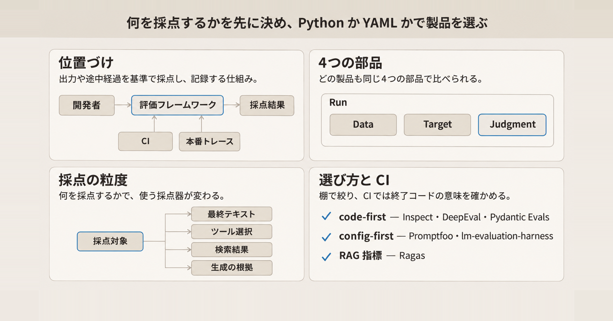
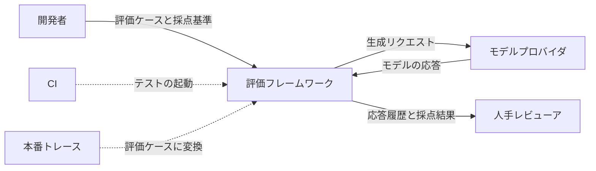
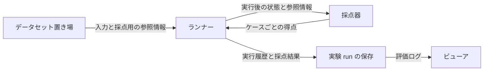
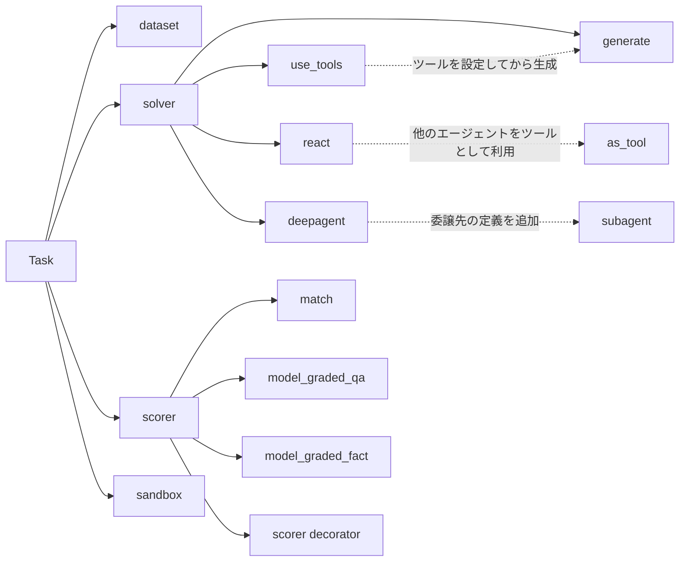
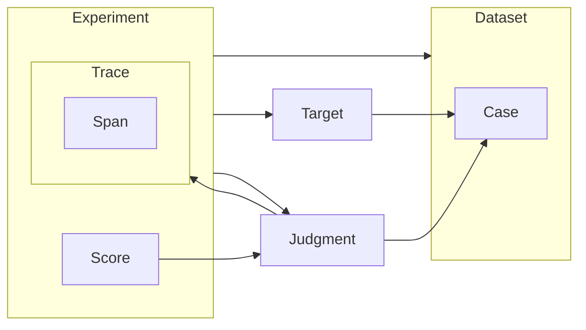
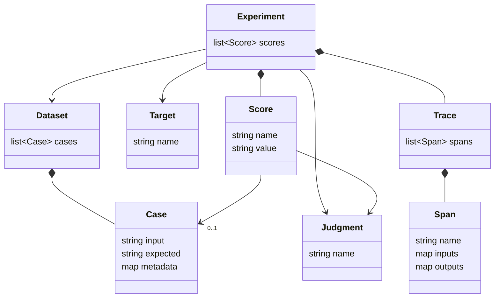

LLM やエージェントが期待どおりに動くかを確かめるには、その出力や途中経過を、定めた基準で採点して記録する仕組みが要ります。その仕組みが評価フレームワークです。出荷前の CI でも、本番トレースの採点でも使います。同じエージェントでも、最終回答、ツール選択、検索順位のどれを採点したいかで、選ぶ製品が変わります。この記事は、Sergii Makarevych の X 投稿 [How to pick an eval framework that checks what you ship](https://x.com/sermakarevich/status/2124210425331921148)（2026-11-21）を入口に、Inspect、DeepEval、Pydantic Evals、lm-evaluation-harness、Promptfoo、Ragas の 6 製品を、同じ物差しで並べます。

読み終えると、次のことがわかります。

- 評価フレームワークが共通に持つ 4 つの部品（Data、Target、Judgment、Run）
- 製品ごとの最小構成（インストール、ケースの書き方、実行コマンド）
- 繰り返し実行、CI でのゲート、判定器の一致の測り方
- 公式文書のあいだで食い違いやすい点

インストール、型、コマンド、終了条件は、2026-11-23 時点の各製品の公式ドキュメントと GitHub API を根拠にしています。


*この記事の全体像。以下、順に解説します。*

## 評価フレームワークとは

評価フレームワークは、モデルやエージェントの出力や途中経過を、定めた基準で採点して記録する仕組みです。オフライン評価では同じ入力の集合を繰り返し使って変更の前後を比べ、オンライン評価では本番の実行をその場で採点します。どの製品も、次の 4 つの形に分けて考えられます。

| 呼び方 | 中身 |
|---|---|
| Data | 評価に使うケースの集合 |
| Target | 評価されるモデルや関数、エージェント |
| Judgment | 出力や途中経過への採点 |
| Run | Data、Target、Judgment を 1 回実行した記録 |

LLM とエージェントの評価では、回答を作る手順と、その回答を採点する基準を分けて持てます。英国 AI Security Institute が公開する評価フレームワーク Inspect では、前者を `solver`（ケースごとに回答を作る手順）、後者を `scorer`（その回答を採点する関数）と呼び、どちらも `Task` に載せます。実行単位は製品によって違います。

| 製品 | 評価の定義 | 実行の入口 |
|---|---|---|
| Inspect | Python の `Task` | `inspect eval` |
| DeepEval | `LLMTestCase` | `deepeval test run` |
| Pydantic Evals | `Dataset` | `evaluate_sync` |
| lm-evaluation-harness | YAML のタスク | `lm-eval run` |
| Promptfoo | `promptfooconfig.yaml` | `promptfoo eval` |
| Ragas | 指標クラスと `@experiment()` の実験関数 | 1 件は指標の `score`（非同期の実験関数内では `ascore`）、データセット全体は quickstart の実験 |

採点の見方は、最終テキスト、ツール呼び出し、検索結果、生成回答のどれを見るかで分かれます。Inspect の `match()` は出力と `target`（期待値）の一致を見ます。Inspect の小文字の `target` は採点用の期待値で、上の表の Target（評価対象）とは別物です。`model_graded_fact()` は、採点用モデルが「回答が期待される事実を含むか」を判定します。DeepEval の `GEval` は、評価基準の文章をもとに LLM が採点する指標で、どの入力を見るかを指定できます。この記事の Correctness 例では `actual_output` と `expected_output` を使います。Ragas の collections API（現行の指標クラスをまとめた `ragas.metrics.collections` モジュール）は、検索結果で裏づける指標と、質問と回答の対応を見る指標をクラスで分けています。

2026-11-23（UTC の同日中）に GitHub API から取得した、主な公開リポジトリの規模は次のとおりです。star と最終 push は取得後も変わるため、目安として読んでください。表の前半 6 行は、この記事で比べる製品のうち Pydantic Evals を除く 5 製品と、NVIDIA が公開する評価ツールの SkillEvaluator です（Pydantic Evals はこの表に含めていません）。後半は、X 投稿が同じ棚に並べた周辺の評価・観測製品で、規模の参考として載せています。ライセンス欄は API の SPDX 表記のままです。`NOASSERTION` は、API が SPDX を断定しなかったことを示します。

| リポジトリ | star | ライセンス（API） | archived | 最終 push（UTC） |
|---|---:|---|---|---|
| UKGovernmentBEIS/inspect_ai | 3313 | MIT | false | 2026-11-22 |
| confident-ai/deepeval | 19602 | Apache-2.0 | false | 2026-11-23 |
| EleutherAI/lm-evaluation-harness | 14523 | MIT | false | 2026-11-04 |
| promptfoo/promptfoo | 27567 | MIT | false | 2026-11-23 |
| NVIDIA/SkillEvaluator | 4424 | Apache-2.0 | false | 2026-11-23 |
| vibrantlabsai/ragas | 16404 | Apache-2.0 | false | 2026-11-14 |
| openai/evals | 19784 | NOASSERTION | false | 2026-04-14 |
| stanford-crfm/helm | 2977 | Apache-2.0 | false | 2026-09-01 |
| langfuse/langfuse | 37746 | NOASSERTION | false | 2026-11-23 |
| Arize-ai/phoenix | 12379 | NOASSERTION | false | 2026-11-22 |
| truera/trulens | 3667 | MIT | false | 2026-11-23 |
| evidentlyai/evidently | 8077 | Apache-2.0 | false | 2026-09-29 |
| mlflow/mlflow | 28940 | Apache-2.0 | false | 2026-11-23 |

## 特徴

- **Inspect**: 評価の定義を `Task` にまとめます。モデル名はタスク関数の外から `inspect eval --model` で渡し、採点モデルは `--model-role grader=` で分けられます。
- **DeepEval**: pytest と同じ収集で `deepeval test run` を走らせます。getting started の単ターン例は `LLMTestCase` と `GEval` と `assert_test` の組み合わせです。
- **Pydantic Evals**: `Case` の列を `Dataset` に入れ、`evaluate_sync` に Python 関数を渡します。quickstart の決定的な例は、大文字化関数と `EqualsExpected` です。
- **lm-evaluation-harness**: 現行 CLI は `lm-eval run` です。タスクは `--tasks`、モデル引数は `--model_args`、few-shot（プロンプトに添える解答例）の数は `--num_fewshot`、乱数は `--seed` で渡します。
- **Promptfoo**: プロンプト、プロバイダ、テストを YAML に書き、`promptfoo eval` がその組み合わせの行列を回します。公式 CLI 文書は、失敗時の終了コードを `100` と書いています。
- **Ragas**: 現行の指標は `ragas.metrics.collections` にあります。Faithfulness は質問、実回答、検索結果を取ります。ContextPrecision と ContextRecall は質問、参照回答、検索結果を取ります。AnswerRelevancy は質問と実回答を取ります。
- **途中経過の記録**: エージェントの途中経過を残す入口は製品で違います。Inspect はサンプルのイベントをログに残します。DeepEval では、1 つの部品の採点は `@observe(metrics=...)` で付けた span（1 つの処理区間）に付きます。エージェントがどの順で処理したかという経路の採点は、trace（1 回の呼び出しの span の集まり）上の span の順序を見ます。
- **LangSmith**（LangChain のドキュメントで公開されている評価・トレースの基盤。6 製品とは別に、本番トレースを評価へつなぐ例として挙げます）: オフライン評価はデータセット上の experiment です。オンライン評価は、参照出力の無い本番トレースを対象にします。評価種別の文書は、本番で失敗した実行をデータセット例の候補にできると書いています。
- **導入方法**: レジストリ上の導入コマンドは、Python 系が `pip`、Promptfoo が `npm` または `npx` です。Promptfoo の Node.js 要件は `>=22.22.0` で、installation のページは 24 LTS を推奨しています。

## 構造

評価の外側には、ケースを書く開発者、モデルを返すプロバイダ、評価を起動する CI、本番の記録、結果を読む人がいます。内側は、ケースの供給、実行、採点、ログ、閲覧に分かれます。コンポーネントの具体例は、公式 API の説明が厚い Inspect の `Task` で示します。

### システムコンテキスト図

矢印はデータや指示を渡す向きです。破線は、CI からの起動と、本番の記録を評価ケースへ戻す経路です。



| 要素名 | 説明 |
|---|---|
| 開発者 | 評価したい入力と、採点に使う参照を用意します。 |
| 評価フレームワーク | ケースごとに回答の生成と採点を実行し、結果を記録します。 |
| モデルプロバイダ | 指定されたモデルで応答を返します。Inspect では OpenAI なら `openai` パッケージと `OPENAI_API_KEY`、Google なら `google-genai` と `GOOGLE_API_KEY` を別途入れます。 |
| CI | 評価コマンドをテストとして起動します。Promptfoo は失敗で終了コード `100` を返します。DeepEval は `deepeval test run` を CI のゲートに使うと公式が書いています。 |
| 本番トレース | 実際の利用時の入出力を含む記録です。LangSmith のオンライン評価は、参照出力の無い本番の run を対象にします。失敗した本番実行は、オフライン用データセットの例の候補になります。 |
| 人手レビューア | ケースごとの会話と採点を読みます。Inspect では `inspect view` がその画面です。 |

### コンテナ図

オフライン評価を、ケースの読み込みから結果の閲覧までの役割で表します。



| 要素名 | 説明 |
|---|---|
| データセット置き場 | Inspect では `dataset` に、CSV や JSON Lines などから読んだ `Sample` を渡します。Pydantic Evals では `Dataset.cases` が `Case` の列です。 |
| ランナー | Inspect は `inspect eval` または Python の `eval()` が `Task` を起動します。Promptfoo は `promptfoo eval`、lm-eval は `lm-eval run`、DeepEval は `deepeval test run` です。 |
| 採点器 | Inspect の `scorer` は `Score` を返します。DeepEval は metric に合格基準の `threshold` を設定し、実行後は `score` を読みます。Promptfoo は採点条件を `assert` に書き、実行後は結果の `score` と `gradingResult` を読みます。Ragas は指標の返り値の `value` を読みます。 |
| 実験 run の保存 | Inspect の評価ログは既定で `.eval` 形式です。Python では `EvalLog` として読めます。ログには実行仕様、サンプル、得点が入ります。 |
| ビューア | Inspect は `inspect view`、Promptfoo は `promptfoo view` で結果を開きます。 |

### コンポーネント図

図は、Inspect の `Task` が受け取る引数と、回答の生成や採点に選べる API の例です。実線は設定の内訳、破線は組み合わせて使う API です。



| 要素名 | 説明 |
|---|---|
| `Task` | どのケースを、どの手順で解き、どの基準で採点するかをまとめます。 |
| `dataset` | `Sample` の列です。`input` がモデルへの入力、`target` が採点用の参照です。 |
| `solver` | ケースごとの手順です。複数並べると `TaskState`（そのサンプルの会話履歴や出力を持つ状態）を順に更新します。 |
| `generate` | 現在の会話履歴でモデルを呼び、応答を履歴へ足します。既定の `tool_calls="loop"` では、ツール要求がなくなるか上限に達するまで、ツール呼び出しと生成を繰り返します。 |
| `use_tools` | 後続の生成で使うツール（と `tool_choice`）を状態に登録します。 |
| `sandbox` | `sandbox="docker"` を指定すると、各サンプルに独立した Docker 環境が用意されます。 |
| `react` | ReAct エージェントです。モデルがツール結果を見て次の行動を選び、`submit()` で回答を出します。 |
| `as_tool` | 別のエージェントを、文字列の依頼と結果を受け渡すツールに変換します。 |
| `deepagent` | 委譲、計画、メモリを加えたエージェントで、`solver` に指定できます。 |
| `subagent` | `deepagent` の委譲先です。既定では子が独立した会話で作業し、要約を親へ返します。 |
| `scorer` | ケースへ適用する採点器です。集計は `metrics` で指定します。 |
| `match` | 出力の指定位置に `target` があるかを照合します。既定は末尾、`location="exact"` は出力全体です。 |
| `model_graded_qa` | 自由記述が質問に答えているかを、`target` の採点指針に沿って採点用モデルが判定します。 |
| `model_graded_fact` | `target` が示す事実を回答が含むかを、採点用モデルが判定します。 |
| scorer decorator | `@scorer` で独自の採点器を登録します。現在の状態（`TaskState`）と期待値（`Sample.target` を入れる Inspect の `Target` 型。共有モデルの Target とは別）を受け取り、`Score` を返せます。 |

## データ

同じ入力で対象を比べるには、実行前に用意する期待値と、実行のたびに得られる回答、検索結果、スコアを分けて扱います。以下の Data、Target、Judgment、Run は、製品間の比較に使う共有の呼び方です。各製品のフィールド名は、表で公式の名前に合わせます。

### 概念モデル

枠は所有を表します。矢印は、利用する側から、利用するデータや処理へ向けています。



| 要素名 | 説明 |
|---|---|
| Dataset | Data の単位です。同じ条件で再評価するための Case をまとめます。 |
| Case | Target へ渡す入力を 1 件分持ちます。採点に必要なら、期待値や参照資料もここに置きます。 |
| Target | 評価されるモデル、関数、エージェントです。Case の入力を受け取り、実出力を返します。 |
| Span | 実行中に観測した 1 つの処理区間です。 |
| Trace | 1 回の呼び出しで観測した Span をまとめます。途中の処理を採点するときに Judgment が参照します。 |
| Judgment | 実出力や途中の処理へ評価基準を適用します。 |
| Score | Judgment の結果です。数値または分類ラベルを持ちます。 |
| Experiment | Run に当たります。Dataset、Target、Judgment を実行し、その回の Trace と Score をまとめます。 |

### 情報モデル

次のクラス図は、比較用の共有の抽象です。特定製品の JSON スキーマそのものではありません。



図の `Score.value` は、製品をまたぐ入れ物として文字列で置いています。Inspect の実際の値は、下の表のとおり、正解ラベルの文字列、数値、辞書、判定者ごとの列のいずれも取り得ます。図の `Span.inputs` と `outputs` も、複数製品をまたぐ入れ物です。DeepEval の `BaseSpan` は単数形の `input` と `output` です。

| 要素 | 公式のフィールド | 一次資料 |
|---|---|---|
| Dataset | Pydantic Evals の `Dataset.cases` は `Case` の列。Inspect の `Task.dataset` には Dataset または Sample の列を渡せる。 | [Pydantic Dataset](https://pydantic.dev/docs/ai/api/pydantic_evals/dataset/)、[Inspect Task](https://inspect.aisi.org.uk/reference/inspect_ai.html) |
| Case（Inspect） | `Sample.input` が必須。期待値は `target` で、省略時は空文字列。補足は `metadata`。 | [Sample](https://inspect.aisi.org.uk/reference/inspect_ai.dataset.html) |
| Case（DeepEval Golden） | 単一ターンの `Golden`（実出力を用意する前から作れるデータセット行。`actual_output` は任意）は `input` が必須。`expected_output` と `context` は任意。メタデータは `additional_metadata`。 | [Datasets](https://deepeval.com/docs/evaluation-datasets) |
| Case（DeepEval LLMTestCase） | 公開型で必須なのは `input`。`actual_output`、`retrieval_context`、`expected_output`、`context`、`tools_called`、`expected_tools` は任意。指標ごとの必須の扱いは「注意点」を参照。メタデータ属性は `metadata`。 | [Test cases](https://deepeval.com/docs/evaluation-test-cases)、[Tool Correctness](https://deepeval.com/docs/metrics-tool-correctness)、[Argument Correctness](https://deepeval.com/docs/metrics-argument-correctness) |
| Case（Pydantic Evals） | `inputs` が必須。`expected_output`、`metadata`、`name`、`evaluators` は省略可。実出力は実行後の `ReportCase.output`。 | [Case](https://pydantic.dev/docs/ai/api/pydantic_evals/dataset/) |
| Case（Ragas） | 質問は `user_input`、参照回答は `reference`、実回答は `response`、検索断片は `retrieved_contexts`。指標ごとに渡す組み合わせが違う。 | 下の 4 指標の表 |
| Target | Inspect の `Task` は、処理を `solver`、モデルを `model`、採点を `scorer` に分けられる。 | [Task](https://inspect.aisi.org.uk/tasks.html) |
| Span / Trace | DeepEval の `BaseSpan` は `name` と単数形の `input`、`output` を持つ。部品の採点は `@observe(metrics=...)` の span に付く。経路の採点は、trace が持つ span の順序が対象。`Trace.root_spans` から `children` をたどる。Inspect は `EvalSample.events` にイベントを残す。 | [DeepEval tracing](https://deepeval.com/docs/evaluation-llm-tracing)、[tracing types](https://raw.githubusercontent.com/confident-ai/deepeval/f18d980571f508607c5e0439ed29bb724eb695ff/deepeval/tracing/types.py) |
| Score | Inspect の `EvalSample.scores` は採点器名から `Score` への辞書で、得点は `Score.value` にある（Python では `sample.scores["match"].value`）。値は正解ラベルの文字列、数値、辞書のいずれも取り得る。複数判定の一致を測るときは、`value` を判定者ごとの値の列にする。Ragas は返り値の `value` を読む。 | [Inspect Score](https://inspect.aisi.org.uk/reference/inspect_ai.scorer.html)、[Metrics](https://inspect.aisi.org.uk/metrics.html) |
| Experiment | Inspect の `EvalLog` は、`eval` が実行仕様、`samples` が各サンプル、`results` が集計。`samples` と `results` は省略されることがある。 | [Log Files](https://inspect.aisi.org.uk/eval-logs.html) |

Ragas の `ragas.metrics.collections` にある 4 指標の入力は次のとおりです。`user_input`、`response`、`reference` は文字列、`retrieved_contexts` は順位どおりの文字列リストです。

| クラス | user_input | response | retrieved_contexts | reference | 判定 |
|---|---|---|---|---|---|
| Faithfulness | 必須 | 必須 | 必須 | なし | 実回答の主張のうち、検索結果で裏づく割合 |
| AnswerRelevancy | 必須 | 必須 | なし | なし | 実回答から作った質問と元の質問の類似度 |
| ContextPrecision | 必須 | なし | 必須 | 必須 | 参照回答に役立つ検索結果が上位にあるか |
| ContextRecall | 必須 | なし | 必須 | 必須 | 参照回答の主張のうち、検索結果で裏づく割合 |

Faithfulness は実回答から、ContextRecall は参照回答から主張を取り出し、採点用 LLM がそれぞれの主張を判定します。割合の分母は採点用 LLM が判定を返した件数なので、判定が空だと値は `NaN` になり得ます。`NaN` は 0 点として集計せず、採点できなかった件数として記録します。参照回答が無く実回答がある場合の適合率は、別クラスの `ContextUtilization` が `user_input`、`response`、`retrieved_contexts` を取って計算します。

## 構築方法

6 製品の公式クイックスタートにある導入コマンドをまとめます。

### 前提

- Python 系の導入は `pip` です。Node.js を要求するのは Promptfoo だけです。
- 外部モデルを使う例では、API キーなどの認証情報を用意します。Inspect の OpenAI／Google の例では、対応するモデル SDK も別に入れます。Pydantic Evals の大文字化の例のように、ローカル関数と文字列比較だけで完結する例もあります。
- 2026-11-23 のレジストリでは、inspect-ai の Requires-Python が `>=3.11`、deepeval が `>=3.10,<4`、pydantic-evals が `>=3.11`、lm_eval が `>=3.10`、ragas が `>=3.9`、promptfoo の `engines.node` が `>=22.22.0` です。

```bash
pip install inspect-ai
pip install -U deepeval
pip install pydantic-evals
pip install "lm_eval[hf]"
npm install -g promptfoo
pip install ragas
```

### Inspect を入れる

- 本体は `pip install inspect-ai` です。
- OpenAI を使う例は `pip install openai` と環境変数 `OPENAI_API_KEY`、Google を使う例は `pip install google-genai` と `GOOGLE_API_KEY` を使います。
- 公式 tutorial の `security_guide` は、タスク内にモデル名を書かず、`model_graded_fact()` で採点します。
- tutorial の採点モデルは `google/gemini-2.5-pro` です。Google は `gemini-2.5-pro` の API 利用を既存利用者に限定し、2026-12-01 から `gemini-3.8-flash` へ自動転送すると告知しています。この記事のコマンドは、採点モデルに `google/gemini-3.8-flash` を指定します。採点モデルを変えたら、その前後のスコアを直接比べないよう記録しておきます。

```bash
pip install inspect-ai
pip install openai
pip install google-genai
export OPENAI_API_KEY=your-openai-api-key
export GOOGLE_API_KEY=your-google-api-key
inspect eval security_guide.py --model openai/gpt-6-luna --model-role grader=google/gemini-3.8-flash
inspect view
```

```python
from inspect_ai import Task, task
from inspect_ai.dataset import example_dataset
from inspect_ai.scorer import model_graded_fact
from inspect_ai.solver import generate, system_message

SYSTEM_MESSAGE = """
You are a computer security expert tasked with providing
concise responses to the following questions. Provide a
short response in a few words, assuming the reader is
also well versed in security.
"""

@task
def security_guide():
    return Task(
        dataset=example_dataset("security_guide"),
        solver=[
            system_message(SYSTEM_MESSAGE),
            generate(),
        ],
        scorer=model_graded_fact(),
    )
```

### DeepEval を入れる

- getting started は、仮想環境で `pip install -U deepeval` を実行するよう書いています。
- 実行は `deepeval test run` にテストファイルを渡します。
- 同じページの GEval 例は、`OPENAI_API_KEY` を環境変数として使います。

```bash
pip install -U deepeval
export OPENAI_API_KEY=your-openai-api-key
deepeval test run test_example.py
```

### Pydantic Evals を入れる

- 公式パッケージ名は `pydantic-evals` です。
- Pydantic の観測サービス Logfire へ結果を送る extra は `pip install 'pydantic-evals[logfire]'` です。quickstart の決定的な例は、この extra を使いません。

```bash
pip install pydantic-evals
```

### lm-evaluation-harness を入れる

- PyPI のプロジェクト名は `lm_eval` です。
- Hugging Face バックエンドは `pip install "lm_eval[hf]"`、API バックエンドは `pip install "lm_eval[api]"` です。
- リポジトリから入れる場合は、clone して `pip install -e .` を実行します。

```bash
pip install "lm_eval[hf]"
lm-eval run --model hf --model_args pretrained=gpt2 --tasks arc_easy --num_fewshot 5
```

### Promptfoo を入れる

- installation のページは、`npm install -g promptfoo`、`npx promptfoo@latest`、`brew install promptfoo` を挙げています。
- Node.js は `>=22.22.0` が必要で、24 LTS が推奨です。
- getting started の初期化は `npx promptfoo@latest init --example getting-started` です。

```bash
npx promptfoo@latest init --example getting-started
export OPENAI_API_KEY=sk-abc123
cd getting-started
npx promptfoo@latest eval
npx promptfoo@latest view
```

### Ragas を入れる

- quickstart の推奨は `uvx ragas quickstart rag_eval` です。
- 先に入れておく場合は、`pip install ragas` のあと `ragas quickstart rag_eval` を実行します。
- 生成したプロジェクトの依存は `uv sync` または `pip install -e .` で入れ、実行は `uv run python evals.py` または `python evals.py` です。

```bash
uvx ragas quickstart rag_eval
cd rag_eval
uv sync
export OPENAI_API_KEY="your-openai-key"
uv run python evals.py
```

## 利用方法

最小の評価は、入力、対象、採点基準の 3 つが揃ったときに形になります。製品ごとの必須の置き場所は、この節の最後の表にまとめます。

### Inspect の Task を書く

- `@task` を付けた関数が `Task` を返します。
- `dataset`、`solver`、`scorer` をタスクに書きます。
- モデルは `inspect eval --model provider/model` で渡します。tutorial の採点モデルは `--model-role grader=` で渡します。

前節の `security_guide` がその最小形です。ホームページの別例は `simpleqa.py` で、`generate()` と `model_graded_qa()` を使い、コマンドは `inspect eval simpleqa.py --model openai/gpt-6-luna` です。

### DeepEval のテストケースを書く

- getting started の単ターン例は、`input`、`actual_output`、`expected_output` を `LLMTestCase` に渡します。
- `GEval` の `evaluation_params` は `SingleTurnParams.ACTUAL_OUTPUT` と `SingleTurnParams.EXPECTED_OUTPUT` です。
- metric に `threshold=0.5` を付け、`assert_test` へ渡します。

```python
from deepeval import assert_test
from deepeval.test_case import LLMTestCase, SingleTurnParams
from deepeval.metrics import GEval

def test_correctness():
    correctness_metric = GEval(
        name="Correctness",
        criteria="Determine if the 'actual output' is correct based on the 'expected output'.",
        evaluation_params=[SingleTurnParams.ACTUAL_OUTPUT, SingleTurnParams.EXPECTED_OUTPUT],
        threshold=0.5
    )
    test_case = LLMTestCase(
        input="I have a persistent cough and fever. Should I be worried?",
        actual_output="A persistent cough and fever could be a viral infection or something more serious. See a doctor if symptoms worsen or don't improve in a few days.",
        expected_output="A persistent cough and fever could indicate a range of illnesses, from a mild viral infection to more serious conditions like pneumonia or COVID-19. You should seek medical attention if your symptoms worsen, persist for more than a few days, or are accompanied by difficulty breathing, chest pain, or other concerning signs."
    )
    assert_test(test_case, [correctness_metric])
```

この例の `actual_output` は固定文字列なので、試せるのは採点器の動きだけです。CI でアプリの劣化を検出するには、`actual_output=app_under_test(question)` のように、評価対象のコードを通った回答を渡します。

同じ getting started は、途中経過を残す入口として `deepeval.tracing` の `observe` を示しています。公式スニペットのモデル呼び出しはプレースホルダのままです。

```python
from deepeval.tracing import observe, update_current_trace

@observe()
def my_ai_agent(query: str) -> str:
    answer = "..."
    update_current_trace(input=query, output=answer)
    return answer
```

### Pydantic Evals の Case を書く

- `Case` の `inputs` と `expected_output` を `Dataset` に並べます。
- データセット共通の評価器として、`EqualsExpected` と `Contains` を置けます。
- `evaluate_sync` に、入力を受けて文字列を返す関数を渡します。

```python
from pydantic_evals import Case, Dataset
from pydantic_evals.evaluators import Contains, EqualsExpected

dataset = Dataset(
    name='uppercase_tests',
    cases=[
        Case(
            name='uppercase_basic',
            inputs='hello world',
            expected_output='HELLO WORLD',
        ),
    ],
    evaluators=[
        EqualsExpected(),
        Contains(value='HELLO', case_sensitive=True),
    ],
)

def uppercase_text(text: str) -> str:
    return text.upper()

report = dataset.evaluate_sync(uppercase_text)
report.print()
```

LLM を判定器にする例は quickstart が別に置いており、`LLMJudge` の `model` にモデル名を書きます。決定的な大文字化の例にはモデル名は出てきません。

### lm-eval のタスクを指定する

- 実行サブコマンドは `lm-eval run` です。
- `--tasks` でタスク名を渡します。モデル実装の既定は `hf` で、重みは `--model_args pretrained=...` で指定します。
- YAML の出力型は `output_type`（例の `generate_until` は、指定の区切りまでモデルに生成させる形式）、採点は `metric_list` の各要素の `metric` です。公式 `gsm8k.yaml` から、データセットの指定とこの 2 つを残すと次の形になります。

```bash
lm-eval run --model hf --model_args pretrained=gpt2 --tasks arc_easy --seed 42
```

```yaml
dataset_path: openai/gsm8k
dataset_name: main
output_type: generate_until
metric_list:
  - metric: exact_match
    aggregation: mean
    higher_is_better: true
```

上の YAML は、公式 `gsm8k.yaml`（lm_eval 0.4.13）から `dataset_path`、`dataset_name`、`output_type`、`metric_list` の 4 キーだけを残した抜粋です。`metric_list` の中は採点器の名前、`aggregation`、`higher_is_better` だけを残し、公式にある `ignore_case`、`ignore_punctuation`、`regexes_to_ignore` を省いています。この正規化には、参照回答の途中式を除くパターンも含まれます。そのため、この抜粋に差し替えると、完全一致の判定結果が公式設定と一致しません。タスク定義そのものには、ほかに本文の切り出しと split のキーがあります。

`--seed` は単一の整数、または `python,numpy,torch,fewshot` の順のカンマ区切りを受け付けます。文書上の既定は `0,1234,1234,1234` です。

### Promptfoo の評価行列を書く

- `prompts`、`providers`、`tests` を `promptfooconfig.yaml` に書きます。
- プロンプトの変数は `{{language}}` のように書き、テストの `vars` で値を渡します。
- 合否は各テストの `assert` で決まります。getting started の例には `contains` と `icontains` があります。

```yaml
prompts:
  - 'Convert the following English text to {{language}}: {{input}}'
providers:
  - openai:gpt-6-sol
  - openai:gpt-6-luna
tests:
  - vars:
      language: French
      input: Hello world
    assert:
      - type: contains
        value: 'Bonjour le monde'
  - vars:
      language: Spanish
      input: Where is the library?
    assert:
      - type: icontains
        value: 'Dónde está la biblioteca'
```

```bash
npx promptfoo@latest eval
npx promptfoo@latest view
```

### Ragas の指標を呼ぶ

- quickstart が生成する実験は、離散ラベルで採点する `ragas.metrics.DiscreteMetric` と、ケースごとの採点メモの列 `grading_notes` を使います。検索と生成の 4 指標は、その実験とは別に `ragas.metrics.collections` のクラスを呼びます。
- quickstart のプロジェクトは、`ragas.Dataset` に行を `append` して `save` します。下の例の `root_dir="."` は、公式の編集例を 1 件に縮めたものです。生成直後の `evals.py` は `root_dir="evals"` です。この行を `grading_notes` に沿って `DiscreteMetric` で採点するのが、quickstart の実験です。
- Faithfulness の現行クラスは `ragas.metrics.collections.Faithfulness` です。公式の同期例は、`score` に `user_input`、`response`、`retrieved_contexts` を渡します。
- ContextPrecision には `user_input`、`reference`、`retrieved_contexts` を渡します。
- AnswerRelevancy の公式コンストラクタは `llm` と `embeddings` を取ります。`score` に渡すのは `user_input` と `response` だけです。

```python
from ragas import Dataset

def load_dataset():
    dataset = Dataset(
        name="test_dataset",
        backend="local/csv",
        root_dir=".",
    )
    dataset.append(
        {
            "question": "What is Ragas?",
            "grading_notes": "Ragas is an evaluation framework for LLM applications",
        }
    )
    dataset.save()
    return dataset
```

```python
from openai import AsyncOpenAI
from ragas.llms import llm_factory
from ragas.metrics.collections import Faithfulness

client = AsyncOpenAI()
llm = llm_factory("gpt-4o-mini", client=client)
scorer = Faithfulness(llm=llm)
result = scorer.score(
    user_input="When was the first super bowl?",
    response="The first superbowl was held on Jan 15, 1967",
    retrieved_contexts=[
        "The First AFL–NFL World Championship Game was an American football game played on January 15, 1967, at the Los Angeles Memorial Coliseum in Los Angeles."
    ],
)
print(result.value)
```

```python
from openai import AsyncOpenAI
from ragas.llms import llm_factory
from ragas.metrics.collections import ContextPrecision

client = AsyncOpenAI()
llm = llm_factory("gpt-4o-mini", client=client)
scorer = ContextPrecision(llm=llm)
result = scorer.score(
    user_input="Where is the Eiffel Tower located?",
    reference="The Eiffel Tower is located in Paris.",
    retrieved_contexts=[
        "The Eiffel Tower is located in Paris.",
        "The Brandenburg Gate is located in Berlin.",
    ],
)
print(result.value)
```

上の 2 例の `gpt-4o-mini` は公式例のままです。OpenAI の deprecations ページでは GPT-4o mini は非推奨で、停止予定は 2027-01-14 です。手元で使うときは採点モデルを設定値にし、モデルを変えたら基準スコアを取り直します。

### 実行時の必須パラメータ

公式の最小例で、これが無いと形にならない指定だけを挙げます。

| 製品 | 指定 | 渡し方 |
|---|---|---|
| Inspect | タスクファイルと `provider/model`。tutorial の grader は `--model-role grader=` | `inspect eval` |
| DeepEval | テストファイル。この GEval 例は `LLMTestCase` の `input`、`actual_output`、`expected_output` と環境変数 `OPENAI_API_KEY`。`evaluation_params` に `EXPECTED_OUTPUT` を入れたとき、そのフィールドが無いと採点できない | `deepeval test run` |
| Pydantic Evals | `Dataset(name=..., cases=...)` と各 `Case` の `inputs`、`evaluate_sync` に渡す関数 | Python |
| lm-evaluation-harness | `--tasks`。モデルは `--model` と `--model_args` | `lm-eval run` |
| Promptfoo | `prompts` と `providers`。掲載例は `tests` で入力と合否条件を与える。OpenAI 例は `OPENAI_API_KEY` | YAML と `promptfoo eval` |
| Ragas | 4 指標ともコンストラクタに `llm`（AnswerRelevancy は `embeddings` も）。`score` の引数は上の 4 指標の表のとおり | `score` |

```bash
inspect eval security_guide.py --model openai/gpt-6-luna --model-role grader=google/gemini-3.8-flash
deepeval test run test_example.py
lm-eval run --model hf --model_args pretrained=gpt2 --tasks arc_easy --num_fewshot 5
npx promptfoo@latest eval
uv run python evals.py
```

## 運用

同じケースを繰り返し、失敗を CI で落とし、ログを残すところまでを、公式が名前を出している設定だけで説明します。

### ログとビューア

- Inspect の評価ログは `.eval` 形式で、`inspect view` を使うと集計から個々のケースの会話と採点へたどれます。
- Python では `EvalLog` を読みます。`eval` が実行仕様を持ち、各 `EvalSample` が `output` と `scores` を持ちます。
- Promptfoo は `promptfoo view` で直近の結果を開きます。`promptfoo eval -o` を使うと、csv、json、yaml、html などのファイルへ書き出せます。

```bash
inspect view
npx promptfoo@latest view
```

### 繰り返しと seed

LLM の出力は実行のたびに揺れるため、同じケースを何回か流して集計します。Inspect ではこの繰り返しの 1 回分を epoch、epoch ごとの得点を 1 つにまとめる関数を reducer と呼びます。

- Inspect の `--epochs` は、各サンプルを繰り返す回数です。既定は 1 です。回数だけを整数で上書きすると、タスクが定義した reducer はそのまま残ります。
- `--epochs-reducer` は、epoch ごとの得点から要約を作ります。metrics ページにある組み込みは `mean`、`median`、`mode`、`majority`、`max`、`pass_at_{k}`、`pass_k_{k}`、`at_least_{k}`、`collect` です。0.3.291 の CLI は、`--epochs` が無いとこのフラグを適用しません。変更するときは回数と一緒に渡します。
- `--no-epochs-reducer` は要約を作りません。こちらも回数の併記が必要で、例は `--epochs 3 --no-epochs-reducer` です。
  - 回数を省くと、どちらのフラグもタスク定義のままになります。
  - 無効化したとき、`scores="auto"` を指定した metric（集計関数）は各 epoch の得点を直接受け取ります。
  - 複数 epoch で、reducer 適用後の得点だけを受け取る `@metric(scores="reduced")` を含むと、0.3.291 は `ValueError` になります。その metric には reducer が必要です。
- lm-evaluation-harness は、`--seed` で Python、NumPy、torch、few-shot の乱数を指定します。既定は `0,1234,1234,1234` です。下の `arc_easy` は選択肢の尤度を比べる多肢選択タスクなので、乱数を固定する例です。回答を繰り返し生成して多数決を取るには、`repeats` と `majority_vote` を構成した `gsm8k_cot_self_consistency` のようなタスクを選びます（「注意点」参照）。
- Promptfoo の `--repeat` は、各テストの実行回数です。`--no-cache` を付けると、ディスクキャッシュを読み書きしません。

```bash
inspect eval security_guide.py --model openai/gpt-6-luna --model-role grader=google/gemini-3.8-flash --epochs 3 --epochs-reducer mean
lm-eval run --model hf --model_args pretrained=gpt2 --tasks arc_easy --seed 0,1234,1234,1234
npx promptfoo@latest eval --repeat 3 --no-cache
```

### CI で落とす

**Promptfoo**（0.126.0）

- 合格率の閾値は `PROMPTFOO_PASS_RATE_THRESHOLD` で読みます。既定は 100 です。
- 失敗時の終了コードは `PROMPTFOO_FAILED_TEST_EXIT_CODE` で、既定は 100 です。`PROMPTFOO_FAILED_TEST_EXIT_CODE=90` としても、合格率の閾値は変わりません。
- 合格率は `(successes / (successes + failures + errors)) * 100` です。丸め前の値が閾値未満のとき失敗します。100 件中 57 件成功なら、浮動小数点の計算誤差で丸め前の値は 57 をわずかに下回ります。丸め前の値が閾値ちょうどなら失敗しません。
- 評価対象が利用不能で評価が止まったときも、終了コードは既定の `100` です。CLI 自体の処理エラーは `1` です。
- 実行全体のエラー件数 `errors`（assertion の判定ではなく、実行そのものが失敗したテストの数。JSON 出力では `results.stats.errors`）は合格率の分母に入ります。閾値を満たせば、個別テストにエラーがあっても終了コードは `0` になり得ます。

**DeepEval**

- 導入文書は、CI/CD でゲートするときは `deepeval test run`、スクリプトで並列実行したいときは `evaluate()` を使う、と使い分けを書いています。
- `assert_test` は、テストケースと metric のリストを受け取ります。GEval の例は、metric に `threshold` を持ちます。

**Inspect**（0.3.291）

- `--fail-on-error` は、評価ログを失敗にするサンプルエラー（生成中や採点中の例外で止まったサンプル）の条件です。スコア未達の閾値ではありません。
- 値の読み方は次のとおりです。
  - `0` より大きく `1` 未満なら割合、`1` 以上なら件数です。`1` と `1.0` はどちらも 1 件で、100% ではありません。
  - 割合の判定は丸め前の `sample_error_count >= fail_on_error * total_sample_count` です。件数も `>=` です。
  - 100 件・1 epoch で `0.1` なら、積がちょうど 10 になり、10 件目で成立します。`0.07` は積が 7 をわずかに超えるため、7 件では成立せず 8 件で成立します。件数そのもので止めるなら `--fail-on-error 7` のように整数を渡します。
  - 固定データセットの場合、分母は `--limit` や `--sample-id` で絞り込んだ後の実行対象件数に epoch 回数を掛けた数です。実行中にケースを追加する SampleSource のタスクでは分母が更新され、割合による失敗判定は実行終了時まで延びます。100 件を 3 epoch 実行するときの `0.1` は 30 件、`--limit 20` で 1 epoch なら 2 件で成立します。
  - 既定の `True` は、最初のサンプルエラーで成立します。Python の `False` はサンプルエラーでは失敗しません。CLI で無効化する綴りは `--no-fail-on-error` です。`--fail-on-error False` は数値引数として解釈できません。
- 通常の `inspect eval` は、`eval()` が戻ったあとプロセスを成功で終えます。ログの `status` が error でも、終了コードは失敗になりません。
- CI でプロセスを落とす入口は `inspect eval-set` です。eval set は、1 つのログディレクトリを単位に評価をまとめて実行し、完了していない作業を再試行する仕組みです。再試行のあと、成功なら終了コード `0`、そうでなければ `1` を返します。再試行回数の既定は 10 です。
- `eval-set` の成否が見るのはログの実行状態で、得点ではありません。全問不正解でも、実行が成功していれば終了コードは `0` です。品質の劣化で出荷を止めるには、`eval-set` のあとでログの `results` から対象 scorer の metric（例: accuracy）と採点済み件数を読み、チームの基準を下回れば CI を失敗させる処理を別に足します。
- `eval-set` のログディレクトリは、完了済みの作業を記録する場所です。既定は `INSPECT_LOG_DIR` または `./logs` です。公式は eval set ごとに専用のディレクトリを求めており、完了後に同じディレクトリで再実行すると何もせずに終わります。新しい検証ごとに固有の `--log-dir` を付け、中断した同じ検証を再開するときだけ、そのパスを再利用します。
- `model_graded_fact()` は、grader ロールにモデルが無ければ評価対象モデルへフォールバックします。そのため CI の例でも `--model-role grader=` を残します。下の例の `${CI_RUN_ID}` は、CI の実行ごとに変わる ID に置き換えます。

```bash
npx promptfoo@latest eval
deepeval test run test_example.py
inspect eval-set security_guide.py --model openai/gpt-6-luna --model-role grader=google/gemini-3.8-flash --fail-on-error 0.1 --log-dir "logs/eval-set-${CI_RUN_ID}"
```

### データセットの版を固定する

- 評価定義はファイルに置きます。Promptfoo は `promptfooconfig.yaml`、lm-eval はタスク YAML、Inspect と DeepEval と Pydantic Evals と Ragas は Python です。
- Inspect の `EvalLog.eval` には、その実行の仕様が残ります。ログの `eval` と、リポジトリにコミットしたタスクファイルを突き合わせます。
- 外部データセットの版は、評価定義のコミットだけでは固定されません。lm-eval のタスク YAML は `dataset_kwargs` を Hugging Face の `load_dataset()` へ渡すので、`dataset_kwargs.revision` にデータセットのコミット SHA を指定します。
- Promptfoo の `--tag env=ci` は、YAML を書き換えずにその実行へ識別用のタグを付けます。データの版を固定するものではありません。

```bash
npx promptfoo@latest eval --tag env=ci
```

### 判定器の一致を測る

LLM に採点させる場合、その判定がどれだけ安定しているかも測っておきます。Krippendorff's alpha は、複数の判定者の評定がどれだけ一致しているかを表す指標です。

- Inspect の `krippendorff_alpha()` は、複数の判定者の一致を測ります。各サンプルの `Score.value` は、判定者ごとの値の列です。`multi_scorer()` の reducer に `"collect"` を渡すと、その列が残ります。
- 尺度は `level="nominal"` が既定です。順序のある段階は `"ordinal"`、等間隔の数値は `"interval"` を指定します。
- Pydantic Evals の `LLMJudge` は、`model` と `model_settings` を取ります。`ModelSettings(temperature=0.0)` は揺らぎを狭める指定です。
- オフラインの一括採点は `Dataset.evaluate_sync` です。本番の一部だけを採点する入口は、`pydantic_evals.online.OnlineEvaluator` の `sample_rate` です。

```python
from inspect_ai import Task, task
from inspect_ai.scorer import krippendorff_alpha, multi_scorer

@task
def judge_reliability():
    return Task(
        dataset=dataset,
        scorer=multi_scorer(
            scorers=[judge1, judge2, judge3],
            reducer="collect",
        ),
        metrics=[krippendorff_alpha(level="ordinal")],
    )
```

`dataset` と `judge1` から `judge3` は、利用者が用意します。この例の判定者は、数値の段階評定を返す前提です。一致を測る単位は「同じ生成回答に対する各判定者の評定」です。

- 複数 epoch で既定の `mean` reducer を残すと、判定者ごとの評定が先に epoch 間で平均されます。回答ごとには判定者が食い違っていても、α が見かけ上高くなり得ます。複数 epoch の各回答をそのまま 1 単位として扱うなら、`--epochs 3 --no-epochs-reducer` のように reducer を無効にします。

- 文字列の評定を `Score.value` の列に置くと、順序の有無にかかわらず、epoch の reducer（`--epochs-reducer` の既定の `mean`。`multi_scorer` の `collect` とは別に適用されます）が先に `value_to_float()` を適用し、`low` も `high` も `0.0` になります。そのあと `krippendorff_alpha` の `to_float` は呼ばれません。
- 文字列を使うときは、判定者が `Score` を返す前に数値へ写すか、1 epoch でも `--epochs 1 --no-epochs-reducer` で reducer を外して列のまま渡します。名義尺度（`nominal`）ならラベルをそのまま渡し、順序尺度（`ordinal`）なら順序を定義した `to_float` を併用します。
- `ordinal` と `interval` で非数値の評定を使う場合、公式 metrics は `to_float` を要求します。

```python
from pydantic_ai import ModelSettings
from pydantic_evals.evaluators import LLMJudge

judge = LLMJudge(
    rubric="Response is factually accurate",
    model_settings=ModelSettings(temperature=0.0),
)
```

```python
from pydantic_evals.evaluators import LLMJudge
from pydantic_evals.online import OnlineEvaluator

from pydantic_evals.online import evaluate

rare_check = OnlineEvaluator(
    evaluator=LLMJudge(rubric="Is the response helpful?"),
    sample_rate=0.01,
    max_concurrency=5,
)

@evaluate(rare_check)
async def answer(question: str) -> str:
    return f"Answer to: {question}"
```

`OnlineEvaluator` は採点器と抽選率を持つだけで、それだけでは何も採点しません。`@evaluate(...)` を付けた関数が呼ばれた時点で、抽選に当たった呼び出しが採点されます。動作確認では `sample_rate=1.0` にすると、試した 1 回が抽選から外れずに済みます。

### サンドボックスでツールを隔離する

- Inspect の Task に `sandbox="docker"` を付けると、各サンプルに独立した Docker 環境が用意されます。その環境を使うツールを、隔離して実行できます。
- ツール付きの solver は、`use_tools` のあと `generate` を呼ぶか、`react` を `solver` に渡します。
- Promptfoo の `--safe-mode` は、インライン JavaScript の assertion と共有 transform を拒否します。公式は、これを限定的なガードであり、サンドボックスではないと書いています。

```python
from inspect_ai.tool import ToolError, tool
from inspect_ai.util import sandbox

@tool
def list_files():
    async def execute(dir: str):
        """List the files in a directory.

        Args:
            dir: Directory

        Returns:
            File listing of the directory
        """
        result = await sandbox().exec(["ls", dir])
        if result.success:
            return result.stdout
        else:
            raise ToolError(result.stderr)

    return execute
```

```python
from inspect_ai import Task, task
from inspect_ai.dataset import Sample
from inspect_ai.scorer import includes
from inspect_ai.solver import generate, use_tools

@task
def file_probe():
    return Task(
        dataset=[
            Sample(
                input='Is there a file named "bar.txt" in the current directory?',
                target="Yes",
                files={"bar.txt": "hello"},
            )
        ],
        solver=[use_tools([list_files()]), generate()],
        sandbox="docker",
        scorer=includes(),
    )
```

採点の `includes()` は、出力に `target` が含まれるかを見る採点器です。先頭の `list_files` は sandbox ページの例で、`sandbox().exec(["ls", dir])` を呼ぶツールです。同じファイルの先頭に置き、次の `file_probe` から参照します。`sandbox="docker"` を付けると、その `exec` はサンプルごとのコンテナで動きます。ツール関数の本体は評価プロセス側に残ります。

## ベストプラクティス

公式の実行単位に沿って、何を採点するかを先に決め、採点モデルと評価対象を分け、検索と生成の指標を別の入力で呼びます。

### 採点粒度を先に決める

- **最終テキストの一致**: Inspect の `match`、lm-eval の `exact_match`、Pydantic Evals の `EqualsExpected`、Promptfoo の `contains` で表せます。ただし判定条件は違います。期待値が `Paris` で出力が `Not Paris` なら、部分文字列の包含を見る `contains` と末尾一致を見る既定の `match` は通り、全体の等値を見る `EqualsExpected` は落ちます。
- **採点モデルによる自由記述の判定**: Inspect の `model_graded_fact` と `model_graded_qa`、DeepEval の `GEval`、Pydantic Evals の `LLMJudge` です。
- **ツール選択**: DeepEval の `ToolCorrectnessMetric` が、`tools_called` と `expected_tools` を比べます。既定の照合では、期待したツールを呼んでいれば、余計な呼び出しがあっても満点になり得ます。呼び出し列の完全一致を求めるなら `should_exact_match=True`、使えたツールの候補に照らした選択を見るなら `available_tools` を指定します。
- **ツール引数の妥当性**: DeepEval の `ArgumentCorrectnessMetric` です。`expected_tools` は使いません。
- **複数ターンのアプリ**: DeepEval の end-to-end 文書は、`ConversationalTestCase` を入口にしています。単ターンの `LLMTestCase` とは別の型です。
- **判定者の一致**: Inspect の `krippendorff_alpha` です。最終回答の `match` とは別の metric です。
- **実行の上限**: Inspect の `cost_limit`、`token_limit`、`message_limit` です。これらは採点値ではなく、サンプルの実行を止める制限です。`cost_limit` はサンプルごとの金額の上限で、評価対象と grader の両方のモデルについて料金情報を登録しておく必要があります。
- **検索と生成**: 検索の順位と生成回答の根拠は、Ragas では別クラスです。1 つの点数にまとめません。

### 判定器を評価対象と分ける

- Inspect の tutorial は、評価対象を `--model`、採点モデルを `--model-role grader=` で渡します。
- DeepEval の GEval 例は、metric に `threshold` を持ちます。Promptfoo 0.126.0 は、丸め前の合格率が既定の 100 未満のとき、または評価対象が利用不能のときに終了コード `100` を返します。実行全体のエラー件数 `errors` は合格率の分母に入ります。
- 採点モデルを変えた実行は、Inspect ではログの実行仕様で区別できます。Promptfoo では、評価対象はトップレベルの `providers`、モデル採点（`llm-rubric` など）の採点モデルは `--grader`、実行を探すためのラベルは `--tag` です。`contains` のような文字列照合は採点モデルを呼びません。

### 検索と生成の指標を分けて呼ぶ

- **生成が検索結果に沿っているか**: Faithfulness です。`score` は `user_input`、実回答、`retrieved_contexts` を取ります。
- **検索が参照回答を覆っているか**: ContextRecall です。`score` は `user_input`、`retrieved_contexts`、`reference` を取ります。
- **検索結果の並び**: ContextPrecision です。コンストラクタは `llm`、`score` は `user_input`、`reference`、`retrieved_contexts` を取ります。参照が無いときの現行クラスは `ContextUtilization` です。
- **回答が質問に沿っているか**: AnswerRelevancy です。`score` の引数に検索結果はありません。公式コンストラクタは `llm` と `embeddings` を取ります。

### 棚の選び方

X 投稿は、評価フレームワークを「棚」（実行単位が似た製品のまとまり）に分けて並べています。棚は排他的な分類ではなく、Pydantic Evals のように 2 つの棚に入口を持つ製品もあります。まず「採点粒度を先に決める」で何を採点するかを決め、その採点を書ける製品の中から、評価定義を Python で持ちたいか YAML で持ちたいかで棚を選びます。実行単位で見ると、棚は次のように分かれます。

| 棚 | 実行単位 | 例 |
|---|---|---|
| code-first | Python の関数 | Inspect の `Task`、DeepEval の `deepeval test run`、Pydantic Evals の `evaluate_sync` |
| config-first | YAML | Promptfoo の `promptfooconfig.yaml`、lm-evaluation-harness のタスク YAML と `lm-eval run` |
| RAG 指標 | 検索結果と回答の関係を見る指標クラス | Ragas の collections（Ragas には `ToolCallAccuracy` や `ToolCallF1` などエージェント向けの指標もあるが、この記事では RAG 指標を扱う） |
| eval-first | データセットに対する experiment | LangSmith。評価種別の文書は、本番で失敗した実行をデータセット例の候補にできると書いている |
| observability | 参照出力の無い本番トレース | LangSmith のオンライン評価。Pydantic Evals の `OnlineEvaluator` の `sample_rate` がその一部を採点する入口 |

## 注意点

公式文書どうしの差や、X 投稿の要約と現行文書の差を、読者への影響とあわせてまとめます。

| 対象 | 資料の記載 | 実態 | 読者への影響 |
|---|---|---|---|
| Inspect の security_guide | X 投稿のコード例は、システム文をファイル参照にし、`model_graded_fact` のテンプレート引数を使う形で紹介されることがある | 2026-11-23 時点の公式 tutorial は、システム文を Python の文字列にし、`model_graded_fact()` を引数なしで呼ぶ。モデルは CLI の `--model` と `--model-role grader=` で渡す | import は同じだが、投稿と同じプロンプトで再現するには、参照先のシステム文と採点テンプレートのファイルとその内容が必要になる |
| ドキュメント中のモデル名 | Inspect の tutorial は `openai/gpt-6-luna` と `anthropic/claude-sonnet-5-5` をスラッシュで書く。Promptfoo getting started は `openai:gpt-6-sol` と `openai:gpt-6-luna` をコロンで書く | これらは各ページの例である。各モデルの提供状況は別途確認が要る | 区切り文字を製品のあいだで入れ替えない。例のモデル名が手元で使えるとは限らない |
| DeepEval の必須フィールド | Tool Correctness の文書は `input`、`actual_output`、`tools_called`、`expected_tools` を必須と書く。Argument Correctness の文書は `input`、`actual_output`、`tools_called` を必須と書く | 公開型 `LLMTestCase` の既定は `actual_output=None`。4.3.4 の実装で各指標が要求するフィールドの一覧（`_required_params`）は Tool Correctness が `INPUT`、`TOOLS_CALLED`、`EXPECTED_TOOLS`、Argument Correctness が `INPUT`、`TOOLS_CALLED` で、どちらも `ACTUAL_OUTPUT` を含まない | 文書の必須一覧だけを見ると、最終回答を保存しない経路を両指標の対象外と誤解する。一方、GEval の Correctness 例は `expected_output` が無いと採点できない |
| Ragas のクラス名 | 指標ページのタイトルは Response Relevancy、本文の見出しは Answer Relevancy、URL は `answer_relevance` | collections のクラス名は `AnswerRelevancy`。legacy のクラス名は `ResponseRelevancy` | ページタイトルから import を作ると一致しない |
| Ragas の Context precision | 1 つの名前で参照ありと参照なしの両方を指す説明がある | 参照ありは `ContextPrecision`、参照なしで実回答を使う現行クラスは `ContextUtilization` | `ContextPrecision` に `response` を渡しても、公式例どおりにはならない |
| Ragas の旧 API | 古い例は `ragas.metrics.Faithfulness` と `evaluate()` を使う | collections が現行。移行ガイドは `single_turn_ascore` を非推奨とし、`evaluate()` の文書は `@experiment` を案内する。メトリクスページは、legacy を 0.4 で deprecated、1.0 で削除と書く | 旧 import は現行 quickstart のコードと別物になる |
| lm-eval の CLI | README の基本例は `lm_eval --model hf` の形を残す | `docs/interface.md` の現行は `lm-eval run`。旧形は `run` が挿入されるレガシーと説明されている | どちらもリポジトリ内に残る。新規の手順は `lm-eval run` に合わせる |
| lm-eval の繰り返し | X 投稿は、サンプルごとの repeats と多数決を一般的な機能として紹介することがある | 全タスク共通の `--repeats` は interface の表に見当たらない。反復回数はタスク YAML の `repeats`、多数決は `filter_list` の `majority_vote` で構成する。0.4.13 同梱の `gsm8k_cot_self_consistency` は `repeats: 64` と `maj@64`、`maj@8` を持つ | 多数決を全タスクの既定として扱わない。使うときは、それを構成したタスクを選ぶ |
| Promptfoo の失敗 | CLI 文書は、テスト失敗または合格率が閾値未満のとき `100`、それ以外のエラーは `1` と書く | 「運用 > CI で落とす」のとおり、評価対象が利用不能のときも `100`、実行全体のエラー件数 `errors` は分母に入る。Inspect の `--fail-on-error` に当たるフラグは、Promptfoo の command line の `eval` オプション表に無い | `100` を assertion の失敗だけと読むと、対象の障害を取り違える。終了コードの環境変数を合格率の閾値と取り違えない。終了コード `0` は、個別テストの実行エラーがゼロであることを意味しない |
| パッケージ版 | クイックスタートは版をピンしない | 2026-11-23 のレジストリは inspect-ai 0.3.291、deepeval 4.3.4、pydantic-evals 2.71.0、lm_eval 0.4.13、promptfoo 0.126.0、ragas 0.4.4 | この記事の版は docs の pin ではない。再現時はインストール日のレジストリを見る |
| DeepEval の GEval パラメータ名 | 古いページは `LLMTestCaseParams` を使う | 現行 getting started の例は `SingleTurnParams` | 新しいコードは `SingleTurnParams` に合わせる |
| データセットの版のフィールド | 比較用にデータセット版のフィールドを探したくなる | 型を確認した製品（Inspect、DeepEval、Pydantic Evals、Ragas）に共通する同名のデータセット版フィールドは無い。Inspect の `EvalLog.version` はログ形式の版である | ログ形式の版を、データセットの版として読み替えない |
| Inspect の Target | この記事の共有図の Target は、評価されるシステムである | Inspect の `Sample.target` は採点用の期待値で、共有モデルの `Case.expected` に対応する | 図の Target と `Sample.target` を同じものとしてコードに書かない |
| OpenAI Evals | X 投稿はホスト側の退役を勧告することがある | OpenAI の deprecations ページは、ホスト版の Evals（ダッシュボード、API、評価用 grader）を読み取り専用とし、2026-11-30 を期日として Promptfoo への移行を案内している。OSS の `openai/evals` は 2026-11-23 時点で archived=false、最終 push は 2026-04-14 | ホスト版を新規に採用しない。OSS リポジトリが残っていることと、ホスト製品の停止は別件として扱う |
| HELM | X 投稿は maintenance mode と書くことがある | 公式の Maintenance Mode Policy は、HELM が 2026-06-01 に maintenance mode に入り、有志による best-effort の保守になり、新機能を追加しないと書いている。リポジトリは archived=false、最終 push は 2026-09-01 | リポジトリへの push が続いていても、新機能は期待しない |
| SkillEvaluator | X 投稿は実験的サポートや静的ルールの件数に触れる | GitHub API で確認できるのは Apache-2.0、star 4424、最終 push 2026-11-23 | ベンダーが主張する件数を、公式の実測として転記しない |
| Braintrust | X 投稿はプラットフォーム製品として並べる | `braintrustdata/braintrust` は GitHub API が HTTP 404 を返す | ホスト製品全体を代表するリポジトリの値は、この表に載せられない。公開 SDK のリポジトリの統計は別に取れるが、製品全体の比較単位にはならない |
| ライセンス | リポジトリの見た目から MIT と呼びたくなる | langfuse、phoenix、openai/evals の API 値は `NOASSERTION` | SPDX は API の値のまま扱い、採用時は LICENSE 本文を確認する |
| プラットフォーム製品 | X 投稿は Braintrust、Langfuse、LangSmith、Phoenix、TruLens、Evidently、MLflow GenAI の挙動を棚分けする | LangSmith は、オフラインがデータセット上の experiment、オンラインが参照なしの本番トレース。Pydantic Evals の本番の一部採点は `OnlineEvaluator.sample_rate`。他社のサンプリング設定名は各社の文書で確認が要る | 各社の設定キーを、Pydantic Evals の `sample_rate` と同じ名前で書かない |
| 判定器の温度 | `temperature=0.0` を付けると点数が固定される、と読みたくなる | Pydantic AI の `ModelSettings` は、`temperature` が `0.0` でも結果は完全には決定的でないと書く | 同じケースの再実行で点数が動いても、温度指定の失敗とは限らない |
| Inspect の失敗条件 | 公式ガイドは、割合も件数も “more than” と書く。`inspect eval --fail-on-error` を CI が赤くなる条件として読みたくなる | 「運用 > CI で落とす」のとおり、0.3.291 の判定は丸め前の `>=` で、スコア未達の閾値ではない。通常の `inspect eval` はプロセスを成功で終え、`inspect eval-set` が `0` か `1` を返す | `inspect eval` の終了コードだけでは CI は赤くならない。件数ちょうどの境界は、丸め前の積と一致しないことがある。同じログディレクトリの再実行は、今回のモデル呼び出しの成否を表さない |
| Promptfoo の Node 版 | installation は `>=22.22.0` かつ 24 LTS 推奨と書く | 同じ製品の Actions 例に node 22 を示すページがあっても、installation の要件文は `>=22.22.0` | どちらか片方だけを唯一の要件として扱わない |
| Ragas の組織 | 古い URL は `explodinggradients/ragas` | API は `vibrantlabsai/ragas` に解決する | 旧組織名を現行の正本にしない |
| MLflow の star | GenAI 機能の人気に見えやすい | 28940 は `mlflow/mlflow` リポジトリ全体の star | GenAI パッケージ単独の star として引用しない |

## トラブルシューティング

### よくある症状

公式の入口で実行したときに起きやすい症状を挙げます。まず次の 3 点を押さえておくと、多くの症状を避けられます。

- 外部モデルを使う例では認証情報が要ります。Inspect の OpenAI／Google の例では、対応するモデル SDK も別に入れます。
- 指標クラスごとに渡す引数が違います。参照回答を要求するクラスに実回答だけを渡しても動きません。
- CI が見るのは、ビューアの画面ではなく、プロセスの終了コードです。

| 症状 | 原因 | 対処 |
|---|---|---|
| `inspect eval` がモデル呼び出しの前に落ちる | `inspect-ai` はモデル SDK を同梱しない。OpenAI なら `openai` と `OPENAI_API_KEY`、Google なら `google-genai` と `GOOGLE_API_KEY` が別に要る | ホームページの例どおり SDK を入れ、対応する環境変数を設定してから `inspect eval` する |
| security_guide の採点が、評価対象と同じモデルで進んでしまう | tutorial は採点モデルを `--model-role grader=` で渡す | `inspect eval security_guide.py --model ... --model-role grader=...` の形で grader を指定する |
| Ragas の ContextPrecision に実回答だけを渡して失敗する | `ContextPrecision.score` の公式例は `user_input`、`reference`、`retrieved_contexts` | 参照回答を渡す。参照が無く実回答がある場合は `ContextUtilization` を使う |
| Faithfulness が検索結果なしでは計算できない | `Faithfulness.score` は `retrieved_contexts` を取る | 順位どおりの文字列リストを渡す。質問と回答だけの対応は AnswerRelevancy で測る |
| Promptfoo の CI が赤くなるが、ローカルの view では表を見ているだけだった | `promptfoo eval` は、丸め前の合格率が既定の 100 未満のとき、または評価対象が利用不能のときに終了コード `100` を返す。view は閲覧用 | CI では `eval` の終了コードを見る。`100` の中身は `view` か `-o` の出力で、assertion の失敗、対象の障害、個別テストの実行エラーに分ける |
| DeepEval のテストが CI で失敗する | `assert_test` が metric の閾値でテストを落とす | テスト結果の score と `threshold` を見る。ゲートするコマンドは `deepeval test run` のままにする |
| lm-eval の点数が実行のたびに動く | `--seed` を省略すると既定 `0,1234,1234,1234` が使われる。別の値を渡すと few-shot などの乱数が変わる | 比べる実行で同じ `--seed` を明示する |
| エージェントのツールが評価プロセスの外の環境を触る | ツールの Python コードは評価プロセスで動く。コンテナで動くのは、`sandbox()` 経由で要求した操作だけである | Task に `sandbox="docker"` を指定し、ツール内のコマンド実行やファイル操作を `sandbox().exec()` などの sandbox API 経由に変える |
| 同じ `inspect eval-set` を再実行すると、モデルを呼ばずに成功で終わる | 完了済みのログディレクトリを再利用すると、公式どおり何もせずに終わる | 新しい検証には固有の `--log-dir` を付ける。中断した同じ検証の再開だけ、同じパスを使う |
| Promptfoo のインライン JavaScript を止めたつもりが、コマンド実行の隔離にはなっていない | `--safe-mode` はインライン JavaScript の assertion と共有 transform を拒否するガードで、公式はサンドボックスではないと書く | ホストからコマンドを隔離したい場合は、Inspect の Docker sandbox のように、隔離を文書が約束している機能を使う |

## まとめ

- 評価フレームワークは、Data（ケース）、Target（評価対象）、Judgment（採点）、Run（実行記録）の 4 つの形で比べられます。
- 実行単位で見ると、Python の関数を回す code-first（Inspect、DeepEval、Pydantic Evals）、YAML を回す config-first（Promptfoo、lm-evaluation-harness）、検索と回答の関係を指標クラスで見る RAG 指標（Ragas）に分かれます。
- 製品を選ぶ前に、何を採点するか（最終テキスト、ツール選択、検索順位、生成の根拠）を先に決め、採点モデルと評価対象を分けて指定します。
- CI では終了コードの意味を製品ごとに確かめます。Promptfoo の `100` は対象の障害も含み、Inspect は `inspect eval` ではなく `inspect eval-set` がプロセスを落とします。
- 公式文書のあいだにはクラス名、必須フィールド、CLI の形の食い違いがあるため、インストール時点の版とレジストリを基準にします。

この記事が少しでも参考になった、あるいは改善点などがあれば、ぜひリアクションやコメント、SNSでのシェアをいただけると励みになります！

## 参考リンク

### 起点とリポジトリ

- [How to pick an eval framework that checks what you ship（X）](https://x.com/sermakarevich/status/2124210425331921148)
- https://github.com/UKGovernmentBEIS/inspect_ai
- https://github.com/confident-ai/deepeval
- https://github.com/EleutherAI/lm-evaluation-harness
- https://github.com/promptfoo/promptfoo
- https://github.com/NVIDIA/SkillEvaluator
- https://github.com/vibrantlabsai/ragas
- https://github.com/openai/evals
- https://github.com/stanford-crfm/helm
- https://github.com/langfuse/langfuse
- https://github.com/Arize-ai/phoenix
- https://github.com/truera/trulens
- https://github.com/evidentlyai/evidently
- https://github.com/mlflow/mlflow

### Inspect

- https://inspect.aisi.org.uk/
- https://inspect.aisi.org.uk/tutorial.html
- https://inspect.aisi.org.uk/tasks.html
- https://inspect.aisi.org.uk/datasets.html
- https://inspect.aisi.org.uk/solvers.html
- https://inspect.aisi.org.uk/agents.html
- https://inspect.aisi.org.uk/react-agent.html
- https://inspect.aisi.org.uk/sandboxing.html
- https://inspect.aisi.org.uk/scorers.html
- https://inspect.aisi.org.uk/model-graded.html
- https://inspect.aisi.org.uk/options.html
- https://inspect.aisi.org.uk/metrics.html
- https://inspect.aisi.org.uk/handling-errors.html
- https://inspect.aisi.org.uk/eval-logs.html
- https://inspect.aisi.org.uk/log-viewer.html
- https://inspect.aisi.org.uk/reference/inspect_ai.dataset.html
- https://inspect.aisi.org.uk/reference/inspect_ai.scorer.html
- https://pypi.org/project/inspect-ai/

### DeepEval、Pydantic Evals、lm-eval

- https://deepeval.com/docs/getting-started
- https://deepeval.com/docs/evaluation-introduction
- https://deepeval.com/docs/evaluation-test-cases
- https://deepeval.com/docs/evaluation-datasets
- https://deepeval.com/docs/metrics-tool-correctness
- https://deepeval.com/docs/metrics-argument-correctness
- https://deepeval.com/docs/evaluation-end-to-end-llm-evals
- https://deepeval.com/docs/evaluation-component-level-llm-evals
- https://deepeval.com/docs/evaluation-llm-tracing
- https://pypi.org/project/deepeval/
- https://ai.pydantic.dev/evals/quick-start/
- https://pydantic.dev/docs/ai/api/pydantic_evals/dataset/
- https://ai.pydantic.dev/evals/evaluators/llm-judge/
- https://ai.pydantic.dev/evals/online-evaluation/
- https://pypi.org/project/pydantic-evals/
- https://github.com/EleutherAI/lm-evaluation-harness/blob/main/docs/interface.md
- https://github.com/EleutherAI/lm-evaluation-harness/blob/main/lm_eval/tasks/gsm8k/gsm8k.yaml
- https://pypi.org/project/lm-eval/

### Promptfoo、Ragas、LangSmith

- https://www.promptfoo.dev/docs/getting-started/
- https://www.promptfoo.dev/docs/installation/
- https://www.promptfoo.dev/docs/usage/command-line/
- https://www.npmjs.com/package/promptfoo
- https://docs.ragas.io/en/stable/getstarted/quickstart/
- https://docs.ragas.io/en/stable/concepts/metrics/available_metrics/faithfulness/
- https://docs.ragas.io/en/stable/concepts/metrics/available_metrics/answer_relevance/
- https://docs.ragas.io/en/stable/concepts/metrics/available_metrics/context_precision/
- https://docs.ragas.io/en/stable/concepts/metrics/available_metrics/context_recall/
- https://docs.ragas.io/en/stable/howtos/migrations/migrate_from_v03_to_v04/
- https://pypi.org/project/ragas/
- https://docs.langchain.com/langsmith/evaluation
- https://docs.langchain.com/langsmith/evaluation-concepts
- https://docs.langchain.com/langsmith/evaluation-types
- https://www.promptfoo.dev/docs/configuration/expected-outputs/model-graded/
- https://docs.ragas.io/en/stable/concepts/metrics/available_metrics/agents/
- https://github.com/EleutherAI/lm-evaluation-harness/blob/v0.4.13/lm_eval/tasks/gsm8k/gsm8k-cot-self-consistency.yaml

### 提供状況・廃止予定

- https://developers.openai.com/api/docs/deprecations
- https://crfm-helm.readthedocs.io/en/latest/maintenance_mode/
- https://aistudio.google.com/docs/deprecations
