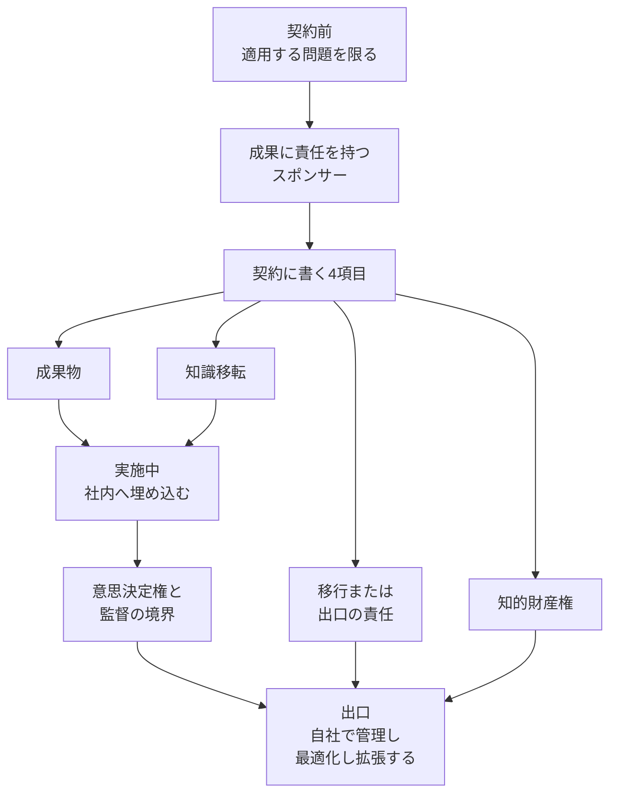

2026年9月29日、Gartner は、ベンダーのフォワードデプロイドエンジニアリング（以下、FDE）が構築したエージェント型 AI を、2028年までに企業の70%が放棄すると予測しました。この記事では、予測の主語と動詞、契約前から出口までに発注側が分ける項目、同じ時期の別予測との違いを整理します。読者は、公開された一次資料の範囲で、予測の届く範囲と、契約に書く項目と、解約後に手元へ残すものの見方を確認できます。この70%は、サンプルサイズと放棄の測り方を添えない予測として発表されています。

*この記事の全体像。以下、順に解説します。*

## ベンダーFDEが構築したエージェントとは

FDE は、ベンダーのエンジニアが顧客と直接組んで、ソリューションを構築し、展開するモデルです。2026年9月29日の Gartner プレスが対象にしているのは、この FDE が構築したエージェント型 AI です。時点は2028年までです。動詞は abandon（放棄）です。発言者は、シニアディレクターアナリストの Mukul Saha です。同じリリースは、コストが上がることと、顧客がその AI を自力で進化させられなくなることを、予測の理由として並べています。Saha は、成功はスコープ、インセンティブ、ガバナンス、所有、出口を含む案件の構造を整えることから始まると述べています。

同じリリースは、FDE の案件はしばしば、技術的に失敗するより前に、構造的に失敗する、と書いています。英語の文は “FDE engagements often fail structurally before they fail technically.” です。

契約前に FDE を使う問題は、深い製品知識、速い適応、またはベンダーの技術と自社の運用環境との密な結合が要るものに限る、とプレスは書いています。スポンサーは、ビジネス成果に責任を持つ人です。

契約に含めるものとして、プレスが名指ししているのは次の4つです。調達の範囲を超える、とも書いています。

1. 成果物（deliverables）
2. 知識移転（knowledge transfer）
3. 知的財産権（intellectual property rights）
4. 移行または出口の責任（transition or exit responsibilities）

実施中は、FDE を社内のドメイン専門家、エンジニア、エンドユーザーに埋め込みます。各増分で決めるのは、意思決定権、自律と人間の監督のバランス、確信度と例外の伝え方、信頼と説明責任のガバナンスです。

出口では、開始時に書いた出口計画を実行します。成功は、その企業が技術を管理し、最適化し、拡張できることです。業務プロセス、優先順位、リスクの変化に合わせて、人と AI の意思決定の形を変える能力も含みます。

同じリリースには、別の予測もあります。2028年を通じて、FDE 案件のうち、反復する顧客ニーズをベンダーの中核製品の機能へ戻せるものは20%未満です。コンサルを FDE の名で売ることを、プレスは “FDE washing” と呼んでいます。

購読者向けノート “The Forward-Deployed Engineering Playbook”（文書コード 860278）はクライアント限定です。この記事が根拠にする定義は、2026年9月29日の公開プレスと、後段で示す公開文書の範囲です。

プレスが描く FDE は、契約前、実施中、出口の3局面で、所有と出口が決まる案件です。次の図の4項目は、そのプレスの Phase 1 が契約要件として列挙した語です。

## 注意点

### 70%の測り方

70%は、公開された手続きで数え直せる率ではありません。2026年9月29日のプレス本文に、abandon の操作的定義はありません。本番停止、更新予算の打ち切り、社内オーナーの不在、ベンダーへの継続課金のどれを数えるかは書いていません。サンプルサイズ、母集団の定義、予測モデルも、このプレスにはありません。文書 860278 の本文はログイン壁の向こうにあり、そこに定義があるかは公開範囲では未確認です。したがって「企業の7割が本番を止める」は、一次が許す範囲を超えた読みです。70%を契約や意思決定の前提に置くなら、「2026年9月29日の予測で、測り方は未公開」と書く範囲に留めます。

### before と日本語リードの強さ

英語の一次は、技術を原因から外していません。前節の before は、構造の失敗が技術の失敗より先に来ることが多い、という順序です。ITmedia エンタープライズは 2026年10月12日11時15分に紹介記事を出しています。記事は会員限定です。検索結果に出るリードは「原因は技術の未熟さではなく、案件の構造にある」と読めます。会員限定の本文は、この記事の根拠にしていません。「ではなく」は、英語の before より強い言い方です。この記事は英語の一次の順序に合わせます。

### 引用の外での単位

同じ70%を、別の単位で書き換えた二次情報があります。Channel Dive は 2026年9月30日の記事で “Roughly 70% of vendor-led AI engineering excursions will be abandoned” と書いています。プレスの主語は enterprises です。目的語は、vendor FDE が構築した agentic AI です。企業と案件が、引用の外で入れ替わっています。

### 20%未満の分母と動詞

20%未満は、70%の裏ではありません。70%の分母は企業で、動詞は放棄です。20%未満の分母は FDE 案件です。動詞は「反復するニーズを中核製品の機能にすること」です。製品に戻らないカスタムを、顧客が本番のまま維持することは、文の上では放棄ではありません。維持には、社内が引き取る場合と、ベンダーの運用を払い続ける場合とがあります。

### 図1の見出し語

図1の見出しは “Three Tenets of a Genuine FDE Model”（Source: Gartner, September 2026）です。公開されている英語 HTML に、Outcome ownership、Value-oriented incentives、Deeply embedded という見出し語はありません。図の alt は空です。図中の文字は、HTML の本文に含まれていません。ITmedia は図1をその3語で紹介しています。3語は、英語本文の主張としては使いません。

### 金額と人数

金額と人数は、この予測の根拠にしません。Channel Dive は、コンサル費用がユースケースあたり四半期20万ドルを超え得る、と書いています。リンク先は Gartner の文書ではありません。稼働している FDE が2,000人で、需要はその約4倍だ、とも、Saha への取材として書いています。2026年9月29日のプレスに、この金額も人数もありません。CIO Dive は 2026年7月2日の記事で、四半期20万〜40万ドルを “Gartner estimations” と書いています。公開要旨からは確認できませんでした。コストが高い、という定性だけをプレスから採ります。

### 近い時期の別予測

Gartner は、近い時期に複数の別予測を出しています。どれも 2026年9月29日の70%の言い換えではありません。

| 発表 | 数値 | 母集団 | 動詞 | 時点 | 発言者 | 一次が原因として置くもの |
|---|---|---|---|---|---|---|
| 2025-06-25 | 40%超 | agentic AI のプロジェクト | canceled | 2027年末 | Anushree Verma | コスト増、事業価値の不明、リスク管理の不足。モデルに複雑な目標を自律で達成する成熟度と agency が足りない、とも述べる |
| 2026-05-26 | 40% | 企業 | demote or decommission | 2027年 | Shiva Varma | 本番インシデントの後に分かるガバナンスのギャップ。自律のレベルを分けず、一律に統治すること |
| 2026-09-29 | 70% | 企業 | abandon | 2028年まで | Mukul Saha | コスト高と、ベンダー FDE が作ったエージェント型 AI を自力で進化させられないこと |
| 2026-09-29 | 20%未満 | FDE 案件 | 中核製品の機能に戻る | 2028年を通じて | Gartner（Saha のリリース） | FDE washing。コンサルを FDE の名で売ること |
| 2026-10-02 の記事 | 50%超 | AI initiatives | halt | 2028年を通じて | Erick Brethenoux の記事が予測として記載 | 未解決の agentic identity |

2026年10月2日付の Gartner 記事は、別の文で「大半の AI エージェントは、複雑または事業上重要な環境で自律運用できるほど信頼できない」と書いています。これは FDE の70%の言い換えではありません。エージェント一般では、信頼性の不足が一次の記事に残っています。

2025年6月25日の同じリリースには、予測とは別のアンケートがあります。2025年1月のウェビナー参加者 3,412人のうち、エージェント型 AI へ大きな投資をしたのは19%です。控えめな投資は42%です。投資なしは8%です。様子見または不明は31%です。ウェビナー参加者の自己申告であり、70%の母集団ではありません。同じリリースは、エージェントを名乗るベンダー数千のうち実体があるのは約130、とも推定しています。これは FDE washing とは別の “agent washing” です。

20%未満の製品化、2027年末までのプロジェクト中止40%超、2027年の降格または廃止40%、2028年までの AI 施策の停止50%超は、この70%の別表現としては使いません。

## 契約前に何を分けて書くか

一次が発注側に渡している実務は、70%の真偽ではありません。成果へ責任を持つスポンサーと、成果物、知識移転、知的財産、出口を、契約の前に分けることです。

2026年9月29日のプレスは、70%、コスト、自力で進化させられないこと、構造が技術より先に失敗しがちであること、契約の4項目、出口の成功の定義、20%未満の製品化、FDE washing を、一つのリリースに置いています。社内チームが準備できていないことを理由に、契約を延ばすな、とも書いています。依存を固定した状態を、成功にはしていません。

2026年4月16日の公開要旨（文書 7727957、Alex Coqueiro）は、実験から本番への失敗原因を「標準ツールとコンサルには、企業の複雑さに要る埋め込みが無いこと」と書いています。FDE では「自チームが所有し、運用し、独立に拡張できる能力」を作れ、とも書いています。全文はクライアント限定です。この記事が使うのは公開要旨です。要旨が目指す状態は、9月の出口の定義と同じです。公開要旨に70%はありません。二次記事が4月の文書へ70%を帰属させている箇所は、要旨と一致しないため採用しません。

定義と手法は、公開プレスにはありません。70%は、今の公開情報では、外れたと判定する手順がありません。購読ノートに定義がある可能性は、未確認のまま残ります。正しいスコープの FDE が、70%の外にどれだけ残ると Gartner が見ているかも、公開されていません。

英語の一次は「技術は原因ではない」とは書いていません。2025年6月25日の Anushree Verma は、別の母集団について、モデルの成熟度を取消の原因に含めています。2026年10月2日の記事は、信頼性の不足を書いています。

Channel Dive は、Saha の発言として “If you truly have the right FDE model, we see it bringing good outcomes.” を載せています。これは取材記事です。Gartner 文書の引用ではありません。逐語かどうかは、公開の Gartner 文書では確認できません。この一文を採るなら、70%は、正しいモデルを含む FDE 一般の失敗率としては読めません。正しいモデルの割合は公開されていません。

同じ Channel Dive で Saha は、プロダクト企業は製品を sticky にしたい、とも述べたとされています。これも取材記事の範囲です。ベンダーの成功指標が継続利用にあるなら、顧客が出口のあと自走することと、インセンティブがずれ得ます。構造の話を弱める材料ではありません。出口を契約に書く理由を強める材料です。率の証拠にはしません。

スポンサーに置くのは、実装予算の担当ではなく、ビジネス成果に責任を持つ人です。契約の前に分けるのは、そのスポンサーと、成果物、知識移転、知的財産、出口責任です。実施中は、意思決定権と、人と AI の監督の境界を、増分ごとに書きます。納品が終わったことを、成功の測り方にはしません。測るのは、自社が管理し、最適化し、拡張できることです。

| 時点 | 名指しするもの | プレス上の位置 |
|---|---|---|
| 契約前 | ビジネス成果に責任を持つスポンサー | 実装予算の担当とは分ける |
| 契約前 | 成果物、知識移転、知的財産権、移行または出口の責任 | Phase 1 の契約要件 |
| 実施中の各増分 | 意思決定権、自律と人間の監督のバランス、確信度と例外の伝え方、信頼と説明責任 | 社内へ埋め込んでいるあいだに決める |
| 出口 | 自社が管理し、最適化し、拡張できること | 成功の定義。人と AI の意思決定を変える能力を含む |

## 解約したあと何が手元に残るか

見積の行や、人の育成の境界とは別に、解約したあと誰の手元に何が残るか、という問いがあります。成功の試験は、自社が管理し、最適化し、拡張できることです。モデルとプロンプトのファイルは、この試験に対して狭いです。ファイルが渡っても、業務の進め方、データの承認者、例外時の判断者、解約後に直す主体がベンダー側に残っていれば、プレスの “unable to evolve it on their own” に当たります。

業務手順、データ所有者、運用主体は、知識移転、意思決定権、出口責任を、契約で名指しするために分解した読みです。プレス本文に、その3語はありません。

Palantir の公式ブログ（2020年11月2日）は、Forward Deployed Software Engineer を顧客への埋め込みと定義しています。現場の設定を製品へ戻す責任も書いています。解約のときにプロンプトを渡して終わる役割としては書いていません。

Palantir の Form 10-Q（2025年6月30日に終了した四半期）は、顧客と見込み客の多くが、個別アプリケーション向けのカスタムソフトを労働契約で購入またはライセンスする慣行に慣れている、と書いています。その慣行では、知的財産は顧客に帰属することが多い、とも書いています。変更、更新、役務のたびに、追加の労働契約を通常要る、とも書いています。顧客が製品型の調達を受け入れず、労働契約の慣行の側に残ると、成長が損なわれ得る、とも書いています。

Gartner のプレスは、知的財産の所有を契約で明確にせよと求めます。帰属先を顧客とは指定していません。10-Q が書く「カスタムの知的財産は顧客に帰属することが多い」と、Gartner が書く「所有を契約で明確にせよ」は、同じ主張ではありません。

FY2025 の Form 10-K（2025年12月31日に終了した年度、2026年2月17日提出）は、オンプレミスの期間ライセンスを、重大な更新、サポート、保守を含む O&M と一緒に売ると書いています。ソフトウェアを契約期間中に意図した用途で保つために O&M が必要だとして、両者を会計上は単一の履行義務としています。顧客の業務運用をベンダーが引き受ける、という記述ではありません。70%予測の標本でもありません。継続課金が「放棄」に入るかは、プレスが定義していません。10-K は、顧客固有の成果物の権利や、出口時の引き渡しが、この会計処理と両立しないとは書いていません。

発注側は、期間ライセンス、O&M、顧客固有の成果物の権利、出口時の引き渡しを、契約ごとに別々に確認します。FDE というラベルだけでは、労働契約型にも製品型にもなり得ます。プレスは、ラベルだけのコンサルを FDE washing と呼んでいます。

| 確認する条文 | 公開資料が決めていないこと |
|---|---|
| 期間ライセンス | 10-K は O&M と単一の履行義務にし得る。成果物の権利とは別 |
| O&M | 継続課金が放棄に入るかは、2026年9月29日のプレスが定義していない |
| 顧客固有の成果物の権利 | Gartner は所有の明確化を求める。顧客への帰属先は指定しない |
| 出口時の引き渡し | 業務手順を直す人、データを承認する人、本番を直す主体が発注側にいるか |

残存の検査は、モデルとプロンプトが渡ったかで終わらせません。解約後に、業務手順を直す人、データを承認する人、本番を直す主体が発注側にいるかを、出口条項の中で名指しします。これは一次の語を分解した読みです。一次がその3語を使っているわけではありません。

逆転の条件は、購読ノートが abandon の観測手続きと母集団を公開し、70%がその手続きの出力だと分かったときです。そのとき、測り方が未公開だという限定は外れます。期間ライセンスと O&M の継続を望む契約でも、顧客固有の成果物を持ち帰れるかは、10-K の会計処理からは決まりません。ライセンス、O&M、成果物の権利、出口時の引き渡しは、その契約の条文で確認します。

## まとめ

2026年9月29日の予測は、ベンダー FDE が構築したエージェント型 AI を、2028年までに企業の70%が放棄する、というものです。率は、公開された手続きで数え直せるものではありません。英語の一次が置いているのは、構造の失敗が技術の失敗より先に来ることが多い、という順序です。技術を原因から外した文ではありません。

発注側が先に分けるのは、成果へ責任を持つスポンサーと、成果物、知識移転、知的財産、出口責任です。実施中は、意思決定権と監督の境界を増分ごとに書きます。解約後の検査は、ファイルの引き渡しで終わらせません。業務手順を直す人、データを承認する人、本番を直す主体が発注側にいるかを、出口条項で名指しします。20%未満の製品化や、2025年から2026年に出た別の率は、この70%の言い換えとして使いません。四半期あたりの金額と、稼働している FDE の人数も、この予測の根拠には使いません。

この記事が少しでも参考になった、あるいは改善点などがあれば、ぜひリアクションやコメント、SNSでのシェアをいただけると励みになります！

## 参考リンク

- [Gartner, “Gartner Predicts 70% of Enterprises Will Abandon Agentic AI Built by Vendor Forward-Deployed Engineering by 2028,” 2026-09-29](https://www.gartner.com/en/newsroom/press-releases/2026-09-29-gartner-predicts-70-percent-of-enterprises-will-abandon-agentic-ai-built-by-vendor-forward-deployed-engineering-by-2028)
- [Gartner, “Gartner Predicts Over 40% of Agentic AI Projects Will Be Canceled by End of 2027,” 2025-06-25](https://www.gartner.com/en/newsroom/press-releases/2025-06-25-gartner-predicts-over-40-percent-of-agentic-ai-projects-will-be-canceled-by-end-of-2027)
- [Gartner, “Gartner Says Applying Uniform Governance Across AI Agents Will Lead to Enterprise AI Agent Failure,” 2026-05-26](https://www.gartner.com/en/newsroom/press-releases/2026-05-26-gartner-says-applying-uniform-governance-across-ai-agents-will-lead-to-enterprise-ai-agent-failure)
- [Gartner, “Accelerate Agentic AI Adoption With Forward-Deployed Engineers,” 公開要旨 2026-04-16](https://www.gartner.com/en/documents/7727957)
- [Gartner, “AI Agent Success Requires Reliability Before Autonomy,” 2026-10-02](https://www.gartner.com/en/articles/ai-agent-reality-check)
- [ITmedia エンタープライズ, 「FDEが構築したAIエージェントの7割、企業が放棄へ　Gartner予測」, 2026-10-12](https://www.itmedia.co.jp/enterprise/articles/2610/09/news042.html)
- [Channel Dive, “Are forward deployed engineers flirting with failure?”, 2026-09-30](https://www.channeldive.com/news/can-forward-deployed-engineers-fdes-fix-ai-gartner/831816/)
- [Palantir Blog, “A Day in the Life of a Palantir Forward Deployed Software Engineer,” 2020-11-02](https://blog.palantir.com/a-day-in-the-life-of-a-palantir-forward-deployed-software-engineer-45ef2de257b1)
- [Palantir Technologies Inc., Form 10-Q for the quarterly period ended June 30, 2025](https://www.sec.gov/Archives/edgar/data/1321655/000132165525000106/pltr-20250630.htm)
- [Palantir Technologies Inc., Form 10-K for the fiscal year ended December 31, 2025, filed 2026-02-17](https://www.sec.gov/Archives/edgar/data/1321655/000132165526000011/pltr-20251231.htm)
