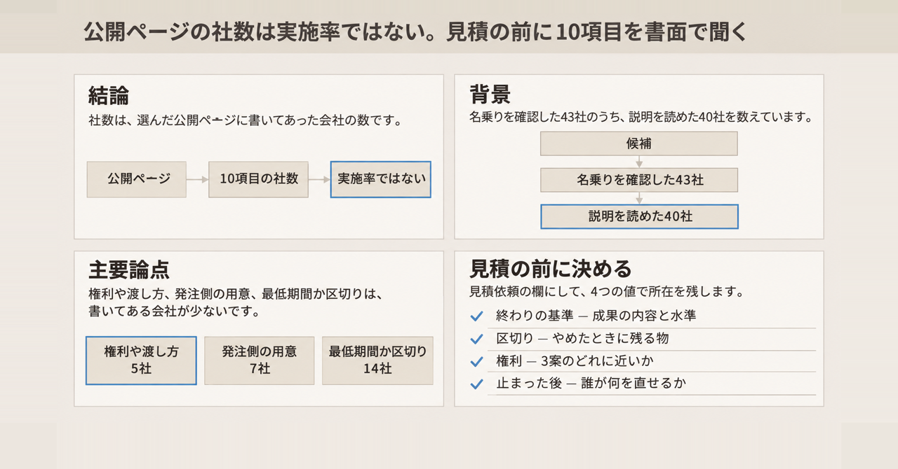
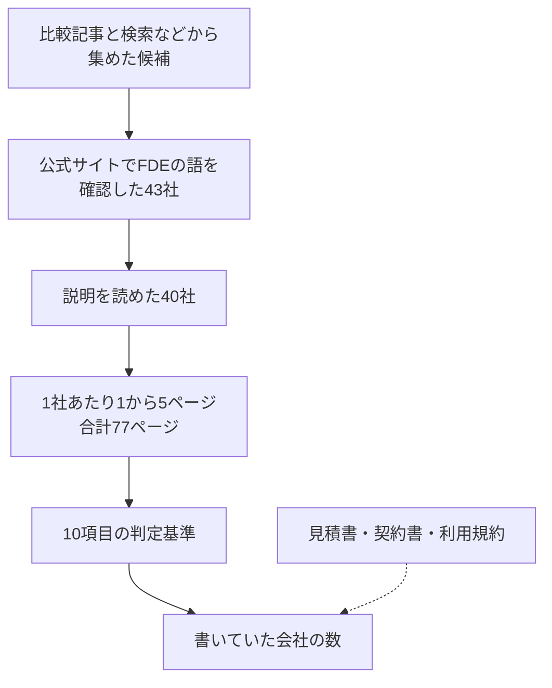
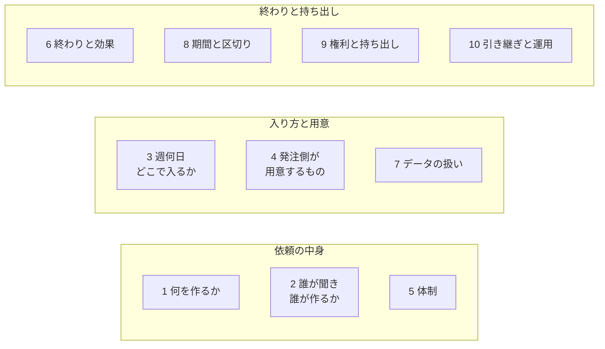

FDE（Forward Deployed Engineer）は、顧客の現場に入ってソフトウェアの仕事をする役割の呼び名です。2026年11月20日、ITmedia エンタープライズは「『名ばかりFDE』を見抜けるか？　依頼検討時に確認したい10項目」を公開し、ゴムマリ株式会社が2026年11月16日に発表した調査を紹介しました。数えているのは、選んだ公式ページにその項目の説明がある会社の数です。契約書や作業実績の数ではありません。

この記事では、その10項目の中身と社数、公開ページの数字を見積書・契約書へ落とす前に残す4つの値、先に書面で決めることをまとめます。

*この記事の全体像。以下、順に解説します。*

## FDEとは

FDE は Forward Deployed Engineer の略で、顧客の現場に入る技術者を指す呼び名です。この記事では、FDE を名乗る会社を提供側、そのサービスを頼む会社を発注側と呼びます。呼び名の中身は、会社の説明ごとに違います。

Palantir の公式ブログ（2020年11月2日）は、Forward Deployed Software Engineer を「顧客に入り、Palantir の既存ソフトウェアを設定するソフトウェアエンジニア」と説明しています。OpenAI の Forward Deployed Engineer 求人（2026年11月22日に取得した Seattle のページ）は、仕事の範囲として、発見、技術の範囲、システム設計、構築、本番への展開を持つ、と書いています。この列挙は求人の仕事の範囲であり、40社の社数の項目ではありません。Anthropic の Staff Forward Deployed Engineer の求人（同日に取得）は、顧客に入って技術方針を率いる役割に加え、自分では作らない仕事について構成と品質の線を置く、パートナー経由の仕事を含みます。

### 公開ページを数えた調査

ゴムマリの調査は、FDE の語を公式サイトで使ってサービスを案内していると確認した国内43社のうち、説明を読めた40社について、選んだ公式ページに何が書いてあるかを数えています。公式サイトで名乗りを確認した43社には、ゴムマリ自身を入れていません。計測の対象は、選んだ公式ページの文面です。10項目は、その文面を読むときの見出しです。

調査の実施日は2026年10月31日です。候補は、比較・一覧記事、PR TIMES、ウェブ検索で挙がった国内79社と、それとは別に AI の伴走支援（顧客の社員が作るのを支える支援）などの語で見つけた会社です。後者の社数は書かれていません。公式サイトで名乗りを確認した43社のうち、説明を読めた40社を集計しました。1社あたり1〜5ページ、合計77ページです。

10項目は、IPA（情報処理推進機構）の「情報システム・モデル取引・契約書」と経済産業省の契約の指針、および Palantir・OpenAI・Anthropic の説明から、頼む前に確かめたいこととしてゴムマリが作っています。項目の文言はゴムマリの詳細ページのものです。ITmedia は項目1を「何を開発するか」と言い換えています。社数は、ゴムマリの詳細ページ、2026年11月16日の PR TIMES、ITmedia の本文で一致します。

記載の有無は、大規模言語モデルの別々の呼び出しで2回判定しています。カッパ係数は、その2回の判定がどれだけ一致したかの数値です。社数を採用してよいかの基準ではありません。ゴムマリは、数に使った12項目について 0.813〜1.000 と報告しています。12項目の一つずつの名前は、この説明には列挙されていません。公表している社数の表は10項目です。詳細ページでは、確かめる項目を14に整理したあと、担い手の呼び方は項目2に含め、運用・保守と引き継ぎは項目10にまとめ、請負か準委任か（仕事の完成を約束する形か、遂行を委ねる形か）と本番まで運ぶかは項目に使わず、10項目にした、と書いています。2回の判定が食い違った22件と、判定はそろっていても基準と合わなかった14件は、同社が本文を読んで決めました。22件と14件の単位は書かれていません。社数の表の社数ではありません。

### 10項目と社数

| # | 確かめたいこと（ゴムマリの原文） | 数えた書き方 | 社数 |
|---|---|---|---|
| 1 | 何を作るか | 開発すると書く | 31 |
| 2 | 誰が業務を聞き、誰が作るか | 聞く人と作る人の関係を書く | 28 |
| 3 | その料金で、週何日、どこで入るか | 週1日以上入ると書く | 10 |
| 4 | 頼む側は、誰の時間とどのデータを用意するか | 頼む側に求めることを書く | 7 |
| 5 | 何人が、どの役割で付くか | 体制を書く | 20 |
| 6 | 何をもって終わりとし、効いたとするか | 効果の測り方を書く | 20 |
| 7 | 頼む側のデータを、どこで誰がどう扱うか | データの扱いを書く | 18 |
| 8 | 最低何か月からか、段階ごとや月単位で続けるかやめるかを決められるか | 最低期間か区切りを書く | 14 |
| 9 | 作った物の権利は誰のものか、終わった後に持ち出せるか | 発注側の権利・資産、または渡し方を書く | 5 |
| 10 | 作った後に誰が動かし、抜けた後に頼む側で直せるか | 引き継ぎを書く | 21 |

項目10の別カウントとして、運用・保守を書く会社は19社です。この19社は、引き継ぎの21社に足していません。

ゴムマリが、作る物が決まりにくい AI の開発で後から費用と手間に響くとして、先に書面で確かめるよう挙げたのは次の3つです。

1. 何をもって終わりとするかを、成果の内容と水準まで数字で決める
2. 段階ごとに、続けるかやめるかを決められる形にする
3. 作った物の権利と、抜けた後に頼む側で直せるかを、一組で決める

3つ目の一組は、権利と、抜けた後に直せるかを、別の問いのまま両方書面で決める、という意味です。

### 社数の内訳

項目2の28社のうち、同じ人が聞いて作ると書くのは20社、聞く役割と作る役割を分けると書くのは8社です。同じ説明に両方がある場合は、分ける側に数えます。

項目3の表の10社は「週1日以上」です。別に「現場に入る」と書く会社は37社あります。この37社のうち週1日以上ではない27社は、月に数回か、頻度の記載がありません。

項目8の14社は、最低契約期間を書く8社と、段階ごとや月単位で続けるかを決められると書く7社の和から、両方を書く1社を除いた数です。

項目9の5社は、作った物を渡すと書く会社を含めた数です。うち、権利が発注側にある、または発注側の資産として残ると書くのは3社です。この3社と、渡し方の記載との重なりは、ゴムマリの詳細ページには書かれていません。

サービスのページを読めたのは40社のうち33社です。残る7社は、サービスのページではなく、お知らせや発表の短い文を読んでいます。33社のうち、担い手をエンジニアと呼ばないのは8社、主なプランで提供側が開発すると書かないのは5社です。どちらかに当たるのは13社です。エンジニアと呼ばない8社は、項目2で役割を分けると数えた8社とは別で、28社に足していません。開発すると書かない5社は、33社の内訳であり、項目1の31社に足す数ではありません。5社の内訳は、顧客の社員が作るのを支える伴走や助言が2社、既製の道具の設定が1社、自社製品の導入が2社です。

料金を公式サイトに載せる会社は40社のうち12社です。1社は確かめられませんでした。月額で読めた8社について、各社で最も低いプランは月額20万円〜60万円です。税込と税別はそろっていません。

### ページの文面から社数までの流れ

候補の集め方から社数までの流れは、次のとおりです。点線は、見積書・契約書・利用規約を、社数の入力にしていない関係です。

10項目は、依頼の中身、入り方と用意、終わりと持ち出しの3つに分かれます。

## 注意点

見出しの「名ばかりFDE」は、ITmedia の呼び方です。ゴムマリの2026年11月16日の発表と詳細ページは、この語を使っていません。本文の社数は、サイトに書いてあった会社の数です。ゴムマリは、詳細ページで次のように書いています。

> 各社が実際にどう働き、どう契約しているかは見ていません。説明に書いていないことを、その会社が決めていない・していないとは言えません。

ITmedia も、契約は調査していないこと、利用規約は確認していないことを残しています。

### 書いていない側に数える手続き

書いていない側に寄る手続きが、調査の手順に入っています。

- 迷ったら、書いていない側か、FDE の元の形から遠い側に数えます。元の形とは、提供側のエンジニアが顧客の中に入り、作ることです。どちらも、書いていた社数には入りません。
- 利用規約は読んでいません。権利や契約期間を利用規約・見積もり・契約書だけに書く会社は、「書いていない」側です。
- 7社は、サービスのページではなく、お知らせや発表の短い文を読んでいます。43社のうち3社は、本文がページを開いた後に読み込まれる作りで読めず、集計した40社に入っていません。
- 長い説明は1社15,000字までです。5社は、後ろのページの一部か全部を読んでいません。選んだ77ページのうち2ページは読めていません。
- 43社は、一覧・記事・発表・検索で見つけ、公式サイトで名乗りを確かめられた会社です。FDE を名乗る国内の会社のすべてではありません。
- 40社の社名と、読んだページの対応表は、ゴムマリの詳細ページと11月16日の発表本文にはありません。この2つの本文だけでは、同じ40社で集計をやり直せません。

### 開発と書くことと、三社の役割説明

項目1の「開発すると書く」は、主なプランで、提供側がソフトウェア、AI エージェント、業務システム、API の連携、データ基盤を開発・実装すると書く場合です。自社製品の導入は、その上に顧客専用のエージェントを作る場合も含め、この項目では数えません。

一方、上に挙げた Palantir の公式ブログは、既存ソフトウェアを顧客先で設定するソフトウェアエンジニアとして説明しています。ゴムマリ自身も、自社製品を顧客ごとに設定する形は Palantir の形でもある、と書いています。ITmedia の本文は、開発すると書かない5社の内訳に自社製品の導入2社を含みますが、この Palantir の注記は載せていません。項目1の記載が無いことは、Palantir が説明する働き方から外れることの証明にはなりません。

Anthropic の求人が含む「自分では作らない仕事」と、提供側が作ると書いていないことは、同じ問いではありません。ゴムマリは「本番の業務まで届けるか」も判定しましたが、2回の判定が安定しなかったため、数に使っていません。10項目の社数は、本番まで届くかの数ではありません。

2026年11月22日に取得した Palantir Foundry のドキュメントは、AI FDE を「会話で Foundry を操作する対話型のエージェント」とも呼びます。Foundry は Palantir のソフトウェアです。人の職種名と、製品の機能名が同じ略称で並んでいます。このページに文書の公開日はありませんでした。

### 権利、引き継ぎ、終わりの基準

権利の5社は、発注側に権利がある、発注側の資産として残る、または作った物を渡す、と書く会社を含めた数です。ベンダに権利が残るとだけ書く説明は、この基準では数えません。

IPA「情報システム・モデル取引・契約書」第二版のひな型は、納入物の著作権を3案から選びます。注記は、ベンダにすべての著作権を帰属させる場合は A案、と書きます。条文の A案は、発注側または第三者が従前から保有する著作物を除き、納入物の著作権をベンダに帰属させます。B案は、ベンダまたは第三者が従前から保有する著作物と、汎用的に利用できるプログラムを除き、委託料の完済時にユーザへ移します。C案で共有するのは、本件業務で新たに生じたプログラムのうち、汎用的に利用できるものを除いた部分で、持分は均等です。解説は、再利用を促すため原則は A案だとしています。サイトに権利の記載が無いことと、契約で発注側に移るかは別です。

引き継ぎについて、同じ第二版の保守工程の解説は、システムの所有者であるユーザに、ベンダの協力を得ながら、業務・設計のノウハウ等の円滑な引継ぎなどの管理を求めています。主語は発注側です。

終わりの基準について、経済産業省「AIの利用・開発に関する契約チェックリスト」（2025年2月18日公表、2月20日に38頁の図9を差替）の4.3.2は、開発型契約が準委任か請負かを抽象的に議論するより、ユーザが成果の内容や水準をどの程度求めるかが重要な論点になる場合が少なくない、と書いています。準委任は仕事の遂行を委ねる形、請負は仕事の完成を約束する形、という契約の類型です。経済産業省「AI・データの利用に関する契約ガイドライン」AI編（2018年6月）の探索的段階型は、学習済みモデルの生成を、アセスメント、PoC、開発、追加学習に分け、必要な性能の成果物ができないと分かれば次の段階に進まない選択ができる、と書いています。PoC は、本開発の前に実現性を確かめる段階です。対象は学習済みモデルの生成であり、既存のモデルを組み込む実装のすべてに同じ4段階を当てる文書ではありません。

### 料金の幅と、11月2日の発表

月額20万円〜60万円は、月額で読めた8社それぞれの、最も低いプランです。相場でも、実際の取引金額でもありません。

2026年11月2日10時の発表は、ライブドアニュースに PR TIMES の転載として残っています。見出しの全文は「FDEを名乗る国内40社の公式サイトを調査、FDE Washingの流れは日本でも」です。FDE Washing は、この11月2日の見出しの語です。詳細ページの本文には、この語はありません。転載は、10項目の整理元にガートナーの2026年9月の発表と、IPA・経済産業省の指針を挙げています。元の PR TIMES（記事番号 `000000049.000185093`）は、2026年11月22日時点で404でした。ガートナーの原文は照合していません。11月16日の発表と、ITmedia が出典にした詳細ページは、整理元を IPA・経済産業省と、Palantir・OpenAI・Anthropic の説明にしています。

VOIX の2026年11月2日の記事は、冒頭で「13社が担い手をエンジニアと呼ばず」と書き、後段では8社と5社に分けています。13は、呼称がエンジニアでない8社と、主なプランで開発すると書かない5社の和です。

約700件は、ゴムマリが自社の案件の発注明細を費目に分けた数です。完了基準の百分率は、その案件で着手前に置いた割合です。39の論点のうち17は、人が挙げた論点のうち、データに該当する列が無かった数です。これらは自社の案件の自己申告であり、40社の公開ページから数えた社数とは別なので、社数の表には入れていません。

### 公開ページだけでは追えないこと

次の点は、確認できた公開資料だけでは閉じていません。

- 40社の社名と、各社で読んだ URL は、詳細ページと11月16日の発表本文にはありません。同じ集計のやり直しには、対象企業、選定した URL、各社の判定根拠が要ります。
- 11月2日の発表原文（PR TIMES）は404で、ライブドアニュースの転載でしか読んでいません。ガートナーの2026年9月の文面は未照合です。
- カッパ係数は再計算していません。
- 利用規約や個別契約に権利や期間がある会社が、40社のうち何社かは不明です。
- 「本番まで届ける」判定の、会社別・判定回別の中身は、詳細ページと11月16日の発表本文にはありません。両文書は、2回の判定が安定しなかったため数に使わなかった、とだけ書いています。

## 公開ページと見積・契約を突き合わせる

サイトの記載、見積・提案、合意した契約は、別の文書です。各項目は次の4つの値で残します。見積書や提案書にあるだけでは、契約条件として合意したことにはしません。

| 値 | 意味 |
|---|---|
| サイトにあり | 選んだ公開ページに、下の「サイトで数えた書き方」がある |
| 見積・提案にある | 見積書または提案書にある。まだ合意した条項ではない |
| 契約にある | 利用規約、契約書、または契約に組み込まれた文書にある |
| 未確認 | 上のどれにも、まだ見つからない。やっていない、とは書かない |

サイトで数えた書き方は、ゴムマリの判定基準を短くしたものです。右の列は、見積もりで別に聞くことです。

| # | サイトで数えた書き方 | 見積もりで別に聞くこと |
|---|---|---|
| 1 | 主なプランで、提供側がソフトウェアやエージェントや連携やデータ基盤を開発・実装すると書く。設定だけ、自社製品の導入だけ、助言だけは数えない | 主なプランの成果は、新規の開発か、既存製品の設定か、発注側の社員が作るのを支えるのか |
| 2 | 人を主語に、同じ人が聞いて作るか、聞く人と作る人を分けるか。会社が「一気通貫」とだけ書く説明は数えない | 要件を聞く人と、手を動かす人は同一か。分かれるなら、どちらが契約の相手か |
| 3 | 常駐か、週1日以上、顧客のチームの一員として動くと書く。物理の訪問かは問わない。月に数回や、頻度の無い「入り込む」は数えない | その料金に含まれる入り方は、週あたり何日か。遠隔か、現地か |
| 4 | 発注側が用意する人、データ、権限、環境、窓口を書く。「二人三脚」だけは数えない | 発注側の誰が、週にどれだけ付き、どのデータと権限をいつ渡すか |
| 5 | この支援に付く人数か、役割の組み合わせを書く。会社全体の社員数だけは数えない | 何人が、どの役割で、この契約に付くか |
| 6 | 支援の前か途中で、削減時間・KPI・費用対効果などの指標を決める・測る・報告すると書く。事例の結果の数字だけは数えない | 終わりの基準は何か。その正解を誰が持つか。数字で置くなら、いつ測るか |
| 7 | 秘密保持、個人情報、権限、顧客環境の中で作る、学習に使わない、セキュリティ認証など、顧客のデータや機密の扱いを書く。一般のプライバシーポリシーへのリンクだけは数えない | データをどこに置き、誰が触り、学習に使うか |
| 8 | 最低契約期間を書くか、PoC の結果で次に進むか、フェーズごと、月単位の見直し、いつでも解約など、続けるかを決められると書く。進め方の期間の目安だけは数えない | 最低期間は何カ月か。区切りでやめたとき、何が手元に残るか |
| 9 | 作った物の権利や著作権が発注側になる、発注側の資産として残る、または納める・渡すと書く。「成果物」の語だけでは数えない | IPA の A案・B案・C案のどれに近いか。汎用部品はどちらに残るか。移転の対価は委託料に入るか |
| 10 | 引き継ぎは、内製化・自走・移管・手順書や設計書を渡し、発注側の社員が自分で動かし直せることを、提供側の仕事として書く。運用・保守は、作った後も提供側が運用・保守・改善・障害対応を受けると書く | 支援が止まった後、誰がどの設定を直せるか。持ち主にしか触れない上限や鍵はどれか |

項目9と項目10は、別の問いです。ゴムマリの注意例では、作った仕組みの置き場の持ち主を途中で発注側へ移したあと、利用枠の上限のように持ち主にしか直せない設定があり、提供側は頼まれても直せませんでした。対象は置き場の管理権限であり、著作権の帰属ではありません。40社の社数でもありません。

発注側は、FDE を名乗る提案を受ける前に、上の10項目を見積依頼の欄にします。サイトに無い項目は未確認として残し、見積書・提案書・利用規約・契約書のどこに書いてあるかを突き合わせます。先に書面で決めるのは、終わりの基準、続けるかやめるかの区切りとやめたときに残る物、作った物の権利、支援が止まった後に誰が何を直せるか、です。権利は、発注側に当然移る前提にせず、IPA の3案のどれに近いかを聞きます。

## 社数を実施率として使わない

40社の社数を「国内の FDE 事業者の実施率」として使う読みは、ゴムマリの調査自身が採っていません。使える読みは、「公開ページだけでは、頼む中身が揃って書いていないことが多い。だから見積もりの前に10項目を書面で聞く」です。

この読みを支えるのは、ゴムマリが手順と限界を同じページに書いたこと、ITmedia がその限界を残したこと、です。公開ページで数えた社数は、権利や渡し方が5社、発注側の用意が7社、最低期間か区切りが14社でした。これらが契約書にどれだけ書かれるかを、ゴムマリの調査は測っていません。

この読みを弱めるのは、対象が公開記事と検索に依存し全数ではないこと、社名と読んだ URL の対応が詳細ページと11月16日の発表本文には無くその範囲では同じ集計をやり直せないこと、判定の最終裁定に調査者自身が入ること、書いていない側に寄せる規則があること、自社を名乗りを確認した43社から外していること、です。独立した再集計で社数の誤りを示した資料は、今回の検索範囲では見つかりませんでした。

自社製品の導入や設定だけのプランは、項目1の社数の外です。それだけで依頼を捨てる材料にはしません。40社の百分率は、国内全体の実施率としては使いません。

## まとめ

ゴムマリが2026年10月31日に数えたのは、FDE の語を公式サイトで確認した43社のうち、説明を読めた40社の公開ページです。10項目のうち、作った物の権利や渡し方は5社、発注側が用意することは7社、最低期間か区切りは14社にとどまります。社数は、選んだページに書いてあった会社の数であり、契約や稼働の実施率ではありません。

見積依頼では、10項目を欄にし、サイト・見積・契約のどこにあるかを4つの値で残します。先に書面で置くのは、終わりの基準、続けるかやめるかの区切りと残る物、権利が IPA のどの案に近いか、支援が止まった後に誰が何を直せるか、です。

この記事が少しでも参考になった、あるいは改善点などがあれば、ぜひリアクションやコメント、SNSでのシェアをいただけると励みになります！

## 参考リンク

- [ITmedia エンタープライズ「『名ばかりFDE』を見抜けるか？　依頼検討時に確認したい10項目」（2026-11-20）](https://www.itmedia.co.jp/enterprise/articles/2611/20/news028.html)
- [ゴムマリ「FDEを名乗る国内40社の公式サイトを調査、名前だけでは何を頼めるか分からない実態」](https://gomumari.com/knowledge/fde-tanomu-mae-2026/)
- [ゴムマリ株式会社プレスリリース（2026-11-16）](https://prtimes.jp/main/html/rd/p/000000060.000185093.html)
- [ライブドアニュースによる PR TIMES 転載「FDE Washingの流れは日本でも」（2026-11-02、二次情報。元の PR TIMES は2026-11-22時点で404）](https://news.livedoor.com/pr_article/detail/32715152/)
- [経済産業省「AIの利用・開発に関する契約チェックリスト」（2025-02-18、2025-02-20に図9を差替）](https://www.meti.go.jp/policy/mono_info_service/connected_industries/sharing_and_utilization/20250218003-ar.pdf)
- [経済産業省「AI・データの利用に関する契約ガイドライン（AI編）」（2018-06）](https://www.meti.go.jp/policy/mono_info_service/connected_industries/sharing_and_utilization/20180615001-3.pdf)
- [IPA「情報システム・モデル取引・契約書（第二版）」（公開 2020-12-22）](https://www.ipa.go.jp/digital/model/model20201222.html)
- [IPA ひな型 docx](https://www.ipa.go.jp/digital/model/ug65p90000001ljh-att/000087508.docx)
- [Palantir Blog “A Day in the Life of a Palantir Forward Deployed Software Engineer”（2020-11-02）](https://blog.palantir.com/a-day-in-the-life-of-a-palantir-forward-deployed-software-engineer-45ef2de257b1)
- [Palantir Foundry “AI FDE Overview”（取得日 2026-11-22。文書の公開日はページ上で未確認）](https://www.palantir.com/docs/foundry/ai-fde/overview/)
- [OpenAI “Forward Deployed Engineer (FDE) - Seattle”（取得日 2026-11-22）](https://openai.com/careers/forward-deployed-engineer-%28fde%29-seattle-seattle/)
- [Anthropic “Staff Forward Deployed Engineer”（取得日 2026-11-22）](https://job-boards.greenhouse.io/anthropic/jobs/5449229008)
- [VOIX「ゴムマリ株式会社が調査したFDEを名乗る40社の公式サイトとFDE Washingの実態」（2026-11-02、二次情報）](https://voix.jp/credit-cards/fde-companies-investigation-japan/)
