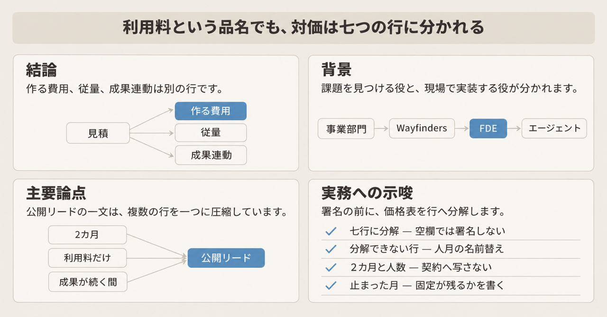
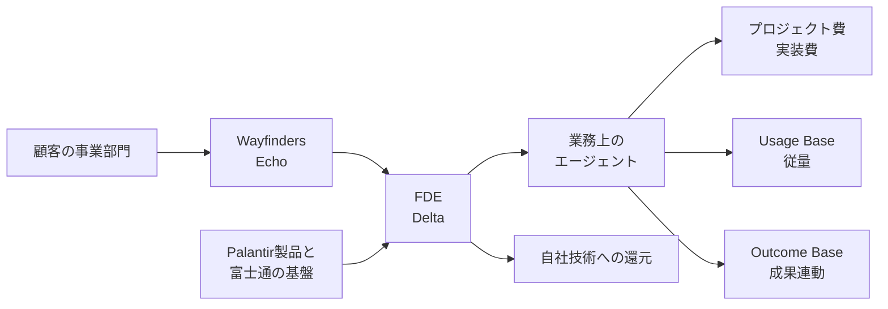

2026年11月10日、日経クロステックは、富士通が FDE を起点に2030年度へ約1,500億円の売上を目指すと報じました。FDE は Forward Deployed Engineer の略で、顧客の現場で実装まで担う技術者です。公開リードは、その記事のうち無料で読める書き出しです。公開リードは、パランティアに学び、事業部門と組んで2カ月で AI エージェントまで作り、対価は人月ではなく利用料で得て、成果を出し続ける限り収益を上げる、と続けています。出典は日経コンピュータ 2026年11月12日号 pp.10-25 の特集です。特集本文は有料会員限定です。

富士通自身が2026年9月16日の IR Day で示した売り方は、人数と期間の積算から、成果への課金と従量課金へ比重を移す価格方針です。IR Day は、投資家向けの説明会です。課題を見つける役と、実装する役は、スライド上で分かれています。この記事は、エージェントを組み立てる時間の対価を契約の行へ落とすときに、その行が何を指すかを、公開資料の範囲で分けます。

*この記事の全体像。以下、順に解説します。*

## 富士通のFDEとは

FDE は、顧客の現場で実装まで担う技術者です。2026年9月16日の資料は、その仕事を、課題を見つける役と実装する役の組として描いています。人月は、人数と期間を掛けて積む見積の単位です。同じ資料は、その積算を提供価格の作り方として図示しています。

### 課題を見つける役と、実装する役

執行役員副社長 CRO の大西俊介氏の資料は、成長の循環を一文で書いています。Wayfinders が顧客課題と成長機会を発見し、FDE が実装と価値の検証を担い、その知見を製品へ戻す、という循環です。Wayfinders は、顧客の課題と成長機会を見つける役の名前です。CRO は、同じ資料が大西氏に付ける肩書です。経歴の頁は、収益の最大化を担う役として説明しています。

スライドは、Wayfinders 側を Echo、FDE 側を Delta とラベルしています。Echo の欄はデプロイメント・ストラテジストです。顧客課題の本質を見極め、技術による解決と価値創造をリードする、と書いています。Delta の欄は前線配置エンジニアです。英語表記は Forward Deployed Engineers です。自社 IP と製品を使い、顧客課題を解決する、と書いています。IP は、自社の知的財産です。どちらも、現場の知見をプロダクト開発へ戻す、と書いています。

執行役員副社長 COO の高橋美波氏の同じ日の資料は、FDE が成果を生むプロセスを四つに分けています。COO は、ソリューションサービス担当の執行役員副社長、という肩書です。四つは次のとおりです。

1. 業種理解から、本質課題を特定する。
2. 暗黙知をコンテキスト化し、最適な AI で具体化する。
3. 業務へ実装し、現場の成果を創出して定着させる。
4. 実践知を技術とサービスへ還元し、価値を高める。

同じスライドは、Palantir との協業を6年、と書いています。Palantir は、冒頭のパランティアです。この協業の相手企業です。2026年9月10日の発表を日経が転載した文では、富士通は Palantir の Global FDE Partner として、Palantir AIP と Palantir Foundry の販売と提供に加え、顧客課題の特定、ユースケース設計、業務実装を進める、とあります。Palantir AIP と Palantir Foundry は、その文が販売と提供の対象として名指しする二つの製品です。AIP が何をする製品か、どの単位で対価を取るかは、その文には書かれていません。Global FDE Partner は、その発表における富士通の立場の名前です。

採用ページには、クロスインダストリーソリューション事業本部 FDE 事業部のインターン募集があります。これは、その組織名が募集文に出ている、という事実です。Uvance の関連ページは、Wayfinders を構想から定着まで一気通貫で支援する、と書いています。Uvance は、高橋氏の資料が2030年度の売上収益 1.7兆円超を置く事業の名前です。

### 対価の二つの箱

大西氏の資料は、多くの IT サービスが開発費や工数を基準に価格を決めてきた、と書いたうえで、プロフェッショナルサービスの提供価格を「エンジニア数 × 期間」として図示しています。その代わりに置くのが、Outcome Base と Usage Base です。Outcome Base は、提供するサービスが生み出す成果に対する課金です。Usage Base は、提供するサービスの従量に対する課金です。

Outcome Base の型は、同じ資料で四つです。

| 型 | 資料の説明 |
|---|---|
| プロフィットシェア（共同事業） | システムや AI が生み出す価値を、成果として分配する課金 |
| エクスプレスサービス | AI の適用による納期短縮の効果を、提供価値として課金 |
| Hybrid 課金 | 固定部分と、成果 KPI に連動する料金を組み合わせる課金 |
| ユースケース課金 / Pod 型 | 事前に定義したユースケースと期間を基準にする課金 |

KPI は、事前に合意する成果指標です。Hybrid は、固定部分を残す型の名前です。資料は、ユースケース課金と Pod 型を、四つの型のうち一つの欄にしています。基準は、事前に定義したユースケースと期間です。通信事業者の例では、人員や工数を基準にせず、一定期間の開発生産量を保証する契約、と書いています。

Usage Base の頁は、利用が増えると収益が伸びる型です。アプリケーション側の名前は、ソースコード課金、データ量課金、レベニューシェアです。レベニューシェアは、この従量の頁に並ぶ名前です。前の表のプロフィットシェアは、成果として価値を分配する課金です。同じ分配かどうかは、二つの頁の説明だけでは決まりません。ソースコード課金の事例は、言語の種別と難易度ごとのソースコード量に応じて課金する、と書いています。データ量課金の事例は、分析するデータ量や、動いている機能に応じて課金する、と書いています。AI Platform 側は、段階別従量課金と削減量課金です。段階別従量は、LLM の動作に必要なコンピューティングの量に応じた段階です。削減量課金は、最適化を適用したあとのコンピューティング資源の削減量に応じた課金です。後の頁は、Uvance の Value Pricing の名前として、ユースケース課金、レベニューシェア、利用量連動、成果連動を並べます。Value Pricing は、提供価値に合わせて価格を付ける、という資料上の名前です。AI Platform 側には、段階別従量と削減量を置きます。ユースケース課金は、Outcome Base の頁にもあります。AI Platform の頁は、現在主流のトークン消費量課金とは異なり、利用価値に応じた価格体系を提供する、と書いています。その頁は、段階別従量課金と削減量課金を、その価格体系として並べています。

同じ資料の後段には、「契約 / SOW 整備」という作業行があります。SOW は、作業範囲を書く文書です。条文そのものは、その行にはありません。

### 事例に並ぶ価格と期間

価格の並びは、事例ごとに違います。

物流の例は、共同輸配送のプラットフォームです。機能開発などの行は「プロジェクト費＋利用料」です。サービス提供の行は「利用料（マッチング収益）」です。資料は、成果の拡大に伴ってプラットフォームの価値と収益が成長するモデルを目指す、と書いています。

欧州の自動車事業者の例は、Uvance Wayfinders の AI 活用コンサルティングです。価格構成は四つです。構想立案と初期検証のための月額固定費用、AI ユースケースの実装費、有効な AI エージェントへの成功報酬、ビジネス貢献への成功報酬です。本文は、固定費と実装費に加え、売上拡大やコスト削減などの事業成果に応じた成功報酬を組み合わせる、と書いています。このコスト削減は事業成果の成功報酬です。前に書いた削減量課金（コンピューティング資源が減った量）とは別の名前です。

期間の例も、一つに揃っていません。高橋氏の資料で、米国の不動産サービス企業は本番導入まで4週間、業務効率 45%向上、と書いています。小売のイオンフードスタイルは、実装まで約10日間、と書いています。どちらも当該スライドの数値です。2026年10月22日のミスミ向け発表は、FDE が顧客の業務担当者と連携し、担当者の確認と承認を残した業務フローで、商品情報管理を約2.5カ月で実業務へ適用した、と書いています。実装人数は書いていません。

### 比率と、一つの利用仕様

大西氏の資料は、従来型 SI、モダナイゼーション、Uvance の三領域に Value Pricing を適用する、と書いています。図の点線のラベルは「Value Pricing 比率」です。三領域を合わせた推移として読むと、2025年度 20%、2030年度 60%、2035年度 80% です。2030年度の点には粗利率の押上げ 3%以上、2035年度の点には 5%以上が添えて読めます。GM 率は、資料がそう書く粗利率です。領域別の2030年と2035年は、従来型 SI が 30% と 40%、モダナイゼーションが 50% と 60%、Uvance が 70% と 90% です。全社目標という語は、その図にはありません。

高橋氏の同じ日の資料は、Uvance の売上収益について、2030年度に 1.7兆円超、と置いています。2025年度は実績、2026年度は計画、2030年度は計画、とラベルしています。約1,500億円は、別のスライドの「FY2030 売上試算」で、「FDE を起点としたビジネス創出」の額です。

リカーリングの脚注は、従来のリカーリングに、顧客伴走型の Outcome Base と Usage Base のプロフェッショナルサービスを加え、安定収益の基盤の指標として追う、と書いています。リカーリングは、その頁が継続して入る収益の側に置いている指標の名前です。

Foundry を使う Fujitsu Data Intelligence Premium の仕様書 GC0052-EN001 は、利用単位を Palantir 定義の Foundry Compute Unit にしています。略称は FCU です。1 FCU が何を数えるかは、ここで確認した条項（期間中に使える数、期間、月末の超過）には書かれていません。FCU は、Foundry を使うこの仕様の単位です。AIP の単位だとは、仕様書は書いていません。前に書いた段階別従量は、IR の AI Platform の頁の名前です。同じ単位だとは、ここで確認した範囲には書かれていません。期間中に使える数と、期間そのものは、Exhibit に書きます。Exhibit は、数量と期間を書く契約の別紙です。超過分は、月末締めの超過数に単価を掛け、その月の利用料とします。期間は Exhibit の Service Period です。Service Period は、その別紙に書いた提供期間です。共通約款に延長の条項があっても、この仕様では延長しません。Data Mesh と Exceed は、この同じ仕様書の中で、便宜解約できない対象として名指しされている二つのサービス名です。Premium という製品名の全体に同じ禁止を書く文は、この条項にはありません。便宜解約は、理由を定めずに途中で解約することです。SaaS の共通約款に便宜解約の条項があっても、この二つのサービスは便宜解約できない、と仕様書が書いています。ここまでの条項は、Fujitsu Data Intelligence Premium の公開仕様書 GC0052-EN001 に書かれているものです。

### 役割から対価へ戻る流れ

次の図は、役割と課金の対応です。図の基盤は、Palantir の AIP および Foundry と、富士通の自社基盤です。

Wayfinders が課題の文を作り、FDE がエージェントを実装します。対価は、作るときの費用、動かし続ける従量、成果に連動する成功報酬に分かれて戻りえます。実装で得た知見は、自社の技術側へ戻る、と IR は書いています。

## 注意点

公開リードの一文は、ここまでの複数の行を一つに圧縮しています。どこまでを事実として使えるかを、先に分けます。

### リードが一つにしていること

| 公開リードや特集の言い方 | 公開資料で確認できる範囲 | 読み方 |
|---|---|---|
| 2030年度に約1,500億円の売上を目指す | 高橋氏の資料は「FY2030 売上試算」「FDE を起点としたビジネス創出 約1,500億円」。同じ資料の Uvance 全体は2030年度 1.7兆円超 | 試算です。Uvance の計画そのものではありません。雑誌は動詞を「目指す」にしています |
| 調査会社の推計、という脚注 | 「調査会社各社のデータをもとに富士通にて推計」は、1,500億円のスライドの頁と、その後の頁の両方にあります | 1,500億円だけに付く印とは、頁の繰り返しからは確定できません |
| 事業部門と2カ月でエージェント | 高橋氏の資料の抽出テキストに「2カ月」はありません。不動産の例は本番導入まで4週間です。イオンフードスタイルは実装まで約10日間です。ミスミ発表は約2.5カ月で実業務へ適用です。特集の次ページ見出しは「2カ月で AI を業務に実装」で、本文は有料です | 2カ月は公開リードの期間です。一次にあるのは別々の事例期間です。標準工期ではありません |
| 人月ではなく利用料 | Outcome Base と Usage Base の両方があります。物流はプロジェクト費と利用料の併記です。自動車の例は月額固定、実装費、成功報酬を並べます | 利用料だけへの置き換えではありません |
| 成果を出し続ける限り収益 | リカーリングの脚注は、従来のリカーリングに、顧客伴走の Outcome Base と Usage Base を、安定収益の指標として追う、と書いています | 成果が止んだ月に対価をゼロにする条項は、ここまでの公開資料には見つかりません。期間の終了条件ではなく、継続収益を追う指標として読みます |
| 業務効率 45%向上、4週間、約10日間 | いずれも当該スライドの数値です | 監査済みの効果、という記載はありません |
| 1〜5人、エセ FDE | 特集の別記事の公開リードです。常駐 SE と違い、顧客と課題を定義し、1〜5人で実装まで担う、とあります。既存職種の改名だけのエセ FDE も散見される、ともあります。有料本文は未読です | 富士通の契約条件としては見つかっていません。エセ FDE は、そのリードの言い方です |
| 3つのリアル | 自社育成の回の公開リードです。主体は SOMPO ホールディングスとミスミグループ本社です。三つが何を指すかは、無料で読める範囲には書かれていません | 富士通の評価基準としては書かれていません。契約条件には写しません |
| マイクロソフトは約6,000人の FDE 組織に25億ドル | 2026年7月2日の公式ブログは、25億ドル、6,000人の業界とエンジニアリングの専門家、そして FDE というラベルを超える組織、と書いています | 「FDE 組織」は雑誌側の圧縮です |

45% も4週間も約10日間も、スライド上の自己申告です。Value Pricing の 20%、60%、80% は、三領域の推移に付いた点線の読みです。2026年11月時点の置換の完了率ではありません。20% を将来目標としては読みません。2025年度の点は、同じ IR Day の売上では実績年に当たります。

### 分母が違う比率

2026年6月1日の ITmedia は、2026年5月28日の中長期経営ビジョンの説明として、Uvance 収益の60%から70%が人月単価ベースの価格設計だと書いています。同じ記事は、サービスソリューションの売上収益について、2025年度時点で従来型 IT サービスが60%、Uvance が30%、モダナイゼーションが10%だった、とも書いています。説明会の質疑資料そのものは、ここでは再掲しません。9月の Value Pricing 比率 20% は、三領域の推移に付いた点線の起点です。5月の60%から70%の裏返しではありません。サービスソリューションに占める Uvance の30%とも別です。足し引きしません。

Wayfinders の関連ページは、構想から定着までを一気通貫で支援する、と書いています。構想だけが Wayfinders の仕事、とこの説明からは確定できません。

### パランティアの年次報告書と、止まった月

Palantir の FY2025 Form 10-K は、事業年度末が2025年12月31日、提出が2026年2月17日です。そこでは、顧客は同社が作ったプラットフォームの利用に支払う、とあります。契約期間は一般に1年から5年です。収益は契約期間にわたって按分して認識します。パイロットとブートキャンプは、一般に Palantir 自身の費用で行い、将来の収益は保証されません。AIP ブートキャンプは、実データ上の実ワークフローを数日で届ける、とあります。多くの契約には便宜解約の条項があり、解約通知期間のあと、残る契約期間について顧客預り金を按分で返金しうる、とも書いています。これは、成果が続く月だけ支払う契約、という書き方ではありません。

Hybrid は固定部分を残します。成果が止んだ月でも、固定が残りえます。通信事業者の Pod 型は、一定期間の開発生産量を保証する契約です。成果が止んだ月に対価が消える、とは書いていません。物流の利用料はマッチング収益です。成果 KPI の成功報酬とは、測る対象が違います。

仕様書 GC0052-EN001 は、対価の切れ目を成果の継続に置いていません。FCU の数と期間は Exhibit です。超過はその月の利用料です。Data Mesh と Exceed は便宜解約できません。成果が止んだ月に利用料がゼロになる、とも書いていません。これは Palantir Foundry の当該サービスの仕様であり、FDE 案件のすべてではありません。

2026年10月22日のミスミ発表は、約2.5カ月で実業務へ適用した事例です。日経リードの「2カ月」に近い期間ですが、同じ文ではありません。人数はありません。顧客の担当者が確認と承認に残ります。1〜5人をこの行へ転記する根拠にはなりません。

課題の所有者、人数、止んだ月の三行だけに畳むと、期間のライセンス、月次の超過、便宜解約の禁止、顧客側の確認が同じマスに消えます。

### 契約判断に使わない数字

次の数字は、この記事の契約判断には使いません。

- 米国求人が1年余りで100倍近く、年収中央値3,000万円、は求人回の公開リードだけです。求人データの一次は照合していません。
- AWS は45日単位、は米テック大手の回の次ページ見出しだけです。本文は有料で、未読です。
- 2026年9月10日の発表にある大きな削減額は、英語の検索抜粋にあり、発表全文としてはここでは確定していません。発表値であったとしても、監査数値ではありません。

## 見積に置く七つの行

方針としての脱・人月は、2026年9月16日の資料で言えます。人数と期間の積算を限界として描き、成果への課金と従量へ比重を移す、と書いてあるためです。標準契約が「成果が続く間だけ」になっている、とは言えません。価格方針については資料が揃っています。条項の中身については、公開された IR に条文がありません。

見積もりの品名を「利用料」に変える前に、次の七行を空欄のまま契約と評価へ置きます。空欄のまま署名しません。

| 行 | 書くこと | 公開資料が既に分けているもの |
|---|---|---|
| 課題定義の所有者 | Wayfinders、顧客、FDE のどれが課題文の確定者か。顧客側の確認者は誰か | Echo と Delta はスライド上は別の役です。ミスミ発表は顧客担当者の確認と承認を残しています |
| 実装の人数と、次のユースケースの作り手 | 初回を誰が作り、2件目以降を顧客が内製するか。人数の欄に1〜5を転記しない | 1〜5人は特集の公開リードです。ミスミ発表にも仕様書 GC0052 にも人数はありません |
| 作るときの費用 | プロジェクト費、実装費、月額固定が残るか | 物流と自動車の事例は、従量や成功報酬と別にこの行があります |
| 期間ライセンス | FCU など利用枠の数と期間。Exhibit の Service Period か | GC0052 は数と期間を Exhibit に置き、期間は延長しません |
| 動いているときの費用 | 超過 FCU、マッチング、段階別従量のどれか。トークンか、削減量か | 超過は月末締めの、その月の利用料です。Usage Base と Outcome Base は別の箱です |
| 止まった月 | 固定が残るか。成功報酬だけがゼロになるか。超過がゼロでも期間枠の対価が残るか | Hybrid は固定が残ります。GC0052 は、成果が止んだら全額がゼロ、とは書いていません |
| 抜け方 | 便宜解約ができるか。残期間分を請求するか | Data Mesh と Exceed は便宜解約できない、と GC0052 が書いています |

評価は、稼働率ではなく、合意した KPI が何カ月続いたかで切ります。その前に、KPI が止んだ月も固定を払うのかを、同じ表へ書きます。成果の継続期間だけを見ると、固定の行が人月の置き場として残ります。

個別の SOW で、成果がゼロの月の固定費、最低利用料、解約金がどう残るかは、公開 IR にはありません。

## 署名の前に見ること

提案書を受け取ったら、見る順は三つです。

1. 価格表を、上の七行に分解できるかだけ見ます。
2. 分解できない行は、人月の見積が名前だけ変わったものとして扱います。
3. 2カ月、1〜5人、3つのリアルは、有料本文を読むまで契約条件に転記しません。

読みが変わる条件も、二つだけです。

富士通または顧客が、成果がゼロの月は固定も利用料も発生しない、という条文を示した場合は、「止まった月」の行をその条文に合わせます。1,500億円を実績として使う場合は、決算で FDE 起点の売上が区分して開示された時点に限ります。現時点の数字は、2026年9月16日の売上試算です。

## まとめ

富士通の FDE は、Wayfinders が課題を見つけ、FDE が現場で実装し、知見を自社の技術へ戻す、という役割の組です。対価は、作るときの費用、従量、成果連動に分かれえます。物流はプロジェクト費と利用料の併記です。自動車の例は月額固定、実装費、成功報酬を並べます。Foundry の一つの仕様は、FCU の数と期間を別紙に書き、超過を月次の利用料にします。

約1,500億円は、2030年度の売上試算です。Uvance 全体の1.7兆円超とは別です。2カ月、1〜5人、業務効率 45% は、標準の契約条件としては使えません。成果が止んだ月に全額がゼロ、という条文は、ここまでの公開資料にはありません。

見積の品名が利用料でも、署名の前に七行へ分解します。分解できない行は、人月が名前だけ変わったものとして扱います。

この記事が少しでも参考になった、あるいは改善点などがあれば、ぜひリアクションやコメント、SNSでのシェアをいただけると励みになります！

## 参考リンク

- [日経クロステック特集（日経コンピュータ 2026年11月12日号 pp.10-25）](https://xtech.nikkei.com/atcl/nxt/mag/nc/18/110400579/)
- [日経クロステック「富士通の FDE」公開リード、2026年11月10日](https://xtech.nikkei.com/atcl/nxt/mag/nc/18/110400579/110400001/)
- [日経クロステック「常駐 SE との違い」公開リード](https://xtech.nikkei.com/atcl/nxt/mag/nc/18/110400579/110400003/)
- [日経クロステック「米テック大手」公開リード](https://xtech.nikkei.com/atcl/nxt/mag/nc/18/110400579/110400004/)
- [日経クロステック「自社育成」公開リード](https://xtech.nikkei.com/atcl/nxt/mag/nc/18/110400579/110400006/)
- [日経クロステック「求人」公開リード](https://xtech.nikkei.com/atcl/nxt/mag/nc/18/110400579/110400002/)
- [高橋美波氏、IR Day、2026年9月16日](https://resources.global.fujitsu/prir/2026/09/2026-IRDay-04-ja.pdf)
- [大西俊介氏、IR Day、2026年9月16日](https://resources.global.fujitsu/prir/2026/09/2026-IRDay-03-ja.pdf)
- [Palantir Form 10-K、事業年度末 2025年12月31日](https://www.sec.gov/Archives/edgar/data/1321655/000132165526000011/pltr-20251231.htm)
- [Judson Althoff、Microsoft 公式ブログ、2026年7月2日](https://blogs.microsoft.com/blog/2026/07/02/microsoft-frontier-company-ai-engineering-that-amplifies-and-protects-your-intelligence/)
- [富士通と Palantir、2026年9月10日](https://global.fujitsu/ja-JP/pr/news/2026/09/10-01)
- [同発表の日経転載](https://www.nikkei.com/article/DGXZRSP712471_R10C26A9000000/)
- [富士通インターン募集 7449](https://fujitsu.recruiting.jp.fujitsu.com/intern-theme/theme-7449/)
- [Uvance の公開説明](https://global.fujitsu/ja-JP/uvance)
- [Uvance Wayfinders の関連説明](https://global.fujitsu/ja-JP/uvance/data-ai-strategy)
- [Fujitsu Data Intelligence Premium 仕様書 GC0052-EN001](https://global.fujitsu/-/media/Project/Fujitsu/Fujitsu-HQ/documents/terms-and-conditions/ss-fujitsu-data-intelligence-premium/v1/ss-fujitsu-data-intelligence-premium-en001.pdf)
- [ミスミ向け発表、2026年10月22日](https://prtimes.jp/main/html/rd/p/000000625.000093942.html)
- [ITmedia、2026年6月1日](https://www.itmedia.co.jp/business/articles/2606/01/news040.html)
