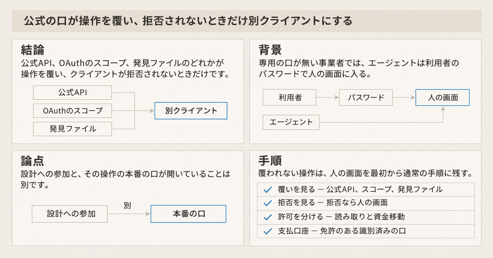
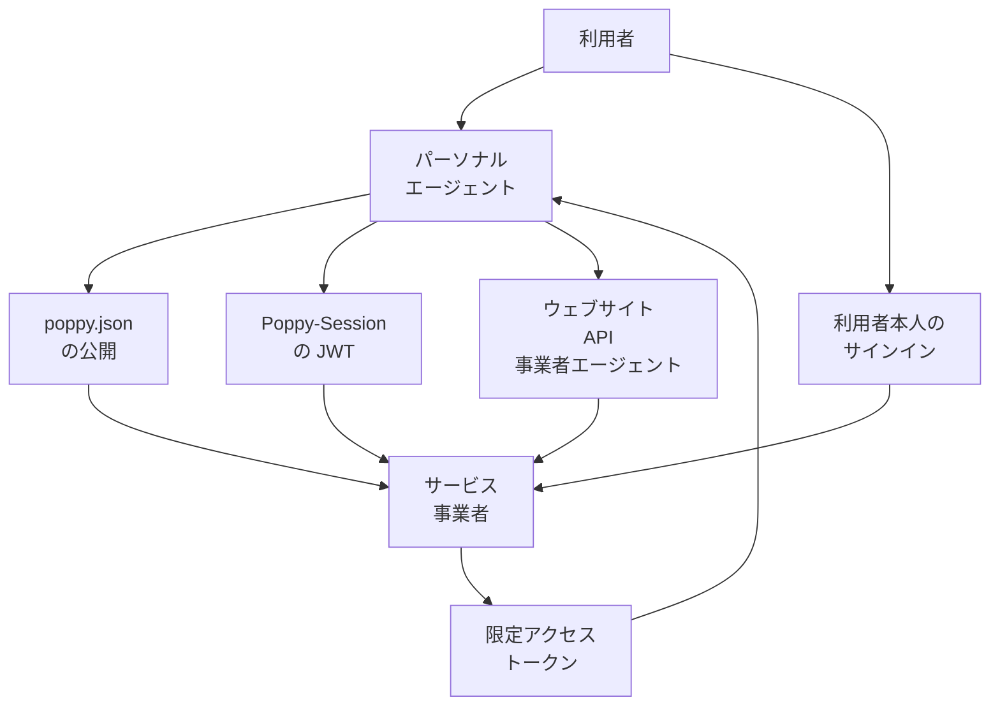

個人向けの AI エージェントは、予約、請求の支払い、苦情の申立てを代行し始めています。専用の入り口を持つ事業者は少なく、エージェントは利用者のパスワードで、人と同じ画面に入っています。

この記事では、2026年11月13日に Financial Times へ出た、銀行 BBVA の会長 Carlos Torres Vila の意見と、同じ週に公開された Personal Agent Protocol（Poppy）仕様 1.0 を整理します。Poppy は、1人の利用者のために動くパーソナルエージェントと、1つの事業者との仕事の分け方を定める仕様です。意見は Expansión のスペイン語転載（2026年11月13日 20:01 更新）を読み、英語版の本文は確認できていません。

依存する外部操作を足す前に、その操作を3つに分ける基準を持ち帰れます。

*この記事の全体像。以下、順に解説します。*

## 人に見せかけない接続口とは

著者が裏口と呼ぶのは、エージェントが利用者のパスワードで、人と同じ画面に入るやり方です。パスワードは、利用者だけが知るはずの資格情報です。専用の入り口は、識別されたエージェントのために事業者が出す接続口です。

意見が挙げるリスクは、利用者のパスワード共有、無権限アクセス、エージェントの誤動作、顧客との紛争です。検知されて遮断される例もある、と著者は書きます。著者が置く代わりは、識別されたエージェントのための接続口です。

### 著者が求める形

エージェントは自分の識別子を持ち、人のふりをしません。利用者はサービスに直接サインインし、狭い範囲の許可を与え、あとから取り消せます。すべての操作は記録されます。銀行から公共料金、デジタルプラットフォーム、ソーシャルネットワークまでの大規模事業者は、識別されたエージェントに、平等な条件の標準的な接続口を出します。

利用者は任意のエージェントを選べるべきだ、と意見は書きます。事業者が自社エージェントを出しても、選択は利用者側に残ります。規制業務では、その提供者も免許を取ります。意見のこの文は、どの業種を規制業務と呼ぶかを列挙していません。後の支払口座の免許は、別の指令の話です。

許可の例は、残高と公共料金の支払いを可とし、新しい支払先やローンを不可とする、という分け方です。

著者の割り当て案は4つです。利用者は、自分が与えた許可と指示を持ちます。サービス事業者は、許可の外の実行を持ちます。エージェント提供者は、指示を超えた行動を持ちます。各提供者は、自システムの侵害を持ちます。利用者は、自分の制御の外の損失を負いません。

識別の器として、意見は eIDAS に基づく検証可能な資格情報を各エージェントに持たせる、と書きます。ここでいう検証可能な資格情報は、そのエージェントが何者かを示す証しとして、意見が持たせようとするものです。eIDAS は、EU の電子識別と信頼サービスの規則（Regulation (EU) No 910/2014）です。

EU の AI 法は、人と直接やり取りする AI に、人へ自分を知らせることを求めます。著者は、サービスに対する自己識別と、なりすましの禁止を、移行期間のあとで加えるべきだと書きます。

### Poppy 1.0 の面

同じ週に、Sierra と Meta が Poppy の仕様 1.0 を公開しました。発見ファイル、セッション、OAuth によるアカウントアクセス、ウェブサイト、API、事業者自身のエージェント、という層で、人とエージェントと事業者の役割を分けます。OAuth は、利用者の承認に基づいて、別のソフトへ限定したアクセス権を渡す枠です。

層は採用段階ではありません。発見、セッション、アカウントアクセス、チャネルは、同時に存在する別の面です。次の図の矢印は、導入の順番ではありません。利用者、エージェント、事業者のあいだの結びつきです。`poppy.json` は事業者が公開し、エージェントはそれを見ます。

利用者は人です。パーソナルエージェントは、その人のために動くソフトウェアです。アカウントアクセスでは、独立した OAuth クライアントになります。`client_id` は、クライアントメタデータ文書の HTTPS URL です。クライアントメタデータ文書は、そのクライアントが何者かを示す文書です。

事業者は、`https://{domain}/.well-known/poppy.json` を HTTPS で公開します。中身は、API、ウェブサイト、事業者エージェントのうち少なくとも1つです。エージェントは、このファイルを見て接続先を見つけます。

セッションとアカウントアクセスは独立しています。サインイン前でも、エージェントは `Poppy-Session` ヘッダの JWT で、自分と、事業者ごとに違う仮名の利用者 ID を示します。JWT は、署名付きの主張を載せるトークン形式です。アカウントに触るときは、それに加えて、利用者の承認に基づくアクセストークンを載せます。

事業者は、どのエージェントを受け入れるかを仕様の外で決めます。拒否の応答は、OAuth の `invalid_client` または `invalid_session` です。`invalid_client` は、そのクライアントを受け入れない応答として、後の分類でも使います。`invalid_session` は、仕様が拒否の応答として `invalid_client` と並べる名前です。両者の違いは、この箇所では分けていません。サインイン前のセッションは受け、サインインは拒む、という応答は `unauthorized_client` です。

### サインインとスコープ

サインインの既定は Direct Sign-In です。利用者本人が事業者のページでサインインし、スコープの一部または全部を承認するか、拒否します。スコープは、許可する操作を名前で分けた単位です。

Device Sign-In は、仕様が Direct Sign-In と並べる、本人によるサインインのもう一つの方式です。エージェントが使ってよいのは、利用者本人がサインインするときだけです。両者の画面手順の差は、ここでは分岐にしません。後の操作の分け方では、この二つの画面の差を使いません。

クライアント認証は `private_key_jwt` です。クライアントが秘密鍵で署名した JWT を事業者へ示す方式の名前です。事業者は、署名アルゴリズム ES256 と PS384 を受け付けます。この二つの名前は、後の操作の分け方には使いません。

対応するスコープの一覧の正は、OAuth のメタデータです。`poppy.json` の `auth.scopes` は、その一覧の代わりではなく、任意の説明です。要求を超えるスコープは付与しません。例には `orders:read`、`orders:write`、ブラウザ参加用の `poppy:browser-sign-in` があります。これらの名前は、スコープの書き方の見本です。後の操作の分け方の条件ではありません。各スコープには、変更が無いか、可逆か、不可逆か、個人データを含むか、のヒントを付けられます。

エージェントは、人に見せかけるためにセッションヘッダを省略してはなりません。アクセストークン、それを更新するリフレッシュトークン、セッション JWT、秘密鍵、認可コードは、モデルのコンテキストに置きません。モデルのコンテキストは、モデルが読める入力の範囲です。

### チャネルと公開の名指し

チャネルは事業者が選びます。OpenAPI、MCP、ウェブページ、任意の事業者エージェントです。OpenAPI は API の記述形式です。MCP は Model Context Protocol のことで、モデルが外部の道具を呼ぶ接続の規格です。仕様は、OAuth、JWT、HTTPS、OpenAPI、MCP を土台に数えます。

Sierra は、Poppy が Universal Commerce Protocol（UCP）を補う、と書きます。2026年11月13日の Sierra の記事は、Shopify の全店舗が Poppy ファイルを自動公開する、と書きます。買い物そのものは UCP が担い、その前段が Poppy です。Meta のエージェント Muse は、訪れるサイトで Poppy を先に探します。

同じ記事が “now going live” と名指しするのは、Mercury、Synchrony、Turkish Airlines です。Mercury について Sierra は “Mercury is not a bank” と脚注します。

BBVA は 2026年10月13日、この設計に加わった最初の欧州の銀行だと自ら書いています。

レート制限に、全体の数値上限はありません。制限する事業者は HTTP 429 と `Retry-After` を返します。429 は、しばらく待てという HTTP の応答です。値は秒数または HTTP 日時です。エージェントは、その待機時間または示された時点まで待ちます。

## 注意点

意見は制定法ではありません。Expansión の欄は Financial Times / Opinión です。標準口の義務、なりすましの禁止、4分割の責任、eIDAS のエージェント資格は、著者の立法提案です。英語版の本文は開けていません。スペイン語転載との字句の差は照合できていません。

### 参加と、開いた口

Sierra の 2026年10月9日の記事は、追加35社を design partners とし、「設計プロセスに参加する」と書きます。design partner は、その設計プロセスへの参加者を指す Sierra の呼び方です。列挙に Bank of America、BBVA、Wells Fargo があります。

BBVA の 2026年10月13日の記事は、欧州の銀行として最初に加わり、共通プロトコルの設計を助ける、と書きます。顧客がエージェントで商品を比べたり、金融手続きを始めたりする話は、“In the future” と “explore their potential application” です。Sierra は “first European bank” とは書いていません。

2026年11月13日の live の段落に、Bank of America、BBVA、Wells Fargo はありません。同期の新規 design partner は100社超の名簿であり、live とは別の段落です。Synchrony は live の列挙に入りますが、本文は “will bring”、“The work explores”、“Over time” と、未来と可能性で書いています。Turkish Airlines は、運賃、運航状況、予約照会ができます。購入を会話の中で終えるのは “working to” です。銀行の本番の Poppy 口が開いた、とは Sierra の本文は書いていません。

仕様 4.1 は、事業者がどのパーソナルエージェントを受け入れるか、その承認方法は仕様の外だ、と書きます。Poppy を実装しても、公開されたすべての相手を使う必要はありません。ロゴと “open standard” は、その事業者が自分のエージェントをクライアントとして受け入れることと同じではありません。「公正な条件」は Torres の規制提案であり、Poppy の性質ではありません。

`web.disabled` は、閲覧してほしくないという好みです。仕様は “The protocol can't enforce web.disabled” と書きます。会社向けキットは、仕様の公開物の一つです。「仕様 1.0 に従う」と書き、別の段落で “The spec is a draft.” とも書きます。仕様の GitHub README は、その掲載サイトが仕様の API を実装しない、と書きます。changelog は仕様 1.0 の公開を 2026年11月14日とし、Sierra のブログは 2026年11月13日に “now available” と書きます。実装が凍結した瞬間は、この2つだけでは決まりません。

### 資格情報でのログイン

仕様 10.5 は、プロトコルの外で利用者の資格情報を使ってウェブサイトに入るエージェントは、利用者本人に見える、と書きます。事業者はそれを限定できず、止めるなら全体を遮断するしかありません。Direct Sign-In も Device Sign-In も出さない事業者、またはスコープと API が利用者の必要を覆わない事業者は、エージェントがその入り方をすることを予期せよ、とも書きます。

Mediated Sign-In は、Direct Sign-In と Device Sign-In をまだ出せない事業者向けの拡張です。仕様 10.5 が予期する、プロトコルの外の資格情報ログインとは別の名前です。この拡張は、後の操作の分け方には使いません。仕様は transitional step と呼びます。changelog は、2027年3月17日に廃止する予定だと書きます。

2026年10月6日の発表文も、アカウントが要る作業では、会社のページでサインインするか、パーソナルエージェントに既に設定した資格情報を使える、と書きます。人手の経路を、標準が行き渡るまでの短い橋だとは、仕様は書いていません。

### 銀行の資格情報拒否

次の整理は、法律事務所 Hunton Andrews Kurth の 2026年11月3日のアップデートです。収益電話（決算説明の電話）、Bloomberg、約款の要約です。原発言の録音と約款原文は、ここでは開いていません。日付と文言は二次情報です。表のオープンバンキングは、Hunton が書く米国の銀行の読み取り用の接続です。後の支払口座の指令とは別です。

| 事業者 | Hunton が書く日付 | Hunton が書く内容 |
| --- | --- | --- |
| JPMorgan Chase | 2026-10-13 の決算説明 | 外部エージェントを入れない。Muse と Instinct を名指し。第三者は資格情報を取ってログインできない。読み取り専用のオープンバンキングは残し、資金移動と請求支払いは不可。Digital Services Agreement の改訂は 2027-01-01 発効で、顧客がエージェントにアクセスを与えた行為は顧客の指示として扱う |
| Charles Schwab | 2026-10-16 | 資金を動かそうとする無許可エージェントを週に10から20回止めている、と CEO が Bloomberg に話した、と Hunton が書く。情報用の制御された接続と、自社アシスタントを開発中 |
| Citigroup | 2026-10-16 | 第三者の AI エージェントやアシスタントが顧客口座にログインすること、同行のデジタルバンキング内で直接取引することを認めない。一部のオープンバンキング経由の読み取り専用は残る |
| Wells Fargo | 約款は 2026-11-24 発効 | 全面遮断ではない。AI エージェントの利用は顧客の自己責任。取引は顧客が承認したものとみなす。監視義務は無く、アクセスを制限または終了できる |

Citi の文言は、検索結果に出た別の Financial Times 記事（2026年10月16日）の抜粋とも一致します。その Financial Times のページも、ここでは開けていません。

Bank of America は、2026年10月9日の design partner です。TechRadar は 2026年10月28日、同行が顧客に銀行パスワードを AI エージェントと共有するなと伝えた、と見出しで書きます。取得できたのは見出し、公開時刻、description までです。メール原文は未確認です。

読み取りと、資金移動や支払先の変更は、別の扉です。二値の「受け付ける / 受け付けない」では足りません。

### 支払口座の先例

支払口座について、次は官報の英語、または legislation.gov.uk が保持する同じ EU 法の識別番号（CELEX）の写しで確認できます。EUR-Lex の HTML は、取得時に本文がありませんでした。

PSD2（Directive (EU) 2015/2366）は、EU の支払サービス指令です。Article 66(3)(d) は、支払開始のたびに、支払開始事業者が口座提供事業者へ自らを識別する、と書きます。Article 67(2)(c) は、口座情報事業者が各通信セッションで同じことをする、と書きます。支払開始事業者は、利用者に代わって支払を始める免許事業者です。口座情報事業者は、口座の情報を読む免許事業者です。口座提供事業者は、口座を持つ側の事業者です。

同じ条は、利用者の personalised security credentials を、利用者と発行者以外がアクセスできないようにする、と書きます。personalised security credentials は、利用者ごとに発行された秘密の認証情報です。第三者に資格情報を求めてはならない、という一句そのものではありません。

RTS（Commission Delegated Regulation (EU) 2018/389）は、PSD2 の詳細を定める委任規則です。Article 38(2) は、2019年9月14日から適用する、と書きます。Article 31 は、インターフェースを専用インターフェースか、利用者向け画面の利用許可か、のどちらかで用意する、と書きます。専用 API だけが、条文上の唯一の選択ではありません。

Article 33(4) は、専用インターフェースが水準を外れている間、識別された第三者が利用者向け画面を使える、と書きます。Article 33(1) は、5連続の要求が30秒以内に返らないとき、計画外停止を推定してよい、と書きます。識別の無い画面アクセスを、この fallback が許すとは書いていません。

EBA（欧州銀行監督局）の 2019年7月26日の整理は、PDF 自身が拘束力は無い、と書きます。RTS 適用後、識別の無い顧客インターフェース経由のアクセス（いわゆる screen scraping）は、支払口座データについて認められない、と書きます。screen scraping は、人の画面を読み取ってデータを抜く入り方です。対象は payment accounts です。必要でないデータを使わない義務は、口座情報事業者と支払開始事業者にあり、口座提供事業者には無い、とも書きます。

EBA Opinion EBA/OP/2020/10（2020年6月4日）は、リダイレクト自体は障害ではないが、顧客が銀行へ直接入るときより面倒な認証は障害になり得る、とします。強い顧客認証（SCA）を複数回課すこと、IBAN の手入力、同意の追加確認を例に挙げます。IBAN は、国際的な口座番号の形式です。90日ごとの再認証は、RTS どおりなら障害ではありません。

EBA は 2021年2月22日、残る障害を除く監督行動を求め、2021年4月30日までに各国が動くよう書いています。

識別された第三者に専用口を義務づけたあとでも、摩擦と、識別されたうえでの顧客画面への退路が残っています。意見自身が、これらの規則はエージェントの行為の一部しか覆わない、と書いています。任意のエージェントが任意の SaaS に入る権利ではありません。

支払の責任も、意見の4分割とは分岐が違います。Article 73 は、無権限の支払を原則翌営業日までに返します。Article 74 は、紛失、盗難、悪用の支払人負担を原則 50ユーロまでとし、詐欺または故意、重過失では全額とします。SCA を事業者が要求していない無権限取引では、詐欺でない限り支払人は損失を負いません。分岐は「権限の有無」「重過失、詐欺」「誰が SCA を要求したか」です。顧客が資格情報を渡した取引は、無権限の返金から外れ得ます。

### AI 法と eIDAS

Regulation (EU) 2024/1689 の Article 50(1) は、人と直接やり取りするよう意図した AI システムの提供者が、その自然人が AI とやり取りしていると知らされるよう設計する、と書きます。明らかな場合と、法令で認められた犯罪探知等の例外があります。50(2) は、生成物への機械可読の印です。サービスやウェブサイトに対して、クライアントとして名乗る義務は、この条にはありません。意見のスペイン語本文も、人への識別は現行の要求、サービスへの識別となりすまし禁止は “debería”（すべき）と書いています。Article 50 の適用日は、官報の適用条項まで突合していません。日付は書きません。

eIDAS の定義は、電子的識別の対象を自然人、法人、法人を代表する自然人に限ります。RTS Article 34 は、支払サービス提供者の識別に、この規則の qualified certificates を使います。qualified certificates は、適格とされた電子証明書です。それは免許を持つ提供者という法人側の識別であり、個人のエージェントソフトウェアの識別ではありません。改正規則 Regulation (EU) 2024/1183 の開いた官報テキストには “agent” という語はありませんでした。欧州委員会の European Digital Identity のトピックページにも、2026年11月15日の取得テキストでは “agent” はありませんでした。エージェント用の資格情報が条文のどこにも無い、とまでは言えません。ウォレットは、利用者本人が relying party に自分のデータを出して認証する枠として書かれています。relying party は、その提示を受けて本人確認に使う相手です。

### 米国の第三者アクセス

Hunton は、CFPB の 2024年10月の Personal Financial Data Rights 規則（Section 1033）が、開発者向けインターフェースを求め、アクセス手数料を禁じ、資格情報による screen scraping から離す設計だった、と書きます。CFPB は、米国の消費者金融保護局です。銀行団体が提訴し、Eastern District of Kentucky が執行を差し止め、最大手の 2026年4月1日の遵守日は効力を生じずに過ぎた、とも書きます。再検討の経緯として、2025年8月22日の事前告知、意見募集の 2025年10月21日締め切り、2026年8月の規制審査への送付、最終規則は未公表、と書きます。判決、Federal Register、CFPB のページは開いていません。手続日付は未確認の二次情報です。

米国 Regulation E の “unauthorized” が、消費者がアクセスを与えた者を除く、という整理は、法律事務所と CSA の二次です。eCFR は開けていません。条文原文は未確認です。

### 使わない数字

年470億ドルという預金コストは、Hunton が “one estimate” と書くだけで、預金利回りを書いた Apollo のページにはありません。使いません。Muse の利用者数は、開いた Sierra の一次に数値がありません。二次記事の「1000万超」は使いません。

Apollo の 2026年9月27日のページ説明は、当座の全国平均約 0.1% と、3.3% から 5.0% を払う口座への移動、と書きます。チャート本文は画像で、説明文の水準です。預金の利回り差は、銀行が資金移動の口を急がない経済上の理由になり得ます。チャート本文は未確認です。

Hunton の「規制当局が非公開で制限を歓迎した」は、当局名も公開文書もありません。事実としては使いません。EBA の公開の方向は、第三者アクセスの障害を除け、です。

## 外部操作を3つに分ける

新しい外部操作を足す前に、相手のサービスを次の3つに分けます。分類の単位はサービス全体ではなく、その操作です。同じ事業者が、読み取りは公式 API、資金移動は人の画面だけ、ということがあり得ます。design partner の名簿は、分類3の根拠にしません。

| 分類 | 見え方 | 操作を足すときの扱い |
| --- | --- | --- |
| 1. 人のログインしか無い | 公式 API、OAuth、エージェント用スコープが無い | パスワードやブラウザセッションの共有を定常にしない。手順に、人がその画面を開く経路を最初から書く |
| 2. 別クライアントを拒む | 利用規約、ボット検知、または第三者エージェントのログインと取引を認めないという明示 | 分類1と同じ。検知されたあとの人手経路を、例外ではなく通常の手順に置く。読み取り専用の公式コネクタが残るなら、その操作だけ分類3に上げる |
| 3. エージェント用のスコープがある | 公式 API、OAuth のスコープ、または Poppy の発見ファイルが、その操作を覆っている | そのクライアントを使う。人は承認する主体のまま、エージェントは別クライアントにする。パスワードは渡さない。不可逆な変更は、読み取りと別の許可にする |

分類3の条件は一つです。公式 API、OAuth のスコープ、または Poppy の発見ファイルが、その操作を覆い、かつ `client_id` が拒否されないことです。Poppy をその口にするときは、名簿ではなく、`poppy.json` が在ることと、目的の操作がスコープまたは API で覆われることを確認します。分類2で読み取り専用の公式コネクタが残るときは、その読み取りだけが公式 API で覆われるので、その操作だけ分類3です。スコープも API も用を足さなければ、仕様 10.5 が予期するとおり、その操作は分類1に残ります。

ローカルのツール許可と、画面を描く部品の許可は、この表の外です。エージェントがローカルでどのツールを呼べるか、どの UI 部品を描けるかは、こちらの実行環境の許可です。相手のサービスが、そのエージェントをクライアントとして受け入れるかは、相手の認証と約款の許可です。前者が通っても、後者が `invalid_client` や全遮断を返すことがあります。

## 採用する結論

新しい外部操作の前に、上の3分類で相手を確認します。分類1と2では、人のセッション共有を期限付きの暫定と呼ばず、人手経路を手順に残します。分類3では、人が承認し、エージェントは別クライアントとして自己識別する口を使います。読み取りと、資金移動や支払先の変更は分けます。「公正な条件の標準口」と4分割の責任は、現行の義務として扱いません。

この結論を支える公開資料は、次のとおりです。

- 意見は、パスワード共有、遮断、顧客紛争を、一次媒体の意見として問題にしています。専用口が無いときのリスクの記述として、現場の確認項目と一致します。
- Poppy 1.0 は、人とエージェントと事業者を用語として分け、本人のサインインと限定トークンを定義しています。分類3の形の実例になります。
- 仕様 4.1 の拒否と、10.5 の全遮断は、拒否されたときの人手経路を残す理由になります。
- JPMorgan と Citi について Hunton が書く整理は、読み取りと資金移動を分ける実例になります。二次情報です。
- PSD2 と RTS は、支払口座に限って、識別された規制事業者と専用インターフェースの先例になります。適用日は 2019年9月14日です。
- RFC 9700（2025年1月、BCP 240）は、OAuth のセキュリティに関する現在のベストカレントプラクティスです。リソース所有者パスワード資格情報グラントを MUST NOT とし、アクセストークンは最小権限にせよ、と書きます。このグラントは、利用者のパスワードをクライアントが預かり、それでトークンを受け取る方式です。画面へのパスワード入力一般を、この禁止が禁じているわけではありません。パスワードをエージェントに渡す扱いを定常にしない判断は、資格情報の受け渡し場所が増えるという同節の理由と、仕様 10.5 の残差を見て行います。

次の読みは、公開資料が支えません。

- 中長期には自己識別の標準口へ寄せ、人手経路はそれまでの暫定だ、という時間軸。仕様 10.5 は、口やスコープが足りない事業者で資格情報ログインが残る、と書きます。自動公開が明記されているのは Shopify の店舗であり、銀行や長尾の SaaS ではありません。
- Poppy に参加している銀行は、エージェントを主体として受け付ける、という読み。参加は設計プロセスです。Wells Fargo は design partner であり、Hunton が書く 2026年11月24日発効の約款は、エージェント利用を顧客の自己責任に置きます。二次情報です。
- 専用口を義務にすれば、公正で摩擦の少ないアクセスになる、という読み。EBA は 2020年と 2021年に、支払口座の専用口に残る障害の除去を求めています。Article 33 の fallback も残ります。
- AI 法が、サービスへの自己識別をすでに求めている、という読み。Article 50 の告知先は自然人です。著者自身が、サービスへの識別は “debería” と書いています。
- eIDAS のウォレットが、エージェントの資格情報として今使える、という読み。開いた官報と委員会ページは、人と法人の識別として書いています。
- OAuth にすれば、なりすまし面は消える、という読み。RFC 9700 節 4.10 は、攻撃者にトークンと鍵素材の両方が渡ると、送信者を制約したトークンも崩れる、と書きます。送信者を制約したトークンは、トークンだけでは足りず、送る側の鍵も要る種類のトークンです。正規のエージェントが両方を持つこと自体は、その攻撃条件ではありません。壊れたクライアントや XSS で両方渡る場合が、残るリスクです。XSS は、ページに注入されたスクリプトが、ブラウザ上の秘密を読む攻撃です。
- 意見の4分割を、支払の責任ルールとして使える、という読み。分岐は Article 73 と 74 にあります。

## 確認の順序

依存する外部操作を足すとき、または既存のブラウザ操作をエージェントに渡すときに、次の順で決めます。

1. その操作が、公式 API、OAuth スコープ、Poppy の発見ファイルのどれで覆われるかを見ます。design partner の名簿は見ません。
2. 覆われ、かつ `client_id` が拒否されないなら、分類3としてそのクライアントを使います。人は事業者のページでサインインし、読み取りと不可逆な変更を別スコープにします。パスワード、セッションクッキー、トークンをモデルのコンテキストに置きません。
3. 覆われない、または別クライアントを規約や検知で拒むなら、分類1または2とします。人の画面を開く手順を、その操作の通常経路として書きます。拒否や全遮断のあとで初めて人手に戻す、とは書きません。
4. ローカルで許可したツールと、画面部品の許可を、相手サービスの受入と別の欄に書きます。前者がオンでも、後者が拒むことがあります。
5. 支払口座の情報を読む操作と、支払を始める操作では、免許を持つ口座情報事業者や支払開始事業者の識別済みインターフェースがあるかを先に見ます。任意のエージェントにパスワードを渡す経路は、支払口座では PSD2 の第三者識別の外に出ます。RFC 9700 が MUST NOT とするのは、OAuth のパスワード資格情報グラントです。画面へのパスワード入力一般ではありません。それでもパスワード共有は、定常の手順にしません。
6. 責任分界は、相手の約款と、支払なら Article 73 と 74 を読みます。意見の4分割を、損失を誰が持つかの現行ルールとして手順に書きません。

分類を上げる条件は、相手が、その操作を覆うスコープ付きの公式クライアントを出し、こちらのエージェントの `client_id` を拒否せず、不可逆操作を別許可にできることです。そのとき、その操作だけ分類3に上げ、人手経路は障害時の退路に下げてよいです。

立法で大規模事業者に平等条件の標準口が義務づけられ、自社の相手がその義務の対象になり、施行と監督が確認できるとき、分類2の「別クライアント拒否」を定常とみなす前提を見直します。2026年11月15日時点では、銀行の本番口として、分類3へ上げられる公式クライアントも、平等条件の標準口の義務も、確認できていません。

ここに置いたのは、操作を分ける基準です。自社が依存する SaaS を、この3分類で当てはめた結果一覧ではありません。

## まとめ

人と同じ画面へパスワードで入るエージェントは、著者の言葉では裏口です。Poppy 1.0 は、発見、セッション、本人のサインイン、限定トークン、事業者が選ぶチャネルで、人とエージェントと事業者を分けます。参加の名簿と、開いた本番口は別です。仕様は、口が足りない相手で資格情報ログインが残る、と書いています。

外部操作は、操作単位で3つに分けます。公式 API、OAuth のスコープ、または Poppy の発見ファイルが、その操作を覆い、`client_id` が拒否されないときだけ、エージェントを別クライアントにします。それ以外は、人の画面を通常経路として残します。読み取りと、資金移動や支払先の変更は分けます。公正な標準口と4分割の責任は、現行の義務として手順に書きません。

この記事が少しでも参考になった、あるいは改善点などがあれば、ぜひリアクションやコメント、SNSでのシェアをいただけると励みになります！

## 参考リンク

- [Carlos Torres Vila 意見のスペイン語転載（Expansión、更新 2026-11-13 20:01）](https://www.expansion.com/economia/financial-times/2026/11/13/agentes-ia-deberian-necesitar-hacerse-pasar-nosotros.html)
- [Financial Times の掲載 URL（英語版の本文は未確認）](https://www.ft.com/content/069cdc48-e17a-430b-818c-93894768706f)
- [Sierra, Introducing Personal Agent Protocol（ページ表記 2026-10-06）](https://sierra.ai/blog/introducing-personal-agent-protocol)
- [Sierra, Sharing a draft of Personal Agent Protocol（ページ表記 2026-10-09）](https://sierra.ai/blog/poppy)
- [Sierra, Releasing Personal Agent Protocol 1.0（ページ表記 2026-11-13）](https://sierra.ai/blog/releasing-poppy)
- [Personal Agent Protocol specification 1.0](https://personalagentprotocol.org/docs/1.0/spec)
- [Changelog](https://personalagentprotocol.org/docs/changelog)
- [Path to 1.0](https://personalagentprotocol.org/docs/path-to-1)
- [Company kit](https://personalagentprotocol.org/kit/company)
- [BBVA、2026-10-13](https://www.bbva.com/en/innovation/bbva-helps-design-a-common-protocol-led-by-sierra-ai-and-meta-to-connect-ai-agents-with-businesses/)
- [EBA, Fourth set of issues（Published on 26 July 2019）](https://eba.europa.eu/sites/default/files/Fourth%20set%20of%20issues%20raised%20by%20EBA%20WG%20on%20APIs.pdf)
- [EBA Opinion EBA/OP/2020/10 のプレスリリース（2020-06-04）](https://www.eba.europa.eu/publications-and-media/press-releases/eba-publishes-opinion-obstacles-provision-third-party)
- [EBA プレスリリース（2021-02-22）](https://www.eba.europa.eu/eba-calls-national-authorities-take-supervisory-actions-removal-obstacles-account-access-under)
- [Directive (EU) 2015/2366 Article 66 の legislation.gov.uk 写し](https://www.legislation.gov.uk/eudr/2015/2366/article/66)
- [Commission Delegated Regulation (EU) 2018/389 Article 33 の legislation.gov.uk 写し](https://www.legislation.gov.uk/eur/2018/389/article/33)
- [欧州委員会, European Digital Identity](https://commission.europa.eu/topics/digital-economy-and-society/european-digital-identity_en)
- [RFC 9700（2025年1月）](https://www.rfc-editor.org/rfc/rfc9700.txt)
- [Apollo Daily Spark（2026-09-27）](https://www.apollo.com/wealth/insights-news/insights/daily-spark/is-an-agentic-bank-run-coming)
- [Hunton Andrews Kurth（2026-11-03、二次情報）](https://www.hunton.com/insights/legal/major-banks-move-to-block-or-limit-customer-directed-ai-agents)
- [TechRadar（2026-10-28、二次情報。メール原文は未確認）](https://www.techradar.com/pro/bank-of-america-tells-customers-to-stop-sharing-banking-passwords-with-ai-agents-agentic-payments-are-becoming-a-major-thorn-in-the-side-of-banking)
