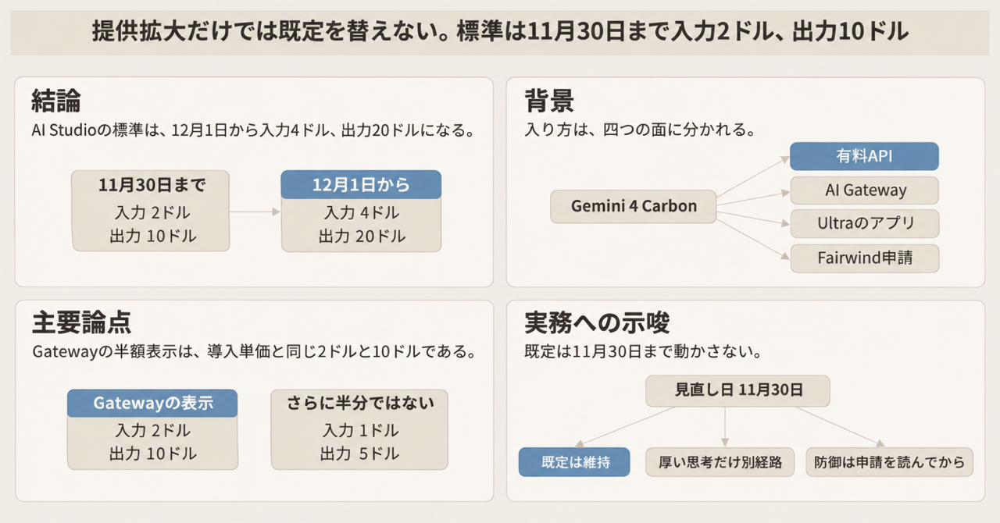
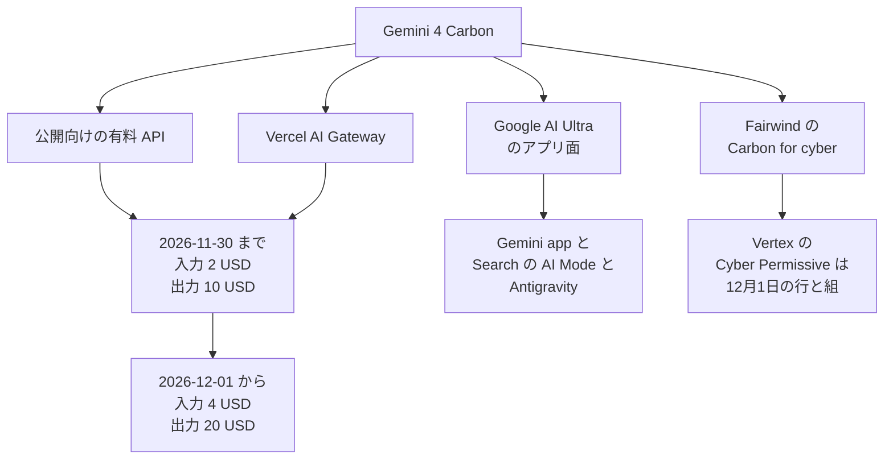

Gemini 4 Carbon は、Google が 2026年11月10日に提供範囲を広げた Gemini 4 のモデルです。API のモデル ID は `gemini-4-carbon` です。Vercel AI Gateway のモデル ID は `google/gemini-4-carbon` です。AI Gateway は、複数プロバイダのモデルを一つの API から呼ぶ Vercel の経由面です。

Google と Vercel は、複雑なソフトウェア工学、継続するエージェント作業、サイバー防御向けと案内しています。エージェント作業は、複数の手順を継続して進める作業です。この記事では、どの面に載っているかと、公開向けの単価が 2026年11月30日と 2026年12月1日でどう分かれるかを整理します。面は、API やアプリなど、モデルへ入る経路です。金額と提供条件は、2026年11月11日時点の公開ページの記載です。


*この記事の全体像。以下、順に解説します。*

## Gemini 4 Carbonとは

状態は Stable です。モデル頁の Latest update は November 2026 です。入力は Text、Image、Video、Audio、PDF です。出力は Text です。

Gemini 4 Argon は、Carbon より先に出ている Gemini 4 のモデルです。モデル ID は `gemini-4-argon` です。What's new は、Gemini 4 Carbon の変更点を書く Google の文書です。What's new は、Carbon と Argon のトークン単価は同じだと書きます。難しい問題では思考トークンを多く使い、1 ターンでも Argon より多い、と書きます。費用を見る範囲は、1 ターンです。思考トークンは、応答の前にモデルが推論へ使うトークンです。出力料金に含まれます。

### 入出力と窓

コンテキストは、入力、思考、出力で共有する 1,048,576 トークンです。この共有する上限を、共有窓と呼びます。同期の最大出力は 65,536 トークンです。それを超える長出力は、`background=true` と `max_output_tokens` を指定します。`max_output_tokens` は、思考と出力の合計の上限です。使える上限は、共有窓から入力を引いた残りです。`background` は、長い生成をサーバ側で続ける指定です。What's new は、`background` を true にしても `max_output_tokens` を書かないと、サーバは 64K トークンで止まると書きます。ここでの 64K は、同期上限の 65,536 を指す呼び方です。

思考レベルは `low`、`medium`、`high` です。既定は `medium` です。`thinking_level` が、この三つの指定名です。What's new は、`low` が最もトークンが少なく、`high` が最も多い、と書きます。`medium` はその間です。

暗黙キャッシュは、4,096 トークン以上のプロンプトで有効になります。ヒットした cached input は 95% 引きです。明示キャッシュは非対応です。明示キャッシュは、`cachedContents` を自分で作って参照する使い方です。`temperature`、`top_p`、`top_k` は、出力のばらつきを指定するサンプリングのパラメータです。渡しても無視されます。画像生成、音声生成、Live API は、モデル頁で非対応です。Live API が何をする機能かは、この日のモデル頁の一覧からは分かりません。

65,536 を超える出力が必要なときの指定は、次のとおりです。標準の作業は 65,536 のままにします。複雑な推論で長く出すときだけ上げます。コードの 131072 は、思考と出力の合計です。見える出力だけが 131072 になる上限ではありません。

```python
from google import genai

client = genai.Client()

interaction = client.interactions.create(
    model="gemini-4-carbon",
    input="対象の処理を、前提と制約つきで書き直す。",
    background=True,
    generation_config={
        "max_output_tokens": 131072,
        "thinking_level": "medium",
    },
)
```

### 公開向け標準の単価

公開向けの有料単価は、100万トークンあたりです。What's new の Pricing は、2026年11月30日まで入力 $2.00、出力 $10.00 と書きます。キャッシュされた入力は $0.10 です。この $0.10 は、暗黙キャッシュがヒットした入力の、95% 引き後の額です。2026年12月1日からは入力 $4.00、出力 $20.00、キャッシュ $0.20 です。11月10日ブログの脚注は、同じ終了日と同じ $4 / $20 を書きます。脚注の文言は "Applies to the Carbon model intended for public access only." です。公開アクセス向けの Carbon に限る、という限定です。

導入単価は、2026年11月30日までの公開向けの価格です。Free tier は Not available です。Free tier は、料金表の無償列です。

### 四つの提供面

使う面は、次の四つに分かれます。

- 有料の Gemini API。対象は、AI Studio の paid tier と Gemini for business です。AI Studio は、Gemini API の料金とモデル頁がある開発者向けの画面です。paid tier は、有料枠です。Gemini for business は、企業向けの Gemini です。ブログは、API かモデルの選択から使う、と書きます。
- Vercel AI Gateway。モデル名は `google/gemini-4-carbon` です。
- Google AI Ultra のアプリ面。対象は Gemini app、Search の AI Mode、Antigravity です。Ultra は、有料の購読です。Gemini app は、対話に使う Gemini のアプリです。Search は、Google の検索です。AI Mode は、その Search 上のモード名です。何ができるかの説明は、この日のブログでは「Search の AI Mode」とあるだけです。Antigravity は、Google のエージェント向け開発環境です。購読者へ段階提供です。
- Fairwind 経由のサイバー向け。Fairwind は、サイバー防御者向けの申請プログラムです。ブログは、Carbon for cyber への申請を残します。Carbon for cyber は、そのプログラム経由の防御向けの入り方です。

提供面と、公開向け標準単価の日付境界は次のとおりです。図の金額は、100万トークンあたりの入力と出力です。



公開向け API と Gateway は、同じ導入単価の行に載ります。図の 12月1日の箱は、公開向け標準の日付境界です。Gateway がその日に $4 と $20 を表示する確認ではありません。Ultra は、アプリ面への段階提供です。API のトークン表とは別の購読です。サイバー向けは、Fairwind 申請の別面です。図の矢印は、申請の入口と Vertex の料金行が隣にある、という意味です。申請するとその行で課金される、とこの日の一次は書いていません。Vertex の料金表では、Cyber Permissive が 12月1日開始の公開 Carbon と組になります。Vertex は、Google Cloud 上のモデル実行面です。四つの提供面とは別に、公開向けの料金表も持ちます。Cyber Permissive だけの入口ではありません。料金は Model Garden の料金表に載ります。Model Garden は、Google Cloud がモデルと料金を並べるカタログです。Cyber Permissive は、その表にある防御向けの行の名前です。

## 注意点

次の読みは、一次の文言より広いです。

### Gateway の「50% off」

changelog は「50% off through November 30, 2026」と書きます。同日のモデル頁が表示する入力と出力は、100万トークンあたり $2 と $10 です。これは Google の導入単価と同じ金額です。導入単価のさらに半分である入力 $1、出力 $5 は、この表示価格ではありません。

changelog は、この 50% が Google の導入価格そのものだとは書きません。並べて読めるのは、次の二つです。推論に platform fee を載せないこと。表示額が導入単価と一致すること。platform fee は、推論のたびに Gateway が上乗せする手数料です。BYOK も含む、と changelog は書きます。BYOK は Bring Your Own Key で、自分のプロバイダ鍵を Gateway に載せる使い方です。

2026年12月1日以降に Gateway が $4 と $20 を表示するかは、その二文からの推論です。未来のカタログは未確認です。

Gateway のモデル頁は、コンテキストを 1,000,000、最大出力を 1,000,000 と書きます。API の共有窓は 1,048,576 で、入力専用ではありません。同期の最大出力は 65,536 です。Gateway 頁の最大出力 1,000,000 は、この同期上限を書いていません。Gateway 経由の実行時上限が 65,536 なのか、頁の 1,000,000 なのかは、この日の頁では未確認です。1,000,000 が共有窓 1,048,576 の概数なのか、別の上限なのかも、頁は書いていません。

### Vertex の $2 と、AI Studio の $2.00

Vertex の料金表は、11月30日までの Global に入力 $2、出力 $10 と印字します。Global は、その表が分けるリージョン区分の一つです。非グローバルは別の金額です。

同じ頁の注は、promotional pricing を次の文で定義します。

> Promotional pricing provided through 50% credits back on net spend on select models within a given period.

AI Studio の What's new は、$2.00 を導入価格として書きます。credits back とは書きません。credits back は、印字された単価とは別に、対象支出へクレジットを戻す、という注の説明です。Vertex の印字 $2 が、請求書に残る額だとは、この注だけでは決まりません。二つの面の印字を、同じ請求書単価だと一つにまとめません。見直し日は、どちらも 2026年11月30日です。

### Cyber Permissive はプロモの外

同じ注は、promotional pricing が Gemini 4 Argon Cyber Permissive と Gemini 4 Carbon Cyber Permissive には適用されない、と書きます。11月30日までの行の名前は `Gemini 4 Carbon*` だけです。`*` は、promotional pricing の注への印です。モデル ID の一部ではありません。Cyber Permissive はその行にありません。

$4 / $20 だけが、防御向けの単価ではありません。12月1日の行は、Global だけでも三つの金額の組を持ちます。内訳は次の節です。

### リード文と、使える人の条件

11月10日のリードは、開発者、企業、科学者、消費者をまとめて書きます。Getting started の条件は、その直後で分かれます。有料の開発者と企業。Google AI Ultra 購読者への段階提供。科学者の申請。Fairwind への申請。リードだけを、範囲の定義にしません。

Google AI Pro は、Ultra とは別の購読名です。Carbon を含むとも、除くとも、この一次にはありません。書かれている消費者の条件は、Ultra への段階提供です。

科学者向けの 6 か月は、別面です。ブログは、資格、定員、選考のうえで、Antigravity の highest usage tier を 6 か月提供する、と書きます。highest usage tier は、その環境の利用枠の上位です。Gemini API の Free tier が開いた記録ではありません。

2026年11月10日のブログは、Fairwind 経由の開始を two weeks ago と呼びます。導入のブログの日付は 2026年10月28日です。

2026年11月11日の Fairwind のプログラム頁は、技術の節と FAQ で Gemini 4 Argon を名指しします。本文は Carbon を名乗りません。再配布を禁じる文は、この頁に残っています。公開 API が開いたことで、この文が消えたわけではありません。

### 経路の材料にしない数値

同日の Multimodal Knowledge Agent の告知は、経路の既定に使いません。Multimodal Knowledge Agent（MKA）は、密なファイルを扱うエージェント作業向けに、同日告知された別のベンチマークです。コスト倍率は、その告知が書くタスクあたり費用の比です。モデルカードは、モデルの仕様と評価をまとめた Google の文書です。サイバーベンチは、脆弱性の発見、悪用、修正を測る指標です。その数値も、経路の既定には使いません。11月10日のブログは、サイバーの指標を Fairwind Program 経由のときのものとして書きます。

Google は、大多数のソフトウェア工学と知識作業には Argon が合う、と書きます。

Antigravity 上の Carbon について、実効窓を 256,000 と書いた Google の一次は、この確認にはありません。実効窓は、API の共有窓とは別に、その環境が実際に使う上限です。第三者の IDE 監視ツールが書く圧縮上限は、API の仕様ではありません。

### 長出力はプラグインの 0.36 が担わない

`simonw/llm-gemini` 0.36（2026年11月10日）は、`llm -m gemini-4-carbon` を追加しました。`llm` は、コマンドからモデルを呼ぶ CLI です。`llm-gemini` は、その Gemini 向けプラグインです。Issue 161 は、2026年11月11日時点で open です。65,000 トークンを超える long continuation の試作は、自信が無いとして 0.36 に入っていません。この 65,000 は、Issue 161 が境に使う概数です。同期上限の 65,536 とは別の境界ではありません。long continuation は、同期の上限を超えて応答を続ける仕組みです。65,536 を超える出力は、Google の background 長出力を使います。

## 経路ごとに残る単価

予算に残す金額は、自分が使う行だけです。Standard の $2 / $10 を、別タブや Cyber Permissive の単価として写しません。markup は、プロバイダ価格への上乗せです。Standard、Batch、Flex、Priority は、AI Studio で選ぶ料金区分です。選ばないときの行は Standard です。Batch は非同期のまとめ処理、Flex は柔軟な推論枠、Priority は優先枠です。Vertex の見る単価は印字です。credits back の注があるため、請求書に残る額とは限りません。

| 経路 | 2026年11月11日時点の入り方 | 見る単価 | 見直し |
|---|---|---|---|
| 公開 Gemini API（AI Studio の paid tier、Gemini for business） | 有料枠。Free tier は Not available | 標準は 11月30日まで $2 / $10。12月1日から $4 / $20。キャッシュは $0.10 から $0.20 | 2026年11月30日 |
| Vercel AI Gateway の `google/gemini-4-carbon` | プロバイダ価格の通過。markup なし | 表示は $2 / $10。終了日の文言は 2026年11月30日 | 同じ日。12月1日以降の表示は未確認 |
| Vertex（Model Garden の料金表） | Global と非グローバルで金額が違う | 11月30日まで Global の印字は $2 / $10。非グローバルの印字は $2.2 / $11。注は credits back。請求額とは限らない。Cyber Permissive は 12月1日の行と組 | 公開標準は 2026年11月30日。Cyber Permissive はプロモの外 |
| Fairwind の Carbon for cyber | 11月10日以降も申請。プログラム頁の技術節は Argon のまま | 公開導入価格の行ではない | 契約前の条件は、提供拡大では自動に外れない |
| Google AI Ultra のアプリ面 | 段階提供。対象は app、AI Mode、Antigravity | API のトークン表とは別の購読 | API の既定の置換材料にしない |
| いまの既定（Argon など、Carbon 以外） | 既に載っている経路 | トークン単価が同じでも、What's new は Carbon の方が 1 ターンの思考トークンが多いと書く | 置換する理由が「公開された」だけなら、期限まで動かさない |

金額は、100万トークンあたりの入力 / 出力です。

AI Studio の Gemini 4 Carbon 節（2026年11月11日）には、Standard、Batch、Flex、Priority のタブがあります。金額は次のとおりです。Free tier はいずれも Not available です。明示キャッシュは非対応です。出力は思考トークンを含みます。

| タブ | 2026年11月30日まで（入力 / 出力 / キャッシュ） | 2026年12月1日から |
|---|---|---|
| Standard | $2.00 / $10.00 / $0.10 | $4.00 / $20.00 / $0.20 |
| Batch | $1.00 / $5.00 / $0.05 | $2.00 / $10.00 / $0.10 |
| Flex | $1.00 / $5.00 / $0.05 | $2.00 / $10.00 / $0.10 |
| Priority | $3.60 / $18.00 / $0.18 | $7.20 / $36.00 / $0.36 |

経路の既定は、Standard の行で決めます。Batch と Flex の半額は、そのタブの価格です。Standard の請求が自動で半分になる、という意味ではありません。

Vertex の料金表は、同じ三つの金額の組を並べます。2026年11月11日に取得した抜粋では、各ブロックの見出し文字列は残っていません。そのため、Cyber Permissive の契約が三組のどれになるかは、この表では特定できません。名前自体は、三組とも 12月1日の行にだけあります。キャッシュは入力側の列です。

| 組 | 11月30日まで Global（入力 / 出力 / キャッシュ） | 非グローバル | 12月1日 Global（Cyber Permissive と同じ行） | 12月1日 非グローバル |
|---|---|---|---|---|
| 1 | $2 / $10 / $0.10 | $2.20 / $11 / $0.11 | $4.00 / $20.00 / $0.20 | $4.40 / $22.00 / $0.22 |
| 2 | $3.60 / $18 / $0.18 | $3.96 / $19.80 / $0.198 | $7.20 / $36.00 / $0.36 | $7.92 / $39.60 / $0.396 |
| 3 | $1 / $5 / $0.05 | $1.10 / $5.50 / $0.055 | $2.00 / $10.00 / $0.10 | $2.20 / $11.00 / $0.11 |

組 1 の金額は、AI Studio の Standard と並びます。組 2 は Priority と並びます。組 3 は Batch および Flex と並びます。並びは金額の一致です。Vertex 側の見出しが同じ単語だとは、この抜粋では言えません。

2026年11月13日から、Gemini 4 の completion が 32K トークンを超え、クライアントまたはサーバのタイムアウトで失敗しても、取得可能なトークン使用量を課金します。注の字は 32K です。32,768 とは書かれていません。completion は、1 回の生成結果です。取得可能なトークン使用量は、注の英語では retrievable token usage です。失敗した応答から取り出せたトークン、という意味です。この注は Vertex の料金表にあります。AI Studio や Gateway の請求が同じかは、この日の頁ではこの注の外です。Carbon 専用の値上げ日ではありません。11月30日の単価改定を置き換えません。

同じ頁の前段は、200 以外の応答コードは入力も出力も課金しない、と書きます。32K 超の失敗に関する注は、その前段と別に、2026年11月13日から適用されます。

Vertex のグラウンディング注は、Gemini 3 と Gemini 4 を合算します。Gemini 3 は、Gemini 4 の前の世代の名前です。月 5,000 クエリまでは $0 です。その後は 1,000 あたり $14 です。Carbon 専用のセルではありません。グラウンディングは、検索結果を応答の根拠に足す機能です。

## 既定を動かす条件

既定の実装経路も、防御経路も、2026年11月10日の提供拡大だけを理由には切り替えません。公開標準の見直し日は 2026年11月30日です。その翌日からの公開標準は、What's new の記載で入力 $4、出力 $20 です。単位は 100万トークンです。導入中の $2 / $10 を、期限後の単価として契約や予算に残しません。

防御経路の既定も、いまは Carbon にしません。Carbon for cyber は、Fairwind への申請が残っています。Cyber Permissive は、公開向けの導入単価の行にありません。限定提供のときに契約前へ置いた条件は、公開 API が開いても自動では外れません。

思考を厚くしたい作業に限り、公開向け Carbon を、既定ではない経路へ置いてよいです。ここでの厚さは、思考レベルを `high` にすることではなく、1 ターンの思考トークンが Argon より多い Carbon を選ぶことです。その場合は支出上限を付けます。2026年12月1日に単価を取り直します。1 ターンの費用は、二つの増加を一緒に見ます。思考トークンが Argon より多いこと。Vertex の注にある、2026年11月13日以降、32K 超で失敗した Gemini 4 の completion も課金されうること。65,536 を超える出力が必要なら、`background=true` と `max_output_tokens` を明示します。llm-gemini 0.36 は、その長出力を担いません。

動かすかどうかは、前の二節の行で切ります。終了日が 2026年11月30日と別だ、という文は、この日の一次にはありません。Gateway が $1 / $5 を別途出している、という表示もありません。Carbon API の共有窓を 1,048,576 以外だと書く Google の文もありません。このモデル ID を対象にした CVE も、2026年11月11日時点の公開の脆弱性データベースには見当たりません。CVE は、公開された脆弱性の識別子です。

次に取る確認は、三つです。

1. 2026年11月30日に、AI Studio の Carbon 標準セルと、Gateway の `google/gemini-4-carbon` の表示と、Vertex の Global / 非グローバルを取り直します。
2. 防御経路を動かす前に、Fairwind の申請条件と Cyber Permissive の単価を、その日の頁で読み直します。プログラム頁の技術節が Argon のままなら、11月10日ブログの Carbon for cyber と並べて差分を残します。
3. 性能順位と MKA のコスト倍率は、この見直しの入力にしません。

逆転条件は、二つです。2026年12月1日以降も公開標準が $2 / $10 のままであると、一次が書いたとき。または、Cyber Permissive が公開導入単価へ含まれ、Fairwind の申請が不要になったと、一次が書いたとき。どちらの文も、2026年11月11日の一次にはありませんでした。

## 一次資料がまだ書いていないこと

次は、2026年11月11日時点で、経路の既定に使える形では固定できていません。

- Carbon 専用の RPM、TPM、RPD。RPM は分あたりのリクエスト数、TPM は分あたりのトークン数、RPD は日あたりのリクエスト数です。レート制限頁には、Batch の待ちトークン上限の行はあります。Carbon の RPM / TPM / RPD の数値行は、2026年11月11日の公開表にはありません。429 RESOURCE_EXHAUSTED は、リソース枯渇を示すステータスです。頁にある説明は、支出上限の一般論です。
- 2026年11月30日のタイムゾーン。
- Google AI Pro が Carbon を含むか。
- Fairwind のプログラム頁が Argon を名指ししているのは、更新前の頁か、Carbon for cyber が別契約のままか。ブログは Carbon を Fairwind に置きます。頁の本文は Carbon を名乗りません。
- Gateway の 12月1日以降の表示額。
- AI Studio の Carbon 節にある Contributor タブの金額と招待条件。タブ自体は 2026年11月11日の頁構造にあります。金額と条件の文は、この日の抜粋では固定していません。
- CodeMender の Carbon 単価。CodeMender は、脆弱性の修正を扱うコードセキュリティのエージェントです。11月10日のブログは、企業向けの入口として名指しします。料金表で確認できた CodeMender の行は Argon 側でした。
- SLA とデータの所在。SLA は、可用性などのサービス水準の約束です。
- Argon の Flex 請求の不具合が Carbon に及ぶか。フォーラムの報告は二次情報です。Flex の半額表示を、Gemini 4 の請求が必ずそうなる保証にはしません。
- AI Studio 側の Grounding with Google Search の、1日 1,500 リクエストの上限が、Carbon 標準の paid 列を指すか。Vertex 側の月 5,000 クエリは、Gemini 3 と Gemini 4 の合算です。

## まとめ

Gemini 4 Carbon の公開向け標準は、AI Studio の Standard で、2026年11月30日まで入力 $2、出力 $10 です。2026年12月1日からは入力 $4、出力 $20 です。単位は 100万トークンです。Gateway の「50% off」の表示額は、この導入単価と同じ $2 / $10 であり、そのさらに半分ではありません。Vertex の同じ数字は印字であり、credits back の注があるため、請求書に残る額とは限りません。

既定の実装経路は、いまのモデルのままにします。見直し日は 2026年11月30日です。防御経路も、Fairwind の申請と Cyber Permissive の行を読むまで、Carbon にしません。思考を厚くしたい作業だけ、支出上限つきで、既定ではない経路へ置きます。

この記事が少しでも参考になった、あるいは改善点などがあれば、ぜひリアクションやコメント、SNSでのシェアをいただけると励みになります！

## 参考リンク

- [Gemini 4 Carbon is now available](https://blog.google/innovation-and-ai/models-and-research/gemini-models/gemini-4-carbon-now-available/)（Google、2026年11月10日）
- [Introducing Gemini 4 Carbon](https://blog.google/innovation-and-ai/models-and-research/gemini-models/introducing-gemini-4-carbon/)（Google、2026年10月28日）
- [Gemini 4 Carbon モデル頁](https://aistudio.google.com/docs/models/gemini-4-carbon)
- [What's new in Gemini 4 Carbon](https://aistudio.google.com/docs/whats-new-gemini-4-carbon)
- [Google AI Studio pricing](https://aistudio.google.com/docs/pricing)（2026年11月11日取得、節 Gemini 4 Carbon）
- [Gemini 4 Carbon モデルカード](https://deepmind.google/models/model-cards/gemini-4-carbon/)
- [Vertex Model Garden pricing](https://cloud.google.com/model-garden/pricing)（2026年11月11日取得）
- [レート制限](https://aistudio.google.com/docs/rate-limits)（2026年11月11日。Carbon の RPM / TPM / RPD の数値行は、この取得の表には無し）
- [Fairwind Program](https://deepmind.google/fairwind-program/)（2026年11月11日取得）
- [Gemini 4 Carbon now available on AI Gateway](https://vercel.com/changelog/gemini-4-carbon-now-available-on-ai-gateway)（Vercel changelog、2026年11月10日）
- [Vercel のモデル頁](https://vercel.com/ai-gateway/models/gemini-4-carbon)
- [llm-gemini 0.36](https://github.com/simonw/llm-gemini/releases/tag/0.36)
- [simonw/llm-gemini#161](https://github.com/simonw/llm-gemini/issues/161)（2026年11月11日時点で open）
