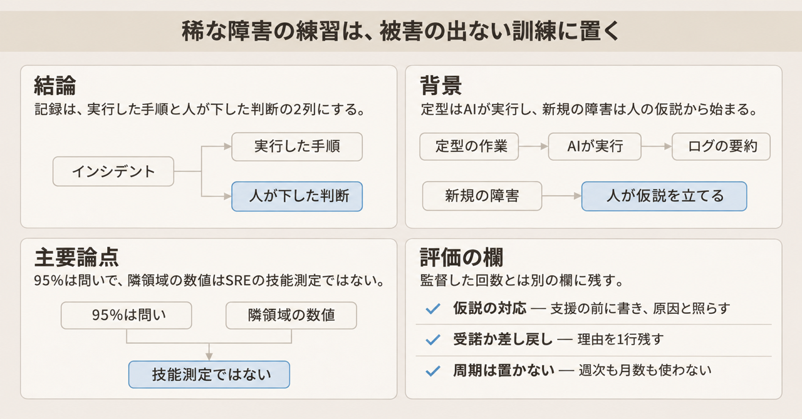
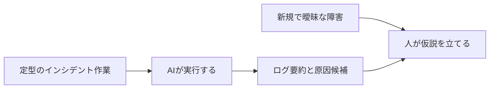
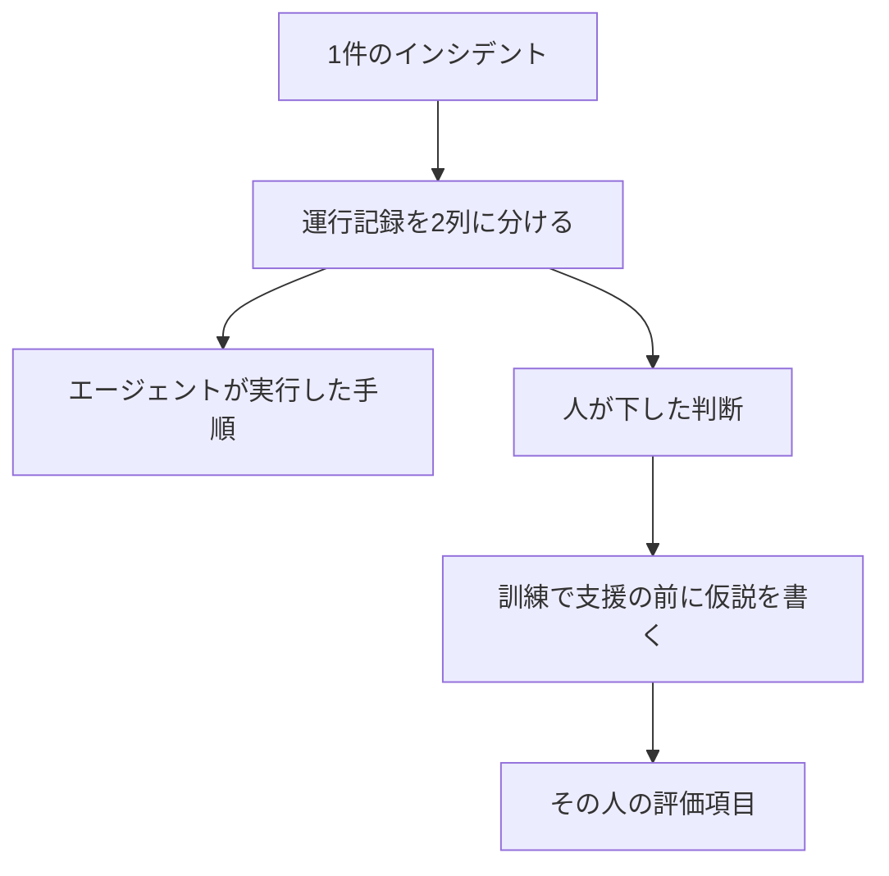

Elizabeth が 2026年2月28日にニュースレター Observability Real Talk で公開した論考「AI Isn't Replacing SREs. It's Deskilling Them.」は、AI がインシデント対応の定型を担ったあと、人に残る新規で曖昧な障害をどう扱うかを問うています。題の deskilling は、経験者が技能を失うことです。SRE（Site Reliability Engineering）は、サービスの信頼性を、運用の設計と障害対応で保つ役割です。SigNoz は、この論考のニュースレターとブログを出している事業者です。同じ内容は [SigNoz のブログ](https://signoz.io/blog/ai-isnt-replacing-sres-its-deskilling-them.md)にもあり、[GIGAZINE](https://gigazine.net/news/20261115-ai-isnt-replacing-sres-its-deskilling/) が 2026年11月15日9時に日本語で紹介しました。

論考が描く分担は、既知の手順を AI が実行し、人が受け取るのはログの要約と原因候補で、新規の障害では人が仮説を立てる、という形です。読む相手は、オンコールの職務と、自動化のあとに残る技能を誰の評価項目にするかを決める人です。オンコールは、障害のときに呼び出されて対応する当番を指します。以下で扱う割合や発見率は、論考が問い、または隣領域の研究として置くものであり、SRE のインシデント件数を数えた実績値ではありません。

この記事では、論考が描く分担、隣領域の数値の読み方、練習と評価をどこに置くかを順に整理します。

*この記事の全体像。以下、順に解説します。*

## インシデント対応の分担とは

論考が「すでに自動化、または AI の支援が厚い」と棚卸しした作業は、次の五つです。

- アラートのノイズ削減とグルーピング
- 既知問題のランブック実行。ランブックは、既知の障害に対する手順書です
- ログのパターン検出と異常フラグ
- 過去インシデントからの原因候補
- 理解済みの失敗モードの自動修復。例は、落ちたポッドの再起動と、負荷の高いサービスのスケールです。ポッドは、再起動の単位になる実行環境を指します

論考がこれからとして挙げる作業は、メトリクス・ログ・トレースをまたぐ相関、部分的に分かった失敗の自律的な原因分析、ユーザー影響前の予知、変更リスクの評価と自動ロールバックです。メトリクスは数値の時系列、ログは事象の記録、トレースはリクエストがサービス間を通った経路です。

論考は対応を三層で描きます。既知の問題と既知の修正は完全自動です。部分的に分かった問題は、AI の推奨と人の検証です。新規・複雑・連鎖は人が主導し、AI は文脈を足します。

論考の提案は二つです。一つは、AI が処理できるインシデントの一部を、人の練習として残すことです。もう一つは、推奨を承認するだけでなく、問題に能動的に関わることです。

論考が技能の変化として並べる材料は、大腸内視鏡の腺腫発見率、航空の操縦と視線、執筆者自身のこの1年の体感、そして SRE では生ログを読まず、仮説を立てず、依存関係のモデルを自分で作らなくなる、という描写です。腺腫発見率（ADR）は、大腸内視鏡の検査のうち、少なくとも1つの腺腫が見つかった検査の割合です。

論考が使う語は二つです。deskilling は、経験者が技能を失うことです。never-skilling は、基礎を獲得しないことです。

仕事の流れは次のとおりです。定型は AI の実行へ向かい、その出力が人の入力になります。新規で曖昧な障害は、人の仮説から始まります。

## 注意点

### 95%と5%

「AI がインシデント対応の 95% を扱うとき、残る 5% は下手になるか」。この文は、論考の見出しに近い問いです。インシデントの母数に対する測定値としては書かれていません。GIGAZINE もこの比率を問いとして紹介しています。二次の再掲が、比率を実績のように書くことがあります。

### 腺腫発見率

論考と GIGAZINE は、非 AI の腺腫発見率を 28% から 22% と整数に丸めます。原著は Budzyń ら、Lancet Gastroenterology & Hepatology、2025年、10巻、896頁から903頁、オンライン公開は 2025年8月12日です。ポーランド4施設の観察研究で、期間は 2021年9月8日から 2022年3月9日です。観察研究とは、ここでは AI の有無を実験として割り付けず、導入の前後の記録を比べたものです。

非 AI は、導入前 795件、導入後 648件です。ADR は 28.4%（226/795）から 22.4%（145/648）です。絶対差は −6.0 ポイント（95%信頼区間 −10.5 から −1.6、p=0.0089）です。この −6.0 は、導入後から導入前を引いた値です。多変量のオッズ比 0.69（95%信頼区間 0.53 から 0.89）は、同じ ADR の低下を、複数の条件を同時に見た別の書き方です。内視鏡医は 19人（医師 16、外科医 3）で、各人が 2000件超、平均経験は 27.6年（範囲 8年から39年）です。

同じ表の、ADR 以外は次のとおりです。

| 指標 | 導入前の非 AI | 導入後の非 AI | 差 |
| --- | --- | --- | --- |
| 検査あたり腺腫数 | 0.54（SD 1.23） | 0.43（SD 1.13） | 0.11（95%信頼区間 −0.01 から 0.24、p=0.071） |
| 進行腺腫 | 0.062（SD 0.27） | 0.063（SD 0.33） | −0.002（95%信頼区間 −0.03 から 0.03、p=0.92） |
| 癌 | 6/795（0.8%） | 8/648（1.2%） | p=0.35 |
| 少なくとも1つの腺腫があった検査での腺腫数 | 1.91（SD 1.64） | 1.92（SD 1.68） | p=0.95 |

この表で「有意」と呼ぶのは、ADR の差だけです。検査あたり腺腫数、進行腺腫、癌、腺腫があった検査での腺腫数は、有意な差として読みません。腺腫、進行腺腫、癌は、論文が別々に数えた所見です。重さの順としては読みません。差の列は、論文が書いた差の値です。検査あたり腺腫数の 0.11 は、0.54 と 0.43 の差として論文が書いた値であり、ADR の −6.0 と同じ引き算の符号には揃えていません。

AI を使った 734件の ADR は 25.3%（186/734）で、導入前の非 AI 28.4% を上回っていません。著者は、同じ時期の中では、非 AI の 22.4% に対して AI ありの 25.3% が上がって見える、と書きます。時系列では非 AI 側が下がっている、という読みと、AI が発見を上げた、という読みが、同じ論文の中にあります。

著者は選択バイアスと交絡に敏感だと書き、抜去時間は無く、標本サイズの計算も無く、盲検でもありません。盲検でないとは、条件を隠す手続きが無い、ということです。2022年1月1日から2022年12月までポーランドの大腸癌検診プログラムが止まり、導入後は待機リストの診断大腸内視鏡が増えた、と著者自身が交絡として書いています。解釈の動詞は might で、断定ではなく可能性の留保です。

### 航空の手動飛行

論考は、FAA が手動飛行の時間をより多く義務化した、と書きます。FAA は、この勧告と次の規則を出す米国の航空当局です。SAFO 17007（2017年5月4日、件名 Manual Flight Operations Proficiency）は勧告です。路線の方針に、科学的根拠のない手動飛行のノルマ（例として月10時間）を置くな、と書きます。同じ文書は、路線運航の方針は手動飛行を認め、促すべきだと書きます。促す中身は、条件が許すときに手動で飛ばすことです。判断は、機長が案件ごとにします。

実際の反復義務は [14 CFR 121.423](https://www.ecfr.gov/on/2026-10-27/title-14/chapter-I/subchapter-G/part-121/subpart-N/section-121.423)（eCFR、2026年10月27日時点）です。拡張包絡線訓練は、この規則がシミュレータで繰り返す訓練の名前です。原則の場は、Level C 以上のフルフライトシミュレータです。Level C は、そのシミュレータに規則が求める水準の名前です。フルフライトシミュレータは、この規則が路線の飛行時間ではなく訓練の場として置いている装置です。

窗口は、パイロットとして就航する時点から遡る期間です。就航より前に一度だけ行う研修ではありません。(b)(1) から (4) は、規則の条項番号です。操作の中身は、この記事の判断には使いません。その条項と、失速回復、および装備されている場合のスティックプッシャーは、遡って 24暦月以内です。バウンド着陸からの回復は、遡って 36暦月以内です。スティックプッシャーとバウンド着陸は、規則が挙げる訓練項目の名前です。

シミュレータの供給が足りないとき、証明書所持者は代替方法を Administrator に申請できます。Administrator は、この規則文が申請先として書く当局です。(e)(4) は、その逸脱または延長を 12か月を超えない期間で出す、と書きます。原則の場はシミュレータであり、路線の飛行時間ではありません。

SAFO 13002（2013年1月）も勧告です。自動操縦を続けたときの、手動回復の技能を懸念します。

### 操縦と視線

Behrend と Lafargue の IASS 2019 スライドは、A340 のパイロット 20人（副操縦士 10、機長 10）を扱います。フライトディレクターは、直前の自動操縦の勧告とは別の、このスライドがオンとオフで比べている対象です。結論は、そのオンとオフで行動と視線の戦略が変わり、オンの手動はオフの基本技能の代わりにならない、というものです。論考の「状況認識と手動操縦の測定可能な低下」は、論考側の要約です。スライドの RMSE（誤差の大きさを描いた図）から、数値は引きません。

Casner らは Human Factors、2014年、56巻8号、1506頁から1516頁です。抄録では、航空会社のパイロット 16人が Boeing 747-400 のシミュレータに乗っています。計器スキャン（計器へ視線を配ること）と手動操縦は、練習が稀でもおおむね残りました。地図なしの位置把握、次の航法手順、計器系統の故障認識は、問題が多かった、と抄録は述べます。認知技能の保持は、自動を監督しているあいだ能動的であり続ける程度に依存しうる、と抄録は結びます。本文の課題別エラー率は未確認です。抄録の「手動は残り、認知が落ちる」が、本文の全課題で同じとはまだ言えません。

### 三層の文言

三層を「PagerDuty がそう枠づけている」とする文は、論考にあります。PagerDuty は、論考が三層の枠づけの主体として名指しする事業者です。PagerDuty の自社ページで、2026年2月時点のその三層と同じ文言は、確認できていません。2026年11月3日の、Paige に関する発表は、論考より後です。この発表は、よく分かったインシデントでは自律、それ以外は人の承認、新規は人の判断、と分けています。Paige が人、製品、文書のどれかは、ここでは特定しません。製品発表の有無は、技能の測定とは別です。

### 技能の語が指す範囲

論考が載せる SRE 側の記述は、測定の表ではありません。隣領域の研究、執筆者の「錆を感じる」という一人称、生ログ・仮説・依存関係のモデルを手放すという描写です。

誤った出力を正しい手順として覚える mis-skilling は、論考の用語には出てきません。Ke らの Nature Medicine、2026年、32巻、1997頁から2006頁、公開は 2026年5月22日です。抄録は、医学教育からの直接証拠は無い、と書きます。ここで使うのは抄録の範囲であり、論文本文は未確認です。

その抄録側の整理では、never-skilling は基礎推論を獲得しないこと、deskilling は経験者の喪失、mis-skilling は AI の誤りを無批判に受け入れ事実として内面化することです。この整理は、論考の日付（2026年2月28日）より後です。論考は never-skilling を出典なしで使います。

## 練習の主枠をどこに置くか

運行記録は、1件のインシデントについて残す記録です。職務設計としての判断は、次の二つです。運行記録では、エージェントが実行した手順と、人が下した判断を分けます。判断の練習の主枠は、本番の定型インシデントを人に戻すことには置きません。これは、論考自身が認める解決の遅れを避けるための判断です。

被害を本番から切り離した訓練で、支援を見る前の仮説を書かせます。その仮説と、記録された受諾・差し戻しの質を、監督した回数のペースとは別の評価項目にします。周期の数値は置きません。

支持として読める一次資料は、次の四つです。

Bainbridge、Automatica、1983年、19巻6号、775頁から779頁は、コンピュータの失敗率を人工的に上げると、オペレータはシステムを信じなくなる、と読めます。各シフトで短時間手を触れさせる案が笑えるなら、シミュレータを用意します。助言に従うだけでは、自分で手順を生む練習になりません。介入が最も稀な、うまくいった自動化ほど、人の訓練への投資が最大になりえます。

14 CFR 121.423 は、残す技能を路線の本番時間ではなく、原則として Level C 以上のフルフライトシミュレータの反復に置いています。シミュレータの供給が足りないときは、FAA が認める代替があり、逸脱または延長の期間は 12か月を超えません。SAFO 17007 は、路線での手動を認め促しつつ、時間のノルマは避けます。促す条件は、そのとき飛ばしてよい状況であることです。

Casner らの抄録は、手と視線の技能と、仮説・位置・故障認識の技能を分けています。後者は、自動を監督しているあいだの離脱と結びつく、と読めます。支援を見る前の仮説を練習する、という SRE への対応づけは類推であり、SRE での測定ではありません。

Google SRE Book 第28章（Andrew Widdowson）の Table 28-1 は、封じ込めた現実的な故障と、理論上の災害のロールプレイを推奨します。アラートやチケットの洪水で新人を鍛えることと、手順書だけで訓練することを、アンチパターンにしています。同章は、トラフィックを外した本番インスタンス、または合成負荷をかけたステージングを壊して直す実習を、ロールプレイより良いと書きます。これは Google の訓練の記述であり、AI による技能低下の測定ではありません。本番の定型インシデントを人の手に戻すこととは、別の実習です。

確信度を下げる材料は、次のとおりです。

Budzyń らで有意な低下は、ADR だけです。進行腺腫と癌は、有意に動いていません。デザインは観察で、著者は検診プログラムの停止を交絡として書いています。隣領域の1研究を、SRE の技能低下の測定として読むのは飛躍です。

論考の「意図的な非効率」は、速い解決を犠牲にすると、論考自身が書いています。Bainbridge が誤りとするのは、コンピュータの失敗率を人工的に上げることです。オペレータがシステムを信じなくなる、というのがその理由です。本番の定型を人の手に残すことと、失敗率を人為的に上げることは、同じ操作ではありません。

SigNoz が 2026年6月26日に紹介した [Noz](https://signoz.io/blog/introducing-noz-your-ai-teammate-in-signoz/) は、反復的なインシデント作業をさらにエージェントへ寄せ、解決時間を下げるロードマップを書きます。Noz は、その紹介が置く名前です。練習のために本番の定型を残す方針と、このロードマップは、SigNoz の中で向きが違います。どちらも技能の測定ではありません。

運行記録を2列に分けることは、監査の型です。技能が落ちた証拠にも、訓練で技能が戻る証拠にもなりません。

mis-skilling、つまり誤った原因分析をランブックに書き写すことは、論考が扱う「使わないから錆びる」とは別の機構です。記録の2列は、受諾した文面が残るので、この機構の痕跡にはなります。防ぐ設計そのものではありません。

総合すると、確信度を下げるのは二つです。「SRE の技能は測られて落ちている」と、「本番の定型を戻せば残る技能が保たれる」です。確信度を維持するのは、練習の主枠を被害から切り離し、評価項目を監督のペースと分ける、という職務設計の側です。

## 技能を残す三つの置き場

ゲームデイは、障害を再現して行う訓練です。リプレイは、過去のインシデントの対応を再現する訓練です。置き場は三つです。

| 置き場 | 被害の出る場所 | 鍛えるもの | 一次資料が置く位置 |
| --- | --- | --- | --- |
| 本番の定型を人に戻す | 本番のインシデント | 既知手順の反復 | 論考自身が解決の遅れを認める。Bainbridge が誤りとするのは、失敗率を人工的に上げること。SRE Book がアンチパターンとするのは、チケットの洪水 |
| リプレイ、ゲームデイ、シミュレータ、トラフィックを外した実機 | 利用者から切り離した場 | 支援を見る前の仮説 | 121.423 は原則としてシミュレータ。供給不足の代替は 12か月以内。Bainbridge は、笑えるならシミュレータと書く。SRE Book は、ロールプレイと、トラフィックを外した破壊実習を勧める |
| 運行記録の2列 | 被害は出さない。監査の型 | 受諾と差し戻しの跡 | 技能の測定ではない。判断を、障害のときだけ開く予備にしないための台帳になる |

## 周期と断定を止める条件

SRE またはオンコールで、人の診断技能を AI ツール導入の前後で測った研究は、確認できていません。そのような研究が見つかり、導入のあとで診断技能が落ちる向きでなかったなら、評価項目の中身を見直します。

被害を切り離した訓練の頻度について、一次資料に実施例はあります。Google SRE Book 第28章で、元 Google Search SRE の Robert Kennedy は、週1回の災害ロールプレイを語ります。本文は、最良のとき週次の儀式になると書きます。Google Search SRE は、四半期ごとに検索クラスタを壊す演習を行います。これは実施例であり、このチームに当てはまる最適頻度の効果検証は、確認できていません。週次や四半期を、ここでの答えにはしません。121.423 の 24暦月と 36暦月は、航空のシミュレータ義務です。オンコールの周期として流用しません。

PagerDuty の三層の文言が自社の一次にあるかは、未確認のままです。誤った原因分析をランブックに採用したとき、その後のインシデントで同じ誤りが再現する割合は、取っていません。

意思決定への影響は、記録の分割と、練習の主枠を被害から切り離す判断までは、止めません。このチームの周期を週次や四半期と決めることと、「技能は既に落ちている」という断定は、止めます。

次に数えるなら、自チームの運行記録で、人が仮説を書く前にエージェントの原因候補を見ている割合です。公開された研究の探索を続けるより、自チームの台帳の方が、評価項目を置く相手が決まります。

## 評価項目に残す記録

オンコールの評価項目に、次の二つを、監督した回数のペースとは別に置きます。

1. 予定した訓練で、エージェントの出力を見る前に書いた仮説が、あとから分かった原因とどこまで対応したか。
2. 本番の運行記録で、エージェントの手順を受諾したか差し戻したかと、その理由が1行残っているか。

本番の定型インシデントは、練習の主枠にしません。枠の名前はチームが決めます。周期の数値は、前節のとおり置きません。

逆転条件は二つあります。一つは、自チームまたは公開された研究で、本番の定型を人に戻した前後の方が、切り離した訓練より稀な障害の診断成績が良く、かつ SLO の悪化が許容内だと示されたときです。SLO は、サービスが守る目標水準です。もう一つは、運行記録の2列を書いても、人がエージェントの文面をそのまま原因として採用している割合が下がらないときです。後者は mis-skilling です。台帳の列を増やすだけでは足りず、採用前に人が自分の仮説を先に書く手順へ戻します。

直近のアクションは三つです。

1. インシデントの記録テンプレートに、実行列と判断列を足します。判断列は、見た時点の仮説、受諾か差し戻しか、理由の1行です。
2. 次のゲームデイまたはリプレイを1回置き、支援を隠した状態で仮説を書かせてから、エージェントの出力を開きます。
3. その仮説の対応と、判断列の記入有無を、オンコールの評価メモに残す相手の名前を決めます。監督した回数とは、別の欄にします。

## まとめ

定型のインシデント作業は AI の実行へ向かい、人はログの要約と原因候補を受け取ります。新規で曖昧な障害は、人の仮説から始まります。95% と 5% は、インシデント母数の測定値ではなく、論考の問いです。隣領域の腺腫発見率には有意な低下がありますが、進行腺腫と癌は有意に動いておらず、SRE の技能を測った研究ではありません。航空が反復を置く原則の場は、路線の飛行時間ではなくシミュレータです。

職務設計としての判断は、運行記録を実行と判断の2列に分け、練習の主枠を利用者の被害から切り離した訓練に置くことです。評価項目は、支援を見る前の仮説が原因とどこまで対応したかと、受諾または差し戻しの理由が1行残っているかです。監督した回数とは別の欄にします。週次や四半期、航空の 24暦月や 36暦月は、このチームの周期にしません。「技能は既に落ちている」という断定もしません。

この記事が少しでも参考になった、あるいは改善点などがあれば、ぜひリアクションやコメント、SNSでのシェアをいただけると励みになります！

## 参考リンク

- Elizabeth. AI Isn't Replacing SREs. It's Deskilling Them. Observability Real Talk. 2026-02-28. https://newsletter.signoz.io/p/ai-isnt-replacing-sres-its-deskilling
- 同内容のブログ. https://signoz.io/blog/ai-isnt-replacing-sres-its-deskilling-them.md
- GIGAZINE. 2026-11-15 09:00. https://gigazine.net/news/20261115-ai-isnt-replacing-sres-its-deskilling/
- Budzyń K, et al. Lancet Gastroenterology & Hepatology. 2025;10:896-903. https://doi.org/10.1016/S2468-1253(25)00133-5
- Bainbridge L. Ironies of Automation. Automatica. 1983;19(6):775-779. https://doi.org/10.1016/0005-1098(83)90046-8
- Behrend J, Lafargue P. IASS 2019 slides. https://flightsafety.org/wp-content/uploads/2019/12/IASS_2019_Behrend_Lafargue.pdf
- FAA. SAFO 17007. 2017-05-04. https://www.faa.gov/sites/faa.gov/files/2022-11/SAFO17007.pdf
- FAA. SAFO 13002. https://www.faa.gov/sites/faa.gov/files/other_visit/aviation_industry/airline_operators/airline_safety/SAFO13002.pdf
- eCFR. 14 CFR 121.423. 2026-10-27. https://www.ecfr.gov/on/2026-10-27/title-14/chapter-I/subchapter-G/part-121/subpart-N/section-121.423
- Casner SM, Geven RW, Recker MP, Schooler JW. Human Factors. 2014;56(8):1506-1516. https://doi.org/10.1177/0018720814535628
- Ke Y, et al. Nature Medicine. 2026;32:1997-2006. https://doi.org/10.1038/s41591-026-04438-y
- Widdowson A. Accelerating SREs to On-Call and Beyond. Google SRE Book, chapter 28. https://sre.google/sre-book/accelerating-sre-on-call/
- SigNoz. Introducing Noz. 2026-06-26. https://signoz.io/blog/introducing-noz-your-ai-teammate-in-signoz/
