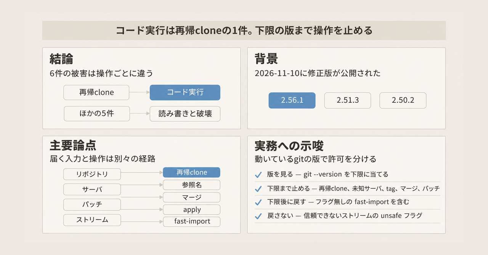
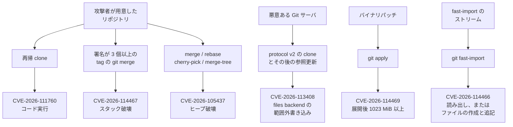

2026-11-10、Git プロジェクトは 6 件の脆弱性を修正した版を公開しました。対象は、再帰的な clone、protocol v2 の参照名、マージ、バイナリパッチ、`git fast-import` です。修正は Git 2.56.1 と、メンテナンス系列の 2.55.1、2.54.1、2.53.1、2.52.1、2.51.3、2.50.2 に入っています。メンテナンス系列とは、最新の 2.56 より古い系統のうち、今回の修正がバックポートされた版のことです。

この記事では、コーディングエージェントと CI が信頼できないリポジトリに対してどの git 操作を許すかを、公開された一次資料から整理します。版の列挙は GitHub Blog と Git のリリースノート（RelNotes）に合わせます。GitHub Security Advisory（GHSA。GitHub 上のセキュリティ告知）の版メタデータは、公開当日の記載のまま遅れています。


*この記事の全体像。以下、順に解説します。*

## Gitの6件の脆弱性修正とは

6 件は、別々の入力が別々の git 操作に入ったときに届きます。入力と届く先の対応は、次の図のとおりです。



### 修正が入った版

告知と RelNotes が示す修正版は次のとおりです。2.51 系は 2.51.3、2.50 系は 2.50.2 まで上がっていないと、この列に入りません。

| 系列 | 告知と RelNotes が示す修正版 |
|---|---|
| 2.56 | 2.56.1 |
| 2.55 | 2.55.1 |
| 2.54 | 2.54.1 |
| 2.53 | 2.53.1 |
| 2.52 | 2.52.1 |
| 2.51 | 2.51.3 |
| 2.50 | 2.50.2 |

タグ `v2.56.1`、`v2.54.1`、`v2.50.2` の committer 日付は 2026-10-23 です。公開告知は 2026-11-10 です。

### 再帰 clone で名前がずれる

CVE-2026-111760 は、再帰 clone のときのパス検査です。再帰 clone は、`--recurse-submodules`（別名 `--recursive`）を付けて、サブモジュールの中身まで取得する clone です。

Git は作業ツリーへファイルを書く前にパスを検査し、自分のリポジトリメタデータを上書きするパスは拒否します。一方で、index の名前長を持つ 32-bit のフィールド `ce_namelen` が、極端に長いパスの長さを切り捨てることがあります。検査した名前と、ディスクへ書く名前がずれます。

サブモジュールの `.git` はディレクトリではなく gitfile です。gitfile は、実体の場所を 1 行で指すファイルです。名前のずれにより、`.git` ディレクトリそのものを置換する拒否をすり抜け、悪意ある設定または hooks を指すシンボリックリンクになりえます。そのディレクトリを Git が続いて使うと、再帰 clone の途中で攻撃者のコードを実行しえます。

GHSA の CVSS 3.1 は 8.0 です。CVSS は脆弱性の深刻度を表す共通の数値です。そのうち攻撃条件は High で、特別な入力が要ることを表します。GHSA は、発火は `--recurse-submodules` のときだけだと現時点では信じている、と書いています。

修正は、長さが切り捨てられる前に、極端に長い index のパスを拒否します。

### protocol v2 が広告する HEAD

CVE-2026-113408 は、空のリポジトリを protocol v2 で clone するときの参照名です。protocol v2 は、clone や fetch のときにサーバが参照名をクライアントへ広告する転送手順の新しい版です。

空リポジトリでは、サーバが未誕生の `HEAD` を symref として広告できます。未誕生とは、まだコミットが無いブランチを指すことです。symref は、別の参照名を指す参照です。Git は、その symref のターゲットを検証せずにローカルへ保存していました。

悪意あるサーバは、パストラバーサルを含む名前を渡せます。files reference backend では、その後のブランチ更新が、参照ディレクトリの外へ書けます。files reference backend は、参照をリポジトリ内のファイルとして 1 件ずつ置く格納方式です。告知の例は `refs/heads/../../../TARGET` です。

このリリースは、広告されたターゲットを受け入れる前に検証します。protocol v2 で受け取る他の参照名と、symbolic-ref のターゲットも検証します。symbolic-ref は、ここで書いた symref と同じく、別の参照名を指す参照です。protocol v1 は 2013-09-17 以降、参照名を検査しています。

告知がこの番号の到達として書くのは、空リポジトリの未誕生 HEAD です。空でないリポジトリで同じ書き込みが起きるかは、その記述にはありません。許可の表で未知のサーバへの clone をこの番号の側に置くのは、protocol v2 で参照名を受け取る経路を、検証が入った版まで知っている Git ホスティングに限るためです。

### 署名を 3 個以上含む tag のマージ

CVE-2026-114467 は、メッセージから署名を剥がす処理です。Git は署名が 2 個までだと仮定し、固定長のスタック配列へ置いていました。署名が 3 個以上のメッセージは、その配列の先へ書きます。

署名が 3 個以上の tag を `git merge` すると、メモリを壊し、サービス拒否になりえます。利用者の代わりにこのマージをするホスティングも、対象になりえます。

修正は固定長配列をやめ、署名の個数を問わず扱います。

### 三方マージの出力サイズ

CVE-2026-105437 は、三方マージの出力に必要なメモリを、書く前に計算する処理です。三方マージは、共通の祖先と両者の変更を重ねるマージです。計算は 32-bit の符号付き整数で足すため、結果が非常に大きいと溢れます。一次資料は、この足し算と、合計が 4 GiB を超えることと、両方を書いています。この記事では、その二つを同じ境界だとは決めません。コミット済みの `.gitattributes` にある `conflict-marker-size` と、多数のコンフリクトの組み合わせが、その例です。`conflict-marker-size` は、衝突マーカーの行の長さを変える属性です。

溢れると、Git は小さすぎるバッファを確保したあと、その外へ書きます。ヒープを壊します。信頼できない内容をマージするアプリケーションやホスティング、手元のマージが対象です。対象コマンドは `git merge`、`git rebase`、`git cherry-pick`、`git merge-tree` です。`git merge-tree` は、作業ツリーを汚さずにマージ結果を作るコマンドです。

NVD の CVSS 3.1 は 7.5 です。NVD は、米国 NIST が公開する脆弱性データベースです。この記録は 2026-11-10 に公開されています。攻撃条件は、再帰 clone の件と同じく High です。NVD と、GitLab 上の Git work item 814 は、最低でもクラッシュで、より悪いヒープ破壊がありうると書いています。

修正は、大きさに合う型と、溢れる足し算の検査を使い、安全に表せない出力サイズのマージを拒否します。

### バイナリパッチの展開後サイズ

CVE-2026-114469 は、`git apply` が約 1 GiB を超えるパッチを拒否する検査です。パッチ適用のコードは、それより大きい入力を安全に扱えません。検査が見ていたのは、入力として渡されたバイト数だけでした。

バイナリパッチは zlib で圧縮され、base85 でテキストになります。zlib は圧縮、base85 はバイナリをテキストにする符号化です。そのため、渡された時点では小さいパッチが、展開後に上限を超ええます。作られたパッチは入力サイズの検査をすり抜け、範囲外読みで Git をクラッシュさせえます。

`v2.50.2` の `apply.c` では、拒否しきい値が `MAX_APPLY_SIZE (1024UL * 1024 * 1023)` です。1023 MiB です。見るのは、宣言された展開後の長さです。修正は、バイナリパッチを処理する前に、宣言された非圧縮サイズも検査します。

### fast-import のストリーム

CVE-2026-114466 は、`git fast-import` のストリームです。`git fast-import` は、コマンドの列を読んでリポジトリを組み立てます。リポジトリの外のファイルへ触れるコマンドは、信頼できない入力ストリームでは、もともと制限されています。

追加で保護が無かった機能が 3 つあります。`rewrite-submodules-from` と `rewrite-submodules-to` は任意のファイルを読み、エラーメッセージに内容が出えます。`export-pack-edges` は指定パスを作るか、既存ファイルへ追記しえます。

これらの機能は、入力ストリームから渡されたときは拒否します。通すのは、呼び出し側が `--allow-unsafe-features` を明示したときだけです。このオプションは、ストリームを生成したプログラムを信頼するときだけ有効にします。

`v2.50.2` のマニュアルは、`import` capability を使う remote-helper では、このオプションが自動で有効だと書いています。remote-helper は、Git が外部の転送実装を呼ぶ仕組みです。`import` capability は、その helper が fast-import のストリームを渡す能力です。自動で有効になる理由は、その helper は既に自分のコードを動かすことを信頼されているからです。

### GitHub への配備

告知が述べる GitHub 側の状態は次のとおりです。

- github.com、GitHub Enterprise Cloud、data residency 付き Enterprise Cloud には、修正を配備済みです。data residency 付きとは、データを指定した地域に置く Enterprise Cloud です。
- GitHub Enterprise Server の更新は 3.19.15、3.20.11、3.21.9、3.22.4 です。GitHub Enterprise Server は、利用者が自分たちで動かす GitHub の製品です。
- GitHub Desktop と GitHub Copilot app は、パッチ済みの Git を含むリリースを調整中です。
- GitHub Codespaces と GitHub Actions は、パッチ済みの Git をこれから受け取ります。告知の文は未来形です。

### checkout 時のパス長

追加の硬化として、checkout と tree 処理で index を確保するときにも、溢れの検査が入ります。この検査は、上のパス長の上限を補います。確保するサイズが、パスをメモリへコピーする前に切り捨てられたり溢れたりするのを防ぎます。

パス長の上限設定 `index.maxPathLen` の既定は `INT_MAX / 2 - 1024` です。設定値の上限は `INT_MAX` です。`INT_MAX` は、32-bit 符号付き整数の最大値です。この規定は修正コミット `29411cf59f` にあります。

## 注意点

6 件を「再帰 clone とマージとパッチと import でコードが実行される」と束ねると、告知より広くなります。コード実行と書いているのは CVE-2026-111760 だけです。あとの 5 件は、範囲外の書き込み、スタック破壊によるサービス拒否、範囲外読みによるクラッシュ、ヒープ破壊、fast-import 経由のファイル読み書きです。

到達条件も、操作の名前より狭いです。

- CVE-2026-111760 について、GHSA は攻撃者自身のホスト上のリポジトリと書き、発火は `--recurse-submodules` だと現時点では信じています。修正コミットが示す切り捨ては、長さ `2^32+4` が 4 になる大きさです。検査した名前が `.gitz` で始まると、残る 4 文字は `.git` になり、ディスク上の名前が `.git` になります。`.gitz` は、その検査前の名前の先頭です。CVSS の攻撃条件は High です。約 4 GiB 級のパスであり、通常の長いパスとは別です。`v2.56.1` の `Documentation/config/submodule.adoc` は、`submodule.recurse` の対象に `clone` と `ls-files` を含めていません。`submodule.recurse` は、対応する git コマンドをサブモジュールへ再帰させる設定です。`v2.56.1` の `builtin/clone.c` が再帰へ進むのは、CLI の `--recurse-submodules` が付いたときです。設定 `submodule.recurse=true` だけでは、clone は再帰しません。
- CVE-2026-113408 の書き込みは、告知と RelNotes が files reference backend と書いています。reftable で同じ書き込みが起きるかは、読んだ一次資料にありません。reftable は、参照を別形式のテーブルへまとめる格納方式です。
- CVE-2026-114467 は、署名が 3 個以上の tag の `git merge` です。通常のブランチマージとは別の入力です。
- CVE-2026-105437 は、衝突マーカーの合計が 4 GiB を超える大きさです。NVD の本文は、サーバが `attr.tree` または `--attr-source` でツリー内の属性を読むときに、push してマージを要求できる利用者だけで発火しうると書いています。`attr.tree` と `--attr-source` は、作業ツリーではなく指定したツリーから属性を読む指定です。この文はサーバ側の到達条件です。手元の `git merge` などが対象であることは、前の節のとおりで、このサーバ側の文には畳み込みません。push するデータ自体は小さいです。Git work item 814 には、GitLab では Gitaly のマージ可否検査を通じて RCE に伸びた、という一文があります。Gitaly は、GitLab が git 操作を担うコンポーネントです。NVD の本文（2026-11-11 取得）には、Gitaly も RCE もありません。GitLab 製品の公開アドバイザリは未確認です。Git 一般のマージを RCE とは呼びません。
- CVE-2026-114469 は、展開後サイズの宣言が 1023 MiB 以上のバイナリパッチです。通常のテキスト diff の `git apply` とは別です。
- CVE-2026-114466 は、fast-import ストリーム中の 3 機能です。GitLab work item 812 のタイトルは `git fast-export` も含みます。本文と `v2.50.2` の修正コミットが説明しているのは fast-import です。fast-export を同じ欠陥とは扱いません。パッチ後も、remote-helper の `import` capability では `--allow-unsafe-features` が自動で付きます。

版のデータベースは、互いにずれています。

- GHSA-vp2w-7xxj-jvxr（2026-11-10T19:09:09Z 公開、CVE-2026-111760）の `vulnerable_version_range` は `all`、`patched_versions` は `none`、本文は "Patches are being discussed" のままです。同じ日の Blog と RelNotes は、修正版を列挙しています。GHSA の `none` を「まだ修正が無い」とは読みません。2026-11-11 時点で、この 6 件に対応する git/git の公開 GHSA は、この 1 件だけでした。
- NVD は 2026-11-11 時点で、CVE-2026-111760 が 0 件、CVE-2026-105437 が 1 件でした。残る 4 件は NVD が 0 件で、MITRE の API は 404 でした。MITRE は、CVE 番号の登録を扱う機関です。番号自体は Blog、RelNotes、GitLab 上の git work item にあります。第三者データベースだけの番号ではありません。
- MITRE の CVE-2026-105437（GitLab が番号を割り当てた記録、2026-11-10T18:34:09Z 公開）は、`0` 以上 `2.49.1` 未満を affected、`defaultStatus` を unaffected としています。この書き方だと、2.49.1 は範囲の外に見えます。`v2.49.1` の `xdiff/xmerge.c` は、2026-11-11 に取得した時点で `int size` のままです。この `int size` は、三方マージの出力サイズを足している 32-bit の符号付き整数です。告知が列挙する最古の修正は 2.50.2 です。2.49.1 を修正済みとは扱いません。タグ `v2.49.1` の committer 日付は 2025-06-13 で、今回のセキュリティタグより前です。

タグの committer 日付は、公開日ではありません。`v2.56.1` などの 2026-10-23 は、告知の 2026-11-10 より前です。

2026-11-11 時点の GitHub 検索では、CVE-2026-111760 の公開された exploit リポジトリは 0 件でした。悪用が観測された、という一次記述は告知にありません。到達できる、という技術上の記述と、今悪用されている、という記述は別です。

libgit2、go-git、JGit は、今回の Blog と RelNotes の対象外です。エージェントが `git` コマンドではなくライブラリで clone している場合、2.56.1 という版番号では塞がりません。

`index.maxPathLen` を合法な上限まで上げても、修正コミットが拒否するのは `INT_MAX` を超える名前長です。切り捨て例の `2^32+4` は、その上限より大きいです。設定を緩めると、同じ切り捨てが戻る、とは読みません。

GitHub 上のサーバ側処理は、告知が github.com と Enterprise Cloud へ修正を配備済みと書いています。セルフホストの runner や、エージェントが手元で起動する `git` は、その配備の外です。GitHub Actions と Codespaces のランナーに入る git は、告知時点では「これから受け取る」です。ホステッド runner の git が 2026-11-11 に修正済みである、とは告知からは言えません。

次の点は、読んだ一次資料からは決まっていません。

- protocol v2 の参照名を検証したあと、reftable backend で同じパストラバーサルの書き込みが残るか。一次資料が名指ししているのは files backend だけです。
- GitHub Actions と Codespaces のランナーイメージが、告知の「will receive」をどのビルドで満たしたか。2026-11-11 時点の告知本文からは、完了日が読めません。
- Desktop と Copilot app の調整中リリースが、どの版番号で出荷されたか。
- libgit2、go-git、JGit が同等のバグを持つか。今回の一次資料の対象外です。
- CVE-2026-111760、113408、114467、114469、114466 が NVD と MITRE に載るまでの間、スキャナーが「レコード無し」を「影響無し」と表示するか。
- work item 810 の回避文は、取得したページ上で "Or run git-fsck(1) to verify if" までで文が終わっています。`git fsck` で何を見れば足りるか、どの操作の回避かも、そのページからは確定できません。

削れる読みは、次のとおりです。

- 6 操作を同じコード実行として一律に禁止する読み。効果は操作ごとに違います。
- `submodule.recurse` や `index.maxPathLen` を緩めると CVE-2026-111760 が残る、という読み。`v2.56.1` のマニュアルと `clone.c`、修正コミットの長さ検査は、その読みを支持しません。
- GHSA の `patched_versions: none` を最新状態と見る読み。
- MITRE の範囲表記だけで 2.49.1 を修正済みと見る読み。ソースの `xmerge.c` が反証します。
- GitLab 製品の RCE が公開案内済みだという読み。確認できたのは Git work item 814 の一文までです。

## 実バイナリの版で許可を分ける

生成したコードをどのサンドボックスで動かすか、リポジトリをどの格納に置くかは、別の層です。ここで決めるのは、エージェントと CI が起動する git コマンドの集合です。

| 操作 | 届く CVE | パッチ前の結果 | 典型的な CI | 典型的なエージェント | 版を確認するまでの扱い |
|---|---|---|---|---|---|
| `clone --recurse-submodules` | CVE-2026-111760 | 約 4 GiB 級のパスでコード実行になりうる | submodule を再帰するジョブだけが届く | プロンプトやリポジトリの指示で再帰フラグを付けやすい | 信頼できない URL ではフラグを付けない |
| 任意サーバへの clone / fetch（protocol v2） | CVE-2026-113408 | files backend で、その後の参照更新が外へ書ける | 接続先は決まった Git ホスティングであることが多い | モデルが URL を選べることがある | 知っている Git ホスティング以外へは clone しない |
| 署名が 3 個以上の tag の `git merge` | CVE-2026-114467 | スタック破壊。サービス拒否 | tag をマージするジョブは少ない。ホスティング側のマージはサーバの git | タグをマージする指示がありうる | 信頼できない tag の自動マージをしない |
| `.gitattributes` を読んだ三方マージ | CVE-2026-105437 | 出力合計が 4 GiB 超でヒープ破壊。最低クラッシュ | `git merge-tree` でマージ可否を見るサーバが、ツリーの属性を読むとき | 作業ツリーで merge / rebase / cherry-pick する | 未パッチなら自動マージをしない。回避は `info/attributes` の `* conflict-marker-size=7` |
| バイナリパッチの `git apply` | CVE-2026-114469 | 宣言サイズ 1023 MiB 以上で範囲外読み、クラッシュ | パッチを適用するジョブ | `git apply` は日常的に出る | 信頼できないバイナリパッチを適用しない |
| `git fast-import` | CVE-2026-114466 | ストリーム内の 3 機能で読み出し、またはファイル作成と追記 | 使うジョブは少ない | import を試すことがある | 信頼できないストリームを流さない。`--allow-unsafe-features` は生成元を信頼するときだけ |

操作欄の protocol v2 には fetch もあります。右端が止めているのは clone です。fetch を同じ停止に含めるかは、この表の記載からは決まりません。`* conflict-marker-size=7` の `*` と `7` が何を指すかも、参照した記載にはありません。この 1 行は、そのまま写します。

許可は二段にします。

1. 起動している実バイナリの版を見ます。配布物に同梱された git も、別バイナリとして見ます。

```bash
git --version
```

系列ごとの下限は、上の表の修正版です。各系列で、その版以上だけが告知の修正版です。2.51.0 から 2.51.2、2.50.0 と 2.50.1、2.49.1 以前は、告知の修正版ではありません。たとえば `git version 2.54.0` は、同じ系列の 2.54.1 より前です。

2. 下限を満たすまで、表の「版を確認するまでの扱い」を、エージェントの既定から外します。CI は、そのジョブが実際に呼ぶ操作だけを外します。決まった GitHub リモートへの非再帰 clone は、CVE-2026-111760 の到達条件の外です。未知サーバへの clone は、CVE-2026-113408 の側に残ります。ホステッドの Actions と Codespaces は、告知時点では未来形です。GitHub がイメージの版で修正済みと示すまでは、その列を修正済みにしません。

3. 下限を満たしたあと、表の右端の停止は、この 6 件を理由としては続けません。戻してよいのは、再帰 clone、未知サーバへの clone、署名付き tag のマージ、三方マージ、バイナリパッチの `git apply`、フラグ無しの `git fast-import` です。署名付き tag のマージは、通常のブランチマージとは別の入力ですが、表の右端にあるため、下限のあとはこの 6 件を理由には止めません。フラグが無いとき、問題の 3 機能は拒否されます。戻さないのは、信頼できないストリームへの `--allow-unsafe-features`、`import` capability の remote-helper が開く fast-import、git 以外の実装での同等操作です。

4. マージを戻す前に、信頼できない作業ツリーでは、`info/attributes` へ `* conflict-marker-size=7` を置くか、git が修正版であることを同じゲートで確認します。下限以上だと同じゲートで確認できていれば、この属性行は要りません。属性行は、その確認ができないあいだの回避です。`info/attributes` は、そのリポジトリの git ディレクトリ内の属性ファイルで、通常は `.git/info/attributes` です。これは、NVD が書くサーバ側の回避と同じ上書きです。回避は、修正の代わりにはなりません。

5. スキャナーや依存関係の台帳は、GHSA の `patched_versions: none` と、MITRE の `2.49.1` 未満を、そのまま採用しません。Blog と RelNotes の列挙と、2.49.1 の `xmerge.c` がまだ `int size` であることを優先します。

この線引きは、Blog の回避策と一致します。更新できない間は、信頼できるサーバからの clone、信頼できない再帰 clone の回避、信頼できない内容や tag のマージ回避、バイナリパッチと fast-import の回避、と書かれています。回避は修正の代わりにはならない、とも書かれています。修正版の列挙は、Blog と `v2.56.1` / `v2.50.2` の RelNotes で一致します。各到達条件は、対応する修正コミットと work item が、告知と矛盾せず具体化しています。

逆転する条件は次のとおりです。

- 対象の git が上の下限以上であると、ジョブとエージェントの両方で確認できるとき。表の右端にあった停止は、この 6 件を理由としては落ちます。フラグ無しの `git fast-import` も戻してよいです。残るのは、信頼できないストリームへの `--allow-unsafe-features` と、別実装です。
- ホステッド Actions の git が修正版だと、GitHub がイメージの版で示した場合。そのイメージに限って、CI 側の列を「修正済み」に更新します。

直近で見る項目は次のとおりです。

1. エージェントの実行環境、CI イメージ、開発者の手元で `git --version` を取り、上の表に当てます。
2. 許可する操作の一覧に、再帰 clone、未知 URL の clone、tag の merge、バイナリ `git apply`、`git fast-import` を別行で書きます。特定のファイル名は、ここでは決めません。
3. GitHub Enterprise Server を使っているなら、3.19.15、3.20.11、3.21.9、3.22.4 のいずれかを確認します。

## まとめ

2026-11-10 に公開された 6 件は、再帰 clone、protocol v2 の参照名、署名付き tag のマージ、巨大な衝突マーカーを伴う三方マージ、展開後 1023 MiB 以上を宣言するバイナリパッチ、fast-import の 3 機能へ、別々に届きます。コード実行と書かれているのは、再帰 clone の 1 件です。

修正版は系列ごとに違います。2.56.1、2.55.1、2.54.1、2.53.1、2.52.1、2.51.3、2.50.2 が、告知と RelNotes の下限です。起動している実バイナリが下限以上だと確認できるまで、表の右端の操作をエージェントの既定許可には置きません。確認できたあと戻してよいのは、再帰 clone、未知サーバへの clone、署名付き tag のマージ、三方マージ、バイナリパッチの `git apply`、フラグ無しの `git fast-import` です。信頼できないストリームへの `--allow-unsafe-features`、`import` capability が開く fast-import、git 以外の実装は、確認後も戻しません。

スキャナーは、GHSA の `patched_versions: none` と、MITRE の `2.49.1` 未満を、そのまま「未修正」や「修正済み」の根拠にしません。

この記事が少しでも参考になった、あるいは改善点などがあれば、ぜひリアクションやコメント、SNSでのシェアをいただけると励みになります！

## 参考リンク

- GitHub Blog, "Git security vulnerabilities announced", 2026-11-10. https://github.blog/open-source/git/git-security-vulnerabilities-announced-7/
- Git RelNotes 2.56.1. https://raw.githubusercontent.com/git/git/v2.56.1/Documentation/RelNotes/2.56.1.adoc
- Git RelNotes 2.50.2. https://raw.githubusercontent.com/git/git/v2.50.2/Documentation/RelNotes/2.50.2.adoc
- [GHSA-vp2w-7xxj-jvxr](https://github.com/git/git/security/advisories/GHSA-vp2w-7xxj-jvxr)（CVE-2026-111760）
- GitLab work items: [809](https://gitlab.com/gitlab-org/git/-/work_items/809)、[810](https://gitlab.com/gitlab-org/git/-/work_items/810)、[811](https://gitlab.com/gitlab-org/git/-/work_items/811)、[812](https://gitlab.com/gitlab-org/git/-/work_items/812)、[814](https://gitlab.com/gitlab-org/git/-/work_items/814)
- NVD CVE-2026-105437（2026-11-11 取得、CVSS 7.5）. https://services.nvd.nist.gov/rest/json/cves/2.0?cveId=CVE-2026-105437
- MITRE CVE-2026-105437. https://cveawg.mitre.org/api/cve/CVE-2026-105437
- 修正コミット（git/git）: `29411cf59f`、`b371db8125`、`8cb7e2e031`、`f357b9c2c7`、`aff5872223`、`55c54fd375`、`b1313872ce`、`2b50a97225`、`19bcf62ed0`
- `v2.50.2` の `apply.c` にある `MAX_APPLY_SIZE`、`Documentation/git-fast-import.adoc` の `--allow-unsafe-features`
- `v2.56.1` の `Documentation/config/submodule.adoc`、`builtin/clone.c`
- `v2.49.1` の `xdiff/xmerge.c`（`int size` が残っている）
