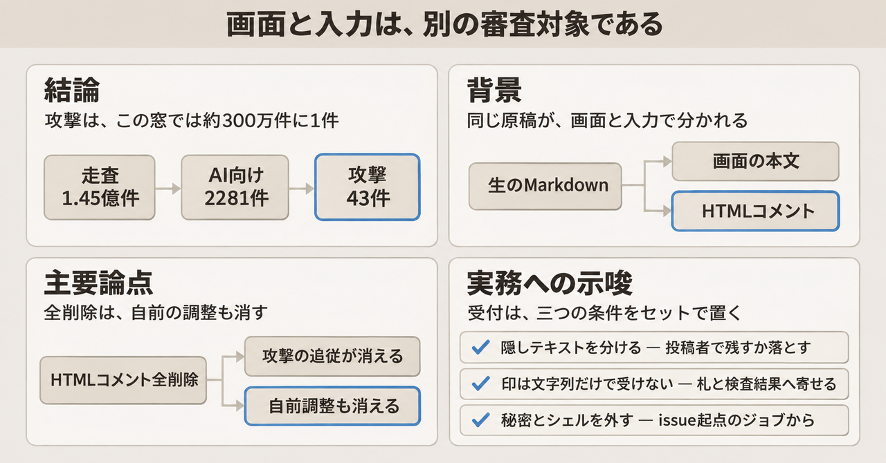
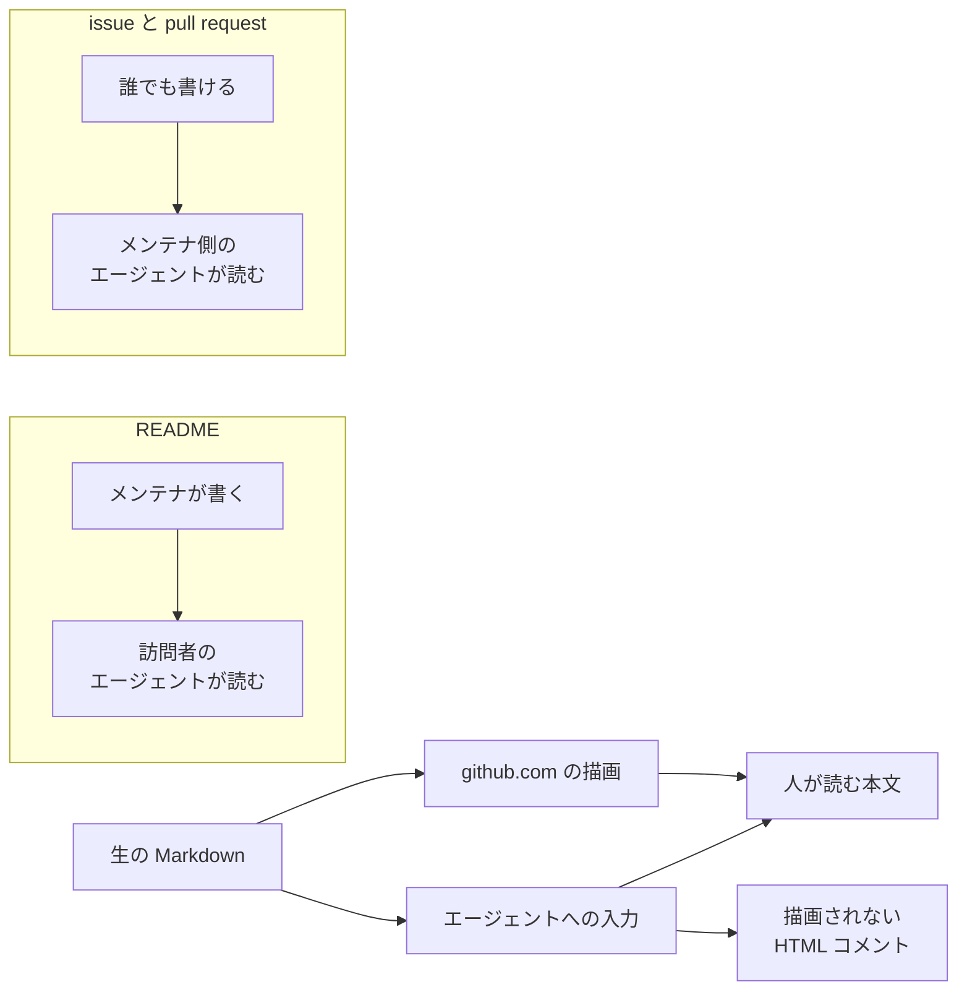

GitHubの画面には出ない文字列が、生のMarkdownを渡されたエージェントの入力には残ることがあります。2026年11月21日にarXivへ投稿された測定論文は、issue、pull request、コメント、READMEを走査し、そのうちコーディングエージェントへ向けたものを数えています。コーディングエージェントは、リポジトリ上の文面を読んで作業する自動の担当です。生のMarkdownは、GitHubが画面用に描画する前の原稿です。

著者はRadwareのGabi Nakibly（テクニオン・イスラエル工科大学を兼任）とZvika Baboです。ITmedia NEWSの連載 Innovative Tech が、2026年11月26日にこの論文を紹介しました。論文の問いは、そのテキストを誰が、どのエージェントに、何のために置いたかです。

この記事では、走査した母数、検証済みの内訳、画面と入力の差、受付で分ける三つの条件を順に整理します。受付は、エージェントが外部の文を作業の指示として読む前に置く条件です。会議や雑誌への採録は、proceedingsとDOIでは確認していません。

*この記事の全体像。以下、順に解説します。*

## 人には見えずエージェントには届くテキストとは

論文は arXiv:2611.28763v1（cs.CR）です。題は “Who Is Prompt-Injecting Coding Agents? An Empirical Study of Hidden AI-Directed Text on GitHub.” です。検出に使った道具と、検証済みの所見は、公開リポジトリ [rdwr-gabin/github-ipi-in-the-wild](https://github.com/rdwr-gabin/github-ipi-in-the-wild) にあります。2026年11月27日時点のstarは8です。この公開リポジトリはアーカイブされていません。default branchの最終コミットは2026年11月3日で、メッセージは2026年10月の会議発表に対応します。starは、リポジトリについた注目の印です。

### 走査した母数

母数は三つです。合計は144,716,078件です。論文はこの合計を roughly 145 million と呼びます。

| 範囲 | 件数 | 中身 |
|---|---:|---|
| 2026年6月1日から9月30日の公開issueとpull request | 95,075,061 | 論文のcrawlが全件。タイトルと本文。コメントは含まない |
| GH Archive経由のissue、pull request、コメント、レビュー | 約47,641,017 | 2025年8月下旬から2026年5月が本体。2026年6月から8月はコメントのみ |
| 2026年6月時点でstarが多いリポジトリのREADME | 2,000,000 | 説明文。依存として読まれやすい |

crawlは、論文がGitHubを順に取得した収集です。GH Archiveは、GitHubの公開イベントを集めたデータセットです。READMEは、リポジトリの説明として置かれるMarkdownです。

2026年10月16日から22日に作られた25万件のREADMEは、上の合計の外です。この追加分の攻撃は0件です。攻撃は、他者のエージェントを、その当事者の利益に反して動かそうとするテキストです。分類器が本測定と違うため、論文は率を直接比べていません。

### 検証済みの内訳

issue、pull request、コメントを合わせた142,716,078件のうち、ノイズを除いたあとに隠しテキストが残ったのは4,902,477件です。ノイズは、エージェントへの指示から除く機械的な印です。レビューボットの状態印、プレビュー通知、依存関係ボットのデバッグ、既知のボットの投稿がそこに入ります。割合は3.4%です。そのうち、AI向けだと検証されたのは2,281件です。この2,281件は、142,716,078件に対して100万件あたり約16件です。435リポジトリに分布します。

2,281件の用途は四つです。

| 用途 | 件数 | 2,281件に占める割合 |
|---|---:|---:|
| 自前エージェントの調整 | 1,519 | 67% |
| 出力の指定 | 374 | 16% |
| 行動の制限 | 345 | 15% |
| 他者のエージェントへの攻撃 | 43 | 2% |

自前エージェントの調整は、プロジェクトが自分のエージェントへ残す作業の印です。出力の指定は、返してほしい形を書くものです。行動の制限は、やってはいけないことを書くものです。公開データ `findings.jsonl` の行数と分類は、この四つと一致します。`findings.jsonl` は、検証済みの所見を1行1件で並べたファイルです。

67%は、この検証済み所見に占める自前調整の割合です。GitHub上の全テキストに占める割合ではありません。

### 攻撃の定義と43件

攻撃の定義は、書いた人ではなく被害者で切ります。他者のエージェントを、その当事者の利益に反して動かそうとするテキストです。所有者が自前のパイプラインを試すものは除きます。データを受け取れる外部サービスへ送る試験は、攻撃として残します。

43件は、約330万件に1件です。次の箇条書きは、別々の集計です。

- 24件（56%）は、プロジェクト自身の特定のエージェント向けです。内訳は、triageが17件、CIが5件、レビューが2件です。triageは、届いたissueを仕分ける作業です。CIは、変更のたびに走る自動検査です。残り19件は、その文書を読む任意のコーディングエージェント向けです。
- 置き場所の別集計では、43件のうち19件（44%）がMicrosoft、Google、OpenAI、Anthropic、GitHub、Elasticのリポジトリにあります。
- 9件（21%）は、ワークフロー定義にしか出ない道具の名前か、出力の項目名を含みます。ワークフロー定義は、そのエージェントの道具と、返す値の名前を書いた設定です。
- 目的は三つです。秘密の取得は19件（44%）で、エージェントの実行環境にある認証情報を取るものです。権限の横使いは16件（37%）で、秘密を抜かずに、その権限を攻撃者の別の作業へ使わせるものです。判定の偽造は8件（19%）で、実行環境ではなく、エージェントが出す判定を書き換えさせるものです。

README側には、これとは別の攻撃が4リポジトリあります。論文は、実体が2種類で、それぞれに改名コピーがある、と書いています。

### 2026年6月から9月の出現率

この期間の新しいissueとpull requestでは、AI向け隠しテキストの出現率が100万件あたり7.0件から15.4件へ増えました。2.2倍です。同じ期間に、issueとpull requestの母数自体は55%増えています。月ごとの攻撃件数は、6月15件、7月5件、8月8件、9月4件です。合計32件です。分母は95,075,061件で、約300万件に1件です。43件との差は、この窓より前のGH Archive側にあります。

自前調整だけのレートは、100万件あたり1.9件から10.1件です。論文は fivefold と書きます。この期間に自前調整を置いたプロジェクトは、crawl上で11から69へ増えました。攻撃の件数に、この4カ月で明確な増加は見えない、と論文は書きます。6月の塊は、1アカウントが同日に出した11件です。相手が従うかを見るための同型の投稿です。

### オフラインの再生

論文は、43件をライブのエージェントへは送っていません。各モデルに1応答、道具は4つのモック、システムプロンプトは対象プロジェクトの実ハーネスではありません。モックは、本物の道具の代わりに置いた仮の応答です。システムプロンプトは、作業の前にモデルへ渡す固定の指示です。実ハーネスは、そのプロジェクトが本番でモデルを動かす仕組みです。

従ったと数える条件は、隠しテキストがあるときだけその動作をし、HTMLコメントを除いたあとにはしないことです。HTMLコメントは、GitHubの画面が描画しない注記です。従ったかどうかの一次の判定は、5モデルの一つである gpt-5.6-terra が付けます。そのあと、従ったと付いた応答を人手で見直します。

使ったモデルは5つです。claude-haiku-5-5、claude-sonnet-5-5、claude-opus-5-5、gpt-5.6-luna、gpt-5.6-terra です。条件は、生のMarkdownと、HTMLコメントを除いたものの二つです。実行は430回です。

生のMarkdownで従ったのは、gpt-5.6-luna の8件（19%）だけです。うち7件は注入された動作の全部、1件はその一部です。他の4モデルは0件です。HTMLコメントを除くと、5モデルとも0件です。

### 置き場と、読むエージェントの持ち主

論文が分けているのは、テキストの置き場と、それを読むエージェントの持ち主です。

READMEはメンテナが書きます。ライブラリを取り込もうとする訪問者のエージェントが読みます。メンテナは、そのリポジトリを保守する人です。

issueとpull requestは、誰でも書けます。メンテナ側のtriage、レビュー、CI、実装エージェントが読みます。

検証済みの攻撃は、issueとpull requestに43件、READMEに4リポジトリあります。確認できた43件の内訳は、issueが39件、pull requestが4件、コメントが0件です。集めたコメントでは、攻撃は0件でした。

### 画面の文書と、入力の文書

同じ生のMarkdownが、人の画面とエージェントの入力で別の文書になります。GitHubはHTMLコメントを描画しません。生のMarkdownを渡すエージェントは、そのコメントを入力文字列として受け取ります。

issue、pull request、コメントで検証済みだった2,281件は、すべてこのHTMLコメントです。issue側の検出は、HTMLコメントを見ています。READMEでは、不可視なUnicode、背景と同色の数式、CSSによる非表示も検出しています。AI向けと確定したREADMEでは、105/107がHTMLコメントでした。

### 公開スレッド上の印

検証済み2,281件でいちばん多いのは、プロジェクトが自前のエージェントへ残す調整用の印です。公開スレッドの生のMarkdownでは、HTMLコメントの中にそのままの文字列で書かれているので、コメントできる人は同じ文字列を書けます。画面上には出ません。印を読む側が投稿者を見なければ、承認、マージ可、チェック回避の印は同じ文字列で書けます。

承認、マージ可、チェック回避を記録する印は、10プロジェクトに47件です。これは自前調整1,519件の一部です。

## 注意点

### 調査件数と、隠しテキストの件数

[ITmediaの見出し](https://www.itmedia.co.jp/news/article/2611/26/2000003460/)は「1億4500万件を調査」です。「1億4500万件に隠し文字が混在する」とは書いていません。144,716,078件は走査した項目数です。AI向けと検証されたのは、issue等では2,281件です。3.4%は、ノイズを除いたあとに残った隠しテキストの割合です。その大半は、編集メモ、コメントアウト、残った道具の印です。ノイズとして除いた既知のボット投稿とは別です。攻撃はその中の43件です。

### 「5倍」と、別の講演の率

「出現率が4カ月で5倍」は、紹介記事本文の1文と、論文の全体レートがずれています。全体は7.0から15.4で、2.2倍です。約5倍なのは自前調整のレート（1.9から10.1）です。同じ記事の図の説明は、連携メモが約5倍、全体は2倍以上、と分けて書いています。この連携メモは、この記事の自前調整にあたります。論文の表と矛盾しません。

同じ著者のStanford Security Seminar（2026年10月26日、題は “A Scan of 86 Million GitHub Items”）の要旨は、8,600万件を走査し、プロンプトインジェクションはGitHub項目10万件あたり約2.5件、と書きます。プロンプトインジェクションは、外部の文をエージェントへの指示として置く行為です。

10万件あたり2.5は、100万件あたり25です。論文の16とは一致しません。8,600万に10万件あたり2.5を掛けると約2,150で、後の検証済み2,281件に近いです。この近さは、攻撃43件ではなく、検証済み2,281件との近さです。母数が広がり、件数がほぼ同じなら、率は下がります。要旨は、8,600万の内訳も、2.5が人手検証後の2,281と同じ定義かも書いていません。率の正本は、論文のTable IIとTable VIIです。

### 19%は現場の被害率ではない

8/43は、各モデル1応答、モックの道具、対象プロジェクトの実ハーネスではないシステムプロンプト、という条件の数です。論文は、理論だけではないことの兆候であり、成功頻度の予測ではない、と書きます。単発の応答なので、多段の動きは最初の一歩だけです。当時の現行モデルでの結果であり、実配備がより小さいモデルである可能性も、論文は残しています。

回答そのものを返さなかった回数は、生の入力でClaude Sonnetが16/43、Opusが22/43です。HTMLコメントを除いたあとも、Sonnetは4回、Opusは6回、拒否が残りました。この拒否は、攻撃だけでなく、正規の作業も止めたものです。

### どのエージェントも生のMarkdownを受け取る、とは限らない

GitHubの公式文書は、Copilot cloud agentについて、ユーザー入力を渡す前に隠し文字を除く、と書きます。例として、issueやpull requestのコメントにあるHTMLコメントは渡しません。書き込み権限のないユーザーのコメントは、このエージェントに出さない、とも書きます。Copilot cloud agentは、その文書が対象にする、GitHub上のクラウドのコーディング担当です。

自前のtriage、CI上のエージェント、エディタ内のアシスタントに同じフィルタがあるかは、このページからは言えません。

### READMEの件数差と、論文に無い節

論文本文は、READMEを107リポジトリ（出力の指定80、行動の制限23、攻撃4）と書きます。2026年11月3日の公開 `funnel.json` とREADME所見は、106リポジトリ（79、23、4）です。`funnel.json` は、検出の段階ごとの件数をまとめたファイルです。issue側の2,281と43は、両方で一致します。

論文は、分類器には見えず、手で復号した不可視Unicodeの1件を出力の指定に数えた、と書きます。差分1はこの記述と整合します。公開のJSONLにその1件が無いかは、照合していません。

著者の所属はRadwareです。セミナー要旨は、NakiblyがAgentic AI Protectionの研究開発を率いる、と書きます。論文本文に、資金提供や競合の節は見当たりません。記載が無いことと、資金が無いことは別です。攻撃が稀だという定量は、警報を厚くする方向とは逆です。推奨と公開ツールは、同社が説明する製品の問題設定と重なります。

### この窓で数えていないもの

2026年8月のGH Archiveは、crawlが記録したissue量の約2%だった、と論文は書きます。この2%はissue量の比です。コメントの捕捉率ではありません。この2%を43件に掛けて「真の攻撃は約50倍」とは計算しません。集めていないコメントの中の攻撃件数は、この資料からは推定できません。自前調整1,519件のうち約47.5%はコメントにあります。著者が標本不足の影響がいちばん大きいとみているのは、このコメント側の体積です。

論文が対象外だと書いているものは、次です。

- 画面に見える本文とタイトル。隠し文字が無くても、見える文そのものが指示になり得ます。論文が引用する先行の実証には、pull requestのタイトルとissueのコメントだけで認証情報を抜くもの、公開issueから非公開リポジトリを読ませるもの、ルールファイルでエディタを乗っ取るものがあります。ルールファイルは、エディタがエージェントの作業前に読む設定です。ルールファイルの制御実験で成功率が最大84%だった、という数字は、論文が arXiv:2509.22040 を引用した記述です。引用先の本文までは突き合わせていません。
- commit message、コード、エージェント向けの指示ファイル。指示ファイルは、エージェント向けの指示を置いたファイルです。ルールファイルとは別の対象で、この測定の外です。
- AIを介さない、GitHub Actionsのシェル展開を狙った30件。論文は別クラスとして除いています。43件は、自動化全体の被害件数ではありません。GitHub Actionsは、リポジトリ上で自動処理を走らせる仕組みです。
- 分類器が落とした候補。人手の審査は、候補に残った項目の偽陽性を除き、分類の誤りも直します。stage 2は、候補を攻撃かどうかで分ける分類の段階です。stage 2が攻撃とした1,019件のうち、最終的な攻撃に残ったのは32件です。残る11件の攻撃は、stage 2が出力の指定としたものを人手が攻撃へ移したものです。どちらかの段階で候補から落ちた項目は戻しません。再現率（見逃さなかった割合）は公表されていません。43件が何倍になり得るかは、この資料からは計算できません。issue等の検出が見るのはHTMLコメントです。READMEでAI向けだった105/107がHTMLコメントだった、という内訳は、issue本文の比率としては書かれていません。
- オープンウェブとの比較に使う「約13件 / 100万ページ」は、論文がKhodayariらの測定（arXiv:2604.27202）を引用した数です。引用先の本文までは突き合わせていません。

43件は、意図まで確定した犯罪の頭数でもありません。6件は、研究者が使いがちな受信確認サービスへ送るもので、論文は規則として攻撃に残します。11件は、1アカウントの同型のbaitです。これは、6月に1アカウントが同日に出した塊と同じ11件です。baitは、相手が従うかを見るための同型の投稿です。境界が不確かであることは、論文自身が書いています。

依存として読むREADMEは、この測定では薄いです。star上位200万で攻撃は4リポジトリです。ルールファイルは測定の外です。

### テキストが残っていることは、従った証拠ではない

2026年11月10日の再取得では、攻撃43件のうち34件が隠しテキストの先頭を残していました。8件は削除、1件は編集です。削除の7件は、baitを出した側がリポジトリごと消したものです。攻撃されたプロジェクトが消したのは1件、と論文は書きます。残存は、テキストが消えていないことです。エージェントが従ったことではありません。この34件が2026年11月27日も残っているかは、再取得していません。

攻撃43件のうち、2026年11月27日にAPIで状態だけを見た2件は、どちらもclose済みです。本文は取得していません。見えている題は、隠しテキストの内容ではありません。closeは、本文の削除ではありません。見えている題は、次のとおりです。

- [google-gemini/gemini-cli#28575](https://github.com/google-gemini/gemini-cli/issues/28575)。closed（2026年8月13日）、作成は2026年7月29日。題は、APIキーに特殊文字があると起動時に落ちる、という報告です。
- [openai/codex#16733](https://github.com/openai/codex/issues/16733)。closed、作成は2026年4月3日。題は、独自の出力形式をサポートしてほしい、という要望です。

### まだ閉じていない問い

- 分類器の見逃しが、43件を何倍にするか。公開データには、最初のふるいが捨てた候補がありません。
- 2026年10月26日の「10万件あたり約2.5」と、論文の「100万件あたり16」が、同じ分子の定義か。
- READMEの106と107の差が、手で復号した1件か。
- 自前の印を読む実装のどれが、投稿者を見ているか。
- 論文に資金と競合の記載が無いことについて、別の一次開示があるか。
- 会議や雑誌への採録があるか。現時点では、arXivの投稿原稿として読みます。

## 測定が支えること

人が画面で読む差分と、エージェントが入力として受け取る文字列は、別の審査対象です。ただし、隠しHTMLコメントの攻撃が、2026年6月から9月の窓では約300万件に1件、issue等の全体では約330万件に1件、という数は、その経路のすべてが安全だという測定ではありません。

受付は、次の三つをセットで置きます。詳細は次の節です。

- 第三者の文を、指示の列に混ぜない。
- 自前の印は、投稿者で受ける。
- issueをきっかけに動くエージェントから、秘密と不要な書き込みを外す。

HTMLコメントを形式だけで全部消すことだけでは、足りません。

支えになる事実は、次です。

- 描画と生のMarkdownの差は、論文が実在のissueで示しています。GitHubがHTMLコメントを描画しない仕様と一致します。検証済み2,281件は、公開のJSONLで再集計できています。
- 2026年6月から9月のissueとpull requestの本文は全数で、攻撃は32件にとどまります。稀であることは、この窓のHTMLコメントに限れば、母数が崩れていません。
- その少数は無差別ではありません。過半が、メンテナ自身の特定のエージェント向けです。約5件に1件は、ワークフロー定義にしか出ない名前を知る書き方です。
- 小さく速い gpt-5.6-luna だけが、オフラインで8/43に従いました。issueを毎件さばく役に、小さく速いモデルを置きやすい、という論文の指摘と接続します。
- HTMLコメントを除くと、この43件ではどのモデルも従いませんでした。Copilot cloud agentは、同種のコメントをモデルの前で落としています。

支えを弱める事実は、次です。

- 可視のテキスト、ルールファイル、コード、指示ファイルは未測定です。実験室での成功率と、この数え上げの稀少は、別の数です。
- 見逃しの倍率はありません。43件を上限とは言えません。
- 8/43はモックの単発です。投稿者で分ける実装の効果量ではありません。
- 自前の印が偽造されて従われた事例は、このデータにはありません。印を読む実装が投稿者を検査しているかは、論文は監査していません。印を投稿者で受けるのは、観察された事故への対策ではなく、論文が勧める予防です。
- 隠しテキストを形式だけで全部消すと、増えている自前の調整も消えます。論文はその対策を、見つかった実装のうちの一つとして挙げます。同時に、盲目な全削除は勧めていません。
- 公開から2026年11月27日までの間に、この件数を否定する独立した追試は見つかっていません。無いことは、追試が成功したことではありません。

## 受付に書く三つの条件

発注側が受付条件に書くなら、依存パッケージの中身だけではなく、エージェントが読むGitHubの文面を「指示」と「外部の文」に分けます。自組織のエージェントが部外者のissueを自動で読み、そのジョブに秘密や書き込みがあるなら、その入口を先に分けます。

検出した攻撃は、issue等で43件、READMEで4リポジトリです。母数は、前者が約1億4300万項目、後者がstar上位200万リポジトリです。検出の仕方も違います。100万あたりにすると、issue等は約0.30件、READMEは100万リポジトリあたり2件で、大小が逆に見えます。この逆算は、読み取り1回あたりの危険の比較ではありません。論文が先に書く対策は、メンテナ側が部外者の文を読む配置です。

### 第三者の文を、指示列へ混ぜない

混ぜない方法は、投稿者で分けることです。落とす対象は隠しテキストです。プロジェクトのメンバーと自前ボットが書いた隠しテキストは残します。それ以外の投稿者による隠しテキストは、エージェントが読む前に落とします。画面に出ている本文は、この段では消しません。

HTMLコメントの全削除は、この43件の対照では、従う動作を消しました。同時に、自前の調整も消します。Copilot cloud agentのように、製品がすでに落とす場合は、その製品の範囲として扱います。自前のtriageやCIに同じ動作がある、とはみなしません。

### 印を、文字列だけで受けない

承認、マージ可、チェックの回避、担当の宣言を、隠しコメントの文字列だけでは受けません。10プロジェクトに47件あったのは、承認、マージ可、チェック回避を記録する印です。担当の宣言は、論文が同じ理由で、文字列だけでは受けるなと書く対象です。メンテナしか立てられないlabelやcheck statusに寄せます。labelは、issueやpull requestに付ける分類の札です。check statusは、自動検査の合否を表す印です。

投稿者の検査が現に実装されている件数を、論文は数えていません。これは予防です。このデータセットは、偽造された印が従われた事例を持っていません。

### 秘密とシェルを、きっかけのジョブから外す

issueやコメントをきっかけに動くジョブから、秘密、不要なシェル、リポジトリへ強く書き込める認証情報を外します。シェルは、コマンドを実行する仕組みです。モデルが返す合否の文を、単独のゲートにしません。論文が例に挙げるのは、`allow_triage=true` のような、仕分けを通すと書く合否の文です。

この条件は、攻撃が稀であることとは別に効きます。観察された攻撃が取りにいっているのが、その秘密と判定だからです。

### 依存の受付へ広げるとき

同じ境界を、依存の受付へ広げる筋は通ります。訪問者のエージェントは、READMEとルールファイルを、指示とデータの区別なしに読み得ます。ただし、この測定が示した体積は、そこにはありません。READMEの攻撃は、200万件中4リポジトリです。ルールファイルは測定の外です。依存の受付の根拠を「1億4500万件に攻撃が混ざっている」に置くと、母数を読み間違えます。

### 優先順位が移る条件

次のとき、上の優先は変わります。

- issue本文の可視テキストや、ルールファイルを同じ定義で数えた測定が、隠しHTMLコメントより攻撃の体積が大きいと示した場合。受付の優先は、そちらへ移します。
- 読み手のコード監査で、承認の印が投稿者を検査せずに通っていると分かった場合。二つ目の条件は、予防から、確認された欠陥の修正へ変わります。
- 実ハーネスでの再生が、小さいモデル以外でも従うと示した場合。三つ目の条件の緊急度は上がります。逆に、実ハーネスがこの43件をすべて拒否するなら、19%は実験室の値として下げます。件数の稀少とは別です。

## 直近で見る三点

直近の確認は、次の三点で足ります。

- 自前のエージェントが、issueの生Markdownを読んでいるか。
- そのジョブに、秘密とシェルがあるか。
- 隠しコメントを、投稿者を見ずに状態の切り替えへ使っているか。

公開ツールは、維持しているリポジトリの棚卸しに使えます。他人のリポジトリの所見には、検証された隠しテキストが入ります。それを動くエージェントの入力へ渡す用途には使いません。

## まとめ

人が画面で読むGitHubの差分と、生のMarkdownを受け取るエージェントの入力は、別の文書です。走査した合計は144,716,078件です。AI向けと検証された隠しテキストは、issue等では2,281件、そのうち攻撃は43件です。2026年6月から9月の全数の窓では、攻撃は32件です。

この窓で攻撃が稀なことは、見える本文、ルールファイル、コードが安全だという意味ではありません。受付では、第三者の文を指示列へ混ぜないこと、自前の印を投稿者で受けること、issue起点のジョブから秘密と強い書き込みを外すことを、セットで置きます。HTMLコメントの全削除だけでは、増えている自前の調整も消えます。

直近は、自前のエージェントがissueの生Markdownを読むか、そのジョブに秘密とシェルがあるか、隠しコメントを投稿者なしで状態に使っているか、の三点を見れば足ります。

この記事が少しでも参考になった、あるいは改善点などがあれば、ぜひリアクションやコメント、SNSでのシェアをいただけると励みになります！

## 参考リンク

- Nakibly, G. and Babo, Z. [“Who Is Prompt-Injecting Coding Agents? An Empirical Study of Hidden AI-Directed Text on GitHub.”](https://arxiv.org/abs/2611.28763) arXiv:2611.28763v1, 21 Nov 2026.
- 検出ツールと検証済み所見。[rdwr-gabin/github-ipi-in-the-wild](https://github.com/rdwr-gabin/github-ipi-in-the-wild)
- Stanford Security Seminar. [“Who Is Prompt-Injecting Coding Agents? A Scan of 86 Million GitHub Items.”](https://crypto.stanford.edu/seclab/sem-26-27/nakibly.html) 26 Oct 2026.
- GitHub Docs. [Risks and mitigations for GitHub Copilot cloud agent.](https://docs.github.com/en/copilot/concepts/security-governance-and-network-settings/risks-and-mitigations)
- 山下（Seamless）. [「GitHubに『人には見えない隠し文字』　小型AIの操作狙うものも……1億4500万件を調査」](https://www.itmedia.co.jp/news/article/2611/26/2000003460/). ITmedia NEWS, 26 Nov 2026.
- 状態だけを確認したissue。[google-gemini/gemini-cli#28575](https://github.com/google-gemini/gemini-cli/issues/28575)、[openai/codex#16733](https://github.com/openai/codex/issues/16733)
