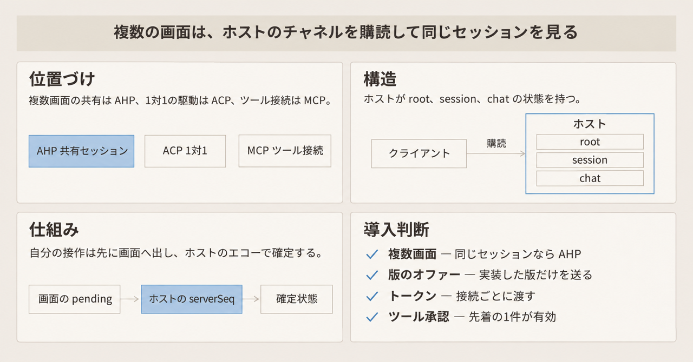
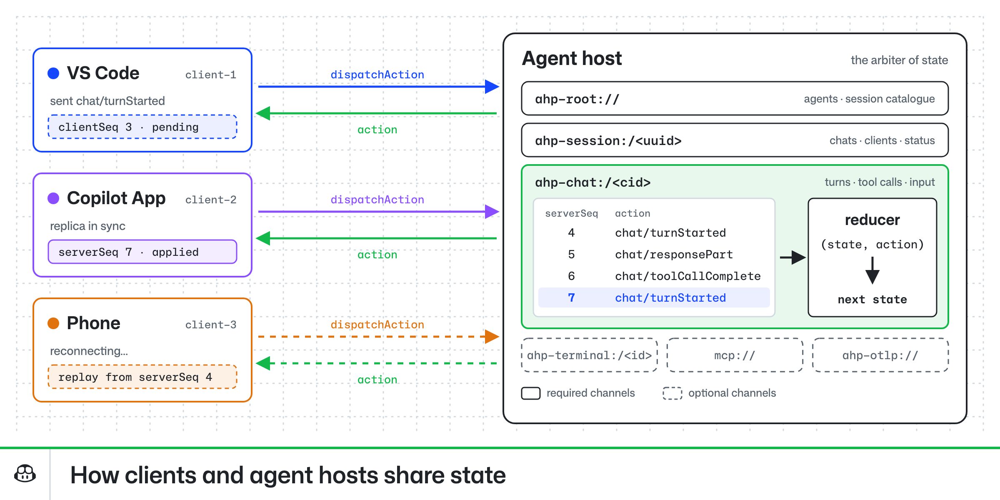
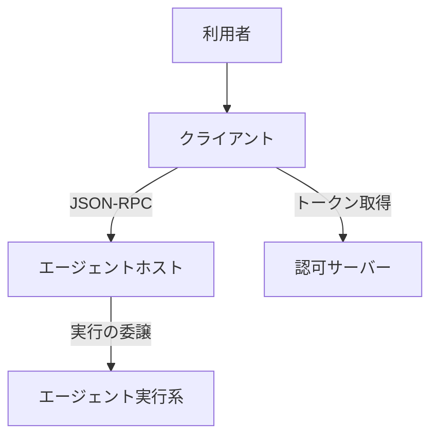
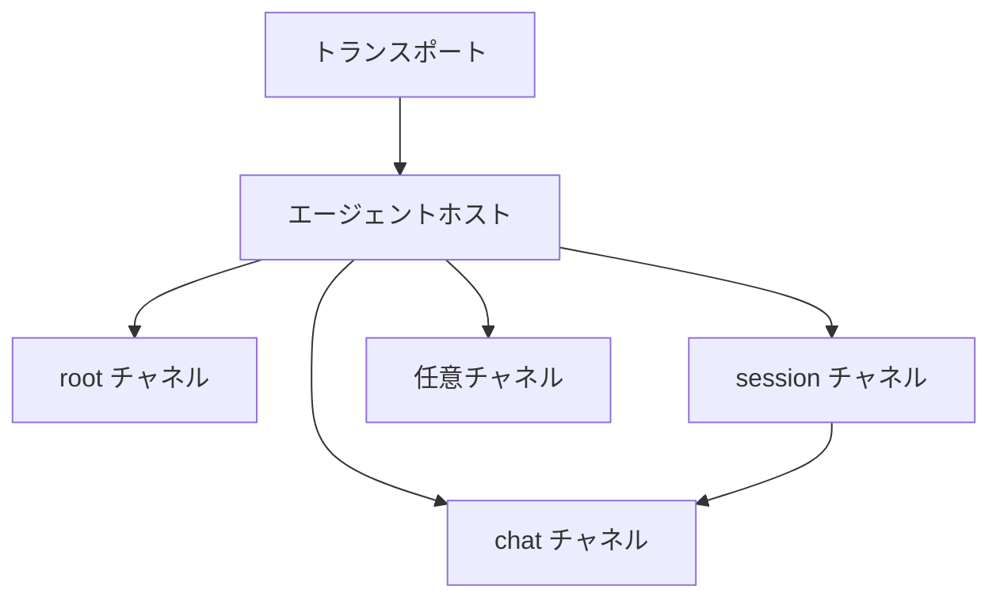
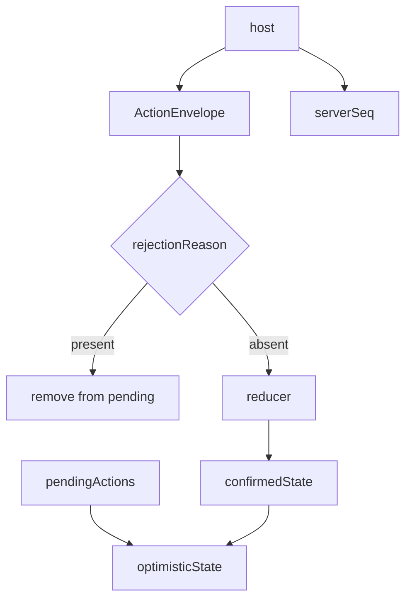
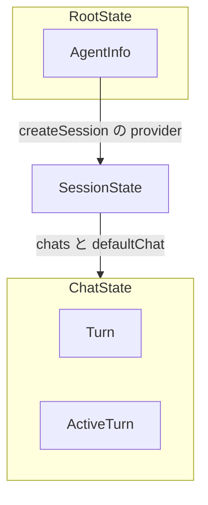
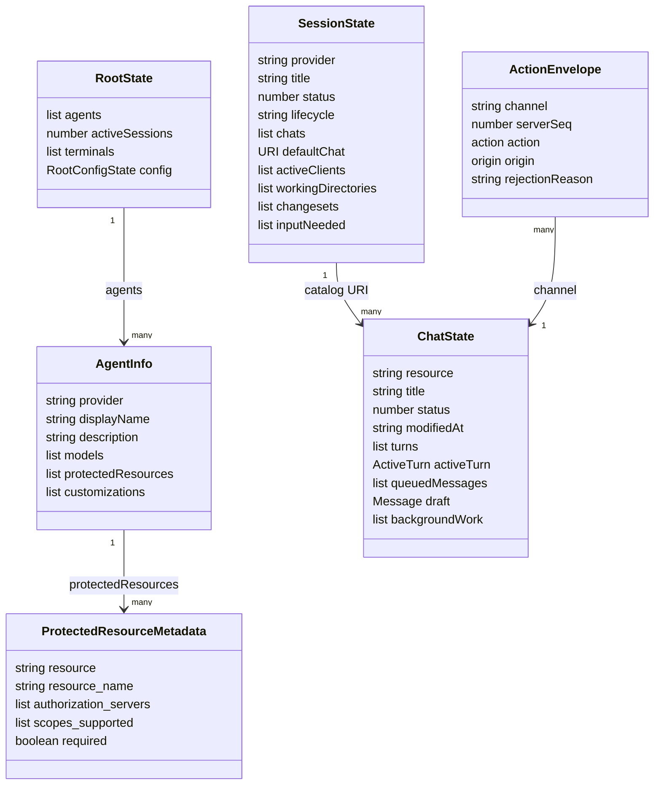

Agent Host Protocol（AHP）は、複数のクライアントが同一のエージェントセッションを同じ状態として見るためのプロトコルです。ポータブルなセッションサーバーであるエージェントホストが権威ある状態を持ち、クライアントはコマンドとアクションでその状態を購読し、更新します。

本文の仕様は、2026-11-13 公開の Git タグ `spec/v1.1.0` に合わせています。チャネルは URI で識別する機能の単位、reducer は状態とアクションから次状態を作る純関数です。読み終えると、その境界、接続からツール承認までのメッセージ、再接続とトークン更新の扱いを、自分のクライアントに落とす判断ができます。


*この記事の全体像。以下、順に解説します。*

## Agent Host Protocolとは

AHP は、GitHub Copilot のセッション継続が載っているオープンな標準です。セッションを VS Code、Copilot アプリ、モバイル、クラウドのあいだで開いたままにします。最初の実装は VS Code で、その後 GitHub 側のホストが同じプロトコルを採用しました。解説記事の著者は Connor Peet と Rob Lourens、公開日時は 2026-11-17T18:20:40Z、読了の目安は 8 分です。

AHP が固定するのは、利用者とホストがセッションをどう共有するかです。1 クライアントと 1 エージェントのプロンプト、ストリーム、ツール、権限は Agent Client Protocol（ACP）が担います。AHP は、その外側で複数のクライアントを同じセッションに揃えます。Language Server Protocol（LSP）はエディタと言語サーバーの境界、Debug Adapter Protocol（DAP）はエディタとデバッガの境界です。Model Context Protocol（MCP）はツール、リソース、プロンプトの接続です。AHP の MCP チャネルは、ホストが動かしている上流の MCP サーバーを、能力広告の範囲でクライアントから使う拡張面です。能力広告のうちホスト固有の分は、`InitializeResult._meta` に出ます。

公開リポジトリは [microsoft/agent-host-protocol](https://github.com/microsoft/agent-host-protocol) です。ライセンスは MIT です。既定ブランチは `main` です。公開 API の `stargazers_count` は 462 でした。`pushed_at` は 2026-11-16T19:04:16Z です。仕様と各言語クライアントは独立した SemVer で出ます。仕様タグは `spec/v1.1.0` です。npm の `@microsoft/agent-host-protocol`、crates.io の `ahp`、NuGet の `Microsoft.VisualStudioCode.AgentHostProtocol` の安定版はいずれも 1.1.0 です。crates.io の `ahp` の `updated_at` は 2026-11-13T00:27:46.981751Z です。Go モジュールのタグは `clients/go/v1.1.0`、Swift パッケージのタグは `v1.1.0` です。

| プロトコル | 担当 | 状態の権威 | クライアント数 |
|---|---|---|---|
| AHP | 共有セッションの同期、購読、アクション順序、再接続 | ホストのチャネル状態 | N |
| ACP | 1 クライアントと 1 エージェントのプロンプト、ストリーム、ツール、権限 | エージェント側のセッション | 1 |
| LSP | エディタと言語サーバー | 言語サーバー | 実装依存 |
| DAP | エディタとデバッガ | デバッガ側 | 実装依存 |
| MCP | ツール、リソース、プロンプトの接続 | サーバー実装 | 実装依存 |

| 場面 | 向く面 |
|---|---|
| 複数画面で同じセッションを見る | AHP のホストと購読 |
| 単一 UI からエージェントを直接駆動する | ACP |
| エディタ機能を言語ごとに分ける | LSP |
| デバッガ UI を実行系から分ける | DAP |
| ホストが動かしている MCP サーバーを、能力広告の範囲でクライアントから使う | AHP の MCP チャネル。`authenticate` の `target` はトークンの宛先 |

## 特徴

チャネルが機能の最大単位です。チャネルは URI で識別します。購読すると、その時点のスナップショットと、その後のアクションを受け取ります。

すべてのコマンドと通知の `params` は、トップレベルに `channel` を持ちます。接続レベルのメソッドは `ahp-root://` を渡します。

状態変更の唯一の経路はアクションです。reducer は `(state, action)` から次状態を作る純関数で、サーバーとクライアントで同じ関数を走らせられます。

クライアントは自分のアクションを先にローカルへ適用し、サーバーのエコーで確定します。この方式を write-ahead reconciliation と呼びます。

トランスポートはプロトコルの外で決めます。順序、信頼性、双方向を満たし、1 件の JSON-RPC が 1 フレームで完結すればよく、実装で最も一般的なのは WebSocket のテキストフレーム 1 つに JSON-RPC 1 件です。

認証は二層です。接続そのものの入場は、トランスポートのハンドシェイク側です。接続後のリソース権限は、RFC 9728 の保護リソースメタデータと、RFC 6750 の Bearer トークンを `authenticate` でホストへ渡す形です。保護リソースメタデータは、リソースがどの認可サーバーを使うかを示す文書です。Bearer トークンは、その認可サーバーが発行したアクセストークンです。

必須チャネルは root、session、chat です。接続の `initialSubscriptions` には、通常 root を含めます。以前開いた session の URI が既知なら、そこにも指定できます。新規の session や chat は、URI が決まってから購読します。terminal、MCP、OpenTelemetry、changeset、automation などは追加チャネルです。changeset はチェンジセットのメタデータを置くチャネル、automation は自動化のカタログとランのチャネルです。

拡張は、`x-` 接頭辞のメソッドと URI スキーム、およびオブジェクトの `_meta` に出します。相互運用に必要な能力は、型付きフィールドへ上げます。

AHP はエージェント非依存です。クライアントはエージェント固有のツール語彙を直接見ず、ホストが変換した表示用メタデータを見ます。

公式クライアントライブラリは Rust、TypeScript、Kotlin、Swift、Go、.NET です。ワイヤ型の正本は、リポジトリの TypeScript `types/` です。各言語の型はここから生成されます。

## 構造

GitHub Blog の図は、VS Code、Copilot アプリ、電話の 3 クライアントが `dispatchAction` をホストへ送り、ホストが `action` を返す形です。クライアントが送る `dispatchAction` は応答の無い通知です。ホストが返す `action` は、逆方向の別通知です。ホストの内側では、必須の root、session、chat が reducer 状態を持ち、chat の順序付きアクションログが次状態を作ります。terminal、MCP、telemetry は任意チャネルとして並びます。telemetry は OpenTelemetry で、URI は `ahp-otlp:` です。`clientSeq` はクライアントが自分のアクションへ付ける通し番号、`serverSeq` はホストが配る順序番号です。pending はサーバーのエコー前、replay は再接続で欠落分を受け取る応答です。図の中の VS Code は自分の `clientSeq` がエコー前のまま、Copilot アプリは `serverSeq` 適用済み、電話は `serverSeq` からの replay 中、という 3 状態です。



図の製品名は説明用です。仕様上のコンテキストは、次の役割に読み替えます。

### システムコンテキスト図



| 要素名 | 説明 |
|---|---|
| 利用者 | セッションの開始、発話、ツール承認を行う人 |
| クライアント | ホストへ接続し、チャネルを購読して UI を描くプロセス |
| エージェントホスト | 権威あるチャネル状態、順序、再生バッファを持つサーバー |
| 認可サーバー | `protectedResources.authorization_servers` が指すトークン発行元 |
| エージェント実行系 | プロンプト処理とツール実行。ACP などホストの下流 |

### コンテナ図



| 要素名 | 説明 |
|---|---|
| トランスポート | プロトコル開始前に決める順序付き双方向ストリーム。WebSocket が一般的 |
| root チャネル | `ahp-root://`。エージェント一覧、端末カタログ、ホスト設定、セッション件数 |
| session チャネル | `ahp-session:/<uuid>`。チャット一覧、既定チャット、作業ディレクトリ、有効クライアント |
| chat チャネル | `ahp-chat:/<cid>`。ターン、ストリーム、ツール呼び出し、下書き |
| 任意チャネル | terminal、changeset、telemetry、MCP、automation、TCP、resource watch など。TCP は実験的な転送で、1 接続が 1 URI、作成したクライアントに限る |

セッション一覧そのものは、root の状態木に入りません。`listSessions` と、`root/sessionAdded`、`root/sessionRemoved`、`root/sessionSummaryChanged` で追います。

### コンポーネント図

チャットチャネルの更新経路です。クライアントは `chat/turnStarted` を `dispatchAction` し、ホストは `serverSeq` を付けた `action` として `chat/delta` や `chat/toolCallReady` を配ります。`chat/delta` は応答テキストの断片です。テキストを足す前に、ホストは `chat/responsePart` で対象のパートを作ります。`serverSeq` は、ホストがアクションへ付ける単調な順序番号です。再接続の `lastSeenServerSeq` に使います。reducer は番号を発行しません。`chat/toolCallConfirmed` はクライアントが送る承認で、ホストはそれをエコーします。



| 要素名 | 説明 |
|---|---|
| pendingActions | サーバーエコー前に、クライアントが楽観適用している自分のアクション |
| confirmedState | サーバーが認めた最後の状態 |
| optimisticState | confirmedState に pendingActions を重ねた表示用の状態。保存せず計算する |
| ActionEnvelope | `channel`、`action`、`serverSeq`、任意の `origin`、任意の `rejectionReason` を持つ配送単位 |
| reducer | 状態とアクションから次状態を作る純関数 |
| serverSeq | ホストがアクションへ付ける単調な順序番号。再接続の `lastSeenServerSeq` に使う |

接続中に届いた `ActionEnvelope` は、次の 3 通りです。

- `origin.clientId` が自分で、`pendingActions` の先頭と一致するエコーは、pending から外して `confirmedState` へ適用します。
- 別クライアントまたはサーバー起源のアクションは、`confirmedState` へ適用し、残りの `pendingActions` を rebase します。rebase は、確定した状態の上に、残っている自分の未確定アクションを載せ直すことです。
- `rejectionReason` があるエコーは、pending から外し、楽観表示を戻します。確定状態には適用しません。

`pendingActions` を空にするのは、再接続の `replay` と `snapshot` のときです。`subscribe` の成功結果は、状態があるチャネルでは `snapshot`（単数）で、中身は `resource`、`state`、`fromSeq` です。`resource` は、そのスナップショットのチャネル URI です。`fromSeq` はその時点の `serverSeq` です。状態フィールドが無いチャネルでは、サーバーはスナップショットを省いて結果を `{}` にしてよく、クライアントは空の `state` と省略の両方を受けます。ウィンドウ付き購読では、結果は `flowControl` で、状態は `channel/snapshot` 通知です。`flowControl` は、スナップショットの代わりに返る購読結果です。

`initialize` と、`reconnect` の `type` が `snapshot` のときの配列は `snapshots[]` で、省略するチャネルは配列に入りません。続く `action` の `serverSeq` は、`fromSeq` より大きいものだけを適用します。

ツール承認はチャット状態の一部です。AHP の ACP 比較ガイドは、同じツール呼び出しへの `chat/toolCallConfirmed` は最初の 1 件が有効で、後続は拒否されると説明しています。

## データ

### 概念モデル

root はセッション実体を所有しません。セッションは `createSession` で作られ、チャットを所有します。チャットは完了ターンと、進行中ターンを持ちます。



| 要素名 | 説明 |
|---|---|
| RootState | 接続全体で共有する軽いカタログ。セッション一覧は含まない |
| AgentInfo | `provider`、表示名、モデル、保護リソース、エージェント側プラグイン |
| SessionState | 1 セッション。ライフサイクル、チャットカタログ、作業ディレクトリ、カスタマイズ |
| ChatState | 1 会話。ターン履歴、進行中ターン、キュー、下書き、バックグラウンド作業 |
| Turn | 完了、キャンセル、エラーのいずれかで閉じた 1 往復 |
| ActiveTurn | ストリーム中の 1 往復。`ChatState.activeTurn` |

### 情報モデル



| 要素名 | 説明 |
|---|---|
| RootState.activeSessions | dispose されていないセッションの件数。一覧そのものではない |
| AgentInfo.protectedResources | RFC 9728 形の認証要件。空ならそのエージェントは認証を要求しない |
| ProtectedResourceMetadata.required | 省略時は true。false のリソースはトークンなしでも動作し、トークンで能力が広がることがある |
| SessionState.lifecycle | `creating`、`ready`、`failed`。作成直後のスナップショットは `creating` |
| SessionState.status | SessionStatus ビットセット。下表 |
| SessionState.chats | `ChatSummary` のカタログ。ターンを持つ `ChatState` は `ahp-chat:/<cid>` の別チャネル |
| SessionState.defaultChat | 任意の既定チャット URI。未設定ならフィールドは無い |
| ChatState.turns | 完了したターン。古いページは `turnsNextCursor` と `fetchTurns` |
| ChatState.activeTurn | 進行中ターン。無ければフィールドは無い |
| ActionEnvelope.serverSeq | ホストが付与する順序。クライアントの `clientSeq` とは別 |
| SessionState.inputNeeded | 全チャットの入力要求または確認待ちの集約。応答は対象チャットへの `chat/*` か、ツール認証なら `authenticate` |

`status` は 0 から 4294967295 の符号なし 32 ビット整数です。活動ビットは同時に 1 種類、メタデータビットは OR できます。仕様は等値比較ではなく、ビット演算で見るよう求めています。`InputNeeded` は `InProgress` のビットを含むため、`status === 8` では入力待ちの進行中を取りこぼします。

| 名前 | 値 | 意味 |
|---|---:|---|
| Idle | 1 | 進行中ターンも入力待ちも無い |
| Error | 2 | 直近ターンがエラーで終わった |
| InProgress | 8 | ターンが進行中 |
| InputNeeded | 24 | 進行中かつ、入力要求または確認待ちのツール呼び出しがある。InProgress ビットを含む |
| IsRead | 32 | 最終更新以降に閲覧した |
| IsArchived | 64 | アーカイブした |

購読表が定める主な URI は次のとおりです。`<uuid>` と `<cid>` と `<id>` は、それぞれの識別子を置く場所です。

| URI | 状態 |
|---|---|
| `ahp-root://` | RootState |
| `ahp-session:/<uuid>` | SessionState |
| `ahp-chat:/<cid>` | ChatState |
| `ahp-terminal:/<id>` | TerminalState |
| `ahp-changeset:/<id>` | ChangesetState。実 URI は `Changeset.uriTemplate` から組む |
| `ahp-automations://` | 自動化カタログ |
| `ahp-automation-run:/<id>` | 自動化ラン |
| `ahp-tcp:/<id>` | 実験的な TCP 転送。1 接続が 1 URI。作成したクライアントに限る |
| `ahp-otlp:` | OpenTelemetry。状態フィールドは空で、通知のみのことがある |

ツール呼び出しの `status` は次の文字列です。`streaming`、`pending-confirmation`、`running`、`auth-required`、`pending-result-confirmation`、`completed`、`cancelled`。`pending-confirmation` の入力はインラインか `ContentRef` で、実体は `resourceRead` で別取得します。`ContentRef` は実体を持たない参照です。

Bearer トークンと、認証済みかどうかは、RootState に置きません。root は全購読クライアントから見えるため、認証状態は接続ごとの `authenticate` と `auth/required` に留めます。

## 構築方法

### 前提

JSON を送受信できるランタイムと、選んだトランスポートが要ります。遠隔では、WebSocket のテキストフレームが前提の実装が多いです。

プロトコル版は SemVer の `MAJOR.MINOR.PATCH` です。プレリリースとビルドメタデータは使いません。

ホストが受け付ける公開済みの互換レンジは、`>=1.0.0 <2.0.0` と `>=0.9.0 <0.10.0` です。クライアントは話せる版を `protocolVersions` に、希望順で並べます。サーバーは、互換レンジに入るオファーのうち最も高い SemVer を、配列にあった文字列のまま返します。配列の先頭をそのまま採用するのではありません。

公式ワイヤ型は、`types/` の TypeScript から各言語へ生成されます。

公式クライアントには Kotlin と Swift もあります。この節では、公開レジストリの安定版が 1.1.0 だった Rust、TypeScript、Go、.NET の導入コマンドを示します。

### Rust クライアント

クレートは `ahp-types`（型のみ）、`ahp`（クライアントと reducer）、`ahp-ws`（tokio-tungstenite の WebSocket）に分かれます。crates.io の `ahp` の max stable は 1.1.0 でした。

```bash
cargo add ahp ahp-ws
```

### TypeScript クライアント

ブラウザと Node の両方で、グローバルな `WebSocket` がある環境を対象にします。npm の最新は 1.1.0 です。

```bash
npm install @microsoft/agent-host-protocol
```

```ts
import { AhpClient } from '@microsoft/agent-host-protocol/client';
import { WebSocketTransport } from '@microsoft/agent-host-protocol/ws';
```

### Go クライアント

Rust と同様に `ahptypes`、`ahp`、`ahpws` に分かれます。リリースタグは `clients/go/v1.1.0` です。

```bash
go get github.com/microsoft/agent-host-protocol/clients/go@latest
```

### .NET クライアント

NuGet の `Microsoft.VisualStudioCode.AgentHostProtocol` は 0.9.0、1.0.0、1.1.0 を公開しています。抽象化パッケージ `Microsoft.VisualStudioCode.AgentHostProtocol.Abstractions` が対になります。

```bash
dotnet add package Microsoft.VisualStudioCode.AgentHostProtocol --version 1.1.0
```

### ドキュメントのローカル確認

ガイドと仕様は VitePress です。`npm run docs:versions` がリリースタグを `docs/versions/` へ展開し、一覧の先頭版がルート URL、`main` は `/draft/` です。

```bash
npm install
npm run docs:dev
```

## 利用方法

### メッセージの共通形

ワイヤは JSON-RPC 2.0 です。リクエストは `id` があり、通知は `id` がありません。

| method | channel | 方向 |
|---|---|---|
| initialize | `ahp-root://` | クライアントからサーバーへのリクエスト |
| reconnect | `ahp-root://` | クライアントからサーバーへのリクエスト |
| ping | `ahp-root://` | クライアントからサーバーへのリクエスト |
| authenticate | `ahp-root://` | クライアントからサーバーへのリクエスト |
| listSessions | `ahp-root://` | クライアントからサーバーへのリクエスト |
| subscribe | 対象チャネル URI | クライアントからサーバーへのリクエスト |
| createSession | `ahp-session:/<uuid>` | クライアントからサーバーへのリクエスト |
| dispatchAction | 対象チャネル URI | クライアントからサーバーへの通知 |
| action | 対象チャネル URI | サーバーからクライアントへの通知 |

### 接続ハンドシェイク

`initialize` の応答で、サーバーが選んだ `protocolVersion`、現在の `serverSeq`、`initialSubscriptions` に対応するスナップショットが返ります。`clientId` は再接続用の不透明な識別子です。`clientInfo` は実装名の参考情報で、機能検出には使いません。

```json
{
  "jsonrpc": "2.0",
  "id": 1,
  "method": "initialize",
  "params": {
    "channel": "ahp-root://",
    "protocolVersions": ["1.1.0"],
    "clientId": "client-abc",
    "clientInfo": { "name": "acme-ide", "version": "2.5.0" },
    "initialSubscriptions": ["ahp-root://"],
    "locale": "ja"
  }
}
```

選べる版が無いとき、サーバーは `UnsupportedProtocolVersion`（`-32005`）と `data.supportedVersions` を返し、接続を閉じます。

### セッションとチャット

クライアントがセッション URI を選び、`createSession` のあとでその URI を購読します。準備完了まで `lifecycle` は `creating` です。`defaultChat` があれば、その URI が既定チャットです。未設定のセッションでは、このフィールド自体がありません。ターンはセッションではなく、チャットチャネルにあります。

```json
{
  "jsonrpc": "2.0",
  "id": 2,
  "method": "createSession",
  "params": {
    "channel": "ahp-session:/3f1c0a4e-7b2d-4e6a-9c11-2a0b6d8e4f70",
    "provider": "copilot"
  }
}
```

```json
{
  "jsonrpc": "2.0",
  "id": 4,
  "method": "subscribe",
  "params": { "channel": "ahp-chat:/8c2a" }
}
```

`subscribe` の成功結果のキーは、状態があるチャネルでは `snapshot` です。中身は `resource`、`state`、`fromSeq` です。状態フィールドが無いチャネルでは `state` が `{}` になり、サーバーはスナップショット自体を省いて `subscribe` の結果を `{}` にしてよいです。クライアントは両方を受けます。`initialize` と、再接続で `type` が `snapshot` のときの配列は `snapshots` で、省くチャネルは配列から外れます。`fromSeq` はその時点の `serverSeq` で、続く `action` はそれより大きい `serverSeq` だけを状態へ適用します。ウィンドウ付き購読の結果にスナップショットは無く、`flowControl` が返ります。

`provider` は root の `AgentInfo.provider` と一致する文字列です。例示の `copilot` はガイドのサンプルです。

### ターンの開始

`dispatchAction` は通知です。`clientSeq` はクライアント側の通し番号で、`serverSeq` とは別です。エコーが自分の楽観適用かどうかは、この番号ではなく、`origin.clientId` と `pendingActions` の先頭で見ます。

```json
{
  "jsonrpc": "2.0",
  "method": "dispatchAction",
  "params": {
    "channel": "ahp-chat:/8c2a",
    "clientSeq": 1,
    "action": {
      "type": "chat/turnStarted",
      "turnId": "turn-1",
      "startedAt": "2026-11-18T09:00:00Z",
      "message": { "text": "Explain this code", "origin": { "kind": "user" } }
    }
  }
}
```

ホストは同じチャットへ `action` 通知を返します。テキストを流すときは、先に `chat/responsePart` で対象のパートを作り、その後 `chat/delta` で文字列を足し、最後に `chat/turnComplete` を送ります。`chat/delta` は、既存パートへ足すテキストの断片です。各通知に `serverSeq` が付きます。`startedAt` はターン開始の ISO 8601 時刻で、1.1.0 の `chat/turnStarted` では必須です。

### ツール呼び出しの承認

パラメータが揃うと `chat/toolCallReady` です。確認が要る呼び出しは `pending-confirmation` になり、クライアントは `chat/toolCallConfirmed` を送ります。拒否は `approved` を false にし、`reason` に `denied` または `skipped` を渡します。

```json
{
  "jsonrpc": "2.0",
  "method": "dispatchAction",
  "params": {
    "channel": "ahp-chat:/8c2a",
    "clientSeq": 2,
    "action": {
      "type": "chat/toolCallConfirmed",
      "turnId": "turn-1",
      "toolCallId": "tc-1",
      "approved": true,
      "confirmed": "user-action"
    }
  }
}
```

`editable` が true のとき、編集後の入力は `editedToolInput` に載せます。入力が `ContentRef` の場合、ホストがエコー前にリソース本体を差し替えます。

### エディタと Copilot アプリからの接続

GitHub Blog が書く接続手順は次のとおりです。

- Copilot アプリでは Experimental、Direct Connections を有効にし、Environments、Add Agent Host Protocol Host へ進みます。
- VS Code では Agents ウィンドウの Add Remote Agent Host から、自分で実装したホストへ接続します。
- スタンドアロンの VS Code エージェントホストは、端末で `code agent host` を実行して起動します。
- エディタ内ホストのエンドポイントは `code agent endpoints` で確認します。
- サンプルは [microsoft/agent-host-protocol-samples](https://github.com/microsoft/agent-host-protocol-samples) です。2026-11-13 に更新があり、ライセンスは MIT です。

```bash
code agent host
code agent endpoints
```

## 運用

チャネルを購読したまま、次の操作で接続を維持します。

- 切断後は、同じ `clientId` と `lastSeenServerSeq` で `reconnect` します。
- アイドル切断の前に `ping` を送ります。
- トークンの残秒が尽きたら、`authenticate` で差し替えます。
- ホストプロセスの再起動後は、進行中ターンを失敗として再接続します。

### 再接続

トランスポートが切れたあとは、同じ `clientId` で `reconnect` を送ります。再生できる範囲なら `type` は `replay` で、欠落アクションが応答に入ります。再生バッファを超えると `type` は `snapshot` で、スナップショットに切り替わります。どちらの場合も、クライアントは `pendingActions` を捨て、confirmed 状態を応答に合わせます。接続中の他者アクションは pending を捨てず、残りの pending を rebase します。空にするのは再接続応答のときです。

```json
{
  "jsonrpc": "2.0",
  "id": 2,
  "method": "reconnect",
  "params": {
    "channel": "ahp-root://",
    "clientId": "client-abc",
    "lastSeenServerSeq": 42,
    "subscriptions": ["ahp-root://", "ahp-session:/3f1c0a4e-7b2d-4e6a-9c11-2a0b6d8e4f70"]
  }
}
```

`missing` は再開できない購読です。dispose 済みのセッションや端末、観測権限が無くなったリソースが入ります。`root/sessionAdded` のようなプロトコル通知は再生されないので、セッション一覧は `listSessions` で取り直します。`auth/required` も再生されません。

### 死活確認

`ping` はペイロードを持たず、`initialize` 完了前でもサーバーは応答します。アイドル切断を防ぐ用途です。間隔は実装依存です。WebSocket の ping と併用できます。

```json
{
  "jsonrpc": "2.0",
  "id": 9,
  "method": "ping",
  "params": { "channel": "ahp-root://" }
}
```

### トークンの更新

トークンは `authenticate` でリソース単位に渡します。`expiresIn` はリクエスト時点の残秒で、正の整数です。発行元の `expires_in` から経過秒を引きます。不明ならフィールドを省略します。空の `token` は認証を取り消します。`target` が無いときはそのリソース全体、`target` があるときはその対象だけです。`target` はトークンの宛先で、ツール定義の注入には使いません。MCP サーバー単位で渡すときは `target.kind` を `mcpServer` にし、ホストが配ったセッション URI と `customizationId` を付けます。`customizationId` は、`customizations` の id です。

```json
{
  "jsonrpc": "2.0",
  "id": 3,
  "method": "authenticate",
  "params": {
    "channel": "ahp-root://",
    "resource": "https://api.github.com",
    "token": "gho_example",
    "expiresIn": 3540,
    "scopes": ["read:user", "user:email"]
  }
}
```

上の `token` は形を示す例です。`auth/required` の `reason` が `expired` のとき、クライアントは新しいトークンを取り直してから `authenticate` します。チャレンジされたトークンとは、期限切れまたは取り消しとして拒否された以前のトークンです。その再送は、仕様が禁じています。

### ホストプロセスの終了

サーバープロセスが予期せず終わったとき、ホスト環境はサーバーを終了扱いにします。再起動はしてもよいです。進行中ターンは失敗として扱います。クライアントは再接続フローで戻します。

ウィンドウ付き購読を使うクライアントは、`reconnect` に `windows` を足します。そのチャネルは接続全体の `actions` や `snapshots` には入らず、チャネル独自の `lastAppliedServerSeq` で回復します。接続全体の位置は `lastSeenServerSeq`、ウィンドウ付きチャネルごとの位置は `lastAppliedServerSeq` です。

## ベストプラクティス

### 共有する状態と接続に残す状態

端末を移す前に、載せるものを次の境界で決めます。

- 会話、ツール呼び出しの確認待ち、チャットの下書き、セッションの作業ディレクトリ URI、チェンジセットのメタデータはチャネル状態です。購読した別クライアントから見えます。
- 作業ツリーのバイト列は、ホストのファイルシステムに残ります。クライアントは `resourceRead` などで URI を取りにいきます。
- Bearer トークンと「この接続は認証済みか」は、root の共有状態に入りません。端末ごとに `authenticate` します。
- 未承認のツール呼び出しはチャット状態なので、別端末から `chat/toolCallConfirmed` できます。最初の承認が有効です。承認を移したくないセッションには、第二クライアントを購読させません。
- モデル呼び出しの実行そのものは、AHP の状態に入りません。ツール定義はセッション状態に入ります。`ToolDefinition` は、名前と説明、入力スキーマを持てるツールの定義です。ホスト提供分は `serverTools`、クライアント提供分は `activeClients` の `tools` です。スキルは `customizations` の子として、名前、URI、説明を共有できます。スキルファイルの本文をそのまま載せるフィールドはありません。セッションに載るそのほかの拡張は `customizations` と `_meta` です。
- `chatMutable` な設定は、チャットごとに持てます。セッションチャネルは、ツールの自動承認がチャット間で異なり得る例としてこの設定を挙げています。自動承認の方針は、ホストプロセスの単一スイッチとは限りません。`chatMutable` は、値をチャット単位で持てる設定です。

### 版の選び方

クライアントは 1.1.0 を含む、自分が実装した版だけを `protocolVersions` に並べます。

機能の有無は、`clientInfo.version` でもチャネル安定度でも見ません。接続上は、能力広告と、交渉済みのプロトコル版を見ます。安定度は、そのチャネル仕様がどれだけ変わり得るかを示す文書上の指標です。プロトコル版でもパッケージ版でもありません。

安定度の読み方は次のとおりです。

| チャネル | 安定度 | 意味 |
|---|---|---|
| root、session、chat、terminal、telemetry、resource watch | 2 | Stable |
| Canvas | 1 | Experimental |
| changeset、MCP | 1.2 | Release candidate |
| annotations | 1.1 | Active development |
| TCP、automation catalogue、automation run | 1.0 | Early development |

未知フィールドは無視します。`@preserveUnknownMembers` の型は、未知メンバーをデコード時に残します。

### 拡張の置き場

標準に入る名前は `x-` で始めません。実装間の合意がある拡張だけが `x-` を使います。

ホスト固有の能力広告は `InitializeResult._meta` です。クライアントは未知キーを無視します。

GitHub Blog は、プロジェクトボードへのリンクのような GitHub 固有の関連をメタデータに残し、プロトコルの穴だったものだけを本線へ上げた、と整理しています。初期版は、PTY に裏打ちされないシェル出力を正確に表現できず、VS Code クライアントがセッション URI の形を決め打ちしていました。PTY は疑似端末です。

## 注意点

### ドキュメントと実装の乖離

| 対象 | 資料の記載 | 実態 | 読者への影響 |
|---|---|---|---|
| initialize の版番号 | ライフサイクル頁の例は `protocolVersions: ["0.3.0"]` と応答 `"0.3.0"` | 版交渉の本文は互換基線を `1.0.0` と `0.9.0` とし、公開タグは `spec/v1.1.0`。npm、crates.io の `ahp`、NuGet も 1.1.0 | 例示の 0.3.0 を現行オファーにすると `-32005` になる |
| Kotlin の版 | `clients.md` の Gradle と Maven 例は `0.2.0` 固定 | 2026-11-18 の Maven Central search API は `com.microsoft.agenthostprotocol:agent-host-protocol` を 0 件返した。他言語の 1.1.0 と数字が揃っていない | 0.2.0 を現行ピンとしてコピーしない。レジストリの実在を確認してから固定する |
| Swift の下限 | `clients.md` の SwiftPM 例は `from: "0.1.0"` | `from` は下限であり、その版への固定ではない。公開タグは `v1.1.0` | 例の 0.1.0 を現行ピンと読まない |
| MultiHostClient | README は Rust、Swift、Go、.NET が同梱すると書く | `implementations.md` の TypeScript 節も `MultiHostClient` を含む。Kotlin はその文の外 | 複数ホスト API の有無は、言語ごとに README と実装ガイドを突き合わせる |
| 1.1.0 の日付 | 変更履歴の見出しは `## [1.1.0] — 2026-11-12` | crates.io の `ahp` 1.1.0 の `updated_at` は 2026-11-13。GitHub Blog の公開は 2026-11-17。リポジトリの `pushed_at` は 2026-11-16。スター数 462 は、この push 時刻とは別の公開 API の `stargazers_count` | 版番号は 1.1.0 で揃う。日付は変更履歴、レジストリ、ブログで別々に読む。スター数を push 時刻の値として読まない |
| 公式クライアントの本数 | `clients.md` は 5 言語。README は .NET を 6 列目に載せる | NuGet に 1.1.0 がある。ガイド本文の言語表には .NET の節が無い | README と NuGet を .NET の導入元にする |
| 端末 URI | 購読表とサンプルは `ahp-terminal:/<id>`。ガイドの What is the Agent Host Protocol? も同じ形を挙げる | 端末チャネルの本文は、スキームとパスはサーバー定義だと書く | カタログの URI を購読する。接頭辞をクライアントが生成しない |
| ブログの見出し | Shipping five clients and two hosts | 本文が名前を挙げて分けるホストは、VS Code の TypeScript と GitHub Agent Host の Rust。クライアント 5 つの固有名は記事本文に列挙が無い | 見出しの 5 を製品名へ割り当てない |
| README と implementations | README の Clients に ahpw がある | 同じタグの `docs/guide/implementations.md` の Clients 列に ahpw は無い | クライアント名簿は README を広く、ガイド頁を狭く読む。ahpw は README にだけ名前があるクライアント欄 |
| SessionState.inputNeeded | 状態モデルガイドの TypeScript ブロックは title、status、chats、defaultChat などを列挙し、inputNeeded を含まない | セッションチャネル仕様は、スナップショットに inputNeeded 集約が含まれると書く。更新は `session/inputNeededSet` と `session/inputNeededRemoved` | 一覧 UI の入力待ちはセッション購読だけで見える。正本はチャネル仕様の散文とする |

### 資料間の食い違い

| 対象 | 資料の記載 | 実態 | 読者への影響 |
|---|---|---|---|
| ホストの実装数 | ブログは二ホストをプロトコルの試金石と書く | implementations 頁は VS Code agent host に加え、pi-ahp、ahpd、hydra-ahp、AHP-ACP Gateway、AgentConnect をサーバーとして挙げる | GitHub 製品の二ホストと、オープンなホスト実装一覧は別集合 |
| スキルと権限の置き場 | スキル本文用のフィールドはセッション状態に無く、スキルはホスト側に残る | 未承認ツールはチャット状態で、別クライアントが承認できる。トークンだけが接続ローカル | 権限のすべてがホスト内に閉じる、とは読まない。承認待ちは移る |
| `_meta` の表記 | ブログ本文は custom methods と `_meta` data | 仕様のフィールド名は `_meta`。`_metadata` というフィールドは仕様に無い | コードでは `_meta` を使う |
| 再接続の要約 | ブログは、不安定な回線ではキューしたアクションをすべて送り、サーバーの確認を待つ、と書く | 仕様の `reconnect` は `lastSeenServerSeq` と購読を送る。`replay` でも `snapshot` でもクライアントは `pendingActions` を空にする | 再接続そのものが楽観キューの再送手順ではない。収束のあと、必要なら送り直す |
| chat の URI | ガイドの What is the Agent Host Protocol? は `ahp-chat:/<uuid>`。状態モデルの一部の例も `<uuid>` | 仕様概要、購読表、セッションチャネルは `ahp-chat:/<cid>` | 指すチャネルは同じ chat。識別子の呼び方だけが資料で割れる |
| AgentConnect の版 | implementations と README は AgentConnect を AHP 1.0 host と書く | 本文の仕様タグは `spec/v1.1.0`。当該文は相手リポジトリの自己申告 | 1.0 ホストが 1.1.0 の全チャネルを実装している、とは読まない |

### 公開資料だけでは確定できない点

| 対象 | 資料の記載 | 実態 | 読者への影響 |
|---|---|---|---|
| `code agent host` | ブログが VS Code の起動コマンドとして書く | 仕様リポジトリのコマンドリファレンスには無い | 製品 CLI の有無は、手元の `code` の版で確認する |
| Kotlin 成果物 | ガイドが Maven Central の座標を書く | search API が 0 件。公開停止か、座標の相違かは公開資料だけでは分かれていない | ビルド前に Maven Central の UI で座標を見る |
| GitHub Agent Host のソース | ブログが Rust 実装と書く | 公開物の参照実装として仕様が名指すのは、VS Code の `src/vs/platform/agentHost/node/`。GitHub ホストの公開パスは示されていない | GitHub ホストの内部ファイル名を断定しない |

## トラブルシューティング

利用時に次の症状が出ます。コード番号は、ライフサイクル仕様と認証仕様に書かれた値です。

- initialize が版不一致で失敗する。
- セッション作成が認証要求で失敗する。
- 再接続の結果が再生ではなくスナップショットになる。
- 承認したつもりが、別クライアントの先着で戻る。

### 接続時のエラー

| 症状 | 原因 | 対処 |
|---|---|---|
| initialize が `-32005` UnsupportedProtocolVersion | オファーした版がホストの互換レンジに入っていない | `data.supportedVersions` を読み、1.x なら `>=1.0.0 <2.0.0` の交点をオファーし直す |
| createSession などが `-32007` AuthRequired | 必須の保護リソースに、この接続のトークンがまだ無い | エラー `data.resources` の `ProtectedResourceMetadata` から認可サーバーを見てトークンを取り、`authenticate` してから元のコマンドを再送する |
| `auth/required` の `reason` が `required` | そのリソースをまだ認証していない | 通知の `resource` からトークンを取り、`authenticate` する |
| `auth/required` の `reason` が `expired` | 以前のトークンの期限切れ、または取り消し | 新しいトークンを取得する。チャレンジされたトークンは再送しない |
| authenticate が `-32602` InvalidParams | `target` のセッションか customization が未知、または MCP サーバーではない。仕様が MUST で `-32602` とするのはこの場合 | ホストが配った `session` URI と `customizationId` をそのまま返す |
| authenticate で `resource` が広告と一致しない | 未知のリソース。仕様は `-32007` または `-32602` の例として書く | どちらのコードでも、広告された `resource` をそのまま使う |

### 再接続後の欠落

| 症状 | 原因 | 対処 |
|---|---|---|
| reconnect の `type` が `snapshot` | `lastSeenServerSeq` からの差分が再生バッファを超えた | スナップショットで confirmed を置き換え、pending を捨てる |
| 結果の `missing` にセッション URI がある | セッションが dispose されたか、観測権限が無くなった | ローカル購読集合から外し、`listSessions` で一覧を取り直す |
| 再接続後に `auth/required` が来ない | プロトコル通知は再生対象外 | root を購読し直し、`protectedResources` と期限を見て `authenticate` する |
| 楽観表示した承認が消える | サーバーが `rejectionReason` 付きでエコーした。別クライアントの承認が先だった場合を含む | pending から外し、エコーされた状態を表示する |
| 進行中だったターンがエラーになる | ホストプロセスが落ち、再起動した | 再接続し、失敗したターンとして扱う。`chat/turnResume` は、最新のエラー終了ターンの末尾エラー部品が `resumable: true` のときだけ。進行中ターンがある、対象が最新のエラーターンではない、末尾が resumable ではない、は拒否される |

## まとめ

AHP は、複数の画面で同じエージェントセッションを見るための共有プロトコルです。状態の権威はエージェントホストにあり、クライアントはチャネルを購読してアクションを送ります。1 つの UI からエージェントを直接駆動するだけなら ACP、ツール接続そのものなら MCP です。

状態はアクションと共有の reducer だけで進みます。自分の操作は先に画面へ出し、サーバーのエコーで確定します。切断後は同じ `clientId` と `lastSeenServerSeq` で戻り、再接続応答では楽観キューを捨てます。トークンは root に置かず、接続ごとに `authenticate` します。未承認のツールはチャット状態なので、別端末の先着承認が有効になります。

実装する版だけを `protocolVersions` に並べ、ライフサイクル頁の `0.3.0` や Kotlin 例の `0.2.0` は現行ピンにしません。端末 URI はカタログが配った文字列を購読します。

この記事が少しでも参考になった、あるいは改善点などがあれば、ぜひリアクションやコメント、SNSでのシェアをいただけると励みになります！

## 参考リンク

### 概要

- [Building the Agent Host Protocol for sessions that continue across devices](https://github.blog/engineering/engineering-principles/building-the-agent-host-protocol-for-sessions-that-continue-across-devices/)
- [Agent Host Protocol リポジトリ](https://github.com/microsoft/agent-host-protocol)
- [ドキュメント](https://microsoft.github.io/agent-host-protocol/)
- [What is the Agent Host Protocol?](https://microsoft.github.io/agent-host-protocol/guide/what-is-ahp)
- [AHP and the Agent Client Protocol](https://microsoft.github.io/agent-host-protocol/guide/ahp-and-acp.html)
- [Implementations](https://microsoft.github.io/agent-host-protocol/guide/implementations.html)
- [Agent Client Protocol](https://github.com/agentclientprotocol/agent-client-protocol)
- [Language Server Protocol](https://microsoft.github.io/language-server-protocol/)
- [Debug Adapter Protocol](https://microsoft.github.io/debug-adapter-protocol/)

### 構造

- [Specification Overview](https://microsoft.github.io/agent-host-protocol/specification/overview)
- [Transport](https://microsoft.github.io/agent-host-protocol/specification/transport)
- [Channels and Subscriptions](https://microsoft.github.io/agent-host-protocol/specification/subscriptions)
- [プロトコル状態の図](https://github.blog/wp-content/uploads/2026/11/ahp-protocol-state.png)

### データ

- [State Model](https://microsoft.github.io/agent-host-protocol/guide/state-model)
- [Session Channel](https://microsoft.github.io/agent-host-protocol/specification/session-channel)
- [Chat Channel](https://microsoft.github.io/agent-host-protocol/specification/chat-channel)
- [Terminal Channel](https://microsoft.github.io/agent-host-protocol/specification/terminal-channel)
- [Root Channel](https://microsoft.github.io/agent-host-protocol/specification/root-channel)

### 構築方法

- [Clients](https://microsoft.github.io/agent-host-protocol/guide/clients.html)
- [npm @microsoft/agent-host-protocol](https://www.npmjs.com/package/@microsoft/agent-host-protocol)
- [crates.io ahp](https://crates.io/crates/ahp)
- [NuGet AgentHostProtocol](https://www.nuget.org/packages/Microsoft.VisualStudioCode.AgentHostProtocol)
- [README](https://github.com/microsoft/agent-host-protocol/blob/spec/v1.1.0/README.md)

### 利用方法

- [Getting Started](https://microsoft.github.io/agent-host-protocol/guide/getting-started)
- [Connection Lifecycle](https://microsoft.github.io/agent-host-protocol/specification/lifecycle)
- [Samples](https://github.com/microsoft/agent-host-protocol-samples)
- [Work from anywhere with Copilot cloud](https://github.blog/changelog/2026-10-28-work-from-anywhere-with-a-new-connected-copilot-cloud-experience/)

### 運用

- [Write-Ahead Reconciliation](https://microsoft.github.io/agent-host-protocol/guide/reconciliation)
- [Authentication](https://microsoft.github.io/agent-host-protocol/specification/authentication)
- [Versioning](https://microsoft.github.io/agent-host-protocol/specification/versioning)
- [RFC 9728](https://datatracker.ietf.org/doc/html/rfc9728)
- [RFC 6750](https://datatracker.ietf.org/doc/html/rfc6750)
- [RFC 2119](https://www.rfc-editor.org/rfc/rfc2119)
