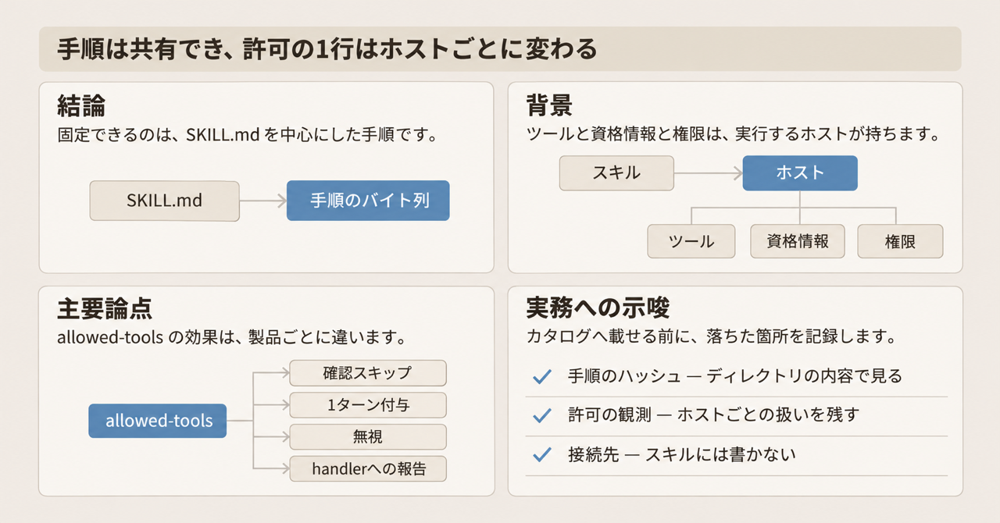
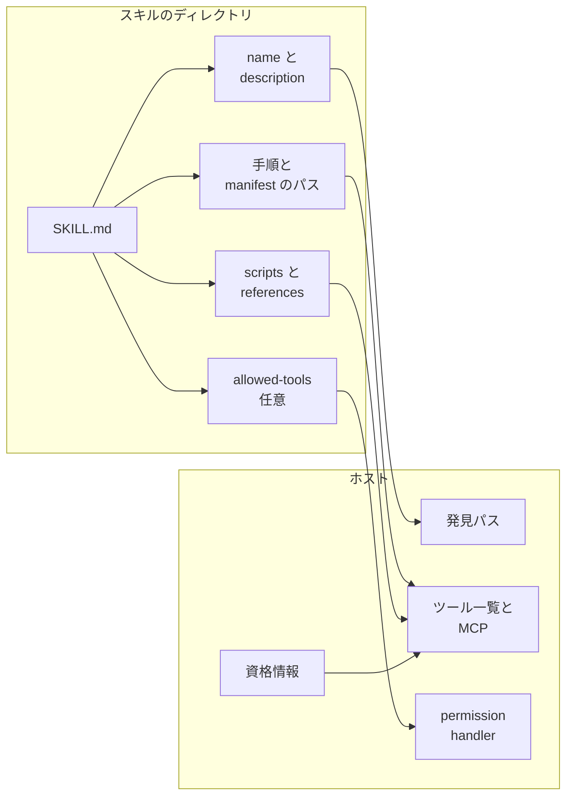
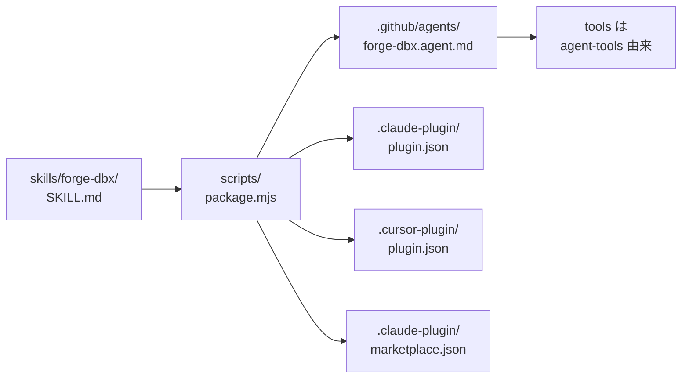

Agent Skills は、繰り返す作業の手順を `SKILL.md` を中心にしたディレクトリへ書き、複数のエージェントで読み直すためのファイル形式です。ここでのエージェントは、その手順を読んで作業するソフトウェアです。GitHub は 2026-11-12 のブログで、手順はレビューできるファイルに置き、ツール、プロジェクトの文脈、資格情報、権限は、その手順を実行するホストが持つ、と説明しています。プロジェクトの文脈は、プロジェクト名や、その環境が選ぶデータ処理の名前のように、実行環境に属する情報です。ホストは、エージェントを動かす製品です。Copilot、Copilot SDK、Claude Code が該当します。この記事は、2026-11-14 時点の公開仕様、各製品のドキュメント、公開デモに沿って、スキルのディレクトリが持つものと、ホストが実行時に足すものを分けて見ます。


*この記事の全体像。以下、順に解説します。*

## Agent Skillsとは

公開仕様は [Agent Skills specification](https://agentskills.io/specification) にあります。必須の項目は `name` と `description` です。任意項目に、実験的な `allowed-tools` があります。`allowed-tools` は、事前承認するツールを書くフィールドです。仕様は、実装ごとにサポートが違ってよい、と書いています。Copilot、Copilot SDK、Claude Code は、この同じ項目を、それぞれ別の権限動作として文書化しています。製品ごとの効果は、後の注意点にまとめます。

### ディレクトリと、読む順番

スキルはディレクトリです。必須ファイルは `SKILL.md` です。仕様は `scripts/`、`references/`、`assets/` を、任意の同梱物として定義します。`scripts/` には、エージェントが実行できるコードを置けます。`references/` は追加の文書、`assets/` はテンプレートやデータファイルです。

読む順番は段階的です。仕様はこれを progressive disclosure と呼びます。起動時に読むのは `name` と `description` です。本文は、スキルを使うと判断したときに読みます。参照ファイルとスクリプトは、必要になったときに読みます。

### スキルが持つものと、ホストが足すもの

スキルのファイルが持つものと、ホストが実行時に足すものを分けると、次のようになります。



`SKILL.md` には、名前と説明、手順、マニフェストへのパス、任意の `allowed-tools`、同梱のスクリプトと参照が入ります。ここでのマニフェストは、プロジェクト名やエンジン名を置くファイルです。ホスト側には、スキルを見つけるパス、ツールの一覧と MCP、permission handler、資格情報があります。MCP（Model Context Protocol）は、この図ではスキルに書かずホストが持つ接続先です。図の矢印は、スキル側の項目が、実行時にホスト側のどれへ対応するかを示します。ツールの一覧は、ホストが持つ側に置いています。permission handler は、ツールを使う要求が来たときに、許可するかを決める処理です。

### プロジェクトの固有名はマニフェストに置く

ブログのデモ Data Forge は、プロジェクト名やエンジン名を `dataforge.manifest.yaml` に置きます。スキル本文にはハードコードしません。`platform.engine` が `duckdb` か `databricks` かを、マニフェストが選びます。この二つは、データ処理の実行系の名前です。スキルが持つのは、そのファイルへのパスです。ファイル自体は、スキル本文の外にあるプロジェクト側の設定です。DuckDB CLI の導入と、データベースへの権限は、環境側の準備です。

### 手で直すのは SKILL.md だけ

同じデモは、`skills/*/SKILL.md` を手で保守するソースにします。`demos/dataforge/scripts/package.mjs` が、Data Forge ディレクトリの中へ生成物を書きます。先頭コメントは、生成先を4つ挙げています。

- Copilot の `.github/agents/*.agent.md`
- Claude Code の `.claude-plugin/plugin.json`
- Cursor の `.cursor-plugin/plugin.json`。Cursor は、Copilot や Claude Code とは別の、エージェントを動かす製品です
- Claude Code の `.claude-plugin/marketplace.json`

```bash
node scripts/package.mjs --check
```

`--check` は、生成物がソースと違うとき、終了コード 1 で終わります。Data Forge では、ソースの `metadata.agent-tools` が、Copilot 向け生成物の `tools:` になります。custom agent は、Copilot が読むエージェント定義で、ファイルは `.github/agents/*.agent.md` です。この `tools` が、そのエージェントが使うツールを決めます。`metadata.agent-tools` が無いとき、スクリプトは `read` と `search` を入れます。



### 作業する側と、検証する側

もう一つのデモ Proof Agent は、作業したエージェントと検証するエージェントを分ける手順を `SKILL.md` に書きます。検証者へ渡すのは、元の依頼、変更ファイル、アプローチです。作業側の自己評価は渡しません。デモの本文がそう指定しています。

### Copilot がスキルを探す場所

Copilot は、プロジェクトスキルを `.github/skills`、`.claude/skills`、`.agents/skills` から探します。個人スキルは `~/.copilot/skills` または `~/.agents/skills` から探します。GitHub Docs がそう書いています。使える場所は surface ごとに違います。surface は、Copilot を動かす面のことです。パスは、面ごとの導入手順に従って選びます。

## 注意点

### 題と、インストール後に見る確認

ブログの題は "Build once, run on any agent: A practical guide to agent skills." です。日本語にすると、一度書けば、どのエージェントでも動く、という主張です。本文が実際に勧めている確認は、インストール後に、そのクライアントがスキルを認識し、参照を読み、必要なツールを使え、スキルが求める証拠を返すか、です。ここでのクライアントは、スキルをインストールしたホストです。証拠は、スキルが返すよう指定した確認結果です。後で述べる、発見パスと許可と生成物の記録とは別です。デモ自身が、クライアント別の生成物を持っています。

`package.mjs` の先頭コメントは、`--check` を CI で回す前提と書いています。2026-11-14 時点の公開リポジトリでは、`.github/workflows/pages.yml` はそのコマンドを呼んでいません。同リポジトリのもう一つのワークフロー `demos/proof-agent/.github/workflows/ci.yml` は pytest を実行するだけで、この生成スクリプトも呼んでいません。

### 検証者を分ける項目は仕様に無い

Proof Agent の README は "Self-verification is not verification." と書いています。作業したエージェント自身の確認は、検証ではない、という規則です。ブログがそのデモを説明するときも、検証者には作業側の自己評価を渡さない、と書いています。Agent Skills 仕様の必須フィールドは `name` と `description` だけです。検証者を分ける項目はありません。

デモの GitHub Action は、差分の静的レビューです。コード実行もテストもしません。ブログがそう書いています。`demos/proof-agent/action.yml` の `block-on-fail` は、検証失敗で終了コード 1 にする入力です。既定値は `true` です。README は、収録した例のワークフローでは `false` にして、指摘を助言にした、と書いています。同ディレクトリの `ci.yml` は、その例とは別のファイルです。pytest を実行するだけで、この action を呼んでいません。マージを止めるかは、リポジトリの必須チェック側の設定です。

### allowed-tools の効果は文書ごとに違う

`allowed-tools` を、ただのコメントとも、どのホストでも同じ許可とも、扱えません。2026-11-14 時点の一次ドキュメントでは、書き方と効果は次のとおりです。

| 文書 | `allowed-tools` の効果 |
|---|---|
| Agent Skills 仕様 | 事前承認するツールのスペース区切り文字列。実験的（仕様の表記は Experimental）。実装ごとにサポートが違ってよい |
| Copilot の skill 追加手順 | 載ったツールは確認なしで使ってよい。載らないツールは確認する。`shell` または `bash` を入れると、ターミナル確認が外れる、と警告する |
| Copilot CLI リファレンス | カンマ区切りの文字列、または YAML 配列。`"*"` は全ツール。スキルが有効なあいだ自動許可 |
| Copilot SDK の custom skills | 権限は付与しない。`skill.invoked` の `allowedTools` に載せ、各ツール要求は permission handler が決める |
| Claude Code の skills | 呼び出したターンのあいだ、載ったツールを確認なしで使える。次のメッセージで付与は消える。載っていないツールは禁止しない。スペース区切り、カンマ区切り、または YAML のリストを受ける |

仕様が示している書き方は、スペース区切りの1行です。`skill.invoked` は、スキルを起動したときに SDK が出すイベントです。その `allowedTools` は、`SKILL.md` の `allowed-tools` に書いたツール名を載せる欄です。権限の付与は、この欄ではなく permission handler が決めます。

```yaml
allowed-tools: Bash(git:*) Bash(jq:*) Read
```

Copilot CLI のリファレンスは、同じフィールドをカンマ区切り、または YAML 配列として書いています。仕様の例を、そのまま CLI の受付形式とは扱えません。

Claude Code は、管理設定 `allowManagedPermissionRulesOnly` があると、プロジェクトスキルと個人スキルの `allowed-tools` を無視します。ドキュメントは Claude Code v2.1.282 以降、と書いています。無視されたスキルでは、組織の管理ルールと通常の確認に戻ります。未検証の Git フォルダは、`HEAD` や `.git` が自分のものか確かめられないフォルダです。そのフォルダでは、`git` を含む Bash と、パースできない Bash に限って、この項目を無視します。ワークスペースの信頼は、これとは別の条件です。信頼は、Claude Code にそのフォルダでの実行を許した状態を指します。信頼していないフォルダでも、プロジェクトスキルのこの項目は `-p` 実行に適用されます。`-p` は、Claude Code を対話セッションにせず、その起動の1回として実行する指定です。リポジトリに入ったスキルを実行する前に、この項目のレビューが要る、と Claude Code のドキュメントが書いています。

### 導入前に中身を見る

GitHub Docs は、`gh skill` を public preview とし、GitHub CLI 2.90.0 以降で使う、と書いています。同じページは、スキルを GitHub は検証しておらず、prompt injection、隠した指示、悪意のあるスクリプトを含み得る、と警告しています。導入前に `gh skill preview` で中身を見るよう、同じページが書いています。

仕様は `scripts/` に実行ファイルを許します。shell の事前承認と組み合わさると、確認なしのコマンド実行が、スキルのバイト列から起きます。GitHub Docs が警告しています。

### レビューが読むブランチ

Copilot code review は、プルリクエストの head ブランチにある custom instructions、agent instructions、agent skills を読みます。head ブランチは、変更が入っているブランチです。base ブランチ（取り込み先）ではありません。custom instructions は、Copilot への追加指示です。agent instructions は、それと並べて読まれる別の指示です。この文は、agent instructions のファイル名を特定していません。`.github/skills` にある既存スキルは、レビューに関連すると自動で使えます。skill 追加手順がそう書いています。main に入ったハッシュは、その PR のレビューが読むバイト列とは別です。

### 仕様の型と、デモの配列

仕様の `metadata` は、文字列から文字列への写像です。Data Forge の `agent-tools` は配列です。追加キーをクライアントが持てる、とは仕様が書いています。配列のまま、仕様が示す参照バリデータ skills-ref が通るかは、未確認です。

custom agents の `tools` は、未設定なら全ツール、リストならそのツールだけです。これは、生成後のファイルに `tools` が無いときの製品の動作です。生成スクリプトが `read` と `search` を書いたファイルとは別です。未認識の名前は無視します。GitHub Docs がそう書いています。同じ文は、製品固有のツール名を書いても壊れないため、とも説明しています。`runCommands` というツール名が、その無視に入るかは、この説明だけでは確定しません。何をする名前かは、この文書の範囲では書いていません。

## 同じバイト列で固定するもの

カタログに「Copilot 以外の CLI でも動く」と書く前に、同じバイト列で落ちる箇所は3つに分かれます。カタログは、再利用するスキルを載せる一覧です。

| 固定したいもの | 記録 | 同じバイト列でもホストで変わること |
|---|---|---|
| 手順 | `SKILL.md` と、それが参照する `scripts/` `references/` の内容ハッシュ | 発見パスが違うと、そのバイト列は読まれない。コマンドラインのホストは、同名スキルを先勝ちで1つだけ載せる |
| 生成物 | `package.mjs --check` が一致していること。Copilot 向けなら `.github/agents/*.agent.md` の `tools` | ソースの `metadata.agent-tools` が無いと、スクリプトは `read` と `search` を入れる |
| 許可 | ホスト名ごとに、`allowed-tools` が「確認スキップ」「1ターン付与」「無視」「handler への報告」のどれだったか | 仕様は Experimental。SDK は付与しない。Claude Code は管理設定と未検証 Git の一部で無視する |

先勝ちは、同名のスキルが複数あるとき、先に見つかった1つだけを載せる、という意味です。この文のホストは、コマンドとして起動する側です。

`name` の受付も、仕様と CLI で別のテストです。Copilot CLI のリファレンスは、英数字、ハイフン、アンダースコア、ドット、コロン、スペースを許し、文字か数字で始まり、最大 64 文字、と書いています。公開仕様の `name` は、1文字以上 64 文字以下の小文字、数字、ハイフンだけで、先頭と末尾のハイフンと、連続するハイフンを許さず、ディレクトリ名と一致します。ファイルが仕様上正しくても、CLI の受付規則とは別です。

## 許可はホスト設定だけでは足りない

カタログの測定行は、次の問いにします。ホストを替えたとき、落ちたのは発見か、`allowed-tools` の実行か、生成物の `tools` か。手順のハッシュと、ホストごとの許可の観測を、両方残します。

ブログ本文と、schema.org の abstract は、ツール、プロジェクトの文脈、権限をホスト側に残す、と書いています。schema.org の abstract は、そのページが機械向けに付けた要約です。データベースの例は、手順がアクセス権を付与しない、という文です。仕様は `allowed-tools` を Experimental とし、実装差を明示しています。SDK は、このフィールドがセッションの権限を付与しない、と書いています。Data Forge は、接続の選択をマニフェストの `platform.engine` に置きます。

この結論の適用範囲を狭める事実は、次のとおりです。

- Copilot の追加手順と CLI リファレンスでは、許可の判断が `SKILL.md` の `allowed-tools` に入ります。ハッシュは手順だけでなく、確認を飛ばす指定も含みます。
- Claude Code では、その付与がワークスペースの信頼を待ちません。リポジトリに入ったスキルを実行する前に、この項目をレビューします。
- `scripts/` の実行ファイルと、shell の事前承認が組み合わさると、確認なしのコマンドがスキルのバイト列から起きます。
- 個人スキルをクラウドの sandbox セッションで使うには、ホームの `~/.copilot/skills` とは別に、dotfiles リポジトリの `.copilot/skills` が要ります。dotfiles リポジトリは、自分の環境設定を Git で持つリポジトリです。この置き場所は、GitHub Actions 上で動くセッションには当てはまりません。about agent skills が書いています。
- コードレビューは、head のスキルを自動で読み得ます。main のハッシュだけでは、レビューが注入する手順を固定できません。

資格情報、MCP の接続先、リポジトリ権限をスキルへ書かない、というブログの切り分けは残ります。SDK も、permission handler がツール要求を決める、と書いています。弱まるのは、許可はホスト設定だけを見ればよく、スキル本文の `allowed-tools` は見なくてよい、という運用です。その1行はスキルのバイト列に入り、Copilot と Claude Code では確認の有無を変えます。

## 一次資料がまだ書いていないこと

次は、2026-11-14 時点の一次資料では分かれていません。書いていないことを、無視する、とは扱いません。

- Codex と Gemini CLI が、`allowed-tools` を付与、無視、報告のどれにするか。この二つは、ここまで見た Copilot と Claude Code とは別のエージェント製品です。Codex の skills の文書には、実行時の意味は書かれていません。
- Copilot code review が、自動で読んだスキルの `allowed-tools` を、レビュー用エージェントの確認スキップとして適用するか。
- `metadata` の配列値を、参照バリデータが拒否するか。
- custom agent の `runCommands` が、どの製品では有効なツール名か。

## カタログに足す測定

カタログへ入れる前の測定に、次の1行を足します。

> 同一バイト列を別ホストで開いたとき、落ちたのは発見パス、`allowed-tools` の扱い（確認スキップ / 1ターン付与 / 無視 / handler への報告）、生成物の `tools` とソースの差、のどれか。

手順の移植は、ディレクトリのハッシュと、生成スクリプトの `--check` で見ます。許可の移植は、その行がホストの権限表のどこに出たか、の観測で見ます。資格情報と MCP の接続先は、スキルに書かず、ホストの差としてテストします。

この推奨が外れる条件は、2つです。対象ホストの一次ドキュメントが、`allowed-tools` を完全に無視すると更新されたときです。または、カタログの対象が SDK の permission handler だけに限られ、Copilot 製品と Claude Code を含まないときです。

## まとめ

Agent Skills でホストをまたいで固定できるのは、`SKILL.md` を中心にした手順のバイト列です。ツールの実体、資格情報、MCP の接続先、権限の最終判断は、実行するホストが持ちます。ただし `allowed-tools` の1行は、Copilot では確認のスキップになり、Claude Code ではそのターンだけの付与になり、SDK では permission handler への報告にとどまります。カタログへ載せる前は、同じバイト列を別ホストで開き、落ちたのが発見パスか、許可の扱いか、生成物の `tools` かを記録します。

この記事が少しでも参考になった、あるいは改善点などがあれば、ぜひリアクションやコメント、SNSでのシェアをいただけると励みになります！

## 参考リンク

- Andrea Griffiths. "Build once, run on any agent: A practical guide to agent skills." GitHub Blog. 2026-11-12. <https://github.blog/ai-and-ml/github-copilot/build-once-run-on-any-agent-a-practical-guide-to-agent-skills/>
- Agent Skills specification. <https://agentskills.io/specification>
- GitHub Docs. "Adding agent skills for GitHub Copilot." <https://docs.github.com/en/copilot/how-tos/copilot-on-github/customize-copilot/customize-cloud-agent/add-skills>
- GitHub Docs. "Agent skills." <https://docs.github.com/en/copilot/concepts/agents/about-agent-skills>
- GitHub Docs. Copilot CLI command reference の Skills reference. <https://docs.github.com/en/copilot/reference/copilot-cli-reference/cli-command-reference>
- GitHub Docs. "Custom skills" （Copilot SDK）. <https://docs.github.com/en/copilot/how-tos/copilot-sdk/use-copilot-sdk/custom-skills>
- GitHub Docs. "Custom agents configuration." <https://docs.github.com/en/copilot/reference/custom-agents-configuration>
- GitHub Docs. Copilot code review. <https://docs.github.com/en/copilot/concepts/agent-capabilities/agent-powered-workflows-and-operations/code-review>
- Claude Code Docs. "Extend Claude with skills." <https://code.claude.com/docs/en/skills>
- デモリポジトリ `githubevents/build-once-run-on-any-agent` の `main`. <https://github.com/githubevents/build-once-run-on-any-agent>
  - [`demos/dataforge/scripts/package.mjs`](https://github.com/githubevents/build-once-run-on-any-agent/blob/main/demos/dataforge/scripts/package.mjs)
  - [`demos/dataforge/skills/forge-dbx/SKILL.md`](https://github.com/githubevents/build-once-run-on-any-agent/blob/main/demos/dataforge/skills/forge-dbx/SKILL.md)
  - [`demos/dataforge/.github/agents/forge-dbx.agent.md`](https://github.com/githubevents/build-once-run-on-any-agent/blob/main/demos/dataforge/.github/agents/forge-dbx.agent.md)
  - [`demos/dataforge/examples/support-desk/dataforge.manifest.yaml`](https://github.com/githubevents/build-once-run-on-any-agent/blob/main/demos/dataforge/examples/support-desk/dataforge.manifest.yaml)
  - [`demos/proof-agent/SKILL.md`](https://github.com/githubevents/build-once-run-on-any-agent/blob/main/demos/proof-agent/SKILL.md)
  - [`demos/proof-agent/action.yml`](https://github.com/githubevents/build-once-run-on-any-agent/blob/main/demos/proof-agent/action.yml)
  - [`demos/proof-agent/README.md`](https://github.com/githubevents/build-once-run-on-any-agent/blob/main/demos/proof-agent/README.md)
  - [`demos/proof-agent/.github/workflows/ci.yml`](https://github.com/githubevents/build-once-run-on-any-agent/blob/main/demos/proof-agent/.github/workflows/ci.yml)
  - [`.github/workflows/pages.yml`](https://github.com/githubevents/build-once-run-on-any-agent/blob/main/.github/workflows/pages.yml)
