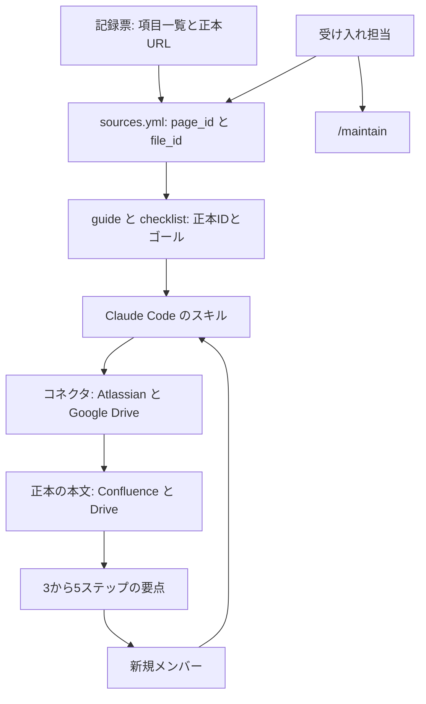
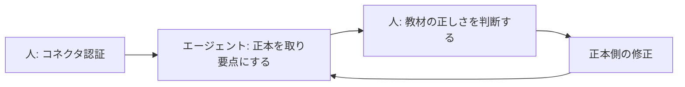

DeNA のヘルスケア領域データサイエンス部で、新規メンバーのオンボーディングを GitHub リポジトリと Claude Code のスキルへ移した設計を読みます。リポジトリに置くものと正本側に残すもの、出力の型、人とエージェントの分担が分かります。同じ説明を人が繰り返し、手順・仕様書・質問の置き場がツールごとに分かれているチームが、自分の現場へ持ち帰る判断材料にします。これは勝野侑馬（u-tan）が 2026-10-07 に [DeNA Engineering](https://engineering.dena.com/blog/2026/10/ai-agent-onboarding/) へ公開した設計の記録で、リポジトリの URL は記事にありません。


*この記事の全体像。以下、順に解説します。*

## GitHubとClaude Codeによるオンボーディング伴走とは

### 部の課題と、置いたゴール

[勝野侑馬（u-tan）](https://engineering.dena.com/blog/authors/u-tan/)は 2025 年入社で、公開時点ではヘルスケア領域のデータサイエンス部でデータ分析や R&D をしています。受け入れ担当になる準備の中で、部のオンボーディングに三つの課題を見ています。

| 課題 | 公開記事が置いたアプローチ |
|---|---|
| 情報の散らばり | 散在した情報への導線を、1 つの GitHub リポジトリへ集約する |
| 個人のスキルへの依存 | Claude Code が伴走する |
| 受け入れ担当の工数が読めない | 環境構築を、資料の取得から実行まで、可能な範囲で自動化する |

手順は Confluence、データ仕様書は Google Drive、項目一覧と進捗はスプレッドシート、質問は Slack にありました。分析には強くても、Docker や CLI 認証やログの切り分けには明るくないメンバーがいるチームです。環境構築は、初日に終わる人と 2 週間かかる人が出る設計になっていた、と公開記事は書いています。

ゴールは、オンボーディングが終わった時点で案件にアサインできる状態です。部の質問に何でも答える汎用ボットは、最初の対象から外しています。すべてをエージェントで終えると部の人との会話も減る、という理由です。

7 月配属の新卒を想定して作り始め、その新卒の配属はなく、8 月に入った中途の 1 名が利用してオンボーディングを終えた、と公開記事は書いています。日報は毎営業日コミットされています。

### リポジトリと、進むコマンド

公開記事が示すツリーは、次のとおりです。

```text
analyst-onboarding/
├── knowledge/
│   ├── sources.yml           # 正本レジストリ
│   └── guide/                # 学習ガイド（ゴール・勘所・完了判定）
├── docs/                     # チェックリスト、運用ドキュメント
├── workspace/                # 個人作業ディレクトリ（YYYY/名前/）
├── .claude/
│   ├── settings.json
│   └── skills/               # Claude Code スキル
└── CLAUDE.md                 # ドメイン知識・禁止事項
```

新規メンバーはリポジトリを clone し、Claude Code を起動して、スラッシュコマンドで進みます。

| コマンド | 用途 |
|---|---|
| `/setup-connectors` | 正本を読むためのコネクタ接続確認。最初に 1 回 |
| `/init` | ワークスペース、ブランチ、Draft PR の作成 |
| `/setup-env` | 環境構築タスクを、人の承認を挟みながら順に消化 |
| `/onboarding next` | 次にやる項目の案内 |
| `/onboarding progress` | 進捗をフェーズ別に表示 |
| `/ask` | 正本を引いて質問に回答 |
| `/daily-report` | 日報を生成してワークスペースに保存 |
| `/feedback` | 改善提案を `improvements.md` に蓄積 |
| `/maintain` | 教材の鮮度点検と更新反映。受け入れ担当向け |

副次的に、GitHub と Claude Code の使い方に、オンボーディングの過程で慣れる、とも書いています。進捗はブランチと PR で回します。

人を入れる前に、著者はエージェントへ新規メンバー役を割り当て、初日のシナリオを頭から 6 周通しています。最後の 1 周でも問題が出ました。番号順だと多要素認証より先に VPN 接続の確認が来ること、テンプレートの相対パスが 1 階層浅くチェックリストのリンク 44 件が切れていたこと、Drive から落としたスクリプトの中身に `sudo rm -rf` が 13 行あったことです。手順の文字列は、禁止コマンドのパターンに一致しなかった、と公開記事は書いています。実行された事故とは書いていません。指示どおりに動く役がいて、はじめて表面化した、としています。

### 本文を置かず、IDで正本を引く

初版は、Confluence とスプレッドシートの内容をコネクタ経由で Markdown へ転記していました。転記した瞬間から同じ情報が 2 か所にあり、正本が更新されてもリポジトリは追随しません。著者は転記をやめています。

リポジトリが持つのは、正本の所在と、その教材で何を身につけるかのガイドです。ゴール、勘所、完了判定は書きます。手順の本文は書きません。実行時にエージェントがコネクタで正本を取り、要点を圧縮して示します。

規約は三つです。正本の URL、`page_id`、`file_id` を書く場所は `sources.yml` だけです。ガイドには `正本:` と ID だけを書き、見出しアンカーは書きません。手順の本文はリポジトリで直さず、正本側で直します。アンカーを書かない理由は、Confluence の見出しが変わった瞬間に参照が切れるからです。公開記事は、こう書いています。

> 二重管理は必ずどちらかが腐ります。ならば書ける場所を1つに絞ってしまえば、腐りようがありません。

データの流れは、上流の記録票から正本の本文までを ID でつなぎ、本文の複製をリポジトリに置きません。



版が動くデータ仕様書は、固定 ID を持たせません。カタログから最新の承認済み版を辿る規則を書きます。新旧は更新日時では決めません。承認済みの版にも後から編集が入るので、更新日時が新しい方が最新版とは限らない、と公開記事は書いています。ファイル名に含まれる版の表記で決めます。

`/ask` は、`sources.yml` から ID を引き、コネクタで本文を取り、ガイドの勘所と突き合わせて答えます。正本が未登録の項目では、推測で手順を埋めません。`CLAUDE.md` に、次の文を返させる規則を書いた、と公開記事は述べています。

> 正本が未登録なので受け入れ担当に所在を確認してください

外部連携は Claude Code のコネクタに限っています。必須は Atlassian（Confluence の手順書）と Google Drive（Drive / Docs / Sheets の仕様書）です。任意は Slack（過去の質問ログ）です。自前の MCP サーバは、新規メンバー全員の手元で同じセットアップを保証する側に回るため、公開記事では採っていません。コネクタなら、新規メンバーがするのはブラウザからの認証 1 回です。

### スキルの出力と、残す成果物

`/onboarding next` の出力は、当初安定しませんでした。次にやることだけが欲しいのに判断の過程が並ぶこと、パスを示すだけで毎回リンク先を開く必要があること、踏まない条件分岐まで展開して本筋が埋もれることです。著者は、モデルの性能の問題ではなく、期待する出力の形を書いていなかっただけだった、としています。`SKILL.md` に次を足して安定した、と書いています。

- 次のタスクは結論のみ提示し、スキップの理由や進捗の推測は聞かれたときだけ答える
- 手順書は読んだうえで 3〜5 ステップに圧縮し、複数画面のスクリーンショットが前提のものだけリンク誘導にとどめる
- 正常系の手順だけ展開し、分岐は書かずに「うまくいかなかったら詰まったポイントを教えて」と一文添える

3 点目には、新規メンバーに、まずエージェントへ聞いてみる体験を積んでもらう狙いがあります。残る成果物の形も固定しています。

| 成果物 | 決めた形 |
|---|---|
| 日報（`daily_report/YYYY-MM-DD.md`） | やったこと / つまったこと / 明日やること |
| 改善メモ（`notes/improvements.md`） | ステータス / 現状 / 問題 / 改善案 / 参照 |
| チェックリスト（`checklist.md`） | 進捗の単一の情報源。日報の生成時に整合を確認する |

日報は、当初はエージェントが質問してから本人が書く流れでした。その後、タスク進捗と困りどころは行動記録からエージェントが書き、本人は自由形式で書く構成に変えています。改善メモは 5 項目固定で、オンボーディングの終了時にリポジトリを直す材料にする前提です。`/feedback` で積んだメモを、受け入れ側が PR にします。

### 人が持つ仕事

公開記事のまとめは、責任の線を次の一文で置いています。

> 認証は人、手順の要約はAI、教材の正しさの判断は人。



コネクタの認証は、エージェント側から実行できません。公開記事が観測したのは、認証用のツールを呼ぶと「ユーザーに `/mcp` を実行させてください」と返る、という応答です。そこで `/setup-connectors` を、接続確認のあとで先へ進む入口にしています。

環境構築は、CLI で完結する範囲を承認のうえでエージェントが実行し、ブラウザ操作、申請フォーム、第三者への依頼は人に渡します。この線は机上で決めず、手を動かして測り直しています。当初「自動化できる」と書いていた項目の一部は、実測すると人手が必要でした。著者は希望的観測として訂正した、と書いています。

長いページは、1 回の取得に収まらないことがあります。全社共通のハブページのように十数万文字あるページは、必要な節に絞って取る前提で組んだ、と公開記事は書いています。取得が成功しても本文が揃ったとは限らない、とも書いています。ページの作りによっては本文の一部が欠けたまま返り、エージェントからは成功に見えます。実例は、Confluence の古い編集形式の表が Markdown 取得で落ち、エージェントには「表がある」ことしか分からなかった、というものです。取得形式を変えて取り直す手順を、スキルに足しています。

8 月の利用では、ほかに次が本人から上がっています。権限確認の手順が、入れ子グループの実態と合っていなかったこと。理解度チェックが、どの教材にも無いことを問うていたことです。

## 注意点

この節は、公開記事の言葉をどこまで数値や手順として読んでよいかを分けます。設計の記述は著者の経験として読みます。効果の到達宣言としては読みません。末尾の追記には、記事の構成や推敲に LLM を使った、とあります。

### 効果の言葉

測定の記述がないまま、効果として読まれやすい箇所があります。

| 公開記事の言葉 | 置いている位置 | 読み方 |
|---|---|---|
| 初日に終わる人と 2 週間かかる人 | 仕組みを作る前の、環境構築のばらつき | 導入後に同じ条件で測り直した数値ではない |
| 約 1 か月で完了 | 2026 年 8 月に入った中途 1 名 | 所要時間の内訳も、完了の判定手順も記事にない。設計上のゴールは別に「案件にアサインできる状態」 |
| 環境構築は爆速 | その 1 名についての著者の感想 | 分や時間の計測はない |
| Slack の質問の粒度が揃った | 1 か月運用後の観察 | 件数や分類基準はない |
| 6 周、切れたリンク 44 件、`sudo rm -rf` が 13 行 | 人を入れる前に、エージェントへ新規メンバー役をさせた結果 | 著者のカウント。原ログは公開されていない |
| 十数万文字のハブページは 1 回の取得に収まらない | 動かして分かった限界 | 文字数の実測表はない |

「約 1 か月」と「爆速」を、自チームの目標値にはしません。立ち上がり時間の短縮は、導入前後の同じ指標ではありません。

公開記事はリポジトリのツリーを示しますが、URL はありません。日報と改善 PR への公開リンクもありません。2026-10-19 の GitHub 検索では、名前に `analyst-onboarding` を含む公開リポジトリのうち、記事のツリーと同名のものは見つかっていません。別名で公開されている可能性と、非公開で存在するかどうかは、この検索からは分かりません。非公開リポジトリに、記事へ書いていない監査があるかどうかも、公開情報の範囲では不明です。無い、とは断定しません。

### 腐らないと言った範囲

「書ける場所を 1 つに絞れば腐りようがない」は、手順本文の複製について著者が書いた結論です。同じ記事が、腐り得る残りを自分で挙げています。

更新日時で版を選ぶと、承認後に編集された古い版を引きます。上流の記録票と正本は食い違うことがあるので、どちらを優先するかを先に決める、と学びの 4 番にあります。理解度チェックが、どの教材にも無いことを問うていました。権限確認の手順が、入れ子グループの実態と合っていませんでした。これらは `sources.yml` の外、ガイドと判断基準の側にあります。ポインタにしても、ID の失効、版解決の規則、ガイドの勘所、理解度チェックは古くなります。

### 取得の成功と、公式文書の別の上限

取得の成功は、本文が揃ったことを意味しません。欠けたことにエージェント自身が気づかないまま、それらしい内容で埋める余地が残る、と著者は書いています。到達できた ID と、読めた本文は別です。表が落ちるのが、記事が書いた古い編集形式に限るのかは、再現条件が公開されていないため、ここからは決まりません。

2026-10-19 参照の [Claude Code の MCP 文書](https://code.claude.com/docs/en/mcp)は、別の上限を書いています。ツール出力が 10,000 トークンを超えると警告し、既定の上限は 25,000 トークンです。`anthropic/maxResultSizeChars` を宣言していないツールについて、フォアグラウンドで完了した呼び出しの、画像を含まない成功結果が 50,000 文字を超えると、会話へ全文を載せずファイルへ退避します。HTTP と SSE の応答は、展開後 16 MiB を超えると読み取りを止めて失敗します。公開記事は Claude Code の版を書いていません。記事の「1 回に収まらない」と、現行文書の「超えたらファイルへ退避する」を、同じ不具合としては扱いません。

### コネクタが読まれる条件

同じ文書の「Use MCP servers from claude.ai」では、claude.ai に追加したコネクタは、Claude Code の認証が claude.ai のサブスクリプションログインのときだけ読まれます。次のときは、以前 `/login` していても読み込まれません。

- `ANTHROPIC_API_KEY`、`ANTHROPIC_AUTH_TOKEN`、`apiKeyHelper` が有効
- Amazon Bedrock や Google Cloud の Agent Platform などのサードパーティが有効
- `ANTHROPIC_PROFILE`、フェデレーション変数、有効な Anthropic プロファイルが資格情報を渡している
- `CLAUDE_CODE_OAUTH_TOKEN` が `claude setup-token` 由来のトークンである

Team と Enterprise では、コネクタを追加できるのは管理者です。API キーだけのセッションでコネクタが動く、という前提にはしません。組織の管理者がコネクタを追加できないなら、ID だけの設計は初日に止まります。

公開記事が観測した「`/mcp` を実行させてください」は、その時点のモデルの応答です。現行文書は、セッション内の `/mcp` に加え、シェルの `claude mcp login` でも OAuth を開始できる、と書いています。公開記事の文面を、現行 CLI の唯一の手順とは読みません。

公式は、外部コンテンツを取る MCP サーバについて、接続前に信頼を確認するよう書き、プロンプトインジェクションの節へリンクしています。環境構築をエージェントに渡すと、正本に書いてあるコマンドが実行判断に入ります。`sudo rm -rf` の 13 行は、禁止コマンドの文字列一致だけでは、取得したスクリプトの中身が止まらない条件が、事前検証で見えた例です。文字列の一致だけで実行を許す読み方は採りません。

### 正しさを、誰がどの周期で見ているか

公開記事の運用記述から、作業と周期を分けると次のとおりです。

| 何を見ているか | 誰 | 記事に書かれたタイミング | 回答が正本と一致しているかの監査か |
|---|---|---|---|
| 初日シナリオを頭から通す | 著者。新規メンバー役はエージェント | 人を入れる前に 6 周 | 手順の矛盾、切れたリンク、危険なスクリプトは見つかった。`/ask` の正誤を周期的に抜く作業としては書かれていない |
| 進捗と詰まり | 新規メンバーが日報を commit し、受け入れ担当が非同期で読む | 毎営業日 | チェックリストとの整合は日報生成時に見る。欄は回答の抜き取りではない |
| 分かりにくさと不具合 | 新規メンバーが `/feedback` でメモを積み、受け入れ側が PR にする | 気づいたとき。終了時にメモを元にリポジトリを直す、と当初から考えていた | 表の欠落や、教材に無い理解度チェックが見つかった経路。予定された監査周期ではない |
| 教材の鮮度と更新の反映 | 受け入れ担当が `/maintain` | 間隔は書かれていない | 説明は「教材の鮮度点検と更新反映」。合格条件と周期は記事にない |
| 正本が未登録のときの回答 | エージェントが、担当者へ所在確認する文を返す | その条件の質問のときだけ | 登録済み正本の要約が欠落していないかは、この規則の対象外 |
| 教材が正しいかの判断 | 人 | まとめの責任分界 | 「判断は人」とある。誰が、どの質問を、どの間隔で正本と突き合わせるかは書かれていない |
| 次の受け入れの前の整備 | 著者 | 次のメンバーの前に、1 周目の指摘を全部反映する | 周期はカレンダーではなく、次の人を迎える前 |

記事が明示している継続の単位は、日報の毎営業日と、次の受け入れ前の一括反映です。`/ask` が返した要点を、正本の表や条件分岐と突き合わせる担当と周期は、この公開記事にはありません。欠落に気づいた経路として書かれているのは、使った本人の指摘です。著者は「一番のバグ発見器はその仕組みをはじめて使う人で、AIに演じてもらうのはあくまで代用だった」とまとめています。

`/maintain` を、受け入れのたびに人が起動するのか、カレンダーで回すのかは、公開記事に間隔がありません。日報の「つまったこと」を、回答の誤りとして数えているのか、環境構築の停止として数えているのかは、欄の名前だけでは分かれません。次のメンバーへの反映のあと、同じ抜けを次の周期でどう見つけるのかも書かれていません。次の目標は「1 周目の指摘を全部反映して 2 周目を滑らかにする」であり、定常の抜き取り監査ではありません。

正しさの判断を人に残す、と書いたあと、その人の点検周期は `/maintain` の説明にありません。

別の公開例は、回答の見方を週次で書いています。[Driftproof の事例](https://www.driftproof.io/use-cases/support-chatbot-hardening-and-audit)は、公開サポートボットについて、会話を毎週分類して人が順位つきで見直し、同じ質問の回答差分とリンクを毎週点検する、と書いています（2026-10-19 参照）。同ページの「死んだ商品リンクを含む回答の割合が、3 週間で 77% から 3% へ」はベンダーの自己申告です。DeNA のオンボーディングで同じ周期が要る、という証拠にはしません。差分として使えるのは、回答そのものを定点で見ると書いている公開例がある、という点までです。

別組織の自己報告では、古い文書を読んだボットがデータフローを誤って説明し、新人が半日実装してからメンターが見つけた、とあります（[Using AI to Onboard New Engineers](https://zidanewu.com/posts/ai-onboarding-engineers/)、2026-10-19 参照）。同記事の週数や質問件数は著者の見積もりなので、ここには数値を転記しません。

前回の公開記事（[スクラム開発の壁をAIで突破したら、もはや別ゲーだった](https://engineering.dena.com/blog/2025/11/ai-scrum/)、2025-11-11）から今回までの間隔は、掲載日どうしで約 11 か月です。今回の「1 年経ってモデルが大幅に進化した今でも、責任範囲の調節は変わらない」は、モデルの世代を特定したベンチマークではありません。

## 同じ型を自分のチームで使うときの判断

この事例が移したのは、資料の置き場そのものより、説明の所在と、直してよい場所です。完了を資料の本数で数える読み方は、公開記事の設計と合いません。効果の大きさは、この公開記事だけでは決まりません。

設計が維持できている根拠として、公開記事が具体的に書いているのは次です。

- 転記をやめ、正本の更新に追随しない複製を置かなくした
- ガイドにアンカーを書かない理由が、Confluence の見出し変更で参照が切れるから、と特定されている
- 出力が安定した理由を、モデルではなく `SKILL.md` の出力の形に置いている。Claude Code の公式文書は、スキルを `SKILL.md` の指示として置き、本文は使用時にだけ読む、と書いています（[Extend Claude with skills](https://code.claude.com/docs/en/skills)、2026-10-19 参照）。禁止やドメイン知識を `CLAUDE.md` に置き、手順をスキルに置く配置は、この読み込み方と矛盾しません
- 自動化できると書いた項目の一部を、手を動かしたあと人手に戻している
- 投入前の 6 周で、人が読み飛ばす順序の矛盾と、生成して踏むまで見えないリンク切れと、文字列禁止では止まらないスクリプトを見つけている

利用者の感想として公開記事が紹介しているうち、この線引きに関わるものをそのまま引きます。計測値ではありません。

> 「この理解であっているかな？」というレベルの疑問点は、正本から正解・間違いを判断可能か、オンボ担当に質問が必要（＝正本や接続されている資料等からは判断不可）かを振り分けられる

> 「AI使わず自力で実装・記述が必要なオンボ内容はclaude codeは作業してくれない」のできちんと実力がつく（質問に対するアドバイスとかはくれる）

自分のチームで同じ型を使うときは、判断を三つに分けます。

1. リポジトリに置くのは、正本の ID と、ゴール・勘所・完了判定と、出力の型です。手順本文の複製は置きません。版が動く文書は、更新日時ではなく、ファイル名の版表記のような規則で解決します。直してよい場所は正本側だと、ガイドに書きます。
2. 完了は、資料の本数で見ません。新規メンバーがエージェント経由で開ける正本の範囲と、開けなかったときに担当者へ戻る条件を、リポジトリの所有者の仕事にします。未登録の正本を推測で埋めない規則は、公開記事が `CLAUDE.md` に置いた文がそのまま使えます。
3. 古い説明を止める条件も、所有者に持たせます。公開記事が実際に使っている単位は、日報の毎営業日と、次の人を迎える前の一括反映です。公開記事は、回答の正誤を見る周期を書いていません。ここは足します。次の受け入れの前に、所有者が同じ質問をエージェントに聞き、圧縮された 3〜5 ステップを正本の表と条件分岐と突き合わせます。表が落ちる取得と、長文を節に絞った取得は、その突き合わせの対象にします。週次が必要かどうかは、この記事からは決まりません。

採らないものは、次です。「約 1 か月」や「爆速」を自チームの目標値にすること。コネクタを、API キーだけのセッションで動く前提にすること。禁止コマンドの文字列一致だけで、取得したスクリプトの実行を許すこと。

逆転条件は、正本がコネクタから安定して取れないこと、または組織の管理者がコネクタを追加できないことです。その場合、ID だけの設計は初日に止まります。公開記事が棄却した自前 MCP を、セットアップコストを受け入れたうえで比較し直します。

## まとめ

DeNA のこの設計は、オンボーディングの手順本文をリポジトリへコピーせず、正本の ID と、ゴール・勘所・完了判定と、スキルの出力の型だけを GitHub に置きます。実行時に Claude Code のコネクタが Confluence と Google Drive から本文を取り、3〜5 ステップに圧縮します。認証と、教材が正しいかの判断は人に残しています。

効果として読まれやすい「約 1 か月」や「爆速」には、導入前後の同じ測定がありません。取得の成功は本文が揃ったことではなく、コネクタは claude.ai のログインと管理者の追加に依存します。同じ型を使うなら、次の受け入れの前に、圧縮された手順を正本の表と条件分岐へ突き合わせる役を、リポジトリの所有者に持たせます。

この記事が少しでも参考になった、あるいは改善点などがあれば、ぜひリアクションやコメント、SNSでのシェアをいただけると励みになります！

## 参考リンク

- 勝野侑馬（u-tan）. 「オンボーディングをAIエージェントに任せたら、もはや別ゲーだった」. DeNA Engineering. 2026-10-07. https://engineering.dena.com/blog/2026/10/ai-agent-onboarding/
- 勝野侑馬（u-tan）. 「スクラム開発の壁をAIで突破したら、もはや別ゲーだった」. DeNA Engineering. 2025-11-11. https://engineering.dena.com/blog/2025/11/ai-scrum/
- 著者ページ u-tan. https://engineering.dena.com/blog/authors/u-tan/
- Anthropic. Connect Claude Code to tools via MCP. 2026-10-19 参照. https://code.claude.com/docs/en/mcp
- Anthropic. Extend Claude with skills. 2026-10-19 参照. https://code.claude.com/docs/en/skills
- Driftproof. AI Support Chatbot Audit and Hardening. 2026-10-19 参照. https://www.driftproof.io/use-cases/support-chatbot-hardening-and-audit
- Zidane Wu. Using AI to Onboard New Engineers. 2026-10-19 参照. https://zidanewu.com/posts/ai-onboarding-engineers/
