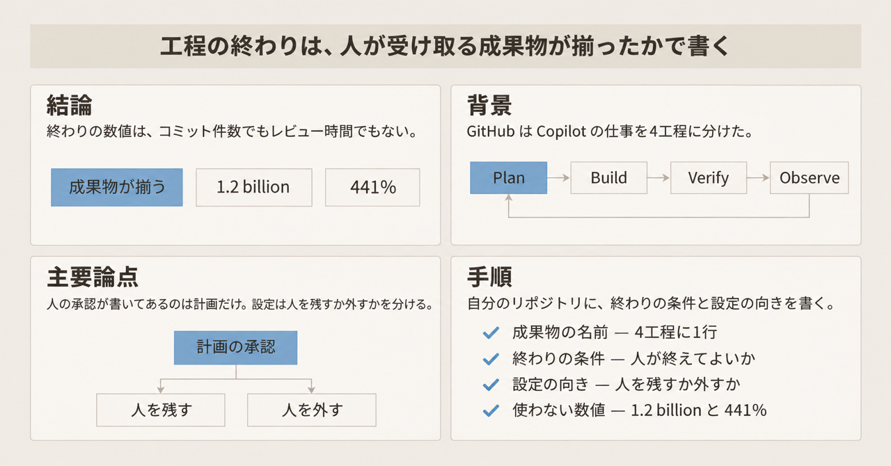
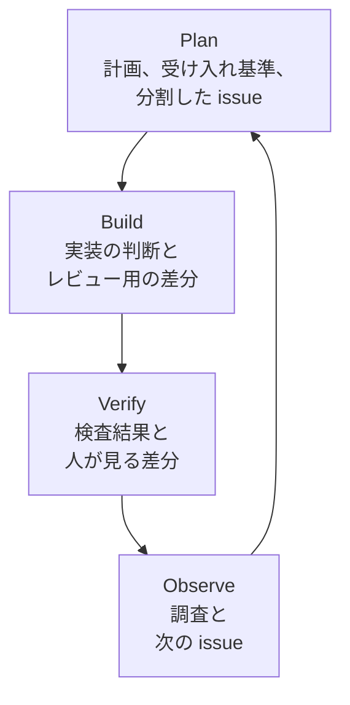
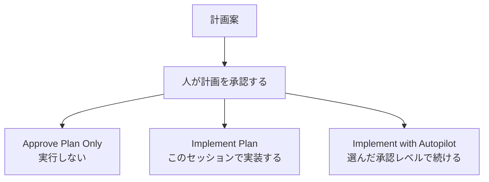
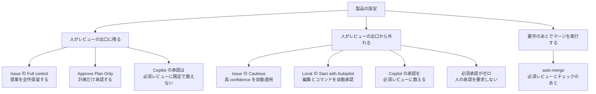

2026年11月6日、GitHub は Copilot を使った開発を Plan、Build、Verify、Observe の4工程に分ける解説を公開しました。著者は Nick Liffen と Philip Holleran です。この解説は、GitHub が自社製品について書いたものです。

解説は、計画、実装、差分の確認、本番で起きたことの調査を、人が Copilot と進める流れとして説明しています。この記事では、各工程で人が受け取るものと、その受け取りを工程の出口にするときの書き方を整理します。

*この記事の全体像。以下、順に解説します。*

## GitHub Copilotの4工程とは

GitHub の解説は、実装の前後にある仕事を4つの名前で呼んでいます。Plan は計画、Build は実装、Verify は差分の確認、Observe は出荷後の調査です。計画が実装へ渡り、差分が確認へ渡り、出荷後の観察が次の計画の材料になります。

各工程で人が受け取るものは、次のとおりです。

| 工程 | 人が受け取るもの |
| --- | --- |
| Plan | レビューできる計画、明示した受け入れ基準、分割した issue |
| Build | 実装上の判断と、レビュー用に焦点を絞った差分 |
| Verify | 検査の結果と、人が意図と壊れ方を見る差分 |
| Observe | 根拠つきの調査と、次の issue の草案 |

### Plan

Plan では、散らばった要件を計画と GitHub Issue にまとめます。成果物は、レビューできる計画、明示した受け入れ基準、分割した issue です。

複雑な作業には Plan Mode を使います。Plan Mode は、実装の前に計画エージェントが計画案を作るモードです。公式ドキュメントは、計画エージェントがコードを変更するのは、人が計画を確認して承認したあとだと書いています。対応する編集画面は Visual Studio Code、JetBrains、Xcode、Eclipse です。Visual Studio では、このドキュメントの時点では使えません。

複雑さの低い issue は、Agentic Workflows でラベルを付け、タスクの複雑さを見積もったあと、Copilot へ直接割り当てられます。Agentic Workflows は、issue の振り分けを自動化する GitHub の仕組みです。どの issue を Copilot に割り当てるかは、設定できます。

### Build

Build では、同じ Copilot のセッションを別の端末から続けられます。クラウドサンドボックスでは、人が席を外したあとも作業が続きます。人が受け取る実装上の判断は、その作業で選んだ実装の選択です。差分は、レビューするために範囲を絞った変更です。

作業ごとの前提は、リポジトリの指示と共有メモリが運びます。リポジトリの指示は、チームの慣行と、検証に使うコマンドです。共有メモリは、Copilot がそのリポジトリで再利用する事実です。Dreaming は、過去のエージェント会話、リポジトリのメモリ、採用されたコードレビューのフィードバックから、メモリを更新し、指示や skills の更新案を出します。カスタム指示は、リポジトリの指示としてチェックインされるファイルです。skills は、その隣にチェックインされるファイルです。changelog は、skills の中身を、ファイルであること以上には書いていません。変更案は、チームがレビューする pull request になります。Dreaming は public preview で、利用は opt-in です。

### Verify

Verify では、人が差分を見る前の作業が並びます。変更を検査するもの、依存を分けてレビューしやすくするもの、ダウンロードを止めるもの、修正案を出すものが含まれます。

- stacked pull requests は、依存のある作業を小さな pull request に分けます。各 pull request は単独でレビューでき、依存は消さず見えるように残します。
- Code Quality は、変更をコーディングの慣行と組織の基準に照らします。
- Copilot code review は、変更に対する自動のフィードバックです。単純な変更は軽い分析、複雑な変更は深い分析になります。
- AI Scan は、GitHub のコード解析である CodeQL が覆わない言語やファイルの脆弱性を探します。
- secret detection は、パスワードのようにパターン一致では拾いにくい秘密情報を探します。
- ライセンス確認は、依存関係のライセンスを自社の規則と照合します。
- package firewall は npm 向けの public preview で、設定したセキュリティ方針に反するダウンロードを止められます。
- Agentic Autofix は、セキュリティ指摘への修正案を出します。

Agent Merge は、pull request に選んだ障害が出ると、クラウド上の Copilot が作業を始める機能です。

Verify で人が注意を向ける先は、コードが意図どおりかと、何が壊れうるかです。

### Observe

Observe では、観測ツールや業務データへコネクタ経由でつなぎ、どのリクエストや顧客群が影響を受けたかを調べます。

Copilot は、根拠と受け入れ基準、回帰テストを含む issue の草案を作ります。人が時間を使うのは、何を変えるかの決定です。

### 4工程のつながり

### 計画の承認と実装の開始

GitHub の Plan Mode では、計画が揃ったあと、その場で実装を始めるか、計画を Markdown として開いて残すかを選べます。

Visual Studio Code の計画ドキュメントは、計画を承認する操作と、その後のツール操作を承認する操作を分けています。計画を承認したあとの選択肢は3つです。

| 操作 | 公式の説明 |
| --- | --- |
| Approve Plan Only | 計画を承認し、実行しない |
| Implement Plan | 計画を承認し、このセッションで実装を始める |
| Implement with Autopilot | 選んだ承認レベルで、自律的に続ける |

承認レベルは、どのツール操作に確認が要るかを決める、そのセッションの設定です。引用した計画の節は、レベル名の一覧を書いていません。

## 注意点

ここまでの説明は、GitHub の解説が各工程に置いた受け取り物です。同じ解説の数値と、マージの一文は、工程の完了条件にはそのまま使えません。

### 週次のコミット数

解説の冒頭は、2026年10月の1週間に GitHub のコミットが12億件を超え、前年の同じ時期より400%を超えて増え、2025年に GitHub が受け取ったコミットの全部より多い、と書いています。この文には、集計方法も図もリンクもありません。

「over 400% more」は、前年のその週の5倍より多い、という意味です。12億件は "more than 1.2 billion" なので、下限です。

Octoverse は、GitHub が年次で出す開発活動の集計です。公開と非公開を合わせたコミットは、2025年10月1日から2026年9月30日までで 34.3 billion だったと書いています。この窓は、解説の1週間でも、暦年でもありません。貢献（contribution）は push を1回と数えるため、コミット総数は貢献総数を超えうると、同じ記事が定義しています。公開の貢献は 2026年に 2.5 billion、前年は 1.12 billion です。これは、解説が言う commits とは別の単位です。

週が2025年の全コミットより多い、という主張を、解説の下限と Octoverse の年次合計だけで確かめる読み方はありません。比較先の2025年通年が、どのリポジトリ集合の、どの週境界の、どのコミット定義かも、解説には書いてありません。

解説の末尾は、ワークフロー全体でエージェントが手伝えば、コミット数が示す生産性を感じられるかもしれない、と書いています。冒頭は、前年より400%生産的になった感じがするかを問うています。どちらも、工程を終えてよいかを判定する数値ではありません。

### レビュー時間の441%

解説は、開発テレメトリをまとめる Faros AI の研究として、AI 採用が低い状態から高い状態へ移ったチームで pull request がレビューに 441% 長く留まった、と書いています。英文は "pull requests spent 441% longer in review" です。主語は pull request で、レビュー段階にいた時間を言っています。

リンク先（2026年4月12日）の原文は、次のとおりです。

> Median time in review is up 441.5%.

比較は、各組織の中で AI 採用が最も低い期間と最も高い期間のあいだの指標変化です。同じ段落には、別の指標があります。code review に費やした平均時間は 199.6% 増です。最初の pull request レビューまでの中央値は 156.6% 増です。

GitHub の文は、Faros の "Median time in review is up 441.5%." に対応すると読めます。GitHub は、中央値とも 441.5 とも書いていません。199.6% は人が code review に費やした平均時間であり、441.5% とは別の指標です。156.6% も、最初のレビューまでの中央値であり、別の指標です。

同じページは、人のレビューもエージェントのレビューも無いままマージされた pull request が 31.3% 増、とも書いています。これも、レビュー段階にいた時間とは別の指標です。

Faros のページは、2年のテレメトリ、22,000人の開発者、4,000チーム超、とデータ規模を自己申告しています。全文 PDF のその他の指標は、ここでは確認していません。441% を手順の根拠に使うなら、Faros の中央値 441.5% を丸めた数であり、GitHub は中央値と書いていない、と併記します。

### Agent Merge と auto-merge

解説の Verify は、Agent Merge の説明と、検証が通れば Copilot がマージする、という文を続けて書いています。公式の手順ページは、この2つを分けています。

Agent Merge は、選んだ障害が pull request に出ると、クラウド上の Copilot が作業を始めます。選べる操作は、失敗した GitHub Actions の workflow を直すことと、マージ競合を解くことです。手順ページは、レビューコメントを直す操作としては挙げていません。解説がレビューコメントにも手を入れる、と書いている点は、この手順ページとはずれます。

手順ページは、Agent Merge が変更のレビューやリポジトリのマージ要件の代わりにはならない、と書いています。マージ前に、Copilot の変更と workflow の結果を見る、とも書いています。英文では "Enabling Agent Merge does not enable auto-merge." です。Agent Merge を有効にしても、auto-merge は有効になりません。

auto-merge は、必要なレビューとステータスチェックが通ったあとにマージする GitHub の機能です。Agent Merge と併用すると、Copilot が障害を直し、要件が揃ったところで GitHub がマージします。auto-merge を有効にしても、必須レビューそのものは外れません。

自分が作る pull request で Agent Merge を既定にする設定は、手順ページに操作があります。その設定の初期値は、手順ページに書いてありません。

解説は、GitHub のイベントである GitHub Universe 2026 のセッションにも触れています。セッションで、ブログ本文に無い停止条件が話されたかは、本文からは分かりません。

## 工程を終えてよい条件

4工程は、かかった時間や件数で完了を見るやり方から、工程ごとに受け取る成果物へ移すときの見出しに使えます。各見出しに書くのは、人が受け取る成果物の名前、誰が受け取るか、その成果物が揃ったら人がその工程を終えてよいか、です。

解説が始め方として置く問いは3つです。その作業に必要な文脈は何か。どうレビューし、どうテストするか。出荷後に、動いたと何をもって知るか。この3つは、入出力を書くときの問いとして使えます。

人が承認するまで次へ進まない、と読める文は、Plan にあります。

> Review and approve the plan before handing it off to Copilot to begin implementation.

Build は、人が離れたあともクラウドサンドボックスで作業が続く、と書いています。Observe は、人が何を変えるかを決める、と書いています。どちらにも、人が承認するまで次へ進まない、という文はありません。

Verify は、人の注意が意図と壊れ方に残る、と書いた同じ節で、設定次第では検証通過後に Copilot がマージする、と書いています。人の確認を必須のゲートと読むのは、この文で弱まります。

終えてよい条件の例は、次のとおりです。

- Plan の計画なら、受け入れ基準が文章になり、人がその計画を承認した。
- Build の差分なら、レビューするために範囲を絞った変更が渡っている。
- Verify なら、意図と、壊れうる点について人がコメントした。並びにある検査、分割、ダウンロードの停止、修正案は、そのコメントの前に置かれる作業の名前です。
- Observe の調査なら、根拠、受け入れ基準、回帰テストが issue に入った。回帰テストが無い場合は、無いことが書いてある。

ブログがこの終えてよい条件を書いていない工程では、条件を書き手が足します。差分を出口にしないなら、代わりの成果物の名前を書きます。

2026年9月14日の実務者の記録は、その一例です。そのリポジトリの branch protection は承認ゼロで、CI が緑ならエージェントが自分でマージします。人は、稼働中の機能を作業項目の上で承認します。これは測定ではなく、そのチームの設計の説明です。レビュー一般が消えた、とは読めません。機能 B が却下された機能 A の上に乗っているときは、エージェントは競合を作業項目に報告し、判断を人に返します。同じ記録では、本番への昇格は人のリリース判断として残しています。

## 設定が人を出口に残すとき

製品の設定は、同じ工程の出口を残す側と、人をその出口から外す側に分かれます。各工程で人が終えてよい条件と、設定の向きを対にします。

Issue の自動化は、ラベル、フィールド、issue の種別、issue を閉じること、担当者への変更に、理由と confidence を付けます。confidence は、自動化がその変更をどれだけ確からしいと見るかを high、medium、low の3段階で付けたものです。リポジトリの自動化レベルが、自動で適用するしきい値を決めます。このしきい値は、issue の属性を自動で書き換えるかどうかの話です。Plan で複雑さの低い issue を Copilot に割り当てる条件と、同一の設定とは、参照したページには書かれていません。

- Full control は、変更を全部保留します。何も自動では適用しません。
- Cautious は既定です。confidence が high の変更だけを自動で適用し、それ以外は保留します。
- Balanced は、定型で明確な変更を自動で適用し、曖昧なものは保留します。
- Full automation は、変更を自動で適用します。不確実と印が付いたものだけを保留します。

この承認は、作業上の便宜です。公式は、サーバ側の境界ではない、と書いています。権限のあるエージェントは、提案を経ずに issue を直接変更できます。境界にするなら、リポジトリとエージェントの権限を使います。対象は、自動化が issue に加える変更だけです。人が手で直す変更や、pull request の作成やコードの push には及びません。

Visual Studio Code で Local を選んだセッションは、Local harness と呼ばれます。Copilot の Plan Mode とは、計画の操作が別です。その Start with Autopilot（Preview）は、計画のあとで実装を始める操作です。ファイル編集、ターミナル、外部ツールの確認を自動で通します。Copilot セッションの Implement with Autopilot も、計画を承認したあとで続けます。こちらは選んだ承認レベルに従うので、確認はそれだけでは消えません。組織は、Start with Autopilot を制限できます。

Copilot code review の承認は、既定では pull request の必須承認に数えません。エンタープライズの「Copilot に pull request の承認を許す」は、Disabled everywhere が既定です。この既定では、組織は Copilot の承認を有効にできません。

リポジトリ、組織、エンタープライズで承認を有効にすると、Copilot はチームメイトの承認と同じように、必須承認を満たす承認レビューを送れます。承認のあとに新しい commit が積まれると、その承認は取り消されます。承認を許す設定と、マージ要件に数える設定は別です。組織が「必須レビューに数える」を Disabled everywhere にすると、どのリポジトリでもマージ要件には数えません。パスの glob で、数える対象のファイルを変えられます。

人がレビューから外れるのは、必須承認がゼロのときと、必須承認を人以外が満たせるときです。auto-merge は、必須レビューとチェックのあとでマージを実行します。これだけでは、人のレビュー要件は外れません。

手順へ併記するときの読み方は、次のとおりです。

- Issue 自動化が Cautious なら、confidence が high の issue 変更は人を待ちません。
- Local の Start with Autopilot を許すなら、計画承認のあと、編集とコマンドの確認が自動で通ります。
- Implement with Autopilot は、選んだ承認レベルに従うので、それだけでは確認は消えません。
- 必須承認の数がゼロなら、人の承認は最初から要りません。
- Copilot の承認を必須レビューに数えるなら、人の承認が無くてもマージ要件を満たしえます。
- auto-merge がオンでも、必須承認を人が満たすなら、その旨を書きます。

## 生成の速度を完了条件にした記録

導入の完了は、生成が速くなったことでは置きません。前節の成果物が、工程の出口としてチームの手順に入ったことで置きます。コミット数、400%、441% は、その出口の数値にしません。

生成速度を完了条件にして問題が起きなかった事例は、ここで参照した記録の範囲では見当たりません。arXiv:2607.01904v2（2026年10月27日）は、匿名化された中規模の B2B ソフトウェア企業で、CTO が進捗指標を「エンジニアあたり月あたりのマージ済み pull request」に置いた事例です。2025年6月の目標は、AI でその数を倍にすることでした。

論文のパネルは 802人、196,212件の pull request、2024年1月から2026年4月です。活動開発者あたりの平均 pull request は、基準期間である2025年1月から4月の 21.2 から、2026年4月の 44.3 へ増え、2.09倍です。同じ時期に pull request の量は 3.1倍、レビュアーとして動いた人のプールは 1.5倍で、レビュアーあたりの負荷はおよそ倍（2.0倍）になりました。2.09倍と 2.0倍は、別の量です。

AI が書いた pull request は、最初の人のレビューからマージまで約20%長く、最初のコミットからマージまたはクローズまでのサイクルタイム全体では約22%長い、と本文は書いています。論文は、急な品質崩壊に反対する証拠はあるが、品質コストは除外できない、とも書いています。レビュー側のコストを同時に記録しているので、「速度を完了条件にして問題が無かった」には使えません。

Faros の 31.3% は、レビュー無しマージの増加です。入出力を出口にしたチームの測定ではないので、ここまでの結論を弱める証拠には使いません。

## チームの手順に残すこと

直近で書くことは、4つです。

1. 4工程それぞれに、成果物の名前と、人が終えてよい条件を1行で書きます。
2. 差分以外を出口にする工程があれば、その成果物の名前を書きます。
3. 上の設定が、自分のリポジトリでどちらを向いているかを手順に併記します。必須承認がゼロなら、その旨を書きます。auto-merge がオンでも、必須承認を人が満たすなら、その旨を書きます。
4. 1.2 billion、400%、441% は、定義が揃うまで根拠の数値にしません。441% を使うなら、Faros の中央値 time in review 441.5% の丸めであり、GitHub は中央値と書いていない、と書きます。199.6% は別指標です。データ規模は Faros の自己申告です。

## まとめ

GitHub の4工程は、計画、実装、差分の確認、出荷後の調査で、人が受け取るものを分ける見出しです。Plan は計画と受け入れ基準と issue、Build は焦点を絞った差分、Observe は根拠つきの issue 草案を、人が受け取ります。

人が承認するまで次へ進まない、と解説が書いているのは、Plan の計画承認です。Build と Observe の終了テスト、Verify で人の確認を必須にするかは、書き手が成果物の名前とともに足します。差分を出口にしない設計はあり、その場合は代わりの成果物を書きます。

設定は、その出口に人を残すか、人を外すかを別に変えます。Issue の Full control、計画だけの承認、Copilot 承認を必須レビューに数えない既定は、人を残す側です。Cautious の高 confidence、Local の自動承認、必須承認ゼロ、Copilot 承認を必須レビューに数える設定は、人を外す側です。auto-merge は、必須レビューとチェックのあとでマージを実行します。

週次の 1.2 billion、400%、レビュー時間の 441% は、工程を終えたことの数値にはしません。

この記事が少しでも参考になった、あるいは改善点などがあれば、ぜひリアクションやコメント、SNSでのシェアをいただけると励みになります！

## 参考リンク

- Nick Liffen, Philip Holleran. [Beyond code generation: A developer’s guide to agentic engineering](https://github.blog/ai-and-ml/github-copilot/beyond-code-generation-a-developers-guide-to-agentic-engineering/). GitHub Blog. 2026-11-06.
- GitHub Staff. [Octoverse: Commits, pushes, reach new highs in 2026 as developers build with agents](https://github.blog/news-insights/octoverse/octoverse-commits-pushes-reach-new-highs-in-2026-as-developers-build-with-agents/). GitHub Blog. 2026-10-28 公開、2026-11-06 更新.
- Faros AI. [AI Acceleration Whiplash: Takeaways](https://www.faros.ai/blog/ai-acceleration-whiplash-takeaways). 2026-04-12.
- GitHub Docs. [Using Plan Mode](https://docs.github.com/en/copilot/how-tos/copilot-in-your-ide/use-copilot-agents/use-plan-mode).
- VS Code docs. [Planning](https://code.visualstudio.com/docs/agents/run/planning).
- GitHub Docs. [About rationale, confidence, and approvals for issues](https://docs.github.com/en/copilot/concepts/agent-capabilities/agent-powered-workflows-and-operations/about-automation-rationale-and-approvals).
- GitHub Docs. [Getting pull requests ready to merge with Agent Merge](https://docs.github.com/en/copilot/how-tos/copilot-on-github/use-copilot-agents/watch-and-fix-pull-requests).
- GitHub Docs. [GitHub Copilot code review](https://docs.github.com/en/copilot/concepts/agent-capabilities/agent-powered-workflows-and-operations/code-review).
- GitHub Docs. [Configuring code review by GitHub Copilot](https://docs.github.com/en/copilot/how-tos/copilot-on-github/set-up-copilot/configure-code-review).
- GitHub Changelog. [GitHub intelligence puts your code, context, and history to work](https://github.blog/changelog/2026-10-28-github-intelligence-puts-your-code-context-and-history-to-work/). 2026-10-28.
- Hao He ほか. [AI Writes Faster Than Humans Can Review: A Longitudinal Study of an Enterprise 2× Mandate](https://arxiv.org/html/2607.01904). arXiv:2607.01904v2. 2026-10-27.
- [AATB: our agent merges its own pull requests](https://paarhu.is/aatb-agent-merges-its-own-pr/). 2026-09-14. 設計の説明であり、測定ではない.
