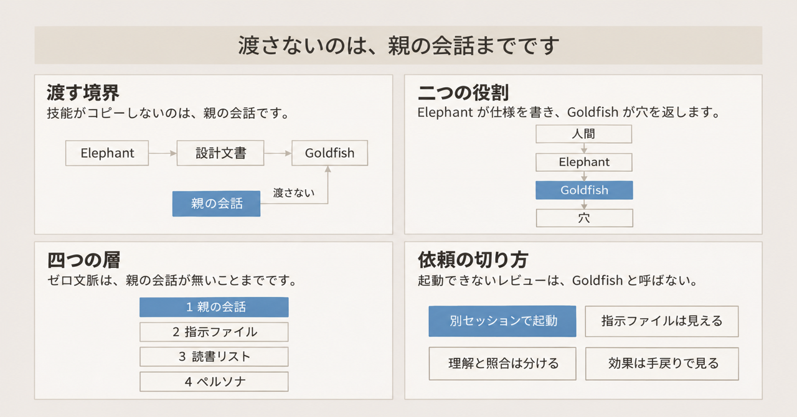
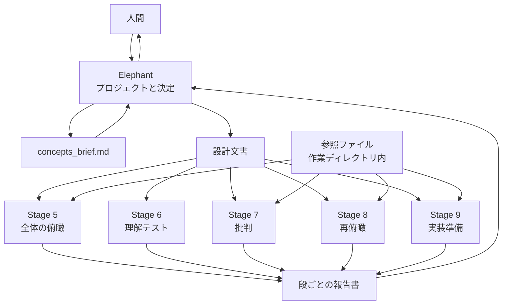

コーディングエージェントに仕様を書かせたあと、実装の前に穴を探す手順があります。Elephant-Goldfish Model（以下、EGM）は、その手順を役割で分けた Apache-2.0 のプラグインです。Elephant は、プロジェクトとこれまでの決定を持つ深文脈のセッションです。Goldfish は、その会話をコピーせずに新しく起動するサブエージェントです。Elephant が要件を聞き、概念メモと設計文書を書きます。Goldfish がその文書を読んで穴を返します。人間がトレードオフを決め、仕様を承認してから実装に進みます。

README は、公式にサポートされる Google 製品ではない、と書いています。

この記事では、レビューの段ごとに、渡るものと渡らないものを整理します。

*この記事の全体像。以下、順に解説します。*

## Elephant-Goldfish Modelとは

EGM の公式 README は、"Design with an elephant. Review with a goldfish." と書いています。Google Cloud Tech は 2026年11月7日に、深い文脈のエージェントが仕様を書き、ゼロ文脈のサブエージェントがコードの前にストレステストする、と紹介しました。技能が Goldfish にコピーしないのは、親の会話です。リンク先は [google/elephant-goldfish-model](https://github.com/google/elephant-goldfish-model) です。ここでの対象は、2026年11月10日時点の `main` です。コミットは `bdcfe8cdaee99699c4b2cb7ad4e3b2c1a6b56a31` で、committer date は 2026年11月9日 22:31 UTC です。

### 配布と版

ライセンスは Apache-2.0 です。プラグイン版は `0.1.1` で、リリース `v0.1.1` は 2026年11月6日に公開されています。リリース文書は、1.0 には技能名・引数・出力パス・報告形式の安定した契約が必要だとしています。1.0 の前は、非互換のワークフロー変更があり得ると書いています。

配布物は、ホストのアカウントで動きます。privacy 文書は、EGM 独自のアカウント、ホスト型 API、テレメトリ端点は無い、と書いています。2026年11月10日に GitHub API で見た星の数は 16494 です。

### 七つの技能

技能は 7 つです。名前は `brainstorm`、`draft`、`review`、`review-loop`、`resolve`、`bootstrap`、`drift-report` です。

`brainstorm` は、問い返しで概念を仮説に整え、概念メモ `concepts_brief.md` を書きます。人間が準備完了と言うまで、Goldfish を起動しません。`draft` は、その概念メモから設計文書を書きます。設計技能は、ソースツリー内の本番ファイルを作ることを指示で禁じています。`review` がレビューの段を担います。`review-loop` は、その段を繰り返す技能です。`resolve`（`egm-resolve`）は、指摘の分類と、承認された修正の適用です。`bootstrap` は、ディレクトリの README を EGM の契約に沿って書く技能です。`drift-report` は、設計文書とコードのずれを検出する技能です。

### レビューの五段

レビューの正本は 5 段です。レビュー技能が実行するのは、Stage 5 から Stage 9 です。Stage 1 から Stage 4 は、このレビュー技能の手順にはありません。内容は、全体の俯瞰、理解テスト、批判、修正後の再俯瞰、実装準備です。

| 段 | 役割 | 設計文書以外に渡せるもの |
|---|---|---|
| Stage 5 | 全体の俯瞰 | 文書が指す、作業ディレクトリ内のファイル |
| Stage 6 | 理解テスト | 読書リストは渡さない |
| Stage 7 | 批判 | 文書が指す、作業ディレクトリ内のファイル |
| Stage 8 | 修正後の再俯瞰 | 参照ファイルに加え、Stage 5 の俯瞰報告 |
| Stage 9 | 実装準備 | 参照ファイル。文書のパスと生きたソースの照合 |

Stage 6 が外すのは、こちらから渡す読書リストです。読めるファイルを、その段のために閉じる規則ではありません。Stage 6 は、言い換えを先に書かせます。言い換えられない節は Blocker です。Blocker と Major は、未決着のままだとループを終わらせない重さです。Nit は、残っていてもループを止めません。

Goldfish は、新しいサブエージェントとして起動します。サブエージェントを作れないホストでは、同じ会話の中でレビューを続けません。そこで停止します。

指摘の採否は、Elephant の会話に戻ります。分類は 4 つです。修正案、反論、人間への引き上げ、見送りです。解決役の Elephant は、Goldfish が読めなかった知識だけで指摘を却下しません。人間に上げます。理解の穴は、反論の対象にしません。

`review-loop` の収束は、未決着の Blocker と Major が無いラウンドが 2 回続くまでです。技能の上限は 5 ラウンドです。上限に達したら、利用者は受け入れ、続行、草案へ戻す、のいずれかを選びます。

`resolve` の Auto accept は、修正案だけを適用します。反論、引き上げ、見送りは飛ばします。

### 段ごとに分かれる受け渡し

渡すものと渡さないものは、段で分かれます。現行技能が禁じるのは、親の会話を Goldfish へコピーすることです。こちらから渡す読書リストは、段ごとに違います。レビュアーがツールで自分からファイルを開くことまで、この規則は禁じていません。

図の `concepts_brief.md` は、`brainstorm` が書く概念メモです。Stage 6 にだけ、参照ファイルからの矢印がありません。Stage 8 は Stage 5 の俯瞰報告も読むので、その段の入力は設計文書だけではありません。

深文脈の Elephant に残るものは、次のとおりです。

- プロジェクト、要件、それまでの決定、人間との質疑
- `brainstorm` では、人間が準備完了と言うまで Goldfish を起動しないこと
- 指摘の分類と、承認された修正の適用

Goldfish に渡るものは、次のとおりです。

- 設計文書、またはその行範囲
- Stage 6 以外の `GoldfishContext`。これは、設計文書とは別に渡す読書リストです。作業ディレクトリ内に解決できるリンクは、自動で足します。作業ディレクトリの外と URL は、承認が要ります。ヘッドレスで答えが無い URL は落とします
- ペルソナ（`agents/*.md`）と、段に紐づく文書規格。ペルソナは、その段の読み方を決める役割定義です。文書規格は、その段の指摘をどう書くかを決める基準です
- 読取ツール。Claude Code では、レビュアーに渡すツールの指定（adapter）が `Read`、`Grep`、`Glob` です。俯瞰役はコード検索を必須とします。実装準備の codebase 役は、文書のパスと生きたソースを照合する役割です

技能が Goldfish に渡さないと書くものは、次のとおりです。

- それ以前の会話
- Stage 6 の読書リスト
- URL そのもの。ローカルファイルに保存してから、パスを渡します。Claude のレビュアーは URL を開けません

## 注意点

公表された言い方、自己申告の数字、ホストが子に足す指示は、前節の入出力より広く読めてしまいます。どこまでを事実として扱うかを、ここで分けます。

### 公表された言い方と現行の入出力

公式の言い方は、現行の入出力より広いものがあります。投稿の一文を、そのまま技能の仕様として読むとずれます。

| 言い方 | どこに書いてあるか | 現行リポジトリで確認できる範囲 |
|---|---|---|
| zero-context subagents | Google Cloud Tech、2026年11月7日 | 親の会話は渡さない。読書リスト、ペルソナ、文書規格、読めるソースは渡る |
| Goldfish は 3 段 | [公式ブログ](https://opensource.googleblog.com/2026/10/introducing-elephant-goldfish-model-plugin.html)、2026年10月22日 | 現行のレビューは 5 段。ブログは公開時点の説明 |
| No code is written here | 同じブログの Elephant 説明 | 設計技能は、ソースツリー内の本番ファイル作成を指示で禁じる。`bootstrap` は別で、[#261](https://github.com/google/elephant-goldfish-model/issues/261) が、`npx prettier --write` を含むプロジェクトの整形コマンドを許す、と 2026年11月2日の確認として記録している。悪用の実証ではなく、既存の実行経路である。ホスト強制のサンドボックスとは書かれていない |
| Thousands of Googlers use this plugin every day | 同じブログ | 集計方法、対照、欠陥率はブログに無い。リポジトリ内を同じ語句で検索しても該当は無かった。公式の自己申告 |
| 3 ホストがレビュアー隔離に合格 | TESTING.md の自己記録 | 合格と書かれるのは、主に親ターンの隔離。指示ファイルの除外は別、と `docs/harnesses.md` が書き分けている。harness は、EGM を載せるホスト製品のことです。ここで並ぶのは Antigravity CLI、Claude Code、Codex です。Antigravity は、`agy` で動くホストです |

ブログが「Goldfish は 3 段」と書いたのは、2026年10月22日の公開時点の説明です。現行の `main` は 5 段です。

"No code is written here" は、設計技能の指示の範囲です。`bootstrap` は README を書く技能ですが、プロジェクト側の整形コマンドを実行する経路も記録されています。Issue [#261](https://github.com/google/elephant-goldfish-model/issues/261)（open。「Harden bootstrap execution, reviewer access, and release dependencies」）が、その経路を記録しています。

### 効果として読めない数字

ブログの利用者数は、効果の証明にも反証にも使えません。FAQ は、ワークフローを終えたことだけでは生産性の改善を示せない、と書いています。通常レビューとの品質、時間、トークンの比較は、Issue [#61](https://github.com/google/elephant-goldfish-model/issues/61)（open。「Benchmark review quality against a baseline」）のままです。未実装の記録です。

独立した小規模実験として引用されることがある、Stanislav Sorokin の 2026年11月8日の投稿は二次情報です。公開ミラーは [teapawt.net 上の投稿](https://teapawt.net/stas_sorokin_/status/2119503454792020344) です。直行は、その投稿が Goldfish 先行と対比しているもう一方の実行です。直行側がどの手順でコードを書いたかは、引用した投稿からは分かりません。本人の記載では、8 関数、各群 4 回、隠しテストで、直行が 24/32、Goldfish 先行が 24/32 です。費用は約 0.28 ドル対約 0.63 ドルです。投稿は、Goldfish が見つけた穴に Goldfish 側が自分で答えた、とも書いています。続きの投稿は、仕様の書き直しと実装を、それぞれ新しいセッションで行った、と説明しています。EGM の 5 段と、人間が指摘に答えるゲートを再現した試験ではありません。

### ホストが足す文脈

技能が隠したことにならない入力があります。ホストが子に注入する指示ファイルです。

Issue [#237](https://github.com/google/elephant-goldfish-model/issues/237) は open です。2026年10月30日に作成され、2026年11月3日に更新されています。題は "Exclude host instructions from Codex and Antigravity reviewers" です。再現手順つきで、次が報告されています。Codex CLI 0.166.0 では、`fork_turns: "none"` でも、プロジェクトとユーザーの `AGENTS.md` が子から見えました。`AGENTS.md` は、エージェントに読ませるプロジェクトやユーザーの指示ファイルです。`fork_turns: "none"` は、親のターンを子へ隔離する設定です。指示ファイルの除外までは含みません。Antigravity では、プロジェクトの `AGENTS.md` と `GEMINI.md` が子から見えました。`GEMINI.md` は、Antigravity が読むプロジェクトの指示ファイルです。現行の `docs/harnesses.md` は、これを親ターン漏れの証拠ではない、と限定したうえで、未解決として残しています。

親ターンの隔離を合格と書いた自己記録は、これとは別の版です。TESTING.md は、Codex 0.163.0 で親ターン隔離と 15 レビュアー、Antigravity CLI 1.4.5 で 16 レビュアーを、2026年10月22日の自己記録として残しています。この 15 と 16 は、その隔離試験で数えたレビュアーの件数です。1 ラウンドに何人置くかの定員ではありません。同じ行に、指示ファイル除外は未試験、と書いてあります。

Claude Code は、2.1.271 以降の `omitClaudeMd: true` で、user、project、local の指示ファイルを外します。`docs/claude.md` は、managed policies は残る、と書いています。managed policies は、その 3 種を外しても適用が残る管理側のポリシーです。中身の一覧は、この文書にはありません。2.1.271 未満は、隔離の検証済み環境として扱いません。Cowork は、Claude のホストの一つで、プラグインパネルから導入します。Cowork への同じ保証は、Issue [#105](https://github.com/google/elephant-goldfish-model/issues/105)（open。「Verify Claude Cowork workflows and reviewer isolation」）が未了です。Cowork の記録は、Stage 8 を使用上限で中断しています。Stage 9 は未検証です。根拠は TESTING.md と、同じ Issue です。

ファイルシステムの扱いは、文脈の隔離とは別です。Claude の文書は、「文脈とツールの隔離であり、ファイルシステムの隔離ではない」と書いています。レビュアーは、読めるファイルを読めます。

Issue [#358](https://github.com/google/elephant-goldfish-model/issues/358)（open。「Let Goldfish reviewers run on a different model than the drafter」）は、レビュアーが書き手と同じモデルを継承すると、共通の盲点が残る、と懸念しています。Issue 自身が、別モデルで精度が上がる測定は無い、と限定しています。

### 収束と採否の限界

解決段では、人間または Elephant が指摘を落とせます。Goldfish の質問に誰が答えるかは、プラグインの外の運用です。

収束規則には、穴の提案があります。draft PR [#344](https://github.com/google/elephant-goldfish-model/pull/344) は open で、未マージです。題は "Re-open a contested finding when its evidence no longer supports it" です。この PR は、現行規則を次のように読んでいます。反論の根拠文が後の修正で消えても、その指摘は既決のまま残ります。既決は、収束の判定で未決着に数えない分類です。指摘の記録が閉じていることではありません。そのため Major は開いたままです。clean round は、未決着の Blocker と Major が無いラウンドのことです。既決は未決着に入らないので、clean round が 2 回続くと、開いた Major があっても収束したと扱われ得ます。著者のプロンプト試験では、`main` に対する Gemini 3.8 Flash（PR 本文の表記）が、10 回中 7 回でそのケースを収束と判定した、とあります。ライブの複数ラウンドは未実施、と PR 自身が書いています。これは規則の反例の提案であり、本番事故の件数ではありません。

Issue [#295](https://github.com/google/elephant-goldfish-model/issues/295)（open。「Add independent precommit review to EGM」）は、文書レビューのあとにも、実装差分の独立レビューが要る、と提案しています。仕様の突き返しは、差分レビューの代わりではありません。

### まだ文書の外にある問い

次は、公開文書の範囲では閉じていません。

- [#237](https://github.com/google/elephant-goldfish-model/issues/237) が、Codex と Antigravity の現行版でまだ再現するか。文書は、2026年11月3日時点の報告を未解決として残しています。実機での再試験結果は、その文書には含まれていません。
- 「毎日数千人」の定義と期間。ブログ以外の一次系列は、確認した文書の中にはありません。
- 連続 2 回の clean round が、複数ラウンドの実ループで Major を閉じ忘れないか。[#344](https://github.com/google/elephant-goldfish-model/pull/344) はプロンプト試験です。ライブ統合は未実施、と PR が書いています。
- ホスト別の料金と利用枠。EGM は料金表を持ちません。Cowork の 1 記録だけが、枠で段が落ちることを示しています。
- Dave Rensin の元エッセイ本文。README とレビュー設計は、Medium の URL を出典にしています。プラグインの入出力の記述は、リポジトリを正本にしています。エッセイ本文は、ここには引用しません。

## 検証者に渡す文脈の指定

検証者に渡す文脈の量は、設計変数として切り出せます。EGM はその変数を、親会話の非共有として実装しています。同じ会話でもう一度読ませる点検とは、入力が違います。ただし「文脈が無い」は、親ターンが無いことまでです。品質や生産性の証明ではありません。

### 技能が支えていること

現行文書が支えているのは、次の点です。

- README の役割表と、レビュー技能の停止条件は一致します。サブエージェントが無ければ、Goldfish レビューを名乗りません。
- Stage 6 は、言い換えを先に書かせ、言い換えられない節を Blocker にします。著者の頭の中だけで埋まっていた接続が、文書に無いかを見る手続きです。
- 理解の穴は、Elephant が反論できません。ゼロ文脈側が踏んだ箇所を、詳しい側の記憶で握りつぶす経路を、技能が狭くしています。
- 公式テスト記録は、親ターン隔離を自己記録しています。指示ファイル除外は、同じ記録の中で未試験と書かれています。

### 四つの層

ゼロ文脈は、1 ビットではありません。技能の入出力は、少なくとも次の 4 層に分かれます。層の名前はプラグインの用語ではなく、公開されている入出力を分けるための呼び方です。

1. 親の会話ターン
2. ホストの指示ファイルと管理ポリシー。管理ポリシーは、上の managed policies と同じものを指します
3. 読書リストと、レビュアーが自分で開くソース
4. ペルソナと採点規格。採点規格は、段に紐づく文書規格のことです。レビュアーはこの二つを受け取るので、素の読者ではありません

Stage 6 は、3 の読書リストを外し、1 を外します。2 はホスト次第です。4 は常に渡ります。Stage 9 は 3 を積極的に使うので、「文書だけで第三者が実装できる」試験ではありません。Stage 6 は、読めるファイルを技術的に閉じる規則でもありません。

[#237](https://github.com/google/elephant-goldfish-model/issues/237) が open のあいだ、Codex と Antigravity では、「著者の前提を知らない」が指示ファイルで破れます。harness 文書は、安定した作業規約は指示ファイルに残し、Goldfish に疑わせたい仮定はレビュー基準として明示する、と案内しています。

### 近くの受け渡しとの違い

文脈量は、仕様の受け渡し方の一種です。停止条件そのものではありません。欠陥をどちらが多く見つけるかは、測られていません。[#61](https://github.com/google/elephant-goldfish-model/issues/61) は未実装のままです。違いは、入力の設計にあります。

| 受け渡し | EGM の現行 | 近くの公式文書が書いている別案 |
|---|---|---|
| 検証者の記憶 | 親会話を渡さない新しいサブエージェント | 同じエージェントが、仕様・計画・タスクの整合を読む。GitHub Spec Kit の `/speckit.analyze` は、読み取り専用の整合検査である、と [公式 reference](https://github.com/github/spec-kit/blob/main/docs/reference/agentic-sdd.md) が書く |
| 足りない決定 | Goldfish が穴を返し、人間か Elephant が仕様に書く | Spec Kit の `/speckit.clarify` は、不足を人間に質問し、答えを `spec.md` に残す、と同じ文書が書く |
| 変更の範囲 | 設計文書の行範囲と、後からの `drift-report` | OpenSpec は、現行仕様と変更フォルダの delta を分ける。レビューは変わる部分を見る、と [公式 concepts](https://github.com/Fission-AI/OpenSpec/blob/main/docs/concepts.md) が書く |

`drift-report` は、設計文書とコードのずれを検出する技能です。OpenSpec の delta は、変わる部分だけをレビュー対象にする別の分け方です。どちらも、検証者の記憶を空にすることとは別の軸です。

### 依頼するときの六つの切り方

仕様レビューを頼むとき、詳しいエージェントにもう一度読ませる手順で止めない、が公開文書から読める切り方です。検証者の文脈を、上の 4 層で指定します。ここでのレビュアーは、そのラウンドで起動する Goldfish です。

1. 親の会話を渡さない実行ができないホストでは、そのレビューを Goldfish と呼びません。EGM 自身が、そこで停止します。
2. 指示ファイルに入っている前提は、レビュアーも読んでいるものとして扱います。疑わせたい仮定は、レビュー依頼に検証対象として明示します。レビュアーに伏せたい前提は、依頼本文にも書きません。Claude Code は、2.1.271 以降を隔離の前提にします。
3. 理解テストとソース照合を、別の結果として残します。理解テストは、設計文書以外の読書リストを渡さない段です。ソース照合は、リポジトリを読んでよい段です。後者の合格を、仕様が自分だけで閉じている証拠にはしません。
4. Goldfish が誤解した箇所を、詳しい側の記憶で文から消しません。反論するなら、レビュアーが読めた根拠を残します。質問への答えは、人間が書きます。レビュアーや解決役に、穴を埋めさせません。
5. 収束は「指摘がゼロ」ではありません。Nit は残ってよいです。未実行のレビュアーがいるラウンドは、成功に数えません。使用枠で落ちた段も、レビュー済みにしません。
6. 効果は、自分の変更で見ます。FAQ が勧める比較は、総時間、有用だった指摘、手戻りです。完走回数は成績ではありません。

小さな既知の修正には、この 5 段を必須にしません。FAQ は、設計とレビューが割に合わない変更があると書いています。

## まとめ

EGM は、深文脈の Elephant が仕様を書き、親の会話をコピーしない Goldfish が穴を返すプラグインです。現行の `main` では、レビューは Stage 5 から Stage 9 の 5 段です。Stage 6 だけが読書リストを外します。ペルソナと文書規格は渡ります。ホストの指示ファイルと、読めるソースは、技能が隠したことにはなりません。

「文脈が無い」と呼べるのは、親ターンが無いことまでです。利用者数や完走回数は、品質の証拠になりません。依頼するときは、4 層のどれを渡し、どれを外すかを指定します。理解テストの結果と、ソース照合の結果は、別々に残します。

この記事が少しでも参考になった、あるいは改善点などがあれば、ぜひリアクションやコメント、SNSでのシェアをいただけると励みになります！

## 参考リンク

- [google/elephant-goldfish-model](https://github.com/google/elephant-goldfish-model)
- [リリース v0.1.1](https://github.com/google/elephant-goldfish-model/releases/tag/v0.1.1)（2026年11月6日）
- [Google Cloud Tech の投稿](https://x.com/GoogleCloudTech/status/2119203243054023129)（2026年11月7日）
- [Google Open Source Blog](https://opensource.googleblog.com/2026/10/introducing-elephant-goldfish-model-plugin.html)（2026年10月22日）
- [Issue #237 Exclude host instructions from Codex and Antigravity reviewers](https://github.com/google/elephant-goldfish-model/issues/237)
- [Issue #105 Verify Claude Cowork workflows and reviewer isolation](https://github.com/google/elephant-goldfish-model/issues/105)
- [Issue #61 Benchmark review quality against a baseline](https://github.com/google/elephant-goldfish-model/issues/61)
- [Issue #261 Harden bootstrap execution, reviewer access, and release dependencies](https://github.com/google/elephant-goldfish-model/issues/261)
- [Issue #295 Add independent precommit review to EGM](https://github.com/google/elephant-goldfish-model/issues/295)
- [Issue #358 Let Goldfish reviewers run on a different model than the drafter](https://github.com/google/elephant-goldfish-model/issues/358)
- [draft PR #344 Re-open a contested finding when its evidence no longer supports it](https://github.com/google/elephant-goldfish-model/pull/344)
- [GitHub Spec Kit の agentic-sdd](https://github.com/github/spec-kit/blob/main/docs/reference/agentic-sdd.md)
- [OpenSpec の concepts](https://github.com/Fission-AI/OpenSpec/blob/main/docs/concepts.md)
- [Sorokin 投稿の公開ミラー（二次情報）](https://teapawt.net/stas_sorokin_/status/2119503454792020344)
