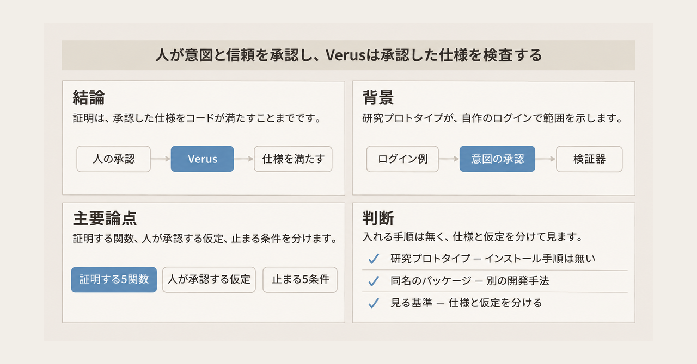
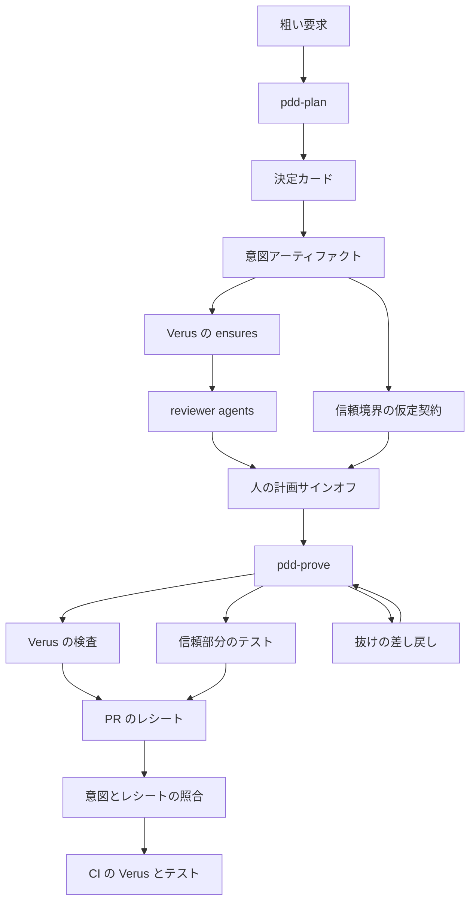
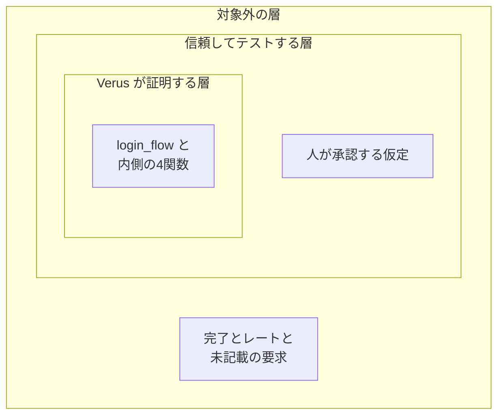

GitHub Next と Microsoft Research は、2026年11月に PDD Kit の公開説明を出しています。PDD Kit は、エージェントが書いたコードのうち、形式化できた性質を検証器が検査するための研究プロトタイプです。この記事では、自作アプリ Pet Store のログイン例を通して、何が証明の対象になり、何が人の承認として残り、どの条件で作業が止まるかを整理します。


*この記事の全体像。以下、順に解説します。*

## PDD Kitとは

PDD Kit は、Proof-Driven Development（証明駆動開発）の研究プロトタイプです。証明駆動開発は、人が意図と仕様を先に承認し、形式化できた性質は検証器が全入力で検査し、証明が届かない部分は人が仮定として承認してテストを残す進め方です。GitHub Next と Microsoft Research が、Chopin の中の計画パートナーとして動かします。計画パートナーは、実装を書く前に既存のコードを読んで質問する役割です。

Chopin は、GitHub Next の実験的な研究用ソフトウェアです。PDD Kit はその中で既存のコードを読み、曖昧さを決定カードで先に問います。決定カードは、実装の前に人へ判断を求めるカードです。質問がコードの動きに依存するときは、質問の前に該当箇所を説明します。

人が答えた内容は、意図アーティファクトに残ります。意図アーティファクトは、平易な言葉と検証器の仕様を結ぶ文書です。各節には英語のコメントが付きます。形式化できた部分は Verus の仕様になります。Verus は Rust の検証器です。普通の Rust に `requires` と `ensures` を足し、コンパイル時に、コードがその仕様を全入力で満たすかを検査します。`requires` は呼び出す前に成り立つ条件です。`ensures` は関数が戻るときに成り立つ事後条件です。証明が届かない部分は信頼境界です。信頼境界では、人が仮定契約を承認し、テストを証拠として残します。仮定契約は、証明しない関数について認める入出力の約束です。

作り手としてプロジェクトページに名前があるのは、Alex Lavaee、Matthai Philipose、Maggie Appleton、Krzysztof Cieślak です。ページの Stage は Research Prototype です。プロジェクトページの表示は Nov 2026 で、HTML の `datetime` は 2026-11-02T12:00:00Z です。Microsoft Research のブログは 2026-11-05 に公開されています。

検証器の公開リポジトリは [verus-lang/verus](https://github.com/verus-lang/verus) です。2026-11-08 時点では archive 前の公開状態で、star は約 3,600（`stargazerCount` 3600）です。default branch は `main` で、先端は 2026-11-06 です。

### ログイン例で並ぶもの

公開例のアプリは Pet Store です。Rust で書かれたフルスタックの Web アプリで、バックエンドは Axum と SQLite、画面は Leptos です。ページは全体で約 5,000 行と書いています。Axum は Rust の Web フレームワーク、Leptos は画面側のフレームワーク、SQLite は組み込みのデータベースです。題材は `backend/src/handlers/auth.rs` の 82–127 行（commit `8b8b70f`）です。仕様は `verified/src/login.rs` にあります。

人が最初に渡した要求は、次の2文です。

> Verify the login logic in backend/src/handlers/auth.rs. Here are my requirements:
>
> 1. You only get a token with the right password.
> 2. Only admin accounts get admin tokens.

日本語にすると、「正しいパスワードのときだけトークンを出す」「admin アカウントだけが admin トークンを得る」です。

最初の決定カードは、1文目の向きを問います。「正しいパスワードのときだけトークン」は、誤ったパスワードにトークンが出ることを拒みます。全員を拒否するログインも、この片方向だけなら仕様を満たします。もう一方は、「正しいパスワードならトークンが出る」です。例では両方向を選んでいます。

証明の対象は5関数です。`login_flow`、`login_core`、`lookup_target`、`decide_login`、`issue_token` です。`login_flow` は、リクエストのフィールドからトークンまたは HTTP エラーまでを async で運ぶ関数です。`lookup_target` は表を選びます。`login_core` は、メールまたはユーザー名でデータベースの行を取る処理を待ち、パスワード判定の `decide_login` を呼びます。この行を取る処理は、信頼側に置く `Customer::find_by_email` と `Admin::find_by_username` です。`lookup_target` とは別です。`decide_login` は合否を決め、照合そのものは信頼側の `check_password`（保存済みハッシュとパスワードを照合する関数）が行います。`issue_token` はトークンを出すか拒否をステータスへ写し、署名そのものは信頼側の `generate_token`（渡された属性に署名する関数）が行います。`issue_token` が写す先は、今日の HTTP ステータスです。「今日の」は、Pet Store がいま返しているステータスコードと文言です。

`login_flow` の `ensures` は8節です。ページが平易な言葉で並べている中身は、次のとおりです。

1. メールもユーザー名も無いときは、今日の文言で 400 を返す。
2. トークンが出るなら、ログインが名指ししたアカウントのパスワードが合い、トークンはそのアカウントの id と、その表の role を持つ。
3. 名指ししたアカウントの正しいパスワードはトークンを得る。外れるのは、lookup か署名が実際に失敗した 500 だけである。
4. 身元は送られたが、そのアカウントを誰も持っていないときは 401 を返す。lookup 失敗の 500 は除く。
5. bcrypt が読めるハッシュでパスワードが違うときは 401 を返す。lookup 失敗の 500 は除く。
6. 保存されたハッシュを bcrypt が読めないときは 500 を返し、トークンは出ない。
7. admin の role は、メールが無く、ユーザー名で見つかった admins の行だけが持つ。
8. メールでのログインのトークンは、必ず customer の role を持つ。

bcrypt は、パスワードと保存済みハッシュを照合するライブラリです。2番の節は、同じアカウント `a` でパスワード照合とトークンの中身を結びます。トークンの `sub` は誰のトークンかを示す欄、`role` は権限の欄です。プロジェクトページが掲載している該当節は、次の抜粋です。仕様の承認時点では、証明する関数の本体はまだ無く、ページは `unimplemented!()` のまま示しています。

```rust
// A token only for the account the login names, with its right
// password; it carries that account's id and its table's role.
r matches Ok(t) ==> (named_account(email, username) matches Some(a)
    && password_matches(password@, a.password_hash)
    && token_claims(t@, config.jwt_secret@) matches Some(c)
    && c.sub@ == a.id && c.role@ == a.role),
```

`named_account` は ghost code です。ghost code は、実行されず、契約の中だけに現れる数学的な定義です。データベースの行、bcrypt の判定、トークンの中身は、未解釈関数として名前だけが置かれます。未解釈関数は、本体が無く、検証器はその名前について仮定契約が言うこと以外を知りません。

信頼として名前が挙がるのは、2つの lookup（`Customer::find_by_email` と `Admin::find_by_username`）、`check_password`、`generate_token`、`expiry_from_now`、`database_error`（失敗した検索を、既存の 500 とデータベースのエラーメッセージへ変える関数）、リクエストの中身を取り出して `login_flow` へ渡すだけのハンドラ `login` です。両ページはログイン例のサインオフを6件と書いています。どの名前を1件と数えるかは、後の注意点でページの文言を並べます。

トークン期限の 86,400 秒は、時計を読む `expiry_from_now` の仮定契約にあります。`login_flow` の8節とは別の契約です。時計の読みから 24 時間、つまり 86,400 秒です。この関数は範囲外の時刻でパニックしうるとページが書き、そのパニックは約束に入っていません。

`Customer::find_by_email` と `Admin::find_by_username` は、元の関数を残したまま外側から契約を付ける `external_fn_specification` です。表を選ぶ `lookup_target` とは別の関数です。`check_password` と時計は、本体を検証器が読まない `external_body` です。どちらも仮定契約の書き方で、人は1件ずつ承認します。

経験的な確認は、単体テスト、end-to-end、端末操作、ブラウザ、computer-use agent です。computer-use agent は、ブラウザが操作できない画面を、計算機の操作として確認するエージェントです。通過したテストには、証拠というラベルが付きます。仮定の節ごとに Given/When/Then が、実装より前に計画へ書かれ、実行までは planned です。公開ウォークスルーの `check_password` は planned で、図の説明は “written before the test exists” です。設計は、実行後にコマンドと commit を記録する、と書いています。

Build plan は、承認済み仕様を7タスクに分けます。図の説明は、`login.rs` を Verus でビルドできるようにすること、決定とトークンとフロー全体を証明すること、信頼する部品をすべてテストすること、と要約しています。

節ごとに1つの変異を、スクラッチコピーへ植えます。変異は、その節だけを壊す変更です。対象の節で Verus が拒否しなければ、gap として戻します。gap は、要求に証明も合格した検査も無い抜けです。ページは、検証は通るがほとんど何も排除しない仕様を vibe verification と呼びます。変異チェックが落とすのは、植えた変異がその節を通過すること、つまり節が空であることです。

タスクが通ると pull request が開きます。PR はレシートになります。レシートは、要求ごとに formally verified か empirically checked かを記し、信頼要素とテストを列挙する一覧です。マージ後は、Verus の検査が経験的テストと並んで CI に入ります。証明が壊れると、テスト失敗と同じくビルドが落ちます。Microsoft Research の FAQ は、この CI への追加を `pdd-ship` と呼んでいます。`pdd-ship` は、検証器の検査をビルドと CI へ足すワークフローの名前です。

対象言語は Rust です。他言語は Rust へ移植するか、検証済み Rust をバインディングで呼ぶ、と両ページが書いています。

### 計画からレシートまでの流れ

人が決めるのは意図と、証明の外に置く仮定です。機械が検査するのは、承認された契約に対するコードと証明です。

図の `pdd-plan` は、粗い要求のあとで決定カードと意図アーティファクトへ進む段階の名前です。Microsoft Research の FAQ では、コードを読み、何も書く前に質問し、答えを Verus の仕様と平易な言葉の計画へ変えるワークフローです。`pdd-prove` は、人の計画サインオフのあとで、実装と証明、Verus の検査、信頼部分のテスト、空節の差し戻しを行う段階の名前です。reviewer agents は、仕様が人へ戻る前に、頼んだことに合っているか、証明が示せる以上を約束していないかを見るエージェントです。ページの本文は “two reviewer agents” と書いています。



### 保証の3層

ログイン例の保証は3層です。内側だけが全入力の証明です。中間は、人が承認してテストする仮定です。外側は、計画が対象外と書いた性質です。



内側の5関数は、表の選択、名指ししたアカウントのハッシュとのパスワード比較、そのアカウントの id と表が与える role を持つトークン、それ以外を今日の 400、401、500 で拒否しトークンを出さない、という契約を全入力で満たす、と Microsoft Research が「証明した」層に書いています。

外側に入るものとして、両ページは次を挙げています。非同期のログイン処理が最後まで応答を返すこと。範囲外の時計でパニックしないこと。試行のタイミングとレート。他のエンドポイントが role をどう読むか。エラー文言や画面の分かりやすさ。誰も書いていない要求。仕様は「答えたときに何が返るか」であり、ハングした問い合わせはその節を破らない、と GitHub Next が書いています。

## 注意点

公開ページは、どこまで信じてよいかを自分で区切っています。強い言い方と、同じページが隣に置いている限定は、次のとおりです。

| 出どころの言い方 | ページが同時に置いている限定 |
|---|---|
| 全入力で仕様を満たす | 満たす相手は、承認した仕様。Microsoft Research の FAQ は “A proof shows the code meets the spec, not that the spec is what you meant.” と書く。間違った仕様はありうる |
| 2文が8節になった | 8節のうち4節は、著者が頼んでいない現行の拒否（400、未知アカウントの 401、誤パスワードの 401、読めないハッシュの 500）を、既存の画面と API テストのために残したもの、と GitHub Next が書く |
| 緑のチェックは保証 | vibe verification は、検証は通るがほとんど何も排除しない `ensures` の節。変異チェックが落とすのは、植えた変異がその節を通過すること、つまり節が空であること |
| 既存バグを見つけ、ログインバグの不在を証明した | Microsoft Research の At a glance の自己記述。症状、入力、差分の一覧は無い。「仕様に関して」と限定されている。説明は “imagine a bug” で、パスワードは Bob の、トークンは Alice の、という想定例である |
| 生成コードを1行も読まなかった | 同じ At a glance の自己記述。FAQ は “reduced reliance on exhaustive line-by-line review”。手順文は、レシートを既承認の意図と照合する、である。行数の測定は無い。人の時間の図は “illustrative, not measured” |
| CI はより小さく強くなる | 証明がすでに覆っている、パスワード判定の入力例のテストを削り、信頼境界のテストを残す、という設計。削除件数と残件数は無い |
| 世界のソフトウェアの50% | 2026-11-04 の GitHub Next 投稿の見出し。同じ投稿の脚注は Stack Overflow Developer Survey 2026 の職種。役割ページの単一選択（任意）は full-stack 7,042人・27.3%、back-end 3,473人・13.5%、front-end 933人・3.6%。役割設問の n は 25,767。調査トップの回答数は 30,903。分母は職種の回答であり、ソフトウェアの量ではない。27.3+13.5+3.6 は 44.4 で、見出しの 50 とも一致しない |
| 人2人が仕様を承認する | 図の alt は “two reviewers must approve” とだけ書く。手順の本文は “two reviewer agents”。人の署名は、決定カード、信頼の個別承認、計画全体、レシート照合として別にある |
| 信頼テストが通った | 公開ウォークスルーの `check_password` は planned。図の説明は “written before the test exists”。実行後にコマンドと commit を記録する、と設計は書く |
| 日常の開発へ持ち込まれた | Stage は Research Prototype。2026-11-08 の `gh` 検索では githubnext と microsoft に PDD Kit のリポジトリは total 0。npm の `pdd-kit` は 404。公開の [githubnext/chopin](https://github.com/githubnext/chopin) は “experimental research software” で、一般向けインスタンスは提供しない、と README が書く。そのリポジトリの code search に `pdd` は total 0。プロジェクトページにインストール手順は無い |
| 保証の強さ | ページ末尾は、6件の信頼のうち重みの大半が `check_password` と2つの lookup にあり、テストは支えるが証明はしない、と書く。Microsoft Research はさらに Verus、Rust コンパイラ、Z3、標準ライブラリ vstd を assumed に置く |
| 検査は短い | FAQ は、小さなモジュールで通常は数秒、大きいコードベースで数分、と書く。計測表は無い |

Z3 は、Verus が証明の検査に使うソルバです。論理式が成り立つかを機械的に判定します。vstd は Verus の標準ライブラリです。この assumed の層は、ログインの6件とは別に、ツールチェーン自体を証明の外に置いています。

### 6件の内訳は、ページで区切りが違う

件数の「6」は両ページにあります。名前の区切りは、次の2通りです。

Microsoft Research の Step 4 は、6件を箇条書きにしています。2つの lookup を1項目にまとめ、そのあとに `check_password`、`generate_token`、`expiry_from_now`、`database_error`、リクエストを unpack するハンドラの殻が続きます。

GitHub Next の `verified/src/login.rs` 冒頭は、仮定契約付きの trusted を「2つの lookup、`check_password`、`expiry_from_now`、`generate_token`、`database_error`」と書き、リクエストからフィールドを取り出す `login` だけは外に残る、と続けます。lookup を2件と数えると、この列だけで6件になり、ハンドラは外です。

同じ「6件」でも、ハンドラの殻を6件目に含める書き方と、lookup を2件と数えてハンドラを外に置く書き方があります。記事の中で件数だけを見て、ハンドラが証明の内側か外側かを決めない方が、公開説明とずれません。

### 同名の別プロジェクト

2026-11-08 時点で、インストールできる `pdd-kit` は別物です。

| 名前 | 定義 | 入口 |
|---|---|---|
| GitHub Next の PDD Kit | Proof-Driven Development。Verus でコードの性質を検査する研究プロトタイプ | プロジェクトページ。インストール手順はページに無い |
| [itai-gendler/pdd-kit](https://github.com/itai-gendler/pdd-kit) | Product-Driven Development。`product-model/` の Markdown。star は約100（2026-11-08 の `stargazerCount` 105） | `npx pdd-toolkit install`。npm のパッケージ名は `pdd-toolkit` |
| [promptdriven/pdd](https://github.com/promptdriven/pdd) | Prompt Driven Development。プロンプトがソースで、コードは生成物 | README は `npm install -g github:promptdriven/pdd` |

### 公開説明が閉じていない点

次は、公開ページの文面からは決まりません。

- At a glance の「既存バグ」が、変異チェックの話と別の欠陥なのか。症状、入力、差分の一覧は無い。
- planned の信頼テストが、公開後に実行記録へ更新されたか。ウォークスルーの `check_password` は planned のまま読める。
- ピン留めした Verus で async を表現できず、人に戻した実例が、どのリビジョンで起きたか。
- reviewer agents が同意した仕様を、人があとから覆した回数が、例の中にあるか。
- 研究プレビューの申込や非公開の配布があるか。公開ページはインストール手順を置いていない。

デモは自作の Pet Store のログインです。両ページに、第三者の本番採用を示す語はありません。仕様が意図と違えば、証明は通ったまま、間違ったコードを正しいことにする、と作り手が書いています。効果量として、レビュー時間、欠陥件数、CI の本数の表は、公開ページにありません。

## 証明の前に揃えるもの

公開例で、証明の前に揃うものは次の9つです。ログインの2文と、両方向の決定は、この一覧の具体例です。

1. 粗い自然言語。対象ファイルは `backend/src/handlers/auth.rs`。要求は「正しいパスワードのときだけトークン」「admin アカウントだけが admin トークン」の2文。
2. 既存コードの説明。決定カードは、質問の前に該当箇所を説明する。
3. 人が閉じる曖昧さ。片方向だけだと、全員を拒否するログインも仕様を満たす。例では両方向を選んだ。
4. 証明の範囲。既定は、決定関数だけを証明し、ハンドラは trusted のままです。決定関数は、表を選ぶ `lookup_target` と、パスワードを判定する `decide_login` です。例では、lookup の待ちと署名まで `login_flow` の契約に入れました。そのとき信頼が増える小さなラッパーは、lookup と `check_password` と `generate_token` です。小さなラッパーは、本体を証明せず、仮定契約だけを付ける関数です。
5. 意図アーティファクト。計画の上部には、これから仕様にする処理の流れ図、何を証明し何を信頼するかの見取り図、各要求を自分の発言へ戻す対応表があります。
6. Verus の契約。`ensures`、未解釈関数、ghost code。同一の `a` が、パスワード照合とトークンの `sub` を結びます。ログインの掲載契約は `ensures` が中心です。成り立つべき条件の別ファイルは出てきません。公開例では、`ensures` の if-then がその条件です。
7. 信頼境界の仮定契約。`external_fn_specification` または `external_body`。人が1件ずつ承認する。
8. 仮定の節ごとの Given/When/Then。実装より前に計画へ書き、実行までは planned。
9. 仕様が戻る前の reviewer agents。頼んだことに合っているか、証明が示せる以上を約束していないか。

範囲の判断基準は、カードが先に言う文にあります。行の取得の待ちと署名まで証明へ入れると、そのぶん小さなラッパーを信頼する契約が増えます。既定のまま決定関数だけを証明するなら、その待ちと署名は `login` の中に残り、trusted のテスト対象です。例では待ちと署名を `login_flow` へ移したので、`login` はリクエストの中身を渡すだけになります。

## 失敗したときに止まる条件

ページがループの規則として書いている停止は、次の5つです。止めた回数のログは公開されていません。

| 条件 | 戻り先 |
|---|---|
| `ensures` が1入力でも破れうる | Verus がビルドを失敗させ、その節を指す |
| 要求に証明も合格チェックも無い | LLM verifier が gap としてコーディングエージェントへ戻す |
| 仕様が自己矛盾する | チームへの決定として戻す。機械はどちらかを選ばない |
| ピン留めした Verus で async を表現できない | 非 async へ逃がさず、契約を弱めず、質問で止まる。どの構文が書けなかったかの実例は、公開ページに無い |
| 節ごとに植えた変異を、その節が拒否できない | 節は何も制約していない、として gap |

LLM verifier は、計画と仕様と結果を並べ、証明も合格した検査も無い要求を探すモデルの工程です。合否を決めるのは、このモデルではありません。Microsoft Research の FAQ は、合否を決めるのは決定的な Verus の実行であり、モデルが書くのは仕様、コード、証明だ、と書いています。

マージ後の停止は CI です。証明が壊れると、テスト失敗と同じくビルドが落ちる、と両ページが書いています。

証明が失敗扱いにしないものも、計画に列挙されます。非同期のログイン処理が最後まで応答を返すこと。範囲外の時計でパニックしないこと。試行のタイミングとレート。他エンドポイントが role をどう読むか。エラー文言や画面の分かりやすさ。誰も書いていない要求。ハングした問い合わせは、「答えたときに何が返るか」という節を破りません。

## コードの性質と手順のゲート

緑のチェックを一つにまとめると、公開設計とずれます。コードの性質と、エージェントが踏む手順は、別のゲートです。

コードの性質は、5関数の本体が契約を全入力で満たすことです。検査器は Verus です。中身は、パスワード、アカウント、role、ステータスコード、トークンの claims を結ぶ `ensures` です。claims は、トークンが持つ id や role などの属性です。ここが「指定した性質の証明が通った」の中身です。

手順のゲートは、次の並びです。Verus がこの並びを証明する、とはページは書いていません。

- コードを書く前に決定カードを出す。
- 契約を弱めず、表現できない構文では止まる。
- 空の節を変異で戻す。
- 証明もテストも無い要求を、LLM verifier が探して戻す。
- 矛盾は人の決定に戻す。
- PR に、証明したもの、信頼したもの、約束しないものを書く。
- 信頼のテストを、実装より前に planned として計画へ書く。

変異チェックは、スクラッチコピー上の空節検出であり、意図との一致ではありません。LLM verifier の gap 探索は、合否を決める Verus 実行とは別のモデル工程です。手順が守られた証拠として公開されているのは、ログイン計画のスクリーンショットと、規則の文章です。

人が残して行う承認は、曖昧さの決定、信頼の個別承認、計画全体、マージ時のレシート照合です。生成されたコードの行を読むことは、この4つの署名とは別です。人の承認と、検証器が落とす止まり方は、どちらも同じ公開例に入っています。止まり方は、Verus が落ちたら止まる、空節なら止まる、仕様の矛盾は人に戻る、です。

自分の仕事で使うかの基準は、問いに合わせて分けます。

| 問い | 公開説明から言えること |
|---|---|
| この5関数は、承認した `ensures` を全入力で満たすか | 満たす相手は承認した仕様。検査は Verus。デモは Pet Store のログイン |
| 仕様は、自分が頼んだ意図どおりか | FAQ は、証明はそこを示さない、と書く。間違った仕様はありうる。人が計画と信頼を承認する |
| ログインバグは無い、と行を読まずに言えるか | At a glance は自己記述で、行数の測定は無い。手順はレシートと既承認の意図の照合 |
| bcrypt や lookup は証明済みか | 証明の外。テストは支えるが証明はしない。公開例では `check_password` は planned |
| 今日、自分のリポジトリへ入れるか | 研究プロトタイプ。プロジェクトページにインストール手順は無い。同名で入るパッケージは別物 |

Microsoft Research の FAQ は、コードを計画へ縛るものの違いを、次のように置いています。Spec-Driven Development は仕様を先に書く進め方、Test-Driven Development はテストを先に書く進め方です。

| 進め方 | コードを何が検査するか |
|---|---|
| Spec-Driven Development | 仕様を強制するものは無い |
| Test-Driven Development | 一部の入力に対するテスト。作ったものに合わせて書かれることが多い |
| エージェントが自分の仕事を検査する | コードを書いたのと同じモデル |
| Proof-Driven Development | 承認した仕様をコードが満たす証明を、Verus が検査する |

証明駆動開発は、仕様を先に書くループを残し、証明が届かないところではテストを使います。テストはいくつかの入力を見ます。証明は、述べた仮定のもとで、形式化した性質を全入力について確立します。

## まとめ

PDD Kit は、Proof-Driven Development の研究プロトタイプです。インストールできる同名の `pdd-kit` は、Product-Driven Development や Prompt Driven Development であり、入口が違います。

人が先に閉じるのは、意図と信頼境界です。Verus が閉じるのは、承認済みの `ensures` に対するコードです。ログイン例では、証明の対象は5関数で、`login_flow` の `ensures` は8節です。信頼のサインオフは両ページが6件と書き、ハンドラの殻をその6件に含めるか、lookup を2件と数えてハンドラを外に置くかで、文言が分かれます。

失敗したときの停止は、ビルド失敗、未カバーの要求、仕様の矛盾、表現できない async、空の節、の5種です。コードの性質が証明されたことと、手順のゲートを守ったことは、別です。手順のゲートを、形式証明とは呼びません。

レビューに要した時間、見つけた欠陥の件数、CI から削ったテストの本数は、公開ページに表がありません。見出しの「ソフトウェアの50%」も、同じ投稿の脚注の職種割合とは分母が違います。

この記事が少しでも参考になった、あるいは改善点などがあれば、ぜひリアクションやコメント、SNSでのシェアをいただけると励みになります！

## 参考リンク

- [GitHub Next. “PDD Kit.”](https://githubnext.com/projects/pdd-kit/)（`datetime` 2026-11-02、表示 Nov 2026、確認 2026-11-08）
- [Microsoft Research. “Formally verifying agent-written full-stack web apps with PDD Kit.”](https://www.microsoft.com/en-us/research/blog/formally-verifying-agent-written-full-stack-web-apps-with-pdd-kit/)（Published 2026-11-05）
- [GitHub Next. Chopin README.](https://github.com/githubnext/chopin)（確認 2026-11-08）
- [verus-lang/verus](https://github.com/verus-lang/verus)（star は 2026-11-08 の API）
- [itai-gendler/pdd-kit](https://github.com/itai-gendler/pdd-kit)
- [promptdriven/pdd](https://github.com/promptdriven/pdd)
- [Stack Overflow Developer Survey 2026, role](https://survey.stackoverflow.co/2026/work/data/role)
- [Stack Overflow Developer Survey 2026](https://survey.stackoverflow.co/2026)（回答数 30,903）
- [GitHub Next の X 投稿（2026-10-21、Proof Driven Development Kit の紹介）](https://x.com/GitHubNext/status/2112936525457740139)
- [GitHub Next の X 投稿（2026-11-04、50% の見出しと職種の脚注）](https://x.com/GitHubNext/status/2118105391707967967)
- [AI Heartland. “証明駆動開発（PDD Kit）とは.”](https://ai-heartland.com/explain/proof-driven-development/)（2026-11-06。解説）
