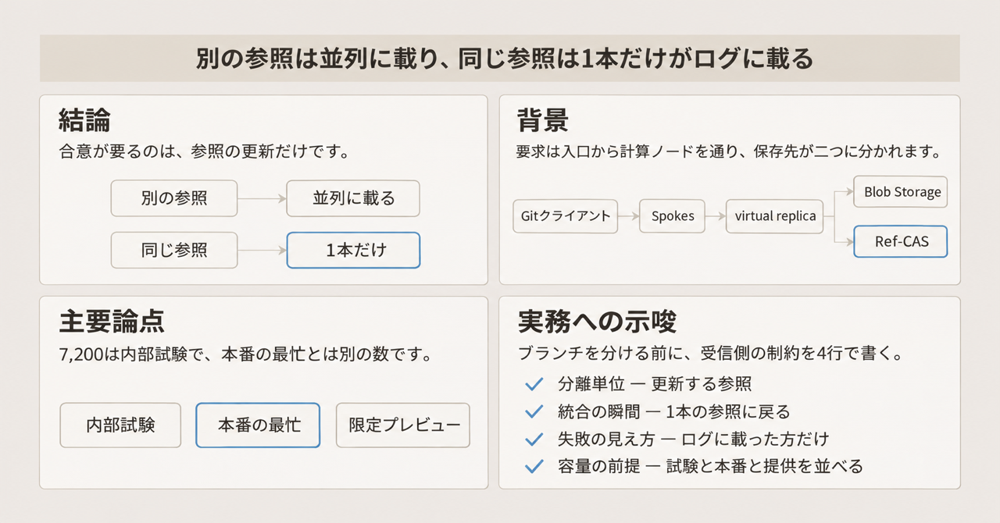
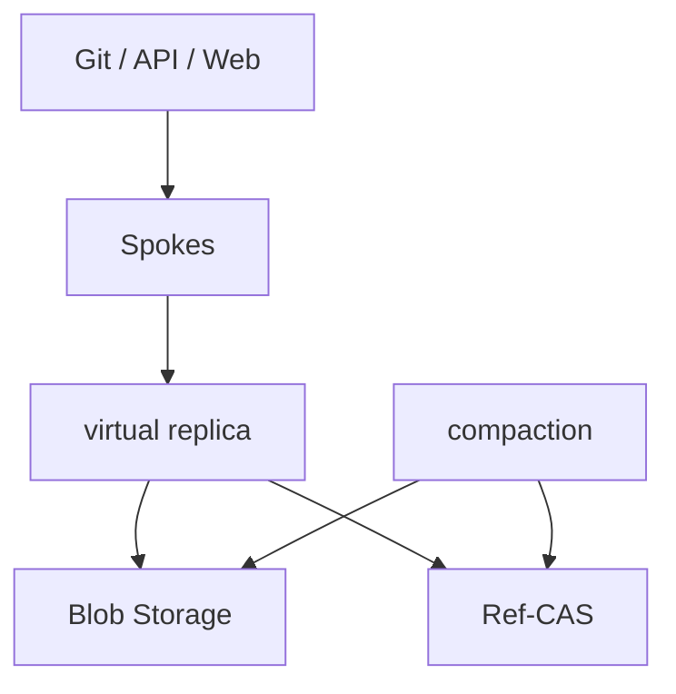
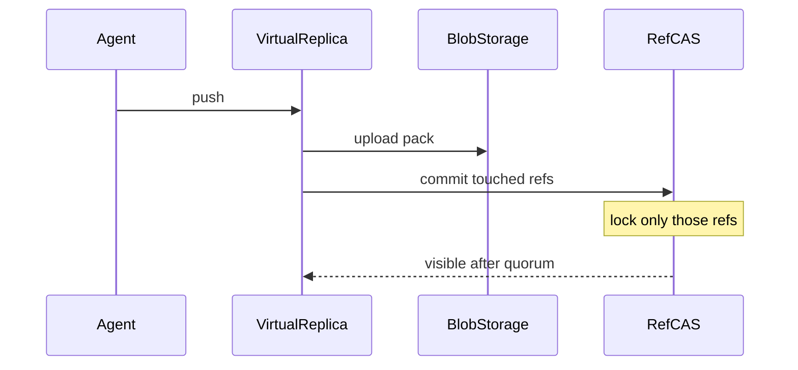

2026年11月5日、GitHubは単一リポジトリへ多数の書き込みが同時に届く前提で組んだGit格納を、公式記事で説明しました。設計名はProject Rubiconです。著者はKarthik RamanとBrian Celenzaです。中核は[Inside GitHub's new Git storage architecture](https://github.blog/engineering/architecture-optimization/inside-githubs-new-git-storage-architecture/)です。前段として、2026年10月6日の[Building Git infrastructure for agent-scale development](https://github.blog/engineering/architecture-optimization/building-git-infrastructure-for-agent-scale-development/)と、2026年10月21日の[The bridge to agent-scale Git infrastructure](https://github.blog/engineering/architecture-optimization/the-bridge-to-agent-scale-git-infrastructure/)があります。

この記事は、要求が通る部品と、同時のpushが順番待ちになる単位を、この3本とGitHub Docsの範囲で整理します。示す数値には、内部試験と本番の観測が混ざっています。

*この記事の全体像。以下、順に解説します。*

## GitHubの新しいGit格納とは

Project Rubiconは、エージェントを同じリポジトリへ並べるときの受信側です。Gitクライアント、API、Webからの要求は、従来のSpokesが受けます。Spokesは、その3種の要求をリポジトリへ渡す入口です。その下のデータ面は4つに分かれます。

- virtual replicaは、使い捨ての計算ノードです。packを索引し、Blob Storageへ上げます。packは、Gitがオブジェクトをまとめたファイルです。ローカルディスクはキャッシュです。記事は、どのreplicaに着地しても正しさは変わらない、と書きます。忙しいリポジトリにはreplicaを足します。
- Ref-CASは、参照とpack manifestを持つ格納です。参照は、ブランチやタグが指す先です。pack manifestは、そのリポジトリに属するpackの一覧です。CASはcompare-and-swapです。期待する現在値と一致するときだけ更新します。
- Azure Blob Storageは、packの実体と、読みを速くするためのデータを置きます。そのデータの固有名は、3本にはありません。
- compactionは、packを畳む別フリートです。フリートは、役割ごとに台数を足す計算機の集まりです。virtual replicaでは動かしません。シャードは、compactionが担当範囲を割った区画です。

耐久する状態は二箇所です。packと読み加速用のデータはBlob Storageです。参照とpack manifestはRef-CASです。

操作の表面はpush、fetch、branchのままです。記事は、既存の保護もそのまま残る、と書きます。ここでの保護は、保護ブランチと必須レビューです。保護ブランチは、更新やマージに条件を付けたブランチです。必須レビューは、マージ前に決めた数の承認を求める条件です。提供状態は、記事公開時点でlimited private previewです。広い展開は、記事の言葉ではearly next yearです。

### 書き込みの順

記事は、合意が要るのは参照更新だけだと置いています。Gitオブジェクトは内容アドレスで不変です。内容アドレスは、中身から決まる識別子でオブジェクトを指す方式です。そのためpackの保存自体に、書き手同士の合意は要りません。

順序は次のとおりです。

1. virtual replicaがpackを索引し、Blob Storageへ上げます。
2. その後、Ref-CASへトランザクションを1つコミットします。中身は、pack manifestへの追記と、参照の更新です。
3. 参照は、すでに耐久化されたオブジェクトだけを指します。

トランザクションは、触った参照だけをロックします。各参照が書き手の期待値のままかを比べます。ログのレプリカの過半数が記録した時点で、その更新は可視になります。このログは、Ref-CASが参照の更新を記録するログです。過半数を数えるレプリカは、そのログの複製であり、virtual replicaとは別です。過半数を、記事はquorumと呼びます。

リポジトリの版は、最新コミットのlog sequence number（LSN）です。ここでのコミットは、Gitのコミットです。LSNは、ログ上の位置を表す番号です。読みは、virtual replicaが持つ参照版をRef-CASに送ります。参照版は、そのvirtual replicaが手元に持つ参照の版です。記事は、参照版とLSNが同じものだとは書いていません。版が現行なら、参照の本体は返りません。参照の本体は、Ref-CASが持っている参照の記録そのものです。

書き込みの中で順序が要るのは、packのアップロードが終わったあとの参照更新です。

compactionはこの要求経路の外です。シャードのleaseを取ります。leaseは、そのシャードを畳む権利を一時的に持つことです。packのハッシュでシャードへ写像します。pack数、サイズ、経過時間のいずれかの定義済み上限で、畳む範囲を閉じます。上限の数値は記事にありません。

遅れたvirtual replicaは、その要求に要るデータだけを取りに行きます。記事は、現行の参照とpackへのポインタを受け取ってから、必要なデータだけを取る、と書きます。

読みを増やす仕組み、参照をレプリカ間で順序づける仕組み、保守でpackを畳む仕組みは、別々に台数を足す対象です。

packの索引とobject connectivityの確認は、書き込みの中で最もCPUを食います。object connectivityは、オブジェクトが履歴としてつながっているかの確認です。コストは書き込みの大きさに比例します。1ノードはすぐに計算律速になります。計算律速は、CPUの処理が先に上限になることです。複数のvirtual replicaに散らす理由は、ここです。

記事は、エージェントが自分のブランチへpushする前提をmostly、およびmostと置いています。

## 注意点

到達の宣言と、本番の観測は、別の文です。ここを混ぜると、受信側の容量を実際より大きく読みます。

| 語句 | 記事が置いている場所 | 読み方 |
|---|---|---|
| 5,000 concurrent agents、7,200 pushes/sec | 2026-11-05。「Through internal testing」 | 内部試験。packの大きさ、同一参照の割合、レイテンシのミリ秒、本番トラフィックかは本文にない。1つのシナリオか別のデモかも、一文だけでは決まらない |
| at most dozens of writes in a single second, typically in short bursts | 2026-11-05。GitHub.comの最忙リポジトリの現状 | 本番の観測として書かれた天井。7,200とは別の文 |
| up to 35 times higher write throughput | 2026-10-06。「In internal benchmarks」 | 倍率の上限。基準のpushes/secは本文にない。7,200とは足せない |
| 3–4x higher throughput | 2026-10-21。異なる参照への書き込み。「internal testing with realistic traffic」 | リポジトリ全体のロックを参照単位にした段の話。同じ記事は、この段の先でもquorumがまだ上限だと書く |
| tens of thousands of operations per second | 2026-11-05。「reference state alone」 | 参照状態のトランザクション。packの索引とアップロードを含むpushの完了数ではない |
| at least two orders of magnitude more scale | 2026-11-05。単一リポジトリの設計目標 | 目標。測定済みの倍率としては書かれていない |
| 99.99999% | 2026-10-21 | Azureと自社データセンターの両方にコピーがあるリポジトリの割合。Rubiconの展開率ではない。多くのリポジトリはレプリカ5つのうち2つがAzureで、AzureがさばくGitトラフィックは約半分、とも同じ記事が書く。この5つは、その記事が複製について書いた台数であり、忙しいリポジトリへ足すvirtual replicaの台数ではない |
| limited by their ideas | 2026-11-05の締め | 測定された「残る詰まりが無い」という結果ではない |
| 180倍 | 公式3本にはない | [Kolen Cheung（2026-10-28）](https://blog.kolen.dev/link/github-universe-2026)が、Universe 2026キーノートのスライドとして伝える値。同じ記事は旧上限をdozens of pushes a secondとも書く。7,200をdozensで割った式は記事になく、公式ブログの倍率でもない |

2026年10月6日のサイト全体の伸びは、内部試験とは別の一次情報です。Gitイベントは、2025年9月から2026年8月の窓で、月218.2 billionから473.3 billionと本文が書きます。このGitイベントに何が含まれるかは、本文にありません。billionは10の9乗です。pushは別文で、前年比4.9倍、月0.69 billionから3.35 billionです。比較した二つの月は、その文にはありません。2026年9月のcommitは7.38 billionです。前年の5倍超です。記事は “In September alone” と書き、公開が2026年10月6日なので直前の9月を指します。同月のGitHub Actionsは3.26 billionです。前年の4倍超です。PRのmergeは “nearly 4x their volume a year ago” で、絶対件数は本文にありません。

同じ2026年10月6日の記事のHTMLには、2026年8月の「リポジトリあたりGitイベント」のパーセンタイルチャートがあります。P100は、その分布の一番端のリポジトリの値です。毎秒のレートではありません。

| 系列 | P100（2026年8月、1リポジトリ、月間イベント） |
|---|---|
| Fetches | 514,300,000 |
| Pushes | 2,970,000 |
| Clones | 279,300,000 |
| Requests (all) | 1,001,000,000 |

本文の “roughly a billion requests in August” は、Requests (all) のP100と桁が一致します。PushesのP100（約297万）を、7,200 pushes/secと同じ量として並べません。

無名リポジトリの日次リクエストは、2026年3月平均44M、5月平均181Mです。Mはmillionです。約4倍です。これはrequestsであり、pushではありません。その後の指数的な伸びは、以降の数値が本文にありません。

レイテンシのミリ秒は本文にありません。語句は二つの段落に分かれます。5,000 agentsと7,200 pushes/secの内部試験の文は “consistently low latency” と書きます。compactionの節は、書き込みが増えても “flat latency curve” だった、と書きます。同じ測定ではありません。

読みは書きの100倍から1,000倍です（2026-10-21）。CIとcode scanningは、同じブランチ先端を毎分数千回取りうります（2026-10-06）。code scanningは、コード上の問題を探す検査です。2026年10月21日の仮想read replicaは、読みに寄せたreplicaです。11月5日のvirtual replicaと同じものとは、書いていません。一部の読みには向きますが全部ではない、と次の段へ送ります。変わった参照とデータだけを取るin-lineの照合を、後続に置いています。in-lineの照合は、その読みの処理の中で、変わった分だけを取る方式です。2026年11月5日は、遅れたreplicaが現行の参照とpackへのポインタを受け取り、要求に要るデータだけを取る、と読みます。10月21日が残した「全部の読みではない」を、明示的に閉じた文は11月5日にはありません。

secret scanningは、リポジトリへ入った秘密情報を探す検査です。2026年10月6日は、ackを遅らせない側に寄せる、と書きます。ackは、pushを受け取った応答です。仕事量は大きい、と残っています。CPU秒や、ackの外に出たあとの待ち時間は本文にありません。

到達不能オブジェクトを外すgarbage collectionは、compactionに似た専用ワーカーです。到達不能オブジェクトは、削除したブランチやforce-pushの残骸です。安全に消すための特別な挙動は “worthy of their own discussion” として、この記事では展開されません。

commit-graphなどのメタデータで、全コミットを歩かずにmerge-baseと到達性を答える、という項目はGit自体の今後に置かれています。merge-baseは、二つの履歴が分かれた直前の共通コミットです。現行の格納記事が、履歴歩行の所要時間を解消したとは書いていません。

公式3本が数値や契約として書いていないものは、次のとおりです。

- compare-and-swapに外れたpushが受け取るエラー文字列と、監査に残るかどうか。
- compactionのpack数、バイト、年齢の上限と、遅れたときの挙動。garbage collectionの安全手順。
- 7,200の試験のpackサイズ、同一参照の割合、レイテンシのミリ秒。
- limited private previewの対象と、現行のどのリポジトリがRubiconか。99.99999%では代用できません。
- secret scanningをackの外へ出したあとの待ち時間。
- レビュー待ち時間の公式のbeforeとafter。

## 書き込みが直列になる層

同時のpushを受信側の制約として書くなら、境界はコマンドではなく参照です。別の参照はRef-CASが並列に載せます。同じ参照への2本は、1本だけがログに載ります。

trunkは、統合の本線として使う既定のブランチです。release trainは、リリースへ載せる変更を1本の流れに乗せる運用です。merge queueは、対象ブランチの最新と、すでにキューにあるpull requestに対して必須チェックを通してからマージする仕組みです。[Managing a merge queue](https://docs.github.com/en/repositories/configuring-branches-and-merges-in-your-repository/configuring-pull-request-merges/managing-a-merge-queue)では、キューに入るのは必須の保護チェックを通過したあとのpull requestです。

| 層 | 何が並ぶか | どこで直列になるか | 根拠 |
|---|---|---|---|
| packの保存 | 内容アドレスのオブジェクト。書き手同士の合意は不要 | 合意の対象ではない | 2026-11-05 |
| Ref-CAS | 別の参照への更新は並列に複製される | 同じ参照への2本のpushは、1本だけがログに載る。トランザクションは触った参照だけをロックし、期待値で比べる | 2026-11-05 |
| 統合の本線 | エージェントが自分のブランチへpushする、という前提（記事はmostly / most） | trunk、release train、merge queueは、すべてのmergeを1本の参照に集める | 2026-10-06 “Merges contend on one reference.” |
| 旧来のquorum | 参照単位にする前 | 書き込みがリポジトリ全体のロックを、コミットまで持つ。遅い健全レプリカが全書き込みの遅延とスループットの天井になる。Azure上のレプリカは自社データセンターから約1,000マイルで、往復が約25ms。書き込みはその往復を複数回要する | 2026-10-21 |
| 試作（単一blobのWAL） | 採用されなかった。WALは、更新を追記するログである | 条件付き書き込みは同時に1本。何と一致したときだけ書くかは本文にない。実測はmid-hundreds writes/sec | 2026-11-05 |
| packの数 | pushのたびにpackが増える | 追加のpackごとにlookupが少し高くなる、と記事は書く。lookupは、必要なオブジェクトをpackから探す処理である。畳む作業はシャードleaseで横に増やす。上限の数値はない | 2026-11-05 |
| CPU | 複数のvirtual replicaに散らす理由 | packの索引とobject connectivityの確認が、書き込みの中で最もCPUを食う。コストは書き込みの大きさに比例し、1ノードはすぐに計算律速になる | 2026-11-05 |
| secret scanning | ackを遅らせない側に寄せる、と2026-10-06は書く | 仕事量は大きい、と残っている。CPU秒や、ackの外に出たあとの待ち時間は本文にない | 2026-10-06 |

適用の例は、次の2本です。エージェントAが`feature-a`へ、エージェントBが`feature-b`へpushするとき、更新する参照は別です。Ref-CASは互いを待たせない、と2026年11月5日は書きます。同じ`main`へ2本が同時に進もうとするとき、触る参照は1本です。ログに載るのは1本です。fast-forwardは、リモートの先端の子孫として進む更新です。その形でも、同じ参照なら1本だけがログに載ります。

履歴の順序は、参照ごとのログと、リポジトリ全体のLSNです。

trunk、release train、merge queueは、mergeの瞬間に1本の参照へ戻ります。ブランチを分ける戦略は、この1本へマージする瞬間の直列を消しません。

参照単位にする前のquorumは、別の段です。書き込みはリポジトリ全体のロックを、コミットまで持っていました。遅い健全レプリカが、全書き込みの遅延とスループットの天井でした。距離と往復の数値は、上の表のとおり2026年10月21日の記事にあります。

単一blobのWALは採用されませんでした。このWALは、上のquorumが数えるログとは別です。条件付き書き込みは同時に1本で、実測はmid-hundreds writes/secです。現行の説明は、この試作を採らなかったあとのRef-CASです。

mostlyは、すべてのpushではありません。同じ参照へ集まる書き込みでは、並列は消えます。

7,200 pushes/secと5,000同時エージェントは内部試験です。2026年11月5日の記事公開時点で、一般提供の容量としては書かれていません。本番の最忙は、dozens of writes/secの短いバーストです。

object connectivityとsecret scanningは、ロックの外でも重い仕事として残ります。7,200がそのコストを含んだ試験かは書いていません。

## 失敗したpushの見え方

記事が書いている失敗は、同じ参照を更新した2本のうち、ログに載らなかった側です。期待値のcompare-and-swapに外れた更新は、そのログには載りません。

記事が書いていないものも、同じ節で分けます。

- 敗者が受け取るgitやHTTPのエラー文字列は、3本にありません。
- 失敗を残す監査イベント名、UI、リポジトリ全体の失敗一覧は、3本にありません。現行のGitHub Docsは、昔からの[non-fast-forwardの拒否](https://docs.github.com/en/get-started/using-git/dealing-with-non-fast-forward-errors)を説明しています。non-fast-forwardは、リモートの先端を上書きせずには進めない更新です。そのページはRef-CASにもRubiconにも触れていません。Rubiconの敗者が同じ文字列を返す、とはDocsもブログも書いていません。したがって「同じ文字列が返る」とも「監査イベントは存在しない」とも、ここでは断定しません。
- “rejected cleanly on conflict” は、未出荷のAtomic commit APIの説明です。2026年11月5日の “What comes next” に置かれています。3本は、このAPIの中身を出荷済み機能としては書いていません。
- 変更の購読に使うgeneric event streamも、同じ「次にやる」側です。generic event streamは、変更を購読するために、これから出す側のイベントの流れです。
- packは参照トランザクションの前にBlobへ上がります。ログに載らなかった側のpackを、その場で消すとは書いていません。削除の話は後段のgarbage collectionにあります。

エージェントから見える範囲として記事が書くのは、各pushを待ってから次の手順へ進む、という待ちです。失敗の台帳が新しく生えた、という記述ではありません。

運用で数えるなら、pushの同期的な応答と、保護ブランチ側のレビューキューを、別のカウンタにします。

## レビュー待ちの時計

レビューの待ち時間は、Ref-CASのロック時間としては書かれていません。公式が残すと書いた制御は、保護ブランチと必須レビューです。2026年10月6日の本文は、未レビューの変更がdefault branchに届かないよう、メンテナにはbranch protectionsとrequired reviewsが要る、と書きます。default branchは、リポジトリの既定ブランチです。コードの所有者は、エージェントが増えてもreview、understand、approveできる、とも書きます。

[保護ブランチ](https://docs.github.com/en/repositories/configuring-branches-and-merges-in-your-repository/managing-protected-branches/about-protected-branches)は、マージ前に指定数の承認レビューを要求できます。マージキューは、前節のmerge queueです。対象ブランチの最新と、すでにキューにあるpull requestに対して必須チェックを通してからマージします。

人が止める時間の時計は、次の順で進みます。

1. トピックブランチへのpush。別参照なら、Ref-CASは互いを待たせない、と2026年11月5日は書きます。トピックブランチは、本線とは別に作業を載せるブランチです。
2. 保護ブランチへ載せる前のレビューと必須チェック。ここはDocsの保護と、2026年10月6日が残すと書いたrequired reviewsです。
3. マージの瞬間。merge queueを含む統合は、1本の参照への書き込みになる、と2026年10月6日は書きます。ここでRef-CASの「同じ参照は1本だけ」が効きます。

公式3本に、レビュー所要時間のbeforeとafterはありません。pushの倍率を、レビュー待ちが短くなった証拠としては使えません。

[DevOps.comのTom Smith（2026-10-08）](https://devops.com/coding-agents-broke-gits-scaling-math-github-is-rebuilding-to-keep-up/)は、Mitch Ashley / Futurum Groupの言葉として、pushが速くなると詰まりはレビューへ移り、branch protectionsとrequired reviewsは人の速度のままだ、と述べます。これはGitHubの測定値ではありません。7.38 billionや4.9倍と同じ根拠に並べません。

## 設計の前に書く4行

ブランチ戦略とレビュー待ちの設計の前に、受信側の制約を次の4行で書いてから先へ進みます。

1. 分離単位は、エージェントのコマンドではなく、pushが更新する参照です。別参照はRef-CASが並列に載せる、と2026年11月5日は書きます。
2. default branch、release train、merge queueは1本の参照に戻ります。ここは2026年10月6日の “single ref” です。ブランチを分ける戦略は、この1本へマージする瞬間の直列を消しません。
3. 失敗したpushは、記事の範囲では「ログに載った方だけ」です。監査の新しいイベントや、衝突時にきれいに拒否するAPIは、この記事の出荷済み機能としては書かれていません。運用で数えるなら、pushの同期的な応答と、保護ブランチ側のレビューキューを、別のカウンタにします。
4. 履歴の実体であるpackは、参照ロックの外で増えます。lookupがpack数で少し高くなる、という公式の一般論があり、畳む上限は記事に数値がありません。7,200 pushes/secと5,000同時エージェントは内部試験です。本番の最忙はdozens of writes/secの短いバーストです。提供はlimited private previewです。容量の前提には、この3つを並べて書きます。

直列になる場所は、公式のロックの説明と一致します。速度の絶対値、失敗の台帳、レビューの秒数は、この3本では決まりません。

次のいずれかが公式に書かれたら、上の4行は書き直します。同一参照でも並列にコミットする、という記述です。失敗したpushの監査イベントを仕様として出す、という記述です。レビュー待ちを格納のメトリクスに含める、という記述です。2026年11月5日と10月の公式3本には、その記述はありません。

## まとめ

GitHubの新しいGit格納は、packの保存と参照の更新を分けます。合意が要るのは参照です。別のブランチへのpushは並列に載り、default branchやmerge queueへの統合は1本の参照に戻ります。人のレビューは、そのロック時間とは別の時計です。7,200 pushes/secは内部試験であり、記事公開時点の一般提供の容量ではありません。

この記事が少しでも参考になった、あるいは改善点などがあれば、ぜひリアクションやコメント、SNSでのシェアをいただけると励みになります！

## 参考リンク

- Karthik Raman, Brian Celenza. [Inside GitHub's new Git storage architecture](https://github.blog/engineering/architecture-optimization/inside-githubs-new-git-storage-architecture/). GitHub Blog. 2026-11-05.
- Eleanor White, Victoria Dye. [The bridge to agent-scale Git infrastructure](https://github.blog/engineering/architecture-optimization/the-bridge-to-agent-scale-git-infrastructure/). GitHub Blog. 2026-10-21.
- Brian Celenza. [Building Git infrastructure for agent-scale development](https://github.blog/engineering/architecture-optimization/building-git-infrastructure-for-agent-scale-development/). GitHub Blog. 2026-10-06（dateModified 2026-10-26）.
- GitHub Docs. [About protected branches](https://docs.github.com/en/repositories/configuring-branches-and-merges-in-your-repository/managing-protected-branches/about-protected-branches).
- GitHub Docs. [Dealing with non-fast-forward errors](https://docs.github.com/en/get-started/using-git/dealing-with-non-fast-forward-errors).
- GitHub Docs. [Managing a merge queue](https://docs.github.com/en/repositories/configuring-branches-and-merges-in-your-repository/configuring-pull-request-merges/managing-a-merge-queue).
- Kolen Cheung. [Looking forward to a more reliable GitHub](https://blog.kolen.dev/link/github-universe-2026). 2026-10-28. 公式3本の外の二次情報です。
- Tom Smith. [Coding Agents Broke Git’s Scaling Math](https://devops.com/coding-agents-broke-gits-scaling-math-github-is-rebuilding-to-keep-up/). DevOps.com. 2026-10-08. 公式3本の外の二次情報です。
