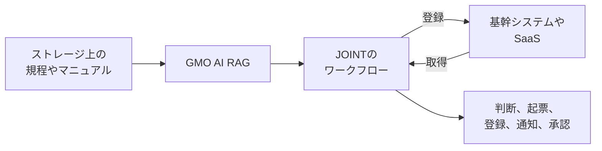
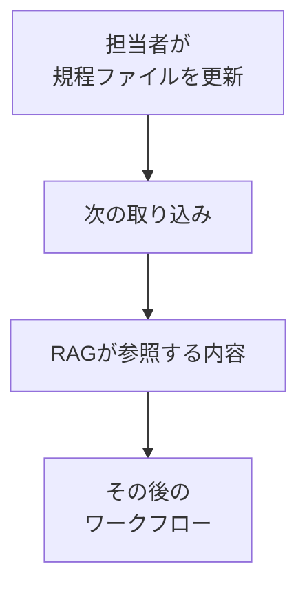

2026年10月19日、GMOプライム・ストラテジーとGMO AIコネクトは、企業向けのRAGソフトウェア「GMO AI RAG」と、「JOINT AI Flow byGMO」の連携を提供開始しました。

JOINT上の業務の流れが、就業規則やマニュアルをGMO AI RAG経由で参照し、その内容を判断や処理に使います。

対象は、社内規程を見ながら稟議や申請、通知、登録を進めたい企業です。

利用には、両サービスの契約がそれぞれ必要です。

この記事では、公開資料にある接続の形、文書を更新したあとに参照が変わる順序、参考価格を先にまとめます。

そのあとで、見出しの文言と記録の差、規則を止める位置、人を残す遷移、1サイクルの終わり方を分けます。

数値と役割の記述は、公式発表、製品ページ、利用規約、およびキーマンズネットの2026年10月21日の記事に書かれている範囲です。

*この記事の全体像。以下、順に解説します。*

## GMO AI RAGとJOINTの連携とは

**GMO AI RAG**は、社内文書から判断の根拠を出す企業向けのRAGソフトウェアです。

根拠は、就業規則やマニュアルから取り出した参照箇所です。

**JOINT AI Flow byGMO**（以下、JOINT）は、その根拠を使って判断と処理を実行する側です。

2026年10月19日の発表は、この役割を二つに分けています。

JOINT側の説明では、取得、加工、登録に加え、承認や通知までを一つの流れに含められます。

**iPaaS**は、別々の業務システムを接続し、取得から登録までの流れを組む基盤です。

JOINTはその種の基盤として案内されています。

取り込み元として、発表はMicrosoft SharePoint、Google Drive、Windows共有フォルダを挙げています。

ファイルは、元の保管場所に置いたまま使います。

規程ファイルを更新すると、次回の取り込み以降、ワークフローが参照する内容も更新されます。

稟議の例は、判断基準をワークフローへ個別に書き込まず、ストレージ上の規程を参照先にすることです。

製造ラインの例は、対処マニュアルやトラブル事例と、JOINT経由で取る基幹の生産実績を照合し、原因の絞り込みを支援することです。

公開されている接続は、文書の保管、RAG、ワークフロー、業務システムの4つです。

ワークフローがRAGに根拠を聞き、業務システムへ取得や登録を行います。

発表が書いている更新の順序は、ファイル更新のあと、次の取り込みで参照内容が変わる、です。

GMO AI RAGのEnterprise版は、2026年6月30日に提供開始されています。

オンプレミスでも動かせます。

MCPサーバーを標準で載せます。
MCP（Model Context Protocol）は、CopilotやClaudeなどの外部ツールから、社内のナレッジを使うための接続です。
2026年6月30日の発表が、このサーバー機能を標準搭載する、と書いています。

部門ごとに情報を分ける情報コレクションで、権限、使用するLLM、月間トークン上限を分けられます。

次の金額は、連携一式でもJOINTでもなく、GMO AI RAGのEnterprise版について、2026年6月30日の発表が示した参考価格です。
税別です。

インフラ費用は別です。

| 区分 | クラウド | オンプレミス |
| --- | --- | --- |
| 環境構築 | 40万円〜 | 40万円〜 |
| 導入支援 | 80万円〜 | 160万円〜 |
| 運用保守または保守 | 180万円〜/年 | 60万円〜/年 |
| サポート | 66万円〜/年 | 72万円〜/年 |

クラウド側の年額は運用保守、オンプレミス側の年額は保守、と発表は呼び分けています。

2026年6月30日の発表の表では、クラウド側の年間費用に、運用保守とサポートを並べています。

二つが別々に外せるメニューかは、その表にはありません。

検索精度オプション「チューンドRAG」は、初期120万円、保守の年額60万円です。

## 注意点

発表の「自動化」という言い方と、申請済みや登録済みという結果の記録は、別です。

**台帳**は、申請や登録の結果を残す記録です。

2026年10月19日の発表は、「回答から実行までが一つの流れ」「判断と処理を実行する」「稟議や申請まで自動化を広げられる」と書いています。

同時に、状態の名前（申請済み、登録済み）、ルール違反の拒否、拒否が期待と一致した割合、導入社の件数や時間は書いていません。

製造の例は、原因絞り込みの支援です。

キーマンズネットの記事の書き出しは「自動化を目指す」です。

取得できた本文にも、「申請まで自動で確定した」という文はありません。

鮮度の言い方は二つあります。

連携の発表は「次回の取り込み以降」です。

製品ページは、「普段通りの作業のまま、AIが常に最新情報を自動で学習します」とも書いています。

間隔、失敗時の挙動、即時反映の定義は、どちらにもありません。

キーマンズネットは編集部の文として、改定が即時にすべての処理へ反映される意味ではなく、取り込みの運用設計が要る、と補足しています。

これはベンダーの注記ではありません。

検索精度の倍率は、社内規程の受理率ではありません。

2026年6月30日の発表は、F1を、必要な文書を見逃さない度合いと、無関係な文書を拾わない度合いを0から1でまとめた指標とし、チューンドRAGのF1@10が約0.591、既存アルゴリズムが約0.332〜0.417、約1.4倍〜1.8倍だと書いています。

図は「JQaRA 全1,668問」です。

これはベンダーの自己申告です。

**F1@10**は、その図が比べている、上位10件についてのF1です。

**JQaRA**は、同じ発表の注では、日本語の検索精度を測るデータセットです。

データセット作者のREADMEは、主指標をnDCG@10とし、最終のtestを1,667問と書いています。

nDCG@10は、作者が主指標に置いた、F1@10とは別の検索の指標です。

同じREADMEの途中の件数は1,680問です。

知識源はWikipediaのクイズであり、就業規則ではありません。

2026年10月21日時点の公開資料では、第三者の追試は見つかっていません。

コネクタ数は、時点ごとの下限表示です。

2026年1月の報道は100以上、2026年4月30日の子会社化発表は110超、2026年10月19日の会社説明は120以上のSaaSです。

2026年10月21日に取得した公式ページの表示は、対応コネクタ120+です。

機能説明では、国産SaaSを含む100以上のSaaSコネクタ、ともあります。

下限どうしは互いに矛盾しません。

正確な現在数は、これらの表示からは確定できません。

同じページには、累計連携実行回数300M+、システム稼働率99.9%もあります。

これらは製品ページの表示であり、契約SLAとしては未確認です。

https://joint-data.com/ の取得HTMLにはこれらの数値が無く、数値の出典にはしません。

JOINTの円建ての定価は、公式発表にありません。

利用規約は、報酬を個別契約および申込書で定める、としています（2026年10月21日取得、第9条）。

比較サイトAIsmileyは、月額5万円～、初期費用0円と書き、いずれも問い合わせ、としています。

これは二次情報です。

保管場所の列挙は、資料によって違います。

連携の発表は、SharePoint、Google Drive、Windows共有フォルダを列挙します。

製品ページは、SharePointとGoogle DriveをEnterpriseのオプションとし、OSS版はWindowsファイルサーバー連携のみ、と比較しています。

同じページの比較表には、Windows SMBとBoxが開発中ともあります。

OSS版の公開予定は、「2026年秋頃」と「2026年10月」が同一ページに併記されています。

2026年10月21日時点では、「現在はEnterprise版」と書かれています。

連携の呼び出しがRESTかMCPかは、2026年10月19日の発表にありません。

両製品がそれぞれMCPを持つ、という別の事実とは分けて読みます。

公開資料の範囲で、次はまだ文書になっていません。

- JOINTからGMO AI RAGを呼ぶ方式
- 取り込みの間隔と、失敗したときにRAGが参照する内容がどうなるか
- どの状態遷移で承認のステップが必須か
- 導入後の、状態遷移の一致と、取り込み待ちの件数
- キーマンズネットのログイン後に、公開HTMLに無い定量があるか

## 規則違反を止める位置

ここから先は、製品が保証すると発表に書いてある仕様ではありません。

公開資料に無い部分を、発注側がフローと登録先に置く決め方です。

比べた止め方は4つです。

検索だけで止める。

登録APIの拒否だけで止める。

検索は証拠にし、項目化できる禁止は登録直前で止め、高影響は人に残す。

すべて人に戻す。

推奨は3つ目です。

検索だけで止めると、必要な条文が取れなかった違反は通ります。

未ヒットを許可と読むのが、この段の失敗です。

登録APIの入力検査だけでは、項目化していない例外や安全判断を検査できない可能性があります。

すべて人に戻すと、必須項目の欠落や重複まで人が見ることになり、台帳を終端にする理由が細ります。

ここでいう終端は、1回の処理の終わりを、台帳の状態で表すことです。

OWASPのLLM06:2025は、拡張機能経由の要求を下流システム側の方針で検査し、LLMに許可判断をさせない、と書いています。

高影響の操作は、実行前に人の承認を求める、とも書いています。

GMOの発表は、この検査を製品が保証するとは書いていません。

発注側が、フローと登録先に置く条件です。

| 止め方 | 向く規則 | 失敗の出方 | この連携の公開仕様 |
| --- | --- | --- | --- |
| 検索 | 根拠の有無を見る | 取りこぼしが許可になる | 参照できる、とある。不合格で停止する、とは無い |
| 登録直前の項目検査 | 金額、日付、必須添付、重複、権限など項目になる禁止 | 項目にできない規則は通過する | 登録処理をフローに置ける、とある。検査項目は無い |
| 人の承認 | 例外、対外送信、支払確定、安全に関わる操作 | 件数が多いと滞る | 承認を流れに含められる、とある。必須条件は無い |

**項目検査**は、金額、日付、必須の添付、重複、権限のように、項目の値だけで合否が決まる禁止を、登録の直前に拒否する検査です。

検索で拾った禁止文は、拒否の材料にはなります。

拒否そのものにはしません。

根拠が無い、または条文が衝突している申請は、登録へ進めず人へ回します。

項目として書ける禁止は、台帳を書く直前に、項目の値だけで合否が決まる検査で拒否します。

この検査を通過していない申請は、登録済みにしません。

通過したあとでも、権利を渡す、金を動かす、外へ知らせる、設備を操作する、のときは、人の承認が終わるまで登録済みにしません。

## 人を残す遷移

自動にしてよいのは、まだ登録の結果が決まっていない下書きや回送と、項目検査で機械的に拒否できる遷移です。

- 下書きの作成。根拠にした条文、文書の版、取り込み済みの時刻を同じ行に残します。
- 必須項目の不足、重複、権限不足による拒否。
- 担当キューへの回送。

人を残すのは、次の遷移です。

- 承認。権利を渡す、金を動かす、外へ知らせる、設備を操作する、のときです。
- 規程に該当条文が無い、または条文が衝突しているときです。
- 例外適用。規程の文章にはあるが、金額や日付のような項目の条件にしていないときです。
- 規程ファイルの更新後、次の取り込みが成功するまでの新規申請。ここは下書きまでで止め、登録済みへ自動で進めません。

キーマンズネットは、製造設備のように安全に関わる判断では、人の確認や承認を組み込むことも重要だ、と書いています。

製品がすべての安全操作に承認を強制する、という仕様文は発表にありません。

発注側がフローに置くノードです。

## 1サイクルの終わり方

RAGの完了を、正しい文章が返ったことに置きません。

1サイクルの終端は、台帳の状態にします。

見る状態は、下書き、拒否、人待ち、登録済み、の4つで足ります。

**人待ち**は、例外、根拠不足、高影響の操作を、人の判断が終わるまで登録へ進めない状態です。

評価は、2本を同じ試験で見ます。

1. 根拠。回答が引用した箇所が、その申請の判断に使った条文と一致するか。
2. 状態。同じ入力に対し、台帳が期待した状態へ移ったか。

取り込み待ちは、3本目として分けます。

規程を更新した直後の申請が、古い索引（更新前に取り込んだ参照内容）のまま進んだ件数は、モデルの誤答に混ぜません。

待ちの長さの問題として数えます。

ベンダーのF1@10は、この3本の代わりにしません。

試験の最小セットは、条文どおり許可、条文どおり拒否、項目不足、根拠なし、条文の衝突、更新直後の古い索引、の6本です。

## 見積もりの前に確認する点

いまの公開情報で採用できるのは、製品の購入そのものではなく、完了の定義です。

- JOINT上の1サイクルは、文章の返却で終わらせません。下書き、拒否、人待ち、登録済みのどれかに着地して終わります。
- ルール違反の停止は二段にします。検索は証拠の段です。項目化できる禁止は登録直前で拒否します。検索の未ヒットは許可にしません。
- 人が残るのは、承認と、例外と、根拠不足と、取り込み完了前の新規申請です。
- この連携を見積もる前に、呼び出し方式、取り込みの間隔と失敗したときに参照内容がどうなるか、承認が必須になる条件、の3点を文書で確認します。3点が無いあいだは、登録済みまでの自動実行を前提にしません。

逆転条件は次のとおりです。

取り込みが規程更新と同じトランザクションで完了し、登録APIが同じ規則を拒否し、その拒否が期待と一致した割合が試験に残っている、と一次資料で示されたときです。

ここでいう同じ規則は、その資料が登録APIの拒否として示した規則です。

その規則についてだけ、人を残す範囲を高影響だけに狭めてよいです。

資料が拒否として示していない例外、根拠が無い申請、条文が衝突している申請は、高影響でなくても人へ残します。

2026年10月21日時点で確認した公式発表、製品ページ、利用規約には、その3つはありません。

## まとめ

GMO AI RAGは社内文書から根拠を出し、JOINTはその根拠を使って取得、登録、承認、通知の流れを組める、と2026年10月19日の発表は役割を分けています。

文書の更新が参照へ反映されるのは、発表の文言では次回の取り込み以降です。

申請が終わったと言える状態の名前、不合格での停止、呼び出し方式、取り込みの間隔は、同じ公開資料にはありません。

発注側がいま置けるのは、下書き、拒否、人待ち、登録済みのどれかに着地する完了の定義と、検索を証拠、項目検査を拒否、高影響を人の承認に分ける止め方です。

この記事が少しでも参考になった、あるいは改善点などがあれば、ぜひリアクションやコメント、SNSでのシェアをいただけると励みになります！

## 参考リンク

- [GMOインターネットグループ「社内ナレッジを参照するAIが、業務フローまで自動化」2026-10-19](https://group.gmo/news/article/10247/)
- [GMOインターネットグループ「法人向けRAG『GMO AI RAG』提供開始」2026-06-30](https://group.gmo/news/article/10081/)
- [GMO AI RAG 製品ページ（2026-10-21取得）](https://ai-prime-strategy.gmo/gmo-ai-rag/)
- [GMOインターネットグループ「ストラテジットを連結子会社化」2026-04-30](https://group.gmo/news/article/10011/)
- [キーマンズネット「GMO、生成AIの『答えるだけ問題』を解消へ」2026-10-21](https://kn.itmedia.co.jp/kn/article/2610/21/2000002373/)
- [JOINT AI Flow byGMO 公式ページ（2026-10-21取得）](https://migration.joint-data.com/)
- [JOINT AI Flow byGMO トップ（2026-10-21取得。上記の数値はHTML本文に無かった）](https://joint-data.com/)
- [Cloud Watch「JOINT AI FlowでMCPサーバーの構築・管理機能を提供」2026-01-21](https://cloud.watch.impress.co.jp/docs/news/2079352.html)
- [Yuichi Tateno, JQaRA README](https://github.com/hotchpotch/JQaRA)
- [OWASP Gen AI Security Project, LLM06:2025 Excessive Agency](https://genai.owasp.org/llmrisk/llm062025-excessive-agency/)
- [JOINT AI Flow byGMO 利用規約（2026-10-21取得）](https://migration.joint-data.com/terms/)
- [AIsmiley「JOINT AI Flow」（二次情報。2026-10-21取得）](https://aismiley.co.jp/product/strategit_joint-ai-flow/)
