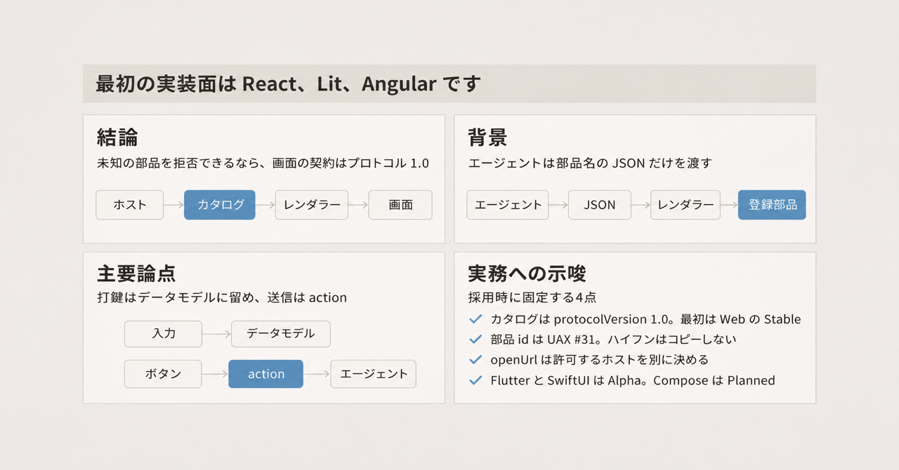
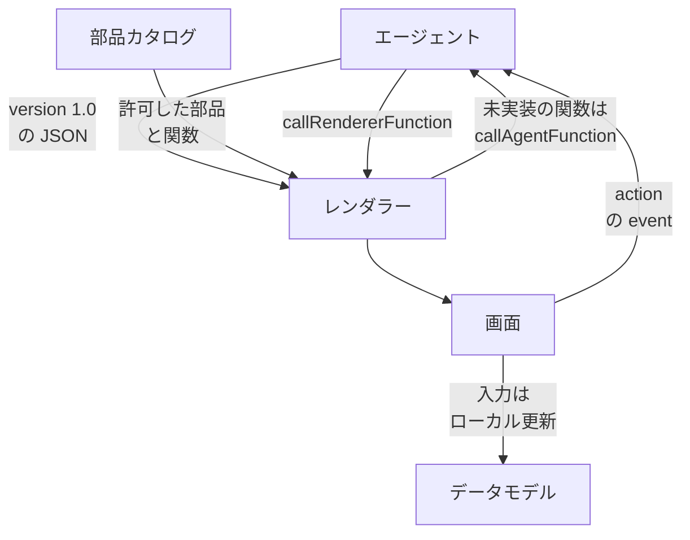

自前の画面部品を持つアプリが、エージェントにその部品の範囲で画面を組ませるときのオープンなプロトコルが A2UI です。エージェントは部品の見た目を描きません。ホストが持つデザインシステムのカタログに載った名前だけを JSON で渡します。ホスト側のレンダラーは、その JSON を登録済みの部品だけで描きます。

この記事では、プロトコル 1.0 のメッセージ、画面上の操作がエージェントとの会話になる条件、公式表が示すレンダラーの対応を整理します。仕様の正は [A2UI Protocol v1.0](https://a2ui.org/specification/v1.0-a2ui/) です。ヘッダの作成日は 2025-11-20、最終更新日は 2026-06-08 です。告知は [Google Developers Blog（2026-11-11）](https://developers.googleblog.com/a2ui-10-build-delightful-fast-reliable-agentic-experiences/) です。仕様本文の日付は、告知より約 5 か月前で止まっています。リポジトリは [a2ui-project/a2ui](https://github.com/a2ui-project/a2ui)（Apache-2.0、約 17.1k stars、2026-11-12 時点）です。


*この記事の全体像。以下、順に解説します。*

## A2UIとは

A2UI は、エージェントが画面を JSON で記述し、ホストアプリのレンダラーがその JSON を、あらかじめ登録した部品だけで描くプロトコルです。2026-11-11 の告知時点で、現行仕様は v1.0 です。バージョン台帳 [versions.json](https://a2ui.org/specification/versions.json) では v1.0 が current、v0.9.1 と v0.9 が previous、v0.8 が deprecated です。README は次の v1.1 を「要件を集めている」と書き、現行仕様には入れていません。

対象は、自前の画面部品を持ち、エージェントにその部品の範囲で画面を組ませたいアプリです。ここでのホストは、その画面を持つアプリ側です。カタログは、ホストが許可した部品と関数の名前を JSON Schema で持つ契約です。レンダラーは、契約に合う JSON だけをホストのウィジェットで描く実装です。

利用者の入力は、まずレンダラーの中のデータモデルにたまります。データモデルは、画面上の値をエージェントへ送る前に置いておく場所です。エージェントへ新しい会話を起こすのは、ボタンなどが送る `action` です。`action` は、レンダラーからエージェントへ新しい会話ターンを始めるメッセージです。

### メッセージは version と本体キー 1 つ

各メッセージは `"version": "1.0"` を持ち、本体のキーはちょうど 1 つです。

エージェントからレンダラーへ送るキーは 6 つです。`createSurface` はサーフェスを開きます。サーフェスは、一枚の画面領域です。`updateComponents` は、そのサーフェスへ部品定義の一覧を足すか更新します。`updateDataModel` は、サーフェスのデータモデルを更新します。`deleteSurface` は、サーフェスとその中身を画面から外します。`callRendererFunction` は、エージェントがレンダラーに登録された関数を実行させます。実行後、レンダラーは必ず `rendererFunctionResponse` を返します。成功なら値、失敗ならその応答の中の `error` を載せます。`agentFunctionResponse` は、レンダラーが送った `callAgentFunction` へのエージェントの返答です。

レンダラーからエージェントへ送るキーは 4 つです。`action` は、ボタンなどが新しい会話ターンを始めるメッセージです。`callAgentFunction` は、レンダラーがローカルに実装していない関数を、エージェントへ実行依頼するメッセージです。`rendererFunctionResponse` は、`callRendererFunction` の結果を返すメッセージです。`error` は、サーフェスの検証エラーや、関数応答とは別に返す実行の失敗をエージェントへ知らせるメッセージです。

`createSurface` の識別子は `surfaceId` で、必須です。同じメッセージに、`catalogId`、初期 `components`、初期 `dataModel`、`sendDataModel` を載せられます。`sendDataModel` の既定は false です。true のとき、この表面のデータモデル全体を、レンダラーが次にエージェントへ出すメッセージへ付けます。`components` と `dataModel` が両方あるときは、`dataModel` を先に適用します。

次の JSON は、必須の形だけを示した説明用の例です。部品の中身は載せていません。`surfaceId` の値は説明用です。

```json
{
  "version": "1.0",
  "createSurface": {
    "surfaceId": "booking"
  }
}
```

`catalogId` はカタログの識別子です。URI の形をしていても、その場で取得するアドレスとしては使いません。実装は `$ref` をネットワーク取得しません。

カタログの `protocolVersion` は、そのカタログがどのプロトコル版の契約かを示すフィールドです。省略すると既定は `"0.9"` です。1.0 のカタログは `"protocolVersion": "1.0"` が必須です。

### 基本カタログは参照実装

基本カタログは参照実装です。本番は、自前のデザインシステム用カタログを定義します。

部品は 18 個です。Text、Image、Icon、Video、AudioPlayer、Row、Column、List、Card、Tabs、Modal、Divider、Button、TextField、CheckBox、ChoicePicker、Slider、DateTimeInput です。

関数は 14 個です。required、regex、length、numeric、email、formatString、formatNumber、formatCurrency、formatDate、pluralize、openUrl、and、or、not です。

コンポーネント id は、Unicode の UAX #31 に従います。UAX #31 は、プログラミング言語の識別子に使える文字種を定めた Unicode の規則です。仕様の例では `user_card` と `userCard` が有効で、`user-card` と `1st_item` が無効です。

関数の `allowedCallers` は、その関数を誰が呼べるかを示す値です。取りうる値は `rendererOnly`、`agentOnly`、`rendererOrAgent` です。省略時は `rendererOnly` です。`requiresUserActivation` が true の関数は、利用者のジェスチャがあるときだけ動きます。省略時は false です。true のときは、`allowedCallers` が `rendererOnly` に限られます。基本カタログの `openUrl` は、指定した URL を開く関数で、`requiresUserActivation` が true です。

`@accessibility` は、部品に付けるアクセシビリティの属性です。キーは `label`、`description`、`live`、`hidden` です。`live` は、値の変化を読み上げへどう知らせるかを示し、Web では aria-live に渡します。`off` は知らせず、`polite` は操作の合間に知らせ、`assertive` はすぐに知らせます。スキーマ既定は `off` です。`hidden` の既定値は false です。`role` キーはありません。仕様は、この 4 属性を描画先のアクセシビリティ API へ渡すことを MUST にしています。Web では aria-label、aria-describedby、aria-live、aria-hidden です。

テーマの `theme` と `primaryColor` は、v1.0 の `createSurface` から外れています。見た目はホストのテーマに委ねます。

### レンダラーの対応

公式のレンダラー表は、プロトコル対応を示します。パッケージの版番号ではありません。出典は [renderers.md](https://github.com/a2ui-project/a2ui/blob/main/docs/public/reference/renderers.md)（main、2026-11-12 に取得）です。

| レンダラー | v1.0 | v0.9.1 |
|---|---|---|
| React | Stable | Stable |
| Lit | Stable | Stable |
| Angular | Stable | Stable |
| Flutter（`a2ui_flutter`） | Alpha | Alpha |
| SwiftUI | Alpha | Alpha |
| Jetpack Compose | Planned | Alpha |

同じ表には、上の 6 行とは別に生態系の行があります。Lynx A2UI（ByteDance）と AGenUI は v0.9、コミュニティ実装の Jetpack Compose と React Native は v0.8、Flutter GenUI SDK は v0.8 と v0.9.1 です。コミュニティの Jetpack Compose は公式行の Jetpack Compose とは別で、Flutter GenUI SDK は公式行の `a2ui_flutter` とは別です。AGenUI がどの画面向けかは、表にある版以外は書かれていません。

### 責任は 3 層に分かれる

エージェントは画面の意図を JSON で出します。カタログは、ホストが許可した部品と関数の名前を契約として持ちます。レンダラーは、その契約に合うものだけをホストのウィジェットで描きます。



画面上の操作は、プロトコル上は次の 3 つに分かれます。

| 操作の見え方 | プロトコル | エージェントの会話 |
|---|---|---|
| 文字入力、スライダー、チェック | レンダラーがデータモデルを更新する | その打鍵だけでは新しいターンを始めない |
| 確認や送信にあたるボタン | `action`（`name` は任意の文字列） | 新しい会話ターンを始める |
| その場の関数（URL を開く、検証する） | action に置く `functionCall` | ローカル実装があれば会話を始めない。無ければ `callAgentFunction` |

`functionCall` は、ボタンなどの action に置く関数呼び出しです。v1.0 の本則では、このキーを `@functionCall` と書きます。`functionCall` は `@` の無い移行中の名前です。その中身は `FunctionCall` で、`@call` と `args` を持ちます。`@call` は、このあと書くデータ束縛の関数呼び出しと同じ形です。

`action` の必須フィールドは `name`、`surfaceId`、`sourceComponentId`、`timestamp`、`context` です。`context` には、`@path` と `@call` で書いた動的束縛を解決した値が入ります。仕様例の `submitForm` は、`context` にニュースレターを購読するかどうかの真偽を載せ、任意の `userMessage` に人間向けの文字列を載せます。`timestamp` は、操作が起きた時刻の ISO 8601 文字列です。

予約名 `Surface` は、`createSurface` が暗黙に作ります。子は `"root"` で固定します。描画する木は `"id": "root"` を 1 つ持ちます。それ以外の部品は、親から子の id を参照してつなぎます。v1.0 の本則は `{"@child": "子のid"}` のように `@` で包む形です。`child` や `children` に id をそのまま書く形は、移行中は受理され、後に拒否される予定です。`Surface` 自体は `updateComponents` で変えられません。

### データ束縛と sendDataModel

データ束縛の動的値は `@path` と `@call` を使います。`@path` はデータモデル上の場所を指す束縛、`@call` はカタログ関数の呼び出しです。`updateDataModel` の `path`、子リストのテンプレート、通常のデータキーは、先頭の `@` を付けません。子リストのテンプレートは、データモデルの配列から子部品を繰り返す指定です。テンプレート側の部品 id と、配列を指す `path` 文字列を持ちます。この `path` は `@path` ではありません。[evolution guide](https://github.com/a2ui-project/a2ui/blob/main/specification/v1_0/docs/evolution_guide.md) は、`"path"` を `"@path"` へ一括置換するな、と書きます。接頭辞の対象は `DataBinding` と `FunctionCall` です。

`sendDataModel` の既定は false です。true のとき、レンダラーがエージェントへ出すメッセージのメタデータ `a2uiRendererDataModel` に、その表面のデータモデル全体が付きます。届く先は、その表面を作ったエージェントです。

## 注意点

告知文と、同じ日の公式表・仕様は、到達点の置き方が違います。ここから先は、どこまでを契約として読めるかの仕分けです。

### 告知が触れる面と公式表の列

ブログは web、Android、iOS の renderer SDK に触れます。同じ記事は、Gemini が今日描くのは A2UI 0.9.1 だと書きます。Gemini Enterprise については、すでに A2UI を使っており 1.0 への更新は作業中、と書きます。現行版を 0.9.1 とは書いていません。Jetpack Compose の v1.0 は coming soon、Lynx は A2UI 0.9 で 1.0 へ適応中、とも書きます。公式表で v1.0 Stable なのは React、Lit、Angular だけです。

AndroidX の `androidx.a2ui.compose` は、2026-10-21 時点で Stable が無く、Alpha は `1.0.0-alpha02` です。これはライブラリの版番号です。1.0.0-alpha01（2026-09-23）の変更は、カタログ id を `v0_9` のパスへ合わせた、とリリースノートが書きます。プロトコル 1.0 の Stable とは別の数字です。出典は [AndroidX A2UI Compose](https://developer.android.com/jetpack/androidx/releases/a2ui-compose) です。

npm と pub の版も、プロトコル版ではありません。2026-11-12 時点のレジストリ latest は次のとおりです。

| パッケージ | latest | その版の時刻 (UTC) |
|---|---|---|
| `@a2ui/react` | 0.15.0 | 2026-11-02T02:43:37.733Z |
| `@a2ui/lit` | 0.15.0 | 2026-11-02T02:43:37.922Z |
| `@a2ui/web_core` | 0.15.0 | 2026-11-02T02:44:15.018Z |
| `@a2ui/angular` | 0.14.0 | 2026-11-02T02:43:39.432Z |
| `@a2ui/agent` | 0.1.0 | 2026-11-02T02:44:47.386Z |
| `a2ui_flutter` | 0.3.0 | 2026-11-11T01:50:45.579787Z |
| `a2ui_core` | 0.7.0 | 2026-11-11T01:49:58.596066Z |
| `a2ui_agent`（Dart） | 0.3.0 | 2026-11-11T01:50:26.102224Z |
| `a2ui-agent-sdk`（PyPI、Python >=3.10） | 0.11.0 | 2026-11-10T22:20:43.505296Z |

ブログの「What is new」では、Dart のリンク先も Python と同じ PyPI URL になっています。Dart のパッケージは pub.dev の `a2ui_agent` です。

Atlassian、Alation、Bloomberg、ByteDance は、ブログが「すでに A2UI で作っている」と名を挙げます。Lynx（ByteDance）のプロトコルは 0.9 と記事が書きます。Atlassian と Bloomberg のプロトコル版は、この記事にはありません。

2026-05-29 公開の Zenn「A2UIの仕組みを整理して動かしてみる」は、本文で v0.9 を最新ドラフトとして解説しています。1.0 の現状の根拠には使いません。

### 入力と送信と関数は別の層

仕様と [Actions and functions](https://a2ui.org/concepts/actions-and-functions.md) が分けているのは、ローカルなデータモデル、`action` の event、カタログ関数の 3 層です。予約された操作名は無く、event 名は任意の文字列です。`confirm` は event 名の例であり、ボタンの文言が Confirm でも送信と同じクリックになることがあります。ブログの病欠シナリオにある「確認するまで何も送られない」は物語です。確認、編集、送信のような 3 段の予約手順ではありません。プロトコルが分けるのは、データモデル、`action`、カタログ関数の 3 層です。

### 実行可能コードをメッセージに載せない契約の出口

仕様は、エージェントが関数を名前で参照し、実行可能コードを送らない、と書きます。これは配送の形の話です。次の出口は、同じ仕様か、現行 main の実装に残っています。

- `action.context` は、解決済みの利用者入力をエージェントへ載せます。`userMessage` も同じ `action` に載ります。エージェントが LLM なら、その文字列は次のモデル入力になり得ます。
- `sendDataModel: true` は、打鍵のたびに通信しません。次にレンダラーがメッセージを出すとき、表面のデータモデル全体が、表面を作ったエージェントへ付きます。
- ローカルに実装が無い関数名は `callAgentFunction` に回ります。概念文書は、`formatCurrncy` のような綴りミスもエージェント呼び出しになると書きます。カタログ外の名前を拒否するかどうかはレンダラーの実装に依存します。拒否する実装では、その拒否を明示する必要があります。
- Text は simple Markdown を描きます。適合試験は、画像を img にしない、リンクを遷移先の無いテキストにする、生 HTML を要素にしない、と期待します。`@a2ui/markdown-it` の試験は、画像とリンクの 2 件を既知のギャップとして skip します（main の `markdown_subset_conformance.test.ts`）。画像 URL の自動取得は、クリック無しの第三者リクエストになり得ます。
- `openUrl` はジェスチャが必要です。ジェスチャのあとの遷移先を、ホストの許可リストで縛る規則は仕様にありません。

### CVE-2026-10032 は告知より前に修正版がある

2026-11-12 時点の一次レコードは次の 2 つです。点数は出典で違います。どちらか一方には丸めません。

| 出典 | 状態 | 点数 | 影響 |
|---|---|---|---|
| [GHSA-72qq-p3r5-f7wq](https://github.com/a2ui-project/a2ui/security/advisories/GHSA-72qq-p3r5-f7wq) | 公開のまま（withdrawn ではない）。severity は critical | CVSS 3.1 は 9.3。vector は `CVSS:3.1/AV:N/AC:L/PR:N/UI:R/S:C/C:H/I:H/A:N` | npm `@a2ui/web_core` の 0.9.0、0.9.1、0.9.2、0.10.0、0.10.1。修正版は 0.10.2 以降 |
| [NVD CVE-2026-10032](https://nvd.nist.gov/vuln/detail/CVE-2026-10032) | Analyzed。published 2026-08-04 | CVSS 3.1 は 6.1 MEDIUM。vector は `CVSS:3.1/AV:N/AC:L/PR:N/UI:R/S:C/C:L/I:L/A:N`。CVSS 4.0 も 6.1 | CPE は 0.9.0 以上、0.10.2 未満 |

内容は、Basic Catalog が既定で有効なとき、悪意あるエージェントが Button の `openUrl` に `javascript:` URL を渡し、利用者がそのボタンを押すと、ページ生成元で JavaScript が動く、というものです。点数の差は、機密性と完全性を advisory が High、NVD が Low にしているためです。

この穴を「1.0 告知時点の現行 Web レンダラーが今も `javascript:` を実行する」証拠にはしません。スキーム制限を入れたのは [a2ui-project/a2ui#1707](https://github.com/a2ui-project/a2ui/pull/1707) で、merge は 2026-06-19T01:30:43Z です。NVD の published は 2026-08-04 で、修正月ではありません。どちらも 2026-11-11 の告知より前です。

`executeOpenUrl` は、commit `5b5936547ec69081417b6141bebcf8cf2e8e8762`（2026-11-11T23:09:24Z）と、2026-11-12 時点の main HEAD `dada9a12c1d615ec43c874131bb8377add9d0b09`（2026-11-11T23:59:23Z、Swift のリファクタ）で同じ関数でした。`https:`、`http:`、`mailto:`、`tel:` 以外を拒否し、相対 URL はページの URL を基底に解決します。ホストの許可リストはありません。レジストリ上の `@a2ui/web_core` 0.15.0 は、上の影響範囲の外です。関数の該当箇所は [basic_functions.ts](https://github.com/a2ui-project/a2ui/blob/dada9a12c1d615ec43c874131bb8377add9d0b09/typescript/core/web_core/src/common/basic_functions.ts) です。

残件は [a2ui-project/a2ui#4045](https://github.com/a2ui-project/a2ui/issues/4045)（open、2026-11-12 時点）です。画像、動画、音声、Markdown、Vega、openUrl に、スキーム以外のホスト制限が無い、という未実装の提案です。Vega は、その Issue が挙げるグラフ仕様（Vega-Lite）を載せる経路です。

### 公式例の id はハイフンを含む

仕様の ComponentId は、ハイフンを Pattern_Syntax として拒みます。Pattern_Syntax は、Unicode が記号と定める文字種で、ハイフンが含まれます。JSON Schema の `ComponentId` は `"type": "string"` だけで、pattern は付いていません。スキーマ検証だけではハイフンを落とせません。

同じ組織の v1.0 例は、`docs/public/concepts/data-flow.md` で `guests-field`、`submit-btn`、`submit-text` を使い、`docs/public/reference/components.md` で `email-input`、`message-list`、`settings-tabs` を使います。公開 URL `https://a2ui.org/reference/components/` はこのギャラリーではなく、basic catalog の実装ガイドへリダイレクトします。ガイド本文に `@accessibility` の例はありません。v1.0 の `@accessibility` 例がリポジトリ原稿にあることと、公開サイトがその原稿を出しているかは別です。公開サイトがこの原稿を配信しているかは、2026-11-12 時点で確認できていません。

採用時は仕様の UAX #31 を優先し、例のハイフン id はコピーしません。

### 80 倍は未搭載の説明である

[ロードマップ](https://a2ui.org/roadmap.md) は、Jev のような決定モデルを公式 Agent SDK がまだ持たない、と書きます。Jev は、そのページが名を挙げるだけで、中身は 1.0 の仕様に無い決定モデルです。公式 Agent SDK は、エージェント向けの公式 SDK を指す名前です。上の版の表では `@a2ui/agent`、Dart の `a2ui_agent`、Python の `a2ui-agent-sdk` がエージェント向けです。同じページの「最大 80 倍」は、トークンごとに木を書く代わりに型付きの質問でレイアウトを決める、という未搭載機能の説明です。公式 SDK の計測表ではないので、1.0 の性能値としては採用しません。

カスタム部品は、今も各ネイティブ実装が必要です。同じロードマップがそう書きます。宣言的プリミティブは、その段をなくす予定の書き方です。1.0 にはまだありません。

### 速度や行数として残していないもの

- レンダラー再実装の「約 3000 行」は、公開 URL `https://a2ui.org/guides/renderer-development.md` が HTTP 404 で、現行のガイド本文を確認できません。採用しません。
- プロトコルにレート上限、課金、SLA、リージョン、データ所在地はありません。有償ホストの契約は確認できていません。
- 公式 Colab の有無は確定していません。リポジトリ内のノートブックファイルは見つかっていません。

### クライアントに組み込まない遠隔ウィジェット

リポジトリの `docs/public/introduction/who-is-it-for.md` は、クライアントへ統合しない遠隔ウィジェットには A2UI を使わず、iframe を使う、と書きます。例として MCP Apps を挙げます。MCP Apps は、ホストアプリの外にある画面を iframe で載せる仕組みです。ブログは Claude と Gemini に触れます。

公開 URL `https://a2ui.org/introduction/who-is-it-for.md` は 2026-11-12 時点で HTTP 404 です。拡張子無しはトップへリダイレクトし、本文は載っていませんでした。サイトに載っているかは確認できていません。原稿は [who-is-it-for.md](https://github.com/a2ui-project/a2ui/blob/main/docs/public/introduction/who-is-it-for.md) にあります。

ブログは、Web と Flutter のレンダラーが MCP Apps（Claude、Gemini）の中で動く、と書きます。役割の併記は、ホストに組み込む画面の契約が A2UI、ホスト外の遠隔画面が iframe、です。MCP Apps の中に A2UI を描く向きと、A2UI の表面に MCP App を埋め込む向きで、状態の共有がどこまで対称かは、公開ガイド `https://a2ui.org/guides/a2ui-in-mcp-apps.md` の本文を確認できていません。

公開情報だけでは、Atlassian と Bloomberg が本番で使っているプロトコル版も、Gemini Enterprise の 1.0 更新がどのビルドで完了するかも決まっていません。2026-11-11 のブログは、その更新を作業中と書きます。

## どの面を 1.0 の契約にするか

ホストがデザインシステムを持ち、未知の部品を拒否できるなら、A2UI 1.0 を画面のワイヤ契約にします。ワイヤ契約とは、エージェントとホストの間で画面の意図を渡すときのメッセージの形です。最初の実装面は、公式表が v1.0 Stable とする React、Lit、Angular に限ります。Flutter と SwiftUI は Alpha、Jetpack Compose のプロトコル 1.0 は Planned として、同じ完成度とは扱いません。確認と送信は、ローカルなデータモデル更新と、明示的な `action` event で画面上に分けます。

### Web と非 Web とホスト外の画面

| 基準 | Web で自前カタログの A2UI 1.0 | 非 Web を同じ 1.0 契約とみなす | ホスト外の画面を iframe（MCP Apps など）にする |
|---|---|---|---|
| 公式の v1.0 表示 | React / Lit / Angular が Stable | Flutter と SwiftUI は Alpha。Compose の v1.0 は Planned | プロトコル版の表には載らない |
| 部品の拒否 | カタログに無い部品は描かない。対応カタログ一覧へのフォールバックは無い | 同じ仕様でも、レンダラーの検証差が Issue に残る | 遠隔ページ側の実装になる |
| デザインシステム | ホストの部品が契約になる | カスタム部品は今も各プラットフォームの実装が要る | ホストの部品カタログの外 |
| 確認と送信 | event 名とボタンで画面上に分けられる。確認・編集・送信という予約された 3 つの動詞は無い | 同じ。SwiftUI の見た目差は別 Issue | 埋め込み先の UI 規約 |
| データがエージェントへ出る条件 | `action.context` と、任意の `sendDataModel` | 同じ仕様 | iframe 側の通信 |

カタログが無い表面は描きません。capabilities は、レンダラーが対応すると宣言したカタログの一覧です。仕様は、その一覧へフォールバックしない、と書きます。入力の打鍵だけではエージェントへ送らない、と two-way binding の節が書きます。two-way binding は、画面の値とデータモデルを双方向で結ぶ仕組みです。

非 Web の差として、2026-11-12 時点で open のものを挙げます。

| Issue | 状態 | 起きていること |
|---|---|---|
| [a2ui-project/a2ui#2738](https://github.com/a2ui-project/a2ui/issues/2738) | open | 全レンダラーを同じ意味の木に揃える適合試験は未完 |
| [a2ui-project/a2ui#3147](https://github.com/a2ui-project/a2ui/issues/3147) | open | SwiftUI はコンテナの live region を読み上げず、グループ化したコンテナの accessibilityHint を落とす |
| [a2ui-project/a2ui#3998](https://github.com/a2ui-project/a2ui/issues/3998) | open | TypeScript が JSON Schema を Zod に落とすときキーワードを欠き、関数引数の合否が Python / Dart と分かれる |
| [a2ui-project/a2ui#4098](https://github.com/a2ui-project/a2ui/issues/4098) | open | relaxed は未知の項目を捨てて続行する検証です。Swift はそのモードでも `theme` 付き `createSurface` を拒否し、ガイドが言う「捨てる」と一致しない |
| [a2ui-project/a2ui#4096](https://github.com/a2ui-project/a2ui/issues/4096) | open | SwiftUI の Image は fit の fill と none で、CSS の object-fit と切り抜きが違う |
| [a2ui-project/a2ui#4168](https://github.com/a2ui-project/a2ui/issues/4168) | open | v1.0 の本則は子と action を `@child`、`@action`、`@functionCall` で包む形です。包まない bare な形（部品 id の文字列、id の配列、`{event}` や `{functionCall}`）はまだ受理され、のちに拒否へ反転する予定です |
| [a2ui-project/a2ui#4082](https://github.com/a2ui-project/a2ui/issues/4082) | open | 部品の中の `catalogId`、`metadata`、`accessibility`、`checks` は `@` 付きが本則です。`@` の無い bare なキーの互換は削除予定です。メッセージの本体キーとは別です |
| [a2ui-project/a2ui#4167](https://github.com/a2ui-project/a2ui/issues/4167) | open | Dart の `a2ui_agent` には、カタログから SKILL.md を書き出す Skill / SkillGenerator がまだ無い。SKILL.md はエージェント向けの手順ファイルで、画面を描くレンダラーの欠落ではない |

アクセシビリティそのものが未実装、とは言えません。仕様は `@accessibility` の 4 属性をホスト API へ渡すことを MUST にし、ブログは 1.0 で足したと書きます。上の #3147 は、SwiftUI のコンテナがその契約どおりではない、という残件です。

この範囲を支える事実は次のとおりです。

- versions.json が v1.0 を current としています。
- カタログが無い表面は描かず、対応カタログの一覧へフォールバックしません。
- 入力の打鍵だけではエージェントへ送りません。
- Web の 3 レンダラーだけは、公式表が v1.0 Stable と書いています。
- `javascript:` の openUrl は、0.10.2 以降の修正範囲に入り、2026-11-12 時点の main はスキームを拒否します。

残る限界は次のとおりです。

- ブログと公式表が、非 Web と Gemini Enterprise と Lynx の 1.0 を先送りしています。
- `action.context`、`sendDataModel: true`、任意の https 遷移、Markdown の画像は、コードを配送しない契約の外にあります。
- 公式例のハイフン id は、仕様が無効とする形です。
- レンダラー間の意味の一致は、適合試験が未完です（#2738）。
- クライアントに組み込まない遠隔ウィジェットは、リポジトリ原稿が A2UI の対象外とし、iframe を例示しています。公開サイトでの掲載は確認できていません。

### 採用時に固定すること

1. ワイヤ契約はプロトコル 1.0 にします。カタログ JSON に `"protocolVersion": "1.0"` を置きます。v0.9 のカタログを 1.0 ランタイムへそのまま載せません。
2. 最初に繋ぐレンダラーは React、Lit、Angular のいずれかにし、`@a2ui/web_core` は 0.10.2 以降を使います。2026-11-12 のレジストリ latest は 0.15.0 です。
3. 部品 id は UAX #31（例: `submit_btn`）にします。公式例のハイフンはコピーしません。
4. 画面では、入力をデータモデルに留め、確認と送信は名前付きの `action` event にします。`sendDataModel` は、表面全体を作ったエージェントへ渡してよいときだけ true にします。
5. `openUrl` と Markdown の画像・リンクは、ホスト側で許可するオリジンを別に決めます。仕様のスキーム拒否だけではホスト制限になりません。
6. Flutter、SwiftUI、Jetpack Compose を「1.0 対応済み」と対外的に書きません。各レンダラーの表の列を、採用日に取り直します。
7. ホストアプリの外にある遠隔ウィジェットは、リポジトリ原稿が示すとおり iframe 側（MCP Apps など）を候補にします。A2UI は、ホストが部品を実装できる画面に使います。
8. Dart を入れるときは pub.dev の `a2ui_agent` を使い、ブログの PyPI リンクは使いません。

公式表が Flutter、SwiftUI、Compose の v1.0 を Stable に変え、#2738 の適合試験がそれらのレンダラーを同じ意味の木として通したとき、非 Web を同じ契約の完成面に加えてよいです。それまでは Web の Stable と、Alpha / Planned を分けたままにします。

## まとめ

A2UI 1.0 は、エージェントが画面の意図を JSON で渡し、ホストが登録した部品だけで描く契約です。入力の打鍵はデータモデルに留め、新しい会話は名前付きの `action` で始めます。最初の実装面は、公式表が v1.0 Stable とする React、Lit、Angular です。Flutter と SwiftUI は Alpha、Jetpack Compose のプロトコル 1.0 は Planned です。カタログには `"protocolVersion": "1.0"` を置き、部品 id は UAX #31 にします。`openUrl` のスキーム拒否は 2026-06-19 の修正に入っていますが、遷移先のホスト制限は仕様に無く、Issue #4045 が残っています。

この記事が少しでも参考になった、あるいは改善点などがあれば、ぜひリアクションやコメント、SNSでのシェアをいただけると励みになります！

## 参考リンク

- Google Developers Blog, "A2UI 1.0: Build delightful, fast, reliable agentic experiences", 2026-11-11. https://developers.googleblog.com/a2ui-10-build-delightful-fast-reliable-agentic-experiences/
- A2UI Protocol v1.0（Status Current、Created Nov 20, 2025、Last Updated Jun 8, 2026）. https://a2ui.org/specification/v1.0-a2ui/
- リポジトリ上の同じ仕様（commit `5b5936547ec69081417b6141bebcf8cf2e8e8762`、committer date 2026-11-11T23:09:24Z）。2026-11-12 時点の main HEAD は `dada9a12c1d615ec43c874131bb8377add9d0b09`（2026-11-11T23:59:23Z）. https://github.com/a2ui-project/a2ui/blob/5b5936547ec69081417b6141bebcf8cf2e8e8762/specification/v1_0/docs/a2ui_protocol.md
- Evolution guide. https://github.com/a2ui-project/a2ui/blob/main/specification/v1_0/docs/evolution_guide.md
- versions.json. https://a2ui.org/specification/versions.json
- Renderer support. https://github.com/a2ui-project/a2ui/blob/main/docs/public/reference/renderers.md
- Actions and functions. https://a2ui.org/concepts/actions-and-functions.md
- Roadmap. https://a2ui.org/roadmap.md
- AndroidX A2UI Compose リリース（Latest Update October 21, 2026、Alpha 1.0.0-alpha02）. https://developer.android.com/jetpack/androidx/releases/a2ui-compose
- GHSA-72qq-p3r5-f7wq. https://github.com/a2ui-project/a2ui/security/advisories/GHSA-72qq-p3r5-f7wq
- NVD CVE-2026-10032. https://nvd.nist.gov/vuln/detail/CVE-2026-10032
- `executeOpenUrl`（`5b59365` と main HEAD `dada9a12` で同一）. https://github.com/a2ui-project/a2ui/blob/dada9a12c1d615ec43c874131bb8377add9d0b09/typescript/core/web_core/src/common/basic_functions.ts
- openUrl のスキーム制限 PR #1707（merged 2026-06-19T01:30:43Z）. https://github.com/a2ui-project/a2ui/pull/1707
- who-is-it-for（リポジトリ原稿。公開 URL は 2026-11-12 に 404）. https://github.com/a2ui-project/a2ui/blob/main/docs/public/introduction/who-is-it-for.md
