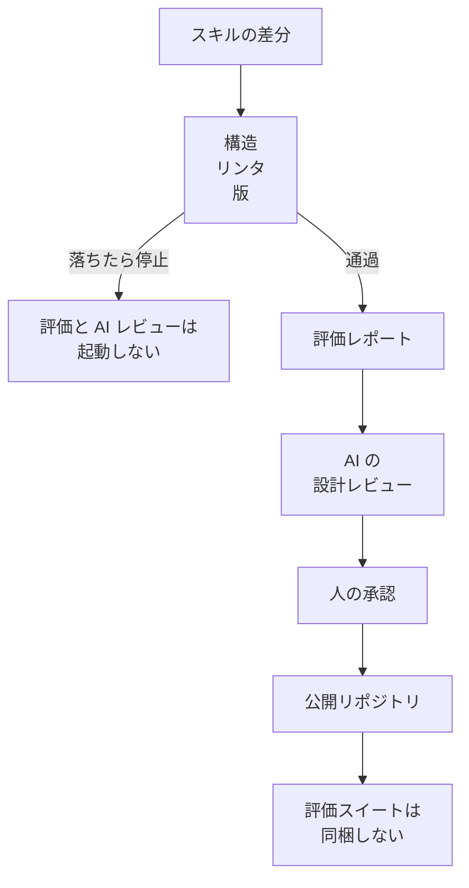

Google の Agent Skills は、エージェントに渡す手順書をディレクトリ単位で配る形式です。2026年10月28日付の [Google Cloud Blog](https://cloud.google.com/blog/topics/developers-practitioners/behind-the-scenes-two-months-later-how-we-ship-google-agent-skills-like-products/) は、その手順書の文言を変えることを、エージェントの判断とツール選択を変える製品変更として出荷する流れを説明しています。説明の本体は運用の手順であり、精度が何ポイント上がったかは書かれていません。この記事では、その出荷の手順と、小さいチームが検収へ移せる条件を整理します。


*この記事の全体像。以下、順に解説します。*

## Google の Agent Skills とは

Agent Skills の 1 件は、1 つのディレクトリです。手順書の本体は `SKILL.md` です。中身は、発見用の短い説明、本文、必要なときだけ読む参照、実行できるスクリプトに分かれます。

[Agent Skills の仕様](https://agentskills.io/specification) は、この読み方を段階に分けています。起動時に読むのは `name` と `description` です。スキルを選んだあとに `SKILL.md` の本文を読みます。`scripts/` や `references/` は、作業がそれらを必要としたときに読みます。10月28日の記事は、同じ段階を AI レビューの規則にしています。本文は 500 行未満に収め、詳細は `references/` へ移します。

公開先は [google/skills](https://github.com/google/skills) です。10月28日の記事は、星が 21,000 を超え、スキルは 170 を超えた、と書いています。

### 内部リポジトリの検査

記事が説明する検査は、GitHub へ書き出す前の内部リポジトリで動きます。並びは 7 段です。1 から 6 が自動で、7 が人の承認です。

1. 構造。ディレクトリの形、置いてよいファイル、分類。
2. リンタ。frontmatter、フォルダ名、Markdown の規則。frontmatter は、ファイル先頭の YAML です。
3. セマンティックバージョン。振る舞いの変更ごとに、版の番号を上げます。
4. 評価スイート。比較に使うプロンプトと期待のまとまりが壊れていないことと、新しい評価レポートがあること。
5. リンク。
6. AI による設計レビュー。
7. 人の承認。承認者は、対象の専門家です。新規スキルでは Central Skills team の一員も入ります。Central Skills team は、新規スキルの承認に加わる中央の担当として記事が書く名前です。

安い検査が先です。構造、リンタ、版のどれかが落ちると、評価も AI レビューも起動しません。通過した差分だけが、比較と設計レビューを経て人に届きます。



図の最後は、2026年8月4日の [前回記事](https://cloud.google.com/blog/topics/developers-practitioners/behind-the-scenes-how-we-build-test-and-scale-google-agent-skills) の説明です。公開用の書き出しで、内部資産と所有情報と評価スイートを外します。

リンクは図の停止条件には入っていません。図が先に止めるのは、構造、リンタ、版です。マージ前の相対リンクは、6 段の自動検査の一つです。通らないと、公開用の書き出しへ進みません。公開後の外部リンクは、毎週月曜の別の検査です。

### 版の書き方

版は、`SKILL.md` の frontmatter にある `metadata.version` です。引用符付きの文字列で書きます。記事の例は、`spanner-basics` の `"1.1.1"` です。新規は `"1.0.0"` から始めます。

```yaml
metadata:
  version: "1.1.1"
```

引用符が要る理由は、YAML の読み方です。引用符のない `2.0` は数値になることがあり、文字列を期待するツールが壊れます。

既存スキルの本文、スクリプト、参照のどれかを変えたのに版が上がっていなければ、その変更は止まります。MAJOR（上位）を上げると MINOR（中位）と PATCH（下位）を 0 に戻します。記事の例は `1.4.2` から `2.0.0` です。MINOR を上げると PATCH を 0 に戻します。例は `1.4.2` から `1.5.0` です。

記事は、この番号を開発者と配布ツールのための印だと書いています。手元のスキルと上流のカタログを比べ、いつ取り込むかを決めるためです。取り込みの操作の例に `npx skills update` を挙げています。分かっている版に固定できる、と記事が書くのは、この番号の側です。

### 評価レポートが比べるもの

評価レポートは、同じプロンプトを、変更後のスキルと、前の版またはスキルなしで走らせた比較の記録です。既存スキルの相手は前の版です。新規の相手は、そのスキルを渡さない実行です。

変更したスキルの pull request 説明から、このレポートへリンクします。レポートは、最新コミットに対する実行でなければなりません。

採点の期待は 1 項目に割ります。この 1 項目を、原子期待と呼びます。ファイルを指すプロンプトは、ファイルが存在し、中身が空でないことを検査が確認します。記事の例は `@file:test_prompt.txt` です。同じスイートの中の、重複したプロンプトと、矛盾した期待も止めます。

複合の期待は、採点が揺れます。記事が悪い例として出す文は、次のとおりです。

> The agent must create a Cloud Storage bucket in us-central1, enable uniform bucket-level access, and apply lifecycle rules.

`us-central1` はリージョン名です。uniform bucket-level access は、バケットのアクセス制御を一様にする設定です。リージョンとライフサイクルは合っていても、この設定が欠けると、採点が揺れた、と記事は書いています。割ったあとの期待は、次の 3 つです。

- "The agent specifies us-central1 for the bucket location."
- "The agent enables uniform bucket-level access on the created bucket."
- "The agent defines a lifecycle configuration rule deleting objects older than 30 days."

8月4日の記事は、見る量を二つに分けています。一つは応答の質とタスクの完了です。もう一つは消費トークンと完了までの時間です。

### AI レビューが見る形

AI レビューは、リンタが拾えない形を見ます。厳密なコマンド列、JSON のパース、デプロイ手順は `scripts/` に置きます。Markdown に残すのは、構成の選択やログの切り分けのように、判断が要る作業です。

`references/` は、サブディレクトリのない 1 段にします。`SKILL.md` から参照ファイルへ、さらに別ファイルへつなぐ連鎖も止めます。記事は、評価ではエージェントが 2 段目の前で止まることが多かった、と書いています。

`scripts/` のスクリプトは、対話の入力で止まらないことが条件です。入力はコマンドの引数か環境変数で渡します。破壊的な操作には、実行前に確認するフラグを付けます。

人の承認は、これらの自動検査の後の段です。

## 注意点

### 数として読める範囲

10月28日の記事は運用の説明です。精度が何ポイント上がったかは書いていません。8月4日の記事は、上の二軸を複数回、複数のエージェント枠で回し、上げ幅を 2 行 2 列で見る、と書いています。エージェント枠が何を数えるかと、行と列が二軸のどちらに対応するかは、記事に書いてありません。表の中身と試行回数もありません。この表を、公開された改善幅としては読めません。

2026年10月29日に公開側で読めた数は、次のとおりです。

| 項目 | 値 | 出典の性質 |
|---|---|---|
| 星の数 | 21,641 | GitHub API の `stargazers_count`。記事の「21,000 を超えた」と整合する |
| 記事が書く前回の星 | 15,000 から | 10月28日の記事の文言。当時の API 値は取り直していない |
| カタログ件数 | 177 | `index.json` の `skills` 配列。先頭は手編集禁止の生成物だと書いてある |
| `SKILL.md` のファイル数 | 182 | `skills/` が 177、`plugins/` が 5。カタログ件数とは別 |

仕様が文字数の上限を書いているのは、`name` が 64 文字、`description` が 1024 文字です。本文を 500 行未満にすることは推奨です。

### 公開リポジトリの workflow

公開されている workflow は、週次のリンク検査 1 本です。スケジュールは月曜 10:38 UTC です。失敗しても、そのステップはジョブを落としません。設定は `fail: false` です。

壊れたリンクは、スキル所有者ごとの通知ではありません。1 件の issue 本文を更新します。既定の番号は 240 です。issue の注記は、修正は内部の正本で行う、と書いています。原文は "All broken links need to be updated in the internal source of truth." です。

10月28日の記事は、壊れたリンクをスキル所有者へ知らせる、と書いています。公開 workflow の動作は、上の 1 件の issue です。

[`CONTRIBUTING.md`](https://github.com/google/skills/blob/main/CONTRIBUTING.md) は、外部の pull request を受け付けないと明記しています。不具合の報告と、新しいスキルの要望は、issue なら受け付けます。

`evals/` や `eval.yaml` を、2026年10月29日の公開ツリーから探すと 0 件でした。したがって、公開リポジトリを見れば内部と同じ 6 段が動いている、とは言えません。

### 設計規則と公開ファイル

AI レビューの規則を、公開物の全件が満たしているわけではありません。2026年10月29日の公開ツリーでは、`firebase-basics` の参照が `references/refresh/` と `references/setup/` に分かれています。平坦な 1 段ではありません。

[`bigquery-basics`](https://github.com/google/skills/blob/main/skills/cloud/bigquery-basics/SKILL.md) の版は `"1.0.2"` です。本文には、API の有効化から `bq mk`、`bq query` までの番号付き手順が残っています。ブログがスクリプトへ置けと言う側に近い例です。

[`gcloud`](https://github.com/google/skills/blob/main/skills/cloud/gcloud/SKILL.md) の版は `"1.0.3"` です。計画は 4 段のテンプレートで書け、と本文が指定しています。1 段目は `gcloud help` に、末端のコマンド名を付けた確認です。実行前に help を見よ、という規則も本文にあります。この規則は、モデルが本文を読まないと文脈に入りません。スクリプトへ移すと、モデルがそのスクリプトを起動しない限り、規則は効きません。

版が `"1.0.2"` や `"1.0.3"` であることは、コマンド列が本文に無いことを意味しません。

### 更新コマンドが見ている印

`npx skills update` の実装は、[vercel-labs/skills の `src/update.ts`](https://github.com/vercel-labs/skills/blob/main/src/update.ts) です。2026年10月29日の main を読みました。

GitHub 由来のスキルは、フォルダのハッシュがロックと違うかを見ています。ロックは、取得時点のフォルダ内容を記録した印です。このファイルの中に、`metadata.version` という文字列はありません。

`/.well-known/` の URL から索引を取る経路にも、索引エントリの `version` があります。実装上の名前は well-known です。これは手順書 frontmatter の版ではありません。

したがって、版を上げなくても、次の `skills update` で手元の中身は変わり得ます。更新がハッシュで追従するからです。記事が書く「分かっている版に固定する」は、このコマンドが `metadata.version` を見て止まる、という意味ではありません。

### 仕様が必須にしていない項目

仕様で必須なのは `name` と `description` だけです。`metadata` は任意の文字列マップです。`version: "1.0"` は例です。本文の形式に制限はありません。500 行未満と、参照を 1 段にすることは推奨です。

仕様ページが `skills-ref validate` にさせる確認は、frontmatter と命名です。版の必須や、評価レポートの必須は、この確認に入っていません。

ルートに `version` を足す提案は、[議論 420](https://github.com/agentskills/agentskills/discussions/420) です。開始は 2026年6月12日です。2026年10月29日に読んだ範囲では、仕様への採用は決着していません。メンテナの jonathanhefner は 2026年6月30日に、SemVer の意味を全員へ強制するのは危うく、自由形式なら `metadata.version` で足りる、と書いています。記事著者の GitHub アカウント rsamborski は 2026年7月27日に、`metadata.version` を検討している、と書いています。

10月28日の記事は、その検討を Google の内部規則にしたものです。仕様の改訂ではありません。

### 採点の失敗と実行の失敗

評価が「失敗」と言うものが、実行の失敗とは限りません。これは google/skills の採点器を測った結果ではありません。2026年10月17日の [別記事](https://cloud.google.com/blog/topics/developers-practitioners/four-eval-engineering-lessons) が、Google Cloud Developer plugin での失敗を書いています。

11 本のプロンプトのうち、自動採点は 3 本を失敗としました。ツール呼び出しのログでは、その 3 本は手順を通っていました。掃除のプロンプトでは、最初に `gcloud help run services list` を実行しました。最終メッセージは、データ消失の警告が中心で、ヘルプを見たとは書いていませんでした。

ライブ実行は、ツールを実際に呼ぶ実行です。計画だけの実行は、呼ぶ前に手順の文章を出す実行です。同じ記事は、この二つの差から、重要な発見のおおよそ半分が出た、とまとめています。分母の件数は書いていないので、検出率としては使えません。計画だけの実行は 8,000 文字の手順を出し、組織の方針を無視していました。ライブ実行は、その前に権限で止まっていました。

10月28日のスキル記事は、原子期待の文を上のように書いています。採点が最終文面なのか、ツール列なのかは指定していません。

参照を 2 段にすると 2 段目の前で止まることが多い、という記述も、回数はありません。

### 費用と検査の当たり方

記事は、変更のたびに全評価と AI レビューを走らせると、トークンと CI 時間がすぐ高くなる、と書いています。金額、トークン数、分数は出てきません。

同じ記事は、初期の検査が広すぎた、とも書いています。1 行の誤字修正が、バグ追跡の承認済みチケットが無いために止まりました。深いディレクトリの新規スキルは、逆に検査から漏れました。教訓は、追加と修正、パスの深さを分け、軽い修正と新規スキルを同じ条件で止めない、です。

自分たちで似た仕組みを作るときの追加案として、重い検査の手動起動と、差分の大きさによる再実行の間引きを挙げています。手動起動の例は、pull request のコメント `/run-evals` です。間引く閾値の数値は公開されていません。記事の本文が、自社のパイプラインで `/run-evals` を使っているとは書いていません。自社のパイプラインについて書いている止め方は、構造、リンタ、版が落ちている間は、評価と AI レビューを起動しないことです。

### まだ分かれていないこと

- google/skills の内部評価が、最終文面とツール列のどちらを採点しているか。10月28日の記事は指定していません。
- 文言のどの変更を MAJOR、MINOR、PATCH にするか。公開されているのは、上のリセット規則までです。
- 精度、トークン、所要時間の上げ幅と、評価の試行回数。
- 公開カタログの何件が、参照の平坦さと「コマンド列はスクリプト」を満たすか。確認したのは、反例が 2026年10月29日も残っていることまでです。
- `src/update.ts` の外のモジュールが、手順書の frontmatter を読むか。確認したのは、このファイルに `metadata.version` が無く、GitHub 経路がフォルダハッシュを見ることまでです。
- 公開リポジトリのブランチ保護。2026年10月29日に main の保護設定を公開 API で読むと 404 でした。保護が無いことと、公開トークンから見えないことは区別できません。外部貢献を拒む文書と、workflow が 1 本であることは確認しました。

## 評価レポートが切る失敗

原子期待は、複合文の中に欠落を隠さないための切り方です。リージョンは合っていても、バケットの均一アクセスが無い、という欠落を、1 つの文の合否に混ぜません。

スイート自体の壊れも、レポートの前に止まります。空のプロンプトファイル、重複プロンプト、矛盾した期待、最新コミットより古いレポートです。

スキルを足したことで、完了かトークンか所要時間が前より悪くなる退行は、比較相手が無いと見えません。新規なら、相手はスキルなしの実行です。

期待が「そのコマンドを実行したか」であり、採点がツール列を見る場合に限って、やっていないことを文章で取り繕う失敗を拾えます。最終文面だけを採点すると、10月17日の 3 本のように、ツールは成功していても最終の文に無い実行を失敗にします。反対に、実行していないことを文面が成功と書いていても、それを通します。

期待のリストに書いていないドメインの誤りも拾えません。バケットの設定例が原子期待を全部満たしても、その設定が本番の正解であるかは、期待を書いた人の知識が上限です。

権限エラーで止まった実行は、計画の中の欠陥を隠します。10月17日の記事では、計画だけの実行が方針を無視した長い手順を出し、ライブ実行は権限で先に止まっていました。

指示が長すぎる、判断とコマンド列が混ざる、参照が連鎖する、といった形は、評価スイートではなく AI レビューの仕事です。版を上げ忘れたことは、評価の前に止まる検査です。同じ差分なら同じ合否になる機械の検査であり、評価レポートの中身ではありません。

採点の面は、期待の文に合わせます。「実行したか」ならツール列を見ます。「利用者への説明にその条件が含まれるか」なら最終文面を見ます。両方を 1 つの期待に混ぜません。混ぜると、やったことを書いていないだけで失敗になります。

## 人に残す四つの判断

人は自動検査の後に置きます。評価が緑であることと、承認してよいことは同じではありません。人に残す判断は、検査の役割と重ならない四つです。

1. 原子期待が、現場の失敗を正しく切っているか。分割したあとも、その 1 項目が本番で守るべき条件かは人が見ます。
2. 期待に書いていない危害。権限の変更、削除、課金、依存関係の供給網のように、成功例の文章では緑になりやすい操作です。
3. 本文に残す禁止と、スクリプトに移す手順の境界。`gcloud` の「実行前に help を見よ」は、読まれなければ効かないので本文に残しています。`bigquery-basics` の作成手順は、同じ結果になる処理としてスクリプトへ置ける側です。禁止が「読まれること」で効くなら本文です。「同じ結果になる処理」で効くならスクリプトです。
4. 新規スキルをカタログに入れるか。記事は、新規だけ Central Skills team を重ねています。既存の修正と、新しい手順書の採用は、同じ承認ではありません。

AI レビューは、この四つを代替しません。記事が AI に見させるのは、コマンド列の混入、500 行、参照の形、スクリプトが対話で止まるか、です。ドメインの正解は、そのリストに入っていません。

厳密で同じ結果になる処理はスクリプトに置きます。パース、件数検査、生成した目次の照合がそれです。本文に残した禁止は、原子期待を「そのツールを呼んだか」にします。最終文面の復唱だけでは通しません。

## 差分の種類で止める条件を分ける

Google の内部規則を、そのまま「文言を 1 文字変えるたびに、前版とのフル比較を必須」にすると、二つの不整合が出ます。

一つは、仕様も `npx skills update` も、その版番号を実行や更新の条件にしていないことです。もう一つは、Google 自身が、軽い修正と新規を同じ検査で止めると誤字が滞り、全評価は高くつく、と書いていることです。

Google の版ゲートが止めているのは、本文かスクリプトか参照が変わったのに版が上がっていない変更です。誤字でも、本文が変わっていれば、このゲートは版を要求します。下の表は、そのゲートの写しではありません。小さいチーム向けに、止める条件を種類で分けた読み替えです。

| 差分の種類 | 版 | マージ前に機械で止める | 評価レポート | 人 |
|---|---|---|---|---|
| 誤字、リンク、生成した目次。ツールの選び方も、エージェントが作業を止める条件も変わらない | 上げなくてよい。上げるなら PATCH で、引用符付き文字列 | 形式、リンク、生成物が再生成されていること | 必須にしない | 生成物が機械で一致するなら省略してよい |
| 手順、エージェントが作業を止める条件、コマンド、参照を読む順 | 上げる。新規は `"1.0.0"` | 上に加え、版が上がっていること | 原子期待で前版と比較。新規はスキルなしと比較 | 期待の妥当性と、期待の外の危害 |
| 入出力や必須ツールが変わる | チーム規約で MINOR 以上。仕様は強制しない | 上に加え、古い呼び出しの期待をスイートに足していること | 前版との比較に、古い呼び出しを含める | 互換を壊してよいか |

どの文言が MAJOR かは、10月28日の記事にありません。Google がこの三段で運用している、という意味でもありません。

版の文字列自体は、監査と会話の印として残す価値があります。台帳、領収、生成物のように残る副作用へ、どの版が書いたかを押せるからです。議論 420 の 2026年9月14日のコメントが、その用途を書いています。これは仕様の決定ではありません。

手元を固定したいチームは、版番号ではなく、取った時点の git の参照をロック側に残します。更新コマンドがハッシュで追従するなら、版を上げなくても、次の `skills update` で手元は変わります。

## 読み替えを採る条件

スキルをチームで保守するときの読み替えは、次の一文です。振る舞いが変わる差分だけ版を上げ、その差分だけを、前版またはスキルなしと原子期待で比べます。同じ結果になる処理はスクリプトに置き、読まれなければ効かない禁止は本文に残します。人は、期待が本番の失敗を切っているかと、期待の外の危害だけを、変更のたびに承認します。前の四つとの対応は、次のとおりです。本文とスクリプトの境界は、この規則に固定します。新規をカタログへ入れるかは、既存の修正とは別の承認です。入出力を壊してよいかは、表の 3 段目で人が見ます。

この読み替えを採る条件は、比較を 1 本以上、同じプロンプトで二回走らせる手段があることです。手段が無く、目視の一回試行しかない状態で「評価レポート必須」と書いても、レポートは感想になります。その状態では、版と差分の人間レビューを先に置き、同じプロンプトを自動で二回走らせる仕組みができた種類から評価を必須にします。

フル比較を毎回必須に寄せる方がよいのは、スキルが顧客の本番操作を代行し、失敗の損失が評価の実行費を上回るときです。その場合でも、誤字と生成物の再生成は決定的検査で止め、評価は振る舞いの差分に限ります。高い検査は、安い検査が落ちている間は起動しません。重い再実行を間引く閾値は、公開されていません。

採らない方がよいのは、版を上げたこと自体を品質の証拠にすることです。版は、モデルの実行経路を切り替えません。公開カタログの `"1.0.2"` や `"1.0.3"` も、コマンド列が本文に無いことを意味しません。

## まとめ

Google の Agent Skills は、手順書の文言変更を、版、評価レポート、AI の設計レビュー、人の承認を通して出荷しています。公開リポジトリに見えている検査は、週次のリンク検査です。仕様と `npx skills update` は、`metadata.version` を実行や更新の条件にしていません。

小さいチームへ移せるのは、振る舞いが変わる差分だけを、前版またはスキルなしと原子期待で比べることです。同じ結果の処理はスクリプトへ、読まれないと効かない禁止は本文へ残します。人が変更のたびに見るのは、期待が本番の失敗を切っているかと、期待の外の危害です。新規をカタログへ入れるかは、その確認とは別です。同じプロンプトを二回走らせる手段が無いなら、評価レポートを先に必須にはしません。

この記事が少しでも参考になった、あるいは改善点などがあれば、ぜひリアクションやコメント、SNSでのシェアをいただけると励みになります！

## 参考リンク

- Remigiusz Samborski, "Behind the scenes, two months later: How we ship Google Agent Skills like products", Google Cloud Blog, ページ上の日付 October 28, 2026. https://cloud.google.com/blog/topics/developers-practitioners/behind-the-scenes-two-months-later-how-we-ship-google-agent-skills-like-products/
- Remigiusz Samborski, "Behind the scenes: How we build, test, and scale Google Agent Skills", Google Cloud Blog, ページ上の日付 August 4, 2026. https://cloud.google.com/blog/topics/developers-practitioners/behind-the-scenes-how-we-build-test-and-scale-google-agent-skills
- Casey West, "Four evaluation engineering lessons learned from building agent plugins", Google Cloud Blog, ページ上の日付 October 17, 2026. https://cloud.google.com/blog/topics/developers-practitioners/four-eval-engineering-lessons
- Agent Skills Specification. https://agentskills.io/specification
- agentskills/agentskills Discussion #420. https://github.com/agentskills/agentskills/discussions/420
- google/skills. https://github.com/google/skills
- google/skills `CONTRIBUTING.md`. https://github.com/google/skills/blob/main/CONTRIBUTING.md
- google/skills `.github/workflows/link-checker.yml`. https://github.com/google/skills/blob/main/.github/workflows/link-checker.yml
- google/skills `index.json`. https://github.com/google/skills/blob/main/index.json
- `skills/cloud/bigquery-basics/SKILL.md`. https://github.com/google/skills/blob/main/skills/cloud/bigquery-basics/SKILL.md
- `skills/cloud/gcloud/SKILL.md`. https://github.com/google/skills/blob/main/skills/cloud/gcloud/SKILL.md
- vercel-labs/skills `src/update.ts`. https://github.com/vercel-labs/skills/blob/main/src/update.ts
