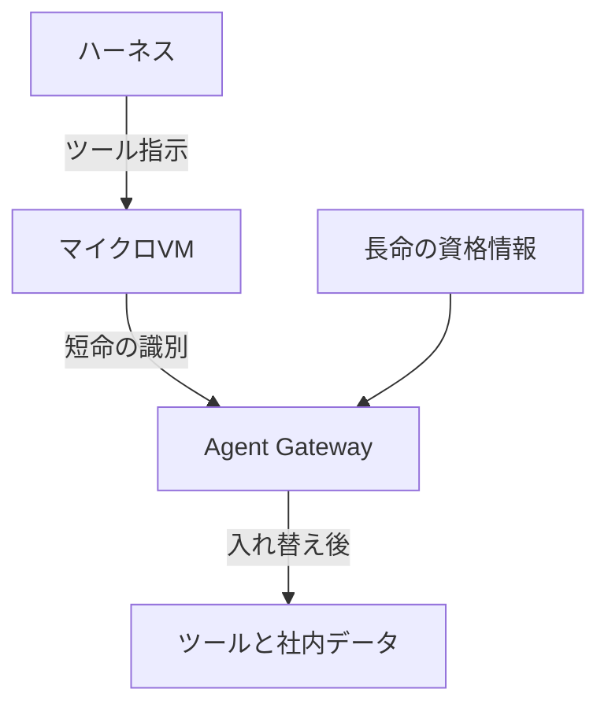

2026年10月22日、Google Cloud は AGNTCon と MCPCon で Agent Compute Engine を発表しました。Gemini の業務エージェントを既に動かしている計算サービスで、エージェントのセッションごとに、ハードウェアで隔離したマイクロVMを渡します。顧客向けは数か月以内のプレビューとして案内され、入口は関心表明のフォームです。同じ発表は、Gemini for business のエージェント統制を、Google Cloud 上の複数ランタイム、他クラウド、管理端末へ広げる計画も示しました。発表文の Gemini for business と、文書上の Gemini Enterprise を同じ製品だと読む根拠は、参照したページにはありません。

統制の部品として名指しされるのは、Agent Gateway、Agent Registry、Agent Identity、OpenTelemetry 準拠の可観測性です。処理中のモデル重みとプロンプトをハードウェアで守る Confidential G4 は、同日に一般提供になった別の記事です。

この記事では、実行の置き場、外への到達と資格情報、処理中のモデル保護が、どの公開文書のどの範囲に書かれているかを追います。読み終わると、今日記録に残せる面と、プレビュー案内を待って見直す面を分けられます。

*この記事の全体像。以下、順に解説します。*

## Agent Compute Engineとは

Agent Compute Engine（以下、ACE）は、ハーネスとサンドボックスを分けます。ハーネスは、モデルを呼び、次の行動を決める側です。サンドボックスは、コード、シェル、ブラウザを実行する側です。サンドボックスは Cloud Hypervisor のマイクロVMで、専用のゲストカーネルと root を持ちます。ホストは、Titanium 上の読み取り専用アプライアンスとして説明されています。

マイクロVMは標準のネットワークインタフェース（NIC）を持ちません。入出力は virtio-vsock から VM 外のプロキシを通ります。Agent Gateway は、その先でユーザー委任、エージェントのアイデンティティ、ノードの証明を見てから、長命の資格情報をマイクロVMの外で、ツール向けの回線へ載せ替えます。Agent Gateway は、外向き通信の前段に置く関門です。

[Inside Agent Compute Engine](https://cloud.google.com/blog/topics/ai-infrastructure/agent-compute-engine-deep-dive)（以下、深掘り記事）がゲストに置かないと書くものは、永続シークレット、OAuth のリフレッシュトークン、クラウドのサービスアカウント鍵、メタデータサーバへの到達です。ゲストに渡すと書くものは、セッション範囲の SPIFFE 証明書と短命の identity token です。用途は、どのサンドボックスがパケットを出したかの識別です。

アイドル時はチェックポイントして、active な計算資源を空けます。メモリはベースイメージを Copy-on-Write で共有します。作業状態の永続化は、特記がなければマイクロVMごとの Hyperdisk です。

Agent Substrate は、同じ「待っているエージェントをスナップショットして密度を上げる」考えを、Kubernetes 上のオープンソース実行系にしたものです。隔離は gVisor（runsc）か、Cloud Hypervisor のマイクロVMかを選びます。gVisor は、マイクロVMと並べるもう一つの隔離です。通常の Linux コンテナは、README が非対応と書きます。gVisor をハードウェア隔離に含めるかは、発表が "strong hardware isolation" の中に書く分類です。GKE では全顧客に非本番として提供され、本番の GA サポートは allowlist（許可された顧客に限る案内）です。上流 README は pre-1.0 で、API と挙動の後方互換を保証していません。Gateway との統合は、これから広げる、という予告です。

SPIFFE は、Agent Identity の文書が主体の標準として名指しするものです。Agent Identity は、その主体をエージェントに付けます。ドキュメントが対応と書くランタイムは、Agent Runtime、Gemini Enterprise、Cloud Run です。Agent Runtime は、同じ文書が Gemini Enterprise Agent Platform Runtime と書く実行面です。Gemini Enterprise は、Agent Runtime と Cloud Run のあいだに並べる別の対応先です。Gateway 概要が現行の Google 管理ゲートウェイ対象として書くのは、Agent Runtime と Gemini Enterprise です。ACE の実行面とは別の名前です。X.509 証明書の有効期間は 24 時間です。Gateway と Gemini Enterprise を併用するとき、エンドユーザーの資格情報は auth manager が暗号化し、Gateway で復号します。

Agent Gateway の概要（2026年10月22日更新）が現在提供と書くのは、Agent Runtime と Gemini Enterprise の Google 管理ゲートウェイです。既定は、明示の IAM 許可が無い接続を拒否します。インスタンスあたり Agent Registry の登録は 5,000 リソースまでです。Agent Registry は、接続先を登録する台帳です。

発表が広げる先として名指しするのは、次です。

- Cloud Run
- Gemini platform の Agent Sandboxes（発表が ACE や GKE と並べて、統制を広げる先に名指しする実行面）
- GKE
- Agent Compute Engine（preview）
- Envoy による他クラウド（preview soon）
- 管理端末上の Claude Code と Antigravity CLI（preview soon）

トークン予算、モデルルーティング、Service Extensions、Ping Identity / SailPoint / Saviynt への委任認可、Cloud Run の Express Link は、今四半期のプレビューとして予告されています。

Confidential G4 は、NVIDIA RTX PRO 6000 Blackwell の G4 における Confidential Computing の一般提供です。Compute Engine の VM と GKE ノードが対象で、36 ゾーンと書かれています。守る対象として書かれるのは、処理中のデータ、モデルパラメータ、プロンプト、生成出力です。ホスト管理者、ハイパーバイザ、クラウドプロバイダからの閲覧に対するハードウェア隔離です。

深掘り記事が書く ACE の経路は、一本です。ハーネスがツールを指示し、マイクロVMが実行し、短命の識別だけを外へ出します。長命の資格情報はマイクロVMの外に置き、Gateway がツールへ転送するときに回線へ載せます。

深掘り記事は、ACE の呼び出し元を四つに分けます。

| 呼び出し元 | 深掘り記事が書く範囲 |
| --- | --- |
| ユーザー | タスク全体の認証に使う。エージェント操作そのものには使わない |
| 委任（on-behalf-of） | 長命な許可は計算ノードの外に置く |
| ワークロードアイデンティティ | サンドボックス通信に乗る。バックエンド API の直接呼び出しには使えない |
| ワークフォースアイデンティティ | エージェントが自分のアカウントを持てる、という一文。発行条件の詳細は同じページに無い |

ログの単位も一つではありません。

- 深掘り記事の監査は、ハーネスが開始したツール呼び出しと、サンドボックス内の計算活動の対応です。
- Gateway の監査は、委任、エージェント、ノードを検証したあとの外向き通信です。
- Agent Identity の監査は、エージェント自身として動いたときと、ユーザーの代理として動いたときの両方を残す、と概要が書きます。
- Substrate の security.md は、サブアクターの系譜記録を Substrate の外、呼ぶ側の責任とします。

## 注意点

密度の倍数は、ACE の一次数値ではありません。2026年10月22日の発表は、Agent Substrate について「traditional compute と比べて最大 10 倍の計算密度」「200,000 エージェントの検証で毎秒 500 起動、suspend と resume は 500ms 未満」と書きます。2026年9月16日の GKE ブログは、同じ 10 倍を「標準コンテナランタイム比」とも「traditional compute 比」とも書き、別段落でホストあたり 1,000 超の休眠エージェントとも書きます。手法、機材、ベースラインの定義は、どちらのブログにもありません。上流 README を 2026年10月23日に取得した自己申告はさらに別です。resume は 400ms 未満、毎秒 1,500 超の起動、デモは約 250 アクターを 8 ポッドへ載せる、と書きます。容量計画に使わず、ベンダー自己申告として読みます。

二次記事は帰属を混ぜえます。

- Crypto Briefing（Diego Almada Lopez、2026年10月22日）は、ACE の copy-on-write の説明の直後に「この方法は 10 倍密度のベンチマークを出した」と Google の主張として書きます。一次の 10 倍は Substrate の節にあります。
- The New Stack（Frederic Lardinois、2026年10月22日）は、10 倍と 200,000 と毎秒 500 と 0.5 秒未満を Substrate の段に置きます。直前の "Similar to Agent Compute Engine" から、同じ密度が ACE にも出ると読める余地が残ります。
- The Decoder（Matthias Bastian、2026年10月22日）は、1 台のサーバに 10 倍のエージェント、20 万体の試験で suspend と resume が 500 ミリ秒未満、と圧縮します。一次が書く毎秒 500 起動は落ち、20 万体の試験全体が 500 ミリ秒で終わったようにも読めます。

「どこでも統制できる」は、発表の計画と、同日更新の製品ドキュメントで範囲が違います。Gateway 概要は、現在の提供を Agent Runtime と Gemini Enterprise に限ります。GKE、Cloud Run、クロスクラウドの行は coming soon で、早期プレビューの申し込みへ誘導します。ACE と Agent Sandboxes の行は表にありません。

トークン管理のページも、冒頭で coming soon と書きます。対応ランタイムの表は GKE と Cloud Run です。適用点は、自プロジェクトの Secure Web Proxy です。Secure Web Proxy は、トークン管理のページが適用点として書くプロキシで、現行の Google 管理ゲートウェイそのものではありません。出力トークンは応答のあとで確定します。そのため、上限に達する前に入った並行リクエストは、その後の 429 より前に maxTokens を超ええます。注記がそう書きます。

Agent Endpoint のページは、まだ使えず、初期 Experimental Preview の計画を説明する、と冒頭に書きます。対象は、Claude Code と Antigravity CLI の OS サンドボックス設定です。macOS は Seatbelt、Linux は bubblewrap または namespaces です。Preview では自前のサンドボックスを同梱しない、と書きます。Windows は計画表にありません。

資格情報についても、強い言い切りは一次の範囲を超えます。深掘り記事は「攻撃者がサンドボックスの中を全部支配しても、盗む資格情報が無い」という設計規則を書きます。同じページは、短命の SPIFFE 証明書と identity token を VM へ渡すとも書きます。Substrate の README は「アクターは証明書を持たない」と「各アクターは短命の SPIFFE 証明書を受け取る」を両方書きます。Zero Ambient Credentials は、既定のサンドボックスを資格情報なしで動かす、という security.md の原則名です。同文書はこれを Met（満たしている）としつつ、識別子、暗号化された資格情報、Substrate の基盤が外で中身を揃えるか復号する非特権トークンは持ってよい、と書きます。ここでの読みは、「長命のユーザー資格情報とサービスアカウント鍵はサンドボックスに置かない」までを一次の範囲とします。

Confidential G4 の性能も自己計測です。非機密の G4 と比べ、g4-standard-48 上の Llama 3、Llama 3.3、Resnet-50、SDXL でスループット低下は 3.5% 未満、と Google が書きます。注記は、特定の試験条件であり構成で変わる、です。遅延 5.2% 増は、同じブログに載った Vertebrae の引用で、試験手順はページにありません。Confidential Space は、同じブログが複数当事者のデータ共有と書く別枠です。coming weeks の一般提供と書かれ、2026年10月22日の G4 の GA 範囲には含まれていません。

顧客と社内の引用は、ベンダーブログ上の発言です。Gemini の Gautham Thambidorai、DeepMind の Clement Farabet、Nous Research の Hervé Bizira、L'Oréal の Alexandre Frizzo です。削減件数や本番台数は書かれていません。

README は pre-1.0 と Quickstart (Development) と書きます。production 非推奨という語そのものは、Status の範囲にはありません。非本番と読める根拠は二つです。GKE ブログが全顧客向けを非本番、本番 GA を allowlist としていること。上流が後方互換を保証しないことです。

Substrate の security.md は、次のように状態を分けます。Met は満たしている、In Progress は着手中、Future は未実装の予定です。

| 項目 | 文書の状態 |
| --- | --- |
| アクター単位の保管時暗号と、復元時の再認可 | Future |
| 削除時の拭き取りと、ノード侵害の爆発半径 | In Progress |
| アクター間認可とクオータ | Future |
| スナップショットのテイント | Future |
| 入口と出口のプロキシ | 今の既定動作。インストール内の全アクターで共有する |
| 動的な egress の取り消し | Met（満たしている） |

これは Substrate の実装状態であり、ACE の契約ではありません。

Agent Identity には運用上の残骸があります。エージェントを削除しても、IAM バインディングは残ります。同じ表示名で作り直してもリソース ID が変わり、古い principal の許可は新主体に付きません。Cloud Storage の legacy bucket role は付与できない、と制限欄が書きます。

2026年10月23日の取得では、ACE の公開ドキュメント、製品ページ、料金、SLA、クォータの URL は、本文として存在しませんでした。`https://docs.cloud.google.com/agent-compute-engine` は HTTP 404 です。`https://cloud.google.com/products/agent-compute-engine` と、その配下の pricing、sla、quotas は HTTP 200 ですが、本文は Page Not Found です。深掘り記事は地理境界を守ると書きますが、顧客が選ぶリージョン表は同じページにありません。アイドル VM は課金しない、という文も料金表が無く、単価は確認できません。

同名に近い別物があります。Compute Engine の Agent for Compute Workloads は、データベース評価用の監視エージェントです。Agent Platform の reasoning engine クォータは別枠です。後者の毎分回数を、ACE の上限として読みません。

NVD の CVE API 2.0 で keywordSearch を 2026年10月23日に再実行しても、ACE または Google Cloud の Agent Gateway を対象とするレコードは返りませんでした。`Agent Compute Engine` は totalResults 5、`Agent Gateway Google` は totalResults 2 です。ヒットは別製品です。例は、Jenkins の Compute Engine プラグイン、GitLab の AI Gateway、Gemini Enterprise Agent Platform の App Builder です。対象が違うレコードの番号を、ACE の脆弱性として転載しません。無いことの証明ではありません。

## 発注側が分ける3つの境界

2026年10月22日に、契約できる製品境界として三つが同時に出た、とは読めません。出ているのは次の三つです。

- ACE の、数か月以内のプレビュー予告と、関心表明フォーム
- Gateway の現行範囲（Agent Runtime と Gemini Enterprise）と、拡張の予告
- 別製品である Confidential G4 の一般提供

G4 の本文は、ACE を処理中保護の層としては接続していません。ACE の本文も G4 に触れていません。関連記事の見出しだけが隣に出ます。

発注側は、ツール実行の隔離、外への到達と資格情報、処理中のモデル保護を、別の行として設計してよい、と一次資料は支えます。Google がこの三つを一つの製品境界として接続した、とはどの本文も書いていません。

支える一次は次です。

- 深掘り記事が、ハーネスとサンドボックス、長命資格情報のオフノード保管、Gateway でのトークン入れ替えを、一つの流れとして書いています。
- Agent Identity の概要が、生のエンドユーザー資格情報をエージェントに渡さず、Gateway で復号する、と書いています。
- Gateway 概要が、許可の無い接続は拒否する、と書いています。今日の提供範囲が Agent Runtime と Gemini Enterprise に限られること自体が、到達制御をまず管理ランタイムに置く判断を支えます。
- Confidential G4 のブログが、処理中の重みとプロンプトを、ホスト管理者とクラウドプロバイダから守る対象として書いています。ACE の深掘り記事は、侵害されたゲストと侵害されたホスト OS から他テナントのボリュームを守る、という別の文を書いています。

同じ結論を弱める一次は次です。

- ACE は数か月以内のプレビュー予告です。公開 API、価格、SLA、リージョン表、クォータ文書は、2026年10月23日の取得範囲にありません。本番のツール実行を今日この製品に移す判断は、文書からは下せません。コード実行の置き場も一本ではありません。端末側の Agent Endpoint は OS サンドボックス設定の配布を計画し、Substrate はマイクロVMか gVisor です。
- 発表の「ランタイム全体へ統制を拡張した」は、Gateway 概要の coming soon と並びます。GKE、Cloud Run のゲートウェイ、他クラウド、端末、トークン予算は、申し込みまたは計画のページです。
- 密度は製品間で数値が一致せず、比較対象の語も揺れます。費用の見込みに使えません。
- 監査の単位が、ハーネス、Gateway、呼ぶ側の系譜に分かれます。一つの証跡で「誰が、何を、途中で拒否されたか」まで揃うとは、一次が書いていません。
- Substrate を先に使う場合、GKE の一般顧客向けは非本番です。上流は互換の保証がありません。security.md の Future 項目（クオータ、アクター間認可、アクター単位の暗号）は、マルチテナントの完成宣言として読めません。

仕分けは次の表です。

| 境界 | 置くもの | 2026年10月23日時点で文書が支える置き場 | 基盤の外に残す判断 |
| --- | --- | --- | --- |
| 実行の隔離 | 生成コード、シェル、ブラウザ、作業ディスク | 今日の契約先としては未公開。設計の先行実装なら Substrate（GKE は非本番、本番は allowlist、上流は pre-1.0） | 本番変更そのもの。サンドボックスが成功したコマンドを、変更管理の承認とみなさない |
| 到達と資格情報 | ツール、社内 API、モデル呼び出し、トークン費用 | 管理ゲートウェイは Agent Runtime と Gemini Enterprise。Agent Identity の対応リストには Cloud Run もある。GKE と他クラウドと端末とトークン予算は coming soon | 権限を新たに足す決裁、規制データの対外送信の最終可否。Gateway は宛先拒否と資格情報の外出しを書くが、人の決裁の代替とは書いていない |
| 処理中のモデル | 重み、プロンプト、生成出力を運用者とクラウド事業者から隠す要件 | Confidential G4（Compute Engine の VM と GKE ノード、36 ゾーンの自己申告）。G4 の本文は ACE と接続していない。Confidential Space は複数当事者のデータ共有として数週間以内の一般提供と予告され、今回の G4 の一般提供には含まれない | ACE のマイクロVMにこの要件を載せない。ACE の文書は別の脅威（ゲスト内の不審コードと、ホスト OS 経由のボリューム横断）を書いている |

## 文書がまだ書いていない問い

次は、2026年10月23日時点の公開文書が書いていない問いです。

- ACE プレビューの開始時期、リージョン、課金単位、SLA、公開 API。深掘り記事の 4 アイデンティティが、Agent Identity ドキュメントの SPIFFE 主体とどう対応するか。
- 実行中のセッションから権限を剥がし、拒否と承認を同じ監査に残す手順が、ACE と Gateway のどちらに実装されるか。一次は未記載です。
- 密度のどれを、どの比較対象で再現するか。200,000 と毎秒 500 と 500ms、README の 400ms と毎秒 1,500、デモの 250 対 8 は、同じ試験ではありません。
- Agent Endpoint が計画する「エージェントプロセス全体の Google 管理サンドボックス」が、OS サンドボックス設定の配布からいつ変わるか。Windows は計画表にありません。
- ワークフォースアイデンティティの発行条件と、ユーザー委任との優先順位。

これらの未知は、境界を三つに分ける設計を止めません。止めるのは、ACE へ本番を載せる時期と、密度を容量計画に入れる時期だけです。

## 直近で記録に残すこと

直近の作業は、次の順です。

1. 既存エージェントを、上の三列に仕分けます。ツール実行がマイクロVM候補、外向きが Gateway 候補、重みとプロンプトが Confidential G4 候補、と印を付けます。
2. 今日ポリシーを強制する面は、Agent Runtime と Gemini Enterprise の管理ゲートウェイに限る、と記録に残します。GKE と Cloud Run のゲートウェイは、early preview の申し込み対象として別行にします。
3. エージェントの廃棄手順に、IAM バインディングの手削除を入れます。再作成時は、新 principal へ許可を付け直します。
4. 密度の 10 倍、200,000、500ms、1,500 回/秒は、見積りの入力にしません。
5. ACE のプレビュー案内が、リージョン、課金単位、アイデンティティの対応表を公開したときに、ツール実行の置き場だけを見直します。

広げる条件は、文書が書き換わったときだけです。

- Gateway の GKE と Cloud Run が、概要ページの coming soon を外れ、同じ IAM と Registry で強制できると書かれたら、到達制御の行をそこへ広げます。
- ACE が公開 API と SLA を持ち、深掘り記事の資格情報モデルと Agent Identity の主体が一つの図で対応したら、ツール実行の契約先を ACE に見直します。
- 密度の再現手順と比較対象が一つに固定されたら、その試験条件の範囲で容量の会話に使います。

## まとめ

ACE は、セッションごとのマイクロVMでツール実行を隔離する計算サービスとして発表されました。顧客向けは数か月以内のプレビュー予告で、関心表明フォームが入口です。今日、管理ゲートウェイとして文書が現行提供と書くのは、Agent Runtime と Gemini Enterprise です。処理中の重みとプロンプトをホスト管理者から隠す要件は、別記事の Confidential G4 が一般提供として書いています。三つは隣の見出しに並びますが、本文同士は接続していません。

密度の 10 倍や起動回数は、比較対象も試験手順も揃っていません。見積りの入力には使いません。エージェントを消しても IAM バインディングは残るので、廃棄手順に手削除と、再作成時の許可の付け直しを入れます。

この記事が少しでも参考になった、あるいは改善点などがあれば、ぜひリアクションやコメント、SNSでのシェアをいただけると励みになります！

## 参考リンク

一次（本文の取得日は 2026年10月23日）:

- [Introducing Agent Compute Engine and expanded agent governance（Google Cloud Blog、2026年10月22日）](https://cloud.google.com/blog/topics/ai-infrastructure/introducing-agent-compute-engine-and-expanded-agent-governance/)
- [Inside Agent Compute Engine（Google Cloud Blog、ページ表記 2026年10月23日）](https://cloud.google.com/blog/topics/ai-infrastructure/agent-compute-engine-deep-dive)
- [Agent Substrate brings high-density, scalable, trusted infrastructure to GKE（Google Cloud Blog、ページ表記 2026年9月16日）](https://cloud.google.com/blog/products/containers-kubernetes/agent-substrate-available-on-gke)
- [Hardware-backed security at global scale: Confidential G4 with NVIDIA Blackwell is GA（Google Cloud Blog、2026年10月22日）](https://cloud.google.com/blog/topics/ai-infrastructure/confidential-g4-gpus-are-ga)
- [Agent Gateway overview（Google Cloud Documentation、Last updated 2026-10-22 UTC）](https://docs.cloud.google.com/gemini-enterprise-agent-platform/govern/gateways/agent-gateway-overview)
- [Agent Identity overview（Google Cloud Documentation、Last updated 2026-10-22 UTC）](https://docs.cloud.google.com/gemini-enterprise-agent-platform/govern/agent-identity-overview)
- [Token management policies overview（Google Cloud Documentation、Last updated 2026-10-22 UTC）](https://docs.cloud.google.com/gemini-enterprise-agent-platform/govern/policies/token-management-overview)
- [Agent Endpoint overview（Google Cloud Documentation、Last updated 2026-10-22 UTC）](https://docs.cloud.google.com/gemini-enterprise-agent-platform/govern/agent-endpoint)
- [agent-substrate/substrate](https://github.com/agent-substrate/substrate)

二次:

- [Diego Almada Lopez, Crypto Briefing, 2026年10月22日](https://cryptobriefing.com/google-cloud-agent-compute-engine-ai-agents/)
- [Frederic Lardinois, The New Stack, 2026年10月22日](https://thenewstack.io/google-agent-compute-engine/)
- [Matthias Bastian, The Decoder, 2026年10月22日](https://the-decoder.com/googles-agent-compute-engine-gives-every-gemini-agent-its-own-hardware-isolated-micro-virtual-machine/)
